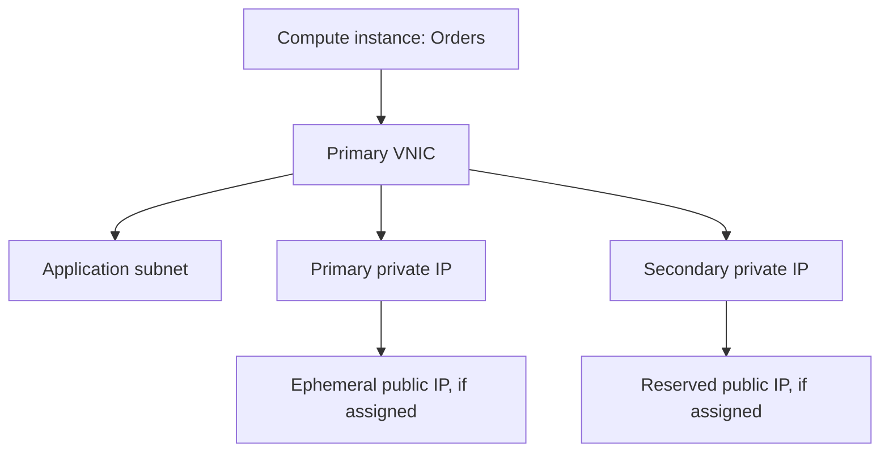

# VNICs, Private IPs, Public IPs, and Reserved Public IPs

## Purpose and Context

In the **Virtual Cloud Networks** chapter of the **CLOUD_PROVIDERS_ORACLE** module, IP addresses must be understood alongside the network objects that own them. When a Java application on OCI Compute fails to receive connections, seeing a public IP in the Console only confirms part of the configuration.

This lesson uses single IPv4 addresses to explain the relationships among a Compute instance, VNIC, private IP, and public IP. From there, you can choose the right address assignment method, check their lifecycles, and prepare for instance replacement or endpoint cutover.

After this lesson, you will be able to:

- Distinguish primary VNICs, secondary VNICs, primary private IPs, and secondary private IPs.
- Explain how a public IP associates with a private IP.
- Choose ephemeral or reserved public IPs according to the required lifecycle.
- Check the conditions required for a service to receive connections from the Internet.
- Inspect IP information via the OCI CLI and reconcile it with in-host configuration.
- Recognize the limitations of IP reassignment when designing for availability.

## 1. Four Concepts Residing at Different Layers

| Concept | Role | Example in a deployment |
| --- | --- | --- |
| VNIC, Virtual Network Interface Card | Virtual network interface connecting an instance to a subnet | Interface of the host running Orders in the app subnet |
| Private IP | Address of an IP object on a VNIC, within the subnet address space | Address the application uses to call an internal database |
| Public IP | Public address object associated with an eligible private IP | Address external users call to reach the host |
| Reserved public IP | A type of public IP whose lifecycle is independent of the attached host | Address retained to reassign to a replacement host |

**A reserved public IP is a type of public IP**, not a new network interface layer. The two types of public IP to distinguish in this lesson are **ephemeral** and **reserved**.

An instance can have multiple VNICs; a VNIC can have multiple private IPs. Therefore, saying "the machine's IP" is not specific enough when troubleshooting or writing automation. You must identify the exact VNIC and the exact private IP object.

### Object Relationships



The diagram shows an illustrative configuration: a public IP is assigned to a **private IP object** associated with a VNIC. A reserved public IP can also be assigned to a primary private IP. [See Public IP Addresses](https://docs.oracle.com/en-us/iaas/Content/Network/Tasks/managingpublicIPs.htm).

You cannot take an arbitrary public IP and manually enter it on the OS interface instead of assigning the object in OCI. In this model, the private address on the machine and the public IP association in OCI must match the actual configuration.

## 2. VNIC: The Instance's Interface in a VCN

### 2.1. The Primary VNIC Is Created with the Instance

When launching a Compute instance, OCI creates and attaches a primary VNIC to the selected subnet. In the IPv4 configuration considered here, the VNIC receives a primary private IP from the subnet. You can specify a valid available address or let OCI choose.

The primary VNIC is tied to the instance lifecycle and cannot be detached like a secondary VNIC. [See Compute instance reference](https://docs.oracle.com/en-us/iaas/tools/oci-cli/latest/oci_cli_docs/cmdref/compute/instance.html).

Attributes to identify when working with a VNIC include:

- The VNIC's OCID.
- The subnet containing the VNIC.
- The MAC address to correlate with the interface inside the OS.
- Primary private IP and secondary private IPs.
- NSGs applied to the VNIC.
- Attributes affecting packet forwarding paths.

Do not rely solely on names like `eth0` or `ens3` in sample documentation. Actual interface names depend on the image and OS configuration; MAC addresses allow accurate correlation.

### 2.2. Secondary VNICs for Separate Network Connections

A secondary VNIC can connect an instance to another subnet, including a subnet in another VCN if supported conditions are met. Account for the availability domain of the instance and subnet; a regional subnet does not turn a VNIC into a resource attachable to a machine in another region.

A secondary VNIC is created as part of the attach operation to an instance. When detached, it is deleted; it does not persist as a spare interface to carry over to another machine. Supported VNIC counts depend on shape. [See Virtual Network Interface Cards](https://docs.oracle.com/en-us/iaas/Content/Network/Tasks/managingVNICs.htm).

One scenario that may require a secondary VNIC is a machine acting as a network appliance between connectivity zones. For typical Java applications, before adding a VNIC, clarify the real need: do you need more addresses in the same subnet, or a connection to a different subnet?

### 2.3. Adding a VNIC and Adding a Private IP Are Two Different Things

| Need | Design approach to consider |
| --- | --- |
| Multiple service addresses in the same subnet | Add a secondary private IP on the existing VNIC |
| Connecting to a different subnet | Consider a secondary VNIC |
| Increasing service availability when one machine fails | Multiple instances and distribution or failover mechanisms |
| Increasing bandwidth | Evaluate shape and network limits; do not assume adding a VNIC increases bandwidth |

If multiple interfaces exist, check OS routes and return paths. A connection entering VNIC A whose response leaves via VNIC B can fail due to asymmetric routing or related control layers.

This is why you should not add multiple VNICs in the same subnet just to "get enough IPs" when secondary private IPs meet the need with a simpler configuration.

## 3. Primary Private IPs and Secondary Private IPs

### 3.1. "Primary" and "Secondary" Are Evaluated Separately at Each Layer

A secondary VNIC still has its own primary private IP:

```text
Instance Orders
├── Primary VNIC, subnet 10.20.1.0/24
│   ├── Primary private IP:   10.20.1.10
│   └── Secondary private IP: 10.20.1.20
└── Secondary VNIC, subnet 10.20.2.0/24
    └── Primary private IP:   10.20.2.10
```

Addresses in this example illustrate structure only, not addresses allocated to an actual tenancy.

The primary private IP is assigned alongside the VNIC. For an instance's primary VNIC, this address remains stable over the machine's lifecycle. A private IP being "secondary" does not mean it resides on a secondary VNIC. [See Private IP Addresses](https://docs.oracle.com/en-us/iaas/Content/Network/Tasks/managingIPaddresses.htm).

### 3.2. Private IPs Serve Internal Communication

Applications can use private IPs to connect to hosts in appropriately routed networks, or to corporate systems over an established private connection. "Private" does not mean every resource in the tenancy is reachable.

A connection from Orders to Oracle Database simultaneously requires:

- The correct database endpoint.
- A network path to the endpoint and a return path.
- Network rules permitting the exact protocol and port.
- The database service being available.
- Appropriate database credentials and privileges.

Similarly, IAM permitting a user to view a VNIC's details does not automatically open network ports to that host. Resource management permissions and application traffic are separate layers.

### 3.3. Secondary Private IPs Must Be Configured in Both OCI and the Host

When adding a secondary private IP, ensure both the OCI object and the OS configuration are ready to use that address.

On Linux, adding an address temporarily changes only current state and may be lost after reboot. Persistent configuration depends on the distribution and network management tool; Oracle documents using appropriate mechanisms such as NetworkManager for relevant Oracle Linux versions. [See Linux configuration for secondary private IPs](https://docs.oracle.com/en-us/iaas/Content/Network/Tasks/managingIPaddresses_topic-Linux_Details_about_Secondary_IP_Addresses.htm).

To observe before making changes, you can use:

```bash
ip -br address
ip route
```

These are inspection commands inside a Linux host. Do not copy interface names or addresses from this lesson into a live system without verification.

Creating an address with an OS command without assigning it to the VNIC in OCI is not a complete private IP assignment workflow. Conversely, having the address in the Console while the OS does not use it properly can also prevent the service from working.

### 3.4. Moving a Secondary Private IP to Another VNIC

A secondary private IP can be moved between VNICs **within the same subnet** via supported OCI operations. This is an IP object move capability, different from moving a primary VNIC or freely moving addresses across any subnet. [See Moving a Secondary Private IP](https://docs.oracle.com/en-us/iaas/Content/Network/Tasks/private-ip-address-move-vnic.htm).

For example, two hosts A and B both have VNICs in subnet `10.20.1.0/24`. The service address `10.20.1.20` can be designed as a secondary private IP, then moved to host B when needed.

Application procedures must still address:

- Does host B already have the corresponding network and service configuration?
- Is host B's data accurate and up to date?
- Has host A stopped serving the old role?
- Do clients need to reconnect?
- Is there health checking and orchestration for the move?

A movable address does not by itself form a complete failover solution.

## 4. Public IPs: A Public Address Alone Is Not Enough for Reachability

### 4.1. Public Subnets Allow Public IP Assignment

For Compute in the model considered here, the VNIC must reside in a public subnet for its private IP to be assigned a public IP. However, not every instance in a public subnet is required to have a public IP.

A host in a public subnet can use only a private IP if no public IP is assigned. Therefore, inspect actual attributes rather than inferring from the subnet name. [See Scenario A: Public Subnet](https://docs.oracle.com/en-us/iaas/Content/Network/Tasks/scenarioa.htm).

If an application needs an internal Oracle Database, one design choice is placing the data tier in a private subnet and allowing connections only from the designated application tier. There is no need for a public IP on the database just so an application in the private network can call it.

### 4.2. Conditions for a Direct Internet Path

For an Internet client to call a service on a Compute instance via a public IPv4 address, verify along this chain:

```text
Client
  -> Public IP assigned to the right target
  -> Internet Gateway and matching route
  -> Permissive network rules
  -> Private IP on the VNIC
  -> OS firewall
  -> Process listening on the right address and port
```

A basic routing configuration typically has a `0.0.0.0/0` route pointing to the Internet Gateway for corresponding outbound traffic. A route does not automatically open all ports into the machine; network rules still govern permitted traffic. [See Internet Gateway](https://docs.oracle.com/en-us/iaas/Content/Network/Tasks/managingIGs.htm).

The chain above applies to a simple setup. If the system has intermediate firewalls, resource-specific routes, or additional protection layers, inspect those components as well.

When diagnosing, specify source, destination, protocol, and port, for example: "the admin host is permitted to connect over TCP to the application port on Orders' public IP." Saying "Internet can't get in" is too broad to pinpoint the cause.

### 4.3. Public IPs Do Not Replace Access Control

Having a public IP does not mean SSH, RDP, or application ports are open. Nor does it mean the service has authentication, encryption, or production-ready configuration.

Security lists and NSGs must be inspected together. Do not assume a narrow NSG overrides a broad allow rule at another layer. [See Security Rules](https://docs.oracle.com/en-us/iaas/Content/Network/Concepts/securityrules.htm).

In hands-on exercises, allow only required source addresses and ports. In real systems, entry point choices also depend on architecture: clients may call a load balancer rather than calling individual app hosts directly.

### 4.4. Private Subnets Can Still Initiate Outbound Connections

An instance without a public IP can still reach the Internet via a NAT Gateway if routes and control layers permit. A NAT Gateway serves connections initiated from the private side and their return traffic; it does not create an entry point for new inbound connections from the Internet to the instance. [See NAT Gateway Metrics and feature description](https://docs.oracle.com/en-us/iaas/Content/Network/Reference/nat-gateway-metrics.htm).

Examples:

- An app host calling out to a package repository via NAT: can be appropriate.
- External clients calling an API on the NAT's public IP to reach the app host: not what NAT Gateway does.
- An app host calling an internal database: needs an appropriate private network path, not public IPs assigned to both just to communicate.

If accessing OCI services such as Object Storage, also distinguish service connection endpoints, IAM permissions, and network path selection. A Compute instance's public IP does not represent every service the application uses.

## 5. Ephemeral and Reserved Public IPs

### 5.1. Brief Comparison

| Feature | Ephemeral public IP | Reserved public IP |
| --- | --- | --- |
| Target private IP | Only the VNIC's primary private IP | Primary or secondary private IP |
| When unassigned | The object is deleted | The address is retained |
| Moving to another target | Cannot be moved | Can be reassigned within the same region |
| Typical purpose | Short-lived test host | Address endpoint to retain across host replacements |

Stopping an instance does not automatically release an ephemeral public IP; the address remains assigned while the instance is stopped. Additionally, an ephemeral public IP cannot be converted to reserved while keeping the same address. [See Public IP Addresses properties table](https://docs.oracle.com/en-us/iaas/Content/Network/Tasks/managingpublicIPs.htm).

The term "ephemeral" here describes object lifecycle. Do not assume every reboot or stop/start must receive a new address.

### 5.2. Ephemeral Fits When the Address Does Not Need Independent Retention

For example, a dev host created to test an application and deleted after the lab session can use an ephemeral public IP if the design permits public access.

When the host is replaced with a new instance, do not assume the old address will be reissued. If DNS, scripts, or partner systems hardcode that address, the replacement procedure must update those dependencies.

An ephemeral public IP can be assigned to an existing primary private IP if conditions are met; the target private IP must not already have another public IP. [See Assigning an Ephemeral Public IP](https://docs.oracle.com/iaas/Content/Network/Tasks/assigning-ephemeral-public-existing-private-ip.htm).

### 5.3. Reserved Decouples the Address from the Serving Host's Lifecycle

You can create a reserved public IP before assigning it to a host. Unassigning returns it to the tenancy's pool of reserved addresses instead of deleting the object. [See Creating a Reserved Public IP](https://docs.oracle.com/en-us/iaas/Content/Network/Tasks/reserved-public-ip-create.htm) and [Unassigning a Reserved Public IP](https://docs.oracle.com/en-us/iaas/Content/Network/Tasks/reserved-public-ip-unassign.htm).

A host replacement plan could look like:

```text
Before change:
Reserved public IP -> Host A private IP -> Current Orders version

Preparation:
Host B has required application, configuration, and data

After cutover:
Reserved public IP -> Host B private IP -> New Orders version
```

A Compute reserved public IP is regional in scope. When planning a shift to resources in another region, another appropriate addressing or entry point strategy is needed; holding an IP in one region cannot serve as a cross-region failover mechanism.

A reserved public IP currently assigned to one private IP does not simultaneously serve as a shared address for multiple hosts receiving the same traffic. If you need to distribute requests across multiple backends, design an appropriate load balancing or orchestration component.

### 5.4. Unassigning and Deleting Are Two Different Operations

| Operation | Outcome to understand | Operational risk |
| --- | --- | --- |
| Unassign reserved public IP | Retains object for reassignment | Traffic entry point is interrupted if no replacement plan is ready |
| Delete reserved public IP | Ends retention of the address object | Do not assume you can reacquire the exact deleted address |
| Unassign ephemeral public IP | Ephemeral address is deleted | Do not use this operation if expecting to move that exact address |

When using infrastructure management tools, check whether the change plan replaces or deletes the reserved public IP object. Wanting to replace only a Compute instance does not mean you want to destroy the address dedicated to the service.

A retained reserved address also needs an owner and a reason for existing. Periodically review unassigned addresses, and check quotas and current pricing before budgeting. Do not treat "unused" as proof that a resource needs no management.

## 6. Reserved Public IPs Support Target Reassignment, Not Automatic Availability

### 6.1. An Orders Service Cutover Scenario

Suppose Orders' public IP is currently attached to host A's private IP. You want to move it to host B.

Before changing the association, verify:

1. Host B is in the right region and its VNIC meets public IP assignment conditions.
2. You selected the exact private IP object on host B.
3. The target private IP does not already have a conflicting public IP.
4. Routes, NSGs, security lists, and host B's firewall permit the intended flow.
5. The application is running and able to handle test requests.
6. Data, configuration, secrets, and certificates match the target environment.
7. A rollback plan to host A is ready if post-cutover checks fail.

OCI supports reassigning a reserved public IP to another private IP; the target address must not already have an assigned public IP. [See Reassigning a Reserved Public IP](https://docs.oracle.com/en-us/iaas/Content/Network/Tasks/reserved-public-ip-reassign.htm).

### 6.2. API Command Success Is Not Service Success

Assign, reassign, and unassign operations for reserved public IPs are asynchronous. Verify object state and association target after the operation. Detaching the old association can succeed while attaching the new target fails. [See OCI CLI public-ip update](https://docs.oracle.com/en-us/iaas/tools/oci-cli/latest/oci_cli_docs/cmdref/network/public-ip/update.html).

After OCI reports the expected state, still send actual requests from the expected client location. A host with the right IP whose Java process only listens on localhost or cannot connect to the database still fails to serve users.

### 6.3. Keeping the Address Does Not Preserve Connection Sessions

When changing targets, existing TCP connections may drop. An IP does not carry application memory, local sessions, unsynchronized files, or transaction state.

For Orders, decide:

- Are sessions stored in a shared store or reconstructible?
- Are in-flight requests drained before cutover?
- Do clients have appropriate retry logic while avoiding duplicate orders?
- Does host B use the same valid data source?
- Who detects failures, decides to cut over, and verifies the result?

Do not use a reserved public IP as the sole evidence that an architecture has high availability.

### 6.4. Moving a Public IP and Moving a Private IP Are Different Options

| Option | What changes | Key constraint |
| --- | --- | --- |
| Reassign reserved public IP | Association from public IP to another target private IP | Target in the same region and meets conditions |
| Move secondary private IP | VNIC owning the secondary private IP | VNICs in the same subnet |

If a reserved public IP attached to a secondary private IP is moved via a supported mechanism, also verify the public IP association afterward. Procedures must verify actual objects, not just address strings.

Which option to choose also depends on whether clients use private or public addresses, subnet layout, and how the application holds state.

## 7. Reading VNIC and IP Information with the OCI CLI

### 7.1. Trace by Object Instead of Searching Only an Address

A useful lookup chain:

```text
Instance OCID
  -> VNIC attachment
  -> VNIC OCID
  -> Private IP OCID
  -> Public IP OCID, if present
```

A VNIC attachment describes attaching a VNIC to an instance. The attachment OCID and the VNIC OCID are two different values; do not mistakenly pass the attachment OCID to `--vnic-id`.

The commands below run on an admin machine with the OCI CLI and a configured profile. They are read-only and do not modify resources:

```powershell
$targetRegion = '<OCI_REGION>'
$instanceCompartmentOcid = '<INSTANCE_COMPARTMENT_OCID>'
$instanceOcid = '<INSTANCE_OCID>'

oci compute vnic-attachment list --profile OCI_LAB --region $targetRegion --compartment-id $instanceCompartmentOcid --instance-id $instanceOcid --all
```

In the output, pick the attachment attached to the desired instance and take the `vnic-id` field. OCI provides the attachment list command to locate an instance's VNICs. [See Listing an Instance's VNICs](https://docs.oracle.com/en-us/iaas/Content/Network/Tasks/managingvnics_tasks-list.htm).

Continue:

```powershell
$vnicOcid = '<VNIC_OCID>'

oci network vnic get --profile OCI_LAB --region $targetRegion --vnic-id $vnicOcid
oci network private-ip list --profile OCI_LAB --region $targetRegion --vnic-id $vnicOcid --all
```

The private IP list per VNIC includes both primary and secondary addresses. When choosing a target to assign a public IP, take the **private IP's OCID**, not the address string or the VNIC OCID. [See OCI CLI private-ip list](https://docs.oracle.com/en-us/iaas/tools/oci-cli/latest/oci_cli_docs/cmdref/network/private-ip/list.html).

### 7.2. Look Up the Associated Public IP

```powershell
$privateIpOcid = '<PRIVATE_IP_OCID>'

oci network public-ip get --profile OCI_LAB --region $targetRegion --private-ip-id $privateIpOcid
```

The `get` command supports lookup by private IP OCID; you can also look up a known public IP by public IP OCID. [See OCI CLI public-ip get](https://docs.oracle.com/en-us/iaas/tools/oci-cli/latest/oci_cli_docs/cmdref/network/public-ip/get.html).

Fields to cross-check include:

| Field | What to verify |
| --- | --- |
| `id` | Matches the managed public IP object? |
| `ip-address` | Matches the address clients use? |
| `lifetime` | Is it `EPHEMERAL` or `RESERVED`? |
| `scope` | Does object scope fit the cutover plan? |
| `private-ip-id` | Attached to the right private IP? |
| `lifecycle-state` | Has the operation completed or is it transitioning? |

The PublicIp model in the OCI SDK separately represents address, lifetime, scope, association target, and state. These are distinct pieces of information that must be checked together. [See PublicIp in OCI Java SDK](https://docs.oracle.com/en-us/iaas/tools/java/latest/com/oracle/bmc/core/model/PublicIp.html).

If the command does not return the expected data, verify region, IAM permissions, OCID, and whether the private IP actually has a public IP. A single API error is not enough to conclude the application's network is broken.

### 7.3. Inspecting the OS and Java Service Side

Inside the Linux host:

```bash
ip -br address
ip route
ss -lnt
```

Cross-check:

- Does the needed private address appear on the right interface?
- Do outbound routes match the source and destination being tested?
- Is the application port in listening state?
- Does the application bind to localhost, a specific private IP, or all appropriate interfaces?

If the Java process only listens on `127.0.0.1:8080`, external clients cannot reach it the way they would a service listening on the VNIC's private IP. Configure the listen address to match the architecture and framework in use.

You can test the internal endpoint actually provided by the application:

```bash
curl --fail --show-error http://127.0.0.1:8080/health
```

`/health` is just an illustrative path; the application needs a corresponding endpoint or you can substitute a known test endpoint. Localhost success only proves the application responds locally, not that external clients can reach it.

The OS may display only the interface's private addresses. Do not take the absence of a public IP in `ip address` as proof that the public IP association in OCI does not exist.

## 8. Hands-On: Create and Reassign a Reserved Public IP in a Test Area

### 8.1. Conditions

Prepare an authorized lab area:

- Two instances A and B in the same region.
- Target VNICs residing in an eligible public subnet.
- Target private IPs verified and free of conflicting public IPs.
- A simple test service on each host returning output distinguishing A and B.
- Routes, network rules, and firewalls allowing the test source to connect.
- IAM permissions to read and manage the required objects.
- A list of resources to keep or clean up after the exercise.

Do not perform the cutover step on an address serving real users. If a target already has a public IP, assess impact before modifying it; do not delete an active address just to make sample commands run.

### 8.2. Create a Reserved Public IP

Commands in this section **modify OCI resources** when executed by the learner. Run after replacing placeholders and verifying profile, region, and compartment.

```powershell
$targetRegion = '<OCI_REGION>'
$publicIpCompartmentOcid = '<PUBLIC_IP_COMPARTMENT_OCID>'

oci network public-ip create --profile OCI_LAB --region $targetRegion --compartment-id $publicIpCompartmentOcid --lifetime RESERVED --display-name 'orders-lab-public-ip'
```

Record the returned OCID and address. The command above creates a reserved public IP without specifying a target private IP; assignment can be done afterward. [See OCI CLI public-ip create](https://docs.oracle.com/en-us/iaas/tools/oci-cli/latest/oci_cli_docs/cmdref/network/public-ip/create.html).

Do not use `display-name` as a unique identifier for automation. Subsequent operations use the confirmed OCID.

### 8.3. Assign to Host A's Private IP

```powershell
$reservedPublicIpOcid = '<RESERVED_PUBLIC_IP_OCID>'
$privateIpAOcid = '<PRIVATE_IP_A_OCID>'

oci network public-ip update --profile OCI_LAB --region $targetRegion --public-ip-id $reservedPublicIpOcid --private-ip-id $privateIpAOcid
oci network public-ip get --profile OCI_LAB --region $targetRegion --public-ip-id $reservedPublicIpOcid
```

Re-check state and `private-ip-id` until output confirms assignment to A. Then, from an authorized test host, call the public address and confirm the response from A. [See Assigning a Reserved Public IP](https://docs.oracle.com/en-us/iaas/Content/Network/Tasks/reserved-public-ip-assign.htm).

You do not need to change application config to bind to the public IP string to complete this step. What needs confirmation is the right private IP, interface, and listen address.

### 8.4. Reassign to Host B's Private IP

Once B serves properly over internal testing:

```powershell
$privateIpBOcid = '<PRIVATE_IP_B_OCID>'

oci network public-ip update --profile OCI_LAB --region $targetRegion --public-ip-id $reservedPublicIpOcid --private-ip-id $privateIpBOcid
oci network public-ip get --profile OCI_LAB --region $targetRegion --public-ip-id $reservedPublicIpOcid
```

Continue polling state until association with B is confirmed complete. If an error occurs or the state is not achieved, halt the cutover procedure and inspect current state before deciding to roll back.

Send a **new request** to the same public address and confirm the response from B. Record observed interruption duration and behavior of open connections. Do not infer results from a browser window that may be using cache or holding an old session.

### 8.5. Result Log

| Moment | Information to record |
| --- | --- |
| Before assign | Public IP OCID, lifetime, state; private IPs A and B |
| After assign A | Association to A, final state, response from A |
| After reassign B | Public address retained, association to B, response from B |
| On error | API output, actual currently assigned object, remediation step |
| Post-exercise | Which objects are kept, unassigned, or deleted per plan |

Do not include secrets, private keys, or tokens in the exercise log.

If you only unassign the reserved public IP, the object remains. If the goal is to end the exercise and no address needs to be kept, clean up according to the confirmed list while verifying no DNS or system still depends on that address.

## 9. Diagnosing Common Scenarios

| Symptom | Hypothesis to check | Evidence to collect |
| --- | --- | --- |
| Console shows public IP but requests time out | Route, gateway, network rules, firewall, return path, or wrong target | IP objects, route configs, rules, and output from client location |
| Connection refused | No listening process or an active rejection layer | `ss -lnt`, app logs, firewall config |
| Localhost works but private IP does not | Bind address or in-host firewall mismatch | Listen addresses and test from another host |
| Private IP works but public IP does not | Public IP association or Internet path misconfigured | Public IP OCID, target private IP, gateway, and routes |
| Secondary IP appears in OCI but unusable | OS config, rules, or source-based routing incorrect | Addresses on interface and routing table |
| After reboot, secondary IP gone from OS | Configuration was added only temporarily | Persistent network config and post-boot state |
| Reserved IP moved but application still fails | Assignment incomplete, service B not ready, or missing app state | Lifecycle state, target link, new request, and B logs |
| Expected reserved IP not found | Wrong region, compartment, permissions, or object deleted | OCID in records and comparative lookup output |

These symptoms are hints, not the sole conclusion. For instance, timeouts can come from multiple layers; do not open all network rules just to make a connection succeed.

An effective approach is testing from the inside out:

1. Does the process respond locally?
2. Is the private IP right on the VNIC and inside the host?
3. Can authorized internal clients call it?
4. Does the public IP point to the right private IP?
5. Are the Internet path and permissive layers right?
6. Does DNS return the right address and is the client using fresh results?

Ping succeeding or failing does not prove whether the application port works or is blocked. Test the exact protocol and port used by the application.

## 10. Choosing Addressing Based on Application Needs

| Need | Selection direction |
| --- | --- |
| App calling internal database | Private IP or internal service name, with matching network path and permissions |
| Short-lived dev machine needing direct external access | Consider ephemeral public IP within a controlled lab scope |
| Keeping an address across Compute instance replacement | Consider reserved public IP and a target cutover procedure |
| Multiple backends serving the same service | Design an appropriate entry point and load balancing |
| Private machine needing outbound Internet | Consider a NAT Gateway instead of assigning public IPs to each host |
| Private service endpoint needing move between two hosts in same subnet | Consider secondary private IP with orchestration |
| Failover to another region | Design an entry-point switching mechanism suitable for multiple regions |

For production applications, evaluate addresses by service role rather than binding a fixed IP to individual hosts. A stable entry point must go together with monitoring, recoverability, configuration management, and data governance.

In automation, manage a reserved public IP as an object with its own lifecycle if it must survive instance replacements. Before applying a plan, inspect closely whether the IP object is being kept, reassigned, or deleted.

## 11. Self-Check Questions

1. Is the primary private IP of a secondary VNIC a secondary private IP?
2. Which object is a Compute public IP directly associated with?
3. Does an instance in a public subnet without a public IP receive direct Internet connections via an Internet Gateway in this model?
4. What layers still need checking after assigning a public IP?
5. Why is a NAT Gateway not an entry point for receiving Internet APIs into a private host?
6. Does stopping an instance automatically release an ephemeral public IP?
7. Can an ephemeral public IP be converted to reserved while keeping the same address?
8. In what scope do moving a secondary private IP and reassigning a reserved public IP differ?
9. Why should you read state after a reserved public IP reassignment command?
10. Does retaining a public address preserve application sessions and data?
11. When no public IP appears in Linux's address list, what should you verify before concluding?
12. When replacing a host via automation tools, how do you avoid accidentally deleting a reserved public IP that should be kept?

Understanding the owning objects and address lifecycles properly helps you choose the right IP assignment method, trace connectivity failures, and build verifiable service cutover procedures on OCI.
