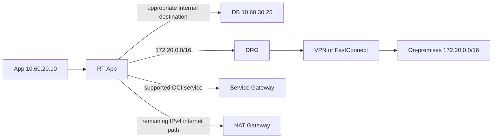

# Route Tables and the Packet Path Determination Process

In the **Virtual Cloud Networks** chapter of the **CLOUD_PROVIDERS_ORACLE** module, route tables help determine the next hop for a packet at a routing point. To explain why Compute can reach Object Storage, an Oracle database, or an on-premises network, you must identify the effective table, the selected route, and the return path.

This lesson builds an end-to-end analysis process from source to destination, combining OCI routing with the operating system, access control, and observability tools. The examples support designing authorized infrastructure, automating network changes, maintaining availability, and controlling transfer costs.

## Learning Objectives

After this lesson, you will be able to:

- Read a route rule and explain its destination, prefix, and target.
- Determine the effective route table when configurations exist at the subnet, VNIC, or IP level.
- Select a route using longest prefix match, including when implicit local routes exist.
- Trace a flow through a NAT Gateway, Service Gateway, or DRG in both directions.
- Distinguish missing routes from security rule, OS, DNS, and application issues.
- Collect evidence before modifying routing configurations.

## 1. What Question Does a Route Table Answer?

A route rule can be read in the form:

```text
If the destination address belongs to this address set
→ forward the packet to the corresponding target at the current routing point.
```

Example:

| Destination | Illustrative target | Meaning |
| --- | --- | --- |
| `172.20.0.0/16` | DRG | Forward traffic to this network via the DRG |
| `0.0.0.0/0` | NAT Gateway | General IPv4 path for eligible traffic going through NAT |
| Service CIDR label of an OCI service | Service Gateway | Route to the set of endpoints supported by the service |

Target names in the tables in this lesson are human-readable labels. When configuring via API or IaC, use the identifier and target type required by the respective interface; do not replace an OCID with a string like `DRG-ERP` just because it is a display name.

A TCP packet can be described by five values:

```text
Source IP, source port, destination IP, destination port, protocol
```

Example: `10.60.20.10:51000 → 172.20.8.40:1521/TCP`. The destination IP is used for prefix matching; port 1521 and protocol TCP are also needed for security rules, firewalls, and applications. Actual database ports must be obtained from the deployed service; do not assume every Oracle Database uses this example configuration.

Having a routing path is not enough for a successful connection. A return path, permissive control layers, and a ready destination process are also required.

## 2. Select the Right Table Before Selecting a Route

### 2.1. OCI Route Tables Differ from Host Route Tables

A Compute instance has an OS routing table. That table decides which interface, source address, and local gateway are used. After the packet passes through the VNIC into the OCI network, OCI routing configurations further determine the path.

Therefore, a route command inside Linux does not reveal every decision made by a DRG or NAT Gateway. Conversely, seeing the right route table in the Console does not prove the application sent packets out the right VNIC.

On a host with multiple VNICs or multiple source addresses, record the actual source IP. An application binding to a different address may cause a different OCI table to be applied.

### 2.2. Table Selection Priority for Traffic Originating from a Resource

OCI supports per-resource routing. The table selection priority order is:

```text
Route table attached to the source IP
        ↓ if none
Route table attached to the VNIC
        ↓ if none
Route table of the subnet
```

Only one table in this chain is chosen; tables are not merged. If the IP's table is selected, a missing route in that table does not cause OCI to fall back and look in the subnet table. See the Per-resource Routing section in [VCN Route Tables](https://docs.oracle.com/en-us/iaas/Content/Network/Tasks/managingroutetables.htm).

Standalone example of table selection:

| Component | Configuration |
| --- | --- |
| App Subnet | Uses `RT-App`, has route to on-premises |
| VNIC A | Attached `RT-Restricted`, no route to on-premises |
| IP `10.60.20.10` on VNIC A | No separate table attached |

Traffic from this IP uses `RT-Restricted`. A correct route in `RT-App` will not fix the problem if that table is being bypassed. Before adding rules, confirm which table is actually effective.

### 2.3. Default Route Table vs. Default Route

| Term | Meaning |
| --- | --- |
| Default route table | The default table created by the VCN; subnets can use it if no other table is selected |
| IPv4 default route | Rule with destination `0.0.0.0/0` |
| IPv6 default route | Rule with destination `::/0` |

A table name containing the word `default` does not guarantee it has a rule to the Internet. Likewise, a custom-created table can still contain a default route. When reading configurations, check actual rules and associations rather than inferring from the display name.

## 3. Selecting a Route: The Most Specific Prefix Wins

### 3.1. Longest Prefix Match

For a given destination address, multiple prefixes may match. A longer prefix describes a smaller address set and takes precedence.

The following standalone illustrative table assumes targets have been validly prepared:

| Destination | Target |
| --- | --- |
| `0.0.0.0/0` | NAT Gateway |
| `172.20.0.0/16` | DRG |
| `172.20.8.0/24` | Appliance private IP |
| `172.20.8.40/32` | DRG |

Conclusions derived from the table:

| Destination IP | Matching prefixes | Selected route |
| --- | --- | --- |
| `172.20.9.10` | `/0`, `/16` | `/16 → DRG` |
| `172.20.8.41` | `/0`, `/16`, `/24` | `/24 → appliance` |
| `172.20.8.40` | `/0`, `/16`, `/24`, `/32` | `/32 → DRG` |
| `198.51.100.40` | `/0` | `/0 → NAT Gateway` |

`198.51.100.40` is a documentation-example address, not an Internet endpoint for running tests. The rows above are a prefix analysis exercise; they do not prove the target can process traffic to the destination.

A `/32` host route can send one host along a different path from the rest of its `/24` network. If the `/24` was intended to force traffic through a security inspection point, that host route can defeat the intent. When reviewing changes, check for more specific prefixes too.

Do not read the table with a "stop at the first matching row" rule. Rule display order does not override longest prefix match.

### 3.2. Implicit Local Routes

A VCN has local routing to forward traffic within the VCN without requiring users to create individual rules. Implicit local routes do not necessarily appear as user-configured rows.

You can create static routes to alter paths between subnets. When a prefix has the same length and same destination as a local route, the static route takes precedence according to OCI rules. However, traffic to an IP in the source VNIC's own subnet is forwarded directly; intra-subnet routing cannot be used to force it through an appliance. See Intra VCN Routing in [VCN Route Tables](https://docs.oracle.com/en-us/iaas/Content/Network/Tasks/managingroutetables.htm).

Examples in VCN `10.60.0.0/16`:

- App `10.60.20.10` to DB `10.60.30.25`: has a default local path between the two subnets unless a static route has been configured to alter that path.
- App `10.60.20.10` to host `10.60.20.50` in the same subnet: do not rely on intra-VCN routing design as a way to force traffic through a firewall in another subnet.
- A `/0` default route to NAT does not mean all internal traffic goes out to NAT; local routes and more specific routes must be evaluated.

### 3.3. Missing Route vs. Non-Functioning Target

Distinguish two cases:

1. No matching route for a destination outside local scope: packets have no forwarding path at that point.
2. A route is selected, but the target or downstream hop cannot handle it: the path still fails.

For example, if a `/24` rule is selected to go through a stopped firewall VM, do not assume the `/16` rule acts as an automatic backup path. Longest prefix match is a route-selection rule, not an application health check that automatically finds a working path.

If HA is needed for an appliance, there must be an appropriate redundancy and target-failover mechanism, along with checks for how existing connections recover.

## 4. Building the Practice Model

### 4.1. Addresses and Components

Illustrative IPv4 model:

| Component | Address or range |
| --- | --- |
| VCN | `10.60.0.0/16` |
| Public Subnet | `10.60.10.0/24` |
| Private App Subnet | `10.60.20.0/24` |
| Private DB Subnet | `10.60.30.0/24` |
| Inspection Subnet, for advanced section | `10.60.40.0/24` |
| App | `10.60.20.10` |
| DB | `10.60.30.25` |
| On-premises network | `172.20.0.0/16` |
| On-premises target host | `172.20.8.40` |

The basic model does not attach separate route tables to VNICs or IPs. The advanced section will intentionally alter this assumption.



The diagram shows the model's intended paths; it does not yet depict all security rules, connection state, and return paths.

### 4.2. Assigned Tables in the Basic Model

| Table | Attached to | User-configured routes |
| --- | --- | --- |
| `RT-Public` | Public Subnet | `0.0.0.0/0 → IGW`; `172.20.0.0/16 → DRG` |
| `RT-App` | App Subnet | `0.0.0.0/0 → NAT`; `172.20.0.0/16 → DRG`; appropriate service CIDR label `→ SGW` |
| `RT-DB` | DB Subnet | `172.20.0.0/16 → DRG`; appropriate service CIDR label `→ SGW` |

These tables still have VCN local routing behavior; the table above lists only user-configured rules. `RT-DB` is designed without an IPv4 Internet default route. To add an update or backup path, identify the required endpoints and paths first.

Routes in this lesson are only part of the configuration. Gateways must exist and be configured properly; the DRG needs attachments and routing; control layers and the destination service must meet requirements.

## 5. Analyzing Each Path Type

### 5.1. App to DB in the Same VCN

In the basic model:

```text
10.60.20.10 → VCN local routing → 10.60.30.25
```

Reasoning steps:

1. The application chooses to connect to the DB's exact IP and port.
2. The OS sends via the identified interface and source IP.
3. With no separate table on the IP or VNIC, `RT-App` is used.
4. The destination belongs to the VCN; with no static route overriding the internal path, local routing is used.
5. Check security rules, host firewall, and database listener.
6. Analyze the DB-to-App return direction per the DB's source configuration.

When the DB is unreachable, adding `0.0.0.0/0 → NAT` to `RT-App` usually does not address the cause of this internal flow. First inspect the local path, custom internal routes, and access controls.

### 5.2. Private App Initiating Outbound Internet Connections

Assume the destination is an actual IPv4 endpoint the learner is authorized to test, outside the local VCN, on-premises network, or selected OCI service set:

```text
Private App → RT-App → NAT Gateway → internet endpoint
                     ← connection return traffic ←
```

A NAT Gateway lets resources without a public IP initiate outbound Internet connections and receive responses; it does not create a path for arbitrary Internet clients to open new connections into the App. Also verify whether the gateway is permitting traffic. See [NAT Gateway](https://docs.oracle.com/en-us/iaas/Content/Network/Tasks/NATgateway.htm).

If a private subnet only has `0.0.0.0/0 → IGW`, do not conclude the instance can reach the Internet directly. Verify subnet type, IP addresses, routes, and IGW path conditions. A rule does not turn a private subnet into a public one.

### 5.3. App to Object Storage via Service Gateway

For supported endpoints in the same region belonging to the configured service CIDR label:

```text
App → route to service CIDR → Service Gateway → OCI service
```

A Service Gateway uses a service CIDR label representing a set of endpoint addresses; it is not a rule matching hostnames for arbitrary Oracle websites. The gateway supports listed Oracle services for the same region. A service endpoint with a public address can still be accessed over an appropriate Service Gateway path without traversing the Internet. See [Access to Oracle Services: Service Gateway](https://docs.oracle.com/en-us/iaas/Content/Network/Tasks/servicegateway.htm).

When `RT-App` has both a Service Gateway route and a NAT default route, check the actual destination IP and label scope rather than concluding traffic always takes NAT because DNS returns a public IP.

Network reachability to the endpoint also does not confirm the user or principal is permitted to read the bucket. An HTTP response from the right endpoint helps separate having reached the HTTP server from whether the API request is valid or authorized.

### 5.4. App to On-Premises via DRG

Intended path:

```text
App → RT-App → DRG's VCN attachment
    → DRG route table applied when packet enters DRG
    → hybrid connection attachment → on-premises network → target host
```

There are two types of tables easily confused:

| Table | Decision |
| --- | --- |
| Source VCN route table | Sends traffic to the DRG or another target |
| DRG route table attached to the ingress attachment | Selects the egress attachment within the DRG |
| VCN ingress route table of the VCN attachment, if configured | Selects path when traffic enters the VCN from the DRG |

The DRG performs lookup using the table attached to the attachment through which the packet enters the DRG. Route distributions can import dynamic routes into the table. A VCN attachment also has VCN ingress routing configuration, distinct from the DRG route table. See [Dynamic Routing Gateways](https://docs.oracle.com/en-us/iaas/Content/Network/Tasks/managingDRGs.htm).

For App `10.60.20.10` connecting to `172.20.8.40`, trace both directions:

| Direction | Analysis point | What must be confirmed |
| --- | --- | --- |
| Outbound | `RT-App` | `172.20.0.0/16` goes to DRG, not diverted by a more specific route |
| Outbound | DRG, packet entering via VCN attachment | Appropriate route exists to the hybrid attachment |
| Outbound | On-premises routers and network | Path exists from connection termination to host `172.20.8.40` |
| Return | Target host and on-premises routers | Route exists to source network `10.60.20.0/24` or covering prefix |
| Return | DRG, packet entering via hybrid attachment | This attachment's table has a route to the VCN attachment |
| Return | VCN ingress routing and remainder | Delivers traffic back to App, via inspection if design requires |

Do not mechanically use the VCN attachment's DRG table to infer both directions. When packets enter from hybrid, the applicable table may differ.

Similarly, the DRG having learned a prefix over BGP does not prove `RT-App` has a rule directing traffic to the DRG. Both layers must be checked. Examples of this relationship are presented in [Learn About Dynamic Routing Gateway Solutions](https://docs.oracle.com/en/solutions/learn-about-drg-solutions/index.html).

## 6. Packet Path Determination Process

The process below is a logical analysis method to verify each condition. It does not describe the internal processing order of OCI networking hardware.

### Step 1: Pin Down the Flow to Test

Explicitly record:

```text
Timestamp: test time and timezone
Source: actual source IP, VNIC, subnet, VCN, region
Destination: hostname and actual IP used
Protocol: TCP / UDP / ICMP or other type
Ports: source port and destination port if applicable
Direction: request and response
Expected: intended path, including inspection point if mandatory
```

If starting from a hostname, verify the DNS result from the source machine itself. Check whether the client uses IPv4 or IPv6 and whether a proxy exists. If the application connects to a proxy, the first hop to analyze is to the proxy; do not use the final server's IP as that hop's destination.

### Step 2: Identify the OS Decision

Inspect interfaces, source IP, local routes, and policy routing if any. Pay special attention to hosts with multiple VNICs, containers, tunnels, or in-host VPNs.

Example on Linux, run in an authorized test environment:

```bash
ip -br address
ip route get 172.20.8.40
ip rule show
```

These commands help determine the source host's decision. Output does not list the full path through OCI virtual gateways.

On Windows, inspect configuration and test the exact port:

```powershell
Get-NetIPConfiguration
Get-NetRoute -AddressFamily IPv4
Test-NetConnection -ComputerName '172.20.8.40' -Port 1521 -InformationLevel Detailed
```

Only use the example address if it is actually a destination in your lab. `TcpTestSucceeded=False` is a signal requiring further investigation; by itself it does not distinguish a route issue from a listener issue.

### Step 3: Identify the Effective Association in OCI

Check source IP, VNIC, and subnet in order. Record the OCID of the selected table and why. If two machines in the same subnet behave differently, this is one of the first points to compare.

Distinguish not seeing a table due to lacking read permissions from the resource having no separate table attached. Do not treat these two cases as the same.

### Step 4: List Candidate Routes

For the pinned destination IP:

1. Evaluate configured rules in the effective table.
2. Evaluate VCN local routing where applicable.
3. Identify applicable prefixes or service destinations.
4. Select the route by the applicable rules, recording destination and target.
5. If no matching path exists, stop here and document which condition is missing.

Do not add a default route before understanding why existing routes do not apply. For IPv6, evaluate IPv6 prefixes and supported gateways separately; `0.0.0.0/0` applies only to IPv4.

### Step 5: Check Target and Next Hop

Verify whether the target is the right resource, VCN or attachment, and in the required state. If the target is:

- **NAT or IGW:** verify conditions of the Internet path in use.
- **Service Gateway:** verify endpoint, region, and supported service set.
- **DRG:** continue inspecting the ingress attachment's table and the hybrid or peering path.
- **Appliance private IP:** inspect VNIC forwarding, OS, firewall, and the table applied to the appliance.

Each target is only the next step. A rule pointing to a DRG does not guarantee the on-premises network has a path to the destination.

### Step 6: Cross-Check Traffic-Permitting Layers

Check security lists, NSGs, any additional protection mechanisms in use, OS firewalls, and appliance policies. For TCP connections, also check whether the service is listening on the right address/port and accepting clients.

IAM permissions to edit a route table differ from the ability to pass packets between two hosts. Someone may view or configure networking yet lack permission to call the target service's data APIs.

### Step 7: Repeat for the Return Direction

Swap source and destination roles at each hop, accounting for whether NAT or a proxy altered connection metadata. Check stateful or stateless layers per actual configuration.

The return path does not necessarily traverse the exact same devices as the outbound path. When stateful firewalls are present, asymmetry can cause connections to fail or bypass intended inspection points. Therefore, verify architectural symmetry requirements, not just individual routes in isolation.

### Step 8: Collect Evidence and Identify Missing Conclusions

For each point, clearly record:

| Point | Configuration evidence | Operational evidence |
| --- | --- | --- |
| Source host | Interface, IP, and local routes | Test result with exact protocol/port |
| VCN | Associations and effective rules | NPA, Flow Logs in enabled scope |
| DRG/hybrid | Per-attachment tables and learned routes | Connection status and relevant telemetry |
| Appliance | Forwarding, policies, and routes | Session logs or authorized packet capture |
| Target host | Listener and firewall | Connection acceptance logs or responses |

If evidence is still missing at a hop, state that explicitly. Do not turn assumptions like "packets probably reached the DB" into an operational conclusion.

## 7. Collecting Configuration with the OCI CLI

The commands below are read-only examples for learners. They assume an `ORACLE_LAB` profile and read permissions on the relevant resources. Replace placeholders with actual OCIDs:

```powershell
oci network subnet get --subnet-id 'REPLACE_SUBNET_OCID' --profile ORACLE_LAB
oci network vnic get --vnic-id 'REPLACE_VNIC_OCID' --profile ORACLE_LAB
oci network private-ip get --private-ip-id 'REPLACE_PRIVATE_IP_OCID' --profile ORACLE_LAB
oci network route-table get --rt-id 'REPLACE_EFFECTIVE_ROUTE_TABLE_OCID' --profile ORACLE_LAB
```

Goal of each step:

- `subnet get`: retrieve route table association and subnet details for comparison.
- `vnic get`: verify the source's actual VNIC and related configuration.
- `private-ip get`: verify the exact IP object, especially when using secondary addresses or per-resource routing.
- `route-table get`: read the table determined to be effective rather than assuming the subnet table is always used.

Check syntax in [Subnet Get](https://docs.oracle.com/en-us/iaas/tools/oci-cli/latest/oci_cli_docs/cmdref/network/subnet/get.html), [VNIC Get](https://docs.oracle.com/en-us/iaas/tools/oci-cli/latest/oci_cli_docs/cmdref/network/vnic/get.html), [Private IP Get](https://docs.oracle.com/en-us/iaas/tools/oci-cli/latest/oci_cli_docs/cmdref/network/private-ip/get.html), and [Route Table Get](https://docs.oracle.com/en-us/iaas/tools/oci-cli/latest/oci_cli_docs/cmdref/network/route-table/get.html).

In diagnostic reports, keep relevant OCIDs for reference and strip unrelated sensitive data. There is no need to share private keys or CLI authentication config files.

## 8. Using Analysis and Observability Tools Appropriately

### 8.1. Network Path Analyzer

Network Path Analyzer analyzes routing and security configurations to infer the path between source and destination; it does not send live traffic. It is useful for finding missing routes or misaligned security conditions. Displayed results also depend on permissions to view entities along the path. See [Network Path Analyzer](https://docs.oracle.com/en-us/iaas/Content/Network/Concepts/path_analyzer.htm).

Recommended workflow:

1. Select the exact source IP/VNIC and destination IP.
2. Enter the exact protocol, port, and endpoint attributes for the scenario.
3. Analyze the return direction as well when needed.
4. Expand hop-by-hop details to inspect routes and security status.
5. Compare results against live tests and target-host data.

A valid configured path does not prove the application is healthy, the listener is open, or clients resolve domain names as intended. Combine analysis output with operational evidence rather than replacing all live tests with it.

### 8.2. VCN Flow Logs

Flow Logs can record traffic accepted or rejected against VCN security rules within the enabled scope. Cross-check IP, port, protocol, timestamp, and VNIC with the flow under test. See [Details for VCN Flow Logs](https://docs.oracle.com/en-us/iaas/Content/Logging/Reference/details_for_vcn_flow_logs.htm).

When reading results:

| Observation | Appropriate conclusion |
| --- | --- |
| `REJECT` matching the flow at a point | Investigate related security configuration at that observation point |
| `ACCEPT` matching the flow | Traffic was accepted at that point; does not yet prove the target app processed it successfully |
| No logs found | Check log enablement scope, filters, time range, and collection conditions before concluding no packets existed |
| Outbound traffic seen but no response | Continue checking destination, return path, and other observation points |

Account for configured sampling rates and traffic types not logged. Enable only the observation level needed for the investigation scope, and manage read access and retention to control both data exposure and cost.

### 8.3. Ping and Traceroute

Ping tests ICMP; it does not replace TCP tests to database or HTTPS ports. Traceroute also does not guarantee listing every logical component in a virtual network. Asterisks (`*`) may relate to no reply to probes; on their own they do not prove a route table is wrong.

A good conclusion specifies which probe failed and which conditions remain unverified. For example: "TCP to DB port failed; NPA indicates the DRG hop lacks a return route to the VCN" is more specific than "network broken because ping failed."

## 9. Two Advanced Scenarios

### 9.1. Same Subnet Yet One IP Cannot Reach On-Premises

Assumptions:

- App Subnet still uses `RT-App`, which has `172.20.0.0/16 → DRG`.
- A secondary IP on the VNIC is attached to `RT-IP-ServicesOnly`.
- `RT-IP-ServicesOnly` only has routes to Service Gateway, with no route to on-premises or default route.

When the application uses that secondary IP as source, lookup must start at `RT-IP-ServicesOnly`. Editing `RT-App` will not change that table selection. After identifying the cause, choose to update the IP's table or remove the separate association per the agreed design.

Review other flows before changing associations: the secondary IP may be intentionally restricted to serve a dedicated task.

### 9.2. Forcing App and DB Through an Appliance in a Separate Subnet

Assume an appliance with private IP `10.60.40.10` in the Inspection subnet is prepared for forwarding. Add illustrative rules:

| Source's table | Destination | Target |
| --- | --- | --- |
| `RT-App` | `10.60.30.0/24` | Appliance private IP |
| `RT-DB` | `10.60.20.0/24` | Appliance private IP |
| Effective table of appliance | Paths to App and DB | Appropriate local routing, not looping traffic back to the appliance itself |

Intended path:

```text
App → appliance → DB
App ← appliance ← DB
```

Here, `/24` prefixes create static routes more specific than the `/16` VCN local path. Both source subnets are configured so outbound and return paths traverse the appliance.

For a traffic-forwarding appliance, configure the VNIC to skip source/destination check where forwarding is needed and enable IP forwarding in the OS. Also verify firewall, routes, and machine state. Do not disable this check across all VNICs just to troubleshoot. See [Virtual Network Interface Cards: Source/Destination Check](https://docs.oracle.com/en-us/iaas/Content/Network/Tasks/managingVNICs.htm).

In API configuration, a private IP target is a private IP object with an OCID; `10.60.40.10` in the table is illustrative only. The target must satisfy OCI requirements, including relationship with the route table's VCN.

If DB and App are in the same subnet, do not use this intra-VCN routing pattern to claim traffic between them is forced through an appliance. Design segmentation and controls appropriate to the requirement.

For traffic entering from a gateway, gateway ingress routing must also be considered. Changing only subnet route tables may be insufficient to route inbound traffic through an inspection point. When implementing transit patterns, also consult [Transit Routing inside a hub VCN](https://docs.oracle.com/en-us/iaas/Content/Network/Tasks/transitrouting.htm).

## 10. Diagnosing by Symptom

| Symptom | Hypothesis to test | Evidence to gather |
| --- | --- | --- |
| All non-VCN traffic fails | No matching route, wrong association, or gateway issue | Effective table and target state |
| Only one secondary IP fails | IP uses a separate table or OS selects another path | Private IP object and host routes |
| Only one sub-range takes the wrong path | A more specific prefix exists | Candidate route list for that exact destination IP |
| Internet works, on-premises fails | Missing DRG/hybrid path or return path | Both per-attachment tables and on-premises routes |
| One OCI service works, another endpoint fails | Different Service Gateway scope, region, or API permissions | Destination IP, service label, and actual response |
| TCP starts but session never completes | Return path, stateful firewall, or listener | Session logs, bidirectional path, and app logs |
| After changing default table, only a few hosts still fail | Separate table or host uses a different VNIC | IP/VNIC associations and actual source metadata |
| After stopping appliance, specific flow loses connectivity | Specific route still points to non-forwarding target | Selected route and appliance health |

When discovering overlapping prefixes across VCN, on-premises, or VCN peering, revisit the address plan and connectivity design. Do not add broad summary routes to mask conflicts without determining how to distinguish destinations.

## 11. Safe and Verifiable Route Changes

One table can be used by many resources, so changing a rule may affect more than the single host under investigation. Before modifying:

1. Record the current table, associations, rules, and list of impacted resources.
2. State which flows should change paths and which must continue working.
3. Analyze longest prefix match before and after, for both outbound and return directions.
4. Assess capacity, availability, and access permissions of the new target.
5. Prepare a rollback method for associations and rules if results fall short.
6. Test the change in an appropriate environment before widening scope.
7. Gather post-change results, and update IaC configs and operational records.

Do not equate deleting a default route with blocking all paths: local routes, more specific routes, or separate tables may still provide paths. Likewise, adding a default route does not prove all destinations are reachable.

If rerouting through an appliance, NAT, or hybrid path, assess impact on existing sessions. Account for costs based on targets, forwarding resources, data transfer, and actual logging; route choices must also align with performance and data governance requirements.

## 12. Practice Analysis Exercise and Expected Outcomes

In a lab prepared according to the basic model, perform step by step:

1. Identify App's effective table using IP, VNIC, and subnet details.
2. Analyze App to DB using private addresses, recording candidate routes and the return path.
3. Analyze App to on-premises via DRG, specifying the applicable table for each ingress attachment.
4. Analyze App to an OCI endpoint supported by Service Gateway.
5. Analyze App to an authorized test Internet endpoint via NAT Gateway.
6. Within an isolated lab scope, attach a restricted table to an IP and observe the effect of no fallback to the subnet table.
7. If an appliance exists, verify the path through inspection in both directions and the designed redundancy mechanism.

Result recording template for each flow:

| Attribute | Content to record |
| --- | --- |
| Flow | Source IP, destination IP, port, protocol, and timestamp |
| Table selection | Which IP/VNIC/subnet provides the effective table |
| Route selection | Selected prefix or service destination, target, and rationale |
| Next hop | Table/attachment/device to inspect next |
| Return path | Routes and response conditions |
| Security | Related permissive or restrictive layers |
| Evidence | Configurations, NPA output, logs, and live test results |
| Conclusion | Success, identified failure point, or what still lacks sufficient evidence |

The goal is to explain the decision at each point and prove required connectivity works. The core skill is consistently answering three consecutive questions: **which table applies, which route is selected, and have the next hop and return path been verified?**
