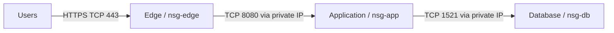

# Security Lists and Network Security Groups

## Lesson Objectives

In Oracle Cloud Infrastructure (OCI), route tables determine packet forwarding paths, while security rules determine what traffic is permitted through a resource's network interface. A VM with the right IP address and path can still fail to connect if a rule is missing. Conversely, a broad rule does not guarantee a service is reachable if routes, the OS, or the application do not meet requirements.

This lesson belongs to the **Virtual Cloud Networks** chapter of the **CLOUD_PROVIDERS_ORACLE** module. You will distinguish Security Lists from Network Security Groups (NSGs), explain rule union behavior, choose stateful or stateless appropriately, and design connectivity across application tiers. Examples connecting VCNs, Compute, and Oracle databases help learners practice network authorization, monitoring, and automating OCI configurations.

The addresses, group names, and ports below are illustrative. They do not describe a live operating tenancy. This lesson focuses on Security List and NSG security rules; when firewalls, Zero Trust Packet Routing, or other intermediate components exist, those layers must also be evaluated.

## 1. Two Ways to Attach Security Rules to Resources

### 1.1. Security Lists Attach to Subnets

A **Security List** contains ingress rules and egress rules. When attached to a subnet, its rules apply to all VNICs in that subnet, including traffic between resources inside the VCN. One Security List can be used by multiple subnets. [Oracle: Security Lists](https://docs.oracle.com/en-us/iaas/Content/Network/Concepts/securitylists.htm).

For example, the `application` subnet contains both app VMs and background job VMs. If a subnet Security List allows TCP 8080 from a source, all VNICs in the subnet are permitted to receive that traffic at the OCI security rules layer. Whether each VM actually has a service listening on port 8080 is a separate matter.

Changing a rule in a shared Security List for one VM's needs can impact multiple VMs and multiple subnets. Therefore, when reading configurations, also inspect the list of subnets using that Security List.

### 1.2. NSGs Attach to Groups of VNICs Sharing Network Needs

A **Network Security Group** groups VNICs and security rules according to resource needs, such as an application group or a database group. The group's VNICs must belong to the same VCN as the NSG. NSGs decouple application security requirements from subnet layout. [Oracle: Network Security Groups](https://docs.oracle.com/en-us/iaas/Content/Network/Concepts/networksecuritygroups.htm).

Examples:

- `nsg-edge`: VNICs used by a load balancer service or traffic ingestion tier.
- `nsg-app`: VNICs of Compute instances running the application.
- `nsg-db`: VNICs or endpoints of a database service that supports NSGs.

Group names do not dictate behavior. An NSG named `nsg-db-private` can still contain rules permitting very broad sources if an operator configured it that way.

Attaching NSGs is typically done through the resource owning the VNIC: updating a Compute VNIC, or configuring NSGs on supported services. For instances with multiple VNICs, check the exact VNIC carrying traffic; attaching an NSG to the primary VNIC does not automatically apply to all secondary VNICs. [Oracle: Security Rules — Comparison of Security Lists and Network Security Groups](https://docs.oracle.com/en-us/iaas/Content/Network/Concepts/securityrules.htm).

### 1.3. Comparing Scope of Impact

| Criterion | Security List | Network Security Group |
| --- | --- | --- |
| Associated object | Subnet | VNIC or supported service resource |
| Scope of impact | Every VNIC in subnets using the list | VNICs currently belonging to the group |
| Organization | By subnet and shared needs | By application role or resource group |
| NSG as source/destination | Does not support referencing NSGs this way | Supports NSGs within the same VCN |
| Stateful/stateless | Chosen per rule | Chosen per rule |
| Convenient use case | Baseline needs truly shared across a subnet | Resources in the same subnet with different access needs |

Do not assume Security Lists are always stateless or NSGs are always stateful. Both use the same security rule principles; statefulness is selected per rule.

## 2. Rules Are Combined as a Union, Not Serial Checkpoints

This is the most important principle when combining both mechanisms. For a VNIC, the effective set of security rules is the union of:

```text
Rules of all Security Lists attached to the VNIC's subnet
                         union with
Rules of all NSGs to which the VNIC belongs
```

Traffic is permitted at the Security Lists/NSGs layer if a matching permissive rule exists, or if it is return traffic for a tracked connection. The VCN FAQ explicitly describes this relationship as a union, not a requirement to simultaneously match one rule in each type. [Oracle: Virtual Cloud Network FAQ](https://www.oracle.com/apac/cloud/networking/virtual-cloud-network/faq/).

### Example: A Narrow NSG Does Not Narrow a Broad Subnet Rule

Suppose a database VNIC has two rule sources:

| Rule source | Permitted ingress |
| --- | --- |
| Subnet Security List | TCP 1521 from the entire VCN `10.20.0.0/16` |
| `nsg-db` | TCP 1521 only from `nsg-app` |

Another VM in the VCN can still match the Security List rule even if it does not belong to `nsg-app`. The narrow NSG does not negate permissions already granted by the broad rule.

To achieve the goal of accepting only application connections, find and address **all broad rules that apply simultaneously**, while verifying group memberships. Editing `nsg-db` alone is insufficient.

Standard rules here are allow rules; there is no operation to add a `deny` rule in an NSG to override a Security List. An empty NSG also does not remove permissions granted by a Security List or another NSG.

This union principle applies to Security Lists/NSGs mechanisms. It does not remove checks from host firewalls, intermediate firewalls, or ZPR policies. Endpoints with ZPR security attributes must also satisfy corresponding ZPR policies. [Oracle: Network Security Groups — ZPR Considerations](https://docs.oracle.com/en-us/iaas/Content/Network/Concepts/networksecuritygroups.htm).

## 3. Reading a Rule from the VNIC's Perspective

**Ingress** is traffic entering the VNIC; **egress** is traffic leaving the VNIC. Direction is always determined at the interface being evaluated, not by generic phrases like "entering the system."

For the App → Database flow:

```text
App VNIC -- egress --> VCN network -- ingress --> Database VNIC
```

The same connection-initiating packet must be allowed on App's egress and Database's ingress. When both ends are OCI resources with security rules, evaluate both ends.

### 3.1. Fields to Identify

| Component | Question when reading a rule | Example |
| --- | --- | --- |
| Direction | Entering or leaving which VNIC? | Ingress at the database VNIC |
| Source | Where does the ingress packet come from? | `nsg-app` or a CIDR |
| Destination | Where does the egress packet go? | `nsg-db` or a CIDR |
| Protocol | Which IP protocol? | TCP, UDP, ICMP |
| Source port | What is the initiator's or responder's sending port? | Client ephemeral port |
| Destination port | Which port does the target service listen on? | TCP 1521 |
| Stateful/stateless | Track connection to allow return traffic? | Stateful for typical app connections |
| ICMP type/code | Which control message types must pass? | Messages supporting Path MTU Discovery |

In the API and Terraform, TCP is typically represented by protocol `"6"`, and UDP by `"17"`. If TCP is selected and port conditions are omitted, the allowed scope may include all TCP ports; do not assume it defaults to the application's port. [Oracle: Terraform NSG Security Rule Reference](https://docs.oracle.com/en-us/iaas/tools/terraform-provider-oci/latest/docs/r/core_network_security_group_security_rule.html).

### 3.2. Distinguishing Source Port from Destination Port

Suppose App uses ephemeral port 49152 to call Database port 1521:

```text
Initiating packet: TCP 10.20.20.10:49152 → 10.20.30.15:1521
Return packet:     TCP 10.20.30.15:1521 → 10.20.20.10:49152
```

Database ingress rules normally set **destination port 1521** and leave source port according to client needs, usually all source ports. Setting source port 1521 for the initiating packet will not match a client sending from 49152.

Port 49152 in the example only illustrates one connection. When writing stateless rules, determine the client's actual ephemeral port range and relevant NAT components; do not take one illustrative port as a fixed range for all operating systems.

## 4. Stateful and Stateless: How Is Return Traffic Handled?

### 4.1. Stateful Tracks Connections

Stateful rules use connection tracking. When ingress is permitted by a stateful rule, corresponding return traffic is allowed outbound; when egress is permitted by a stateful rule, corresponding return traffic is allowed inbound. Return permission is based on tracked connections, not opening arbitrary initiation in the reverse direction. [Oracle: Security Rules — Stateful Compared to Stateless Rules](https://docs.oracle.com/en-us/iaas/Content/Network/Concepts/securityrules.htm).

Example of App actively connecting to Database:

| VNIC | Rule for initiating packet | Corresponding return handling |
| --- | --- | --- |
| App | Stateful egress to Database TCP 1521 | Return ingress is allowed by connection tracking |
| Database | Stateful ingress from App TCP 1521 | Return egress is allowed by connection tracking |

There is no need to add ingress on App opening the entire ephemeral range just to receive responses for this stateful flow. Nor is there a need to open Database egress to everywhere to answer tracked connections.

Database still does not have permission to **initiate a new connection** to another service on App. If there is a business requirement for that direction, document a separate initiating flow and design corresponding rules.

### 4.2. Stateless Requires Describing the Return Path

Stateless rules permit packets strictly by the rule's own conditions, without relying on connection tracking to automatically allow responses. Therefore, the designer must add rules for the return direction when needed. [Oracle: Terraform NSG Security Rule — Stateless](https://docs.oracle.com/en-us/iaas/tools/terraform-provider-oci/latest/docs/r/core_network_security_group_security_rule.html).

If both VNICs in the App–Database example use stateless rules for this flow, four places must be checked:

| Evaluation point | Source port | Destination port | Meaning |
| --- | --- | --- | --- |
| Egress at App | Client ephemeral port range | 1521 | Send request |
| Ingress at Database | Client ephemeral port range | 1521 | Receive request |
| Egress at Database | 1521 | Client ephemeral port range | Send response |
| Ingress at App | 1521 | Client ephemeral port range | Receive response |

Source and destination IPs/NSGs must also match in each direction. This table explains the flow; it is not yet a complete configuration for all service types.

### 4.3. Stateful Rules Overlapping Stateless Rules

If the same flow in one direction matches both a stateful rule and a stateless rule, the stateless rule takes precedence and the connection is not tracked under that stateful rule. In that case, an appropriate rule must exist for the return direction. [Oracle: Security Rules — Stateful and Stateless Overlap](https://docs.oracle.com/en-us/iaas/Content/Network/Concepts/securityrules.htm).

For example, a subnet has a very broad stateless ingress TCP 443 rule, while the web server's NSG has stateful ingress TCP 443 from the same source. You cannot conclude the NSG rule guarantees automatic return traffic. Review the overlap and pick a consistent model for the flow.

Stateful rules are usually easier to manage for typical application connections. For flows with very high throughput or connection counts, evaluate connection tracking, shape, and appropriate stateless models rather than toggling statefulness to work around an unidentified error.

## 5. Designing a Three-Tier Application with NSGs

### 5.1. Example Scope

Suppose the VCN has CIDR `10.20.0.0/16`, divided into:

| Tier | Illustrative subnet | Network group |
| --- | --- | --- |
| Edge | `10.20.10.0/24` | `nsg-edge` |
| Application | `10.20.20.0/24` | `nsg-app` |
| Database | `10.20.30.0/24` | `nsg-db` |

Edge receives HTTPS from users and then creates a separate connection to App. App creates a separate connection to Database using private IPs. In this example, edge terminates connections and forwards requests at the application layer; not every load balancer type or network path behaves identically regarding preserving source addresses.



Port 1521 is an assumed listener port for this lesson. A specific Oracle database service may use a different endpoint, port, or access model; obtain it from the actual configuration.

### 5.2. Initiating Flow Matrix

All rules in the table are assumed stateful:

| Flow | Permitted source | Destination and port | Egress rule at OCI source | Ingress rule at OCI destination |
| --- | --- | --- | --- | --- |
| Users → Edge | Client network, or Internet if public service | Edge TCP 443 | Per source environment | `nsg-edge` allows selected source to 443 |
| Edge → App | `nsg-edge` | `nsg-app`, TCP 8080 | `nsg-edge` allows to `nsg-app` port 8080 | `nsg-app` accepts from `nsg-edge` port 8080 |
| App → Database | `nsg-app` | `nsg-db`, TCP 1521 | `nsg-app` allows to `nsg-db` port 1521 | `nsg-db` accepts from `nsg-app` port 1521 |

Each row describes a new connection. An HTTPS connection from users to Edge does not automatically authorize Edge → App connections; both segments must be configured independently.

If the Edge service performs health checks on another port, add that exact health check flow. If it uses the same backend port, confirm existing rules already match rather than adding broad rules.

### 5.3. Conditions for NSG References to Take Effect

An NSG used as the source of ingress or destination of egress must belong to the same VCN as the NSG containing the rule. An NSG can reference itself to control connectivity between VNICs within the group. Deleting an NSG referenced by another rule can invalidate that rule. [Oracle: Managing Security Rules for an NSG](https://docs.oracle.com/en-us/iaas/Content/Network/Concepts/manage-nsg-security-rules.htm).

Verify membership of both the source VNIC and destination VNIC. Merely creating two NSGs and adding rules without attaching the VNICs to the groups will not achieve the goal.

This example uses private IPs between tiers. For two VNICs in the same VCN communicating via public IPs and a path through an internet gateway, do not rely on NSG references to represent source/destination addresses of that flow; OCI documentation requires using the appropriate public IPs in that case. [Oracle: Security Rules — Network Security Group as Source or Destination](https://docs.oracle.com/en-us/iaas/Content/Network/Concepts/securityrules.htm).

### 5.4. Operational Flows Must Be Documented Separately

The three-tier matrix does not cover all host needs. Identify additional flows actually used, such as:

- Administration from the chosen management access path to the right VNIC and admin port.
- Connections to custom DNS, monitoring systems, or internal update servers if present.
- Access to Object Storage or other OCI services over the designed network path.
- Database backup, replication, or recovery per service configuration.

Do not open egress everywhere simply because these dependencies have not yet been inventoried. Conversely, omitting legitimate dependencies can break patching, monitoring, or backups even while the main app flow still works.

Some traffic to platform services at link-local addresses has special handling. Do not mechanically apply the standard application packet model to every OCI platform service.

## 6. What Should Shared Security Lists Contain?

You can organize Security Lists for shared baseline needs and NSGs for application flows, provided the permitted scope across them is clearly controlled.

A suitable design workflow:

1. List truly shared needs across every VNIC in the subnet.
2. Decide which rules stay in the Security List and who is responsible for them.
3. Place differing application relationships into corresponding NSGs.
4. Evaluate the unioned rule set on each VNIC to spot permissions broader than the matrix.
5. Re-verify when adding Security Lists, adding NSGs, or changing membership.

A VCN has a default Security List; if no custom list is specified when creating a subnet, the subnet may use the default list. A newly created NSG has no pre-populated default rules. Read the actual configuration after creation via Console, wizard, or IaC rather than inferring from the word "default." [Oracle: Security Lists](https://docs.oracle.com/en-us/iaas/Content/Network/Concepts/securitylists.htm), [Oracle: Network Security Groups](https://docs.oracle.com/en-us/iaas/Content/Network/Concepts/networksecuritygroups.htm).

In particular, if a Security List still allows egress for all protocols to all destinations, adding an NSG allowing App only to call Database does not restrict App's egress to Database only. The unioned rule set still contains that broad egress permission.

Similarly, attaching both `nsg-app` and `nsg-admin` to a VNIC adds their allowed scopes together. Permission to attach or modify NSG membership is therefore also part of network security governance.

## 7. Automation Illustration with Terraform

The following HCL describes **two rules for the new App → Database connection**. It assumes both NSGs already exist in the same VCN and VNICs are attached to the right groups:

```hcl
variable "app_nsg_id" {
  type = string
}

variable "db_nsg_id" {
  type = string
}

resource "oci_core_network_security_group_security_rule" "app_to_db" {
  network_security_group_id = var.app_nsg_id
  direction                 = "EGRESS"
  protocol                  = "6"
  destination_type          = "NETWORK_SECURITY_GROUP"
  destination               = var.db_nsg_id
  stateless                 = false
  description               = "App initiates database connections"

  tcp_options {
    destination_port_range {
      min = 1521
      max = 1521
    }
  }
}

resource "oci_core_network_security_group_security_rule" "db_from_app" {
  network_security_group_id = var.db_nsg_id
  direction                 = "INGRESS"
  protocol                  = "6"
  source_type               = "NETWORK_SECURITY_GROUP"
  source                    = var.app_nsg_id
  stateless                 = false
  description               = "Database accepts application connections"

  tcp_options {
    destination_port_range {
      min = 1521
      max = 1521
    }
  }
}
```

`stateless = false` selects stateful; equal min/max values specify a single port. The example does not restrict client source ports. Resource names and configuration fields follow the OCI provider documentation. [Oracle: Terraform NSG Security Rule Reference](https://docs.oracle.com/en-us/iaas/tools/terraform-provider-oci/latest/docs/r/core_network_security_group_security_rule.html).

This is not yet a complete infrastructure configuration: it needs a provider, appropriate credentials, VCN, subnets, routes, service resources, NSG membership, and other operational rules. These two rules also do not delete broad rules existing in other Security Lists or NSGs.

When managing with IaC, maintain one clear source of truth for each object. Avoid having multiple places overwrite the rule list of the same Security List or manage the NSG ID set on a VNIC without coordination. Operations that replace an entire collection must retain components still needed.

## 8. Re-Reading Configuration with Console and OCI CLI

### 8.1. Start from the VNIC Actually Carrying Traffic

For Compute, locate the instance, open the VNIC in use, and identify:

- Subnet ID and Security List IDs attached to the subnet.
- All NSG IDs attached to the VNIC.
- Private IP/public IP and the path under test.
- The peer VNIC if both ends are inside OCI.

Then read all relevant rules; do not stop at a group whose name resembles the application.

### 8.2. Read-Only Command Examples

The following commands are for learners who have configured the OCI CLI and appropriate network read permissions. Replace placeholders with actual OCIDs:

```powershell
$ociNetworkRegion = '<region-id>'
$ociVnicId = '<vnic-ocid>'
$ociSubnetId = '<subnet-ocid>'
$ociSecurityListId = '<security-list-ocid>'
$ociNsgId = '<network-security-group-ocid>'

oci --region $ociNetworkRegion network vnic get --vnic-id $ociVnicId
oci --region $ociNetworkRegion network subnet get --subnet-id $ociSubnetId
oci --region $ociNetworkRegion network security-list get --security-list-id $ociSecurityListId
oci --region $ociNetworkRegion network nsg rules list --nsg-id $ociNsgId --all
oci --region $ociNetworkRegion network nsg vnics list --nsg-id $ociNsgId --all
```

Commands for reading NSG rules and VNIC membership are described in the guide to getting NSG details. For rules list, `--all` retrieves all pages rather than only the first page of results. [Oracle: Getting an NSG's Details](https://docs.oracle.com/en-us/iaas/Content/Network/Concepts/get-nsg.htm), [Oracle: OCI CLI NSG Rules List](https://docs.oracle.com/en-us/iaas/tools/oci-cli/latest/oci_cli_docs/cmdref/network/nsg/rules/list.html).

If the subnet has multiple Security Lists or the VNIC has multiple NSGs, repeat the read step for each ID. Record the source of each rule so you know where to edit when overly broad permissions are found.

Modify or delete network permissions are not required to perform these inspection steps. When real changes are needed, IAM permissions must match the exact resources and administrative responsibilities.

## 9. Layer-by-Layer Verification and Troubleshooting

### 9.1. Standardize a Test Case

Before opening additional ports, record:

```text
Source: resource, VNIC, IP address, and NSGs
Destination: resource, VNIC, IP address, and NSGs
Protocol: TCP, UDP, or ICMP
Source/destination ports or ICMP type/code
Expected path: internal private, peering, DRG, internet, or other gateway
Test timestamp and observed result
New connection or pooled/reused connection
```

For App → Database, a successful TCP connection to 1521 only proves TCP setup at the time of testing. It does not prove database login, TLS, data privileges, or business queries are working.

### 9.2. Diagnostic Order

| Verification layer | Question to answer |
| --- | --- |
| Name and address | Does DNS return the right address? Is private IP used as designed? |
| Forward and return paths | Do routes/gateways/peering align? Is any address translation involved? |
| Membership | Is the right VNIC in the right NSGs? |
| Effective rules | What do all Security Lists and NSGs permit? |
| Connection state | Are there overlapping stateless rules or missing return rules? |
| Operating system | Does the host firewall allow it and is the service listening on the right address? |
| Application | Are TLS, authentication, and app configuration aligned? |

From an authorized test source host, you can use a TCP tool such as the following if installed in the environment:

```bash
nc -vz -w 3 10.20.30.15 1521
```

On a destination VM you manage, tools like `ss -lntp` help confirm the TCP listener. For managed database services, use endpoint details and the service's diagnostic tools; do not assume OS shell access exists.

Ping uses ICMP; it does not test TCP 1521 or TCP 443. Ping failing is insufficient to conclude the application is blocked, and ping succeeding does not prove the application port is allowed.

### 9.3. Using Flow Logs and Network Path Analyzer

VCN Flow Logs provide information about traffic accepted or rejected by security rules. When reading logs, match the exact VNIC, time window, source/destination, protocol, and port. Some link-local platform traffic does not appear in Flow Logs. [Oracle: Details for VCN Flow Logs](https://docs.oracle.com/en-us/iaas/Content/Logging/Reference/details_for_vcn_flow_logs.htm).

An ACCEPT record does not prove the target service answered successfully. The absence of records also does not prove a blocking rule exists: verify logging enablement scope, capture filters, and collection timing.

Network Path Analyzer analyzes routing and security configurations to identify paths and configuration points that may block connections. This tool does not send live traffic; combine results with listener checks, host firewalls, and live connection tests. [Oracle: Network Path Analyzer](https://docs.oracle.com/en-us/iaas/Content/Network/Concepts/path_analyzer.htm).

### 9.4. ICMP and MTU Are a Separate Requirement

When stateless flows to endpoints outside the VCN have trouble transmitting large packets, consider Path MTU Discovery. For IPv4, OCI documentation cites ingress ICMP type 3 code 4 to receive fragmentation-needed messages; this is a different requirement from ICMP echo used for ping. [Oracle: Security Rules — Path MTU Discovery](https://docs.oracle.com/en-us/iaas/Content/Network/Concepts/securityrules.htm).

If the VCN uses IPv6, inspect IPv6 rules and paths as well. `0.0.0.0/0` describes IPv4 only; it does not replace `::/0` or specific IPv6 prefixes. ICMPv6 and Packet Too Big messages must also be evaluated according to the IPv6 design. [Oracle: Security Lists — IPv6 Rules](https://docs.oracle.com/en-us/iaas/Content/Network/Concepts/securitylists.htm).

## 10. Hands-On Exercise: Restricting App Calls to Database

### Lab Scope

Use two VMs or two appropriate lab resources in the same VCN: an App source and a target with a known TCP listener. A lab TCP service can be used instead of installing a real database; clearly document that it is a network test. Use another test source when verifying out-of-matrix access.

Keep required administrative access paths and record initial configurations before making changes. The following steps are for an assigned lab environment; deploying additional production resources is not required to complete this lesson.

### Part A — Observe Before Changing

1. Record VNICs, subnets, private IPs, and NSGs of both App and Database.
2. Read all Security Lists attached to both subnets and all NSGs of both VNICs.
3. Identify which rules currently allow the listener port from a scope broader than App.
4. Verify routes and listener work independently of the goal of tightening rules.
5. Build the desired connectivity matrix, including admin access and dependencies to retain.

### Part B — Configure the Minimal Flow

1. Create or use `nsg-app` and `nsg-db` in the right VCN.
2. Attach the right VNICs to each group.
3. Add stateful egress from App to `nsg-db` on the listener port.
4. Add stateful ingress on Database from `nsg-app` on the same port.
5. Address remaining broad rules within the lab scope according to the matrix; retain only permissions with clear intent.

### Part C — Verify Both Permitted and Blocked Directions

| Test | Condition for meaningful result | Expectation |
| --- | --- | --- |
| App initiates to Database on exact port | Routes valid, listener ready | Connects |
| Source outside `nsg-app` calls Database on same port | Source has path to destination and enough egress permission to reach destination ingress layer | Not permitted by ingress rules |
| Database initiates a new connection to a lab port on App | App has a separate listener, path exists, no rule for this direction | Not permitted if rule set disallows it |
| App calls another port outside the matrix | Lab service listening there to avoid confusing with closed port | Not permitted by security rules |

A connection failing due to a missing route or absent listener does not prove the NSG blocked it properly. When confirming root cause, combine Flow Logs or path analysis with data at both ends.

Test with new connections; avoid using an already-tracked session or reused pool to evaluate new-connection initiation rules. Do not assume editing a rule immediately terminates all existing sessions.

### Part D — Observe the Effect of Union Behavior

In the controlled lab, temporarily add a broader rule for the same port in the Security List, then retest from a source outside `nsg-app`. Explain why the narrow NSG no longer guarantees the original goal once the Security List rule permits it. Afterward, remove the illustrative rule, restore the desired configuration state, and re-verify results.

Switching to stateless is not required to complete this part. If practicing stateless separately, explicitly write return rules and avoid overlapping stateful/stateless rules that skew conclusions.

## 11. Conclusions You Must Be Able to Explain

| Common claim | Accurate understanding |
| --- | --- |
| "A narrow NSG overrides a broad Security List" | Allow permissions are unioned; all applicable broad rules must be addressed |
| "Security Lists are stateless" | Statefulness is selected per rule in both mechanisms |
| "Same subnet or same NSG automatically allows communication" | Appropriate rules and valid paths are still required |
| "Opening Database ingress means App can definitely call it" | Source egress, routing, membership, host firewall, and listener still apply |
| "Stateful allows Database to initiate back" | It automatically allows matching return traffic; new reverse connections are a separate requirement |
| "Attaching an NSG to an instance covers every VNIC" | Membership must be verified for each relevant VNIC |
| "TCP success means the database is fully working" | Only the TCP connection layer is verified, not database functionality |
| "No Flow Logs means no traffic" | Logging scope, filters, and observation limits must be evaluated |

A verifiable OCI design starts from an initiating flow matrix, maps each flow to ingress/egress on the exact VNICs, and evaluates the entire unioned rule set. Security Lists suit shared subnet needs; NSGs express application roles. Keeping clear configuration sources, observing traffic, and testing paths that should be blocked ensures the network supports deployment, monitoring, and recovery while preserving intended access boundaries.
