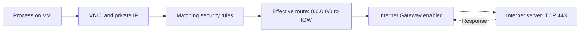

# Internet Gateway and Internet Access for Public Subnets

In Oracle Cloud Infrastructure (OCI), an **Internet Gateway (IGW)** connects a Virtual Cloud Network to the Internet. For IPv4, a Compute instance needing direct communication via an IGW requires a public IP, a subnet that permits public IPs, appropriate routes, and traffic control layers permitting the connection.

Therefore, creating a subnet labeled "public" does not prove machines in the subnet can reach the Internet. Creating an IGW is also not enough: the gateway might not be enabled, the route table might not be attached properly, or the application might still be blocked by the OS firewall.

This lesson belongs to the **Virtual Cloud Networks** chapter, focusing on IPv4 access paths via an IGW. The final section explains what changes when using IPv6 and how to choose an architecture suited to real environments.

## 1. Role and Scope of an Internet Gateway

An Internet Gateway is a network resource of a VCN, supporting both connections initiated by resources inside the VCN and inbound connections from the Internet to published resources. The IGW does not automatically open all ports and does not automatically assign public IPs to instances.

Different components hold different responsibilities:

| Component | Responsibility |
| --- | --- |
| Public subnet | Allows VNICs in the subnet to have public IPv4 addresses |
| Public IP | Address for the resource to communicate directly with the Internet side per configuration |
| Internet Gateway | Provides the connectivity path between the VCN and the Internet |
| Route table | Selects the next hop for destination addresses |
| Security list and NSG | Permits traffic types within their applicable scope |
| OS firewall | Controls traffic inside the machine |
| Application process | Listens, processes requests, and enforces application authentication |

An IGW serves resources belonging to its own VCN. Do not treat one VCN's IGW as a default shared Internet path for peered VCNs or on-premises hosts connected via a DRG. A centralized egress architecture must be designed around appropriate routing capabilities and forwarding components.

Oracle describes the scope and usage conditions in [Internet Gateway](https://docs.oracle.com/en-us/iaas/Content/Network/Tasks/managingIGs.htm).

### 1.1. Public Subnet vs. Instance with a Public IP

A public subnet allows assigning public IPv4 addresses; it does not force every instance to have a public IPv4 address.

| IPv4 scenario | Can communicate directly via IGW? |
| --- | --- |
| Public subnet, has public IP, proper routes and rules | Yes |
| Public subnet, no public IP | Does not meet conditions for a direct IGW path |
| Private subnet, private IP only | Does not use this direct model |
| Has public IP but missing route or blocked | Not yet working |

For an instance with only a private IP to initiate outbound connections to the Internet, typically consider a NAT Gateway or an appropriate egress architecture. Do not try to fix it merely by adding a route to the IGW.

The meaning of public and private subnets is explained in [Networking Overview](https://docs.oracle.com/en-us/iaas/Content/Network/Concepts/overview.htm).

## 2. Understanding an Instance's Private IP and Public IP

### 2.1. Public IPv4 Attaches to a Private IP Object

In the standard Compute model, a VNIC has a private IP; a public IP is assigned to the private IP object associated with the VNIC. Applications on the host normally use the private IP when binding sockets.

Illustrative address example:

```text
VM Private IPv4:    10.20.10.10
Public IPv4:        <OCI_ASSIGNED_PUBLIC_IPV4>
Public subnet:      10.20.10.0/24
```

Do not manually configure the OCI-assigned public IPv4 as an extra address on a Linux network interface. If `ip addr` shows only the private IP, that does not prove no public IP is assigned; check the assignment in OCI.

The public IP must be attached to the exact private IP/VNIC you are testing. On a host with multiple VNICs or multiple addresses, looking at one interface's public IP while checking routes from another interface can cause confusion.

### 2.2. Ephemeral and Reserved Public IPs

| Type | Key characteristics | Use case |
| --- | --- | --- |
| Ephemeral public IP | Lifecycle tied to the corresponding resource or assignment | Test hosts, resources not needing a long-term retained address |
| Reserved public IP | Retained as a standalone resource, can be unassigned and reassigned within service limits | Need to keep a stable address across certain resource replacements |

Do not assume stopping and starting an instance changes an ephemeral public IP. Conversely, when unassigning or deleting the associated resource, an ephemeral address can be released with no guarantee of getting it back.

A reserved IP helps manage address lifecycle, but it does not replace a load balancer, DNS, or high-availability design. Documentation on assignment and lifecycle is in [Public IP Addresses](https://docs.oracle.com/en-us/iaas/Content/Network/Tasks/managingpublicIPs.htm).

## 3. Outbound and Inbound Flows

### 3.1. Instance Initiating Outbound to the Internet

Example of a VM making an HTTPS request to an Internet server:



The diagram is a logical model, not the internal processing order of every OCI device. Public IPv4 assignment, return path, and OS firewall must also be right.

If the egress rule is stateful, connection responses are tracked and permitted by connection tracking. You do not need to open inbound TCP 443 just to receive the response to a `curl https://...` command.

Port 443 in this case is the **remote server's destination port**. The client's source port is normally an ephemeral port.

### 3.2. Internet Client Initiating Inbound to the Instance

For a web server:

```text
Internet client
    → Instance public IPv4, destination port 80 or 443
    → IGW and matching network path
    → Security rules allowing ingress
    → Firewall on the VM
    → Listening web process
```

A successful outbound connection does not prove inbound is open. Inbound also requires rules permitting the connection source and a listening service.

For example, a VM can fetch an HTTPS page while clients cannot open the website on the VM because Nginx is not running, port 80 is not allowed, or the client is mistakenly using the private IP.

## 4. Route Tables: Choosing the Right Path

### 4.1. Default IPv4 Route to IGW

Common configuration for a public subnet:

| Attribute | Value |
| --- | --- |
| Destination type | CIDR block |
| Destination | `0.0.0.0/0` |
| Target type | Internet Gateway |
| Target | IGW belonging to the same VCN |

`0.0.0.0/0` covers all IPv4 addresses. In a route table, it means using this next hop when selecting a matching route; it is not a command allowing all ports.

Do not confuse two configurations that both contain `0.0.0.0/0`:

- Destination CIDR in a route rule determines destination addresses and the forwarding path.
- Source or destination CIDR in a security rule determines the address scope allowed to pass the corresponding traffic.

### 4.2. The Route Table Must Actually Be Used

Creating a route table with the right rules without attaching it to the public subnet will not change that subnet's path.

In the basic lab model, inspect the route table referenced directly by the subnet. If the environment uses per-resource routing, a route table attached to the IP or VNIC may be selected instead of the subnet's route table.

When multiple routes match, the more specific route takes precedence via longest prefix match. Therefore, having `0.0.0.0/0 → IGW` does not prove all traffic goes to the IGW if a more specific route exists.

These mechanisms are described in [VCN Route Tables](https://docs.oracle.com/en-us/iaas/Content/Network/Tasks/managingroutetables.htm).

### 4.3. Linux Routes Do Not Show All OCI Routes

The `ip route` command on a VM typically shows the subnet's local default gateway. It does not display the IGW as an interface you must manually add in Linux.

Several layers can coexist:

- Routes in the OS to send packets out of the VNIC.
- OCI routes to choose the next hop outside the subnet or VCN.
- Advanced routes if the environment has appliances, multiple VNICs, or per-resource routing.

Do not manually change the OS default route to a public IP or an IGW OCID to fix an OCI route table error.

## 5. Security Rules and Firewalls

### 5.1. Security Lists and NSGs Have Different Scopes

Security lists apply to VNICs in the associated subnets. NSGs apply to VNICs or resources that are members of the group.

Allow rules across relevant security lists and NSGs are evaluated as a combined permission set. An NSG allowing SSH only from an admin IP does not automatically narrow an SSH rule from everywhere that still exists in a security list.

Therefore, when auditing access scope, examine all security lists on the subnet and all NSGs on the VNIC. Do not conclude a machine is locked down based solely on one neatly configured NSG.

Mechanics and scope of application are described by Oracle in [Security Rules](https://docs.oracle.com/en-us/iaas/Content/Network/Concepts/securityrules.htm).

### 5.2. Stateful and Stateless

| Mode | How responses are handled |
| --- | --- |
| Stateful | Tracks connections; matching responses are allowed by state |
| Stateless | Does not use connection tracking for that rule; return-direction rules must be designed appropriately |

For basic labs, use stateful to easily understand clients sending requests and receiving responses. Do not mix stateful and stateless rules covering the same traffic without understanding how OCI handles overlap.

Do not open all inbound ephemeral ports just to "make sure HTTPS gets through." Determine which side initiates the flow and whether rules are stateful.

### 5.3. Sample Permissions for the Lab

Suppose:

- `<ADMIN_PUBLIC_IPV4>/32`: actual public IP of the administrator.
- `<TEST_CLIENT_PUBLIC_IPV4>/32`: actual public IP of the HTTP test machine.
- The VM needs to download packages and make outbound HTTPS calls to the Internet.

| Direction | Address scope | Protocol, destination port | Purpose |
| --- | --- | --- | --- |
| Ingress | Admin IP `/32` | TCP 22 | SSH |
| Ingress | Test client IP `/32` | TCP 80 | Test HTTP |
| Egress | Required destinations; `0.0.0.0/0` may be used in an isolated lab | TCP 443 | Outbound HTTPS |
| Egress | Required destinations; `0.0.0.0/0` may be used in an isolated lab | TCP 80 | Package repo or HTTP if needed |

The rules above are not an exhaustive list for every system function. Retain necessary baseline rules, such as ICMP for diagnostics or Path MTU Discovery per OCI guidance. Do not bulk-delete default rules on a subnet used by other resources.

Security rules by CIDR/port are not equivalent to an allowed hostname list. If you need to restrict access to specific domains only, evaluate proxies, firewalls, or appropriate egress control mechanisms.

### 5.4. Host Firewall and Listen Address

OCI permitting TCP 80 does not guarantee Linux allows it or a process is listening on port 80.

Examples:

- Service bound to `127.0.0.1:80`: accepts only loopback connections.
- Service bound to `0.0.0.0:80`: accepts IPv4 on local addresses per configuration.
- Service bound to the VNIC's exact private IP: can receive traffic via the mapped public IP if remaining layers align.

Do not bind directly to the public IPv4 as if it were a local OS address in this model.

## 6. Hands-On: Setting Up a Public Subnet with Internet Access

This lab uses a dedicated VCN, IPv4, and an Ubuntu VM. Do not run test changes on a route table shared with production.

### 6.1. Preparation and Resource Layout

| Resource | Illustrative value |
| --- | --- |
| VCN | `vcn-igw-lab`, CIDR `10.20.0.0/16` |
| Public subnet | `subnet-public-lab`, CIDR `10.20.10.0/24` |
| Route table | `rt-public-lab` |
| Internet Gateway | `igw-lab`, enabled |
| Compute | `vm-public-lab`, Ubuntu, with public IPv4 |
| Security rules | Dedicated rules for the lab, restricted SSH and HTTP sources |

CIDRs must not overlap networks you need to connect to. The VM's private IP is assigned by OCI or chosen from the valid range; it does not have to be `10.20.10.10`.

The operator needs permissions to create and manage network resources, Compute, and dependencies in the assigned compartment. If the tenancy enforces Security Zones or guardrails prohibiting public subnets/public IPs, use a lab environment compliant with those policies.

### 6.2. Create the VCN and Public Subnet

In the OCI Console:

1. Select the right region and lab compartment.
2. Create VCN `vcn-igw-lab` with the chosen CIDR.
3. Create subnet `subnet-public-lab`.
4. Choose **public subnet**, permitting public IPv4.
5. Select appropriate DHCP options and DNS resolver; the lab can use the VCN's default DNS configuration.
6. Record the VCN OCID and subnet OCID.

If using the VCN Wizard with Internet connectivity, some resources such as gateways and routes may already be created. Inspect actual resources before creating extras or altering defaults.

### 6.3. Create or Inspect the Internet Gateway

Inside the VCN, open Internet Gateways:

1. Create `igw-lab` if no suitable gateway exists yet.
2. Confirm the gateway belongs to the right VCN.
3. Confirm the operational state is **enabled**.
4. Record the IGW OCID.

Do not create an IGW in another VCN and pick it by a similar name. Display names do not substitute for OCIDs. Oracle outlines the steps in [Creating an Internet Gateway](https://docs.oracle.com/en-us/iaas/Content/Network/Tasks/create-ig.htm).

### 6.4. Configure Routes for the Public Subnet

Create or select `rt-public-lab`, then add:

```text
Destination: 0.0.0.0/0
Target type: Internet Gateway
Target:      igw-lab
```

Then attach this route table to `subnet-public-lab`. Verify the subnet references the right route table after saving.

This lab does not use per-resource routing or advanced gateway ingress routing. If reusing resources that have those configurations, inspect them instead of looking only at the subnet route.

### 6.5. Configure Security Rules

Use a dedicated security list for the lab or a thoroughly reviewed configuration set. If adding an NSG, attach the NSG to the instance's VNIC.

Perform:

1. Allow SSH ingress from the actual admin public IP `/32`.
2. Allow HTTP TCP 80 ingress from the test client's public IP `/32`.
3. Allow HTTPS and HTTP egress for the lab.
4. Keep necessary infrastructure rules.
5. Verify no unintended broad allow rule remains in other security lists or NSGs.

A laptop's IP seen on a home network is usually a private IP. If the laptop goes through NAT or a VPN, the ingress rule must use the public address OCI sees from that connection path.

When switching Wi-Fi networks or changing VPNs, the public address may change. Update the specific scope after verifying; do not open SSH from `0.0.0.0/0` as a default workaround.

### 6.6. Create the VM and Assign Public IPv4

When creating the Ubuntu instance:

1. Select the right VCN and public subnet.
2. Enable public IPv4 assignment, or assign an appropriate address afterward via the service mechanism.
3. Provide the administrator's SSH public key.
4. Select the NSG if the lab uses an NSG.
5. Wait for the instance to become available.
6. Verify private IP, public IP, VNIC, and subnet on the details page.

A public subnet permits assignment, but confirm the instance actually received a public IP. Do not rely solely on default selections on the create screen.

Log in using an SSH client and the corresponding private key:

```bash
ssh -i '<PRIVATE_KEY_PATH>' ubuntu@<INSTANCE_PUBLIC_IPV4>
```

The illustrative command uses Bash and the `ubuntu` user of an appropriate Ubuntu image. With other images, the default user may differ.

## 7. Verifying Outbound, DNS, and Local Services

Commands in this section run **inside the Ubuntu VM**.

### 7.1. View OS Addresses and Routes

```bash
ip -4 addr
ip -4 route
```

Results to verify:

- The VNIC has a private IPv4 belonging to the subnet.
- A default route or required route exists to send packets out of the machine.
- No manual configuration puts a public IPv4 onto an interface contrary to the OCI model.

This confirms part of the guest OS configuration; you must still verify the OCI route table.

### 7.2. Verify Name Resolution

```bash
getent ahostsv4 www.oracle.com
```

If no IPv4 is returned, check the DNS resolver, DHCP options, guest OS config, or proxy. Do not widen inbound HTTP just to fix a name resolution error.

If the environment uses custom DNS, a path to the resolver and matching rules are also needed. VCN local DNS access uses separate infrastructure mechanics; do not assume every DNS query must traverse the IGW.

### 7.3. Verify Outbound HTTPS

```bash
curl -4 -I --connect-timeout 10 --max-time 30 https://www.oracle.com/
```

Depending on the website and timing, the response may be 200, a redirect, or another HTTP code. Receiving a valid HTTP response after TLS proves the connection to that endpoint traversed the required layers; not every endpoint must return 200.

If the environment has `HTTPS_PROXY`, the command may go through a proxy. To prove the direct IGW path, confirm no proxy is used in the design or test client configuration. Do not print full proxy URLs to logs if they contain credentials.

Do not use `curl -k` as a default fix for TLS errors. Certificate errors may involve system time, trust stores, hostnames, or TLS inspection devices.

### 7.4. Install a Web Server for the Inbound Step

On the lab Ubuntu VM:

```bash
sudo apt-get update
sudo apt-get install -y nginx
sudo systemctl enable --now nginx
```

Package repositories may use HTTP or HTTPS; egress must match the actual endpoints. If only TCP 443 is allowed while a repository uses HTTP 80, HTTPS to Oracle succeeding does not prove `apt-get` will succeed.

Verify:

```bash
sudo systemctl status nginx --no-pager
sudo ss -lntp
curl -4 -I --connect-timeout 5 http://127.0.0.1/
```

If localhost already fails, fix the service before investigating the inbound Internet path. If Nginx listens only on loopback, update its listen configuration appropriately.

### 7.5. Check the OS Firewall

If the VM uses UFW, view status:

```bash
sudo ufw status verbose
```

If UFW is active and does not yet allow HTTP from the lab client, add a specific rule:

```bash
sudo ufw allow from <TEST_CLIENT_PUBLIC_IPV4> to any port 80 proto tcp
```

Replace the placeholder with the actual address without angle brackets. Do not enable UFW just to run the test if the image uses another firewall mechanism; check which tool actually manages the firewall.

Before modifying firewall rules, keep administrative SSH access permitted. Do not disable the entire firewall instead of identifying the required rule.

## 8. Verifying Inbound from Outside OCI

Run from a **client machine outside the VM**, whose public IP is in the HTTP allowlist:

```bash
curl -4 -I --connect-timeout 10 --max-time 30 http://<INSTANCE_PUBLIC_IPV4>/
```

Use the instance's actual public IP. Do not use `10.20.10.x` from a laptop without a private path into the VCN.

The expected result is an HTTP response from Nginx. This is HTTP with a default page, used for connectivity testing and containing no sensitive data. Real services need HTTPS, valid certificates, and appropriate protections.

### 8.1. Why Not Test Only from the VM Itself?

If the VM reaches localhost successfully, that only proves the local service works. It does not confirm:

- The public IP is assigned properly.
- The IGW and network path outside the VCN work.
- Ingress rules permit the client.
- The OS firewall permits external traffic.

Testing from an identified external source separates the inbound flow from local loopback connectivity.

### 8.2. Testing Outside the Permitted Scope

If you have a second client you control with a public IP outside the allowlist, you can test the same endpoint. Results should match the source-restricted design.

Confirm the two clients truly have two different public addresses. Two devices on the same home network may go through the same NAT and therefore do not form two distinct public sources.

If the out-of-allowlist client still gets through, check other security lists, NSGs, and firewall rules that may allow a broader scope.

### 8.3. Acceptance Table

| Check | Expected outcome |
| --- | --- |
| VM has right public IPv4 | Assignment matches the private IP/VNIC under test |
| IGW in right VCN and enabled | Confirmed in OCI configuration |
| Effective route | Internet flow uses route to IGW in the lab model |
| Outbound DNS and HTTPS | Resolves name, connects, and receives response |
| Local Nginx | Service running and listening on the right address |
| HTTP from permitted client | Succeeds |
| Client outside allowlist | Denied access per design |
| SSH | Open only to selected admin source |

## 9. Checking OCI Configuration via CLI

This section runs from a machine with the OCI CLI installed and a profile granted read permissions on resources. The OCI CLI admin identity differs from the SSH user inside the VM.

Bash example:

```bash
export LAB_REGION='<OCI_REGION>'
export LAB_IGW_OCID='<INTERNET_GATEWAY_OCID>'

oci network internet-gateway get \
  --ig-id "$LAB_IGW_OCID" \
  --region "$LAB_REGION" \
  --profile OCI_LAB
```

Verify gateway ID, VCN ID, and enabled state from the response. This read-only command does not automatically add routes or enable the gateway. Syntax is documented in [OCI CLI — internet-gateway get](https://docs.oracle.com/en-us/iaas/tools/oci-cli/latest/oci_cli_docs/cmdref/network/internet-gateway/get.html).

For the remaining components, check the Console or corresponding API/CLI:

- Subnet: public/private, VCN, and referenced route table.
- VNIC/private IP: public IP assignment, NSG, and per-resource routing if any.
- Route table: destinations and targets.
- Security lists/NSGs: all relevant rules.
- Gateway ingress routing: inspect further if the architecture configures this feature.

If automation updates routes or security rules, check whether the API replaces the entire list or modifies a single entry. Submitting an incomplete list can wipe out rules used by other flows.

## 10. Layer-by-Layer Error Diagnosis

| Symptom | Possibilities to check | Next step |
| --- | --- | --- |
| SSH to public IP times out | Wrong IP, IGW/route, allowlist, firewall, VM not ready | Verify from public IP assignment to port 22 and actual source |
| Outbound HTTPS times out | Missing public IP, gateway disabled, wrong route or egress, proxy | Check path conditions one by one |
| `Could not resolve host` | DNS or hostname | Check resolver before editing HTTP rules |
| TLS certificate error | Trust store, clock, hostname, TLS inspection | Check TLS layer; do not open extra ports arbitrarily |
| Inbound HTTP times out yet localhost works | Ingress rule, client IP, firewall, or public IP | Check path from client and effective rules |
| `Connection refused` | Likely no listener or an active rejection layer | Check service, bind address, and logs |
| HTTP 403/404 received | Request reached an HTTP server but handled at app layer | Verify exact server, virtual host, and web config |
| Ping fails yet HTTP succeeds | ICMP disallowed or restricted | Do not treat ping as a mandatory HTTP test |
| Only some destinations fail | More specific route, DNS, destination-scoped rule, or remote endpoint | Compare destination addresses and effective routes |
| Changed NSG yet access remains broad | Another security list or NSG still has allow rule | Audit the unioned rule set |

### 10.1. Do Not Use Ping as the Sole Conclusion

Ping uses ICMP; HTTPS uses TCP and TLS. An endpoint may not answer ICMP yet still serve HTTPS normally.

Traceroute may also omit intermediate steps across cloud networks. Combine route configurations, live port checks, and log evidence rather than expecting every hop to reply.

### 10.2. Using Logs to Narrow Scope

VCN Flow Logs can add traffic visibility within the enabled scope. An ACCEPT record does not prove HTTP or TLS succeeded; service and application logs are still needed.

OCI Audit helps identify recorded administrative changes, such as route or security rule edits. It does not replace Nginx request logs.

If changing an IGW or route could break SSH, operate via the Console/API over an independent management path and prepare a rollback configuration. Do not use a single SSH session to edit every connectivity layer without accounting for cutting off your own access.

## 11. IPv6: Evaluate as a Separate Path

The earlier lab section used `curl -4` to pin IPv4. When enabling IPv6, do not mechanically apply "public IPv4" requirements to the IPv6 path.

To communicate with the Internet over IPv6, examine:

- VCN and subnet already have appropriate IPv6 configuration.
- VNIC has an IPv6 address used for the connection.
- Prefix type is Internet-routable, such as an appropriate GUA; ULA is not an Internet address.
- Subnet permits Internet communication per public/private configuration.
- Appropriate IPv6 route, typically `::/0 → IGW`.
- Security rules, firewalls, and listeners support IPv6.

`0.0.0.0/0` does not cover IPv6. An IPv4 rule restricting sources also does not automatically restrict the IPv6 path.

If a website has both A and AAAA records, clients may pick IPv6. When diagnosing, test each address family separately to see which path is active; do not use IPv4 results to conclude all Internet access is right.

Conditions and prefix scopes are documented by Oracle in [IPv6 Addresses](https://docs.oracle.com/en-us/iaas/Content/Network/Concepts/ipv6.htm).

## 12. Practical Design, Cost, and Lab Cleanup

### 12.1. Expose Only Necessary Components

A common application architecture places a public load balancer at the ingestion tier, while application servers and Oracle Database stay in private networks. This reduces directly exposed endpoints and allows clearer management of TLS and inbound flows.

If a VM only needs software updates or outbound Internet API calls, consider placing it in a private subnet and using a NAT Gateway or designed egress mechanism. If accessing supported Oracle services, consider a Service Gateway per endpoint and region.

Reserved IPs and DNS help manage addresses, but a single VM remains a single point of failure. Availability must be designed across Compute, load balancing, data, and application deployment layers.

### 12.2. Control Costs by Resources and Traffic

Monitor Compute, boot volumes, public IPs per applicable pricing policy, data transfer, and enabled logs during hands-on work. Do not assume the entire setup is free just because one gateway resource is not the main cost driver.

Stopping an instance does not mean all related resources are deleted. Boot volumes, separately held addresses, or other resources may persist and must be checked against actual billing rules.

### 12.3. Clean Up Resources Following Dependencies

After completion:

1. Remove test HTTP and SSH rules that do not need to be kept.
2. Delete or terminate the lab VM as needed, handling boot volumes and remaining data.
3. Release any separately created reserved public IP if no longer needed.
4. Remove routes pointing to the IGW before deleting the gateway.
5. Delete subnets, route tables, dedicated security lists/NSGs, and the VCN once no dependencies remain.
6. Check log resources and extra components created by wizards.

Only clean up resources from the lab exercise. If an IGW serves multiple public subnets, deleting or disabling it can impact multiple workloads simultaneously.

At sign-off, separately prove address assignment, routing path, traffic permissions, and application state. Those four parts explain why a public subnet does or does not have Internet access via an IGW.
