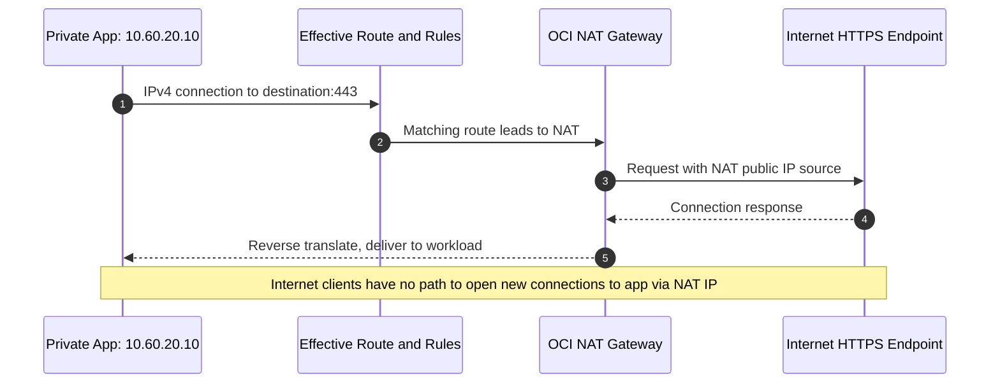

# NAT Gateway and Outbound Connectivity from Private Subnets

An application server in a private subnet usually does not need to receive direct connections from the Internet, yet it may still need to download patches, pull libraries, or call partner APIs. In Oracle Cloud Infrastructure (OCI), a NAT Gateway provides an IPv4 Internet path for connections initiated by workloads without assigning a public IPv4 address to each server.

In the **Virtual Cloud Networks** chapter, this lesson moves from address translation mechanics to route configuration, traffic controls, and connectivity verification. This knowledge helps you operate Compute, applications, and components related to Oracle databases in private networks while managing infrastructure change permissions, monitoring, and costs.

After this lesson, you will be able to:

- Explain connection initiation direction and return traffic via a NAT Gateway.
- Distinguish a NAT Gateway from an Internet Gateway, Service Gateway, and proxy.
- Design routes and security rules for private workloads needing IPv4 Internet access.
- Verify the path using OCI configurations, requests from the workload, and destination-side evidence.
- Isolate errors involving DNS, routes, gateways, firewalls, TLS, and connection resource exhaustion.

## 1. What Problem Does a NAT Gateway Solve?

Suppose instance `app-01` has private IPv4 `10.60.20.10` in a private subnet. The application needs to call an HTTPS service on the Internet. The server has no public IPv4 and does not need to open ports for the Internet to connect into it.

An instance's private address is not publicly routable on the Internet as a source address. A NAT Gateway performs source address translation when forwarding traffic outbound and keeps mapping state to return responses to the right workload.

```text
Before passing through NAT:
    Source:      10.60.20.10:<source port>
    Destination: <Internet service IPv4>:443

After passing through NAT:
    Source:      <NAT Gateway public IPv4>:<mapped port>
    Destination: <Internet service IPv4>:443
```

The Internet service sees the NAT Gateway's public IP, not the instance's private IP. When responses return, the gateway uses mapping state to deliver traffic to the side that initiated the connection. This is the core behavior described by Oracle in [NAT Gateway](https://docs.oracle.com/en-us/iaas/Content/Network/Tasks/NATgateway.htm).

Ports in this example only illustrate the mechanism. Do not assume source ports always stay unchanged after address translation or that one public IP represents only one host.

### Connection Direction Is the Most Important Point

| Scenario | Does a NAT Gateway satisfy this model? |
| --- | --- |
| Private app opens an HTTPS connection to the Internet | Yes, if configuration and destination permit |
| Internet sends responses for a connection the app initiated | Yes, per matching connection/mapping state |
| An Internet client opens a new connection to the private app via the NAT IP | Not a NAT Gateway function |
| Partner calls a webhook directly into the private app via NAT | No |
| Administrator SSHs from the Internet into the app via the NAT IP | No |

A NAT Gateway does not provide port forwarding to expose a private backend port. If you need to receive webhooks or serve Internet users, design an appropriate entry point, such as a frontend/load balancer or API Gateway per service capabilities, along with required authentication and rules.

An application can also establish a persistent outbound channel. Data transmitted over that channel still belongs to the connection initiated by the application; therefore, "no new inbound connections directly from the Internet" does not mean all data entering or leaving the application is automatically governed.

## 2. NAT Gateway Is a VCN Resource

An OCI NAT Gateway is a managed network service, not a Compute instance where you must install NAT software. It attaches to a VCN; subnets that need to use the gateway must have an appropriate path.

In the basic model:

```text
VCN in a region
├── Private subnet app-a ─┐
├── Private subnet app-b ─┼──> NAT Gateway ──> Internet
└── Private subnet data ──┘    if each subnet is permitted to use it
```

You do not need to create a public subnet just to "place the NAT Gateway inside it." Nor do you assign the gateway's public IP onto an instance's network interface. The workload OS continues using its private address.

A NAT Gateway is a dedicated OCI Internet access path; you do not need to add an Internet Gateway chained behind the NAT Gateway in this model. If the VCN has a public frontend, the Internet Gateway serving that public path is a separate component.

The gateway provides service-managed high availability. However, applications can still lose connectivity when routes are wrong, the gateway is blocked, rules mismatch, or the Internet destination fails. Gateway availability does not guarantee every external dependency works continuously.

### Not Shared by Default Over Peering

Peering between two VCNs does not automatically turn one VCN's NAT Gateway into a direct Internet gateway for every resource in the other VCN. Centralized egress architectures via a hub require a supported design, which may involve firewalls or network virtual appliances and bidirectional routing. Oracle explains this in [Learn OCI Network Firewall with Examples](https://docs.oracle.com/en-us/iaas/Content/Resources/Assets/whitepapers/learn-oci-network-firewall-with-examples.pdf).

This exercise considers only workloads and a NAT Gateway within the same VCN, without building multi-VCN transit egress.

## 3. Choosing the Right Tool for the Connectivity Need

| Component | Primary need | Key distinction |
| --- | --- | --- |
| NAT Gateway | Workloads without public IPv4 initiating IPv4 Internet connections | Not an entry point for new inbound connections to workloads |
| Internet Gateway | Direct Internet communication for resources with matching public config | Requires public IP, route, and rules in the IPv4 model |
| Service Gateway | Private access to supported Oracle services in the region | Not a general Internet path |
| Appropriate proxy or firewall | More granular policy control, depending on product | Can add authentication, filtering, and inspection at another layer |
| VPN/FastConnect and DRG | Private connectivity to corporate networks per design | Not synonymous with Internet NAT |

For example, an app calling a partner's Internet API may need NAT. An app reading Object Storage within Service Gateway scope can use a Service Gateway instead of going over the Internet. An app calling a private database inside the VCN does not need to detour through NAT.

Oracle describes direct access paths in [Internet Gateway](https://docs.oracle.com/en-us/iaas/Content/Network/Tasks/managingIGs.htm), and private scope to the Oracle Services Network in [Service Gateway](https://docs.oracle.com/en-us/iaas/Content/Network/Tasks/servicegateway.htm).

### NAT Does Not Replace Application Protection Layers

Address translation does not by itself encrypt data, verify hostnames, authenticate callers, or grant IAM permissions. Workloads calling HTTPS still need to verify certificates and endpoint identity. Requests to OCI services still need authentication mechanisms and appropriate policies.

If the requirement is "allow calls only to two partner domains," a NAT route plus a TCP 443 rule to `0.0.0.0/0` does not satisfy that requirement. That rule allows an IPv4 range and port, not a hostname allowlist. Choose an egress control mechanism with matching capabilities and manage DNS, proxies, and firewalls if used in the architecture.

## 4. Routes Directing Traffic to the NAT Gateway

Creating a NAT Gateway does not automatically give every subnet Internet access. Under the subnet-level routing model, the route table associated with the private subnet must contain the corresponding rule.

Example:

```text
Route table: rt-app-egress
Destination type: CIDR block
Destination: 0.0.0.0/0
Target type: NAT Gateway
Target: nat-app-egress
```

`0.0.0.0/0` matches all IPv4 destinations, but that does not mean all traffic will always go through NAT. More specific routes and the actually effective routing must also be evaluated. VCN routing mechanics are described in [VCN Route Tables](https://docs.oracle.com/en-us/iaas/Content/Network/Tasks/managingroutetables.htm).

A route table might contain:

| Destination | Target | Purpose |
| --- | --- | --- |
| Declared corporate network | DRG | Communicate with on-premises |
| Selected Service CIDR label | Service Gateway | Supported Oracle services |
| `0.0.0.0/0` | NAT Gateway | Remaining IPv4 Internet path |

Do not add a default route to NAT to every subnet out of habit. A database subnet without general Internet needs might only require defined service and operational destinations.

### Check the Right Route Table and the Return Direction

Common mistakes include editing a route table not attached to the subnet, picking the wrong gateway, or overlooking per-resource routing. Record OCIDs and association relationships to verify rather than looking only at display names.

If a route table is associated with the NAT Gateway for ingress routing, return traffic may be routed through an intermediate component before reaching the workload. When the architecture includes a firewall, inspect both forward and return paths; a correct one-way route does not prove a session works.

## 5. Security Rules, DNS, and the Operating System

Routes determine the packet forwarding direction. Security rules and other protection layers determine whether traffic is allowed to pass.

### Egress Matched to Actual Needs

For example, if a workload only needs HTTPS to a managed set of destinations, egress rules should reflect that protocol, port, and destination scope. If temporarily using `0.0.0.0/0` TCP 443 in an approved lab, recognize this is a broad IPv4 range, not application-level filtering.

Security lists and NSGs can apply together. Inspect all allow rules; a narrow NSG does not automatically remove broad permissions already in a security list. For endpoints with ZPR enforcement, corresponding policies must also be satisfied. See [Security Rules](https://docs.oracle.com/en-us/iaas/Content/Network/Concepts/securityrules.htm).

With appropriate stateful rules, connection responses are tracked by state. You do not need to open broad Internet ingress just to receive HTTPS responses for that connection. If using stateless rules, design bidirectional rules matching protocol and ports; do not apply stateful reasoning verbatim.

### DNS Is a Separate Hop

Before connecting to a hostname, the workload must resolve the name using a configured resolver. The resolver may be the VCN service or a custom DNS system, with its own path and rules.

DNS errors are not fixed merely by adding a NAT default route. Conversely, successful name resolution does not prove TCP 443 is open. When investigating, separate DNS, IP/TCP connectivity, TLS, and application responses in turn.

### Host Firewalls and Policies Still Apply

OS firewalls, proxy settings, application environment variables, or endpoint protection software can block or alter paths. A request going through a proxy is not a direct test of the host's NAT path to an endpoint, even though both return HTTP success.

## 6. Gateway Public IP and Allowlist Requirements

Some partners only accept requests from approved public IPs. When multiple workloads share the same NAT Gateway, partners typically see the gateway's shared public source address.

This simplifies allowlist management, but it does not individually identify each workload. Inside the system, service accounts, tokens, or appropriate authentication mechanisms are still needed to distinguish applications and enforce authorization.

When creating a gateway, OCI supports public IP options per current capabilities, including reserved or ephemeral. Choose and manage the lifecycle to match address-retention requirements. Oracle presents these options in [Creating a NAT Gateway](https://docs.oracle.com/en-us/iaas/Content/Network/Tasks/nat-create.htm) and [Public IP Addresses](https://docs.oracle.com/en-us/iaas/Content/Network/Tasks/managingpublicIPs.htm).

For example, if a pipeline destroys an old gateway and creates a new one, do not assume the source address seen by partners remains identical. Check public IP usage options, retention/reassignment capabilities per service, and update allowlists before shifting traffic.

A minimal egress record should include:

| Information | Purpose |
| --- | --- |
| NAT Gateway OCID and VCN OCID | Precisely identify the gateway |
| Public IPv4 in use | Cross-check allowlists and destination-side logs |
| Dependent subnets/route tables | Know blast radius when making changes |
| Partners and using applications | Coordinate address changes |
| Owner and approver | Manage infrastructure changes |

## 7. Lab Design: A Private Subnet Making Outbound HTTPS Calls

This exercise describes steps for learners in an authorized environment. This lesson does not create resources or run commands against a live tenancy.

### 7.1. Illustrative Scope

| Component | Illustrative value |
| --- | --- |
| VCN | `vcn-egress-lab`, CIDR `10.60.0.0/16` |
| Subnet | `subnet-app-private`, regional private, CIDR `10.60.20.0/24` |
| Workload | A prepared lab Compute instance, private IPv4 only |
| Route table | `rt-app-egress` |
| NAT Gateway | `nat-app-egress` |
| Test target | HTTPS endpoint permitted by the organization |
| Workload administration | An existing private path or management service |

You do not need to stand up a new database to test NAT. If no lab Compute exists yet, provisioning Compute must be managed within a separate exercise scope, including shape, image, permissions, and cost.

The administrative path into the machine must be independent of assuming NAT is an entry point. You can use VPN/FastConnect, OCI Bastion, or an option supported and approved by the environment. A NAT Gateway is not a bastion host.

### 7.2. Connection Diagram



The diagram omits TCP/TLS handshake details to focus on initiation direction. Inspect those layers separately when errors occur.

### 7.3. Preparing IAM and Governance Constraints

The configurator needs permissions to manage gateways and route tables within the assigned scope. Testers may only need read permissions on corresponding network resources and metrics. Workloads do not need gateway management permissions just to send traffic through NAT.

If the environment has a Security Zone or other governance policies, creating a gateway may be restricted. Some recipes include policies prohibiting NAT Gateways; see [Security Zone Policies](https://docs.oracle.com/en-us/iaas/Content/security-zone/using/security-zone-policies.htm). Do not relax governance constraints simply because resource creation reports an error.

### 7.4. Configuration Order

1. Verify the private subnet, VNIC, and workload addresses; record the active route table.
2. Create or select a NAT Gateway in the right VCN, compartment, and region; confirm the public IP per design.
3. Confirm the gateway permits traffic and is not in a blocked state.
4. Add the route to NAT in the route table of the subnet needing egress.
5. Verify egress rules and stateful/stateless mode, plus DNS and OS firewall.
6. Test an IPv4 request from the workload itself to the permitted endpoint.
7. Cross-check source public IP and monitoring evidence.

When modifying an existing route table, retain all existing routes needed for on-premises, Oracle services, or other connections. An update command replacing the entire route list with only the NAT default route can drop active paths.

## 8. Reading Configuration with the OCI CLI

The commands below are read-only commands, used with an installed and configured OCI CLI. They do not create gateways or modify route tables.

PowerShell example:

```powershell
$ociNetworkProfile = 'OCI_EGRESS_LAB'
$ociAuthMode = 'security_token'
$targetRegion = '<region-id>'
$natGatewayOcid = '<nat-gateway-ocid>'
$privateSubnetOcid = '<private-subnet-ocid>'
$routeTableOcid = '<effective-route-table-ocid>'
```

Replace placeholders. `security_token` is just an example if the profile has a valid session token; choose the auth mechanism matching the actual profile.

### 8.1. Read the Gateway

```powershell
oci network nat-gateway get --nat-gateway-id $natGatewayOcid --region $targetRegion --profile $ociNetworkProfile --auth $ociAuthMode
```

Cross-check at least: gateway ID, VCN, lifecycle state, public IP, and block traffic flag. See [nat-gateway get](https://docs.oracle.com/en-us/iaas/tools/oci-cli/latest/oci_cli_docs/cmdref/network/nat-gateway/get.html).

Illustrative snippet example, not actual command output:

```json
{
  "lifecycle-state": "AVAILABLE",
  "block-traffic": false,
  "nat-ip": "203.0.113.10"
}
```

`203.0.113.10` is a documentation-example address, not a NAT IP to configure in a live environment. Lifecycle state AVAILABLE does not substitute for checking `block-traffic` and paths.

### 8.2. Read the Subnet and Route Table

```powershell
oci network subnet get --subnet-id $privateSubnetOcid --region $targetRegion --profile $ociNetworkProfile --auth $ociAuthMode
oci network route-table get --rt-id $routeTableOcid --region $targetRegion --profile $ociNetworkProfile --auth $ociAuthMode
```

Take the route table ID from the active configuration, not from a name you remember. In architectures with per-resource routing, also inspect related overrides.

The [route-table get](https://docs.oracle.com/en-us/iaas/tools/oci-cli/latest/oci_cli_docs/cmdref/network/route-table/get.html) command lets you cross-check all route rules. An IPv4 NAT rule typically has destination `0.0.0.0/0`, destination type `CIDR_BLOCK`, and network entity ID set to the chosen NAT Gateway's OCID.

Check more specific routes too. If the endpoint falls inside a range routed toward a DRG or a firewall, the request may not go directly via the NAT default route.

## 9. Verifying from the Workload and Endpoint

### 9.1. Run the Test in the Right Place

Test commands must run on the workload inside the private subnet. Running on a laptop or Cloud Shell with a different network path does not prove the lab instance's egress.

Confirm the workload is not using an unintended proxy and that the test selects IPv4. On a Linux host with appropriate tools installed, you can use:

```bash
getent ahostsv4 example.com
curl -4 --head --connect-timeout 5 --max-time 20 https://example.com
```

`example.com` is a public hostname example. In a real environment, substitute an organization-permitted HTTPS endpoint that supports the test request type and allows collecting evidence. Do not install extra software from the Internet just to test the Internet if the environment already has other test tools.

### 9.2. Interpreting Results Layer by Layer

| Observation | What can be concluded | Cannot yet conclude |
| --- | --- | --- |
| IPv4 resolved | Resolver returned an address | TCP/TLS and NAT are working |
| TCP/TLS established to right endpoint | A connection path to destination works | Definitely used the intended gateway |
| HTTP response received, even an app error code | Request reached an HTTP endpoint in that session | Application authorization or business content is right |
| Destination logs show expected NAT public IP | Egress source path matches that evidence | All workloads and destinations share the same path |
| Gateway metrics rise during the test | Activity passed through the gateway in that window | Every packet belonged to the specific test request |

An HTTP `403` or `401` response should not immediately be viewed as a broken NAT. The network path may be open while the endpoint rejects authentication, source IP, or app permissions. Combine TLS certificate, hostname, response, and logs to confirm requests reached the right target.

### 9.3. Confirming the Source Address

Prefer logs from an endpoint controlled by your organization or partner. Cross-check source IP, timestamp, and test request identifier. Multiple instances sharing a gateway may have the same source IP, so additional correlation info is needed.

If using an external service to display your IP, use only approved services and understand what data is sent. A small test against a controlled endpoint usually gives better evidence than an arbitrary public website.

Do not use `ping` as sole evidence: ICMP may be blocked while HTTPS works fine. Also do not disable TLS verification to count a connection as successful.

### 9.4. Boundary Testing and Recovery

Test an out-of-scope destination/port using an agreed method without scanning the Internet. Verify the workload still has no public IPv4 and administrative ingress remains per design.

If you need to test blocking traffic on the gateway, do so only in an isolated lab with authorization and a recovery plan. Gateways can be shared by multiple subnets; blocking traffic is a broad-impact action. Do not delete a shared gateway to test failures.

## 10. Monitoring the NAT Gateway

OCI provides metrics in the `oci_nat_gateway` namespace. Useful signals include:

| Metric/dimension | How to use |
| --- | --- |
| `BytesToNATgw` | Monitor bytes from OCI resources to the gateway |
| `BytesFromNATgw` | Monitor bytes from the gateway back to OCI resources |
| `DropsToNATgw` | Monitor packets dropped by the gateway |
| `dropType = noPorts` | Isolate signs of NAT port exhaustion |
| `dropType = throttle` | Isolate signs of throttling |
| `highPortUsageWatermark` | Binary signal for port utilization threshold, not a direct percentage |

Verify current names and definitions in [NAT Gateway Metrics](https://docs.oracle.com/en-us/iaas/Content/Network/Reference/nat-gateway-metrics.htm). Select the exact `resourceId`, time range, and region when reading data.

### Using Multiple Evidence Sources

Gateway metrics are aggregated data. To investigate an application incident, combine with:

- Application logs: DNS, timeouts, TLS errors, responses, and retries.
- Endpoint/partner logs: observed source IP and processing results.
- VCN Flow Logs if enabled: flows, addresses, ports, and verdicts within the capture scope.
- Audit and change history: who modified routes, gateways, or rules and when.
- Actual configurations of subnets, VNICs, proxies, and intermediate components.

For example, request timeouts without corresponding changes in gateway metrics may suggest a wrong route or requests never reaching the gateway. However, with background traffic and metric granularity, you cannot conclude solely from a flat chart.

Alerts should combine error signals with impact: drops rising alongside application error rates, or critical destinations losing connectivity across multiple checks. Do not use a fixed byte threshold to assume all workloads are healthy.

### Signs of Connection Pressure

Multiple workloads can share public IPs and NAT resources. An application continuously opening short-lived connections or retrying in synchronized bursts creates different pressure from an application using sensible connection pooling.

When seeing signs of port exhaustion or throttling, cross-check metrics, target destinations, concurrent connections, and retry behavior. Check current service limits; do not assume infinite capacity because the gateway is managed.

Improvements should be evaluated at the application level: connection reuse, concurrency limits, bounded backoff, and avoiding synchronized retries. Scaling up application instances without considering egress traffic can increase connection pressure.

## 11. Hop-by-Hop Troubleshooting

| Symptom | First check | Isolation direction |
| --- | --- | --- |
| Cannot resolve hostname | Resolver, DHCP/DNS, and path to DNS | Fix name resolution layer before editing NAT |
| Resolves yet IPv4 connection times out | Effective route table, gateway, egress | Cross-check traffic at each hop |
| Gateway AVAILABLE yet all dependent egress stops | `block-traffic` and recent changes | Lifecycle state alone does not confirm traffic is permitted |
| Only one subnet fails | That subnet's route table, rules, and overrides | Do not replace a shared gateway immediately |
| Only one endpoint fails | More specific route, allowlist, destination service | Check destination IP and partner-side logs |
| HTTPS certificate error | Hostname, trust store, clock, and TLS proxy | Do not disable cert verification to "fix NAT" |
| HTTP rejection received | App permissions, token, source IP | Separate service errors from connectivity errors |
| Errors appear under increased load | Drops, NAT ports, concurrency, and retries | Evaluate pressure and service limits |
| IPv4 succeeds, IPv6 fails | Selected stack, IPv6 routes, and IPv6 gateway | Do not treat IPv4 NAT as an IPv6 path |
| Corporate connectivity lost after route edit | Are old routes still present? | Restore appropriate config, check the entire table |

### Block Traffic Can Block Even When Routes and Rules Are Right

OCI allows blocking or allowing traffic on a NAT Gateway. When blocked, the gateway stops traffic through it even though routes and security rules still exist. This is an attribute to check separately, as described in [Blocking or Allowing Traffic for a NAT Gateway](https://docs.oracle.com/en-us/iaas/Content/Network/Tasks/nat-block.htm).

A block operation can affect multiple applications sharing the gateway. When restoring, use appropriate change authority and determine why the gateway was blocked; do not assume the prior action was an operational mistake.

### An Illustrative Investigation Scenario

After a partner updated their allowlist, the app started receiving HTTP `403`. DNS still worked, TLS verified, and the endpoint responded.

Operations checked partner logs and saw the source was the public IP of a new gateway recreated during a deployment wave. The allowlist still held the old IP. The root cause was IP lifecycle and partner-side config, not a missing ingress rule on the private subnet.

The fix was coordinating the allowlist update or approved source-address strategy per design, then retrying requests from the workload itself. Opening ingress to the entire Internet or assigning a public IP to the app neither explains nor fixes this root cause.

## 12. IPv6 and Data Access Paths

### NAT in This Lesson Is an IPv4 Internet Path

The `0.0.0.0/0`, public IPv4, and `curl -4` examples intentionally test IPv4. Do not replace them with `::/0` pointing to a NAT Gateway expecting an equivalent IPv6 path.

OCI has a distinct set of gateways and rules for IPv6; NAT Gateway is not among the IPv6 gateways listed in documentation. When using dual-stack, check both DNS A/AAAA, client address selection, routes, public/private flags, and IPv6 rules. See [IPv6 Addresses](https://docs.oracle.com/en-us/iaas/Content/Network/Concepts/ipv6.htm).

### Do Not Route All Oracle Traffic Through NAT

If a workload needs to access an Oracle service in the region supported by Service Gateway, design a dedicated route to that service. NAT still serves other Internet endpoints when permitted.

Likewise, an application connecting to a database via a private endpoint in the VCN needs private paths, rules, and appropriate database credentials. Having NAT does not grant SQL privileges, open listeners, or fix wrong database endpoints.

For backups or database management tools, identify the exact service to call and the supported access method. Do not assume every Oracle task needs general Internet access, nor assume every Oracle endpoint falls within Service Gateway scope.

## 13. Operations, Automation, and Cost Control

### Manage Changes by Dependencies

When putting configuration into automation tools, clearly document which VCN the gateway belongs to, how the public IP is managed, which route tables use it, and which teams own dependent applications.

A change plan must answer:

1. Will the gateway be updated in place or replaced?
2. Will the public IP change, and which partners maintain allowlists?
3. Are existing routes preserved as required?
4. Which flows will be tested post-deployment, and what is the rollback plan?
5. Is there a shared gateway/subnet making the blast radius wider than expected?

Do not treat successful config creation as proof that Internet egress works. Add tests from the workload against a controlled endpoint and cross-check read-back configuration.

### Availability of the End-to-End Path

A gateway service having HA does not replace fault-tolerant application design. Sensible timeouts, retry limits, handling partner unavailability, and monitoring critical flows are still required.

If failure domains or source addresses need isolation across workload groups, evaluate VCN, subnet, route, and gateway layouts within current limits. Do not copy rules like "every AD must have one NAT Gateway" from other platforms into OCI.

### Evaluate Costs System-Wide

Check actual pricing tables, terms, and limits for networking services, data transfer, Compute, logs, and egress control components. This lesson does not assume a flat fee or apply another provider's billing model.

Monitor traffic generated by repeated patch downloads, image/library pulls, retries, or unnecessary data syncs. A continuously failing job can generate both load and data transfer that is hard to spot just by looking at instance counts.

In labs, prefer existing resources, small requests, and bounded test windows. When finished, review lab-created resources, referenced routes, and retained public IPs. Clean up only resources within your assigned scope; shared gateways must not be deleted just because one test exercise ended.

## 14. Completion Criteria and Self-Check

A complete hands-on result should include:

| Criterion | Evidence |
| --- | --- |
| Private workload | VNIC has no public IPv4, subnet matches design |
| Correct route | Rule and route table association lead to NAT for test target |
| Working gateway | Right VCN, region, public IP, and unblocked |
| Matching rules | Egress/response, DNS, and control layers verified |
| Successful request | Executed from the workload itself over IPv4 |
| Proven path | Source public IP and correlated data align |
| Clear boundaries | No assumption that NAT provides new inbound Internet access |
| Controlled operations | Owner, monitoring, dependencies, and recovery plan recorded |

Self-check questions:

1. **Why doesn't an instance need a public IPv4 to call the Internet via NAT?**  
   The gateway translates the source to its own public IP and forwards responses back via mapping state to the workload that initiated the connection.

2. **Can a partner call a webhook into a private app via the NAT IP?**  
   Not with this NAT Gateway function. A separate appropriate entry point or event ingestion mechanism must be designed.

3. **After creating the gateway, the app still times out—what steps are easily missed?**  
   Effective route table, egress rules, DNS, host firewall, or the block-traffic flag.

4. **Does a TCP 443 rule to `0.0.0.0/0` restrict by domain name?**  
   No. It describes protocol/port and IPv4 scope, not a hostname policy.

5. **Why doesn't HTTP `403` prove the NAT is broken?**  
   The request may have reached the endpoint and been rejected at the application, authentication, or allowlist layer.

6. **Why doesn't rising NAT metrics prove a specific request took the right path?**  
   Metrics are gateway-wide aggregates; timestamp, source IP, and request logs must be correlated.

7. **Does a NAT Gateway automatically allow reading objects or logging into Oracle Database?**  
   No. Network path, IAM, service authentication, and database privileges must be configured separately.

When selecting a NAT Gateway, explicitly state which workload may call which destination, which route applies, and what evidence confirms the path. That allows outbound connectivity from private subnets to be deployed, monitored, and debugged without blurring system access boundaries.
