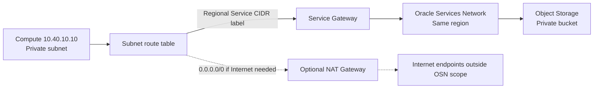

# Service Gateway and Accessing Oracle Services Over a Private Network

An application running in a private subnet may need to read files from Object Storage or send data to an OCI service without being assigned a public IP. A Service Gateway provides a private access path from a Virtual Cloud Network (VCN) to supported services in the Oracle Services Network (OSN), helping design networks for applications and Oracle database tasks with clear access boundaries.

In the **CLOUD_PROVIDERS_ORACLE** module, this lesson connects VCN knowledge with IAM, Compute, storage, and infrastructure operations: picking the right network path, restricting data read permissions, automating configuration, and collecting evidence during incidents.

After this lesson, learners will be able to:

- Explain why an endpoint resolving to a public address can still be reached over a private path.
- Configure Service Gateways, route tables, and security rules consistently.
- Use instance principals to test reading a bucket without distributing API keys to VMs.
- Distinguish connectivity errors, authentication errors, and authorization errors; design tests proving the traffic path.

## 1. What Problem Does a Service Gateway Solve?

A Service Gateway is a regional network resource attached to a VCN, enabling workloads to access supported Oracle services **within the same region** over Oracle's network. Workloads can use private IPs only; this access path requires neither an Internet Gateway nor a NAT Gateway. One gateway can serve multiple subnets if routes and security rules permit. Connections are initiated from the workload side; the gateway does not open a path for Oracle services to arbitrarily initiate connections to VMs. [Oracle Service Gateway Overview](https://docs.oracle.com/en-us/iaas/Content/Network/Tasks/servicegateway.htm).

Three concepts must be kept separate:

| Concept | Question to answer |
| --- | --- |
| Private access path | Which infrastructure do packets traverse? |
| Service endpoint | Which hostname and address does the application call? |
| Data access permissions | Which identity is allowed to perform which action? |

Enabling the gateway solves only part of the network-path problem. It does not grant permission to read buckets, replace TLS certificates, or choose the bucket on behalf of the application.

## 2. Sample Architecture and Request Flow

Consider the following lab environment, where all target service resources are in region `ap-singapore-1`:

| Component | Illustrative value |
| --- | --- |
| Lab compartment | `OciSgwLab` |
| VCN | `vcn-sgw-lab`, CIDR `10.40.0.0/16` |
| Regional private subnet | `subnet-app-private`, CIDR `10.40.10.0/24` |
| Compute | `vm-sgw-test`, illustrative private IP `10.40.10.10`, no public IP |
| Service Gateway | `sgw-sgw-lab` |
| Subnet route table | `rt-app-private` |
| Private bucket | `oci-sgw-lab`, or a unique name matching your namespace |
| Prepared object | `samples/hello.txt` |



The file-read flow is analyzed step by step:

1. The application selects the Object Storage hostname for the target region.
2. DNS resolves the hostname to an endpoint address.
3. A route with a matching destination directs traffic to the Service Gateway.
4. Security rules must permit the connection; TCP and TLS are established.
5. Object Storage authenticates the signed request and checks IAM permissions.
6. If authorized, data returns over the established connection.

### Public Endpoints and Private Transmission Paths

A DNS result returning a public IP is insufficient to conclude traffic goes over the Internet. A Service Gateway routes to Oracle-managed service address ranges; it does not create a new private IP inside the subnet for each bucket. Continue using the service hostname to preserve TLS certificate validation. Do not replace the hostname with a hardcoded IP just to make the connection look internal.

If a service offers a **private endpoint**, that is a separate endpoint configuration mechanism that must be evaluated per service documentation. In this lesson, the model examined is accessing OSN endpoints through a Service Gateway.

## 3. Selecting a Service CIDR Label

A Service CIDR label represents regional service address ranges. Two common choices are:

| Display label | Selection scope |
| --- | --- |
| `OCI <region> Object Storage` | Object Storage in the corresponding region |
| `All <region> Services in Oracle Services Network` | Services supported by OSN in that region |

A gateway enables only one of these two labels; a route table also cannot have two separate routes corresponding to both labels. A gateway with `All ...` enabled can accept a route targeting only Object Storage. The reverse is invalid for services outside Object Storage: a gateway with Object Storage enabled cannot fully serve an `All ...` route. [Rules for choosing a service CIDR label](https://docs.oracle.com/en-us/iaas/Content/Network/Tasks/attach-sgw.htm).

`All ...` still has a specific scope. Do not infer from the label name that every Oracle website, every endpoint of every service, or every region is covered. When requirements expand to another service, verify the actual endpoint and support scope before editing configurations.

### Distinguishing Service OCID from Routing Label

The `Service` object has attributes serving different purposes:

| Attribute | What is it used for? |
| --- | --- |
| `id` | Selects the service enabled on the gateway |
| `cidr_block` in Terraform, `cidr-block` in JSON CLI | Specifies the destination for a route or service-type security rule |
| `name` | Display name, helps identify the selection |

Retrieve info for the target deployment region; avoid copying OCIDs from other environments or picking the first element of a list without checking its scope. [Attributes of data source `oci_core_services`](https://docs.oracle.com/en-us/iaas/tools/terraform-provider-oci/latest/docs/d/core_services.html).

## 4. Configuring the Route Table in the Right Place

In the standard subnet model, the route table attached to the subnet determines egress out of the VCN. Creating a gateway without adding a route to the table actually used by the subnet will not route traffic through the gateway. If the environment has per-resource routing on the VNIC or IP, check the table effective for that source. [VCN Route Tables mechanics](https://docs.oracle.com/en-us/iaas/Content/Network/Tasks/managingroutetables.htm).

For example, `rt-app-private` might contain:

| Destination type | Destination | Target | When needed? |
| --- | --- | --- | --- |
| Service | Selected OSN label for the region | `sgw-sgw-lab` | Accessing services within label scope |
| CIDR | `0.0.0.0/0` | NAT Gateway | Only when workload needs other Internet endpoints |

The initial lab only needs the service route. Do not add a default route just to make a failing test fall back to the Internet path without understanding the cause.

Three values must match when declaring the route:

```text
destination_type  = SERVICE_CIDR_BLOCK
destination       = <service CIDR label fetched from the region's API>
network_entity_id = <OCID of the Service Gateway in the VCN>
```

The `destination` line is the service label, not the Service OCID, VCN CIDR, or current IP from one DNS lookup. When a NAT Gateway is present, the service route handles destinations within its scope; the default route serves the rest per OCI route-selection rules.

### Avoid Copying Mechanically to a Public Subnet

OCI does not support having both a route to an Internet Gateway and a route for `All <region> Services in Oracle Services Network` to a Service Gateway in the same route table. This combination can cause asymmetric routing when an Oracle service initiates a connection to a public instance. For a public subnet needing an Internet Gateway, Oracle advises using the Object Storage route to the Service Gateway if needed. This restriction differs from the private subnet model using a NAT Gateway. [Known Issues for Networking](https://docs.oracle.com/en-us/iaas/Content/Network/Reference/known_issues_for_networking.htm).

## 5. Security Rules and DNS

For the HTTPS lab, configure a stateful egress rule:

| Attribute | Value |
| --- | --- |
| Direction | Egress |
| Stateless | Unchecked |
| Destination type | Service |
| Destination service | Label matching the needed traffic |
| Protocol | TCP |
| Source port | All source ports |
| Destination port | `443` |

Stateful connections allow return traffic belonging to the tracked connection. If using stateless rules, design appropriate return-direction rules; client-side destination ports are usually ephemeral ports, not always `443`. Audit both Security Lists and NSGs attached to the VNIC: their allow rules are unioned, so a broad egress rule elsewhere can nullify the restriction of a new rule. [Security Rules and connection tracking](https://docs.oracle.com/en-us/iaas/Content/Network/Concepts/securityrules.htm).

In the lab, you can use a dedicated security list for the subnet to configure a Service-type destination; still inspect all relevant NSGs and the OS firewall. Do not open Internet ingress just to receive responses for a stateful HTTPS connection.

DNS must be verified independently. With custom resolvers, verify forwarding for service hostnames still works. A working gateway does not fix DNS errors, wrong hostnames, application proxies, or missing trusted CAs. If an application goes through a proxy, the proxy's network path determines the connection hop to the service.

## 6. IAM: Network Reachability Does Not Mean Data Read Access

Using an instance principal lets a VM call APIs with its own identity. A dynamic group identifies which instances receive the policy; the workload uses CLI or SDK request-signing mechanisms. You do not need to place a user's API private key on the VM. [Calling Services from an Instance](https://docs.oracle.com/en-us/iaas/Content/Identity/Tasks/callingservicesfrominstances.htm).

Example dynamic group `OciSgwLabReaders` matching only the lab VM:

```text
instance.id = '<LAB_VM_OCID>'
```

Policy to read objects in the prepared bucket:

```text
Allow dynamic-group OciSgwLabReaders to read objects in compartment OciSgwLab where target.bucket.name='oci-sgw-lab'
```

Replace placeholders and resource names with environment values. The lab preparer creates the bucket, uploads the object, and provides the namespace beforehand; the VM only reads data. This policy does not grant permission to create gateways, edit networking, create buckets, or write objects. Condition syntax on bucket name narrows resource scope instead of granting `manage object-family in tenancy`. [Managing permissions on Object Storage objects](https://docs.oracle.com/en-us/iaas/Content/Object/Tasks/managingobjects.htm).

Network operations and workload identities have separate responsibilities. Someone configuring the gateway needs network management permissions appropriate for the compartment and VCN; the VM does not need those permissions to read files. Changing the configurator's permissions does not automatically change the instance principal's permissions.

### Restricting Source with a Network Source

If the requirement is to accept access only from the lab subnet over the permitted VCN path, create a Network Source `oci-sgw-lab-source` with:

- Network type: Virtual Cloud Network.
- VCN OCID: lab VCN.
- IP range within the VCN: `10.40.10.0/24`.

Then use the source condition in the policy:

```text
Allow dynamic-group OciSgwLabReaders to read objects in compartment OciSgwLab where all {target.bucket.name='oci-sgw-lab', request.networkSource.name='oci-sgw-lab-source'}
```

A Network Source describes the request origin, not a route destination. It does not replace packet rules or TLS. [Configuring Network Sources and IAM conditions](https://docs.oracle.com/en-us/iaas/Content/Identity/Tasks/managingnetworksources.htm).

`Allow` policies combine permissions additively. A conditional statement is insufficient to guarantee source restriction if a broader statement still applies to the same principal. In the lab environment, verify all effective permissions of the dynamic group; do not keep both an unconditional policy and a conditional policy expecting the later statement to narrow the earlier one.

## 7. Hands-On via Console

### 7.1. Prepare the Test Environment

Prepare a VM in a private subnet, a private bucket, and a sample object in the same region. Pre-install the OCI CLI, DNS, and TLS tools before isolating the Internet path. Connect for administration using an organization-approved method, such as OCI Bastion or a dedicated management network; do not use Service Gateway in place of an SSH channel.

Record the region, VCN OCID, subnet OCID, effective route table, gateway OCID, namespace, and bucket name. Confirm the VM has no public IP, no forwarding proxy, and no alternate Internet path via NAT, DRG, or network appliances in the verification lab.

### 7.2. Create the Gateway

In VCN details, open **Service Gateways**, choose **Create Service Gateway**, and set name and compartment. For the bucket-reading exercise, select the Object Storage label for the right region. You can use the `All ...` label when the lab also tests other OSN services.

The route table association directly on the gateway is for transit routing scenarios; the single-VCN VM scenario does not require configuring this part. After creation, verify the gateway allows traffic and the label is enabled. [Creating a Service Gateway](https://docs.oracle.com/en-us/iaas/Content/Network/Tasks/create-sgw.htm).

### 7.3. Complete the Access Path

1. Open `rt-app-private`, add a Service destination route with the chosen label and target `sgw-sgw-lab`.
2. Verify `subnet-app-private` is using this exact table.
3. Add stateful TCP `443` egress to the service label in the lab security list; review other allow rules.
4. Confirm DNS and the OS firewall permit the test requests.
5. Add the VM's identity to the dynamic group and apply the bucket-reading policy; wait for IAM changes to propagate before concluding a test failed.

Keep the bucket private throughout the entire lab so the test genuinely exercises request signing and the designed IAM permissions.

## 8. Testing from the Compute Instance

The commands below are examples for a Bash shell on a Linux VM; they do not run automatically on the reader's machine. Replace namespace, bucket, and region with your lab details. The namespace should be provided by the lab preparer to avoid granting extra permissions just to discover metadata.

### 8.1. Test DNS and TCP/TLS

```bash
REGION='ap-singapore-1'
OS_HOST="objectstorage.${REGION}.oraclecloud.com"

getent ahostsv4 "$OS_HOST"
curl --noproxy '*' -4 -I --connect-timeout 5 --max-time 15 "https://${OS_HOST}/"
```

Do not expect an unsigned `curl` to read a private object. An HTTP error response can still indicate TCP/TLS to the endpoint succeeded; inspect the certificate, headers, and error body to see which side replied. Conversely, a timeout is insufficient to blame IAM.

`--noproxy '*'` excludes proxies from this `curl` test. For the OCI CLI and real workloads, still check proxy environment variables and corresponding configurations. `-4` keeps the test focused on the described IPv4 setup; this lab does not verify an IPv6 path.

### 8.2. Call Signed APIs Using Instance Principal

```bash
REGION='ap-singapore-1'
OS_NAMESPACE='<TENANCY_NAMESPACE>'
LAB_BUCKET='oci-sgw-lab'

oci os object list \
  --namespace-name "$OS_NAMESPACE" \
  --bucket-name "$LAB_BUCKET" \
  --region "$REGION" \
  --auth instance_principal \
  --limit 10

oci os object get \
  --namespace-name "$OS_NAMESPACE" \
  --bucket-name "$LAB_BUCKET" \
  --name 'samples/hello.txt' \
  --file /tmp/sgw-lab-hello.txt \
  --region "$REGION" \
  --auth instance_principal
```

The expected output is a list containing the prepared object and the download command reading the sample content. If a bucket is empty, an empty list can be a valid result; it does not prove an object's contents were read. `--namespace-name` specifies the namespace directly, while `--limit` caps returned objects. [Object list command options](https://docs.oracle.com/en-us/iaas/tools/oci-cli/latest/oci_cli_docs/cmdref/os/object/list.html).

This is test data; download only to an appropriate path without critical files. If acquiring the instance principal token fails before calling Object Storage, inspect that authentication flow separately from the data transmission path.

### 8.3. Proving Requests Use the Service Gateway

A single successful command only proves a working connection path exists. To verify the Service Gateway path, use an isolated lab environment:

| Lab state | Expected outcome |
| --- | --- |
| Service path only, gateway allowing, valid rules and IAM | Read command succeeds |
| Keep above config but block the gateway | New connections through the gateway fail to complete |
| Re-enable traffic on the gateway | New read command succeeds again |
| Keep network path but use an unauthorized principal | API returns permission error or hides resource per service behavior |

OCI has an operation to block/allow gateway traffic without deleting the resource. Only run this test on a lab gateway serving no other workloads, record initial state, and restore immediately after testing. [Controlling Service Gateway traffic](https://docs.oracle.com/en-us/iaas/Content/Network/Tasks/sgw-traffic.htm).

If the command still succeeds when blocked, check backup paths, proxies, actual endpoints, and whether the command initiated a new connection. Do not use `ping` output or a single `traceroute` hop as sole proof for a managed service path.

## 9. Automating with Terraform

The following example covers networking configuration for an **existing lab VCN**, assuming the VCN does not yet have a reusable Service Gateway. The OCI provider is already authenticated with the right region selected. The reader provides `compartment_id`, `vcn_id`, and the `service_cidr_label` string from the region's service list.

```hcl
variable "compartment_id" {
  type = string
}

variable "vcn_id" {
  type = string
}

variable "service_cidr_label" {
  type = string
}

data "oci_core_services" "regional" {}

locals {
  selected_service = one([
    for service in data.oci_core_services.regional.services : service
    if service.cidr_block == var.service_cidr_label
  ])
}

resource "oci_core_service_gateway" "lab" {
  compartment_id = var.compartment_id
  vcn_id         = var.vcn_id
  display_name   = "sgw-sgw-lab"

  services {
    service_id = local.selected_service.id
  }
}

resource "oci_core_route_table" "private_app" {
  compartment_id = var.compartment_id
  vcn_id         = var.vcn_id
  display_name   = "rt-app-private"

  route_rules {
    destination_type  = "SERVICE_CIDR_BLOCK"
    destination       = local.selected_service.cidr_block
    network_entity_id = oci_core_service_gateway.lab.id
  }
}
```

The gateway uses `service_id`, while the route uses `cidr_block` of the same selection. Do not assign `route_table_id` on the gateway for this simple subnet scenario. [Service Gateway resource](https://docs.oracle.com/en-us/iaas/tools/terraform-provider-oci/latest/docs/r/core_service_gateway.html), [Route Table resource](https://docs.oracle.com/en-us/iaas/tools/terraform-provider-oci/latest/docs/r/core_route_table.html).

This code creates the gateway and route table; it does not yet attach the table to the subnet, create security rules, or grant IAM. In the subnet resource managed by your Terraform configuration, set `route_table_id` to `oci_core_route_table.private_app.id`. Complete the remaining parts before considering the access path ready.

`one(...)` avoids picking a service by return order. If the label does not match, it fails to produce the required attribute and the plan must be fixed with the right label; do not switch to another service automatically. If a gateway or route table already exists, bring resources under appropriate state management before modifying. When updating an active table, inspect all routes in the plan to avoid dropping administrative or other application paths.

## 10. Extending to On-Premises

For backup needs from a data center, the high-level model is:

```text
On-premises
  -> FastConnect private virtual circuit or Site-to-Site VPN
  -> DRG
  -> Transit VCN
  -> Service Gateway
  -> OSN service in the same region
```

Beyond the DRG connection, configure an outbound route from the DRG attachment toward the Service Gateway and a return route from the Service Gateway toward the DRG for on-premises CIDRs. Edge devices must also select the right path to the service ranges. This is a scenario where subnet route tables must be distinguished from route tables attached to gateways or attachments. [Private Access to Oracle Services](https://docs.oracle.com/en-us/iaas/Content/Network/Tasks/transitroutingoracleservices.htm).

Do not assume peering two VCNs automatically lets workloads in the second VCN use the first VCN's gateway. Sharing a service path through a hub requires a transit design and checking corresponding limits; in this lab, the VM and gateway reside in the same VCN.

## 11. Layer-Based Error Diagnosis

Start with a small read request to the exact bucket and record timestamp, principal, region, hostname, and request ID if available. Keep other conditions constant when changing one configuration so the test shows what altered the outcome.

| Symptom | Cause category to check | Evidence to gather |
| --- | --- | --- |
| Cannot resolve hostname | Wrong name, resolver, or DNS forwarding | DNS output and resolver config |
| Timeout before HTTP response | Route, service label, blocked gateway, security rules, firewall, or proxy | Effective route table, gateway state, flow logs |
| TLS error | CA, hostname, clock, or TLS-intercepting proxy | Certificate message and actual endpoint |
| Instance principal token error | Incomplete authentication flow | Sanitized CLI error, VM identity |
| `401`/`NotAuthenticated` | Signature, credentials, or clock skew | Auth config and system time |
| `403`/`NotAuthorized` | Principal permissions, source condition, or service policy | Dynamic group, effective policies, Network Source |
| `404`/`NotAuthorizedOrNotFound` | Name, namespace, region, or masked permissions | Cross-check resource and policies; do not immediately conclude bucket does not exist |
| Object Storage works yet external Internet package download fails | Package download endpoint is outside service path scope | Final URL after redirects and need for Internet path |

Some Oracle repositories have regional endpoints; generic hostnames or redirects may send requests elsewhere. Check actual URLs before widening egress. One success with Object Storage does not verify every application dependency.

### Using Logs Appropriately

VCN Flow Logs provide traffic metadata and `ACCEPT`/`REJECT` decisions of network rules. Cross-check source, destination, port, and timestamp to support investigation. `ACCEPT` does not prove IAM permits reading objects, nor does it alone prove the full path traversed the gateway. Flow logs may omit certain link-local traffic such as internal DNS; records also have states tied to data collection. [Details for VCN Flow Logs](https://docs.oracle.com/en-us/iaas/Content/Logging/Reference/details_for_vcn_flow_logs.htm).

Combine network logs with CLI errors, application logs, and enabled service logs. When sharing evidence, strip tokens, keys, auth headers, and sensitive payload data; keep request IDs so correlation remains useful.

## 12. Operations, Availability, and Cost

For operations, the goal is monitoring the ability to execute business operations. You can schedule a periodic test reading a small object, measuring latency, and categorizing errors. Use a dedicated object, a read-only principal, and alert thresholds accounting for transient failures; alerting should follow the system's operational channels.

A gateway has regional scope; cross-region DR designs must independently prepare network paths, endpoints, permissions, and data copies in the standby region. When an application switches regions, changing only the hostname does not ensure the rest is ready.

When switching labels from Object Storage to `All ...` or vice versa, update the gateway, associated routes, and security rules using the label in the Oracle-documented sequence. Do not delete and recreate the gateway just to change the selection; doing so disrupts dependent connections. [Changing the service CIDR label](https://docs.oracle.com/en-us/iaas/Content/Network/Tasks/service-gateway_management.htm).

Oracle states that Service Gateway is provided free of charge; the overall workload must still be budgeted for all resources and services consumed. [Virtual Cloud Network FAQ](https://www.oracle.com/bz/cloud/networking/virtual-cloud-network/faq/).

For labs, track VMs, boot volumes, objects, requests, and log volume per applicable pricing. Set retention limits for test data, resource tags, and appropriate budgets. Removing NAT from the Object Storage path does not replace dependency inventory: applications may still need to download patches or reach non-OSN services via an approved path.

## 13. Self-Verification Exercise

Perform in an isolated environment and record results directly in your lab notes:

1. Build the path to read `samples/hello.txt` from a VM without a public IP using instance principal.
2. Record the gateway, effective route table, service label, egress rule, and policy used.
3. Demonstrate success when the gateway is open, failure for new connections when the gateway is blocked, then success after restoring.
4. Keep the network path active and switch to an unauthorized principal to observe the difference from a timeout.
5. Add a Network Source condition and verify effective permissions contain no broader statement nullifying the source restriction.
6. Describe the changes required if the backup program must send data to a different region.

A satisfactory solution must identify both the packet path and the identity permitted by the service. Statements like "having a gateway makes the bucket private" or "DNS returns a public IP so it definitely goes over the Internet" do not explain how the model works.

After the lab, restore gateway state before leaving the environment; delete or reclaim test resources within your managed scope. If deleting the gateway, remove routes targeting the gateway first. Check lab volumes, objects, logs, and policies to avoid leaving behind unnecessary data, permissions, or resources.
