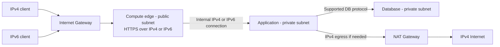

# IPv6 in VCNs and Dual-Stack Network Design

## 1. Purpose and Context

In the **Virtual Cloud Networks** chapter of the Oracle Cloud Infrastructure (OCI) module, IPv6 expands connectivity options while keeping IPv4 for existing systems. A dual-stack design is complete only when addressing, routing, access control, operating system, application, and DNS all operate intentionally together.

After this lesson, you will be able to:

- Plan IPv4/IPv6 addressing for network tiers within a VCN.
- Distinguish being assigned an IPv6 address from being permitted Internet connectivity.
- Design separate routes and security rules for each address family.
- Deploy incrementally, test IPv4/IPv6 independently, and troubleshoot systematically.
- Integrate changes into authorization, automation, monitoring, and cost-control workflows.

The hands-on scope covers a VCN with dual-stack subnets and Compute instances. Do not assume every OCI database, storage, load balancer, or monitoring service has identical IPv6 capabilities. Verify each service's capabilities before expanding the architecture.

## 2. What Does Dual Stack Actually Mean?

Dual stack means running IPv4 and IPv6 in parallel. A service can be reached via either an IPv4 or IPv6 address, depending on DNS, client network capabilities, and how the application selects connections.

For example, an API's domain name can have both records:

```text
api.example.com.  300  IN  A     203.0.113.10
api.example.com.  300  IN  AAAA  2001:db8:42:1000::10
```

This is illustrative data. The domain name and addresses must be replaced with resources you manage when practicing.

Two connections to the same API can take two paths:

```text
IPv4 client -> public IPv4 address -> HTTPS service
IPv6 client -> IPv6 GUA address    -> HTTPS service
```

Enabling IPv6 on a VCN is not enough to create the second path. Three configuration levels must be verified:

| Level | What is required | What cannot yet be inferred |
| --- | --- | --- |
| VCN | IPv6 prefix assigned | Every subnet has IPv6 |
| Subnet | Matching prefix and right public/private attribute | Every VNIC has an IPv6 address |
| VNIC and host | Address assigned, OS receives configuration | Service is listening and firewall permits |

OCI allows adding IPv6 to an existing VCN. Therefore, you can transition per subnet and workload rather than replacing the entire network at once. [Oracle: Networking Overview](https://docs.oracle.com/en-us/iaas/Content/Network/Concepts/overview.htm)

Dual stack does not automatically convert IPv6 packets into IPv4. An application can accept IPv6 and then open a new IPv4 connection to a backend; those are two separate connection sessions managed by the intermediary application. NAT64/DNS64 are separate translation mechanisms that must be designed explicitly if needed.

## 3. Reading Addresses and Prefix Planning

### 3.1. Notations to Recognize

IPv6 uses 128-bit addresses, typically represented as eight hexadecimal groups. Leading zeros within a group can be omitted; consecutive groups of zeros are compressed with `::`, which may appear only once in an address.

```text
2001:0db8:0042:1000:0000:0000:0000:0010
2001:db8:42:1000::10
```

Both notations represent the exact same address. Do not compare addresses using raw text strings in management tools or log analytics; parse them with a network address library.

| Notation | Meaning in design |
| --- | --- |
| `/56` prefix | Example address block for a VCN |
| `/64` prefix | Address block for an IPv6 subnet in OCI |
| `/128` address | Exactly one IPv6 address |
| `::/0` | All IPv6 destinations, typically used for a default route |
| `::1` | The host's own IPv6 loopback |
| `fe80::/10` | Link-local addresses, not a substitute for internetwork addresses |
| `2001:db8::/32` | Documentation-reserved range, not for live deployment |

The documentation range prevents examples from accidentally pointing to another organization's systems. Every `2001:db8:...` address in this lesson must be replaced with an actual prefix. [RFC 3849: IPv6 Address Prefix Reserved for Documentation](https://datatracker.ietf.org/doc/html/rfc3849.txt)

### 3.2. From VCN Down to Subnets

With Oracle-allocated GUA, a VCN receives a `/56` prefix; IPv6 subnets use `/64`. One `/56` can divide address-wise into:

```text
2^(64 - 56) = 256 /64 blocks
```

This is an address-space calculation, not a guarantee of the number of subnets permitted in a tenancy. Service limits and quotas still apply. [Oracle: Networking Overview](https://docs.oracle.com/en-us/iaas/Content/Network/Concepts/overview.htm)

Planning example:

```text
VCN:                  2001:db8:42:1000::/56

edge-public:          2001:db8:42:1000::/64
application-private:  2001:db8:42:1010::/64
database-private:     2001:db8:42:1020::/64
```

With this `/56` prefix, the fourth group of the subnets falls in `1000` through `10ff`. The numbers `1000`, `1010`, and `1020` are hexadecimal, chosen to make roles easy to recognize.

Save the allocation map by environment, region, and function. Do not use the same prefix for two networks that will connect via peering, VPN, or FastConnect. Reserve remaining blocks for new subnets rather than allocating scattered ranges without convention.

### 3.3. Choosing a Prefix Type

OCI offers Oracle-allocated GUA, BYOIPv6, and ULA options:

| Option | Purpose in design |
| --- | --- |
| Oracle-allocated GUA | Needs Internet-routable addresses, convenient deployment |
| BYOIPv6 | Organization manages its own address block and has a process to bring it into OCI |
| ULA | Internal connectivity; not routed on the Internet |

GUA does not mean service ports are open. In particular, resources in a private subnet cannot communicate directly with the Internet over IPv6 even if assigned a GUA. Reachability also depends on subnet type, routes, and security layers. [Oracle: IPv6 Addresses](https://docs.oracle.com/en-us/iaas/Content/Network/Concepts/ipv6.htm)

## 4. Three-Tier Architecture Example

Suppose an application has an HTTPS ingestion tier, a business-processing tier, and a database. We pick VCN `10.42.0.0/16` and illustrative IPv6 prefix `2001:db8:42:1000::/56`.

| Tier | IPv4 subnet | IPv6 subnet | Subnet type | Role |
| --- | --- | --- | --- | --- |
| Edge | `10.42.10.0/24` | `2001:db8:42:1000::/64` | Public | Receives HTTPS from the Internet |
| Application | `10.42.20.0/24` | `2001:db8:42:1010::/64` | Private | Processes internal requests |
| Database | `10.42.30.0/24` | `2001:db8:42:1020::/64` | Private | Reserves network space for data tier |

A Compute instance at edge can use private IPv4 `10.42.10.10`, an OCI-assigned public IPv4, and an assigned IPv6 GUA on the VNIC. Do not configure the illustrative public IPv4 address `203.0.113.10` directly onto the machine's NIC.



In this lab, Compute edge is used to clearly control addresses and listeners. When substituting a load balancer service, verify the chosen product's frontend type, listeners, backends, health checks, and IPv6 support.

Giving the database subnet an IPv6 prefix only prepares the network's capability. It does not confirm a specific DB System or Oracle Database service has a matching IPv6 endpoint. You can operate a dual-stack frontend while backend and database remain on IPv4.

Specific addresses for each tier, if assigned by OCI to the right VNICs, could be:

```text
edge: 10.42.10.10 and 2001:db8:42:1000::10
app:  10.42.20.10 and 2001:db8:42:1010::10
```

Do not pick an address yourself and merely run OS commands to add it. Addresses used by workloads must be properly allocated and managed on the OCI side.

## 5. Designing Routing per Address Family

### 5.1. Public Subnet Routes

Two independent default routes are used for edge:

| Destination | Target | Effect |
| --- | --- | --- |
| `0.0.0.0/0` | Internet Gateway | IPv4 Internet path for eligible resources |
| `::/0` | Internet Gateway | IPv6 Internet path for eligible resources |

Having a route does not mean access is permitted. The instance still needs matching addresses, the right subnet type, security rules, and an active listener.

OCI has local routing for intra-VCN traffic. In this lesson's simple architecture, no default route is needed just for edge to talk to app. If intermediate firewalls or custom routing are deployed, inspect actual paths rather than applying this assumption. More specific routes take precedence over broader routes. [Oracle: VCN Route Tables](https://docs.oracle.com/en-us/iaas/Content/Network/Tasks/managingroutetables.htm)

### 5.2. Private Subnet Routes

For the app tier in the example:

| Destination or need | Approach |
| --- | --- |
| Communicate with edge inside the VCN | Local routing and corresponding security rules |
| Download updates from the Internet over IPv4 | `0.0.0.0/0` to NAT Gateway, if needed |
| Reach corporate network over IPv6 | Corporate prefix to DRG and configure return path |
| Direct IPv6 Internet | Do not include in this private subnet design |

Do not copy an IPv4 route, replace the destination with `::/0`, and keep NAT Gateway as the target. NAT Gateway and Service Gateway are not among the OCI gateways supporting IPv6 traffic; Internet Gateway, DRG, and LPG are supported. For corporate connectivity, FastConnect or Site-to-Site VPN must also have matching IPv6 configuration. [Oracle: IPv6 Addresses](https://docs.oracle.com/en-us/iaas/Content/Network/Concepts/ipv6.htm)

If a private workload needs to call an external API, you can keep the IPv4 outbound path during transition. If IPv6 is mandatory, redesign a controlled egress path, such as through an appropriate proxy; do not assume adding a route solves the requirement.

### 5.3. Routes in OCI and Routes in the OS

VCN route tables and host routing tables are two separate layers. Correct configuration in OCI does not prove the OS already has matching addresses and paths.

On Linux:

```bash
ip -4 address show
ip -6 address show
ip -4 route show
ip -6 route show
```

The IPv6 address assigned to the VNIC must appear on the corresponding interface. Seeing only `fe80::...` addresses does not prove the machine received an address for off-link communication.

OCI supports OS address assignment via DHCPv6. On a running instance, when an address is picked up depends on the DHCPv6 lease cycle and image configuration. Use the image's network management mechanism to refresh config when needed; avoid adding temporary addresses that drift from managed state. [Oracle: Virtual Cloud Network FAQ](https://www.oracle.com/cloud/networking/virtual-cloud-network/faq/)

## 6. Dual-Stack Security

### 6.1. Write Policies Based on Access Intent

Start with "who is allowed to call which service," then express it separately for IPv4 and IPv6.

Example of edge serving public HTTPS:

| Direction | Source or destination | Protocol | Destination port | Purpose |
| --- | --- | --- | --- | --- |
| Ingress | `0.0.0.0/0` | TCP | 443 | Public IPv4 HTTPS |
| Ingress | `::/0` | TCP | 443 | Public IPv6 HTTPS |
| Ingress | Admin IPv4 CIDR | TCP | 22 | SSH from admin network |
| Ingress | Admin IPv6 prefix | TCP | 22 | IPv6 SSH if genuinely needed |
| Egress | `10.42.20.10/32` | TCP | 8080 | Edge calls app over IPv4 |
| Egress | `2001:db8:42:1010::10/128` | TCP | 8080 | Edge calls app over IPv6 if used |

The last two egress rows are two options or two intentionally permitted paths, not a requirement that the application use both. App needs matching ingress from edge; OS firewalls on both sides must also align.

If the API is partner-only, replace all-Internet sources with partner ranges. Do not open SSH from `::/0` just because you already restricted IPv4 SSH.

With stateful TCP, return traffic for tracked connections is handled by state. When using stateless, design both outbound and return directions, including client ephemeral ports. Avoid mixing both rule types for the same traffic without understanding how they interact.

### 6.2. NSGs and Security Lists Are Not Two Serial Deny Layers

Security lists apply per subnet; NSGs group VNICs by security role. When used together, allow rules from NSGs and security lists combine additively. A narrow NSG does not narrow a broad rule still present in a security list. The OS firewall is an additional check layer. [Oracle: Security Rules](https://docs.oracle.com/en-us/iaas/Content/Network/Concepts/securityrules.htm)

Therefore, when verifying whether SSH has been restricted, audit every security list attached to the subnet and every NSG attached to the VNIC. Do not check only the newly created NSG.

The example scope covers networks using NSGs and security lists. If the environment also uses Zero Trust Packet Routing or firewall appliances, policies at those layers must also permit the intended connection path.

### 6.3. Do Not Block ICMPv6 Mechanically

ICMPv6 supports IPv6 operation, not just ping. Filtering all ICMPv6 can make network paths unstable even while some small connections still succeed. Build policies for error and control messages suited to the firewall's position. [RFC 4890: Recommendations for Filtering ICMPv6 Messages in Firewalls](https://www.rfc-editor.org/rfc/rfc4890.txt)

An important message is **Packet Too Big**, ICMPv6 type 2, code 0. Routers along the path notify when a packet exceeds the MTU so the sender adjusts packet size; IPv6 routers do not fragment packets on behalf of the sender. If this message is blocked, connections may succeed while large data transfers hang. [RFC 8201: Path MTU Discovery for IP version 6](https://www.rfc-editor.org/info/rfc8201/)

In OCI, the ICMPv6 protocol number is 58. Do not confuse it with IPv4's ICMP, which is number 1. When defining rules, distinguish protocol from type/code.

If permitting ping for diagnostics, restrict sources and duration as needed. Ping succeeding does not replace testing TCP, TLS, and business endpoints.

## 7. DNS and Applications: Publishing IPv6 at the Right Time

### 7.1. A and AAAA Records

A holds an IPv4 address; AAAA holds an IPv6 address. Having an AAAA record announces that the service can be reached over IPv6, so add it only after the IPv6 path has passed testing.

Recommended rollout sequence:

1. Keep the A record and active IPv4 path running.
2. Complete IPv6 addressing, routes, security rules, and listeners.
3. Test IPv6 using the selected address while preserving the hostname for TLS checks.
4. Publish AAAA on a test name first, then on the primary hostname.
5. Monitor errors, latency, and traffic share per address family.

Some clients use Happy Eyeballs to race connection attempts and reduce wait times when one path fails. That fallback mechanism can hide broken IPv6 from operators who only try opening the page in a browser. [RFC 8305: Happy Eyeballs Version 2](https://www.rfc-editor.org/rfc/rfc8305.txt)

### 7.2. Listeners, TLS, and Application Data

A service bound only to `0.0.0.0:443` may not accept IPv6. Nor should you assume a `[::]:443` listener handles both address families identically across every OS and runtime.

```bash
ss -lntp
```

Inspect the application's own listener config and test each address family separately. For TLS, the certificate must still be valid for the accessed hostname; do not skip certificate verification to mask test errors.

Audit commonly overlooked components:

- Do allowlists, rate limits, and fraud detection systems accept IPv6?
- Do logs preserve full addresses and distinguish addresses from ports?
- Do databases or analytics tools have large enough fields for IPv6?
- Do callbacks, webhooks, and partner APIs have matching connectivity paths?
- Do health checks test the exact address family users will use?

In URLs containing a literal IPv6 address, use square brackets around the address to separate it from the colon before the port:

```text
http://[2001:db8:42:1000::10]:8080/health
```

## 8. Hands-On: Adding IPv6 While Keeping IPv4

### 8.1. Prerequisites

Use an isolated lab compartment with permissions to manage the right network resources and assign addresses to the selected Compute VNICs. Permission to edit a VCN does not automatically grant permission to modify configs on every related instance or service.

Prepare:

- A VCN with one public subnet for edge and one private subnet for app.
- A Compute image supporting IPv6 with an identified network management mechanism.
- An HTTPS service with a valid certificate on edge, serving `/health`.
- A test machine with genuinely working IPv4 and IPv6 connectivity.
- A hostname you control if testing A/AAAA publication.
- A pre-change IPv4 connectivity baseline.

In this example, `/health` only needs to return HTTP 200 with a short known body. If the app or database tier does not exist yet, you can test the edge network path first; do not create a database solely to verify VCN IPv6.

### 8.2. Configuration Steps

1. **Record initial state.** Save OCIDs, addresses, routes, security rules, and IPv4 access results in a change record. Confirm the right region and compartment are selected.
2. **Add a prefix to the VCN.** Choose Oracle-allocated GUA for a lab with Internet access. Record the actual assigned prefix.
3. **Assign subnet prefixes.** Pick non-overlapping `/64`s within the VCN prefix. Keep edge public and app private.
4. **Assign IPv6 to VNICs.** Use OCI-assigned addresses or valid addresses specified via OCI. Record which address belongs to which VNIC and subnet.
5. **Verify the OS.** Ensure the image receives the address and routes. If absent, check network management and DHCPv6 before editing firewalls.
6. **Add routes.** Add `::/0` to the Internet Gateway for edge when IPv6 Internet is needed. Do not add that path to private subnets to try bypassing subnet type restrictions.
7. **Add security rules.** Add IPv6 rules per the designed matrix, checking both security lists and NSGs. Keep required ICMPv6 and matching OS firewall rules.
8. **Verify listener and TLS.** The service must accept IPv6 connections and serve the right endpoint.
9. **Test before DNS.** Use client address-forcing options. Add AAAA only after mandatory tests pass.
10. **Monitor and record.** Compare against the IPv4 baseline; confirm no unintended ports were opened.

Console menu labels may change; the objects to verify remain VCN, subnet, VNIC/IP, route table, gateway, and security rules.

### 8.3. Checking on the Server

The commands below are Linux examples, not commands executed automatically by this lesson:

```bash
ip -4 address show
ip -6 address show scope global
ip -4 route show
ip -6 route show
ss -lntp
```

Reconcile addresses with the VNIC in OCI. If the machine has multiple NICs or multiple addresses, confirm the interface and source address the application actually uses.

Check the routing decision to an internal peer:

```bash
# Replace the illustrative address with the app's actual IPv6 address.
ip -6 route get 2001:db8:42:1010::10
```

This command shows the OS path choice; it does not prove NSGs, firewalls, or the destination service permit it.

### 8.4. Testing from the Client

In the examples below, replace `api.example.com`, IPv4, and IPv6 with your edge's actual hostname and addresses. Run on a machine with the right tools and verified independent IPv6 connectivity.

```bash
dig +short A api.example.com
dig +short AAAA api.example.com

curl --noproxy '*' -4 --connect-timeout 5 --max-time 15 \
  https://api.example.com/health

curl --noproxy '*' -6 --connect-timeout 5 --max-time 15 \
  https://api.example.com/health
```

`--noproxy '*'` prevents direct-path tests from accidentally going through an HTTP proxy configured in the environment. If the architecture requires a proxy, add a separate test for the proxied path.

Before publishing AAAA, force the address while keeping the hostname for HTTP Host and TLS SNI:

```bash
curl --noproxy '*' -6 \
  --resolve 'api.example.com:443:[2001:db8:42:1000::10]' \
  --connect-timeout 5 --max-time 15 \
  https://api.example.com/health
```

The test passes when the TLS handshake succeeds, HTTP 200 is returned, and `/health` body matches expectations. Do not use `-k` as an acceptance criterion.

If you need to measure the actual connected address and timing:

```bash
curl --noproxy '*' -6 -sS -o /dev/null \
  --connect-timeout 5 --max-time 15 \
  -w 'remote=%{remote_ip} status=%{http_code} total=%{time_total}\n' \
  https://api.example.com/health
```

A normal `curl` command succeeding without forcing an address family is not enough to conclude both paths work.

## 9. Acceptance Matrix

Run both permitted tests and tests that must be denied, against lab resources under your management.

| Test | Test source | Expectation |
| --- | --- | --- |
| IPv4 HTTPS to edge | External host with IPv4 | Succeeds like baseline |
| IPv6 HTTPS to edge | External host with IPv6 | Succeeds, TLS and content right |
| Edge calls app over IPv4 | Edge | Succeeds if this path is chosen |
| Edge calls app over IPv6 | Edge | Succeeds if this path is deployed |
| IPv6 SSH to edge | Authorized admin network | Succeeds if IPv6 SSH is required |
| IPv6 SSH to edge | Unauthorized source | Fails to establish session |
| Direct access to private app from IPv6 Internet | External host | Fails |
| Transfer sufficiently large payload over IPv6 | External host with IPv6 | Does not hang due to MTU issues |
| Query A and AAAA | Client resolver | Returns exact published addresses |

For the large-payload test, use a test endpoint with a known payload you are permitted to download. `/health` is too small to represent all MTU problems.

Do not record "IPv6 broken" if the test machine itself has no IPv6 default route or the ISP does not provide IPv6. Always separate client, intermediate network, and OCI-side faults.

## 10. Layer-Based Diagnosis

| Symptom | Possibilities to check | Next step |
| --- | --- | --- |
| VCN has prefix yet OS only has `fe80::...` | Subnet, VNIC assignment, DHCPv6, or image mismatch | Trace from VCN down to VNIC then to OS |
| IPv4 works, IPv6 times out | Missing IPv6 route, IPv6 rule, listener, or IPv6 client | Inspect each layer independently |
| Fails only by hostname | Wrong AAAA, DNS cache, or proxied path | Compare DNS against `--resolve` test |
| TCP returns connection refused | No listener or active firewall reject | Check listening sockets and logs at target |
| TLS reports wrong hostname/certificate | Tested by IP or misconfigured virtual host | Keep hostname and verify SNI/certificate |
| Small responses work, large responses hang | Blocked MTU or ICMPv6 | Check Packet Too Big and transmission path |
| SSH still reachable from outside allowlist | Another security list or NSG has broad rule | Audit the entire effective allow rule set |
| Internal IPv6 works yet private app cannot reach IPv6 Internet | Architecture lacks suitable egress path | Check requirements against subnet type; do not open ingress |
| Browser works yet forced IPv6 test fails | Client falling back to IPv4 | Fix IPv6 path before considering rollout complete |

When deeper visibility is needed, capture packets on the right interface with appropriate privileges:

```bash
sudo tcpdump -n -i any 'ip6 and tcp port 443'
sudo tcpdump -n -i any 'icmp6'
```

If SYN packets arrive at the host with no reply, check OS firewall, listener, and return route. If packets are absent, continue investigating upstream of the host; that alone is insufficient to blame a single NSG.

Do not disable the entire firewall or open all ports to diagnose. Each change should have a small scope, clear intent, and observable outcome.

## 11. Monitoring, Automation, and Cost Control

### 11.1. Observe Both Address Families Separately

Maintain forced-IPv4 and forced-IPv6 probes for the same endpoint. Track success rate, TLS handshake time, response time, and status codes per path.

Application logs should retain untruncated source addresses, timestamps, request IDs, and trusted proxy metadata if applicable. Do not blindly trust every forwarding header sent by clients.

When changing networking, check Audit to see who edited routes, gateways, or security rules. VNIC metrics help investigate packets dropped by security, but do not replace endpoint tests. [Oracle: Securing Networking](https://docs.oracle.com/en-us/iaas/Content/Security/Reference/networking_security.htm), [Oracle: Security Rules](https://docs.oracle.com/en-us/iaas/Content/Network/Concepts/securityrules.htm)

If using flow logs or network analysis tools, confirm the tool's data and filters actually cover IPv6 in the active configuration.

### 11.2. Expressing in Infrastructure as Code

When automating with infrastructure management tools, separately declare:

- VCN prefix and `/64` allocations per subnet.
- IPv6 addresses on VNICs when explicit management is needed.
- IPv4 routes, IPv6 routes, and target gateways.
- Role-based IPv4/IPv6 rules, along with necessary ICMPv6.
- A/AAAA records and pre-publication tests before publishing AAAA.

Use the actual OCI-assigned prefix as input to dependent resources; do not copy documentation ranges into deployment configs. Review change plans to avoid accidentally replacing running subnets, VNICs, or services.

Release pipelines should verify IPv4 after every IPv6-related change. A change intended only to add IPv6 can still mistakenly overwrite a shared route list or rule set.

### 11.3. Availability and Cost

Dual stack adds connectivity path options, but does not eliminate single points of failure. A single Compute edge can still fail and disrupt both IPv4 and IPv6. If high availability is required, design multiple instances, appropriate fault domains, and load balancing verified to support the requirements.

Do not assume IPv6 makes the entire architecture cheaper. Costs still come from Compute, egress traffic, load balancers, VPN/FastConnect, log volume, and operational effort.

In labs, reuse suitable workloads, set budgets/alerts, and clean up resources afterward. There is no need to create an extra DB System just to test an IPv6 path between two Compute instances.

## 12. Phased Rollout and Rollback

A low-concurrency rollout roadmap is:

1. Pick a small-scope workload and confirm the IPv4 baseline.
2. Add IPv6 to VNICs and listeners without publishing AAAA yet.
3. Test forced addressing, security, and large payloads.
4. Publish AAAA on a test hostname and monitor from external networks.
5. Publish on the primary hostname once criteria are met.
6. Expand gradually, keeping dependencies that lack IPv6 support on IPv4.

If errors appear after publishing, you can withdraw AAAA while keeping A to steer new lookups back to IPv4. However, DNS caches and existing connections do not vanish immediately; account for TTL duration and keep resolving the root cause.

Do not immediately remove IPv6 from VNICs or subnets while clients may still be using cached addresses. Allow a transition window and verify impact before reclaiming resources.

When cleaning up a lab, retire DNS records first per plan, terminate unused workloads, then remove address, route, and gateway dependencies in the order permitted by OCI. Do not delete network resources shared with other exercises.

## 13. Design Self-Check

Before considering a workload operating in dual stack, be able to explain:

- How do the VCN prefix, subnet prefixes, and VNIC addresses relate?
- Why doesn't a GUA in a private subnet create direct IPv6 Internet access?
- Where do IPv4 and IPv6 default routes point, and how is the return path assured?
- Are there any broad rules in security lists invalidating NSG restriction intent?
- Do the OS and application actually accept IPv6, or was the address only assigned in OCI?
- After which tests was AAAA published?
- How do you detect broken IPv6 while clients still succeed over IPv4?
- How are withdrawing AAAA, monitoring caches, and preserving the IPv4 path executed?

A design able to answer these questions with concrete configurations and test results is easier to deploy, operate, and scale than merely toggling IPv6 on in the VCN.
