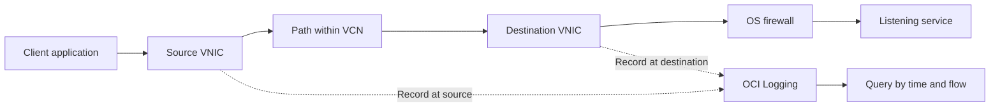

# VCN Flow Logs and Blocked Traffic Analysis

In the **Virtual Cloud Networks** chapter of the Oracle Cloud Infrastructure (OCI) module, this lesson addresses a common operational scenario: an application cannot connect to an endpoint, and the operator does not yet know where packets are being blocked. VCN Flow Logs provide traffic evidence at the VNIC to narrow the investigation scope before changing network configurations.

The running example is an application host connecting to an internal endpoint over TCP 1521, the port commonly used for Oracle Net Listener. The same analysis applies to SSH, HTTPS, and other TCP services. Tenancy, compartment, and IAM information help identify who can enable or read logs; VCN and Compute information help locate the exact interface; observation data helps verify changes, control costs, and support troubleshooting across multiple nodes.

## 1. Learning Outcomes

After this lesson, learners will be able to:

- Choose the right flow log enablement point for a connection under investigation.
- Distinguish security rule evaluation results from data collection statuses.
- Look up both directions of a flow by address, port, protocol, VNIC, and timestamp.
- Use evidence to decide whether to inspect NSGs, security lists, routing, host firewalls, or services.
- Verify a network permission change with a new connection and record before/after results.
- Recommend capture scope and alerting aligned with workload criticality.

Prerequisite knowledge includes CIDR, TCP, source/destination ports, ingress/egress, subnets, VNICs, NSGs, and security lists. Deploying a real database is not required to complete the lesson's lab.

## 2. Where Do Flow Logs Observe?

A resource connects to a VCN through a VNIC. Flow logs describe traffic observed at a VNIC, in a given direction and collection window. They can be enabled at the VCN, subnet, or specific resource/VNIC level; storage and search use OCI Logging. [Oracle VCN Flow Logs Overview](https://docs.oracle.com/en-us/iaas/Content/Network/Concepts/vcn-flow-logs.htm).



Separate three questions when reading evidence:

1. **What was observed?** Is there a record matching the attempt on the VNIC under review?
2. **How did security rules handle it?** Is the record's `action` `ACCEPT` or `REJECT`?
3. **Did the business request succeed?** Did the client receive the expected response from the service?

These three questions form consecutive investigation steps. For instance, seeing `ACCEPT` at the destination VNIC only gives a basis to move on to inspecting the host firewall and server process. It is not enough to conclude Oracle Database is ready to accept login sessions.

Flow logs do not contain SQL statements, HTTP bodies, or application payloads. When you need exact application-layer responses, combine service logs and client output; when packet-level detail is needed, consider packet capture tools or VTAP within authorized scope.

## 3. Distinguishing Three Types of Decisions

### 3.1. `ACCEPT` and `REJECT`

`data.action` reflects traffic accepted or rejected by security rules at the observation point. Use it to investigate security lists and NSGs applied to the VNIC. A record does not directly provide the OCID of the rule that needs editing. [Using flow logs to investigate security rules](https://docs.oracle.com/en-us/iaas/Content/Network/Concepts/vcn-flow-logs.htm).

For an expected flow:

- `REJECT`: check the right direction, effective rule set, and actual packet attributes.
- `ACCEPT`: continue checking the rest of the path, return direction, OS, and service.
- No matching records: verify both the packet path and the observation scope before drawing conclusions.

A burst of `REJECT` entries from unknown sources to an admin port may mean protections are doing their job. Whether it is an incident depends on whether that traffic is supposed to be permitted by design.

### 3.2. Collection Statuses `OK`, `NODATA`, `SKIPDATA`

| `data.status` | Meaning when reading logs |
| --- | --- |
| `OK` | Normal traffic record |
| `NODATA` | No traffic recorded during the collection window |
| `SKIPDATA` | Data was skipped due to system issues or collection capacity |

For `NODATA` and `SKIPDATA`, many traffic fields may be `null`. They are not equivalent to `REJECT`; missing data also does not prove the endpoint is reachable. [Collection window statuses](https://docs.oracle.com/en-us/iaas/Content/Logging/Reference/details_for_vcn_flow_logs.htm).

### 3.3. Capture Filter Include/Exclude

Capture filters select which data goes into logs. Security rules decide which traffic is allowed to pass. Therefore, adding Include to a capture filter does not open a service port; adding Exclude only changes the evidence collected.

Capture filters have a sampling rate and rules evaluated in order; the first matching rule decides Include/Exclude. Traffic matching no rule is not logged. Editing a shared filter affects all flow log configurations referencing it. [Capture Filters](https://docs.oracle.com/en-us/iaas/Content/Network/Concepts/capture-filters.htm).

Self-designed example for an IPv4 diagnostic run:

| Order | Action | Condition |
| --- | --- | --- |
| 1 | Include | Source `10.20.1.10/32`, destination `10.20.2.20/32`, TCP, destination port 1521 |
| 2 | Include | Source `10.20.2.20/32`, destination `10.20.1.10/32`, TCP, source port 1521 |

Select the appropriate direction on each VNIC, or both directions if supported and needed. Set 100% sampling for a small scope during the lab window. Including only the request direction leaves you without evidence on the return direction. If a broad Include rule is placed first, subsequent Exclude rules may have no effect.

## 4. Preparing and Enabling the Right Scope

### 4.1. Permissions and Resource Identification

Record the region, workload compartment, log group compartment, and both VNIC OCIDs. Do not assume the log group lives in the same compartment as the Compute host.

Investigators only need permission to read log groups and log contents. Configurators additionally need log resource management permissions and network permissions matching the enablement point. Permission to read logs does not by default allow editing NSGs. See [log search permissions](https://docs.oracle.com/en-us/iaas/Content/Logging/Concepts/searchinglogs.htm) and [flow log management permissions](https://docs.oracle.com/en-us/iaas/Content/Logging/Task/managinglogs.htm).

In an organization, log reading can be assigned to the operations team while rule changes remain with the network administration team. This separation lets diagnostic records be shared without widening infrastructure change privileges.

### 4.2. Console Workflow

1. Open **Networking → Network Command Center → Flow logs** and select the right compartment.
2. Choose **Enable flow logs**, giving a traceable name such as `flow-app-db-investigation`.
3. Select the destination log group to which investigators have access.
4. Select or create a **Flow log capture filter** covering both request and response in the lab.
5. Add enablement points: prefer the two VNICs under investigation; two subnets can be used if observing multiple nodes is needed.
6. Review the configuration and enable flow logs.
7. Generate test traffic after enabling; check Logging to confirm data appears before starting analysis.

Enablement point options and creation steps are documented by Oracle in [Enabling Flow Logs](https://docs.oracle.com/en-us/iaas/Content/Network/Tasks/vcn-flow-logs-enable.htm). VCN/subnet is convenient when covering many VNICs; targeting specific VNICs gives an investigation a tighter scope.

Name configurations by purpose and owner rather than just hostnames. A diagnostic configuration should have a planned end time so anyone taking over knows when to re-evaluate capture scope.

## 5. Reading a Useful Record

Most commonly used fields:

| Field | Used to identify |
| --- | --- |
| `data.sourceAddress`, `data.destinationAddress` | IP pair |
| `data.sourcePort`, `data.destinationPort` | Port pair |
| `data.protocol` | Protocol number, e.g., TCP is 6 |
| `data.action`, `data.status` | Decision and collection quality |
| `data.packets`, `data.bytesOut` | Packets and bytes in the record |
| `data.startTime`, `data.endTime` | Time window, epoch seconds |
| `oracle.vnicocid` | Observed interface |

`flowid` is a hash derived from flow attributes; combine it with VNIC and time when investigating. Some link-local infrastructure traffic like VCN DNS/DHCP and ARP does not appear in flow logs. For connections via a Compute public IP, address fields may reflect the corresponding private IP. [Record schema and limitations](https://docs.oracle.com/en-us/iaas/Content/Logging/Reference/details_for_vcn_flow_logs.htm).

The snippet below is **hand-crafted illustrative data**, extracting only the fields needed for study; OCID and `flowid` are placeholders, not data taken from a tenancy:

```json
{
  "data": {
    "action": "REJECT",
    "status": "OK",
    "sourceAddress": "10.20.1.10",
    "destinationAddress": "10.20.2.20",
    "sourcePort": 43018,
    "destinationPort": 1521,
    "protocol": 6,
    "packets": 3,
    "bytesOut": 180,
    "startTime": 1795168800,
    "endTime": 1795168810,
    "flowid": "DEMO_FLOW_HASH"
  },
  "oracle": {
    "vnicocid": "DESTINATION_VNIC_OCID"
  }
}
```

Inference for this example: at the destination VNIC under review, traffic from the client to port 1521 was rejected by security rules. Cross-check actual configuration to see whether a rule is missing or an NSG is misattached. The count of three packets may also relate to retransmissions; the record alone is insufficient to determine three independent business requests.

Do not read `bytesOut` as an egress direction label. When reconstructing flow direction, use source/destination IPs and the observed VNIC. For example, `10.20.1.10:43018 → 10.20.2.20:1521` is the request; the response uses `10.20.2.20:1521 → 10.20.1.10:43018`.

Incident timestamps must always include timezones. For example, `17:00 +07:00` corresponds to `10:00Z`. When cross-checking, widen the search window around the attempt to account for aggregation windows and Logging ingestion latency.

## 6. Querying in OCI Logging

In **Logging → Search**, select the right region, log group, log, and time range. The queries below use **Logging Search Advanced mode**; replace `COMPARTMENT_OCID`, `LOG_GROUP_OCID`, and `LOG_OCID` with real values rather than leaving placeholders. Selecting the specific log avoids mixing schemas with logs from other services.

The structure of `search`, `where`, `select`, `summarize`, and `sort by` follows [Logging Query Language Specification](https://docs.oracle.com/en-us/iaas/Content/Logging/Reference/query_language_specification.htm).

### 6.1. Find Blocked Traffic

```text
search "COMPARTMENT_OCID/LOG_GROUP_OCID/LOG_OCID"
| where data.status = 'OK' and data.action = 'REJECT'
| sort by datetime desc
```

Inspect one raw JSON line before adding conditions: IP fields are strings, ports/protocols are numbers, and field names are case-sensitive. The time range is selected in the Search UI.

### 6.2. Narrow Down the Exact Connection and Observation Point

```text
search "COMPARTMENT_OCID/LOG_GROUP_OCID/LOG_OCID"
| where data.status = 'OK'
  and data.sourceAddress = '10.20.1.10'
  and data.destinationAddress = '10.20.2.20'
  and data.destinationPort = 1521
  and data.protocol = 6
  and oracle.vnicocid = 'DESTINATION_VNIC_OCID'
| sort by datetime desc
```

Hold off filtering `REJECT` in this query so you can see both before and after results across a change. The source port on a new attempt may differ from 43018; add a source port condition only after pinning down the exact attempt to inspect.

### 6.3. Check the Return Direction

```text
search "COMPARTMENT_OCID/LOG_GROUP_OCID/LOG_OCID"
| where data.status = 'OK'
  and data.sourceAddress = '10.20.2.20'
  and data.destinationAddress = '10.20.1.10'
  and data.sourcePort = 1521
  and data.protocol = 6
| sort by datetime desc
```

If the two VNICs write to two different logs, adjust the search scope accordingly or select both logs. Compare within the same time window; do not pair a response from a different attempt just because the IP pair matches.

### 6.4. Group Rejected Sources

```text
search "COMPARTMENT_OCID/LOG_GROUP_OCID/LOG_OCID"
| where data.status = 'OK' and data.action = 'REJECT'
| summarize count(data.action) as records
  by data.sourceAddress, data.destinationAddress, data.destinationPort
| sort by records desc
```

The output shows which group has the most rejected **records** to prioritize investigation. Do not name the column connection count or request count. A long-lived flow can appear across multiple windows; the same traffic can also be seen on multiple VNICs. [Oracle VCN Flow analysis notes](https://docs.oracle.com/en-us/iaas/log-analytics/doc/vcn-flow.html).

### 6.5. Check Collection Gaps

```text
search "COMPARTMENT_OCID/LOG_GROUP_OCID/LOG_OCID"
| where data.status = 'NODATA' or data.status = 'SKIPDATA'
| sort by datetime desc
```

Keep this query separate from the `REJECT` query. Merging them into a single "network errors" metric makes it hard for on-call operators to tell whether to fix security rules or check telemetry quality.

## 7. Workflow for Investigating a Failed Connection

### Step 1: Rewrite the Expected Request

A good description is: "At 17:00 +07:00, Compute `app-01`, IP `10.20.1.10`, initiated a new TCP connection to `10.20.2.20:1521`; result timed out." Also record the actual destination IP if the client used DNS, VNIC OCIDs, and attempt counts. Saying "database is down" fails to distinguish network, listener, and login errors.

### Step 2: Verify Observability

Verify logs were enabled before the attempt, on the right enablement point, with a filter covering the right direction, suitable sampling, read permissions, and search time window. Perform a timestamped test attempt for correlation. Missing historical logs from before enablement cannot be recovered by widening the query. [Conditions for searching ingested logs](https://docs.oracle.com/en-us/iaas/Content/Logging/Concepts/searchinglogs.htm).

### Step 3: Use the Decision Table

| Attempt evidence | Next inspection direction |
| --- | --- |
| `REJECT` at source VNIC, outbound request | Source VNIC egress |
| `ACCEPT` at source, `REJECT` at destination VNIC | Destination VNIC ingress |
| `ACCEPT` at destination yet client still times out | Host firewall, listener, response, and return path |
| Only request-direction records exist | Check return-direction filter, server response, and return path |
| Absent on both sides | Enablement point, filter, time, destination IP, and path before VNIC |
| `SKIPDATA` present during incident window | Supplement with VNIC metrics, OS logs, and another test attempt |

This table is a suggested isolation method. Each row is an investigation direction, not an automatic root-cause conclusion.

### Step 4: Cross-Check Effective Rules

Allow rules from security lists and NSGs applied to a VNIC are combined as a union. There is no requirement that every NSG and every security list contain the same allow rule. Stateful rules track connections and permit return traffic; stateless rules must explicitly allow the return direction. When both stateful and stateless rules match one traffic direction, stateless takes precedence. [Security Rules](https://docs.oracle.com/en-us/iaas/Content/Network/Concepts/securityrules.htm).

Use specific questions to verify:

- Is the NSG attached to the exact VNIC appearing in the log?
- Does the source CIDR contain the IP the server actually sees?
- Is the rule granting ingress or egress?
- Was the client's ephemeral source port confused with destination port 1521?
- Is there a broad allow rule in a security list preventing removal of an NSG rule from producing the expected `REJECT`?
- If the path traverses NAT or a proxy, does the tuple at the observed segment differ from the tuple originally created by the client?

If the endpoint uses Zero Trust Packet Routing, cross-check the corresponding ZPR policy alongside security rules. For topologies traversing centralized firewalls or intermediate appliances, gather additional evidence on that device; VNIC flow logs do not substitute for logs across the entire path.

### Step 5: Cross-Check Host and Service Side

Once the destination VNIC shows `ACCEPT`, check whether the server binds to the right address/port, whether the OS firewall allows it, and whether the client uses the right endpoint. Example on an authorized Linux host:

```bash
ss -lntp 'sport = :1521'
```

This shows whether a listening socket exists; it does not verify Oracle service name, credentials, or TLS configuration. A socket bound only to `127.0.0.1` also will not answer connections to the machine's private IP.

With a real Oracle Database, TCP success is only one milestone. Continue checking Oracle Net Listener, registered services, and Oracle client connection results. Do not open extra network ports to troubleshoot authentication errors after already reaching the listener.

### Step 6: Make a Small Fix and Verify

Change one evidence-backed cause, record before/after, and open a new connection. Changing multiple things at once makes it hard to tell what altered the outcome. After fixing, test both traffic that should be allowed and traffic that must still be blocked by design.

## 8. Lab: Missing TCP 1521 Ingress

### 8.1. Topology and Conditions

Use two Linux Compute hosts in a lab environment within the same VCN `10.20.0.0/16`, communicating via private IPs:

| Component | Address and role |
| --- | --- |
| `app-01` | `10.20.1.10`, subnet `10.20.1.0/24`, initiates connection |
| `db-probe` | `10.20.2.20`, subnet `10.20.2.0/24`, runs simulated TCP listener |
| `nsg-app` | Attached to source VNIC, allows TCP egress to destination 1521 |
| `nsg-db-probe` | Attached to destination VNIC, initially lacks ingress from client to 1521 |

The lab assumes no ZPR or intermediate firewall; internal VCN paths already work. Inspect all relevant security lists and NSGs to be sure no other allow rule already permits the flow meant to be blocked. Only modify rules on lab resources while preserving admin access to the machines.

`ncat` is needed on both hosts. `db-probe`'s OS firewall must be prepared to allow TCP 1521 from the lab client; if not, resolve that prerequisite first so two failure causes are not mixed into one test. Do not deploy a real Oracle Database in this lab.

### 8.2. Prepare Endpoint and Logs

On `db-probe`, start a simulated TCP listener and keep the terminal open:

```bash
ncat --listen --keep-open 10.20.2.20 1521
```

In another terminal on the same host:

```bash
ss -lntp 'sport = :1521'
```

Enable flow logs on both VNICs with a capture filter covering both directions described earlier. Record VNIC OCIDs, log OCIDs, and start timestamp. Commands in the lab section are instructions to run on the two lab machines, not on the machine used to author documentation.

### 8.3. Create a Controlled Failure

On `app-01`:

```bash
date -u '+%Y-%m-%dT%H:%M:%SZ'
ncat -vz -w 3 10.20.2.20 1521
```

Expect the connection to fail due to missing ingress at the destination. Once logs are ingested, search for the matching tuple and destination VNIC OCID. Expected primary evidence is `status=OK`, `action=REJECT`, source `10.20.1.10`, destination `10.20.2.20`, destination port 1521.

If this evidence does not appear, re-check capture scope and actual configuration. Do not fill expected results into a report as if they were observed results.

### 8.4. Fix with Exact Scope

Add one rule to `nsg-db-probe`:

| Attribute | Lab value |
| --- | --- |
| Direction | Ingress |
| Stateful | Yes |
| Source type | CIDR |
| Source CIDR | `10.20.1.10/32` |
| Protocol | TCP |
| Source port | All |
| Destination port | 1521 |

A `/32` CIDR keeps the change small and easy to verify in the lab. For applications with multiple instances whose addresses change, design rules referencing the source NSG where appropriate rather than manually maintaining `/32` entries.

Open a **new connection** from `app-01`, record the timestamp, and re-query logs. Expect TCP to connect successfully and a matching `ACCEPT` to appear. Do not use a successful TCP connection to the simulated listener to claim Oracle Database is working.

### 8.5. Control Check and Lab Completion

If a third lab client exists, keep it outside the permitted source and test the same port: it should continue to be blocked. If none exists, explicitly record that out-of-scope source control testing was not performed; do not substitute measurements from the permitted client.

The lab report must be filled with actual observed data:

| Attempt | UTC Time | Tuple/VNIC | Client result | Log evidence |
| --- | --- | --- | --- | --- |
| Before change | Fill when run | Fill when run | Fill when run | Fill when run |
| After change | Fill when run | Fill when run | Fill when run | Fill when run |
| Control check if any | Fill when run | Fill when run | Fill when run | Fill when run |

When finished, stop `ncat` with `Ctrl+C`, revert the lab rule, and re-evaluate capture settings. Remove only resources created specifically for the lab; retain required evidence per your learning environment's policies.

## 9. Monitoring and Cost Control

For multi-node workloads, break down results by VNIC and endpoint before aggregating. One node with an ingress failure can be masked inside total `ACCEPT` traffic across the whole application. During failover, verify whether the new target VNIC is already inside the observation scope.

One alerting option is using **Connector Hub** to consume flow logs from Logging, filter `data.action = 'REJECT'`, emit metrics to Monitoring, and configure alarms and notification channels. This pattern is illustrated in [Scenario: Alarming on Log Data](https://docs.oracle.com/en-us/iaas/Content/connector-hub/alarmlogs.htm).

Scope alerts to critical business tuples or endpoint groups. Thresholds should be based on baselines and service health: three `REJECT` records from a test exercise are not enough to set a tenancy-wide threshold. Also monitor data gaps so missing logs are not mistaken for blocked traffic disappearing.

An operational setup might include:

- Steady-state capture on critical service subnets, with scope and retention approved by the owner.
- A separate, narrow filter at 100% sampling during specific connection investigations.
- Saved queries for app–database connections and for `SKIPDATA`.
- Owner, review date, and criteria for ending diagnostic capture.

Costs must account for log ingestion/retention volume and any extra services used such as Log Analytics or external exports. Lower sampling reduces data volume but weakens evidence for rare attempts. Avoid estimating total real requests by mechanically multiplying record counts by the inverse of the sampling rate.

Configuration change history should be checked via Audit when needing to know who modified networking or disabled logs. Flow logs provide traffic evidence; change records place that evidence in operational context. Access to read IPs, OCIDs, and topology in logs must also be authorized on a need-to-know basis.

## 10. Misinterpretations to Avoid

| Hasty interpretation | Evidence-based check |
| --- | --- |
| "Seeing `REJECT` means we must open the port" | Determine whether the traffic is permitted by design |
| "`ACCEPT` proves the application works" | Also check TCP, the service, and business responses |
| "No logs means no packets existed" | Check filter, sampling, enablement point, and time window |
| "Missing allow in one NSG means definitely blocked" | Evaluate the entire rule set applied to the VNIC |
| "`count` equals connection count" | Explicitly note you are counting records, not inferring requests |
| "Port 1521 must be set on both source and destination" | Clients normally use ephemeral source ports |
| "Opening the entire CIDR reaches conclusions faster" | Test a small change tied to the observed tuple |

When closing an investigation, records should be complete enough for someone else to reproduce: tuple, VNIC, timestamps, queries, client output, before/after records, edited rules, and control-test results. Conclude root cause only when actual evidence links the configuration change to the change in connection behavior.
