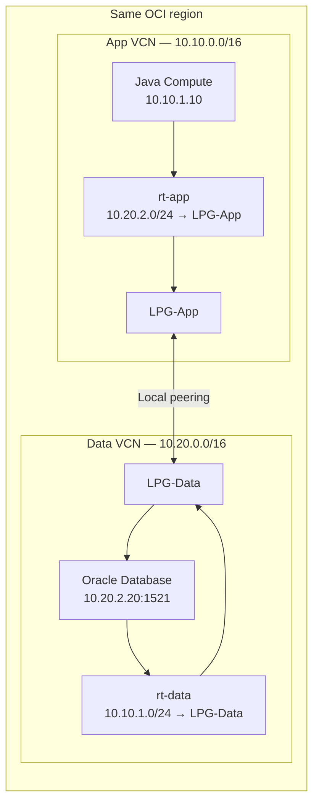

# Local Peering Gateway and VCN Connectivity Within the Same Region

## Objectives and Context

In the **Hybrid and Inter-Region Connectivity** chapter of the **CLOUD_PROVIDERS_ORACLE** module, this lesson focuses on a foundational OCI networking capability: enabling resources in two Virtual Cloud Networks (VCNs) within the same region to communicate over private IP addresses using a Local Peering Gateway (LPG).

A system may separate its application tier and data tier into two VCNs to assign responsibilities to two different teams. For example, a Java application on OCI Compute needs to call an Oracle Database over a private address, while the database team independently manages networking and access permissions. An LPG provides the connection path; IAM, route tables, and security rules decide who is allowed to establish that path and which traffic actually passes through.

After this lesson, learners will be able to:

- Identify the prerequisites for establishing local peering.
- Design an LPG pair and bidirectional routing between two VCNs.
- Distinguish IAM permissions from packet-level access control.
- Practice an application-to-database flow with clearly scoped access.
- Diagnose issues layer by layer and choose between LPG and DRG appropriately.

## 1. What Problem Does Local Peering Solve?

A VCN is a virtual network with its own address space, subnets, routing, and security mechanisms. Two VCNs in the same tenancy, compartment, or region do not automatically have a communication path between them.

**Local peering** connects two VCNs in the same region so resources communicate using private IPs, without routing inter-VCN traffic over the Internet or looping back through an on-premises network. The two VCNs can belong to the same tenancy or different tenancies. With LPG, each side creates a gateway and then establishes a connection between the two gateways. [Oracle Local Peering using LPG overview](https://docs.oracle.com/en-us/iaas/Content/Network/Tasks/localVCNpeering.htm).

Three types of objects must be understood separately:

| Object | Question the object answers |
| --- | --- |
| LPG and peering connection | What connectivity relationship exists between the two networks? |
| Route rule | Where are packets destined for a given CIDR sent? |
| Security rule | Is traffic with this source, destination, protocol, and port permitted? |

For example, an established peering status only confirms the gateway relationship. It does not prove that the Java application can open a connection to the database listener.

### LPG in OCI Architecture

LPG serves connectivity between VCNs in the same region. When cross-region connectivity is required, a different architecture must be chosen, typically involving a DRG and remote peering. When many VCNs need to connect through a central routing point, an upgraded DRG should be evaluated instead of continuously adding LPG pairs. [Types of VCN peering](https://docs.oracle.com/en-us/iaas/Content/Network/Tasks/VCNpeering.htm), [intra-region connectivity via upgraded DRG](https://docs.oracle.com/en-us/iaas/Content/Network/Tasks/scenario_d.htm).

The lab below only requires two VCNs and one pair of LPGs. You do not need to create FastConnect, VPN, or DRG to complete this model.

## 2. Lab Model: Java Application Accessing Oracle Database

Suppose a tenancy has two compartments: `AppLab` and `DataLab`. The application team owns App VCN; the data team owns Data VCN. Both VCNs are created in the same region selected for the lab.

| Component | App VCN | Data VCN |
| --- | --- | --- |
| VCN name | `app-vcn` | `data-vcn` |
| VCN IPv4 CIDR | `10.10.0.0/16` | `10.20.0.0/16` |
| Test subnet | `10.10.1.0/24` | `10.20.2.0/24` |
| Illustrative resource | Compute running Java application | Host running Oracle Database |
| Illustrative private IP | `10.10.1.10` | `10.20.2.20` |
| LPG | `lpg-app-data` | `lpg-data-app` |
| Subnet route table | `rt-app` | `rt-data` |

The addresses above are design values for this lesson. When practicing, use the actual IPs assigned to the VNICs; do not assume the host automatically receives the illustrative address.

The required flow is:

```text
Source:      10.10.1.10, ephemeral TCP port chosen by client
Destination: 10.20.2.20, TCP 1521
Initiator:   application host
Response:    database host back to the initiated session
```

TCP 1521 is an assumed listener port in this example, not a mandatory port for every Oracle Database service. For an actual database, obtain the endpoint, port, and TLS requirements from the service configuration. If you only want to test networking, you can run a test TCP service in Data VCN before deploying a database.



The diagram shows both the request path and the return path. The routes in the diagram are associated with the resource subnets, not an instruction to attach route tables directly to the LPGs.

## 3. Prerequisites to Lock Down

### 3.1. Same Region and Non-Overlapping CIDRs

Both VCNs participating in peering must be in the same region and have non-overlapping CIDRs. If a VCN has multiple CIDRs, check the entire address set rather than only the CIDRs used by the two test hosts.

For example:

| VCN A | VCN B | Notes |
| --- | --- | --- |
| `10.10.0.0/16` | `10.20.0.0/16` | Non-overlapping |
| `10.10.0.0/16` | `10.10.2.0/24` | B falls inside A, not suitable |
| `10.10.0.0/16` | `10.10.0.0/16` | Completely identical |

Merely placing two hosts in different subnets does not resolve overlapping VCN CIDRs. Plan addressing ahead of time, while reserving space for additional VCNs and on-premises networks.

### 3.2. One LPG Per Side for This Relationship

The design places `lpg-app-data` in App VCN and `lpg-data-app` in Data VCN. One LPG serves a single peering relationship; when App VCN needs to peer directly with a third VCN, provision an additional separate LPG on each side of the new relationship.

### 3.3. Executing Account Has Sufficient Permissions

You need permissions to view the right VCNs, create LPGs, establish peering, modify route tables, and update the relevant security objects. Being able to create an LPG does not mean the account already holds all remaining permissions.

Task assignment table for the lab:

| Task | Responsible party |
| --- | --- |
| Confirm CIDRs, region, and required TCP flows | Agreed jointly by both teams |
| Create LPG in App VCN | App-side network administrator |
| Create LPG in Data VCN | Data-side network administrator |
| Initiate connection request | Designated requestor |
| Authorize request within receiving scope | Acceptor side |
| Configure routes and security rules | Each team for its own VCN |
| Test database listener | Data team in coordination with App team |

Requestor and acceptor are roles during relationship setup. Once peering is active, those roles do not turn the connection into a one-way data path. [LPG creation workflow](https://docs.oracle.com/en-us/iaas/Content/Network/Tasks/create-lpg.htm), [permission requirements for the connect operation](https://docs.oracle.com/en-us/iaas/tools/oci-cli/latest/oci_cli_docs/cmdref/network/local-peering-gateway/connect.html).

## 4. IAM Permissions and Boundaries Between Teams

IAM governs OCI management operations. Security rules govern data traffic across VNICs. These two layers must be designed separately.

In the example model:

- The App team needs to manage networking within `AppLab`.
- The Data team needs to manage networking within `DataLab`.
- The requestor needs permission to establish a relationship with the acceptor's LPG per the policy agreed upon by both sides.
- Application developers do not need tenancy-wide administrative privileges just for the application to use an existing connection.

Within the same tenancy, clearly define groups, compartments, and required permissions. Across different tenancies, the two administrators must coordinate cross-tenancy policies and exchange the exact OCIDs. Do not assume that knowing the remote LPG's OCID is sufficient to connect.

This lesson does not provide a one-size-fits-all policy to copy for every organization: policy placement, groups, identity domains, and compartment scope depend on the actual IAM structure. Learners should compare LPG creation permissions against LPG connection permissions, then work with an administrator to apply the appropriate scope according to [IAM guidance for creating an LPG](https://docs.oracle.com/en-us/iaas/Content/Network/Tasks/create-lpg.htm).

An important outcome to record during IAM verification is: operators can perform the exact lab actions within the two intended compartments, while the application connects to the database using database identities and credentials. IAM permission to build the network path does not grant database accounts.

## 5. Bidirectional Routing Design

### 5.1. App Subnet Route

Suppose only Data subnet `10.20.2.0/24` needs to be reached. Add to `rt-app`:

| Destination CIDR | Target type | Target |
| --- | --- | --- |
| `10.20.2.0/24` | Local Peering Gateway | `lpg-app-data` |

### 5.2. Data Subnet Route

So that return packets can reach the App subnet, add to `rt-data`:

| Destination CIDR | Target type | Target |
| --- | --- | --- |
| `10.10.1.0/24` | Local Peering Gateway | `lpg-data-app` |

OCI uses the destination CIDR and target gateway to determine the path. Therefore, when creating a rule, select the LPG belonging to the VCN being configured; do not use the peer VCN's LPG OCID as the target in the source subnet. [Route tables and route rules in OCI](https://docs.oracle.com/en-us/iaas/Content/Network/Tasks/managingroutetables_topic-working.htm).

Expected path:

```text
10.10.1.10
  → App subnet route table
  → lpg-app-data
  → local peering relationship
  → lpg-data-app
  → 10.20.2.20

Return packet:
10.20.2.20
  → Data subnet route table
  → lpg-data-app
  → local peering relationship
  → lpg-app-data
  → 10.10.1.10
```

### 5.3. Why Check Associations?

The name `rt-app` does not prove that the App subnet is actually using that table. If the subnet is associated with a different route table, editing `rt-app` will not produce the expected behavior.

In the lab, inspect each subnet's association directly. The model assumes there is no dedicated route table on the VNIC or private IP and no path through an intermediate inspection appliance; if a real environment has such configurations, determine the effective route table for that exact source.

### 5.4. Broad Routes vs. Narrow Routes

You can design a route to the entire peer VCN, such as `10.20.0.0/16`, or only to the target subnet as in the example. The choice should reflect the connectivity scope you want to maintain.

A narrow subnet route makes the lesson's intent explicit, but security rules are still required to restrict services. A route to `10.20.2.0/24` does not mean only TCP 1521 is permitted.

If the table already has a default route `0.0.0.0/0` to another gateway, check more-specific routes for the peer subnet. Do not replace the default route with an LPG just to troubleshoot connectivity errors. In this two-VCN model, the destinations requiring routing are already known.

### 5.5. Attaching a Route Table Directly to an LPG

The console may allow selecting a route table when creating an LPG. That setting is for advanced routing scenarios, such as transit routing. For direct App-subnet-to-Data-subnet connectivity, leave this option unassigned; configure routes at the subnets as shown above. [Route table option when creating an LPG](https://docs.oracle.com/en-us/iaas/Content/Network/Tasks/create-lpg.htm).

## 6. Permitting the Exact Flow at the Security Layer

Suppose two NSGs are used:

- `nsg-app-db-client` attached to the App host's VNIC.
- `nsg-db-listener` attached to the Data host's VNIC.

Example using **stateful rules** for a TCP session initiated by App:

| Side | Direction | Source or destination | Protocol | Source port | Destination port |
| --- | --- | --- | --- | --- | --- |
| App | Egress | Destination `10.20.2.20/32` | TCP | All | 1521 |
| Data | Ingress | Source `10.10.1.10/32` | TCP | All | 1521 |

Source port is set to `All` because clients typically select ephemeral ports. If expanding to a group of application hosts, you can change the source CIDR to the App subnet after agreeing on scope.

With statefully tracked sessions, corresponding return traffic is handled according to connection state. Return routes must still exist. If stateless rules are used or an overlapping stateless rule exists for the flow, you must explicitly design the return direction and ephemeral ports; do not blindly apply the stateful assumption from this example. [How security rules work](https://docs.oracle.com/en-us/iaas/Content/Network/Concepts/securityrules.htm).

### Common Pitfalls

**Do not reference an NSG from the peer VCN directly.** For peering between two VCNs, use appropriate CIDRs in the example rules. An NSG referenced inside a rule must belong to the same VCN as the NSG being configured. [NSG rules in local peering](https://docs.oracle.com/en-us/iaas/Content/Network/Tasks/localVCNpeering.htm).

**Adding a narrow rule does not override an existing broad rule.** Inspect all subnet security lists and all NSGs applied to the VNIC. If an existing rule still permits TCP from a broader range, adding a `/32` rule does not narrow the overall effective access. Security lists and NSGs are additive allow-rule sets; they do not operate like ordered rule chains with an implicit deny at the end. [Security lists and NSGs used together](https://docs.oracle.com/en-us/iaas/Content/Network/Concepts/securityrules.htm).

**The OS and service can still reject traffic.** Beyond OCI configuration, verify the Data host's firewall, confirm the listener is bound to the appropriate address, and check that the database account has login privileges. An open TCP port does not guarantee that SQL queries will succeed.

If resources use Zero Trust Packet Routing, traffic must also satisfy ZPR policies. This basic lab assumes no ZPR attributes are attached to either endpoint. [Relationship between ZPR and security rules](https://docs.oracle.com/en-us/iaas/Content/Network/Concepts/securityrules.htm).

## 7. Console Setup Walkthrough

### Step 1: Record Configuration and Identify the Test Source

Verify both VCNs are in the right region, have non-overlapping CIDRs, and confirm the private IPs, subnets, and associated route tables of both hosts. Designate App as the requestor and Data as the acceptor.

Prepare access to the App host, such as an authorized OCI Bastion or an existing private management channel. Do not add a public IP to the database just to test peering.

### Step 2: Create Both LPGs

Under Networking, open App VCN, locate Local Peering Gateways, and create `lpg-app-data`. Verify the compartment and VCN before creating.

Repeat in Data VCN to create `lpg-data-app`. Leave route table association unselected for this basic lab. Save the OCID of each LPG so both sides identify the exact resources. [Console steps to create an LPG](https://docs.oracle.com/en-us/iaas/Content/Network/Tasks/create-lpg.htm).

### Step 3: Establish Peering

From the App-side LPG, initiate the peering connection and specify the Data-side LPG using the method provided by the Console. The acceptor side must prepare appropriate IAM permissions beforehand.

After the operation, check the peering status of both LPGs. If the request is rejected, troubleshoot IAM, region, or OCID first; there is no reason to modify database ports yet.

### Step 4: Add Routes to Both Subnets

Apply the two rules from Section 5 while preserving existing routes serving other subnet needs. For subnets shared by multiple resources, assess the impact of each new rule before saving.

### Step 5: Configure Security Rules and the Target Service

Apply the stateful rules from Section 6. Review existing rules to ensure traffic is opened only to the intended scope.

On the Data host, confirm the service is running and the OS firewall permits traffic from the App source. For Oracle Database, check the actual listener and service name.

### Step 6: Test from the App Host Itself

Use the Data host's private IP and the exact service port. Testing from a personal laptop does not prove local peering works if the laptop has no path into App VCN.

When testing succeeds, record: source, destination, port, timestamp, route tables used, and the status of both LPGs. This is stronger evidence than a screenshot of gateway status alone.

## 8. Automation Example with OCI CLI

The snippet below is for **PowerShell with OCI CLI installed and authentication configured**. These are sample commands for learners to run in a lab environment; replace all placeholder values before executing. Both VCNs already exist, the profile has appropriate permissions, and the two sample LPGs have not yet been created.

```powershell
$ociRegion = '<region-of-both-VCNs>'
$appCompartmentId = '<app-compartment-ocid>'
$dataCompartmentId = '<data-compartment-ocid>'
$appVcnId = '<app-vcn-ocid>'
$dataVcnId = '<data-vcn-ocid>'

$appLpgId = oci network local-peering-gateway create `
    --region $ociRegion `
    --compartment-id $appCompartmentId `
    --vcn-id $appVcnId `
    --display-name 'lpg-app-data' `
    --query 'data.id' --raw-output

if ($LASTEXITCODE -ne 0) {
    throw 'Failed to create App-side LPG.'
}

$dataLpgId = oci network local-peering-gateway create `
    --region $ociRegion `
    --compartment-id $dataCompartmentId `
    --vcn-id $dataVcnId `
    --display-name 'lpg-data-app' `
    --query 'data.id' --raw-output

if ($LASTEXITCODE -ne 0) {
    throw 'Failed to create Data-side LPG.'
}

oci network local-peering-gateway connect `
    --region $ociRegion `
    --local-peering-gateway-id $appLpgId `
    --peer-id $dataLpgId

if ($LASTEXITCODE -ne 0) {
    throw 'Failed to establish peering.'
}

oci network local-peering-gateway get `
    --region $ociRegion `
    --local-peering-gateway-id $appLpgId

oci network local-peering-gateway get `
    --region $ociRegion `
    --local-peering-gateway-id $dataLpgId
```

The `connect` command uses the requestor LPG in `--local-peering-gateway-id` and the acceptor LPG in `--peer-id`. [Connect command reference](https://docs.oracle.com/en-us/iaas/tools/oci-cli/latest/oci_cli_docs/cmdref/network/local-peering-gateway/connect.html).

The sample script assumes a single identity with sufficient permissions in both compartments. In a two-team independent administration model, each team creates its own LPG with its own identity and exchanges OCIDs; the requestor runs the connect step.

The CLI automates operations—it does not bypass IAM. The snippet also does not configure routes or security rules yet. Inspect the output of both gateways before proceeding to data-plane testing.

If deploying with Terraform or another tool, manage all parts: both LPGs, the peering relationship, routes, and security rules. Re-runs must recognize existing resources; repeatedly creating new LPGs with the same display name is not safely idempotent.

## 9. Testing and Interpreting Results

### 9.1. Checking the Listener on the Data Host

If the target host runs Linux, an authorized administrator can check:

```bash
ss -lnt | grep ':1521'
```

This command confirms a listening socket matches the filter, but does not prove the App-to-Data path works. Check the bind address: a listener bound only to loopback will not serve connections over the host's private IP.

### 9.2. Checking TCP from the App Host

On Linux with netcat:

```bash
nc -vz -w 3 10.20.2.20 1521
```

On a Windows source host:

```powershell
Test-NetConnection -ComputerName 10.20.2.20 -Port 1521
```

A successful TCP connection shows the path and service allowed the TCP handshake at the time of testing. If using JDBC, proceed to test login and a small query using an authorized lab account.

Example JDBC URL for a standard TCP listener:

```text
jdbc:oracle:thin:@//10.20.2.20:1521/<actual_service_name>
```

The URL above illustrates using a private address in a connection string. With TCPS, wallets, or managed database services that have custom connection strings, use the configuration provided by the service and never log passwords.

### 9.3. Distinguishing Failure States

| Observed result | Hypothesis to investigate next |
| --- | --- |
| Unable to establish peering | Requestor/acceptor permissions, region, OCID, LPG state |
| TCP timeout | Bidirectional routes, OCI rules, target host firewall, whether endpoint is active |
| TCP connection refused | Service not listening or a component actively rejecting |
| TCP succeeds but JDBC fails | Service name, credentials, TLS configuration, and database requirements |
| Works by IP but hostname fails | DNS and resolver configuration |
| ICMP fails while TCP succeeds | ICMP may not be permitted; not sufficient grounds to conclude peering is broken |

Each observation narrows the scope—it is not an absolute conclusion. For example, a timeout does not prove only a security rule is wrong.

### 9.4. Using Packet Capture When Needed

If granted access on the Data host:

```bash
sudo tcpdump -ni any 'host 10.10.1.10 and tcp port 1521'
```

Interpret along these lines:

- No SYN seen: check the source-to-destination path and filtering layers before packets reach the host.
- SYN seen but no SYN-ACK: check the Data host's service and firewall.
- SYN-ACK leaves the Data host but the source still times out: focus on the return path or source-side configuration.
- Handshake completes then fails: check application and database protocols.

Combine packet capture with route, rule, and timestamp information. When a managed service does not permit OS access, use the diagnostics and logs supported by the service.

## 10. DNS Is a Separate Configuration

Peering provides the network path; name resolution between the two VCNs requires additional design. Do not assume internal names in Data VCN will automatically resolve from the App host right after connecting LPGs.

OCI provides resolvers and private DNS mechanisms. Depending on how domains are organized, you may need to share private views or configure appropriate resolver endpoints and forwarding. [DNS in a VCN](https://docs.oracle.com/en-us/iaas/Content/Network/Concepts/dns.htm).

Example troubleshooting sequence:

1. Test TCP to `10.20.2.20` first to confirm the IP path.
2. Query the database hostname directly from the App host.
3. Compare the returned IP with the expected endpoint.
4. If forwarding is needed, verify the path to the DNS endpoint and rules for DNS queries.
5. Switch the connection string to the hostname once both name resolution and TCP connectivity pass.

Do not edit the hosts file on a single machine and conclude that shared DNS design is complete. It can support temporary testing, but it does not validate the system's resolvers.

## 11. Architectural Limits to Remember

### 11.1. Peering Relationships Are Not Automatically Transitive

Suppose App VCN peers with Shared VCN, and Shared VCN peers with Data VCN:

```text
App VCN ← LPG → Shared VCN ← LPG → Data VCN
```

Do not infer that App automatically has a path to Data across those two relationships. When three networks must communicate, design appropriate direct connectivity or an intentional centralized routing architecture. Even when using a DRG, attachments, routes, and security rules must still be configured properly.

To estimate complexity, if every pair among `n` VCNs must peer directly, the number of relationships is:

```text
n × (n - 1) / 2
```

Four VCNs produce six relationships, corresponding to twelve LPGs in a design with two gateways per relationship. This is the full-mesh count, not a deployment recommendation or a quota guarantee.

### 11.2. Do Not Use a Peer's Internet Gateway as a Default Internet Route

Do not design this lab by pointing `0.0.0.0/0` to an LPG and expecting the App host to use Data VCN's Internet Gateway. Internet egress or centralized inspection needs require a supported, separately evaluated architecture.

### 11.3. Transit Routing Requires Additional Design

Some scenarios route traffic from a VCN through a hub to an on-premises network via VPN or FastConnect. That is transit routing with additional route tables; merely having an LPG pair does not establish the entire path. [Scope and advanced scenarios for LPG](https://docs.oracle.com/en-us/iaas/Content/Network/Tasks/localVCNpeering.htm).

### 11.4. When to Consider an Upgraded DRG?

| Design need | Direction to evaluate |
| --- | --- |
| Two VCNs, direct connectivity, small scope | An LPG pair is a clear model to learn and operate |
| Many VCNs requiring centralized routing | Evaluate an upgraded DRG and route policies |
| Inter-region connectivity | Evaluate DRG and remote peering architecture |
| Multiple hybrid networks sharing VPN or FastConnect | Evaluate the full topology, redundancy paths, and segmentation |

Oracle maintains guidance for connecting multiple VCNs via an upgraded DRG. Designers should compare that architecture against relationship counts and operational requirements, rather than picking LPG solely because the first connection is easy to create. [Local peering via upgraded DRG](https://docs.oracle.com/en-us/iaas/Content/Network/Tasks/scenario_d.htm).

## 12. Operations, Availability, and Cost

### Separating Network Incidents from Service Incidents

An application can still lose connectivity due to a stopped Compute instance, listener failure, route changes, rule changes, or DNS misconfiguration even while the LPG relationship remains active. System availability also depends on application and database redundancy designs.

In this example, a periodic check can run from the App subnet, recording TCP open latency and the result of a simple query. An alert that TCP failed alone is insufficient to pinpoint root cause; correlate it with resource health and change history.

### Monitoring and Change Management

Where supported, use VCN Flow Logs for additional flow evidence at collection points, alongside OCI Audit to inspect relevant management actions. Choose appropriate scopes and retention periods; avoid logging credentials.

Before changing routes or rules, record the old configuration and prepare a specific rollback procedure. If you need to block a flow, identify every rule permitting that flow; deleting a narrow rule will not have the desired effect if a broad rule remains.

### Data Protection

Private IP transport avoids exposing database endpoints publicly. It does not replace authentication, database authorization, or encryption required by the application. For sensitive data, configure appropriate TLS or TCPS and validate certificates on the client.

### Controlling Lab Costs

Do not conclude the entire model incurs zero cost just because private addresses are used. List all resources including Compute, boot volumes, databases, storage, and logs; check pricing, quotas, and tenancy budgets before provisioning.

Use an existing test-permitted database or a lightweight TCP service if the goal is solely network testing. Tag lab resources with owner, purpose, and expiration. After completion, tear down unneeded resources within your authorized scope.

## 13. Lab Exercises and Expected Outcomes

Execute in your own lab environment:

1. Prepare two VCNs with the model's CIDRs or another non-overlapping CIDR pair.
2. Create the LPG pair and establish peering using granted permissions.
3. Configure bidirectional routes on the proper subnets.
4. Permit TCP traffic from the App host to the exact listener on Data.
5. Test TCP and, if a database is present, log in with a lab account.
6. Try a port not permitted in the lab configuration to verify access scope.
7. During an authorized fault-injection window, temporarily remove the return route, observe the result, then restore it.
8. Separately test hostname resolution and explain how it differs from IP testing.

Do not attempt to delete routes or modify rules on shared production subnets to complete these exercises.

Suggested results log table:

| Item | Required evidence |
| --- | --- |
| Resource identities | Region, VCN and LPG OCIDs, subnets, actual IPs |
| Peering relationship | Status of both LPGs |
| Forward and return paths | Destination CIDRs, target LPGs, associations of both subnets |
| Security scope | Effective rules on both VNICs and host firewall |
| Service connectivity | TCP result and database login result if applicable |
| DNS | Queried name, returned IP, and resolver used for the query |
| Post-fault recovery | Routes and rules restored to expected configuration |

When cleaning up the lab, remove the routes and rules added for the connection before deleting the associated gateways, and verify no other users depend on the resources. Do not delete shared VCNs, subnets, databases, or rules just because they appear in the model.

## 14. Key Takeaways

A working LPG connection requires **a connected gateway pair, accurate bidirectional routes, appropriate security rules, and an active target service**. IAM allows operators to create and manage these components; database access and DNS require separate configuration.

For Oracle systems on OCI, the value of this design lies in connecting applications to data over private addresses, keeping administrative responsibilities clear, and having concrete test evidence. As the topology grows, re-evaluate LPG, DRG, network segmentation, and operational approaches before adding further peering relationships.
