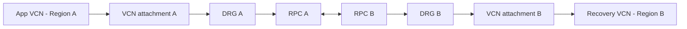
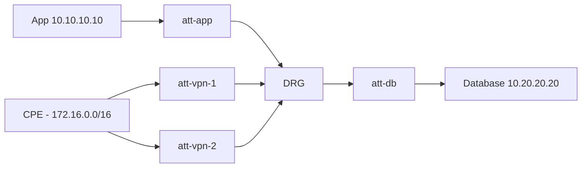

# Dynamic Routing Gateway and Attachment Types

In the **Hybrid and Inter-Region Connectivity** chapter of the **Oracle Cloud Infrastructure (CLOUD_PROVIDERS_ORACLE)** module, the Dynamic Routing Gateway is the component that stitches private networks together into an operable architecture. An application on OCI Compute might need to access an Oracle Database in another VCN, call services in an on-premises data center, or exchange data with a disaster recovery region. The connectivity design must simultaneously satisfy authorization, security, observability, and availability requirements.

This lesson explains which attachment serves each need, how to determine which route table is used, and how to build a lab model with explicit forward and return paths.

## 1. Objectives and Prerequisites

After this lesson, learners will be able to:

- Select the appropriate attachment for VCN, Site-to-Site VPN, FastConnect, and inter-DRG connections.
- Distinguish DRG route tables, subnet route tables, and VCN ingress route tables.
- Trace a packet through the ingress attachment, route table, and egress attachment.
- Design routes for App VCN, Database VCN, and on-premises networks without relying on default configurations.
- Verify attachments, routes, security, and failover to backup connections using concrete evidence.

Learners should understand CIDRs, private IPs, subnets, VCNs, compartments, NSGs, and the basics of BGP. The examples use IPv4, an upgraded DRG, and non-overlapping placeholder addresses. Names like `att-app` are naming conventions in this lesson; in actual operations, use the corresponding OCIDs.

## 2. DRG and Attachment Are Two Different Objects

A **Dynamic Routing Gateway (DRG)** is a virtual router serving private network connectivity. An **attachment** represents the point where a network resource connects to the DRG. One DRG can have many attachments; each attachment has its own identifier and information about the attached network. This model lets you manage a centralized routing hub rather than pairing networks individually. [Source: OCI CLI — DRG](https://docs.oracle.com/en-us/iaas/tools/oci-cli/latest/oci_cli_docs/cmdref/network/drg.html).

You can read the architecture from left to right as follows:

```text
Source network
    |
ingress attachment
    |
DRG: look up route table applied to the ingress attachment
    |
egress attachment
    |
Destination network
```

Three questions to answer during design:

1. Which networks need to participate in connectivity?
2. From a given network, which destination networks should packets be allowed to have routes to?
3. Which components control protocols, ports, and application-level access?

For example, attaching Database VCN to a DRG only creates a connection point. The operations team must still define routes to the database subnet, return routes, network security rules, and Oracle Database access permissions. None of those conditions can be inferred solely from the attachment state.

## 3. Map of Attachment Types

OCI defines the following attachment types. The "Typical scenario" column reflects choices used in this lesson, not an exhaustive list of every deployable architecture.

| API type | Associated resource | Typical scenario |
| --- | --- | --- |
| `VCN` | Virtual Cloud Network | Attaching an application or database network |
| `IPSEC_TUNNEL` | Site-to-Site VPN tunnel | Connecting an on-premises network over VPN |
| `VIRTUAL_CIRCUIT` | FastConnect virtual circuit | Private connection serving private peering |
| `REMOTE_PEERING_CONNECTION` | Remote Peering Connection, abbreviated RPC | Connecting two DRGs, typically cross-region |
| `LOOPBACK` | Component of IPSec over FastConnect | Supporting VPN traffic paths over FastConnect |

A DRG is regional. Directly attached VCNs must be in the same region as the DRG; cross-region architectures use a DRG in each region with an RPC connecting them. A VCN can attach to only one DRG at a time, whereas one DRG can attach multiple VCNs. [Source: Dynamic Routing Gateways](https://docs.oracle.com/en-us/iaas/Content/Network/Tasks/managingDRGs.htm).

"Cross-tenancy" describes ownership between parties. Do not treat it as a sixth attachment type value in the table above. During inventory, note both the network type and the owning tenancy. The Console may display cross-tenancy attachments in a separate group. [Source: Getting a List of DRG Attachments](https://docs.oracle.com/en-us/iaas/Content/Network/Tasks/drg-get-all-drg-attachments.htm).

### 3.1. VCN Attachment: Entry Point for Application Networks

A VCN attachment is created directly to attach a VCN to a DRG. The VCN and DRG can belong to different compartments; the attachment resides in the VCN's compartment. You can attach a VCN from another tenancy if both sides configure appropriate IAM policies. After attaching, routes from subnets to the DRG are still required. [Source: Attaching a DRG to a VCN](https://docs.oracle.com/en-us/iaas/Content/Network/Tasks/drg-create-attachment.htm).

Usage example:

```text
App VCN                  DRG                  Database VCN
10.10.0.0/16 -- att-app -- + -- att-db -- 10.20.0.0/16
```

This design fits when the application team and database team manage separate networks. The designer should draft a table of intended flows before enabling connectivity:

| Source | Destination | Requirement |
| --- | --- | --- |
| App subnet | Database subnet | Connect to database listener |
| On-premises management network | Database host | Approved operational tasks |
| Test network | Database subnet | Not required in this example |

Choosing compartments supports resource-management authorization. Rules permitting a specific TCP session must be designed separately.

### 3.2. IPSec Tunnel Attachment: Site-to-Site VPN Connectivity

An IPSec connection is created with two redundant tunnels; each tunnel corresponds to its own attachment on the DRG. The CPE is the customer-premises endpoint device; the CPE object in OCI represents that device. Each tunnel can use BGP or static routing as supported. Always configure both tunnels rather than using only one. [Source: Site-to-Site VPN Overview](https://docs.oracle.com/en-us/iaas/Content/Network/Tasks/overviewIPsec.htm).

```text
                       tunnel 1 -- att-vpn-1
On-premises network -- CPE ====                     ==== DRG
                       tunnel 2 -- att-vpn-2
```

In an enterprise example, VPN may be the first step to test application connectivity with internal services. The network team should record separately:

- Which tunnel has established IPSec.
- Which tunnel has established BGP, if BGP is used.
- Which prefixes are actually learned over each tunnel.
- Which route is currently used for forwarding.
- What happens to application connectivity when one tunnel is interrupted.

Static routing configured on an IPSec connection is not the same as manually adding a static route in a DRG route table with the tunnel as next hop. Those two configuration places serve different roles.

### 3.3. Virtual Circuit Attachment: FastConnect Connectivity

FastConnect provides dedicated private connectivity between a customer network and OCI. For reaching private IPs inside a VCN, this lesson uses a private virtual circuit attached to a DRG. Do not generalize this model to assume every FastConnect type attaches to a DRG in the same way. [Source: FastConnect](https://docs.oracle.com/en-us/iaas/Content/Network/Concepts/fastconnect.htm).

```text
On-premises network -- provider network/cross-connect
                    -- private virtual circuit -- att-fc -- DRG
```

In enterprise system design, FastConnect is typically evaluated when you need capacity and operational characteristics matched to the workload. Decisions should be based on measurements: peak traffic, data transfer windows, application latency, budget, and failover plans when a link fails.

A virtual circuit is a logical resource. When evaluating redundancy, ask about physical paths, edge devices, and the provider network as well; merely counting attachments misses critical details.

### 3.4. RPC Attachment: Connecting Two DRGs

A Remote Peering Connection is created on each DRG, and then the two RPCs are connected. This architecture supports DRGs in different regions, or two DRGs in the same region. Participating networks require non-overlapping CIDR planning, bidirectional routes, and appropriate security rules. It can be deployed within the same tenancy or across tenancies. [Source: Remote VCN Peering through an Upgraded DRG](https://docs.oracle.com/en-us/iaas/Content/Network/Tasks/scenario_e.htm).



In a disaster recovery scenario, an RPC solves only part of the network connectivity. Operators still need to determine target hosts, data replication mechanisms, acceptable latency, and procedures to cut the application over to the standby region.

Separate three states during acceptance testing: the two RPCs are connected, routes to the target subnet exist, and the application actually exchanges data. Each state needs its own evidence.

### 3.5. Loopback Attachment: Supporting IPSec over FastConnect

Private FastConnect does not automatically imply IPSec encryption. With IPSec over FastConnect, the loopback attachment supports the Oracle-side VPN termination and the forwarding path between the virtual circuit and the tunnel. Oracle manages loopback routing; tenancy administrators do not manually configure its routes. The virtual circuit and tunnel attachments in this model must use different DRG route tables and import distributions. [Source: FastConnect Security](https://docs.oracle.com/en-us/iaas/Content/Network/Concepts/fastconnectsecurity.htm).

Simplified path per Oracle documentation:

```text
Encrypted packet from CPE
  -> VIRTUAL_CIRCUIT attachment
  -> LOOPBACK attachment
  -> IPSEC_TUNNEL attachment: IPSec termination, decryption
  -> VCN attachment
  -> destination in VCN
```

When reading the diagram, distinguish the transport path of encrypted packets from the path of decrypted application packets. Loopback serves this specific mechanism; do not treat it as an arbitrary attachment to link networks.

### 3.6. Resource Lifecycle and Attachment Lifecycle

Not all attachments are created through the same operation:

| Type | Resource-level management |
| --- | --- |
| VCN | Create or detach VCN attachment directly |
| IPSec tunnel | Manage the IPSec connection and associated tunnels |
| Virtual circuit | Manage the FastConnect virtual circuit |
| RPC | Manage the Remote Peering Connection |
| Loopback | Managed by OCI via the IPSec over FastConnect workflow |

OCI does not allow directly creating or deleting RPC, IPSec tunnel, or virtual circuit attachments in the same way as VCN attachments. Static routes in a DRG route table also cannot target an IPSec tunnel or virtual circuit attachment as next hop. [Source: DRG Management](https://docs.oracle.com/en-us/iaas/Content/Network/Tasks/manage-drg.htm).

Therefore, a deployment inventory must store both the network resource OCID and the attachment OCID. Recording only display names makes it easy for operators to pick the wrong object during checks or changes.

## 4. Route Tables Are Selected by the Ingress Attachment

Each attachment is associated with one DRG route table. When a packet enters the DRG, the table associated with the **ingress attachment** determines the egress attachment. The same attachment can export routes to multiple tables if each table's import distribution allows it. [Source: OCI CLI — DRG route table](https://docs.oracle.com/en-us/iaas/tools/oci-cli/latest/oci_cli_docs/cmdref/network/drg-route-table.html).

Suppose:

```text
att-app  -> RT-FROM-APP
att-db   -> RT-FROM-DB
att-vpn  -> RT-FROM-ONPREM
```

When App sends to Database, open `RT-FROM-APP` to find the route to Database. When Database replies, open `RT-FROM-DB` to find the route to App.

A common mistake is checking the destination attachment's table and concluding "the route exists." That check does not answer how packets arriving from the source will be handled.

### 4.1. Three Route Locations to Distinguish

| Location | When evaluated in the model |
| --- | --- |
| VCN route table used for workload traffic | Decides how packets leave the VCN toward the DRG |
| DRG route table attached to the ingress attachment | Decides which attachment to forward the packet to |
| VCN ingress route table associated with the VCN attachment, if configured | Controls the path when packets enter the VCN from the DRG |

A VCN attachment interacts with both a DRG-side table and a VCN-side table. If no dedicated VCN ingress route table is configured, implicit routing directs packets to the VCN's subnets. A newly created DRG has default tables and import distributions; verify the actual configuration rather than guessing from table names. [Source: Working with DRG Route Tables](https://docs.oracle.com/en-us/iaas/Content/Network/Tasks/managingDRGs.htm).

The lab below uses subnet route tables for workloads and inserts no traffic-inspection appliances. If an environment has dedicated route tables on a VNIC or IP, inspect the effective table at that level. OCI prioritizes IP-level tables, then VNIC-level, then subnet-level. [Source: VCN Route Tables](https://docs.oracle.com/en-us/iaas/Content/Network/Tasks/managingroutetables.htm).

### 4.2. Import Distributions and Route Propagation

An import route distribution is a set of rules selecting route sources for a DRG route table. You can match specific attachments, attachment types, or all attachments. OCI allows creating additional import distributions; export distributions use the service-provided default mechanism. [Source: Creating an Import Route Distribution](https://docs.oracle.com/en-us/iaas/Content/Network/Tasks/drg-rd-create.htm).

Lesson design example:

```text
RT-FROM-APP
  import from att-db
  import from att-vpn-1
  import from att-vpn-2

RT-FROM-DB
  import from att-app
  import from att-vpn-1
  import from att-vpn-2

RT-FROM-ONPREM
  import from att-app
  import from att-db
```

How to read this:

- App needs to learn paths to Database and on-premises.
- Database needs a return path to App, as well as a path to on-premises.
- Packets arriving from VPN need paths to App and Database.

This is one design choice for the illustrative scenario. If a test VCN is added, the implementation team must decide which tables it appears in. Rules matching specific attachments make reviewing the network list easier while the number of networks is small.

Do not interpret an import distribution as a TCP filter. Having `10.20.20.0/24` present in a route table says nothing about whether port 1521 or 443 is permitted.

## 5. Lab: App, Database, and On-Premises Network

### 5.1. Scope and Addressing

The hypothetical model has:

| Component | Address range | Conventional attachment |
| --- | --- | --- |
| App VCN | `10.10.0.0/16` | `att-app` |
| App subnet | `10.10.10.0/24` | Passes through `att-app` |
| Database VCN | `10.20.0.0/16` | `att-db` |
| Database subnet | `10.20.20.0/24` | Passes through `att-db` |
| On-premises network | `172.16.0.0/16` | `att-vpn-1`, `att-vpn-2` |

The App host has IP `10.10.10.10`; the database host has IP `10.20.20.20`. Assume the Oracle Database listener is configured on TCP 1521. An internal on-premises service has IP `172.16.40.10`, listening on TCP 443.



The arrows illustrate connection points. Route tables and security rules still must be configured for both directions.

Flows to accept:

| Flow | Expectation |
| --- | --- |
| App to Database TCP 1521 | Connects |
| App to on-premises service TCP 443 | Connects |
| Selected on-premises admin host to Database TCP 1521 | Connects within granted scope |
| App to unpermitted port on Database | Denied |

### 5.2. Preparing Permissions and Responsibilities

Suggested task allocation for the lab:

- The network team manages the DRG, attachments, routes, and VPN connection.
- The application team confirms source IPs, protocols, and connectivity requirements.
- The database team confirms the listener, accounts, and administrative scope.
- The cost owner tracks provisioned resources and retention periods.

IAM controls the ability to create and modify resources. For cross-tenancy connectivity, both parties need matching policies; `Define`, `Endorse`, and `Admit` statements work together to grant permissions across tenancy boundaries. Revoking peering creation permissions does not automatically tear down existing peering. [Source: IAM Policies for Routing Between VCNs](https://docs.oracle.com/en-us/iaas/Content/Network/Tasks/drg-iam.htm).

In a single-tenancy lab, scope permissions to the selected compartments. If the two VCNs are in different compartments, verify permissions at both the DRG location and the VCN location before concluding a resource is missing.

### 5.3. Build Sequence

1. **Plan addressing.** Confirm App, Database, and on-premises CIDRs do not overlap. Record the exact subnet containing each test host.
2. **Prepare VCNs and workloads.** Create or select the two VCNs, subnets, and test hosts. Verify the listener on the target host is active.
3. **Create the DRG.** Give it a recognizable name, place it in the network compartment, and record its OCID.
4. **Create separate route tables.** Prepare `RT-FROM-APP`, `RT-FROM-DB`, and `RT-FROM-ONPREM` according to the model.
5. **Create VCN attachments.** Attach App VCN and Database VCN and select their corresponding DRG tables. Wait until attachments are ready.
6. **Build the VPN.** Create the CPE object and IPSec connection, and configure both tunnels with the on-premises network team. This example uses BGP.
7. **Attach route tables to the tunnels.** Both VPN attachments use `RT-FROM-ONPREM` in this design.
8. **Configure import distributions.** Use the source lists in Section 4.2; verify the routes actually imported.
9. **Add workload and on-premises routes.** Use the tables in the next section.
10. **Apply security rules per flow.** Test each flow, save evidence, then test failover.

These steps describe operations in a lab environment. Do not change the route table of an attachment serving a live production system just to reproduce an example.

### 5.4. Subnet Routes

Route table used by App subnet:

| Destination | Target |
| --- | --- |
| `10.20.20.0/24` | DRG |
| `172.16.0.0/16` | DRG |

Route table used by Database subnet:

| Destination | Target |
| --- | --- |
| `10.10.10.0/24` | DRG |
| `172.16.0.0/16` | DRG |

The on-premises network needs routes to `10.10.10.0/24` and `10.20.20.0/24` via the OCI connection. With BGP, verify those prefixes are received and selected for use on the CPE.

The example intentionally routes to subnets rather than entire VCNs. If a new subnet is added, update the design; do not assume a new subnet already has permissions or routes.

### 5.5. Expected Routes Inside the DRG

Expected outcome of the design once imports are active:

| Table | Destination | Expected next hop |
| --- | --- | --- |
| `RT-FROM-APP` | `10.20.20.0/24` | `att-db` |
| `RT-FROM-APP` | `172.16.0.0/16` | Selected VPN tunnel |
| `RT-FROM-DB` | `10.10.10.0/24` | `att-app` |
| `RT-FROM-DB` | `172.16.0.0/16` | Selected VPN tunnel |
| `RT-FROM-ONPREM` | `10.10.10.0/24` | `att-app` |
| `RT-FROM-ONPREM` | `10.20.20.0/24` | `att-db` |

This is a verification checklist, not a list of static routes to enter. In particular, on-premises routes in this example are learned over VPN; do not manually add static routes with a tunnel next hop.

If the same prefix appears over both tunnels, check which route is actually selected and verify multipath settings if applicable. The basic lab does not require load balancing; the requirement is that connectivity remains functional when one tunnel goes down according to the prepared plan.

### 5.6. Tracing App-to-Database Connectivity

Request packet:

```text
Source: 10.10.10.10
Destination: 10.20.20.20:1521

App
 -> route 10.20.20.0/24 in table used by App subnet
 -> DRG via att-app
 -> RT-FROM-APP
 -> route to 10.20.20.0/24, next hop att-db
 -> Database VCN
 -> Database host
```

Return packet:

```text
Database
 -> route 10.10.10.0/24 in table used by Database subnet
 -> DRG via att-db
 -> RT-FROM-DB
 -> route to 10.10.10.0/24, next hop att-app
 -> App VCN
 -> App host
```

If a connection times out, record source, destination, port, and test timestamp. A "ping works" result does not prove the database listener is healthy. Conversely, ping failure is not enough to conclude routing is wrong if ICMP is not allowed.

One way to test from a Windows host with the corresponding cmdlet:

```powershell
Test-NetConnection -ComputerName 10.20.20.20 -Port 1521
Test-NetConnection -ComputerName 172.16.40.10 -Port 443
```

This tests TCP connectivity. To verify the complete application flow, continue with the appropriate client and an authorized account.

### 5.7. Separating Routing Conditions from Security Conditions

For the App-to-Database connection, evidence should include:

| Condition | Required evidence |
| --- | --- |
| Source sends packets to DRG | Effective route table for App |
| DRG selects the right Database attachment | Route in `RT-FROM-APP` |
| Return path selects the right App attachment | Route in `RT-FROM-DB` and Database side |
| Network policy permits TCP 1521 | Rules applied at source and destination |
| Target host runs the service | Listener and OS firewall |
| Application is authorized to use the service | Authentication result and valid operation |

In a model using stateful rules, configure the initiating flow according to policy and understand connection tracking. With stateless rules, explicitly design return traffic rules. Avoid adding a broad rule just to mask an unidentified failure point.

## 6. Inspecting Configuration with OCI CLI

The commands below only read resources. Assume OCI CLI is installed, authenticated, and configured for the right region. Strings with ellipses are placeholders and must be replaced with real OCIDs.

```powershell
$drgOcid = 'ocid1.drg.oc1...'
$vcnCompartmentOcid = 'ocid1.compartment.oc1...'
$attachmentOcid = 'ocid1.drgattachment.oc1...'
$routeTableOcid = 'ocid1.drgroutetable.oc1...'

oci network drg get --drg-id $drgOcid
oci network drg-attachment list --compartment-id $vcnCompartmentOcid --drg-id $drgOcid --all
oci network drg-attachment get --drg-attachment-id $attachmentOcid
oci network drg-route-table list --drg-id $drgOcid --all
oci network drg-route-rule list --drg-route-table-id $routeTableOcid --all
```

The attachment list command filters by compartment. If a VCN or connected resource sits in another compartment, check that specific compartment; an empty list in one scope does not prove the entire DRG has no attachments. [Source: Listing DRG Attachments](https://docs.oracle.com/en-us/iaas/Content/Network/Tasks/drg-list-attachment.htm).

Use attachment details to verify the associated route table. Display names aid recognition, while OCIDs provide exact matching. [Source: Getting a DRG Attachment’s Details](https://docs.oracle.com/en-us/iaas/Content/Network/Tasks/drg-get-attachment.htm).

Listing route tables returns the tables themselves—it does not replace listing the rules inside each table. [Source: OCI CLI — List DRG Route Tables](https://docs.oracle.com/en-us/iaas/tools/oci-cli/latest/oci_cli_docs/cmdref/network/drg-route-table/list.html).

When reading rules, verify destination, route type, next-hop attachment, and any conflict status. Do this for both the request-direction table and the return-direction table. [Source: OCI CLI — List DRG Route Rules](https://docs.oracle.com/en-us/iaas/tools/oci-cli/latest/oci_cli_docs/cmdref/network/drg-route-rule/list.html).

In automation, store the declarative relationship among the DRG, route tables, import distributions, and attachments in the team's infrastructure tooling. Before applying changes, check how many attachments use a given table: modifying a shared table can affect multiple flows.

## 7. Extending to a Recovery Region

Suppose you add Recovery VCN with subnet `10.30.30.0/24` in Region B. The next design sequence:

1. Prepare DRG B and a VCN attachment for Recovery VCN.
2. Create RPC A on DRG A, RPC B on DRG B, and connect both sides.
3. Configure App's table on DRG A to learn the Recovery prefix from RPC A.
4. Configure the table applied to incoming RPC B traffic on DRG B with a route to Recovery VCN.
5. Design the return path: Recovery needs a route to App, and Region A needs a route from RPC A to the App attachment.
6. Update workload subnet tables in both VCNs and security rules.
7. Measure application connectivity, replication throughput, and latency.

This is an extension of the example—do not infer that connecting two RPCs automatically satisfies every policy.

Use a dedicated checklist table to avoid mixing up directions:

| Direction | Lookup point in Region A | Lookup point in Region B |
| --- | --- | --- |
| App to Recovery | Table attached to `att-app` | Table attached to RPC B |
| Recovery to App | Table attached to RPC A | Table attached to Recovery VCN attachment |

If on-premises also needs to reach Recovery, that is an additional requirement. You must check VPN routes at A, routes across the RPC, routes at B, and routes known to the CPE. Do not substitute an App-to-Recovery test for an on-premises-to-Recovery test.

## 8. Operations, Redundancy, and Cost

### 8.1. Redundancy Must Be Proven End-to-End

With FastConnect, redundancy depends on the provider model and physical paths. Oracle separately documents L2 partners, L3 partners, and direct connections; a virtual circuit via an L3 partner may already be redundant between the partner and Oracle, but that does not guarantee redundancy from customer to partner. Backup VPN for FastConnect should use route-based VPN with BGP. [Source: FastConnect Redundancy Best Practices](https://docs.oracle.com/en-us/iaas/Content/Network/Concepts/fastconnectresiliency.htm).

For the lab, design a controlled test:

1. Record the active path and the result of a new TCP connection.
2. Interrupt one tunnel according to the lab test plan.
3. Observe route changes and retry a new connection.
4. Record outage duration, recovery time, and the state of existing sessions.
5. Restore the tunnel and verify the model returns to its intended state.

Do not equate "the route switched" with "all open sessions remain intact." Application criteria must specify reconnect capability, tolerable interruption windows, and error logging behavior.

### 8.2. Layer-by-Layer Observability

A useful operational record should correlate:

```text
Timestamp
 -> source/destination/port flow
 -> ingress attachment
 -> effective route table
 -> selected next hop
 -> related tunnel/circuit/RPC status
 -> application result
```

Alert on impact: losing a redundant path, losing a route to a critical prefix, or business connectivity failures. Merely seeing a resource exist in the Console does not reflect connectivity health.

### 8.3. Controlling Cost in Design

Do not estimate costs solely from the number of DRGs. For the proposed architecture, break down:

- Compute and Database workloads used for testing.
- FastConnect, provider services, and customer-side circuits if applicable.
- Cross-region data transfer, especially with frequent data replication.
- Monitoring tools and log data.
- Resources retained after the lab session.

For instance, if the goal is solely learning how to attach VCNs and select route tables, complete that part in a single region first. Add VPN, FastConnect, or a second region only when testing those specific features. Budgets should reflect the deployment model and unit pricing confirmed at execution time.

## 9. Isolating Faults with Evidence

The table below provides a suggested diagnostic sequence for the lesson's model.

| Symptom | Hypothesis to check | Next evidence |
| --- | --- | --- |
| VCN attachment is ready, but App cannot reach Database | Workload is not sending packets to DRG | Effective route table for App |
| Route exists in DRG, yet traffic still times out | Looking at the wrong ingress table | Attachment where packets actually enter |
| VPN shows up, but on-premises is unreachable | Route not learned, imported, or selected | BGP status and routes in App's table |
| One direction works, the other fails | Missing return route or another network control | Trace the return path hop by hop |
| Connectivity drops after changing import distribution | Required prefix is no longer in the table | Route list before and after |
| RPCs connected, yet workloads across regions cannot talk | Missing route in a VCN or DRG | Check both ingress tables in both regions |
| TCP opens, but Database client fails | Listener, service, or application credentials issue | Database client logs and output |
| Multiple attachments lose connectivity together | Shared component along the path | Physical diagram, CPE, and provider network |

When troubleshooting, change one evidence-backed hypothesis at a time. Expanding CIDRs, swapping route tables, and opening ports simultaneously makes recovery hard to explain and hard to maintain.

## 10. Signs You Truly Understand the Model

An implementation is explainable when the operator can point out:

- Why each network uses that exact attachment type.
- Which table processes packets upon each entry into the DRG.
- Which route delivers packets to the destination and which delivers responses back to the source.
- How network conditions and application conditions are verified.
- Which component provides redundancy for which failure, backed by concrete test results.
- Which resources must be kept, monitored, or torn down after the lab.

For the App-to-Oracle Database flow in this example, the explanation must connect the entire chain: workload route, `att-app`, `RT-FROM-APP`, `att-db`, Database network, and return path. Being able to trace that chain is the foundation for scaling to hybrid connectivity, multi-tenancy, and multi-region designs.
