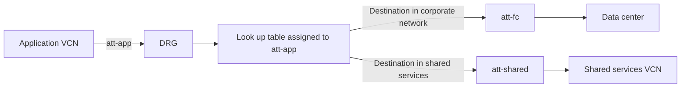
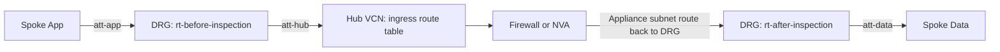
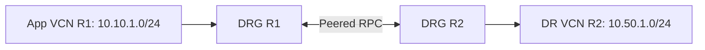

# DRG Route Tables, Route Distributions, and Transit Routing

## 1. Objectives and Context

In the **Hybrid and Inter-Region Connectivity** chapter of the **CLOUD_PROVIDERS_ORACLE** module, this lesson explains how to control packet paths through a Dynamic Routing Gateway (DRG) on Oracle Cloud Infrastructure (OCI). When a tenancy has multiple VCNs, data center connections, and a standby environment in another region, creating attachments only provides connection points. You must also specify which network learns which other networks' routes, and which attachment the DRG forwards incoming packets out through.

A typical scenario is an application running on OCI Compute needing to access an Oracle Database in an on-premises data center while also consuming shared services in a separate VCN. The network team wants to keep the application and data environments isolated, permit only required connections, and optionally force traffic through a firewall. DRG route tables and route distributions express the routing part of that requirement; IAM and security layers continue to enforce configuration change permissions and service access.

After this lesson, you will be able to:

- Distinguish a DRG route table, a VCN subnet route table, and a VCN ingress route table attached to a DRG attachment.
- Explain which control plane import/export route distributions belong to.
- Construct route tables for hybrid connectivity and segmented hub-and-spoke models.
- Trace both forward and return paths, including when traffic must traverse a traffic-inspection appliance.
- Prepare, observe, and cleanly roll back routing changes in a controlled manner.

This lesson uses an **upgraded DRG**, IPv4, and non-overlapping CIDRs. Learners should conceptually understand CIDRs, subnets, VCNs, NSGs, Site-to-Site VPN, and FastConnect. Examples use illustrative addresses; they contain no real OCIDs, keys, or live resources.

## 2. Mental Model: Route Tables Are Selected by the Ingress Attachment

### 2.1. Attachments Connect Networks to the DRG

A DRG is a virtual router. Common attachments in this lesson include:

| Attachment type | Associated network or connection | Example design name |
| --- | --- | --- |
| `VCN` | A VCN in the region | `att-app`, `att-shared` |
| `IPSEC_TUNNEL` | A Site-to-Site VPN tunnel | `att-vpn-1` |
| `VIRTUAL_CIRCUIT` | A FastConnect private virtual circuit | `att-fc` |
| `REMOTE_PEERING_CONNECTION` | Connection to another DRG via RPC | `att-rpc-r2` |

Each attachment is assigned one DRG route table. Multiple attachments can share one table when they share the same forwarding policy. When a packet enters the DRG through attachment A, the DRG looks up the **table assigned to A**, selects a next-hop attachment based on destination address, and forwards it. Return traffic enters from a different attachment and may use a different table. This mechanism is described in [Oracle's DRG overview documentation](https://docs.oracle.com/en-us/iaas/Content/Network/Tasks/managingDRGs.htm).



To analyze a packet, always record three facts: **which attachment it enters on, which table it looks up, and which attachment it exits on**. Having "app" in a table name does not automatically link it to the application; the assignment configuration determines which table is actually used.

### 2.2. Three Easily Confused Table Types

| Component | Location and scope | Primary decision | Example |
| --- | --- | --- | --- |
| VCN subnet route table | Inside a VCN, attached to a subnet in the basic model | Which gateway to send subnet traffic to | `172.20.0.0/16 → DRG` |
| DRG route table | Inside the DRG, assigned to an attachment | Which attachment a packet entering the DRG will exit through | `172.20.0.0/16 → att-fc` |
| VCN ingress route table on DRG attachment | Table inside the VCN, used for traffic entering the VCN from the DRG | Forwarding inside the VCN, e.g., to a firewall private IP | `10.20.1.0/24 → firewall private IP` |

The first two tables can contain the same destination CIDR with different target types: the subnet picks **DRG**, while the DRG picks **attachment**. The VCN ingress table directs traffic that has already left the DRG to a next hop inside the VCN. Assigning a dedicated ingress table serves hub-transit scenarios; see [VCN route tables and DRG attachment guide](https://docs.oracle.com/en-us/iaas/Content/Network/Tasks/managingroutetables_topic-working.htm).

Example: VM `10.10.1.10` wants to reach host `172.20.10.25`. If the subnet lacks a route to the DRG, a correct DRG table will not help packets reach the DRG. If the subnet is correct but the table assigned to `att-app` lacks the corporate route, packets reach the DRG yet have nowhere to go next. Both faults produce the same timeout symptom while occurring at different points.

### 2.3. Control Plane and Data Plane

The **control plane** builds path information: learning prefixes from connections, importing routes into tables, and advertising routes externally. The **data plane** uses the resulting tables to forward live packets.

A successfully created import distribution does not prove application connectivity works. Similarly, an established BGP session only shows the route-exchange channel exists; you must still verify received prefixes, the table importing those prefixes, and the return path. Separating these two planes prevents editing NSGs when the real fault is an unimported route.

## 3. DRG Route Tables: Components and Path Selection

### 3.1. Reading a Route Rule

A route must be read in the context of the table containing it:

| Table | Destination | Next hop | Type | Meaning |
| --- | --- | --- | --- | --- |
| `rt-from-app` | `172.20.0.0/16` | `att-fc` | Dynamic | Traffic entering the DRG from the app has a path to corporate |
| `rt-from-app` | `10.30.1.0/24` | `att-shared` | Dynamic | Application has a path to the shared services subnet |
| `rt-inspect` | `0.0.0.0/0` | `att-hub` | Static | Destinations without a more-specific route are sent through the hub |

**Dynamic** routes are imported from attachments; **static** routes are declared by operators inside the DRG route table. Static targets cannot be IPSec tunnel or FastConnect virtual circuit attachments. To reach those attachments, rely on routes imported via their respective connection mechanisms; do not create static rules pointing directly at them. See [DRG management restrictions](https://docs.oracle.com/en-us/iaas/Content/Network/Tasks/manage-drg.htm).

Also distinguish "VPN configured with static routing" from "static route rules in a DRG route table." Those are two separate configuration places; you cannot infer the DRG rule type solely from the VPN routing mode name.

### 3.2. Longest Prefix Match Precedes Equal-Prefix Tie-Breaking

For a specific destination address, a longer prefix matches more precisely. Suppose there are two routes:

```text
0.0.0.0/0       → att-hub       (static)
10.20.1.0/24    → att-data      (dynamic)
```

A packet destined for `10.20.1.25` matches `/24` and will exit via `att-data`. A static default route does not beat a more-specific dynamic route. Static-preference rules only matter when resolving routes with the **same destination prefix**. This is critical when forcing traffic through a firewall; [Oracle's VCN FAQ](https://www.oracle.com/cloud/networking/virtual-cloud-network/faq/) explains longest prefix match and route conflicts in a DRG.

When multiple routes share the same CIDR, the DRG also evaluates static/dynamic type, AS path, and route origin per conflict-resolution rules. Do not rely on distribution priority to "force" a FastConnect path to beat a VPN. When changing path preference, inspect actual route attributes and relevant BGP policies. The [route preference section in the DRG solutions guide](https://docs.oracle.com/en/solutions/learn-about-drg-solutions/index.html) covers these factors.

### 3.3. Do Not Equate an Attachment with Its Advertised Prefixes

A VCN `10.10.0.0/16` containing subnet `10.10.1.0/24` does not necessarily advertise a `/16` route into the DRG. When configured to advertise subnet CIDRs, the table learns subnet prefixes; when set to VCN CIDR, the prefix set changes. This lesson's examples use `/24` for workload subnets to explicitly show actual targets. During deployment, inspect the actual route list instead of inferring prefixes from VCN names. VCN route type options are described in the [VCN attachment creation guide](https://docs.oracle.com/en-us/iaas/Content/Network/Tasks/drg-create-attachment.htm).

## 4. Route Distributions: Intentional Route Learning

### 4.1. Import Distributions Attach to Route Tables

An import route distribution decides which attachments' routes are added to a DRG route table. Keep this relationship in mind:

```text
Source attachment provides routes
    → import distribution accepts source
    → route appears in destination DRG route table
    → destination table is assigned to the ingress attachment
```

Suppose you want packets arriving from `att-app` to reach shared services. You attach a distribution accepting `att-shared` to `rt-from-app`, and then assign `rt-from-app` to `att-app`. You do not attach a distribution to `att-shared` and expect every attachment to automatically see shared services. Creating a distribution and assigning it to a table are two separate steps; see [Creating an Import Route Distribution](https://docs.oracle.com/en-us/iaas/Content/Network/Tasks/drg-rd-create.htm).

### 4.2. Statements, Match Criteria, and Priority

Common match types include:

| Match type | Scope | When appropriate |
| --- | --- | --- |
| Specific attachment | Routes from the attachment with the selected OCID | Cleanly separating application, data, and shared services |
| Attachment type | All attachments of the selected type on the DRG | Intentional policy for all VCNs or all VPN connections |
| Match all | Every eligible source within distribution scope | Test environments or broadly shared routing domains |

Statements are evaluated in ascending priority order; lower numbers are evaluated first. If a statement has multiple match criteria, all criteria must match. Priority is the evaluation order for route import policy, not administrative distance, BGP local preference, or load-balancing weight. Refer to [Adding a Route Distribution Statement](https://docs.oracle.com/en-us/iaas/Content/Network/Tasks/drg-rds-add.htm).

These match criteria operate on attachment origin, not arbitrary filtering by CIDR, TCP port, or user identity. To restrict Oracle Database access to a specific set of hosts, combine proper prefix/route design with NSGs, firewalls, and database authentication. Accepting routes from an attachment does not mean only one service on that network is allowed.

### 4.3. Export Distributions Follow Attachments

Export distributions govern route advertisement out to export-capable attachments. OCI provides auto-generated export distributions; users do not create custom export distributions the way they create import distributions. VCN attachments do not receive dynamic route exports to auto-populate subnet route tables. Subnet tables still need static rules pointing to the DRG. The import/export model is documented in [OCI CLI: drg-route-distribution](https://docs.oracle.com/en-us/iaas/tools/oci-cli/latest/oci_cli_docs/cmdref/network/drg-route-distribution.html).

When designing for a CPE, inspect both the table assigned to the corporate attachment and the routes actually advertised over the connection. Seeing a route in `att-app`'s table does not prove the CPE learned that route. Exports are also subject to platform limits, so do not assume every prefix present in every table is propagated out to every connection.

### 4.4. Beware of Default Configurations

A DRG comes with auto-generated tables and distributions. The default configuration for VCNs can enable broader route learning than your intended segmentation model. For production environments, define policy-driven tables and verify each attachment's assignment. Oracle also recommends task-specific tables in the [VCN and route table design guide](https://docs.oracle.com/en/solutions/oci-best-practices-networking/identify-vcn-topology-and-specifications1.html).

Changing the default table for an attachment type only affects default assignments for attachments created afterward; existing attachments keep their current assignments. Thus, "I changed the default" is not evidence that existing systems switched to the new policy. See [Changing Route Table Assignment Defaults](https://docs.oracle.com/en-us/iaas/Content/Network/Tasks/drg-rt-default-assignment.htm).

## 5. Segmentation Example: Application, Data, and Shared Services

### 5.1. Topology and Purpose

Suppose region R1 has DRG `drg-r1` and the following networks:

| Network | VCN or corporate network CIDR | Subnet used | Attachment |
| --- | --- | --- | --- |
| Application VCN | `10.10.0.0/16` | `10.10.1.0/24` | `att-app` |
| Data VCN | `10.20.0.0/16` | `10.20.1.0/24` | `att-data` |
| Shared services VCN | `10.30.0.0/16` | `10.30.1.0/24` | `att-shared` |
| Data center | `172.20.0.0/16` | Test host `172.20.10.25` | `att-fc` or VPN attachments |

Requirements for this example: application and data can reach shared services; corporate can reach all three subnets for operations; application and data have no direct path to each other through the DRG. This is a network-layer connectivity policy, independent of permitting a specific service port.

### 5.2. Configuration Matrix

| Ingress attachment on DRG | Assigned table | Imported sources |
| --- | --- | --- |
| `att-app` | `rt-from-app` | `att-shared`, corporate attachment |
| `att-data` | `rt-from-data` | `att-shared`, corporate attachment |
| `att-shared` | `rt-from-shared` | `att-app`, `att-data`, corporate attachment |
| Corporate attachment | `rt-from-onprem` | `att-app`, `att-data`, `att-shared` |

If using a two-tunnel VPN, each tunnel has its own attachment. Include all required attachments in the policy; do not represent an entire VPN with a single tunnel OCID. When adding a backup VPN for FastConnect, tables serving corporate return paths must also learn prefixes from the appropriate backup sources.

Key effective routes in `rt-from-app`:

```text
10.30.1.0/24    → att-shared
172.20.0.0/16   → selected corporate path attachment
```

This table contains neither `10.20.1.0/24` nor a default route permitting detours through another domain. At the same time, the application subnet needs rules to permitted networks targeting the DRG; the shared services subnet needs a return route to `10.10.1.0/24` targeting the DRG.

### 5.3. Tracing Bidirectional Connectivity

For the flow `10.10.1.10 → 10.30.1.20:443`:

1. The application subnet route table matches `10.30.1.0/24 → DRG`.
2. Packets enter the DRG via `att-app`, so `rt-from-app` is used.
3. The rule in that table selects `att-shared`; packets reach the shared services VCN.
4. The service replies to `10.10.1.10`; the shared services subnet sends the reply back to the DRG.
5. The reply enters via `att-shared`, so `rt-from-shared` is used.
6. Rule `10.10.1.0/24 → att-app` delivers the reply back to the application.

If step 5 lacks a route, the application side still sees a timeout even though request packets reached the shared services host. Observe both ends to catch one-way failures.

### 5.4. Limits of Route-Based Segmentation

Omitting direct route imports constrains paths inside the DRG, but does not prove the entire system is isolated. Check default routes, paths through firewalls/proxies, other peering links, and transit forwarding in the corporate network. An indirect path can break isolation assumptions. NSGs or firewalls must still express service-access policies; IAM restricts who can modify tables and distributions.

## 6. Hands-On: Configuring an Import Relationship and Assignment

### 6.1. Preparing the Lab Environment

This section demonstrates creating `rt-from-app` from the matrix above. Before working in OCI, prepare:

- An existing DRG and attachments in ready state.
- Exact OCIDs of the DRG, `att-app`, `att-shared`, and the corporate attachment.
- Required IAM permissions to read attachments, create tables/distributions, and update assignments in the relevant compartments.
- A dedicated lab operator account, with subnet routes and security rules scoped to test prefixes/ports.
- A record of the old assignment for rollback; ensure your management channel does not depend solely on the path about to be changed.

Do not grant `manage all-resources in tenancy` just to bypass permission errors. If resources live in different compartments or tenancies, clarify scope and cross-team policies before making changes. Creating a new unassigned table usually carries less risk than directly editing a distribution shared across many tables.

The commands below are **examples for learners to run in Bash with OCI CLI configured**. They do not create a DRG, VCN, VPN, or FastConnect, and they do not open security rules. Replace all illustrative values with real OCIDs from your lab environment; never put private keys in commands or documentation.

### 6.2. Saving Current Assignment and Verifying the Attachment

```bash
set -euo pipefail

REGION='ap-singapore-1'
DRG_ID='ocid1.drg.oc1.ap-singapore-1.REPLACE_ME'
APP_ATTACHMENT_ID='ocid1.drgattachment.oc1.ap-singapore-1.REPLACE_APP'
SHARED_ATTACHMENT_ID='ocid1.drgattachment.oc1.ap-singapore-1.REPLACE_SHARED'
ONPREM_ATTACHMENT_ID='ocid1.drgattachment.oc1.ap-singapore-1.REPLACE_ONPREM'

oci network drg-attachment get \
  --region "$REGION" \
  --drg-attachment-id "$APP_ATTACHMENT_ID"

OLD_APP_ROUTE_TABLE_ID=$(oci network drg-attachment get \
  --region "$REGION" \
  --drg-attachment-id "$APP_ATTACHMENT_ID" \
  --query 'data."drg-route-table-id"' \
  --raw-output)

printf '%s\n' "$OLD_APP_ROUTE_TABLE_ID"
```

Verify the attachment returns the right DRG, right VCN, and healthy state before continuing. Display names can collide; OCIDs are the exact identifiers for matching. Record the old table in your lab environment's change log.

### 6.3. Creating the Import Distribution

```bash
APP_IMPORT_ID=$(oci network drg-route-distribution create \
  --region "$REGION" \
  --drg-id "$DRG_ID" \
  --distribution-type IMPORT \
  --display-name 'import-shared-and-onprem-for-app' \
  --query 'data.id' \
  --raw-output)
```

The CLI creates a distribution of type `IMPORT`; see [drg-route-distribution create parameters](https://docs.oracle.com/en-us/iaas/tools/oci-cli/latest/oci_cli_docs/cmdref/network/drg-route-distribution/create.html). The newly created distribution does not yet inject routes into any active table.

Add two statements accepting sources from shared services and the corporate link. JSON is passed inline without creating intermediate files:

```bash
APP_IMPORT_STATEMENTS=$(printf '[{"action":"ACCEPT","priority":10,"matchCriteria":[{"matchType":"DRG_ATTACHMENT_ID","drgAttachmentId":"%s"}]},{"action":"ACCEPT","priority":20,"matchCriteria":[{"matchType":"DRG_ATTACHMENT_ID","drgAttachmentId":"%s"}]}]' \
  "$SHARED_ATTACHMENT_ID" "$ONPREM_ATTACHMENT_ID")

oci network drg-route-distribution-statement add \
  --region "$REGION" \
  --route-distribution-id "$APP_IMPORT_ID" \
  --statements "$APP_IMPORT_STATEMENTS"
```

The `--statements` parameter accepts a JSON array per [OCI CLI: add distribution statements](https://docs.oracle.com/en-us/iaas/tools/oci-cli/latest/oci_cli_docs/cmdref/network/drg-route-distribution-statement/add.html). For redundant links, add statements for the appropriate backup attachments; do not treat statement priorities `10` and `20` as primary/secondary path selection.

### 6.4. Creating the Table and Inspecting Imported Routes

```bash
APP_ROUTE_TABLE_ID=$(oci network drg-route-table create \
  --region "$REGION" \
  --drg-id "$DRG_ID" \
  --display-name 'rt-from-app' \
  --import-route-distribution-id "$APP_IMPORT_ID" \
  --wait-for-state AVAILABLE \
  --query 'data.id' \
  --raw-output)

oci network drg-route-rule list \
  --region "$REGION" \
  --drg-route-table-id "$APP_ROUTE_TABLE_ID" \
  --all
```

The table creation command binds the import distribution via `--import-route-distribution-id`; see [OCI CLI: drg-route-table create](https://docs.oracle.com/en-us/iaas/tools/oci-cli/latest/oci_cli_docs/cmdref/network/drg-route-table/create.html). Verify the shared services prefix, corporate prefix, next-hop attachments, and any conflict flags. Routes may need convergence time after source or policy changes; do not proceed simply because the create command succeeded.

Expected design output is routes to `10.30.1.0/24` and `172.20.0.0/16` with their corresponding sources and next hops. If corporate advertises specific subnets instead of `/16`, the output should reflect the exact prefixes received. Do not add a default route to mask discrepancies.

### 6.5. Preparing Return Paths Before Switching Assignment

Before assigning the new table to the application, complete the remaining tables in the matrix: `rt-from-shared` must have a return path to the application, `rt-from-onprem` must have a route to the application subnet, and subnet route tables must forward the right prefixes to the DRG. Check routes advertised on the CPE if testing corporate connectivity.

Only then switch `att-app`:

```bash
oci network drg-attachment update \
  --region "$REGION" \
  --drg-attachment-id "$APP_ATTACHMENT_ID" \
  --drg-route-table-id "$APP_ROUTE_TABLE_ID"

oci network drg-attachment get \
  --region "$REGION" \
  --drg-attachment-id "$APP_ATTACHMENT_ID"
```

The `--drg-route-table-id` flag changes the DRG-side table; the `--route-table-id` flag applies to the VCN table for traffic entering the VCN. Never swap those two OCIDs. That distinction is explicitly documented in [OCI CLI: drg-attachment update](https://docs.oracle.com/en-us/iaas/tools/oci-cli/latest/oci_cli_docs/cmdref/network/drg-attachment/update.html).

Re-running `create` commands can produce duplicate resources with identical names. In operations or IaC, track OCIDs and resource state, diff changes before applying, and do not treat this illustrative snippet as a fully idempotent script.

### 6.6. Verifying Connectivity and Rolling Back

On the lab application host, test the prepared port in shared services:

```bash
nc -vz -w 5 10.30.1.20 443
```

If testing an Oracle Database in the data center, use the exact lab listener address and port, such as `172.20.10.25:1521`. A working TCP connection only proves the listener is reachable; still verify TLS, credentials, service name, and database session privileges per service configuration.

For the prohibited app → data path, only test against a known active test service. Timing out against a host with no listener does not prove routes are properly isolated. Combine connectivity results with route tables, flow logs, and target host logs.

If a change breaks a path that must remain up, revert `att-app` back to the recorded old table:

```bash
oci network drg-attachment update \
  --region "$REGION" \
  --drg-attachment-id "$APP_ATTACHMENT_ID" \
  --drg-route-table-id "$OLD_APP_ROUTE_TABLE_ID"
```

Reverting the assignment does not automatically revert other edits to subnets, NSGs, CPEs, or shared tables. A change record must list every modified object and its prior state.

## 7. Transit Routing Through a Firewall Hub

### 7.1. Using a DRG as a Hub Does Not Mean Traffic Passes Through a Firewall

Connecting multiple VCNs to the same DRG can create spoke → DRG → spoke paths. If a VCN named `hub-security` is attached to the same DRG, yet routes point directly to the destination spoke attachment, the firewall inside the hub is not in the path. For centralized inspection, the design must route packets into the hub VCN, through the inspection appliance, and then back to the DRG.

For example, add hub VCN `10.40.0.0/16`, with appliance subnet `10.40.1.0/24` and forwarding private IP `10.40.1.10`. This section presents a separate architectural option: it replaces direct-routing policies for flows requiring inspection—do not layer it on top of `rt-from-app` expecting everything to work automatically.



The two DRG nodes in the diagram represent **two passes through the same DRG**. The first pass uses the table assigned to the spoke; the second pass uses the table assigned to `att-hub`. This pattern is illustrated in [Routing traffic through a central network virtual appliance](https://docs.oracle.com/en-us/iaas/Content/Network/Tasks/scenario_g.htm).

### 7.2. Routing Layers That Must Align

| Location | Illustrative policy for app → data |
| --- | --- |
| Application subnet | `10.20.1.0/24 → DRG` |
| DRG table assigned to `att-app` | `10.20.1.0/24 → att-hub` via static rule, or an appropriately scoped default route |
| VCN ingress table attached to `att-hub` | `10.20.1.0/24 → private IP 10.40.1.10` |
| Appliance subnet/VNIC egress routing | `10.20.1.0/24 → DRG` per NVA design |
| DRG table assigned to `att-hub` | `10.20.1.0/24 → att-data` via route imported from data spoke |

The pre-inspection table must not import direct routes to destination spokes that bypass inspection. Only the post-inspection table learns the spoke routes to forward to. In practice you may choose a default route toward the hub, but check all more-specific routes; `/24 → att-data` still beats `/0 → att-hub`.

For a self-managed NVA on Compute, configure IP forwarding, VNIC forwarding settings such as skip source/destination check where required, OS settings, and security rules per the appliance's requirements. For a managed firewall, follow the service's endpoint and HA guidance. A route pointing to a private IP only selects a next hop—it does not turn that VM into a router on its own.

### 7.3. Return Traffic Must Traverse the Matching Inspection Domain

For data-to-app return traffic, `att-data` needs a pre-inspection table sending `10.10.1.0/24` into the hub. The hub ingress table delivers packets to the firewall; once allowed, packets return to the DRG via `att-hub`, where the post-inspection table selects `att-app`.

If the forward path traverses the firewall while the return path goes direct, stateful appliances will not see the full session and may drop traffic. For multi-appliance HA clusters, verify symmetry or state-synchronization mechanisms supported by the product. Simply launching two firewall VMs does not guarantee a session enters and exits the same appliance.

### 7.4. Two Classic Design Errors

**Bypassing the firewall:** `rt-before-inspection` has both `/0 → att-hub` and `/24 → att-data`. Packets to data pick `/24`. Fix this by aligning the pre-inspection table's route set with the inspection policy, then verifying effective prefixes.

**Routing loop:** `att-hub` also uses a table with a default route pointing back at the hub and lacks specific spoke routes. Inspected packets returning to the DRG are sent straight back into the hub. Fix this by separating pre-inspection and post-inspection tables and inspecting effective routes at each pass back into the DRG. Never try to fix a loop by raising TTL.

If corporate → spoke traffic must also pass through the firewall, the corporate attachment likewise needs a pre-inspection policy and appropriate route advertisements toward the CPE. Configurations written only for spoke-to-spoke traffic do not automatically inspect traffic entering from FastConnect or VPN.

## 8. Extending to Another Region via RPC

A DRG is a regional resource. To connect a VCN in R1 to a VCN in R2, the standard pattern uses a DRG in each region and an RPC on each side, then peers the two RPCs. This is a connection between DRGs; you do not attach an R2 VCN directly to an R1 DRG. See [Remote VCN Peering through an Upgraded DRG](https://docs.oracle.com/en-us/iaas/Content/Network/Tasks/scenario_e.htm).



A minimal matrix for app R1 ↔ DR R2:

| DRG | Ingress attachment | Destination table must know | Route source to import |
| --- | --- | --- | --- |
| R1 | `att-app-r1` | `10.50.1.0/24` | R1-side RPC |
| R1 | R1-side RPC | `10.10.1.0/24` | App R1 VCN attachment |
| R2 | R2-side RPC | `10.50.1.0/24` | DR R2 VCN attachment |
| R2 | `att-dr-r2` | `10.10.1.0/24` | R2-side RPC |

The App R1 subnet and DR R2 subnet still need routes to their respective regional DRGs. Inspect the tables assigned to the VCN attachments, the tables assigned to the RPC attachments, and peering status. Successful peering does not confirm bidirectional routes or security rules are complete.

When extending corporate connectivity from R1 to R2, import R2 network routes into the table serving the corporate attachment in R1, and ensure R2 has return routes toward corporate via the RPC. Do not copy an overly permissive VCN policy if the standby region only needs specific data subnets.

Do not use a DRG as an arbitrary transit WAN router between two corporate sites. Routes originating from IPSec or virtual circuits are not advertised to other IPSec/virtual circuit attachments under DRG restrictions, and traffic entering from those attachment types cannot exit another attachment in the same group as an on-premises-to-on-premises path. Connecting multiple DRGs via RPC does not bypass that restriction; route origin and propagation limits still apply. Check the [route propagation restrictions section](https://docs.oracle.com/en-us/iaas/Content/Network/Tasks/managingDRGs.htm) before designing multi-site transit networks.

For cross-region replicated Oracle Databases, the DRG provides only IP connectivity. Availability also depends on replication mechanisms, latency, bandwidth, DNS, listener settings, and database role-transition procedures. Separate network tests from service failover tests to isolate the failing layer accurately.

## 9. Diagnosing Along a Packet's Path

### 9.1. State the Hypothesis Before Changing Anything

For each failing flow, write down:

```text
Source:                10.10.1.10
Destination & service: 172.20.10.25:1521/TCP
Ingress attachment:    att-app
Expected DRG table:    rt-from-app
Expected next hop:     att-fc or selected VPN attachment
Return attachment:     corresponding corporate attachment
Return table:          rt-from-onprem
```

Then verify step by step: source subnet route → ingress attachment → assigned table → actual route → next hop → destination-side route → security rules → listener. When an inspection hub exists, insert both DRG lookups and appliance forwarding steps into this chain.

### 9.2. Symptoms and Checkpoints

| Symptom | Hypothesis to check | Appropriate evidence |
| --- | --- | --- |
| Corporate prefix missing from app table | Wrong import source, source not advertising, or session has not learned route | Statements, attachment OCIDs, received prefix list |
| Prefix exists in a table, yet connection still fails | Ingress attachment is assigned a different table | Attachment's `drg-route-table-id` details |
| Request reaches destination, yet source times out | Missing return path or return traffic blocked | Destination/CPE routes, logs at both ends, flow logs |
| Spoke can still reach spoke despite required firewall | More-specific direct route or bypass path exists | Effective routes, firewall logs, other peering/default routes |
| Connectivity drops after adding a VCN | Newly learned route is too broad or overlaps prefixes | Route list before/after, route origin and conflicts |
| Traffic loops between hub and DRG | Wrong table on `att-hub` or missing post-inspection route | Assignments, destination prefixes in post-inspection table |
| Ping succeeds, yet service connection fails | Port, listener, firewall, or MTU mismatch | TCP test to exact port, application logs, packet size testing |
| Backup VPN exists, yet is unused when FastConnect fails | Missing import for backup source or missing backup prefixes | Routes received per attachment and failover test results |

To inspect imported and static routes, run the following; `--all` avoids missing paginated results:

```bash
oci network drg-route-rule list \
  --region "$REGION" \
  --drg-route-table-id "$APP_ROUTE_TABLE_ID" \
  --all

oci network drg-route-distribution-statement list \
  --region "$REGION" \
  --route-distribution-id "$APP_IMPORT_ID" \
  --all
```

Reading effective routes in the table is a stronger confirmation than inspecting distribution configuration alone. The [guide to listing DRG route rules](https://docs.oracle.com/en-us/iaas/Content/Network/Tasks/drg-rtrule-list.htm) explains comparing routes and next hops; [CLI list route rules](https://docs.oracle.com/en-us/iaas/tools/oci-cli/latest/oci_cli_docs/cmdref/network/drg-route-rule/list.html) documents pagination options.

### 9.3. Metrics and Logs Supporting Diagnosis

An upgraded DRG emits metrics under the `oci_dynamic_routing_gateway` namespace. You can monitor bytes, packets, and packet drops per attachment; dimensions such as `resourceId`, `drgRouteTableId`, and `attachmentType` help narrow scope. For drops, `dropType=noRoute` indicates the DRG found no matching route; interpret it alongside traffic direction and the associated attachment's table. Refer to [DRG Metrics](https://docs.oracle.com/en-us/iaas/Content/Network/Reference/drgmetrics.htm).

Combine three sources of evidence: routing state, packet/flow observation, and real service checks. Traceroute may omit hops due to ICMP handling or virtualized infrastructure; do not treat a hop list without the firewall as sole proof that the firewall was bypassed. Conversely, a successful TCP handshake does not prove traffic traversed the required inspection point; inspect the appliance's own logs.

## 10. Operations, Availability, and Cost

### 10.1. Bounding Change Blast Radius

One distribution can be used by many tables; one table can be shared by many attachments. Editing a statement for Application A's issue can alter Application B's paths. Before applying changes, list every table using the distribution and every attachment assigned those tables. For major changes, prepare a new table, inspect resulting routes, then migrate attachment groups in an agreed sequence.

When using Terraform or another IaC tool, explicitly declare relationships: DRG → attachment, distribution → statements, table → import distribution, and attachment → table. Change plans should show assignments and import sources rather than only new resource names. Never manage the same object across multiple state files or mix automation with untracked Console edits.

IAM controls who can make these changes. Placing VCNs in different compartments supports administrative separation, but creates no network traffic block on its own; appropriate routes and security rules must be configured.

### 10.2. Designing and Testing Backup Paths

Having both FastConnect and VPN does not prove the system is fault-tolerant. Verify corporate prefixes arrive via the backup source, required tables import that source, the CPE has return routes, and firewalls continue handling sessions appropriately after path failover.

ECMP applies to eligible paths based on DRG configuration, connection types, and route attributes. Do not assume a FastConnect circuit and a VPN will automatically aggregate bandwidth. Check route preference, convergence behavior, and symmetry requirements before choosing active/active or active/standby. For database flows, record both network recovery time and application reconnection behavior.

In the lab, only perform link-failure tests against a prepared plan: record baseline, drop one test path, observe route withdrawal/selection, re-test the service, restore, and verify post-recovery state. Never evaluate failover solely by checking that a backup tunnel or circuit shows "up."

### 10.3. Accounting for Cost Across the Full Path

When budgeting, list corporate circuits, inter-region data transfer, firewalls/NVAs, Compute and storage supporting appliances, logs, and monitoring. Check current unit pricing by region, service, and connectivity provider; this lesson does not assume the entire topology fits within free tier limits.

For database replication, estimate steady-state traffic, initial sync, and post-outage catch-up phases. Those phases can generate very different bandwidth and logging volumes. Bounding lab duration, test traffic, and resource lifecycles prevents leaving idle appliances or circuits running.

## 11. Lab Completion Criteria

An implementation meets the lesson's goals when the learner can provide the following evidence:

| Item to prove | Expected evidence |
| --- | --- |
| Correct assignments | Attachment OCIDs, table OCIDs, and rationale matching the matrix |
| Scoped imports | Source statements and actually imported routes to the exact prefixes |
| Permitted connectivity | TCP to the right service succeeds with working return path |
| Segmentation maintained | No direct routes or unintended bypass paths; prohibited service test supported by evidence |
| Inspection enforced (if applicable) | Appliance logs record required direction(s), not bypassed by more-specific routes |
| Cross-region working (if applicable) | Tables and routes on both DRGs/RPCs, subnet routes, and bidirectional service tests |
| Reversible changes | Old assignment and config recorded, affected objects identified |

The core takeaway is reading routing from the **ingress attachment**, controlling **which route sources are imported into tables**, and then proving **both forward and return paths**. This approach lets you design OCI networks for applications and Oracle Databases with clear authorization, observability, and room to scale into hybrid connectivity, centralized inspection, or standby regions.
