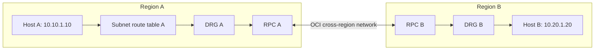

# Remote Peering Between Regions

In the **Hybrid and Inter-Region Connectivity** chapter of the `CLOUD_PROVIDERS_ORACLE` module, this lesson builds private network connectivity between two regions of Oracle Cloud Infrastructure (OCI). We combine tenancy, compartments, and IAM with VCN, Compute, and DRG routing to establish a foundation for Oracle applications or databases operating across multiple regions. The hands-on example uses two test hosts; only afterward should you apply the same verification approach to application flows, data replication, and disaster recovery.

## 1. Objectives and Prerequisites

After this lesson, learners will be able to:

- Explain the relationship among VCN, Dynamic Routing Gateway (DRG), DRG attachment, and Remote Peering Connection (RPC).
- Plan CIDRs, IAM permissions, and route tables for two regions.
- Establish an RPC pair and verify forward and return paths using private IP addresses.
- Distinguish peering connection errors, routing errors, security rule errors, and service errors.
- Evaluate the impact of latency, inter-region data transfer, and region outages on design.

You should understand subnets, CIDRs, route tables, security lists, and Network Security Groups (NSGs). The lab assumes learners have permission to create network resources in a test tenancy subscribed to two regions, along with administrative access to VMs via Bastion or an approved management path. The OCI CLI and Linux commands in this lesson are examples for learners to execute in their own environments.

## 2. What Does Remote Peering Solve?

Remote peering allows resources in two VCNs in different regions to communicate using private IPs over OCI's network. Traffic does not have to detour over the Internet or an on-premises data center. A typical design comprises a DRG in each region, an RPC on each DRG, and a peering relationship connecting the two RPCs. The two sides may belong to the same tenancy or different tenancies. This lesson uses the modern DRG, commonly called the upgraded DRG. [Oracle: Remote VCN Peering through an Upgraded DRG](https://docs.oracle.com/en-us/iaas/Content/Network/Tasks/scenario_e.htm).

| Example requirement | Role of remote peering | What else must be designed |
|---|---|---|
| Application in Region A calls a private service in B | Provides the network path between private addresses | Authentication, TLS, timeouts, and application permissions |
| Standby environment for Oracle Database | Provides transport for selected database flows | Data Guard configuration or an appropriate replication mechanism |
| Batch data transfer between two regions | Allows processing hosts to connect to receiving hosts | Transfer schedules, data verification, and budget |
| On-premises needs workloads in Region B via A | Can serve as one segment in a transit architecture | On-premises routes, DRGs, and end-to-end return paths |

Peering provides only one component of the architecture. If the Region A application still depends solely on a database or authentication system in A, creating another VCN in B is not enough to restore the service when A experiences an outage.

## 3. Understanding Components Along a Packet's Path

| Component | Role in the example |
|---|---|
| VCN A and VCN B | Private network spaces of the two regions |
| Subnet route table | Sends traffic destined for the remote subnet to the local region's DRG |
| VCN attachment | Connects the VCN to the DRG |
| DRG route table | Selects the next attachment when a packet enters the DRG |
| RPC and RPC attachment | Peering endpoint on the DRG and its corresponding attachment |
| NSG, security list | Permits flows defined by source, destination, protocol, and port |
| IAM policy | Allows administrative principals to create or modify network configurations |

IAM controls management operations; security rules control data traffic. Having permission to create an RPC does not automatically open an application port.



The diagram shows the path from A to B; return traffic requires corresponding routing in the opposite direction. The verification steps below follow this exact sequence instead of checking only the RPC status.

## 4. Lab Design and Addressing Plan

Use one tenancy and two compartments to make authorization boundaries clear. Names, addresses, and ports in the table are lab conventions, not OCI auto-assigned values.

| Attribute | Region A | Region B |
|---|---|---|
| Region | `ap-singapore-1` | `ap-tokyo-1` |
| Compartment | `NetSingapore` | `NetTokyo` |
| VCN | `vcn-sg`, `10.10.0.0/16` | `vcn-tokyo`, `10.20.0.0/16` |
| Test subnet | `10.10.1.0/24` | `10.20.1.0/24` |
| Test host IP | `10.10.1.10` | `10.20.1.20` |
| DRG | `drg-sg` | `drg-tokyo` |
| RPC | `rpc-sg-to-tokyo` | `rpc-tokyo-to-sg` |
| Setup role | Requestor | Acceptor |

The first flow to open is `10.10.1.10 → 10.20.1.20:8080/TCP`. Route only the two test subnets; do not grant connectivity across both entire `/16` blocks yet.

Before creating resources, cross-check addresses against on-premises networks, connected VCNs, and planned expansion regions. For this lesson's simple architecture, ranges must not overlap. Do not treat API acceptance of overlapping addresses as proof that routing will work. [Oracle: Access to Other VCNs — Peering](https://docs.oracle.com/en-us/iaas/Content/Network/Tasks/VCNpeering.htm).

For instance, if both hosts are placed in `10.10.1.0/24`, a packet destined for `10.10.1.20` no longer unambiguously identifies which region the host belongs to. Creating an RPC will not resolve that address ambiguity. For a new lab, re-selecting CIDRs before deployment is far easier than resolving conflicts after applications are running.

## 5. Preparing IAM and Bilateral Agreements

The **requestor** initiates the connection operation; the **acceptor** permits the requestor to connect to its RPC. These roles apply during setup and do not dictate data transmission direction.

Within the same tenancy, for example, the `PeeringOperators` group is granted:

```text
Allow group PeeringOperators to manage remote-peering-from in compartment NetSingapore
Allow group PeeringOperators to manage remote-peering-to in compartment NetTokyo
```

These two permissions serve peering establishment. Those creating DRGs, RPCs, attachments, route tables, and NSGs still need management permissions on the respective resources. Adjust group names to match your tenancy's identity domains as needed.

Across two tenancies, `Define`/`Endorse` policies are needed on the requestor side and `Define`/`Admit` on the acceptor side, specifying exact tenancy OCIDs, group OCIDs, and compartment scopes. A one-sided policy is insufficient. Revoking IAM peering creation permissions also does not tear down an already established connection. [Oracle: IAM Policies for Routing Between VCNs](https://docs.oracle.com/en-us/iaas/Content/Network/Tasks/drg-iam.htm).

A configuration handoff sheet should explicitly list region, compartment, VCN CIDR, permitted subnets, RPC OCID, owner, and required flows. Across tenancies, add the tenancy OCIDs and group OCIDs used in policies. Distinguish the target RPC OCID from the DRG or VCN OCID.

## 6. Preparing VCNs, DRGs, and RPCs

Execute the steps below in both regions, always checking the region and compartment selectors before each operation:

1. Create a VCN with the CIDR from the lab table; create a dedicated subnet for the test host.
2. Launch one Compute instance in each subnet without assigning a public IP for the test flow. Record the actual IP if it differs from the illustrative address.
3. Create a DRG in the region's network compartment and create a VCN attachment connecting that DRG to the local VCN.
4. Open the DRG page, locate remote peering connection attachments, and create an RPC in the chosen compartment.
5. Record the OCIDs of the RPC, attachment, and DRG; side B provides its RPC OCID and region B to side A.

Creating an RPC also creates the corresponding attachment on the DRG; you do not need to create a separate standalone RPC attachment for the same RPC. Creating an RPC requires permissions on both the RPC and the associated DRG. [Oracle: Creating a Remote Peering Connection](https://docs.oracle.com/en-us/iaas/Content/Network/Tasks/drg-rpc-create.htm).

If using an existing environment, inspect the DRG version and existing VPN/FastConnect links before making changes. Upgrading a DRG is a separate infrastructure change that requires planning; do not treat it as a default lab step.

## 7. Connecting Both RPCs and Checking Status

From RPC A, choose **Establish Connection**, enter region B and RPC B's OCID. The tenancy must be subscribed to the required regions; across two tenancies, coordinate subscriptions and permissions on both sides before connecting. Monitor peering status until it reaches `PEERED`. That is the status of the RPC relationship—it does not prove routes, security rules, and services are ready. [Oracle: Connecting Two Remote Peering Connections](https://docs.oracle.com/en-us/iaas/Content/Network/Tasks/drg-rpc-connect.htm).

You can perform creation and connection using OCI CLI. The Bash example below assumes the CLI is installed, authenticated, and authorized. Replace all four OCIDs before running; variables are only for the lab shell session.

```bash
REGION_A='ap-singapore-1'
REGION_B='ap-tokyo-1'
COMPARTMENT_A_ID='<ocid-compartment-NetSingapore>'
COMPARTMENT_B_ID='<ocid-compartment-NetTokyo>'
DRG_A_ID='<ocid-drg-sg>'
DRG_B_ID='<ocid-drg-tokyo>'

RPC_A_ID=$(oci --region "$REGION_A" network remote-peering-connection create \
  --compartment-id "$COMPARTMENT_A_ID" \
  --drg-id "$DRG_A_ID" \
  --display-name 'rpc-sg-to-tokyo' \
  --query 'data.id' --raw-output)

RPC_B_ID=$(oci --region "$REGION_B" network remote-peering-connection create \
  --compartment-id "$COMPARTMENT_B_ID" \
  --drg-id "$DRG_B_ID" \
  --display-name 'rpc-tokyo-to-sg' \
  --query 'data.id' --raw-output)

# Verify both RPCs were created and are ready before connecting.
oci --region "$REGION_A" network remote-peering-connection get \
  --remote-peering-connection-id "$RPC_A_ID"
oci --region "$REGION_B" network remote-peering-connection get \
  --remote-peering-connection-id "$RPC_B_ID"

oci --region "$REGION_A" network remote-peering-connection connect \
  --remote-peering-connection-id "$RPC_A_ID" \
  --peer-id "$RPC_B_ID" \
  --peer-region-name "$REGION_B"

# Read back in both regions; wait for the asynchronous operation to complete if needed.
oci --region "$REGION_A" network remote-peering-connection get \
  --remote-peering-connection-id "$RPC_A_ID"
oci --region "$REGION_B" network remote-peering-connection get \
  --remote-peering-connection-id "$RPC_B_ID"
```

Verify the `peering-status` field is `PEERED`, while confirming the peer OCID and region match. `lifecycle-state` and `peering-status` describe two different aspects; seeing the resource in an available lifecycle state is not enough to conclude the connection is formed.

If RPCs were already created via Console, use the existing OCIDs and skip the two `create` commands. Resource creation commands are not arbitrarily re-runnable: an operational script should save or look up OCIDs, check errors at each step, and inspect existing state before deciding to create new resources.

## 8. Configuring Routes on Subnets and Inside the DRG

### 8.1. Subnet Route Tables

Add the following rules to the exact route tables used by the test subnets:

| Route table | Destination CIDR | Target |
|---|---|---|
| Subnet `10.10.1.0/24` in A | `10.20.1.0/24` | DRG A |
| Subnet `10.20.1.0/24` in B | `10.10.1.0/24` | DRG B |

The target here is the DRG in the local region. Do not set the remote RPC as the target in a subnet route table. If multiple subnets need to communicate, inspect each subnet–route table association; updating one table does not update the others.

A route table selects paths by destination; it does not express rules like "allow only port 8080." Use security rules to restrict protocols and ports. A route to a `/24` also does not grant application access to every host in that `/24`. [Oracle: VCN Route Tables](https://docs.oracle.com/en-us/iaas/Content/Network/Tasks/managingroutetables.htm).

### 8.2. Route Tables Attached to DRG Attachments

A packet entering a DRG uses the route table assigned to the **ingress attachment**. Therefore, inspect both the VCN attachment's table and the RPC attachment's table. Routes can be learned dynamically via import route distributions; RPCs exchange routes between the two DRGs. Table assignments, import/export configurations, and actual routes must align. [Oracle: Dynamic Routing Gateways](https://docs.oracle.com/en-us/iaas/Content/Network/Tasks/managingDRGs.htm).

With the lab addresses, the expected observations are:

| DRG | Ingress attachment | Route to subnet | Expected next hop |
|---|---|---|---|
| A | VCN attachment A | `10.20.1.0/24` | RPC attachment A |
| B | RPC attachment B | `10.20.1.0/24` | VCN attachment B |
| B | VCN attachment B | `10.10.1.0/24` | RPC attachment B |
| A | RPC attachment A | `10.10.1.0/24` | VCN attachment A |

This table describes the effective paths to achieve, not a requirement to create four static routes if dynamic routes already satisfy them. If the DRG advertises VCN CIDRs instead of subnet CIDRs per attachment configuration, a route accurately covering the destination may also satisfy it; check more-specific routes and conflicts before concluding.

For a new DRG using default settings, start by inspecting which routes were already learned. For a DRG using custom tables, answer in order:

1. Which table does the VCN attachment use when receiving packets from the VCN?
2. Does that table have a route to the remote subnet via the RPC?
3. Which table does the receiving-side RPC attachment use?
4. Does the receiving-side table have a route to the local VCN?
5. Do the same conditions hold for the return direction?

Example error: A can send packets to B, yet subnet B lacks `10.10.1.0/24 → DRG B`. B cannot complete the TCP session even when B's NSG ingress permits the request. Adding more ingress rules at B will not fix a missing return path.

### 8.3. Extending to Hybrid Networks or Multiple VCNs

If on-premises connects to DRG A via FastConnect or VPN, reaching subnet B also requires routes and prefix advertisements across the full on-premises–A–B path. Build a table of ingress attachments and next hops for each segment, and repeat for the return path.

With multiple spoke VCNs, modern DRGs can participate in transit designs. However, merely adding a peering pair does not specify a hub's routing policy. Do not infer that because A connects to B and B connects to C, A can reach C; you must explicitly design topology, propagation limits, route tables, and traffic permissions for the full path.

## 9. Opening the Exact Flow and Controlling Access Scope

For the test where A initiates TCP to B, add two illustrative rules:

| Location | Direction | Remote source or destination | Protocol | Source port | Destination port | Type |
|---|---|---|---|---|---|---|
| NSG attached to VNIC A | Egress | Destination `10.20.1.20/32` | TCP | All | 8080 | Stateful |
| NSG attached to VNIC B | Ingress | Source `10.10.1.10/32` | TCP | All | 8080 | Stateful |

Client source ports are usually ephemeral, so do not fix source port to 8080. Use `/32` in the lab to keep scope tight; when deploying real services, choose source scope based on workload design.

Stateful rules track sessions and automatically permit matching responses; they do not create return routes. With stateless rules, explicitly permit the corresponding return flow. Security lists and NSGs are additive allow sets: adding a narrow NSG does not revoke a broad permission granted in another rule. Also inspect the OS firewall and the address the process binds to. [Oracle: Security Rules](https://docs.oracle.com/en-us/iaas/Content/Network/Concepts/securityrules.htm).

If using Zero Trust Packet Routing (ZPR), also verify ZPR policies applying to the resources. Do not treat the two NSG rules above as the complete access policy for every tenancy.

When B needs to actively initiate connections to A, add the corresponding egress/ingress pair for the new flow. That differs from B replying to a session initiated by A.

Inter-region backbone links are protected by OCI using MACsec. For end-to-end authentication and application session protection, still configure TLS, mTLS, or appropriate database security mechanisms. [Oracle: VCN FAQ — Remote peering encryption](https://www.oracle.com/cloud/networking/virtual-cloud-network/faq/).

## 10. Layer-by-Layer Testing

### 10.1. Preparing a Test Service

Use an existing TCP service on B, or set up a TCP echo service using Ncat on a test Linux host with `ncat` installed. The example below listens on B's private IP, port 8080, and echoes back received data:

```bash
# Run on host B in a dedicated lab terminal session.
ncat --listen --keep-open --exec /usr/bin/cat 10.20.1.20 8080
```

If actual IPs differ from the example, substitute them in every step. Open port 8080 only for source IP A at the network layer and OS firewall per lab policy. Stop the process with Ctrl+C after testing.

On B, in a second admin terminal, verify the listener:

```bash
ss -lnt | grep ':8080'
```

A process bound only to `127.0.0.1` will not accept connections to the VNIC's private IP. Checking the listener first avoids mistaking a service issue for an RPC failure.

### 10.2. Testing from the Actual Source

On host A:

```bash
# Test TCP handshake and return path.
ncat -v -z -w 5 10.20.1.20 8080

# Test data exchange; type a line, observe the echoed line, then Ctrl+C.
ncat 10.20.1.20 8080
```

If the first command succeeds and data echoes back, you have evidence for the A-to-B flow and B-to-A return path for that session. You cannot yet conclude from this that B is allowed to initiate a new session to A.

You may use `ping` after permitting required ICMP, but do not rely on ping alone. Blocked ICMP can coexist with a normally functioning TCP service.

For HTTP/TLS services or real Oracle Databases, perform protocol-level checks: call a health endpoint, validate certificates and hostnames, or connect to the database using its service name and a test account. Open TCP connectivity does not prove login succeeds, query permissions are correct, or replication works.

### 10.3. Lab Completion Criteria

| Item | Evidence to save in the lab report |
|---|---|
| Peering relationship | Paired RPCs in matching regions, `peering-status = PEERED` |
| Subnet routing | Two routes from test subnets to local DRGs |
| DRG routing | Effective routes to each subnet via appropriate attachments |
| Permitted traffic | TCP handshake and data exchange from A to B succeed |
| Access scope | Flows outside design scope are blocked when no other broad rule permits them |
| Service | Listener, firewall, and application checks all pass |

To meaningfully verify access restrictions, pick another test service confirmed listening on B that is not granted permission from A. A port with no listener already accepts no connections, so it is weak evidence that an NSG is actively blocking traffic.

## 11. Private DNS Between Two Regions

Test by IP first, then test domain names. Having a peering link does not mean internal hostnames in the peer VCN resolve automatically.

For cross-region resolution, one deployment pattern creates a listening endpoint on B's resolver, a forwarding endpoint on A's resolver, and forwarding rules for needed zones from A to B's listener IP. If bidirectional resolution is needed, design symmetrically in both regions. Ensure routes and security rules permit DNS, including UDP/TCP 53 per endpoint role. Attaching private views directly between resolvers is a same-region sharing mechanism; do not apply it blindly across two regions. [Oracle: Private DNS](https://docs.oracle.com/en-us/iaas/Content/DNS/Tasks/privatedns.htm).

For example, application A calls `orders-b.internal.example`. If TCP to B's IP works yet this name fails to resolve, inspect zones, records, forwarding rules, and resolver endpoints before changing application flow routes.

## 12. Monitoring and Troubleshooting

Enable VCN Flow Logs on the scope you need to observe and select appropriate capture filters. Correlate source/destination addresses, ports, protocols, timestamps, and accept/reject verdicts across observation points. An accepted record on one side does not prove the application replied successfully. [Oracle: Troubleshoot Basic Network Issues](https://docs.oracle.com/en/learn/oci-ntw-troubleshoot-1/index.html).

Network Path Analyzer analyzes network configuration, complementing real-host tests. For cross-region paths via RPC, Oracle notes `Indeterminate` results and instructs splitting the analysis into two parts, one per region. Therefore, do not interpret `Indeterminate` as proof that the RPC is broken. [Oracle: Network Path Analyzer](https://docs.oracle.com/en-us/iaas/Content/Network/Concepts/path_analyzer.htm).

| Symptom | Check first | Remediation direction |
|---|---|---|
| Cannot create RPC | Permissions on RPC/DRG, current compartment and region | Fix the exact permissions or resource scope |
| Connect command rejected | Requestor/acceptor roles, from/to permissions, target RPC OCID | Verify IAM policies and handoff details |
| Not yet `PEERED` | Correct RPC pair, target region, partner resources | Check status of both RPCs and operation errors |
| `PEERED` yet TCP times out | Subnet routes, ingress attachment's DRG table, security rules | Trace packet A to B then inspect return path |
| TCP reports connection refused | Whether listener and firewall actively reject | Inspect service, bind address, and logs on host B |
| SYN reaches B, yet A fails to finish handshake | Whether B emits SYN-ACK, return route, reply rules | Separate B-side reply failure from return-path failure |
| IP works, yet hostname fails | DNS resolvers, zones, and forwarding | Inspect private DNS instead of widening application ports |
| Small transactions work, large transfers fail | MTU, Path MTU Discovery, firewalls, and timeouts | Measure real path MTU, check required ICMP messages |
| Connects, yet slow | RTT, sequential call counts, host limits, transfer volume | Measure at network and application layers before redesigning |

When diagnosing, record a specific flow—for example, source `10.10.1.10`, destination `10.20.1.20`, TCP/8080, and test timestamp. This lets both operations teams locate the same session in logs instead of comparing unrelated tests.

## 13. Latency, Availability, and Cost

### Latency and Application Design

Use inter-region latency figures as a reference point, then measure from real workloads. OCI provides inter-region latency observability alongside other network monitoring tools. [Oracle: Network Monitoring, Observability, and Management](https://docs.oracle.com/en/solutions/oci-network-deployment/learn-network-monitoring-observability-and-management1.html).

Suppose lab measurement shows an RTT of 70 ms. A request making 15 sequential cross-region calls incurs roughly `15 × 70 ms = 1,050 ms` of network wait time before accounting for business logic and protocol overhead. This is an illustrative calculation, not a latency SLA for Singapore–Tokyo.

From there, consider batching queries, asynchronous processing, caching appropriately, or placing dependent services closer to compute. For database replication, evaluate latency alongside synchronous/asynchronous modes and acceptable data-loss targets.

### Availability and Recovery

Treat cross-region link loss and full region loss as two distinct drill scenarios. Each workload must define timeouts, bounded retries, fallback behavior when remote services are unreachable, and region failover criteria.

For example, an order-intake application in A replicating to B must answer: if A fails completely, does B have sufficient data, secrets, identities, DNS, and Compute capacity to absorb traffic? Remote peering alone does not answer those questions. Measure RTO and RPO through real failover drills.

### Cost Control

Oracle states that remote peering carries no separate charge for the peering relationship itself, whereas outbound data transfer has pricing policies and applicable thresholds. Check current pricing rather than assuming all inter-region traffic is free. [Oracle: VCN FAQ — Peering pricing](https://www.oracle.com/cloud/networking/virtual-cloud-network/faq/).

Budget per transfer direction and service consumed. As a pure volume example: a continuous stream averaging 2 MB/s for 30 days generates roughly `2 × 86,400 × 30 = 5,184,000 MB`, or 5.184 TB in decimal units, before protocol overhead and retransmissions. This is raw volume before OCI metering rules, free allowances, or unit pricing—not an amount owed. Cross-check real billing against the [Oracle Cloud Price List](https://www.oracle.com/cloud/price-list/).

Name/tag lab resources clearly, monitor Compute and volume costs across both regions, and bound flow log retention to actual needs. For replication systems, monitor changes in data volume, transfer frequency, and reverse-direction traffic to catch unexpected cost spikes.

## 14. Automation and Lab Cleanup

An automation workflow can follow the same steps practiced manually: validate inputs, create or look up VCN/DRG/RPC, connect the exact RPC pair, apply routes and security rules, then read state and test required flows. Always pass the region explicitly for every operation. Maintain an OCID mapping per environment so subsequent runs manage the exact resources.

With existing configurations, read current route tables and rules before updating. An operation replacing an entire rule list can wipe out paths for other workloads if only lab rules are submitted. Changes should include rollback plans and verification evidence just like Console operations.

When finishing a personal lab:

1. Stop TCP echo and test processes.
2. Remove rules and routes added solely for the lab after confirming no dependencies remain.
3. Delete lab Compute instances, volumes, and private DNS endpoints per data retention needs.
4. Delete RPCs when peering is no longer needed, then inspect and clean up remaining lab network resources. Deleting an RPC tears down the relationship with its peer RPC; coordinate cleanup checks on both sides.
5. Inspect logs, storage usage, and cost reports for any remaining charges.

Tearing down peering by deleting an RPC is documented in [Oracle: Connecting Two Remote Peering Connections](https://docs.oracle.com/en-us/iaas/Content/Network/Tasks/drg-rpc-connect.htm). In shared environments, only remove resources explicitly scoped to the lab.

## 15. Self-Check Questions

1. Why is `PEERED` insufficient to prove host A can connect to an application port on B?
2. For packets entering DRG B from the RPC, which attachment's route table must be inspected?
3. Why does a stateful NSG permit replies yet still require a return route to A?
4. If connecting by IP works while domain names fail, which components should be checked?
5. What are `remote-peering-from` and `remote-peering-to` permissions for? Do they open TCP ports?
6. Why are two regions with VCNs and an RPC still not a complete DR plan for Oracle Database?
7. If an application continuously replicates data to another region, which quantities should be measured to forecast cost and recovery time?

A production-ready, handoff-grade configuration must explain the forward path, return path, principals authorized to modify the network, and permitted traffic flows, backed by application test evidence and an operational plan for inter-region link incidents.
