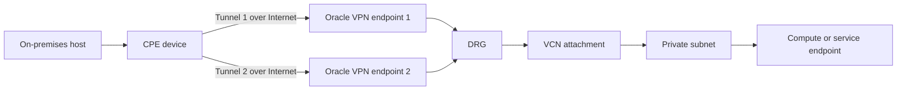

# Site-to-Site VPN, IPSec Tunnels, and BGP Routing

In the **Hybrid and Inter-Region Connectivity** chapter of the Oracle Cloud Infrastructure (OCI) module, this lesson covers connecting an on-premises network to a VCN using Site-to-Site VPN. The goal is to build a transport path for internal addresses, understand IPSec encryption, exchange routes via BGP, and verify route failover when a tunnel fails.

An application in an on-premises data center may need to reach an Oracle Database in a private subnet on OCI. Having an encrypted tunnel solves only part of the problem: both sides also need accurate routes, network access permissions, and healthy services. Tenancy, compartments, and IAM define administrative boundaries; DRG, VCN, and Compute build the path; Monitoring and Logging provide operational evidence. The design must also account for equipment costs, circuits, cloud resources, and application availability requirements.

## 1. Learning Outcomes and Prerequisites

After this lesson, learners will be able to:

- Explain the roles of the CPE, DRG, IPSec connection, and individual tunnels.
- Distinguish the VPN public endpoint, BGP addresses inside the tunnel, and application host addresses.
- Prepare IKE/IPSec parameters, BGP ASNs, peering addresses, and advertised prefixes.
- Trace packets through subnet route tables, DRG, CPE, and on-premises networks in both directions.
- Independently verify IPSec state, BGP state, routes, and service connectivity.
- Measure failover, determine redundancy scope, and define operational conditions.

You should know CIDRs, longest prefix match, private/public IPs, NSGs, security lists, TCP, and basic routing. The lab assumes permission to configure a lab CPE and OCI network resources; illustrative commands are only for the corresponding lab environment.

## 2. Components That Form the Connection

**Site-to-Site VPN** connects an on-premises network to a VCN over IPSec. In the Internet-based model in this lesson, the CPE reaches Oracle's public VPN endpoints; application hosts at both ends communicate using private IPs. OCI uses IPSec tunnel mode and creates two redundant tunnels for each new connection. The routing type is chosen per tunnel. [Site-to-Site VPN Overview](https://docs.oracle.com/en-us/iaas/Content/Network/Tasks/overviewIPsec.htm).

| Component | Role in the design |
| --- | --- |
| CPE device | Physical router or firewall in the customer network performing IPSec and routing |
| CPE object | OCI resource describing the device, including its public IP and device details |
| Dynamic Routing Gateway, DRG | Virtual router connecting VCNs with VPN and other attachments |
| VCN attachment | Links a VCN to the DRG |
| IPSec connection | Parent resource linking the CPE object to the DRG |
| IPSec tunnel | Encrypted link with its own endpoint, shared secret, and configuration |
| BGP session | Route-exchange session running inside a tunnel |

Creating a CPE object does not push configuration onto the physical router. Network engineers must still configure the CPE to match OCI parameters. [Managing an IPSec connection](https://docs.oracle.com/en-us/iaas/Content/Network/Tasks/ipsec-manage.htm).



The diagram shows both encrypted paths passing through a single CPE. If that CPE or its sole Internet circuit fails, both tunnels can drop. Protecting against that failure mode requires redundant CPEs, circuits, and power.

## 3. Three Address Groups Not to Confuse

This self-designed example uses the following values:

| Group | Illustrative value |
| --- | --- |
| Permitted on-premises network | `10.40.10.0/24` |
| On-premises test host | `10.40.10.10` |
| VCN | `10.60.0.0/16` |
| Lab OCI subnet | `10.60.1.0/24` |
| Test OCI Compute instance | `10.60.1.20` |
| CPE public IP | `198.51.100.10`, documentation address, must be replaced on deployment |
| Oracle tunnel 1 and 2 public IPs | `ORACLE_VPN_PUBLIC_IP_T1`, `ORACLE_VPN_PUBLIC_IP_T2`, retrieved from OCI |
| BGP inside tunnel 1 | CPE `169.254.20.1/30`, Oracle `169.254.20.2/30` |
| BGP inside tunnel 2 | CPE `169.254.21.1/30`, Oracle `169.254.21.2/30` |
| On-premises ASN | `65010`, private ASN used for the example |
| Oracle ASN | `ORACLE_BGP_ASN`, taken accurately per tunnel, region, and realm |

**Public endpoints** carry IKE and IPSec traffic over the transport network. **Inside tunnel IPs** are the addresses of the two BGP speakers, with each tunnel using a separate pair. **Workload private IPs** are the source and destination of business traffic traversing the VPN.

OCI accepts `/30` or `/31` IPv4 inside addresses; both ends must match. Certain link-local ranges are reserved and cannot be used for inside tunnel interfaces, so do not pick arbitrary `169.254.x.x` addresses. When replacing example addresses, check [Creating an IPSec Connection](https://docs.oracle.com/en-us/iaas/Content/Network/Tasks/ip-sec-con-create.htm) and [excluded inside tunnel ranges](https://docs.oracle.com/en-us/iaas/Content/Network/Tasks/settingupIPsec.htm).

Workload CIDRs must not overlap. If both sides use `10.60.1.0/24`, adding BGP will not enable routers to distinguish two networks with identical addressing. Either renumber or design controlled NAT, adjusting routes and policies to the addresses actually seen.

Do not use an inside tunnel IP as a database endpoint for applications. Establishing BGP to `169.254.20.2` does not prove the on-premises host has a usable route to `10.60.1.20`.

## 4. How Does IPSec Protect Traffic?

### 4.1. Transport Network, IKE, and Encrypted Data

```text
Inner packet:
10.40.10.10:ephemeral -> 10.60.1.20:22, TCP

CPE selects route over tunnel and encapsulates/encrypts:
CPE_PUBLIC_IP -> ORACLE_VPN_PUBLIC_IP_T1

Oracle side decrypts and forwards inner packet via DRG to VCN.
```

The CPE must steer packets into the right tunnel; after decryption, the DRG still selects the next attachment. IPSec does not automatically grant access to every port inside a private subnet.

**IKE** negotiates and authenticates the peer, establishing Security Associations (SAs). With IKEv2, distinguish the IKE SA from the CHILD SA protecting data. Device UIs may still label these phase 1 and phase 2. When reading logs, separate IKE negotiation failures from data SA failures.

### 4.2. Parameters That Must Match

| Group | Values to verify between both sides |
| --- | --- |
| Peer | Public endpoint, IKE identifier |
| Authentication | Pre-shared key (PSK) |
| IKE | Version, encryption, integrity/PRF where applicable, DH group, lifetime |
| IPSec | ESP, matching encryption and authentication, PFS, lifetime |
| Protection scope | Traffic selectors or encryption domains per configuration type |
| Operations | NAT-T, dead peer detection, rekey |

Prefer IKEv2 when supported by the device and configure both sides to match. Choose algorithms approved by your organization and supported by both the CPE and OCI. GCM includes built-in authentication, so do not arbitrarily pair it with an extra HMAC as used with CBC. Check [Supported IPSec Parameters](https://docs.oracle.com/en-us/iaas/Content/Network/Reference/supportedIPsecparams.htm) rather than copying parameter sets from other devices or realms.

Each tunnel has its own secret PSK. Operational records should reference the designated secret store; avoid pasting live keys into learning materials or broadly shared outputs. Rotate keys one tunnel at a time, coordinating both ends and verifying the remaining path.

### 4.3. NAT-T and Edge Firewalls

| Traffic on the transport path | Purpose |
| --- | --- |
| UDP 500 | IKE |
| UDP 4500 | NAT traversal when using UDP encapsulation |
| IP protocol 50, ESP | ESP when not wrapped in UDP NAT-T |

ESP is **IP protocol number 50**, not TCP or UDP port 50. BGP's TCP 179 runs between the two inside tunnel IPs inside the encrypted path; you do not open TCP 179 from the entire Internet to the CPE's outside interface.

OCI supports NAT-T. If the CPE sits behind NAT, verify the public address and IKE identifier Oracle uses to authenticate the peer. Outside-interface NAT for VPN differs from NAT/PAT of internal workload addresses. [CPE Configuration](https://docs.oracle.com/en-us/iaas/Content/Network/Tasks/configuringCPE.htm).

Observe tunnels during rekeying as well. Connections repeatedly dropping after one interval may relate to lifetime, PFS, proposals, or the transport path; rebooting the router merely erases clues to the root cause.

## 5. What Part of Connectivity Does BGP Solve?

BGP exchanges routing information. The CPE and Oracle router establish one eBGP session per tunnel. The CPE advertises on-premises prefixes; Oracle advertises routes exported through the corresponding attachment. When a path becomes invalid, route information can be withdrawn and the system selects the remaining path.

Applications can use a prefix only when the route is actually advertised, accepted, selected as best path, and installed in the forwarding table.

| Verification milestone | Evidence to look for |
| --- | --- |
| Peer connected | BGP Established on CPE, corresponding Up state in OCI |
| Prefixes received | Received routes contain expected prefixes |
| Path selected | Route table selects the right next hop/attachment |
| Traffic forwarded | Test traffic passes, packet counters increment |
| Service working | Client receives valid application-layer responses |

BGP does not automatically add routes to OCI subnet route tables, open NSGs/security lists, or configure hybrid DNS. Those parts must be designed separately.

### 5.1. Per-Session Requirements

Tunnel 1: local address on CPE is `169.254.20.1`, neighbor `169.254.20.2`. Tunnel 2 uses `169.254.21.1` and `169.254.21.2`. Local ASN is `65010`; remote ASN comes from actual Oracle tunnel details. Do not enter the public VPN IP into the BGP neighbor field in this model.

Select BGP for both tunnels if that is the target design. Static routes attached to an IPSec connection are not used for tunnels configured with BGP. [Routing types and required details](https://docs.oracle.com/en-us/iaas/Content/Network/Tasks/overviewIPsec.htm).

If BGP is Down while IPSec is Up, check peering addresses, ASNs, and TCP 179 inside the tunnel. Site-to-Site VPN does not support BGP MD5 authentication; do not enable that option just because a BGP template for another service uses it. [BGP Session Troubleshooting](https://docs.oracle.com/en-us/iaas/Content/Network/Troubleshoot/ipsectroubleshoot.htm).

### 5.2. Advertisement Policy for the Example

```text
CPE to OCI, on both tunnels:
  Advertise only 10.40.10.0/24.

OCI to CPE:
  CPE accepts lab prefix 10.60.1.0/24.
  Verify the actual advertised list on OCI before applying filters.

Do not advertise a default route or the entire internal routing table in this lab.
```

This is a policy description, not vendor-specific CLI syntax. Prefix lists, route maps, import/export policies, and address families depend on the CPE. Some devices only originate a prefix when a matching route exists in the local routing table; check that condition if the peer does not receive the advertisement.

If OCI advertises the aggregate `10.60.0.0/16` while the CPE only allows an exact `/24`, the session may show Established yet fail to retain the needed route. Scope filters to the design and actual configuration; never widen filters to all prefixes just to make a test pass.

## 6. Three Routing Layers to Inspect Separately

### 6.1. VCN Subnet Route Table

For Compute `10.60.1.20` to reply to host `10.40.10.10`, the route table attached to the subnet needs the rule:

| Destination CIDR | Target |
| --- | --- |
| `10.40.10.0/24` | DRG attached to the VCN |

Routes learned in the DRG do not automatically appear as subnet route rules. You do not need to send all `0.0.0.0/0` traffic to the DRG if only the lab prefix needs connectivity. [Routing a Subnet's Traffic to a DRG](https://docs.oracle.com/en-us/iaas/Content/Network/Tasks/managingDRGs.htm).

### 6.2. DRG Route Table

Packets entering the DRG are evaluated against the DRG route table attached to the **attachment on which the packet enters**. With a modern DRG, verify both directions:

| Ingress attachment | Destination to look up | Expected egress |
| --- | --- | --- |
| VCN attachment | `10.40.10.0/24` | Valid IPSec tunnel attachment |
| IPSec tunnel attachment | `10.60.1.0/24` | VCN attachment |

Import route distributions determine which dynamic routes appear in the DRG route table. Export settings on attachments determine which routes peers receive. Inspect the actually assigned table instead of assuming from a familiar table name. [DRG route tables and route distributions](https://docs.oracle.com/en-us/iaas/Content/Network/Tasks/managingDRGs.htm).

Auto-created tables can handle simple topologies. Whenever changing distributions, isolating environments, or adding transit, re-verify the path. This lab assumes no network appliances or custom ingress routing inside the VCN.

### 6.3. On-Premises Routing Table

Host `10.40.10.10` must send `10.60.1.20` traffic through an internal gateway with a path to the CPE. The CPE must select the OCI route learned via BGP; intermediate routers also need matching routes. The CPE must forward decrypted packets back toward the advertised LAN.

Ask at every hop: "For a packet with this source and destination, what is the next router?" Apply this sequentially at the host, LAN router, CPE, DRG, and VCN to pinpoint any gap.

### 6.4. Bidirectional Trace

```text
Forward path:
On-premises host -> LAN gateway -> CPE
-> route to 10.60.1.0/24 -> IPSec tunnel
-> DRG route table of tunnel attachment
-> VCN attachment -> VNIC 10.60.1.20 -> service

Return path:
10.60.1.20 -> subnet route 10.40.10.0/24 to DRG
-> DRG route table of VCN attachment
-> selected tunnel -> CPE -> LAN -> 10.40.10.10
```

Always check the return path, even when request packets are visible on the target host. Adding more ingress rules in OCI will not fix a missing return route in the subnet.

## 7. Two Tunnels, Path Preference, and Availability

### 7.1. Redundancy Must Be Configured at Both Ends

Fully configuring two tunnels and two BGP sessions provides an alternate path when one tunnel fails. They still share fate if they depend on a single CPE or uplink. For critical workloads, consider two independent CPEs and circuits, each with its own IPSec connection. [CPE and tunnel redundancy recommendations](https://docs.oracle.com/en-us/iaas/Content/Network/Tasks/configuringCPE.htm).

Two Up tunnels do not prove failover works: the second path may advertise fewer prefixes, or a firewall may only permit business traffic through the first path's interface.

### 7.2. Controlling Both Directions Independently

The CPE can use local preference to select paths from on-premises to OCI. To influence the return direction, AS-path prepending can be applied to advertisements on the backup path when routes share the same prefix and satisfy other path-selection rules. Longest prefix match favors more-specific routes first. [Route advertisements and path preferences](https://docs.oracle.com/en-us/iaas/Content/Network/Concepts/routingonprem.htm).

For example, advertise `10.40.10.0/24` over both tunnels, while prepending the on-premises ASN on T2 so its AS_PATH is longer. Observe which route Oracle receives and the DRG selects, rather than relying solely on intended CPE configuration.

If T2 advertises a more-specific `/25` inside T1's `/24`, prepending on T2 will not make the `/24` preferred for destinations in that `/25`. Before comparing AS_PATH, compare prefix specificity and check whether static routes override selection.

### 7.3. Asymmetric Routing and ECMP

Forward and return paths may traverse different tunnels. Stateful CPEs/firewalls must handle asymmetry or have routing policies aligned accordingly. The label "Tunnel 1" does not guarantee traffic always prefers it.

DRG supports per-flow ECMP across eligible paths; ECMP is disabled by default per DRG route table. Creating two tunnels does not automatically enable load balancing. Multiple flows can be distributed, while a single TCP session is not guaranteed to aggregate bandwidth across two tunnels. [ECMP in DRG](https://docs.oracle.com/en-us/iaas/Content/Network/Tasks/managingDRGs.htm).

This basic lab keeps path selection easy to observe. Only enable active-active after verifying routes and firewall asymmetry handling on both ends.

## 8. Verifiable Deployment Sequence

### Step 1: Lock Down Parameters and Permission Scope

Build an address table like the example, confirming region, compartment, ASN, and permitted prefixes. The implementer needs corresponding OCI network permissions and CPE configuration rights. Observers need read access to resources, metrics, and logs; tenancy-wide admin rights are unnecessary just to inspect status.

Lock down the first test flow, such as `10.40.10.10 -> 10.60.1.20:22/TCP`. Keep a management path to the CPE independent of the tunnel you plan to disable. For real Oracle Databases, define dedicated flows per actual listener and endpoint.

### Step 2: Prepare VCN and DRG

Create or select the VCN, private subnet, DRG, and VCN attachment. Add subnet routes for the on-premises prefix; inspect attachment DRG route tables and import distributions. Set NSGs/security lists for the test flow and prepare the OS firewall.

### Step 3: Create the CPE Object and IPSec Connection

Register the CPE's real public IP and appropriate device type. Create an IPSec connection linking the CPE object to the DRG. Configure each tunnel for BGP, entering the inside IP pairs, customer ASN, IKE version, and compatible options. Record both tunnel OCIDs and Oracle public endpoints.

Prerequisites and resource sequence are detailed in [Setting Up Site-to-Site VPN](https://docs.oracle.com/en-us/iaas/Content/Network/Tasks/settingupIPsec.htm).

### Step 4: Configure the CPE

Use the **CPE Configuration Helper** to obtain vendor/platform-specific parameters and templates. Oracle recommends route-based VPN whenever possible. Templates consolidate endpoints, PSKs, IPSec settings, and BGP parameters, but network engineers must still complete on-premises networking. [Using the CPE Configuration Helper](https://docs.oracle.com/en-us/iaas/Content/Network/Tasks/CPEconfigurationhelper.htm).

Verify tunnel interfaces, peers, policies, forwarding, NAT exemption if needed, and routes to the public endpoints over the proper Internet path. Avoid learning routes over the VPN that redirect traffic destined for the VPN endpoint itself back into the tunnel.

### Step 5: Verify Milestone by Milestone

1. IPSec Up on both tunnels with stable data SAs.
2. BGP Up/Established on both peers.
3. On-premises prefix visible in received routes on OCI; cloud prefix present on CPE.
4. Correct routes selected in DRG and CPE; subnet has route rule to on-premises.
5. TCP test succeeds using private IPs.
6. Real service replies properly if continuing to application-layer tests.
7. Drop one tunnel, measure interruption, and confirm full recovery.

Do not skip route verification just because the first two statuses are green.

## 9. Checking Status via Console and CLI

In OCI Console, open **Networking → Customer connectivity → Site-to-Site VPN**, select the connection, and inspect each tunnel. Record IPSec status, BGP status, inside IPs, and observation timestamps separately. A dash for BGP status may indicate static routing; verify the routing type. [Listing IPSec Tunnels](https://docs.oracle.com/en-us/iaas/Content/Network/Tasks/ip-sec-tunnel_list.htm).

You can use OCI CLI with the proper profile and region configured:

```bash
oci network ip-sec-tunnel list \
  --ipsc-id 'IPSEC_CONNECTION_OCID' \
  --all

oci network ip-sec-tunnel get \
  --ipsc-id 'IPSEC_CONNECTION_OCID' \
  --tunnel-id 'TUNNEL_1_OCID'
```

Replace placeholders with real OCIDs. Repeat the read check for tunnel 2. This `get` command does not return the PSK. [CLI list](https://docs.oracle.com/en-us/iaas/tools/oci-cli/latest/oci_cli_docs/cmdref/network/ip-sec-tunnel/list.html), [CLI get](https://docs.oracle.com/en-us/iaas/tools/oci-cli/latest/oci_cli_docs/cmdref/network/ip-sec-tunnel/get.html).

On the tunnel page, view **BGP Routes Received** and **BGP Routes Advertised**, including AS_PATH. "Received" is from Oracle's perspective: routes sent by the CPE to Oracle. Keep the vantage point straight when comparing against the on-premises routing table. [Getting an IPSec Tunnel's Details](https://docs.oracle.com/en-us/iaas/Content/Network/Tasks/ip-sec-tunnel_get.htm).

A point-in-time snapshot only describes that moment. When investigating brief outages, correlate snapshots with logs, metrics, and timestamped test logs.

## 10. Lab: Private IP Connectivity and Failover Measurement

### 10.1. Initial Conditions

Use the topology and addresses from Section 3. The CPE supports route-based IPSec with BGP; you have an on-premises Linux host and an OCI Linux Compute instance. SSH server on Compute listens on TCP 22; `ncat` is installed on the on-premises host. No public IP is needed on Compute to serve VPN traffic.

Allow only the lab flow from `10.40.10.10/32` to `10.60.1.20:22/TCP` in the corresponding policies. Stateful rules track reply traffic, yet bidirectional routes and compatible CPE policies are still required. Keep your active management channel open during testing.

### 10.2. Baseline Check

Follow Section 8. Confirm both tunnels and both peers are active, then fill in:

| Item | Actual value recorded from live environment |
| --- | --- |
| Tunnel 1 | OCID, Oracle endpoint, IPSec status, BGP status |
| Tunnel 2 | OCID, Oracle endpoint, IPSec status, BGP status |
| OCI received from CPE | Prefix and AS_PATH for `10.40.10.0/24` |
| CPE received from OCI | Usable prefix to reach `10.60.1.20` |
| Selected paths | Routes on CPE and DRG for both directions |
| Subnet scope | Route `10.40.10.0/24 -> DRG` |

On the on-premises host, record UTC time and initiate a new connection:

```bash
date -u '+%Y-%m-%dT%H:%M:%SZ'
ip route get 10.60.1.20
ncat -vz -w 3 10.60.1.20 22
```

`ip route get` on the host only shows that host's local decision. Check CPE routes as well to see which tunnel is chosen. A successful `ncat` proves TCP setup to the test port; SSH login also depends on accounts and keys.

### 10.3. Repeating Timestamped Probes

The shell loop below opens 30 new TCP connections from the lab host:

```bash
for attempt in $(seq 1 30); do
  date -u '+%Y-%m-%dT%H:%M:%SZ'
  if ncat -vz -w 2 10.60.1.20 22; then
    echo "attempt=$attempt result=TCP_OK"
  else
    echo "attempt=$attempt result=TCP_FAIL"
  fi
  sleep 2
done
```

Each iteration has its own execution time, so the period is not strictly two seconds. Use real timestamps to estimate the outage window. This probe does not measure survivability of a long-lived TCP session.

### 10.4. Dropping One Tunnel in the Lab

Pick the tunnel currently carrying traffic or preferred by routes/counters. From the CPE management interface, disable only that tunnel using the device-appropriate action; do not shut down the shared Internet interface. Record timestamp, peer state, and routes before and after.

Observe whether the failed tunnel's route is withdrawn or deselected, whether the remaining tunnel holds a valid prefix, and whether TCP probes recover. Duration depends on IPSec/BGP fault detection, route convergence, and application behavior; do not assume a fixed figure like three seconds. If the 30-attempt loop finishes before observation completes, run another timestamped loop.

Re-enable the tunnel, wait for IPSec and BGP to stabilize, and confirm routes match design. Only then test the other tunnel. If both tunnels go Down simultaneously, stop testing and restore the lab configuration before continuing.

### 10.5. Completion Evidence

| Phase | T1 IPSec/BGP | T2 IPSec/BGP | Selected route | TCP result | UTC time |
| --- | --- | --- | --- | --- | --- |
| Normal | Fill in actual | Fill in actual | Fill in actual | Fill in actual | Fill in actual |
| One tunnel down | Fill in actual | Fill in actual | Fill in actual | Fill in actual | Fill in actual |
| Recovered | Fill in actual | Fill in actual | Fill in actual | Fill in actual | Fill in actual |

Separately record the count of failed TCP probes and the elapsed time between the last success before failure and the first success after failure. This is a client-perspective measurement whose resolution depends on probe cadence; it is not a standalone precision measurement of BGP convergence time.

If any step fails, record the observation and which layer remains unverified. Never enter expected outcomes as measured data. After the lab, restore both tunnels, policies, and appropriate alarms; handle lab-specific resources according to your usage plan.

## 11. Layer-by-Layer Diagnostics

### 11.1. IPSec Down

Check public endpoints, Internet reachability, IKE version, PSK, IKE ID, proposals, DH/PFS, and traffic selectors. Compare logs from both ends across the same time window. Authentication failures and proposal mismatches point to different fixes.

`AUTHENTICATION_FAILED`, `NO_PROPOSAL_CHOSEN`, or `TS_UNACCEPTABLE` are diagnostic clues; read them alongside SA context and negotiation stage. [Site-to-Site VPN diagnostic messages](https://docs.oracle.com/en-us/iaas/Content/Network/Troubleshoot/ipsectroubleshoot.htm).

### 11.2. IPSec Up but BGP Down

Verify inside IPs, customer ASN, Oracle ASN, and rules permitting BGP inside the tunnel. Ensure no stale peer configs remain and routing type is BGP. Do not edit Compute NSGs to fix a BGP session between the CPE and Oracle's router.

### 11.3. BGP Up but Missing Routes

Check originate/advertise rules on the sender, filters on the receiver, address family, and exact prefixes. Inspect DRG route distributions, tables attached to attachments, and route conflicts. Receiving a route advertisement does not prove the route is selected for forwarding.

If prefixes disappear after adding a new network, verify current service limits and CPE prefix limits. Do not hardcode a prefix count limit into long-term designs without verifying at deployment time.

### 11.4. Routes Present but Application Cannot Connect

Use the exact 5-tuple to inspect subnet routes, NSGs/security lists, CPE firewall, OS firewall, listener, and return path. With VCN Flow Logs enabled on the right scope, `REJECT` at the VNIC points directly to security rules there; `ACCEPT` does not confirm the application replied successfully.

If IP works while hostname fails, inspect DNS and resolved IPs. VPN does not automatically configure DNS forwarding between the two environments. For Oracle Database, also check the listener, service name, and client errors after confirming TCP connectivity.

### 11.5. One-Way Traffic or Only Small Packets Succeed

One-way failures point to return paths, NAT, stateful firewalls, and asymmetric routing. Small packets working while large transfers hang often involve MTU/MSS and Path MTU Discovery due to IPSec overhead. Do not hardcode one MTU across every topology; inspect encapsulation type, devices, and relevant ICMP messages before tuning.

A successful `ping` does not confirm a TCP service works. A failed ping may only mean ICMP is blocked. Test with the exact protocol and port the application uses.

| Observed state | Next checkpoint to inspect |
| --- | --- |
| IPSec Down | Public reachability, IKE, and SAs |
| IPSec Up, BGP Down | Inside peer, ASN, TCP 179 |
| BGP Up, missing prefix | Advertisements, filters, import/export |
| Prefix present, route not selected | Route conflicts, specificity, path-selection policy |
| Routes accurate, TCP fails | Rules, firewalls, listener, return path |
| TCP succeeds, business call fails | DNS, TLS, authentication, service configuration |

## 12. Monitoring, Automation, and Cost

OCI emits metrics in the `oci_vpn` namespace: `TunnelState`, packet/byte counters, and `PacketsError`. Dimension `parentResourceId` identifies the connection, and `publicIp` identifies Oracle's tunnel endpoint. Send/receive perspectives are from Oracle's side. [Site-to-Site VPN Metrics](https://docs.oracle.com/en-us/iaas/Content/Network/Reference/ipsecmetrics.htm).

`BytesReceived` rises when OCI receives traffic from on-premises; it is not the count of bytes successfully processed by an application. `TunnelState` does not replace BGP checks or probes to business endpoints.

Practical monitoring should cover:

- Single tunnel down: redundancy lost even though applications may still run.
- Entire VPN path unavailable: handle according to service impact.
- BGP flapping or critical prefix disappeared: investigate routing.
- Rising errors, packet loss, or latency: check Internet path and devices.
- Business endpoint failures: inspect the full path and service.

Keep connection/tunnel IDs in monitoring metadata. Record configuration changes with before/after evidence; Audit history supports reviewing OCI resource changes. Restrict read access to logs and configs on a need-to-know basis.

Manage OCI resources with Terraform/Resource Manager and CPEs with vendor-appropriate tooling. Clearly document ownership on each side, store secret-free configuration versions, and modify one tunnel at a time. Avoid updating both links simultaneously before verifying.

Account for full-system cost: CPE appliance/VM, licenses if any, Internet circuits, data transfer per applicable pricing, logs, and monitoring/lab resources. Internet-based VPN is subject to transport network variability; actual throughput also depends on CPE encryption capacity, packet size, and latency. Benchmark with representative traffic before relying on it for database replication or strict-SLA batch jobs.

## 13. Relation to Cross-Region Connectivity and FastConnect

The VPN in this lesson brings an on-premises network into one region's DRG. To reach a VCN in another region, you need inter-region design such as Remote Peering Connections between DRGs, route propagation, route tables, and bidirectional security rules. Having a VPN into Region A does not automatically grant access to every region in the tenancy.

DRGs enforce transit and propagation restrictions across attachment types; they cannot arbitrarily transit between two VPNs or from VPN to FastConnect by default. Check [DRG attachment and route propagation restrictions](https://docs.oracle.com/en-us/iaas/Content/Network/Tasks/managingDRGs.htm) when expanding topology.

VPN and FastConnect can participate together in redundancy. Align prefixes, bidirectional preferences, and failover tests. A more-specific route over VPN can override an aggregate over FastConnect; naming a link "primary" in documentation does not change how routers select routes.

## 14. Technical Handoff Documentation

A verified connection should include diagrams, CIDRs, ASNs, resources/attachments, route policies, secret references, business flow rules, and owners on both ends. Include per-tunnel status, route tables, private IP test runs, and measured failover results.

An operator taking over must be able to answer: which application reaches which prefix, over which path in steady state, what detects failure on that path, and which route takes over next. Answers must be backed by actual configuration and observed test results, not just green tunnel indicators.
