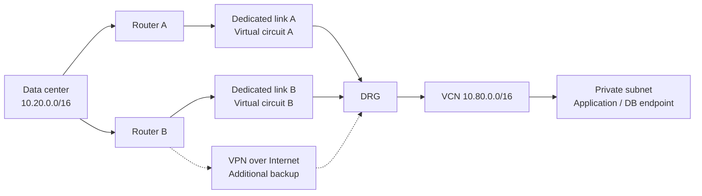

# FastConnect and Choosing a Private Connectivity Model

When applications and databases span both an on-premises data center and Oracle Cloud Infrastructure (OCI), network connectivity becomes part of the application architecture. Data replication, backups, and service access require bandwidth, latency, and recovery mechanisms matched to business needs.

In the **CLOUD_PROVIDERS_ORACLE** module, this lesson places FastConnect in the context of hybrid and inter-region connectivity: choosing how to bring the enterprise network to OCI, connecting circuits to VCNs and DRGs, scoping access, verifying route failover, and estimating operational costs.

After this lesson, learners will be able to:

- Distinguish the Oracle Partner, third-party provider, and colocation models.
- Choose private peering or public peering according to the target endpoints.
- Explain the relationship among physical links, virtual circuits, BGP, DRG, and VCN route tables.
- Propose encryption, redundancy, and testing approaches aligned with real data demands.

## 1. What Does FastConnect Provide?

FastConnect provides dedicated private connectivity between an external network and OCI, avoiding reliance on the public Internet for that connectivity segment. It is suited for high bandwidth demands or a more predictable network experience than Internet-based connections. When deploying a virtual circuit, you can choose private peering or public peering. [FastConnect Overview](https://docs.oracle.com/en-us/iaas/Content/Network/Concepts/fastconnectoverview.htm).

A dedicated circuit does not automatically deliver every characteristic an application needs. Define each separately:

| Characteristic | Design question |
| --- | --- |
| Connectivity | Which endpoints must be reachable, and from which sources? |
| Performance | What usable bandwidth, latency, and packet-loss levels are acceptable? |
| Security | Where is data encrypted, and who is permitted access? |
| Availability | Which failures must be tolerated, and how fast must recovery be? |
| Operations | Which team handles incidents on each segment? |

For example, replication moved onto FastConnect may still run slowly due to disk writes, encryption CPU, RTT, or TCP window sizing. Measure the full processing pipeline before upgrading link bandwidth.

### Comparison with Site-to-Site VPN

VPN over the Internet fits when you need an encrypted connection without a dedicated circuit, or as a backup path. FastConnect follows a provisioning workflow for dedicated circuits; you can run IPSec over FastConnect to combine private connectivity with encryption. [FastConnect FAQ: differences from IPSec VPN](https://www.oracle.com/cloud/networking/fastconnect/faq/).

Decisions should start from measurable requirements. For a low-traffic lab with no carrier available and an urgent timeline, VPN can serve the initial phase. For continuous replication workloads, evaluate FastConnect alongside provisioning lead time, cost, and redundancy options.

## 2. Components to Distinguish

| Component | Meaning in design |
| --- | --- |
| FastConnect location | Physical point of presence where connections meet Oracle network gear |
| Cross-connect | Physical cable segment connecting to Oracle at a location, under the direct model |
| Cross-connect group | Group of links using link aggregation, also called a LAG |
| Virtual circuit | Logical connection configured with peering type and bandwidth |
| BGP session | Routing exchange session between the respective peers |
| DRG | OCI virtual router connecting network attachments |
| VCN | Workload network in OCI |

Physical links and virtual circuits describe different layers. A logical circuit configured in the Console does not mean cabling, VLANs, and BGP are already operational. [FastConnect Concepts](https://docs.oracle.com/en-us/iaas/Content/Network/Concepts/fastconnectoverview.htm).

A DRG can accept attachments from VCNs, FastConnect virtual circuits, IPSec tunnels, and remote peering connections. The route table bound to an attachment is used when packets enter the DRG through that attachment. Route distributions control which dynamic routes are imported into the appropriate table. [Dynamic Routing Gateways](https://docs.oracle.com/en-us/iaas/Content/Network/Tasks/managingDRGs.htm).

To validate a diagram, trace both directions. The application's request path and return response path may be governed by different routing decisions.

## 3. Three Private Connectivity Delivery Models

Choosing a connectivity delivery model is separate from choosing a peering type. Both decisions must be documented in the design.

### 3.1. Connecting via an Oracle Partner

The enterprise connects to an Oracle-supported FastConnect partner. The partner coordinates its network service and connects to Oracle. Some partners offer an L2 model with BGP directly between customer and Oracle; in an L3 model, customer BGP terminates at the partner, while the partner maintains its own BGP session to Oracle. [FastConnect with an Oracle Partner](https://docs.oracle.com/en-us/iaas/Content/Network/Concepts/fastconnectprovider.htm).

This model is worth considering when the organization already uses the partner's network or wants an integrated service. Before selecting, request a clear specification of:

- Where BGP terminates and who updates route policies.
- Which shared failure points exist from enterprise sites to the partner.
- Where bandwidth is provisioned and policed along each segment.
- Who takes first-line incidents and who coordinates with Oracle.

Seeing a partner on the supported list does not guarantee they offer the exact location, peering type, and service level your project requires.

### 3.2. Connecting via a Third-Party Provider

This is a carrier selected by the enterprise outside the Oracle Partner list. The carrier must bring a circuit to a FastConnect location and execute a cross-connect to the Oracle demarcation point. The customer creates a direct resource, obtains a **Letter of Authorization (LOA)**, and passes it to the carrier to install the cross-connect. [FastConnect with a Third-Party Provider](https://docs.oracle.com/en-us/iaas/Content/Network/Concepts/fastconnectthirdpartyprovider.htm).

This model fits when leveraging existing WAN contracts or addressing geographic coverage. Clarify responsibility for cabling orders, LOA expiration tracking, optical signal testing, and fault isolation across demarcation points. A building street address alone cannot substitute for the patch panel and port details on the LOA.

### 3.3. Colocation with Oracle

The enterprise already has equipment inside a FastConnect location and arranges a cross-connect from that gear to Oracle. The process includes creating a cross-connect or cross-connect group, obtaining an LOA, ordering cabling, verifying physical link, and activating. [FastConnect Colocation](https://docs.oracle.com/en-us/iaas/Content/Network/Concepts/fastconnectcolocate.htm).

This model is worth considering when you already have a facility footprint and a network team able to operate the equipment. Estimates must include rack space, power, hardware, optics, cross-connects, and remote-hands support, while still solving connectivity from business systems to the facility.

### 3.4. Practical Selection Table

The table below is an evaluation framework for this lesson, not a guarantee about every provider:

| Criteria to verify | Oracle Partner | Third-party provider | Colocation |
| --- | --- | --- | --- |
| Existing assets to leverage | Connection to the partner | WAN contract with carrier | Hardware and space at location |
| Points to clarify early | L2/L3, coverage, service handoff | Ability to reach Oracle demarcation | Cabling, optics, gear, and on-site staff |
| Key coordination records | Circuit details and partner workflow | LOA and cross-connect order | LOA and facility cabling request |
| Easily overlooked risks | Enterprise-to-partner segment | Responsibility boundary between carrier and facility | Power, routers, and path back to enterprise |

Do not choose a model solely by the Oracle port price; total cost and operational boundaries reflect the complete solution.

## 4. Private Peering and Public Peering

| Peering type | Typical target | Prerequisites to prepare |
| --- | --- | --- |
| Private peering | Reaching private endpoints or workload private IPs inside a VCN | DRG, attachments, bidirectional routes |
| Public peering | Reaching public endpoints of supported OCI services over FastConnect | Valid public prefixes and matching advertisement config |

Private peering requires a DRG for the path into a VCN. With public peering, Oracle validates customer ownership of advertised public prefixes. Routing equipment must support BGP; OCI permissions and baseline networking must also be in place beforehand. [FastConnect Requirements](https://docs.oracle.com/en-us/iaas/Content/Network/Concepts/fastconnectrequirements.htm).

The word **public** in public peering describes the address and endpoint type—it does not mean traffic travels over the Internet. Public peering also does not create a path to a DB system's private IP.

If on-premises sources use private IPs and need to access supported OSN services, an alternative design is:

```text
On-premises -> FastConnect private peering -> DRG
            -> VCN transit -> Service Gateway -> OSN service
```

This approach requires forward and return routes across the relevant attachments and gateways. It differs from a public virtual circuit. [Private Access to Oracle Services](https://docs.oracle.com/en-us/iaas/Content/Network/Tasks/transitroutingoracleservices.htm).

Choose peering after listing the exact endpoints applications actually use: hostnames, addresses, regions, ports, and connection initiation direction. Never guess peering type from a database product name alone.

## 5. Sample Scenario: Hybrid Oracle Database System

Suppose an enterprise moves its application to OCI while retaining a data source in its data center. Below is the illustrative design parameter set:

| Attribute | Value |
| --- | --- |
| Data center network | `10.20.0.0/16` |
| Primary region VCN | `10.80.0.0/16` |
| Application subnet | `10.80.10.0/24` |
| Test VM | `10.80.10.10` |
| Customer ASN | `65010`, illustrative only |
| Continuous data replication | Average `200 Mbit/s` |
| Additional files to transfer | `500 GB` within `4 hours` |
| Single-link failure requirement | Maintain replication and committed file transfer jobs |



The diagram shows the logical target. When ordering services, verify whether the two paths use separate routers, fiber routes, power feeds, and locations. Two lines on a diagram are not proof of physical independence.

For this problem, private peering is the starting point because targets are private IPs inside a VCN. Oracle Partner is a candidate if coverage and contracts align; third-party provider or colocation apply when corresponding infrastructure conditions hold.

## 6. Sizing Bandwidth for Workload and Failure States

Using decimal GB and temporarily ignoring overhead to compute the minimum average transfer rate for the file transfer:

```text
500 GB = 500 × 10^9 bytes
Time = 4 × 3600 = 14,400 seconds

File transfer rate = 500 × 10^9 × 8 / 14,400
                   ≈ 277.8 Mbit/s

Plus continuous replication = 277.8 + 200
                           ≈ 477.8 Mbit/s
```

If targeting known traffic not exceeding `65%` of a single link's usable capacity:

```text
Capacity to consider ≈ 477.8 / 0.65
                     ≈ 735 Mbit/s
```

A nominal `1 Gbit/s` option can be a candidate to test if supported by the model and provider. That number does not prove targets are met: measure overhead, traffic bursts, per-segment limits, encryption CPU, and actual read/write throughput.

More importantly, if the requirement is to survive losing one link, **the surviving link** must carry the committed load. Having two active links in normal operation does not let you count their combined sum as always-available capacity.

If a backup VPN only measures `150 Mbit/s`, it cannot carry the `200 Mbit/s` continuous replication stream in this example. Decide degradation behavior explicitly: upgrade capacity, shed load, pause file transfers, or accept a backlog and assess RPO impact. Never describe that VPN as an equivalent replacement.

## 7. BGP and Bidirectional Routing

FastConnect uses BGP to exchange routes. When multiple paths advertise the same prefix, path selection depends on route attributes and DRG configuration. For identical prefixes in a DRG route table, AS path length can influence selection from OCI; more-specific prefixes must be checked first before drawing conclusions about path preference. [Routing Details for Connections to the On-premises Network](https://docs.oracle.com/en-us/iaas/Content/Network/Concepts/routingonprem.htm).

With the example addresses, state expectations before configuring:

| Decision point | Destination to reach | Expected outcome |
| --- | --- | --- |
| On-premises router | `10.80.0.0/16` | Select the preferred FastConnect path |
| DRG, packet arriving from circuit | `10.80.0.0/16` | Forward to VCN attachment |
| OCI subnet route table | `10.20.0.0/16` | Target is DRG |
| DRG, packet arriving from VCN | `10.20.0.0/16` | Forward to selected circuit or backup path |

Inspect the DRG table effective for the **ingress attachment**, not just whether a route exists in some arbitrary table. Verify both imported routes and outbound advertisements.

On customer routers, local preference can prioritize outbound paths. AS-path prepending can influence OCI's return path selection, though it must be verified against actually received routes, partner models, and current rules. Never assume requests and responses automatically follow the same link.

Beyond routing, you need internal DNS, Security Lists/NSGs, data center firewalls, and application listeners. A network path to an Oracle Database private IP does not grant database login privileges. IAM for network resource administration and database user authentication govern separate domains.

## 8. Private Connectivity and Encryption

FastConnect does not automatically encrypt data across every segment. OCI supports IPSec over FastConnect and MACsec for qualifying configurations. IPSec over FastConnect uses a private virtual circuit and requires an upgraded DRG; Oracle supports it across all three connectivity models. MACsec protects Layer 2 and requires compatible hardware, ports, and connection types; do not assume every partner offering supports MACsec. [FastConnect Security](https://docs.oracle.com/en-us/iaas/Content/Network/Concepts/fastconnectsecurity.htm).

In the design document, explicitly record protection scope:

| Mechanism | What must be clarified |
| --- | --- |
| TLS/TCPS at the application | Authentication endpoints, CA, hostnames, and protection up to session termination |
| IPSec over FastConnect | Tunnel endpoints, routing for encrypted payloads, and device capacity |
| MACsec | Protected link span, carrier support, keys, and behavior on encryption failure |

A complete encryption decision also requires key management, rotation, and failure testing. If encryption is mandatory, the design must define what happens when the encryption layer fails; never allow a backup path to silently drop promised protection.

## 9. Redundancy Design by Failure Domain

Oracle distinguishes device, location, and provider redundancy. With an L3 partner, a virtual circuit may be redundant across the partner–Oracle segment without proving customer–partner redundancy. Under the direct model, the customer is responsible for arranging required physical connections. Backup VPN should use route-based VPN with BGP to govern route failover. [FastConnect Redundancy Best Practices](https://docs.oracle.com/en-us/iaas/Content/Network/Concepts/fastconnectresiliency.htm).

Use the following checklist for each pair of paths:

| Failure domain | Required evidence |
| --- | --- |
| Customer router | Two devices, power feeds, and corresponding LAN uplinks |
| Last mile | Confirmed physical fiber routes and any shared points |
| Carrier network | Demarcation devices and provisioned backbone paths |
| FastConnect location | Location serving the region and diversity capability |
| Oracle port/hardware | Circuits placed per redundancy design |
| Application region | Data, workloads, and access path to recovery region |

LAG helps aggregate capacity and tolerate member link loss, yet two links sharing a router or location still share a failure domain. The design must explicitly state whether it survives losing one link, one router, one carrier, or one location.

Connection redundancy also does not create database recovery. If the application region becomes unavailable, you must have a plan to fail over endpoints, data, and workloads within defined RTO/RPO targets.

## 10. Deployment and Handoff Workflow

This is a framework for a real project; creating OCI resources must be coordinated with carrier circuit orders.

1. **Lock down requirements:** private/public targets, bidirectional throughput, peak bursts, encryption, and recovery objectives.
2. **Lock down model:** coverage, locations, BGP termination, cabling responsibilities, bandwidth, and redundancy.
3. **Prepare OCI:** compartments, IAM, DRG, VCN attachments, routes, DNS, and security rules.
4. **Prepare external side:** ASNs, peering addresses, VLANs if applicable, prefix lists, and route policies.
5. **Coordinate provisioning:** use partner circuit/service IDs per their workflow; for direct, use LOAs and cross-connects.
6. **Verify layer by layer:** physical, circuit, BGP, routing, TCP/TLS, then application operations.
7. **Test failures:** individual links, failover mechanics, surviving capacity, and return to normal state.
8. **Hand off:** diagrams, OCIDs, carrier circuit IDs, expected routes, owners, and incident runbooks.

A provisioned circuit state and an active BGP session are two distinct signals. In an L3 partner model, BGP status in OCI reflects the partner–Oracle hop; you must separately verify the customer–partner hop. [Partner workflow and connection states](https://docs.oracle.com/en-us/iaas/Content/Network/Concepts/fastconnectprovider.htm).

A parameter summary for design review can be represented in JSON as shown below. This is an illustrative record, not an OCI API request payload:

```json
{
  "purpose": "hybrid-database",
  "region": "ap-singapore-1",
  "connectivityModel": "oracle-partner",
  "peering": "private",
  "onPremisesPrefix": "10.20.0.0/16",
  "vcnPrefix": "10.80.0.0/16",
  "customerAsn": 65010,
  "requiredSurvivingCapacityMbps": 735,
  "pathA": "provider-circuit-id-a",
  "pathB": "provider-circuit-id-b"
}
```

With Infrastructure as Code, manage OCI resources and config parameters under the same design while tracking physical work through carrier processes. A successful apply does not prove external circuits are provisioned or accepted.

## 11. Verification with CLI and Application Probes

### 11.1. Reading Virtual Circuit Status

The example below uses Bash and OCI CLI authenticated with an identity authorized to read the corresponding resources:

```bash
REGION='ap-singapore-1'
VC_OCID='<VIRTUAL_CIRCUIT_OCID>'

oci network virtual-circuit get \
  --virtual-circuit-id "$VC_OCID" \
  --region "$REGION"
```

This retrieves circuit details; verify lifecycle state, BGP state, DRG, and peering configuration against the approved design record. Repeat for the backup circuit. [OCI CLI: virtual-circuit get](https://docs.oracle.com/en-us/iaas/tools/oci-cli/latest/oci_cli_docs/cmdref/network/virtual-circuit/get.html).

Management API output does not prove application traffic flows over the dedicated circuit. Specifically, querying from Cloud Shell only observes the control plane; data-plane tests must run from an on-premises source or representative workload.

### 11.2. Testing from an On-Premises Source

Suppose the application team prepared test HTTPS endpoint `app.hybrid.example:8443`, resolving to `10.80.10.10`, with a certificate trusted by the test host:

```bash
getent ahostsv4 app.hybrid.example
ip route get 10.80.10.10
nc -vz -w 5 10.80.10.10 8443
curl --noproxy '*' --connect-timeout 5 --max-time 15 \
  'https://app.hybrid.example:8443/health'
```

`ip route get` on a client host typically shows only the local gateway, not the full BGP path on the edge router. Cross-check routing tables and counters on the router/circuit at the same test timestamp. For a database, test the actual listener port and a small read query using an authorized test account.

Never disable TLS certificate validation just to turn a failure into a pass. If errors involve DNS or CAs, fix that specific layer and re-test.

### 11.3. Failover Test Matrix

| Test condition | What to confirm |
| --- | --- |
| Both dedicated links active | Preferred path matches design, application gets valid responses |
| Link A lost | Routes withdrawn or changed, Link B carries required load |
| Link A restored | Preemption or hold-down matches plan, no prolonged flapping |
| Both dedicated links lost | Backup VPN is selected if supported by the design |
| Encryption layer failure | Behavior meets security and recovery requirements |

Test inside a change window or lab, altering one factor at a time. Record failure detection time, route-switch time, application recovery time, and backlog drain time. Existing TCP sessions may need to reconnect; BGP convergence does not mean the application has already recovered.

## 12. Monitoring and Diagnostics

The `oci_fastconnect` namespace exposes metrics such as `ConnectionState`, `Ipv4BgpSessionState`, `Ipv6BgpSessionState`, `BitRateReceived`, `BitRateSent`, `PacketsError`, and `PacketsDiscarded`. Send/receive directions are from Oracle's perspective. A LAG's `ConnectionState` can still show up when one member fails and total capacity drops. [FastConnect Metrics](https://docs.oracle.com/en-us/iaas/Content/Network/Reference/fastconnectmetrics.htm).

Therefore, monitoring designs should pair status with live capacity: circuit up, BGP up, utilized bitrate, packet errors, and business probe results. With partners, supplement with on-premises–partner metrics because OCI metrics do not fully cover that segment.

| Symptom | Investigation direction |
| --- | --- |
| No physical link | Check demarcation, cabling, optical signal, activation state |
| Circuit provisioned, yet BGP down | Peering IPs, ASNs, VLAN, keys if configured, and actual BGP hop |
| BGP up, yet required routes missing | Advertised/received prefixes, route policies, and effective DRG table |
| Route present, yet TCP times out | Return path, Security Lists/NSGs, firewalls, and listener |
| Small packets pass, large payloads hang | MTU, PMTUD, MSS, and encryption overhead end-to-end |
| Slow only under high load | Per-hop bottlenecks, drops, CPU, and source/target I/O |
| Fails only during path switch | Bidirectional route preference, stateful firewalls, backup capacity |

When opening an incident with the carrier and Oracle, provide timestamps, circuit ID/OCID, BGP state, affected prefixes, and reproduction tests. Compare customer device logs with OCI data to isolate the failing segment. [FastConnect Troubleshooting](https://docs.oracle.com/en-us/iaas/Content/Network/Troubleshoot/fastconnecttroubleshoot.htm).

## 13. Inter-Region Reachability and Total Cost

A FastConnect link into one region does not automatically create paths to VCNs in other regions. When using DRGs and remote peering to extend reach, design attachments, routes, permissions, and non-overlapping addresses for each network domain. [VCN Peering](https://docs.oracle.com/en-us/iaas/Content/Network/Tasks/VCNpeering.htm).

When adding a recovery region, evaluate network paths and data recoverability together. Avoid having all paths to both regions still depend on one router, one facility, or one last-mile segment.

Total cost estimates should include:

```text
Connectivity cost = OCI FastConnect service
                  + carrier / partner service
                  + cross-connect / facility if applicable
                  + routers, optics, operational support
                  + related encryption, monitoring, and redundancy
```

Look up current unit pricing and terms for the chosen model; never extrapolate full end-to-end pricing from a single port line item. [OCI Price List](https://www.oracle.com/cloud/price-list/).

Billing start milestones must also be in the plan. Under the direct model, resources may begin billing upon activation conditions or after a set period following LOA generation; carriers have separate terms. Do not wait until the application goes live to check billing meters. [Third-party provider provisioning and metering terms](https://docs.oracle.com/en-us/iaas/Content/Network/Concepts/fastconnectthirdpartyprovider.htm).

Assign owners, lab expiration dates, and decommissioning procedures. Deleting OCI resources and terminating carrier/facility contracts are separate tasks to reconcile; completing one does not prove the other has stopped billing.

## 14. Option Selection Exercise

Using the parameters from Section 5, draft a decision record containing the following parts:

1. List endpoints, peering type, and selection rationale.
2. Choose a delivery model, noting available infrastructure and missing carrier confirmations.
3. Sketch both paths and mark shared failure domains.
4. Calculate minimum surviving link capacity, distinguishing it from normal combined capacity.
5. Specify expected routes on on-premises routers, DRG, and OCI subnets for both directions.
6. Define encryption scope and behavior when encryption or connectivity fails.
7. Prepare the acceptance matrix, monitoring evidence, and multi-provider cost estimate.

A convincing proposal must explain why the system handles the load and recovers under committed conditions. Having two virtual circuits or an Up BGP state alone is insufficient to declare the application ready for production.
