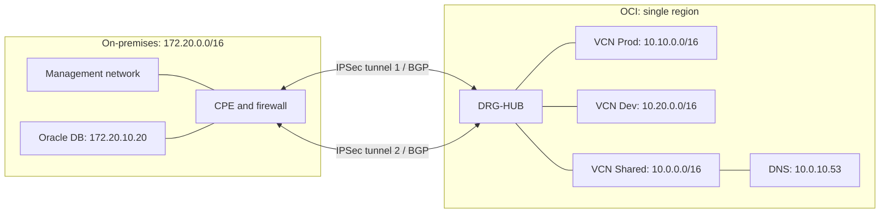

# Hub-and-Spoke Design for Multiple VCNs and On-Premises

In the **Hybrid and Inter-Region Connectivity** chapter of the `CLOUD_PROVIDERS_ORACLE` module, this lesson designs OCI networking for multiple application groups connecting back to an on-premises data center. The goal is to organize VCNs, DRGs, IAM, routing, and traffic controls into a scalable, observable, and operable architecture. The example combines Compute, shared DNS, and an on-premises Oracle Database; the same principles apply when the database sits inside a dedicated VCN.

## 1. Problem Statement and Learning Outcomes

Suppose an enterprise has three networks on OCI: production, development, and shared services. All three need certain connections to on-premises, while development must not access the production database. Creating separate links and policies per network pair causes every new VCN to trigger widespread, hard-to-govern changes.

Hub-and-spoke organizes networks around a central connectivity coordination point. In OCI, a modern DRG can serve as the routing hub for multiple VCNs in the same region. A dedicated VCN can host DNS, traffic-inspection appliances, or shared services as needed. Attaching multiple VCNs to a DRG provides the connectivity baseline; actual access still depends on routes and security layers. [Oracle: Local VCN Peering Through an Upgraded DRG](https://docs.oracle.com/en-us/iaas/Content/Network/Tasks/scenario_d.htm).

After this lesson, learners will be able to:

- Choose between a DRG-only hub and a hub pairing a DRG with an inspection VCN.
- Build a connectivity matrix, CIDR plan, and compartment-based management scope.
- Design DRG route tables and import route distributions per attachment group.
- Explain forward and return paths between spokes and on-premises.
- Verify network segmentation, DNS, redundant paths, and operational costs.

You should understand subnets, CIDRs, VCN route tables, NSGs, security lists, and basic BGP or VPN concepts. The lab assumes a test tenancy, one region, a modern DRG, and a CPE supporting Site-to-Site VPN with BGP. Commands in this lesson are examples for learners to run in an authorized environment.

## 2. Two Ways to Organize a Hub

| Approach | Coordination point | When appropriate | Additional responsibilities |
|---|---|---|---|
| DRG as hub | VCNs and on-premises links attach to the DRG | Centralized routing and segmentation via routes, NSGs, and security lists | Managing route tables, change permissions, and permitted flows |
| DRG paired with inspection VCN | DRG steers flows through a firewall or network virtual appliance in a VCN | Central traffic inspection or logging required | Routing through the appliance, symmetric return paths, firewall capacity, and HA |

"Hub" is a role in the topology—it does not require every spoke to route all traffic through a VM in a hub VCN. Oracle distinguishes a DRG-only hub from a hub combining a DRG and a VCN hosting a network virtual appliance. [Oracle: Routing traffic through a central network virtual appliance](https://docs.oracle.com/en-us/iaas/Content/Network/Tasks/scenario_g.htm).

The lab first uses the DRG as the hub, with a Shared Services VCN as a shared destination network. Shared VCN does not automatically become a transit point between Prod and Dev. Centralized inspection is added in a later section.

## 3. Network Planning and Administrative Permissions

### 3.1. Sample Addresses and Resources

All VCNs below reside in the same region. Names, host addresses, and attachment names are lab conventions; replace them with real values when deploying.

| Network | CIDR | Key subnet or resource | Compartment | Attachment on DRG |
|---|---|---|---|---|
| Shared Services | `10.0.0.0/16` | Subnet `10.0.10.0/24`, DNS at `10.0.10.53` | `NetworkShared` | `A-SHARED` |
| Production | `10.10.0.0/16` | Subnet `10.10.10.0/24`, app host `10.10.10.10` | `Production` | `A-PROD` |
| Development | `10.20.0.0/16` | Subnet `10.20.10.0/24`, test host `10.20.10.10` | `Development` | `A-DEV` |
| On-premises | `172.20.0.0/16` | DB `172.20.10.20`, management network `172.20.99.0/24` | Outside OCI | `A-EDGE-1`, `A-EDGE-2` |

`A-EDGE-1` and `A-EDGE-2` represent the two IPSec tunnel attachments of a lab VPN connection. The DRG is named `DRG-HUB` and belongs to a network compartment managed by the infrastructure team.

Verify CIDRs across the entire connected domain: current VCNs, on-premises networks, partner networks, and planned expansion regions. Reserve space for new subnets, resolver endpoints, firewalls, and workload growth. Plans that only avoid overlaps within individual VCNs can still collide when networks are joined.

For instance, two branches both using `172.20.0.0/16` make a route to that range ambiguous as to which branch is the target. This lab requires non-overlapping address domains. If a live system already has overlapping addresses, a dedicated address-translation or renumbering design is needed before applying this simple topology.

### 3.2. Separating Admin Permissions from Network Access

| Team | Suggested scope of responsibility |
|---|---|
| Network administrators | DRG, import distributions, VPN/FastConnect links, and route table associations |
| Production operators | Compute, applications, and rules for production workloads within assigned scope |
| Development operators | Development resources and connectivity requests for this environment |
| Security operators | Firewall policies, flow inspection, and monitoring evidence |
| On-premises network team | CPE, BGP, internal routing, and on-premises firewalls |

Placing VCNs in different compartments does not create a network block between them. Conversely, a group with permission to edit critical routes or attachments can alter connectivity even without OS login access to application hosts.

Grant IAM strictly to the resources and compartments that require management. Creating VCN attachments and assigning DRG route tables involve permissions on VCNs and DRGs; attaching VCN ingress route tables also requires route table permissions. Across tenancies, cross-tenancy IAM agreements are required for the corresponding attachment model. [Oracle: IAM Policies for Routing Between VCNs](https://docs.oracle.com/en-us/iaas/Content/Network/Tasks/drg-iam.htm).

## 4. Define the Traffic Matrix Before Creating Routes

The matrix below states the hypothetical enterprise's requirements. TCP/1521 is the listener port chosen for the DB example; live systems may use different ports or TCPS configurations.

| Initiating source | Destination | Service | Requirement |
|---|---|---|---|
| Prod | Shared DNS `10.0.10.53` | UDP/TCP 53 | Allow |
| Dev | Shared DNS `10.0.10.53` | UDP/TCP 53 | Allow |
| Prod | On-premises DB `172.20.10.20` | TCP 1521 | Allow |
| Dev | On-premises DB `172.20.10.20` | TCP 1521 | Block |
| On-premises admin network `172.20.99.0/24` | Prod and Dev hosts | TCP 22 | Allow within admin scope |
| Prod | Dev | Direct workload-to-workload traffic | Block |
| Dev | Prod | Direct workload-to-workload traffic | Block |
| Other sources | Unapproved services | Any | No default access |

Keep two concepts separate:

- **Routability:** whether a network has a path to a destination prefix.
- **Service access permission:** whether a source is allowed to initiate communication to the target port and application.

Dev still needs a path back to on-premises to reply to authorized management sessions. Thus, having a route to `172.20.0.0/16` does not mean Dev is allowed to reach TCP/1521 on the DB. Source rules, on-premises firewalls, and database privileges must match the service matrix.

## 5. Reference Topology



The diagram shows attachments and links capable of participating in forwarding. Allow/block policies live in the matrix, DRG route tables, and security layers; lines on the diagram do not grant access to every service.

You can replace the on-premises link with FastConnect **private peering**. Public peering targets Oracle's public services, so distinguish the two models when designing paths into private subnets. [Oracle: FastConnect Overview](https://docs.oracle.com/en-us/iaas/Content/Network/Concepts/fastconnectoverview.htm).

## 6. Distinguishing the Routing Layers

### 6.1. Subnet Route Table

This table decides where workload packets go when leaving a subnet per VCN configuration. For example, a Prod host reaching `172.20.10.20` needs a matching route targeting the local DRG.

### 6.2. DRG Route Table Attached to the Ingress Attachment

When a packet enters the DRG, the DRG uses the table attached to the **receiving attachment**, then picks the next-hop attachment. The table on `A-PROD` handles packets from Prod; the table on `A-EDGE-1` handles packets arriving from tunnel 1 into OCI. Import route distributions populate the table with routes learned from selected attachments. [Oracle: Dynamic Routing Gateways](https://docs.oracle.com/en-us/iaas/Content/Network/Tasks/managingDRGs.htm).

### 6.3. VCN Ingress Route Table on the Attachment

In designs with a transit appliance, a VCN route table can be attached to the VCN attachment to govern packets **entering the VCN from the DRG**, such as forwarding them to a firewall's private IP. That is a VCN-owned table, distinct from the DRG route table handling packets entering **the DRG**. [Oracle: Networking Scenarios — VCN Ingress Routing](https://docs.oracle.com/en-us/iaas/Content/Network/Tasks/scenarios.htm).

A direct-routing lab does not need a dedicated ingress table to steer traffic through an appliance. Adding a firewall VCN does not automatically force all traffic through it.

## 7. Designing Route Tables and Import Distributions

### 7.1. Tables for Each Attachment Group

Create four DRG route tables with the following targets:

| DRG route table | Attached to ingress attachment | Import routes from | Exclude from import in this design |
|---|---|---|---|
| `RT-PROD` | `A-PROD` | `A-SHARED`, `A-EDGE-1`, `A-EDGE-2` | `A-DEV` |
| `RT-DEV` | `A-DEV` | `A-SHARED`, `A-EDGE-1`, `A-EDGE-2` | `A-PROD` |
| `RT-SHARED` | `A-SHARED` | `A-PROD`, `A-DEV`, `A-EDGE-1`, `A-EDGE-2` | Unapproved attachments |
| `RT-EDGE` | `A-EDGE-1`, `A-EDGE-2` | `A-PROD`, `A-DEV`, `A-SHARED` | Networks outside scope advertised to on-premises |

Correspondingly create `IMP-PROD`, `IMP-DEV`, `IMP-SHARED`, and `IMP-EDGE`. In each distribution, create `ACCEPT` statements matching **specific attachment OCIDs** per the import column, then bind each distribution to its corresponding DRG route table.

Example `IMP-PROD`:

| Example priority | Match type | Matched attachment | Action |
|---|---|---|---|
| 10 | Attachment | OCID of `A-SHARED` | ACCEPT |
| 20 | Attachment | OCID of `A-EDGE-1` | ACCEPT |
| 30 | Attachment | OCID of `A-EDGE-2` | ACCEPT |

Priority is the statement evaluation order, not a primary/backup tunnel weight. Matching by attachment type `VCN` matches all attachments of that type; matching by specific attachment prevents accidentally importing routes from an unplanned new spoke. Import distributions are not TCP/UDP filters and do not express per-port policies. [Oracle: DRG Route Distribution Statements](https://docs.oracle.com/en-us/iaas/tools/terraform-provider-oci/latest/docs/d/core_drg_route_distribution_statements.html).

Attachments can still contribute additional prefixes when source network subnets or route settings change. Therefore, controlling imported attachments must go hand in hand with governing which prefixes originate from each attachment. If only part of a network should be exposed, design and inspect the effective route set; an `ACCEPT` statement for an attachment is not an arbitrary CIDR filter.

### 7.2. Expected Effective Routes

Assume the lab advertises VCN subnets rather than summarizing entire VCN CIDRs; the CPE advertises `172.20.0.0/16` over both tunnels.

| Table | Expected prefixes | Next hop |
|---|---|---|
| `RT-PROD` | `10.0.10.0/24` | `A-SHARED` |
| `RT-PROD` | `172.20.0.0/16` | Tunnel selected by route selection |
| `RT-DEV` | `10.0.10.0/24` | `A-SHARED` |
| `RT-DEV` | `172.20.0.0/16` | Tunnel selected by route selection |
| `RT-SHARED` | `10.10.10.0/24`, `10.20.10.0/24` | Each spoke's corresponding attachment |
| `RT-SHARED` | `172.20.0.0/16` | Tunnel selected by route selection |
| `RT-EDGE` | `10.10.10.0/24`, `10.20.10.0/24`, `10.0.10.0/24` | Each VCN's corresponding attachment |

`RT-PROD` has no direct route to Dev; `RT-DEV` has no direct route to Prod. Neither table has static routes or default routes that defeat that segmentation goal. Shared Services is not configured as an arbitrary router or proxy bridging the two environments.

Inspect **the route table after import**, not just the statement list. Actual routes also depend on prefixes advertised by sources and connection state.

### 7.3. Subnet and CPE Routes

| Subnet table | Destination | Target |
|---|---|---|
| Prod subnet | `10.0.10.0/24` | DRG-HUB |
| Prod subnet | `172.20.0.0/16` | DRG-HUB |
| Dev subnet | `10.0.10.0/24` | DRG-HUB |
| Dev subnet | `172.20.0.0/16` | DRG-HUB |
| Shared subnet | `10.10.10.0/24` | DRG-HUB |
| Shared subnet | `10.20.10.0/24` | DRG-HUB |
| Shared subnet | `172.20.0.0/16` | DRG-HUB |

The CPE must learn or be configured with routes back to all three OCI subnets over the appropriate links. Internal routers and on-premises hosts must also have paths to the CPE. A working OCI-to-on-premises route is still insufficient if the DB replies through a default gateway that lacks a route back to OCI.

## 8. Lab Deployment Sequence

1. **Prepare inputs:** confirm region, CIDRs, compartments, administrators, permitted flows, and admin access methods to test hosts.
2. **Create networks:** create the three VCNs, sample subnets, and per-role NSGs. Do not open broad workload connectivity yet.
3. **Create DRG-HUB and custom tables:** prepare DRG route tables for each attachment group.
4. **Create VCN attachments:** attach the three VCNs to the DRG; assign the right custom tables immediately when possible. Hold off on enabling subnet routes to external networks until segmentation is complete.
5. **Create on-premises connectivity:** create the CPE object and IPSec connection, configure BGP on each tunnel, configure the CPE device, and verify both tunnels.
6. **Assign tables to tunnel attachments:** both use `RT-EDGE` to avoid leaving one tunnel on a different default table.
7. **Create and bind import distributions:** use actual OCIDs and verify effective routes across all four tables.
8. **Verify routes advertised to CPE:** confirm only intended OCI prefixes are learned on-premises.
9. **Add subnet routes and security rules:** implement per the service matrix, then test each flow.
10. **Save evidence:** record VCN–attachment–route table mappings, tunnel/BGP state, test outputs, and lab teardown plan.

Site-to-Site VPN provides two redundant tunnels; routing type is configured per tunnel. This lab chooses BGP on both and requires ASN and inside-tunnel BGP addresses. One UP tunnel does not prove the other tunnel and its BGP session are healthy. [Oracle: Site-to-Site VPN Overview](https://docs.oracle.com/en-us/iaas/Content/Network/Tasks/overviewIPsec.htm).

Hand off IKE/IPSec parameters, endpoints, and shared secrets to the CPE team over an authorized channel. Match configuration to the actual device and [Oracle: Setting Up Site-to-Site VPN](https://docs.oracle.com/en-us/iaas/Content/Network/Tasks/settingupIPsec.htm).

## 9. Tracing a Session from Prod to On-Premises DB

Consider host `10.10.10.10` initiating TCP to `172.20.10.20:1521`:

1. Prod's subnet route table matches `172.20.0.0/16` and sends to DRG-HUB.
2. Packets enter the DRG via `A-PROD`, so `RT-PROD` is used.
3. `RT-PROD` holds the route learned from on-premises; route selection picks the active tunnel.
4. Packets cross IPSec to the CPE; the on-premises firewall validates Prod-to-DB access and forwards into the DB network.
5. The DB replies to `10.10.10.10`; the on-premises network routes replies back to the CPE.
6. Packets re-enter OCI via a tunnel attachment using `RT-EDGE`.
7. `RT-EDGE` has `10.10.10.0/24 → A-PROD`, delivering packets back to the VCN and application host.

If the CPE lacks a return route, step 5 fails. If `RT-EDGE` lacks the Prod prefix, step 7 fails. If the DB firewall blocks TCP/1521, complete routing still will not yield a successful application session.

Now consider Dev to the same DB. `RT-DEV` still has a path to on-premises, yet service policy forbids Dev from reaching TCP/1521. To enforce this requirement, withhold matching egress rules on Dev and configure the on-premises firewall to accept DB traffic only from approved Prod sources. The DB must also enforce accounts and access privileges per application policy.

## 10. Role-Based Security Rules

| Location | Direction | Source or destination | Service to permit |
|---|---|---|---|
| Prod app NSG | Egress | Destination `172.20.10.20/32` | TCP to port 1521 |
| Prod/Dev host NSG | Egress | Destination `10.0.10.53/32` | UDP/TCP to port 53 |
| Shared DNS NSG | Ingress | Approved client subnets | UDP/TCP to port 53 |
| Prod/Dev host NSG | Ingress | Source `172.20.99.0/24` | TCP to port 22 |
| On-premises firewall near DB | Per device role | Approved Prod sources | TCP to DB/1521 |

For TCP clients, source ports are typically ephemeral; never fix source port to the target service port. Choose stateful or stateless deliberately. Stateful rules track session replies without creating return routes; stateless rules require explicitly permitting matching return flows.

Inspect both subnet security lists and all NSGs attached to VNICs. Allow rules are additive; a narrow NSG does not revoke broad permissions granted by another security list or NSG. Keep rules explicit in the lab instead of leaving egress open to everything and assuming an extra NSG will restrict Dev. [Oracle: Security Rules](https://docs.oracle.com/en-us/iaas/Content/Network/Concepts/securityrules.htm).

If the tenancy uses Zero Trust Packet Routing, inspect applicable ZPR policies as well. On hosts, check OS firewalls, listeners, and application permissions. For databases, a working TCP handshake does not prove service name, certificates, accounts, or query permissions are right.

## 11. Adding Traffic Inspection at the Hub

When all Prod–on-premises traffic must pass through a firewall in an Inspection VCN, the topology must forward in this sequence:

```text
Prod → DRG → Inspection VCN → firewall → DRG → on-premises
on-premises → DRG → Inspection VCN → firewall → DRG → Prod
```

Illustrative design table for this specific flow:

| Decision point | Required route |
|---|---|
| DRG receiving from Prod | DB/on-premises prefix → Inspection attachment |
| VCN ingress at Inspection | DB/on-premises prefix → firewall private IP |
| Firewall subnet post-processing | On-premises prefix → DRG |
| DRG receiving from Inspection | On-premises prefix → appropriate edge attachment |
| DRG receiving from edge | Prod prefix → Inspection attachment |
| VCN ingress at Inspection, return | Prod prefix → firewall private IP |
| DRG receiving from Inspection, return | Prod prefix → Prod attachment |

The DRG table attached to Inspection holds the real post-inspection destinations. Tables used for uninspected traffic must point toward Inspection. Importing a direct route more specific than a default route to the firewall allows traffic to bypass the appliance. Sending post-firewall packets back to the firewall creates a routing loop.

For a self-managed NVA on Compute, enable OS IP forwarding and configure source/destination check settings on forwarding VNICs per product requirements. The design needs both forward and return paths through the right firewall instance(s); firewall policies must preserve intended segmentation. Follow the detailed configuration in [Oracle: Central Network Virtual Appliance](https://docs.oracle.com/en-us/iaas/Content/Network/Tasks/scenario_g.htm) while adding HA per the chosen product.

This is an architectural change compared to the direct-routing lab. Roll out and verify one flow group at a time; a single `0.0.0.0/0` route does not fully describe centralized inspection. Evaluate throughput, concurrent sessions, logging, and appliance failover behavior.

## 12. DNS and Shared Services

In the lab, `10.0.10.53` is a configured DNS service serving authorized clients. If using OCI Private DNS, you can deploy a resolver listening endpoint for queries from other networks, a forwarding endpoint for queries to on-premises DNS, and domain-based forwarding rules. Create matching routes and UDP/TCP 53 rules per endpoint role. [Oracle: Private DNS](https://docs.oracle.com/en-us/iaas/Content/DNS/Tasks/privatedns.htm).

Example namespaces for the hypothetical enterprise:

| Namespace | Authoritative responder | Expected query path |
|---|---|---|
| `prod.internal.example` | Prod DNS/private zone | Resolver configured to access Prod DNS data |
| `dev.internal.example` | Dev DNS/private zone | Resolver configured to access Dev DNS data |
| `corp.internal.example` | On-premises DNS | Forward to on-premises DNS |

Within the same region, private views can be shared across resolvers under an appropriate design. Between OCI and on-premises, define listeners, forwarders, and rules on each side. Avoid having both sides forward the same zone back to each other in a recursive loop. [Oracle: Private DNS Between OCI and On-Premises](https://docs.oracle.com/en/solutions/oci-best-practices-networking/private-dns-oci-and-premises-or-third-party-cloud.html).

A Service Gateway in Shared VCN does not automatically grant Object Storage access to every spoke or to on-premises. A Service Gateway serves supported Oracle services in the same region; if transit to Oracle Services Network is required, dedicated routing and access policies must be designed. [Oracle: Access to Oracle Services — Service Gateway](https://docs.oracle.com/en-us/iaas/Content/Network/Tasks/servicegateway.htm).

Shared services need an owner, client scope, availability targets, and scaling plans. A single DNS server can become a single point of failure even when the DRG and tunnels are redundant.

## 13. Redundancy and Circuit Selection

### 13.1. Two Tunnels and Infrastructure Independence

Configure both tunnels, monitor BGP, and drill single-tunnel failures. Two tunnels traversing one CPE and one Internet circuit can still drop together if that CPE or circuit fails. Also evaluate redundant CPEs, ISPs, power feeds, and internal data center paths.

With FastConnect, evaluate whether devices, circuits, and locations are independent relative to availability goals. Two virtual circuits do not automatically mean two physically independent paths. [Oracle: FastConnect Redundancy Best Practices](https://docs.oracle.com/en-us/iaas/Content/Network/Concepts/fastconnectresiliency.htm).

### 13.2. Route Selection and Asymmetry

When multiple paths exist, more-specific routes and routing attributes affect path selection. BGP configuration on the CPE governs on-premises outbound selection; OCI's selection must also be inspected. A session may enter via VPN and return via FastConnect if bidirectional policies allow it.

If a firewall must maintain state along a deterministic path, engineer BGP and routing accordingly, then verify with live sessions. Never rely on import statement priority to pick a primary tunnel. [Oracle: Routing Details for Connections to the On-premises Network](https://docs.oracle.com/en-us/iaas/Content/Network/Concepts/routingonprem2.htm).

### 13.3. Encryption and Failure Domains

FastConnect provides private transport; encryption requirements must be specified separately per deployment model. OCI offers IPSec over FastConnect and MACsec where supported. TLS or database security mechanisms still handle authentication and application session protection. [Oracle: FastConnect Security](https://docs.oracle.com/en-us/iaas/Content/Network/Concepts/fastconnectsecurity.htm).

A single regional hub also creates regional dependency. If disaster recovery is required, plan workloads, data, DNS, and connectivity in the standby region; redundant network links alone do not satisfy application RTO/RPO.

## 14. Inspecting Configuration with OCI CLI

The Bash commands below only read configuration. Replace OCIDs and region with actual values; the CLI must be authenticated with read permissions.

```bash
OCI_REGION='ap-singapore-1'
DRG_ID='<ocid-DRG-HUB>'
ATTACHMENT_COMPARTMENT_ID='<ocid-compartment-containing-attachments-to-inspect>'
DRG_TABLE_ID='<ocid-RT-PROD>'
IMPORT_DISTRIBUTION_ID='<ocid-IMP-PROD>'

# List attachments in the selected compartment and corresponding DRG.
oci --region "$OCI_REGION" network drg-attachment list \
  --compartment-id "$ATTACHMENT_COMPARTMENT_ID" \
  --drg-id "$DRG_ID" \
  --all

# Inspect actual static and dynamic routes in a DRG route table.
oci --region "$OCI_REGION" network drg-route-rule list \
  --drg-route-table-id "$DRG_TABLE_ID" \
  --all

# Inspect statements of the relevant import distribution.
oci --region "$OCI_REGION" network drg-route-distribution-statement list \
  --route-distribution-id "$IMPORT_DISTRIBUTION_ID" \
  --all
```

Repeat attachment queries across compartments holding relevant resources; results filtered to one compartment do not represent the entire hub. Match OCIDs and route table associations instead of relying only on display names. Command syntax and scope: [Listing DRG Attachments](https://docs.oracle.com/en-us/iaas/Content/Network/Tasks/drg-list-attachment.htm), [Listing DRG Route Rules](https://docs.oracle.com/en-us/iaas/Content/Network/Tasks/drg-rtrule-list.htm), and [Listing Route Distribution Statements](https://docs.oracle.com/en-us/iaas/Content/Network/Tasks/drg-rds-list.htm).

Evidence to verify is effective routes matching the matrix: Prod has Shared and on-premises with no direct path to Dev; edge attachments use a table with routes back to the OCI subnets approved for advertisement.

## 15. Testing Flows, Segmentation, and Failover

Before network probing, confirm the DB listener and DNS are serving on the chosen addresses. For SSH, the target host must have the service listening and OS firewall aligned. A port with no listener is weak evidence that network policy is blocking traffic.

```bash
# On Prod host: expected to succeed if DB listener is ready.
ncat -v -z -w 5 172.20.10.20 1521

# On Prod or Dev host: verify DNS over UDP and TCP.
dig @10.0.10.53 db.corp.internal.example A
dig +tcp @10.0.10.53 db.corp.internal.example A

# On Dev host: expected to fail reaching production DB listener.
ncat -v -z -w 5 172.20.10.20 1521

# On admin host in 172.20.99.0/24: verify path to Prod.
ncat -v -z -w 5 10.10.10.10 22
```

Add database connection checks with a test account, service name, and matching security settings to validate application flow. Avoid putting passwords directly in commands that may be saved in shell history.

| Test group | Expected outcome | Evidence |
|---|---|---|
| Prod → DB | Permitted flow works | TCP and appropriate DB protocol checks |
| Prod/Dev → Shared DNS | Returns accurate records | UDP/TCP results, DNS logs if needed |
| Dev → DB | Flow is blocked | Probe output plus rule logs at source or firewall |
| Prod ↔ Dev | No direct connectivity outside policy | Effective routes and probes against an active test service |
| On-premises admin → workloads | Only approved admin sources | Probes from both permitted and out-of-scope sources |
| Tunnel 1 down | Remaining path takes over per design | Routes/BGP before and after, measured outage duration |
| Tunnel 1 restored | Network converges per policy | Route selection, new sessions, and existing sessions |

Conduct failover drills in a lab or approved change window. Test both new sessions and long-lived sessions: routes may recover before the application recovers a dropped database session.

## 16. Monitoring and Troubleshooting Along the Packet Path

Enable flow logs at the VNIC/subnet scope you want to observe, selecting appropriate capture filters and retention. Correlate source, destination, port, protocol, timestamp, and `ACCEPT`/`REJECT` decisions. An accepted record at one point does not prove the entire path or application transaction succeeded. [Oracle: Details for VCN Flow Logs](https://docs.oracle.com/en-us/iaas/Content/Logging/Reference/details_for_vcn_flow_logs.htm).

Network Path Analyzer helps evaluate supported routes and policies. For paths traversing a network virtual appliance, you may need to split analysis into pre-appliance and post-appliance segments; the tool does not replace checking listeners, firewall logs, and real application sessions. [Oracle: Network Path Analyzer](https://docs.oracle.com/en-us/iaas/Content/Network/Concepts/path_analyzer.htm).

| Symptom | Priority checks |
|---|---|
| Tunnel UP yet no on-premises routes | BGP session, prefixes advertised by CPE, import distribution, and attached table |
| Some spokes work, new spoke does not | Whether new attachment is imported into the right tables and has return routes |
| Route exists in DRG yet host cannot reach target | Whether subnet uses the right route table, source/target rules, and host firewall |
| Prod and Dev unexpectedly reach each other | Default tables, Match All, aggregate/default routes, or path via proxy |
| Connectivity drops only on tunnel switch | Remaining tunnel's table association, route selection, and firewall state |
| DNS fails while IP access works | Resolver, forwarding rules, zones, UDP/TCP 53, and endpoint routes |
| Hub firewall logs no inspected flow | More-specific direct route bypassing appliance, or flow taking another path |
| Packets return to firewall repeatedly | Post-inspection table still pointing back to Inspection attachment |
| Slow under rising load | Tunnel/circuit bandwidth, firewall capacity, RTT, and workload limits |

Every incident report should record a concrete flow—for example, `10.10.10.10 → 172.20.10.20:1521/TCP`—with timestamp and initiation direction. Cloud and on-premises teams must inspect the same session rather than exchanging generic status like "VPN is still green."

## 17. Scaling, Automation, and Cost Control

### Adding a Spoke

A request to add a VCN must state CIDR, environment, owner, reachable destinations, and services to open. After creating the attachment, update the right import distributions, subnet routes, return paths, DNS, and security rules. Test both new flows and existing segmentation.

Matching by specific attachment prevents a new spoke's routes from automatically entering every table. Administrators still need centralized change control to avoid missing return routes or advertising a new prefix too broadly.

### Expanding Across Multiple Regions

In each region, use that region's DRG and VCN attachments; link two DRGs with an RPC pair when cross-region paths are needed. Do not attach a VCN in another region directly as a local VCN attachment. Redesign exchanged prefix sets and segmentation policies at both hubs. [Oracle: Remote VCN Peering through an Upgraded DRG](https://docs.oracle.com/en-us/iaas/Content/Network/Tasks/scenario_e.htm).

DRGs do not provide arbitrary transit between every pair of on-premises connections: traffic arriving from an IPSec tunnel or virtual circuit cannot exit to another IPSec tunnel or virtual circuit under DRG restrictions. Check attachment types before treating a hub as a branch-to-branch WAN router. [Oracle: DRG Route Propagation Restrictions](https://docs.oracle.com/en-us/iaas/Content/Network/Tasks/managingDRGs.htm).

### Managing as Code and Change Workflow

Model VCNs, attachments, route tables, distributions, and service rules as components with clear owners. Pass environment-specific regions, compartments, and OCIDs; avoid using display names as unique identifiers. With IaC, inspect change plans to ensure operations will not overwrite full rule lists or recreate active connections.

Before switching an attachment to a new table, fully prepare the target table, inspect effective routes, and save the old association for rollback. After changes, verify allowed flows, blocked flows, and backup paths. A successful apply alone does not prove the traffic matrix is enforced.

### Cost and Capacity

Estimate based on real components: FastConnect and carrier services if applicable, firewalls/NVAs, Compute, volumes, DNS, log retention, and inter-region data transfer when expanding. Check the [Oracle Cloud Price List](https://www.oracle.com/cloud/price-list/) and carrier contracts instead of assuming fixed prices for every topology.

For example, centralizing firewalls reduces where policies are managed while concentrating processing demand. Size for throughput, concurrent sessions, log retention, and headroom when a standby appliance must absorb full load. A hub configuration sufficient at low load may fail during failover.

When ending the lab, remove custom rules and routes, clean up Compute/volumes, resolver endpoints, and test-only connections after checking dependencies. In shared systems, clean up only lab-owned resources and coordinate CPE-side changes.

## 18. Self-Check Questions and Handoff Evidence

1. When is a DRG alone sufficient as a hub? When is an Inspection VCN needed?
2. Do packets from Prod entering the DRG use `RT-PROD` or `RT-EDGE`? Which table do replies over VPN use?
3. Why does Dev have a route to on-premises yet still need to be blocked from calling the production DB?
4. How does matching by attachment type differ from matching by specific attachment OCID when adding a spoke?
5. Why does import statement priority not select the primary/backup tunnel?
6. What should be checked if a default route points to the firewall yet the firewall sees no traffic?
7. Why do two tunnels on one CPE fail to protect against CPE failure?
8. When expanding to another region, which routes and policies must be re-verified at both hubs?

An operable handoff package must include the CIDR diagram, service matrix, attachment–route table–distribution mapping, effective routes, on-premises return routes, administrative permissions, test evidence, and measured failover results. Those details let operators tell exactly which networks and flows a change affects and how to roll back if results diverge from expectations.
