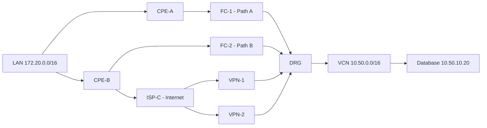

# Redundant Connectivity and Link Failover Testing

An Oracle Cloud Infrastructure system can remain healthy inside a VCN while users at the data center lose access because a network link is interrupted. Adding a second tunnel or virtual circuit is only preparation; you must prove the alternate path is independent of the failure under test, carries accurate routes, and has sufficient capacity to serve the application.

In the **Hybrid and Inter-Region Connectivity** chapter of the **CLOUD_PROVIDERS_ORACLE** module, this lesson covers designing redundant connectivity and testing link failover. The focus is on connecting an on-premises network to OCI Compute workloads and Oracle Databases, integrating authorization, monitoring, automation, and cost control.

## 1. Learning Outcomes

After this lesson, learners will be able to:

- Identify which failures each backup path addresses and which components remain shared.
- Design path preferences on both the customer side and OCI side.
- Prepare controlled failover tests, bounded failback, pass criteria, and rollback steps.
- Measure network recovery time and application recovery time using distinct evidence.
- Recognize cases where BGP or tunnels stay up while business connectivity has already failed.

This lesson assumes readers already know VCNs, subnets, DRGs, attachments, BGP, and Site-to-Site VPN. Addresses, preference policies, and target timings below are examples for learning purposes.

## 2. Concepts to Distinguish

| Concept | Meaning in this lesson |
| --- | --- |
| Redundancy | Having an alternate component or path for a given failure mode |
| Failover | Shifting traffic to another path after the active path stops responding |
| Failback | Returning traffic to the preferred path once that path recovers |
| Control plane | State and information used to select routes, such as BGP and routing tables |
| Data plane | Actual ability to forward data packets |
| Failure domain | Group of components that can be affected together by a single fault |

Two tunnels sharing one CPE handle certain tunnel faults, yet when that CPE stops working, both tunnels can drop together. Similarly, two circuits sharing a single fiber path can fail simultaneously if that cable is cut.

To evaluate redundancy, write a concrete statement: "When component X fails, traffic Y moves to path Z and satisfies condition W." Saying "we already have two links" does not state the requirement completely.

### 2.1. Network Recovery Differs from Application Recovery

A backup circuit may be ready while a connection pool still holds stale sockets. New TCP connections may succeed while existing Oracle Database sessions drop. A service may also reconnect yet run too slowly to meet business needs.

Therefore, testing must observe at least:

1. The failed path is detected and routes are updated.
2. Packets traverse the alternate path in both directions.
3. New connections establish cleanly.
4. The application completes valid operations within defined bounds.

Link testing does not validate database RPO or data recoverability in a standby region. Those requirements demand dedicated data and application-architecture tests.

## 3. Choosing a Redundancy Model by Failure Mode

### 3.1. Common Options

| Option | Failures handled when properly configured | Points requiring closer review |
| --- | --- | --- |
| Two tunnels of one IPSec connection | One tunnel or one OCI-side VPN endpoint becomes unusable | Customer-side CPE and ISP may still be shared |
| Two VPN connections over independent CPEs and ISPs | Loss of one CPE or one Internet circuit | LAN, power, and management access |
| Two FastConnects with diverse links and gear | Loss of one circuit, device, or location per design | Customer-to-provider segment |
| FastConnect plus VPN over Internet | Loss of FastConnect while backup Internet remains active | Bandwidth, latency, and route policies on VPN |
| Connectivity to a second OCI region | Supports alternate-region access plans | Workloads, data, and service dependencies in that region |

Each option must be evaluated against the actual diagram. Rows in the table illustrate scenario analysis—they do not guarantee that every matching deployment automatically achieves full redundancy.

### 3.2. FastConnect Redundancy Has Multiple Layers

Oracle distinguishes device redundancy, location redundancy, and single-FastConnect deployments. Two virtual circuits on different devices at the same location cover a different failure scope than two circuits across two locations. [Source: Redundancy improvements for FastConnect](https://docs.oracle.com/en-us/iaas/releasenotes/network/redundancy_improvements_for_fastconnect.htm).

Provider delivery models also matter. With an L3 partner, a virtual circuit may be redundant between the partner and Oracle, while the customer-to-partner segment must still be evaluated separately. With direct connections or L2 models, verify the physical links and routers actually used. Oracle recommends route-based VPN with BGP as backup for FastConnect. [Source: FastConnect Redundancy Best Practices](https://docs.oracle.com/en-us/iaas/Content/Network/Concepts/fastconnectresiliency.htm).

The design record should answer:

- Which routers do the two circuits traverse?
- Do they share providers, fiber paths, power cabinets, or CPEs?
- When one component fails, where does the surviving path terminate?
- Can operators reach management interfaces when the primary link drops?

OCI surfaces redundancy warnings when connections terminate on the same Oracle edge router or lack alternate links. [Source: Redundancy Remedies](https://docs.oracle.com/en-us/iaas/Content/Network/Troubleshoot/drgredundancy.htm).

### 3.3. Backup VPN Needs an Independent Transport Path

In this lesson's example, the VPN runs over an Internet path independent of FastConnect. That prerequisite enables testing a scenario where all FastConnect links fail while VPN remains serviceable.

If VPN is deployed as IPSec over FastConnect, the IPSec layer still depends on the underlying FastConnect transport. That model provides encryption over a private circuit; do not count it as an Internet backup for the very circuit carrying it. [Source: FastConnect Security](https://docs.oracle.com/en-us/iaas/Content/Network/Concepts/fastconnectsecurity.htm).

## 4. Lab Model

### 4.1. Resources and Assumptions

Use the following illustrative components:

| Component | Role |
| --- | --- |
| On-premises network `172.20.0.0/16` | Contains test host `172.20.10.10` |
| OCI VCN `10.50.0.0/16` | Contains application and database subnets |
| Database subnet `10.50.10.0/24` | Hosts test target `10.50.10.20` |
| DRG | Connects VCN to hybrid links |
| CPE-A, FC-1 | Preferred FastConnect link |
| CPE-B, FC-2 | Secondary FastConnect link |
| CPE-B, ISP-C, VPN-1 and VPN-2 | Two VPN tunnels over the Internet |

Assume FC-1 and FC-2 run BGP from customer equipment to Oracle, or a partner environment provides equivalent verified policy control. If BGP terminates at an L3 partner, coordinate route policies with the partner.



The model uses two CPEs for clear analysis. CPE-B is a shared point for FC-2 and VPN; when it fails, both paths are affected together. FC-1 must remain active to protect against that case. If VPN must also be independent of CPE-B, add another device and re-evaluate failure domains.

### 4.2. Test Flows

Assume the database host already runs a TCP 1521 listener configured for the test environment.

| Flow | Verification method |
| --- | --- |
| On-premises to Database | TCP 1521 and read query via Database client |
| OCI to on-premises service | New connections to a prepared test service |
| Existing sessions | Observe session behavior during path switch |
| Continuous new connections | Generate periodic probes to measure outage duration |

Tests use lab accounts and test data. Target addresses, ports, network permissions, and listeners must be verified before injecting faults.

### 4.3. Initial Routing Conditions

The model requires:

- Routes from OCI workloads to `172.20.0.0/16` via the DRG.
- Routes from on-premises to subnet `10.50.10.0/24`.
- The DRG table applied to traffic entering from the VCN sees FC-1, FC-2, and VPN paths to on-premises.
- The DRG tables applied to traffic entering from each hybrid link have routes to the Database subnet.
- Route advertisement and acceptance policies allow required prefixes on both primary and backup paths.

Route tables are chosen by the ingress attachment. To check OCI-to-on-premises routing, inspect the VCN attachment's table; to check the reverse direction, inspect the FastConnect or VPN attachment's table where packets enter. [Source: OCI CLI — DRG route table](https://docs.oracle.com/en-us/iaas/tools/oci-cli/latest/oci_cli_docs/cmdref/network/drg-route-table.html).

If a backup path lacks the required prefix, losing the primary path will not magically conjure that prefix.

## 5. Controlling Preference in Both Directions

### 5.1. Set Goals Before Choosing BGP Attributes

In the illustrative model:

```text
Normal operation:            prefer FC-1
FC-1 unavailable:            use FC-2
Both FCs unavailable:        use VPN
Preferred path recovered:    planned failback
```

To achieve this outcome, you must govern both routes leaving on-premises and routes leaving OCI.

| Direction | Preference design approach |
| --- | --- |
| On-premises to OCI | Route selection policy inside customer network, typically BGP local preference |
| OCI to on-premises | Attributes on routes advertised to OCI, typically AS_PATH tuning |
| After losing one route | Backup routes must remain valid, carry required prefixes, and be imported into the right tables |

OCI can route asymmetrically. Request packets arriving over one connection do not force reply packets onto that same connection. Oracle documents using AS_PATH to influence path selection from OCI back to the customer. [Source: Routing Details for Connections to the On-premises Network](https://docs.oracle.com/en-us/iaas/Content/Network/Concepts/routingonprem.htm).

### 5.2. Example Preference Policy

For the same OCI destination prefix, an internal policy might assign:

| Route learned via | Illustrative local preference |
| --- | --- |
| FC-1 | 200 |
| FC-2 | 150 |
| VPN | 100 |

These numbers are example choices, not mandatory OCI values. The internal network must propagate and apply policies consistently across routers; editing only one CPE may fail to steer all LAN traffic.

For the `172.20.0.0/16` prefix advertised to OCI, engineer AS_PATH so FC-1 is more attractive than FC-2, and VPN is least preferred. Verify the actually received AS_PATH rather than merely reading prepend counts in router configs.

Oracle provides guidance on using local preference on the customer side and AS path prepending for OCI-to-customer direction when deploying FastConnect with backup VPN. [Source: Connectivity Redundancy Guide](https://docs.oracle.com/en-us/iaas/Content/Resources/Assets/whitepapers/connectivity-redundancy-guide.pdf).

### 5.3. Check Prefix Specificity

Before comparing path attributes, check whether routes share the exact same prefix. For example, if VPN advertises `172.20.10.0/24` while FastConnect only advertises `172.20.0.0/16`, traffic to `172.20.10.10` may select VPN due to longest prefix match.

Therefore, keep prefix sets intentional and inspect prefixes actually received on each link. Never rely on a slogan like "FastConnect always beats VPN" instead of inspecting routing tables. [Source: Site-to-Site VPN Troubleshooting](https://docs.oracle.com/en-us/iaas/Content/Network/Troubleshoot/ipsectroubleshoot.htm).

### 5.4. Active-Active and ECMP

ECMP on a DRG supports per-flow distribution across FastConnect virtual circuits or BGP-enabled IPSec tunnels, provided routes qualify. This mechanism does not mix FastConnect and VPN into the same ECMP group; ECMP is disabled by default and enabled per route table. [Source: Dynamic Routing Gateways — ECMP](https://docs.oracle.com/en-us/iaas/Content/Network/Tasks/managingDRGs.htm).

This lab uses explicit path preference for observability. With active-active, test multiple flows and verify capacity when one branch fails. A single TCP session does not demonstrate load-distribution capability for the whole system.

## 6. Preparing Tests and Pass Criteria

### 6.1. Choose a Recoverable Fault Scope

Before a test run, document:

| Item | Example |
| --- | --- |
| Affected object | BGP session of FC-1 for the lab prefix |
| Flow to observe | `172.20.10.10 -> 10.50.10.20:1521` |
| Expected outcome | FC-2 takes over, application connectivity recovers |
| Fault injector | Network engineer responsible for CPE-A |
| Observers | OCI route observer and client probe operator |
| Rollback method | Restore exact BGP session, compare against baseline |
| Abort criteria | Loss of management access or out-of-scope impact |

Separate management paths from the link under test whenever possible. Know how to recover a CPE before interrupting the connection used to administer that very device.

In a learning environment, affect only prepared test resources. Fault actions must be bounded and reversible; there is no need to delete DRGs, attachments, or virtual circuits to test route failover.

### 6.2. Baseline Before Fault Injection

Confirm and record:

1. All planned links are active.
2. Routes to the same prefix set exist on OCI and on-premises.
3. FC-1 is the active path per design.
4. TCP and application read queries succeed.
5. Latency, throughput, and link utilization are normal.
6. All participants use synchronized UTC timestamps.
7. Monitoring tools and backup management access are reachable.

Oracle recommends testing both failover and failback, verifying the primary path, and measuring outage duration. Traceroute provides useful data only when devices and network policies permit replies. [Source: Site-to-Site VPN Best Practices — Redundancy Testing](https://docs.oracle.com/en-us/iaas/Content/Resources/Assets/whitepapers/ipsec-vpn-best-practices.pdf).

### 6.3. Sample Criteria for the Test Environment

The thresholds below are set by this lesson to illustrate acceptance criteria—they are not an Oracle SLA:

| Metric | Illustrative target |
| --- | --- |
| New TCP connection recovery | Within 60 seconds from fault injection |
| Stable read query success | Within 90 seconds from fault injection |
| Stability confirmation | At least three consecutive successful application probes |
| Routing scope | No loss of prefixes outside the lab flow |
| Post-failover path | Matches the defined plan |
| Failback | No unexpected repeated route flapping |

If criteria are not met, record the actual measurements and root cause. Never lower thresholds after a test just to turn a failure into a pass.


## 7. Preparing Observation Evidence

### 7.1. Route State and Redundancy Status

OCI provides a command to read DRG redundancy status:

```powershell
$drgOcid = 'ocid1.drg.oc1...'
oci network drg-redundancy-status get --drg-id $drgOcid
```

Replace the placeholder with a real OCID and select the right region. This output is one OCI-side configuration check; combine it with customer diagrams and live application output. [Source: Getting the DRG Redundancy Status](https://docs.oracle.com/en-us/iaas/Content/Network/Tasks/drg-get-redundancy-status.htm).

To observe active routes for one direction, inspect the table attached to the corresponding ingress attachment:

```powershell
$routeTableOcid = 'ocid1.drgroutetable.oc1...'
oci network drg-route-rule list --drg-route-table-id $routeTableOcid --all
```

Save outputs before, during, and after failover, noting destination, next-hop attachment, and selected route. Listing routes does not prove packets reached the application. [Source: OCI CLI — List DRG Route Rules](https://docs.oracle.com/en-us/iaas/tools/oci-cli/latest/oci_cli_docs/cmdref/network/drg-route-rule/list.html).

Simultaneously, the CPE operator inspects BGP neighbors, received prefixes, and the customer-side forwarding table. Exact syntax depends on the device, so the runbook must record commands verified for that environment.

### 7.2. FastConnect Metrics

In the `oci_fastconnect` namespace, useful metrics include:

| Metric | Evidence provided |
| --- | --- |
| `ConnectionState` | Connection state at the corresponding resource level |
| `Ipv4BgpSessionState` | IPv4 BGP session state of the virtual circuit |
| `Ipv6BgpSessionState` | IPv6 BGP state if used |
| `BitRateReceived`, `BitRateSent` | Traffic bitrate at the Oracle end |
| `PacketsError`, `PacketsDiscarded` | Errored or discarded packets |

Filter by the exact `resourceId` and `component`. For a LAG, `ConnectionState` can remain up while one member stays active, even though total capacity has dropped. Metric scope also depends on the connectivity model. [Source: FastConnect Metrics](https://docs.oracle.com/en-us/iaas/Content/Network/Reference/fastconnectmetrics.htm).

### 7.3. VPN Metrics

The `oci_vpn` namespace provides `TunnelState`, `BytesReceived`, `BytesSent`, `PacketsReceived`, `PacketsSent`, and `PacketsError`. Receive/send directions are measured at the Oracle end. Use `parentResourceId` alongside the Oracle tunnel `publicIp` to distinguish individual tunnels. [Source: Site-to-Site VPN Metrics](https://docs.oracle.com/en-us/iaas/Content/Network/Reference/ipsecmetrics.htm).

A tunnel that is up with zero traffic is not a fault if it sits in standby. Conversely, a tunnel that is up while traffic shifted onto it fails to complete signals a need to inspect routes, network policies, and applications.

### 7.4. Impact-Based Alerting

Suggested alert tiers for the model:

- **Loss of redundancy:** one path failed while business traffic continues on another path.
- **Degraded capacity:** traffic shifted to a lower-bandwidth path, or errors and high latency appeared.
- **Service outage:** business probes fail to complete within bounds.

Do not aggregate path states into one "all healthy" status that hides individual branch failures. After a successful failover, the system may still need urgent attention because only a single path remains.

## 8. Generating New Connection Probes

The PowerShell snippet below opens a new TCP connection on each iteration and outputs one JSON line to stdout. Run it on a test host with routing to the target private IP. The script does not attempt Database login and does not verify SQL queries.

```powershell
$probeTargetAddress = '10.50.10.20'
$probePort = 1521
$connectTimeoutMs = 1500
$sampleGapMs = 1000
$runTimer = [System.Diagnostics.Stopwatch]::StartNew()

for ($sampleIndex = 1; $sampleIndex -le 120; $sampleIndex++) {
    $startedAt = [DateTimeOffset]::UtcNow
    $sampleTimer = [System.Diagnostics.Stopwatch]::StartNew()
    $tcpClient = [System.Net.Sockets.TcpClient]::new()
    $result = 'FAIL_TIMEOUT'

    try {
        $connectTask = $tcpClient.ConnectAsync(
            $probeTargetAddress,
            $probePort
        )
        if ($connectTask.Wait($connectTimeoutMs) -and $tcpClient.Connected) {
            $result = 'OK'
        }
    }
    catch {
        $result = 'FAIL_CONNECT'
    }
    finally {
        $tcpClient.Dispose()
        $sampleTimer.Stop()
    }

    [pscustomobject]@{
        sample = $sampleIndex
        started_utc = $startedAt.ToString('o')
        finished_utc = [DateTimeOffset]::UtcNow.ToString('o')
        run_elapsed_ms = $runTimer.ElapsedMilliseconds
        connect_elapsed_ms = $sampleTimer.ElapsedMilliseconds
        target = $probeTargetAddress
        port = $probePort
        result = $result
    } | ConvertTo-Json -Compress

    Start-Sleep -Milliseconds $sampleGapMs
}
```

Key points to keep in mind when using this template:

- Each sample takes connection time plus sleep interval; the period is not fixed at exactly one second.
- `FAIL_TIMEOUT` means the connection did not finish within the timeout threshold; it does not identify root cause.
- `FAIL_CONNECT` can result from connection refused or network errors; additional evidence is needed to isolate.
- Sampling cadence and timeout affect the precision of observed recovery timestamps.
- A Stopwatch measures duration within the same process; UTC aligns events across hosts.

Also run probes from OCI toward on-premises against a prepared target service. Bidirectional checks should not rely on a single TCP session.

For Database, the application owner should maintain a read probe via an authenticated client, such as:

```sql
SELECT 'CONNECTIVITY_OK' AS result FROM dual;
```

Record results separately for existing sessions and new sessions. For write operations, you must have a way to check transaction outcomes before retrying to avoid duplicate processing when responses are lost.

## 9. Failover Scenarios

### 9.1. Test Matrix

Run each scenario individually and restore the baseline before moving to the next scenario.

| ID | Fault injected in test environment | Expected outcome to verify |
| --- | --- | --- |
| F1 | Stop one VPN tunnel on CPE | Surviving tunnel serves traffic when VPN is active |
| F2 | Withdraw route or stop BGP on FC-1 | Traffic shifts to FC-2 |
| F3 | Make both FC-1 and FC-2 unavailable | VPN over Internet carries traffic |
| F4 | Stop CPE-A | FC-2 remains operational |
| F5 | Stop CPE-B while FC-1 is healthy | FC-1 serves traffic while loss of FC-2 and VPN is detected |
| F6 | Inject scoped data-plane fault while keeping BGP up | Exposes gap between control plane and data plane |
| F7 | Restore preferred path | Failback stabilizes per policy |

Scenario F1 only proves tunnel failover if VPN is actually carrying the test flow. When FastConnect remains preferred, shutting down one tunnel without affecting application traffic does not prove the surviving tunnel can take over.

### 9.2. F2: Loss of Preferred FastConnect Link

Suggested sequence:

1. Verify baseline and start TCP and application probes.
2. Record timestamp `t_fault`.
3. The CPE-A operator withdraws the exact test prefix or stops the exact BGP session per runbook.
4. Observe the FC-1 route becoming ineligible.
5. Confirm FC-2 is selected in both directions per design.
6. Wait for application probes to satisfy stability criteria.
7. Record timestamps, failed samples, and state of existing sessions.
8. Proceed to the failback workflow.

Withdrawing routes or stopping BGP tests routing reaction. This result does not replace testing CPE power loss, physical fiber cuts, or carrier network outages.

### 9.3. F3: Full Shift to VPN

This test must keep CPE-B and ISP-C up while both FastConnect paths become unavailable.

Beyond basic connectivity, measure:

- Which prefixes are received and selected over VPN.
- Whether traffic increases on the matching tunnel as expected.
- Latency and completion time of Database operations.
- Whether backup bandwidth gets saturated by background traffic.
- Whether existing application sessions self-recover or must reconnect.
- Whether the surviving VPN tunnel holds up if one VPN tunnel subsequently fails.

Testing with a tiny data volume does not prove VPN meets peak load. To test capacity, run a bounded load test appropriate for the environment with explicit pass criteria.

### 9.4. F6: BGP Remains Up While Data Fails

In a lab, you can inject a forwarding drop scoped strictly to the test flow, keeping control sessions up and with an independent rollback path. Scope must be defined ahead of time; never apply a broad filter that cuts off management access.

This scenario can yield:

```text
BGP: established
Preferred route: still present
Connection status metric: up
TCP or query: failed
```

If the route is not withdrawn, the system may keep selecting that path. In that case, the outcome is having exposed a limit of the current redundancy mechanism; never record "failover passed" just because VPN is still up.

The next design step is defining data-plane fault detection and rerouting actions suited to device capabilities, blast-radius limits, and operational policy. Those mechanisms require dedicated testing; never assume BGP automatically handles every data-plane transmission failure.


## 10. Measuring Recovery Time

### 10.1. Milestones to Record

Use these timestamps for every test run:

| Milestone | Meaning |
| --- | --- |
| `t_fault` | Timestamp when the fault action is executed |
| `t_detect` | Timestamp when monitoring detects the fault |
| `t_route` | Timestamp when the alternate route is confirmed active |
| `t_tcp` | Timestamp when the first new TCP connection succeeds after fault |
| `t_app` | Timestamp when defined application stability criteria are met |

Two calculations for this lesson:

```text
Observed TCP recovery time = t_tcp - t_fault
Application recovery time  = t_app - t_fault
```

If three consecutive successful application probes define stability, explicitly note that `t_app` is the confirmation timestamp of the third probe. Also retain the timestamp of the first successful probe so readers understand how the number was computed.

Do not mechanically add BGP time, route time, and application time together: activities overlap. Use a timeline to see which phase truly dominates recovery.

### 10.2. Hypothetical Example Output

The table below is constructed to illustrate reading metrics—it is not measured output from OCI:

| Relative time | Hypothetical event |
| --- | --- |
| `t+0s` | Stop BGP on FC-1 |
| `t+3s` | BGP session down observed |
| `t+6s` | FC-2 confirmed active |
| `t+8s` | New TCP connection succeeds |
| `t+10s` | First new read query succeeds |
| `t+12s` | Second read query succeeds |
| `t+14s` | Third read query succeeds |

By the definitions above, observed TCP recovery time is 8 seconds and time to confirmed application stability is 14 seconds. Do not use these numbers to claim all OCI environments fail over in this timeframe.

Results vary with fault-detection methods, timers, route policies, hardware, load, and client behavior. When comparing test runs, keep sampling cadence and fault type equivalent.

### 10.3. Reading Application Behavior

For Oracle Database connections, record separately:

- Whether sessions existing before the fault stay usable or disconnect.
- How long the client takes to establish a new session.
- How the connection pool evicts broken connections.
- Whether timeout and retry limits prolong user wait times.
- How an in-flight operation sent without a received response is checked for completion.

Not every pre-existing session has to survive to declare network failover successful. However, if the application fails to recover within its own criteria, application acceptance still fails.

## 11. Testing Failback

### 11.1. Controlled Restoration

When the primary path comes back up, preferred routes may be selected immediately. If that path is still unstable, traffic may flap repeatedly back and forth.

Suggested failback workflow:

1. Confirm the root cause of the fault is resolved.
2. Restore the component per runbook and anticipate exactly when routes will re-advertise.
3. Observe BGP sessions, connection states, and live traffic.
4. Return the path to its intended preference per plan.
5. Confirm bidirectional traffic follows the expected path.
6. Monitor the application and confirm backup paths remain ready.
7. Conclude once no unexpected fluctuations occur within the observation window.

If devices support holding route advertisements or staged policy restoration, use that to separate "link is up" from "link carries live traffic." Execution must match device capabilities and be documented in the runbook.

### 11.2. Re-Checking Existing and New Sessions

Failback can also disrupt stateful devices and open sessions. Do not record only that BGP came back up.

Compare:

| Item | After failover | After failback |
| --- | --- | --- |
| Selected path | Expected alternate path | Expected preferred path |
| New TCP connections | Succeed | Succeed |
| Read queries | Meet criteria | Meet criteria |
| Application errors | Recorded and explained | None beyond expectations |
| Redundancy level | May be degraded | Restored to baseline |

In the FC-1, FC-2, and VPN model, bringing FC-1 back while leaving VPN broken does not complete baseline restoration.

## 12. Redundancy Capacity, Security, and Cost

### 12.1. Having Connectivity Does Not Guarantee Capacity

Suppose protected demand reaches 300 Mbps while the backup link delivers roughly 100 Mbps under test conditions. Routes may switch cleanly, yet queuing, timeouts, and operation latency will climb.

Preliminary sizing check:

```text
Demand to protect
  = critical business load
  + mandatory operational traffic
  + appropriate headroom

Capacity condition
  = surviving path meets that demand in testing
```

This is a planning model, not a performance guarantee formula. Measure both directions, CPE encryption throughput, and application load.

When using two active-active paths, test the scenario where all protected load collapses onto one path. Never use total combined bandwidth while both are healthy to represent post-failure capacity.

### 12.2. Preserving Security Policy Across Alternate Paths

In an example without source address changes, verify NSGs, security lists, and firewalls permit the same approved flows after switching paths. If CPEs or security appliances perform different NAT per path, verify actual post-failover addresses.

Asymmetric routing can impact stateful inspection devices. Designers must know which firewalls each branch traverses, whether state sync exists, and what behaviors are supported.

Prepare network modification permissions and metric read permissions before the test session. Never fix connectivity issues by granting broad admin privileges or opening all ports before isolating the failing point.

### 12.3. Distinguishing Link Redundancy from Region Redundancy

Two links into the same region primarily protect against failures within the designed connectivity scope. To survive an entire region outage, also evaluate links into another region, workload placement, data replication, and application dependencies.

If every path from on-premises terminates in Region A and only reaches Region B via RPC, evaluate whether Region B remains reachable when Region A fails. Adding an RPC does not guarantee independent access to Region B. Oracle recommends evaluating alternate regional connectivity for multi-region workloads. [Source: Define Your Network and Connectivity Architecture](https://docs.oracle.com/en/solutions/oci-best-practices/define-your-network-and-connectivity-architecture1.html).

### 12.4. Balancing Cost Against Protected Requirements

Cost estimates should break out circuits, carrier services, CPEs, backup ISPs, test workloads, and observability data. Do not assume adding every possible component is the right choice for every system.

A low-load system may accept a backup VPN with reduced service levels for short windows. A system needing peak throughput during a circuit outage may require additional FastConnect capacity. Choices must tie back to business criteria and measured test results.

After testing, record which resources stay to maintain redundancy and which were solely for lab practice. Never tear down a path that is a mandatory part of the accepted redundancy design.

## 13. Test Records and Operational Use

### 13.1. Single-Test Record Template

Use a record thorough enough for another engineer to reproduce:

```text
Test ID:
Environment, region, compartment:
Source / destination / protocol / port flow:
Preferred path before test:
Fault type and affected object:
Fault injection, detection, and route-switch timestamps:
TCP and application recovery timestamps:
Path used after failover:
Existing session state, new connections:
Failback result:
Path states after rollback:
Pass / fail criteria and evidence:
Test limitations:
Follow-up actions:
```

Records should include route outputs from both OCI and the CPE, metrics for the exact resources, client probe samples, and the operational timeline. Never include VPN secrets, API keys, or Database passwords in evidence logs.

### 13.2. Preparing for Maintenance

Oracle performs maintenance on FastConnect routers and recommends having an alternate connection; if using IPSec as the secondary path, tunnels should be configured with BGP. [Source: Maintaining Virtual Circuits](https://docs.oracle.com/en-us/iaas/Content/Network/Concepts/vc-maintenance.htm).

Use the latest test results to prepare for a maintenance window:

1. Confirm current diagrams and policies still match the last test.
2. Verify the alternate path is healthy and has adequate capacity.
3. Confirm observers, alerts, and management channels.
4. Monitor routes alongside application results during the change window.
5. Re-verify redundancy levels once maintenance finishes.

Re-test after changes to topology, BGP policies, CPEs, firewalls, critical prefixes, or client behavior. Automation can help collect status and run probes, yet fault injection must retain explicit scope, abort conditions, and rollback steps.

## 14. Evidence of a Usable Redundancy Design

A proven design must connect four facts:

- **Specific fault:** which circuit, tunnel, CPE, or data-plane failure is handled.
- **Alternate path:** sufficiently independent, carrying the right prefixes, and selected in both directions.
- **Business outcome:** the application recovers within agreed criteria with adequate capacity.
- **State restoration:** failback is stable and backup paths return to baseline.

The value of testing lies in evidence of real behavior. When a scenario fails to meet criteria, the timeline and collected data must pinpoint what is missing in the design so operations can address it.
