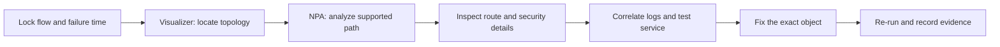
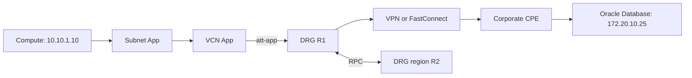

# Diagnosing Connectivity with Network Path Analyzer and Network Visualizer

## 1. Objectives and Use Cases

In the **Hybrid and Inter-Region Connectivity** chapter of the **CLOUD_PROVIDERS_ORACLE** module, this lesson builds a connectivity diagnostic workflow on Oracle Cloud Infrastructure (OCI). The workflow combines resource topology maps, route and security rule analysis, live traffic observation, and service checks. Learners use that evidence to isolate faults before modifying infrastructure.

Suppose a Java application on OCI Compute cannot connect to an Oracle Database in the data center. The application team reports timeouts; the network team says the VPN is up; the diagram shows the VCN is attached to the DRG. All three facts are helpful, yet none shows where TCP packets go, where they are dropped, or whether a return path exists.

Two tools in the OCI Network Command Center answer two different questions:

- **Network Visualizer:** how are network resources organized and connected within the viewed scope?
- **Network Path Analyzer (NPA):** given the selected source, destination, protocol, and ports, which paths does the supported configuration permit?

Analysis results must be cross-checked against live observations. Oracle describes NPA as a configuration-analysis tool that does not send synthetic probe traffic; see [Network Path Analyzer](https://docs.oracle.com/en-us/iaas/Content/Network/Concepts/path_analyzer.htm). A path modeled as reachable does not prove the database listener is running, certificates are valid, or application login succeeds.

After this lesson, you will be able to:

- Select the right region, compartment, and topology level to locate relevant resources.
- Describe a flow with explicit endpoints, protocol, ports, and connection direction.
- Create, run, and interpret an NPA analysis hop by hop within tool-supported boundaries.
- Distinguish routing errors, security rule errors, missing analysis data, and actual service failures.
- Handle hybrid links, cross-region RPCs, and intermediate appliances without over-inferring from diagrams.
- Save before/after evidence and re-verify after a narrow, scoped change.

Examples use IPv4, an upgraded DRG, and illustrative addresses. Learners should have basic familiarity with VCNs, subnets, VNICs, NSGs, security lists, DRGs, VPN, and FastConnect.

## 2. What Does Each Evidence Source Answer?

| Tool or data source | Primary question | What must be supplemented when concluding |
| --- | --- | --- |
| Network Visualizer | How do VCNs, subnets, gateways, attachments, and security resources relate? | Display scope, route details, exact endpoints, and ports |
| NPA | How does supported configuration process a hypothetical flow? | Model limits, read permissions, and live traffic testing |
| VCN Flow Logs | What accept/reject records are logged for flows at a VNIC? | Filters, sampling, timestamps, and observation direction |
| VPN/FastConnect/BGP status | What is the state of connections and route exchange? | Actually received prefixes, tables using prefixes, and return paths |
| TCP or service probes | From the test host, how does the endpoint/port respond? | DNS, host firewall, TLS, listener, and application permissions |
| Audit and deployment history | Which configuration changed at what timestamp? | Causal link between change and incident to verify |

VCN Flow Logs report traffic accepted or rejected by security lists and NSGs at the VNIC; capture filters and sampling affect which records appear. Refer to [Flow Logs](https://docs.oracle.com/en-us/iaas/Content/Network/Concepts/vcn-flow-logs.htm). Because NPA only analyzes configuration, actively generate a real connection when you need matching flow log records.

An effective sequence is:



Each step eliminates one class of hypotheses. For example, if NPA points out a missing route in the source subnet, inspect that exact subnet table; editing an NSG on the database will not fix packets that never reached the DRG.

## 3. Preparing Inputs and Read Permissions

### 3.1. Describe the Flow Before Opening Any Tool

Use a brief diagnostic ticket instead of "cannot reach database":

```text
Application:          Java app on Compute
Source:               10.10.1.10, application VNIC in region R1
Destination:          172.20.10.25, Oracle Database on-premises
Protocol:             TCP
Modeled source port:  51000
Destination port:     1521
Directions to check:  Request and response of the same connection
Failure time:         Explicit timestamp and timezone
Expected path:        VNIC → subnet route → DRG → VPN/FastConnect → CPE → DB
```

`1521` is an example port; use your environment's actual listener or TCPS port. Source port `51000` illustrates a client ephemeral port. When failures depend on ports or NAT, capture the real tuple from logs or packet captures to configure the analysis accurately.

If a user supplies a hostname, also record the IP the source host resolved at the time of failure. Analyzing a path to private IP A does not explain a live connection going to public IP B or IPv6 C. For multi-VNIC hosts, select the exact VNIC carrying the flow rather than defaulting to the primary VNIC.

### 3.2. Distinguish Three Permission Scopes

Check three items separately:

1. The operator has permissions to use and manage NPA tests per assigned duties.
2. The NPA service has permissions to read required configs to build the model.
3. The operator has permissions to view resources and details along the analyzed path.

NPA documentation provides sample policies for user groups and service principal `vnpa-service`, and recommends tenancy scope for analysis accuracy. Use current policies in [Required Permissions for NPA](https://docs.oracle.com/en-us/iaas/Content/Network/Concepts/path_analyzer.htm) as deployment baseline. Check API action permissions at [Details for the Network Monitoring Service](https://docs.oracle.com/en-us/iaas/Content/Identity/Reference/VnMonitoringpolicyreference.htm).

For Network Visualizer, Oracle specifies tenancy-level resource-read policies in the [Network Visualizer permissions guide](https://docs.oracle.com/en-us/iaas/Content/Network/Concepts/network_visualizer.htm). Holding `read virtual-network-family` alone does not cover full Visualizer access. Administrators should review what visibility is granted to support teams; diagnostic read access and infrastructure edit privileges should be separated cleanly.

A hidden node or indeterminate status caused by missing permissions is a limit of current evidence. Identify missing permissions or visibility scope before modifying routes or opening ports. Never assume a resource was deleted just because it does not appear under a support account.

### 3.3. Record Region and Compartment

A tenancy may split application VCNs, DRGs, logging, and databases across multiple compartments. At the start:

- Select the right region containing the OCI endpoint under investigation.
- Select the right compartment and check the subcompartment inclusion option.
- Record OCIDs alongside display names for VCNs, subnets, VNICs, DRGs, and key attachments.
- Check active filters and refresh timestamps.

Display names aid searching; OCIDs prevent confusing identically named resources across production, staging, or disaster recovery regions. A map showing fewer objects than expected should first be checked for scope and permissions.

## 4. Using Network Visualizer from Overview Down to Endpoint

### 4.1. Regional Topology: Identify Connectivity Paths

In OCI Console, open **Networking → Network Command Center → Network Visualizer**. Check region, compartment, and filters before reading the map. At the regional level, locate the source VCN, DRG, attachments, VPN or FastConnect, and related CPE. If a cross-region link exists, note the RPC and switch to that region to inspect the remote infrastructure.

With an upgraded DRG, you can select an attachment connector to view attributes and routes associated with that selected attachment. That is an effective way to identify the **DRG table assigned to the ingress attachment**, rather than seeing a VCN–DRG line and assuming all traffic passes. This workflow is described in [Viewing a Regional Network Topology Map](https://docs.oracle.com/en-us/iaas/Content/Network/Tasks/view-network-topology-map.htm).

Example expected path for this lesson:



This diagram is a target model sketched by the learner. During live investigation, add real names/OCIDs and mark which segments already have evidence versus which still need confirmation from other teams. CPE state and internal corporate routes require data from the enterprise network team.

### 4.2. VCN Topology: Inspect Subnet-Level Routing and Security

Select the VCN and open **View VCN routing map** or **View VCN security map**. These two views support reading routing relationships and security objects. Locate the source VNIC's subnet, the route table bound to that subnet, and the gateway serving the destination prefix. See [Viewing a VCN Topology Map](https://docs.oracle.com/en-us/iaas/Content/Network/Tasks/view-vcn-topology-map.htm).

For source `10.10.1.10` and corporate destination `172.20.10.25`, practical questions are:

- Which route table is the source subnet using?
- Does that table contain a prefix covering `172.20.10.25` targeting the DRG?
- Is there a more-specific route steering packets to another next hop?
- If an intermediate appliance exists, which ingress/egress tables route packets into and out of it?

If a subnet has multiple aggregate routes, evaluate the exact target IP. Seeing a `0.0.0.0/0` rule is not enough to conclude a specific `/24` prefix route is learned properly.

### 4.3. Subnet Topology: Locate the Exact VNIC and Security Resources

From the subnet, open **View subnet inventory map** or **View subnet security map**. Locate the Compute instance, load balancer, or relevant VNIC; inspect the VNIC's NSGs and the subnet's security lists. Subnet view helps distinguish two hosts in the same network that have different NSGs or VNICs. Refer to [Viewing a Subnet Topology Map](https://docs.oracle.com/en-us/iaas/Content/Network/Tasks/view-subnet-topology-map.htm).

Record the exact security objects applied to the endpoint. A rule named "allow-db" in another NSG has no effect simply because that NSG is in the same compartment. Also inspect allow rules across all related security lists and NSGs before concluding a port is blocked.

### 4.4. Keep Map Semantics Accurate

Visualizer has a display limit on resource counts; when exceeded, the map may show only part of the topology. Filters and permissions also affect what is visible. **Export Map Data** saves the map and data for the currently displayed scope; an export is not a complete tenancy-wide inventory by default. See [Network Visualizer](https://docs.oracle.com/en-us/iaas/Content/Network/Concepts/network_visualizer.htm).

After changes, refresh the map and re-check resource details. When saving evidence, include region, compartment, filters, and timestamp. Those details help reviewers understand why a resource may exist in the environment yet be absent from a capture.

## 5. Creating an Interpretable NPA Analysis

### 5.1. Choose the Right Endpoints and Protocol

Open **Networking → Network Command Center → Network Path Analyzer**. The saved test list depends on the currently selected compartment; see [Listing Path Analysis Tests](https://docs.oracle.com/en-us/iaas/Content/Network/Tasks/path_analyzer-list.htm).

Select **Create path analysis** and give it a descriptive name, such as `app-r1-to-onprem-db-tcp1521`. Choose the compartment to store the test, protocol TCP, and the corresponding endpoints. When entering a corporate IP, check **This IP address is an on-premises endpoint** on that endpoint. If overlapping CIDRs or multiple resources share IPs in independent networks, prefer selecting the specific OCI resource to avoid modeling the wrong target. Options are described in [Creating a Path Analysis Test](https://docs.oracle.com/en-us/iaas/Content/Network/Tasks/path_analyzer-creating_test.htm).

Inputs for the hybrid example:

| Attribute | Illustrative value | What to verify |
| --- | --- | --- |
| Source | App host VNIC, private IP `10.10.1.10` | Exact VNIC and right region |
| Destination | IPv4 `172.20.10.25` | Marked as on-premises endpoint |
| Protocol | TCP | Matches application protocol |
| Source port | `51000` | Modeled value or actually captured value |
| Destination port | `1521` | Matches active listener |
| Direction | Bi-directional | Inspect both request and response |

Selecting an address within a subnet can model configuration even when no active host holds that IP yet. That trait helps validate designs pre-deployment, and also shows why a reachable result does not mean a target process is listening. When investigating an existing host, choosing the VNIC/resource preserves clearer context than a bare IP.

### 5.2. Understand the Return Direction Properly

For a TCP connection without NAT, both directions can be represented as:

```text
Request:   10.10.1.10:51000  → 172.20.10.25:1521
Response:  172.20.10.25:1521 → 10.10.1.10:51000
```

Testing both directions of this connection differs from opening an independent connection from the DB host to port `1521` on the app host. That independent test has a different tuple and service requirement. If SNAT, DNAT, or a proxy exists, record both pre-device and post-device tuples when reconciling results.

Also distinguish stateful and stateless security rules: stateful rules allow return traffic for tracked connections per OCI mechanics; stateless rules require matching rules for both relevant directions. Even when security permits replies, the network still needs a routing path back to the source.

### 5.3. Run and Save the Test

Select **Run analysis**, wait for completion, and review discovered paths. If you will reuse it, select **Save analysis** to store the test definition. After modifying network configs, re-run the saved test to get fresh results, keeping the tuple unchanged when comparing before and after.

Record at least the test name/OCID, execution timestamp, source/destination, and ports. Screenshots lacking those parameters easily lead to comparing two different tests. Never place database credentials, wallets, or private keys in test names or diagnostic records.

## 6. Reading Results Hop by Hop and Direction by Direction

### 6.1. Path Verdicts and Component Details

Under **Discovered paths**, review each path tab and both forward and return paths if bidirectional analysis was enabled. Select **View diagram information** or open hop details to inspect routes and security; retain OCIDs of objects the findings point to. Console steps are in [Running a Path Analysis Test](https://docs.oracle.com/en-us/iaas/Content/Network/Tasks/path_analyzer-running_test.htm).

States to understand:

| Observed status | Practical interpretation |
| --- | --- |
| `Reachable` | Analysis model found a valid path matching inputs and supported scope |
| `Unreachable` | Analysis shows a segment cannot pass; open the hop to find the cause |
| Routing `Forwarded` | Forwarding decision exists per analyzed configuration |
| Routing `No route` | Check routes and security on that hop; cross-check context and model limits |
| Security `Allowed` / `Blocked` | Read the rule or security object evaluated for the entered flow |
| `Indeterminate` | Insufficient basis to conclude success or failure for that segment |

An indeterminate state may stem from read permissions or unanalyzable segments. When seeing a red hop, inspect destination prefix, next hop, rule direction, and chosen port before proposing changes. Color summaries must always be tied back to exact configuration objects.

### 6.2. Separate Routing Questions from Security Questions

An app → database path can fail at different places:

| Suspect point | Question to answer | Objects to inspect |
| --- | --- | --- |
| App subnet | Is the corporate prefix routed to the DRG? | Route table bound to the subnet |
| DRG | Which attachment receives packets, and which table picks the corporate path? | Attachment assignment, DRG route table, effective routes |
| Source | Which rule permits egress for this tuple? | Subnet security lists, VNIC NSGs, applicable additional policies |
| OCI destination (if any) | Where is ingress allowed for the exact source and port? | Security resources applied to the target endpoint |
| Return path | How does the target network send replies back to the exact source? | Target-side route table, return DRG table, or CPE routes |

On a DRG, the table used for a packet is determined by the **attachment on which the packet enters**. The return direction may use a different table. Consult [Dynamic Routing Gateways](https://docs.oracle.com/en-us/iaas/Content/Network/Tasks/managingDRGs.htm) when verifying table assignments and route imports.

If a route appears in `rt-from-onprem` while the flow enters via `att-app` using `rt-from-app`, seeing the prefix in the first table does not prove the flow can pass. Similarly, an allow rule in an NSG not attached to the target VNIC does not explain that endpoint's security status.

### 6.3. Turn Findings into a Minimal Change

A good fix proposal states: object, affected flow, current config, target config, and post-change verification. Example:

```text
Observation: Subnet-app table lacks route to 10.30.1.0/24.
Intent:      Send only this shared services subnet via DRG.
Proposal:    Add destination 10.30.1.0/24 targeting the identified DRG.
Verify:      Re-run the same NPA test and probe TCP 443 from the app host.
Rollback:    Remove the added rule if outcome or blast radius diverges from expectations.
```

A proposal to "allow all traffic" breaks the link between evidence and remediation while risking other services. Keep working paths untouched and edit only what was proven to be the root cause.

## 7. Lab Exercise: Distinguishing a Missing Route from a Missing Allow Rule

### 7.1. Scoped Lab Topology

Use two VCNs in the same region R1 connected via an upgraded DRG, with no NVA along the lab path:

| Component | Address or role |
| --- | --- |
| App VCN | `10.10.0.0/16` |
| App Subnet | `10.10.1.0/24`, test host `10.10.1.10` |
| Shared VCN | `10.30.0.0/16` |
| Shared Subnet | `10.30.1.0/24`, test service `10.30.1.20:443` |
| DRG | Two VCN attachments with bidirectional routes to subnets |
| Security | Allow only lab flows and required management paths |

Prepare an actual HTTPS or TCP service listening on port `443` beforehand. Using two VCNs avoids relying on a single-subnet scenario as a general proof of NPA behavior. This example guides learners in their own lab; expected states below are not measurements from a specific deployment.

### 7.2. Build a Baseline with Both Configuration and Live Connectivity

1. In Visualizer, locate both VCNs, attachments, and relevant subnet/DRG route tables.
2. Confirm App subnet has `10.30.1.0/24 → DRG`; Shared subnet has `10.10.1.0/24 → DRG`.
3. Confirm the DRG table on the App attachment learns the path to Shared, and the reverse table learns the path to App.
4. Read all applicable security lists/NSGs to identify the allow rule for TCP `443` from App; check ZPR policies as well if applied to endpoints.
5. Create an NPA test from App VNIC to Shared VNIC/private IP, TCP destination port `443`, bidirectional.
6. Run the test, record results for both directions, and run a live TCP probe from the App host to `10.30.1.20:443`.

A valid baseline must explain both the model and live connectivity. If NPA passes while TCP fails, finish investigating the listener, host firewall, and tuple before proceeding to intentional fault injection.

### 7.3. Scenario A: Remove the Route to Shared

In an isolated lab, record the old config and temporarily remove `10.30.1.0/24 → DRG` from the exact App subnet route table. Ensure no aggregate or default route still sends that destination to the DRG.

Refresh topology, re-run the same NPA test, and inspect where the path breaks. Expect routing analysis to flag a missing path to Shared. Run the TCP probe as well to compare symptoms. If the result stays reachable, verify the rule was actually removed from the table bound to that subnet and check for alternate routes.

Restore the rule, re-run tests, and confirm recovery. This single-variable change explains how a missing route causes connectivity failure without mixing in security edits.

### 7.4. Scenario B: Remove the Destination Allow Rule

Once the baseline is restored, record the old config and temporarily remove the ingress allow rule for TCP `443` from the App source on the lab's destination security object. Check beforehand that no other security list or NSG still permits the same flow. OCI security lists and NSGs are additive; removing one rule may not block the flow if another broad rule remains.

Re-run NPA with the same tuple. Expect the security section to flag the flow as blocked at the relevant object while routes remain intact. Cross-check flow logs and live TCP probes if matching logging is enabled. Restore the exact allow rule, re-run, and confirm baseline.

If ZPR is active, evaluate endpoint policies alongside security rules; do not assume one NSG allow rule explains every case. Use analysis message details to confirm which layer was actually evaluated.

### 7.5. Evidence Learners Must Save

| Run | Changed configuration | Configuration evidence | Live evidence |
| --- | --- | --- | --- |
| Baseline | Unchanged | Matching routes and security | TCP to service succeeds |
| Missing route | App subnet rule | Affected hop and table | TCP result, logs if available |
| Route restored | Restored old rule | Re-analysis of exact tuple | Service works again |
| Missing allow | Target security rule | Security details and evaluated rules | TCP/logs for the same flow |
| Allow restored | Restored old rule | Re-analysis of exact tuple | Service works again |

The lab's goal is explaining **why** outcomes change. Save unexpected observations along with permissions and tool limitations rather than cherry-picking green screenshots to show completion.

## 8. Applying to Hybrid, Cross-Region, and Intermediate Appliances

### 8.1. Hybrid Connectivity: Dividing Verification Responsibilities

For flow `10.10.1.10 → 172.20.10.25:1521`, start on the OCI side: right source VNIC, subnet route to DRG, table assigned to the ingress attachment, route to the corporate network, and relevant VPN/FastConnect link. Verify the return direction via the table used by the corporate ingress attachment into the DRG and routes back to the App subnet.

The corporate side needs additional evidence from the CPE and database operations teams:

| Scope | Evidence to collect |
| --- | --- |
| VPN/FastConnect | Tunnel/circuit state, traffic counters, and error events |
| BGP or static routing on CPE | Prefixes actually received/advertised, selected routes to `10.10.1.0/24` and `172.20.10.25` |
| Corporate firewall | Rules and logs for pre-/post-NAT tuples if applicable |
| DB internal network | Gateways, return routes, and intermediate ACLs |
| DB host | Listener, OS firewall, bind addresses, and connection logs |

Selecting an on-premises endpoint in NPA helps the tool understand your analysis intent. It does not supply internal configurations of corporate routers, firewalls, and host OSes. At handoff, clearly state what was verified on OCI and what external evidence is still missing.

A connection whose requests go over VPN and replies return over FastConnect may encounter firewall state-symmetry requirements. Record each direction's path and route attributes rather than citing "both links are up" to rule out routing bugs. Preserve observability before altering BGP or redundancy policies.

### 8.2. Cross-Region RPC: Splitting Analysis and Verifying the Link

NPA documentation lists cross-region/cross-tenancy RPC among cases that can return `Indeterminate`, recommending splitting analysis per region. See [Known caveats and Special use cases](https://docs.oracle.com/en-us/iaas/Content/Network/Concepts/path_analyzer.htm).

With App VCN in R1 and DR VCN in R2, the investigation workflow is:

1. Open Visualizer in R1, locate source VCN, DRG, and R1-side RPC.
2. Switch to R2, locate its RPC, DRG, VCN, and target endpoint.
3. Verify peering status, attachment table assignments, and effective routes to the peer prefixes on both DRGs.
4. Run local analyses using supported resources and endpoints within each region.
5. Verify live cross-region connectivity, checking logs and return routes.

An RPC is a connectivity object, not a VNIC with an arbitrary IP you can enter as an endpoint. When splitting tests, choose real supported endpoints for each segment. Two reachable local analyses do not prove the RPC link or full cross-region flow works; the connecting segment still requires checking status, routes, and live traffic.

If the goal is Oracle Database replication, also check replication sessions and application behavior during role transitions. Replication timeouts can stem from bandwidth, latency, or service settings even when routing configs are accurate.

### 8.3. Firewalls, NVAs, and Load Balancers: Preserving Per-Segment Context

When paths traverse an intermediate appliance, split investigation into pre-appliance, inside-appliance, and post-appliance segments. Probing the firewall's management IP only proves reachability to that address; distinguish that from the appliance forwarding the original flow to its destination.

With NAT or proxies, record both incoming and outgoing tuples. Backend security rules may require the post-SNAT source IP rather than the original client IP. With load balancers, separately trace client → listener and load balancer → backend connections, along with health checks and real backend ports.

When NPA does not fully model intermediate segments, pair per-segment checks with appliance logs, packet counters, and service probes. In an inspection hub model, verify packets actually traverse the firewall in every required direction, and check whether more-specific routes bypass the hub.

### 8.4. Limits to Check Before Editing Configuration

| Case noted by Oracle | Handling approach |
| --- | --- |
| IPv6 | Diagnose with appropriate tools; NPA supports IPv4 |
| Two different private IPs in the same subnet; intra-VCN/IGW routing | Check model limits and verify live |
| Private IP next hop or intermediate appliance | May return `No route`/`Indeterminate`; inspect segment by segment |
| Routing loops | Manually trace next-hop chain; NPA does not detect loops |

These notes reflect [current NPA limitations](https://docs.oracle.com/en-us/iaas/Content/Network/Concepts/path_analyzer.htm). In scenarios hitting a limitation, verify a `No route` label against live routes instead of immediately adding a default route. Check current documentation when encountering endpoint types, topologies, or tenancy scales beyond this lab.

## 9. Correlating with DNS, TCP, and Service Status

### 9.1. Probe from the Exact Source Host

The following commands are examples for an authorized Linux test environment with the corresponding tools installed:

```bash
# Check which IP the application host resolves.
getent ahostsv4 db.internal.example

# Probe TCP to the illustrative data center listener.
nc -vz -w 5 172.20.10.25 1521

# Probe the shared services lab endpoint.
nc -vz -w 5 10.30.1.20 443
```

`db.internal.example` is only a sample hostname. Use your lab's hostname, address, and port; run from the app host itself or a host confirmed to share its network path and policies. Results from an admin laptop over a personal VPN may reflect a different path.

If you need to match the exact source port entered in NPA, use a tool supporting fixed source ports or capture the live connection's tuple. The simple `nc` command above normally uses an OS-chosen ephemeral source port.

On a destination host you manage, inspect listeners:

```bash
ss -lntp
```

Check the bind address: a process listening only on `127.0.0.1` does not offer the same reachability as one bound to the right private IP. For managed database services, use service-provided endpoints and diagnostics rather than assuming OS shell access.

### 9.2. Interpreting Probes at the Right Layer

| Observation | What can be concluded | Next step |
| --- | --- | --- |
| Hostname returns a different IP than NPA | Probe and application target different endpoints | Confirm DNS/private endpoint then re-run |
| TCP timeout | No connection-completion reply received within probe window | Bidirectional routes, firewalls, logs, endpoint, and service health |
| TCP connection refused | Endpoint or intermediate device actively replied | Inspect listener, port, and reject policies |
| TCP succeeds, yet JDBC fails | TCP connection succeeded during that test | TLS, wallet, service name, credentials, and database logs |
| NPA reachable, yet TCP fails | Configuration model and live observation diverge | Tuple, timestamp, NPA limits, guest firewall, unmodeled devices |
| NPA indeterminate, yet TCP succeeds | Live traffic passed during probe, model has inconclusive segment | Note limits; still verify path policy if required |

For HTTPS or TCPS, use protocol-appropriate checks and preserve certificate validation per environment policy. A working TCP handshake does not validate certificates, authentication, or business queries.

### 9.3. Matching Logs by Exact Tuple and Timestamp

When reading Flow Logs, specify the VNIC, direction, source/destination IPs, ports, and time window. If no records appear, check where logging is enabled, capture filters, sampling, and search range before concluding packets never arrived.

An accept record on the source VNIC does not prove the destination host received the packet. A reject record on the destination VNIC narrows the security issue to that exact scope. When NAT is present, translate addresses carefully so you do not search for the wrong tuple behind the appliance.

## 10. Re-Running Saved Tests with OCI CLI

### 10.1. Read the Definition Then Start Analysis

This section is for learners who have OCI CLI configured and an NPA test saved from the Console. Commands are Bash examples; they do not modify routes, security lists, or NSGs.

```bash
REGION='ap-singapore-1'
TEST_ID='ocid1.vnp...REPLACE_WITH_SAVED_TEST_OCID'

oci vn-monitoring path-analyzer-test get \
  --region "$REGION" \
  --path-analyzer-test-id "$TEST_ID"

oci vn-monitoring path-analysis get-path-analysis-persisted \
  --region "$REGION" \
  --path-analyzer-test-id "$TEST_ID"
```

`TEST_ID` is a placeholder and must be replaced with the full real test OCID. Reading the definition confirms endpoints, protocol, and direction before running; see [CLI: path-analyzer-test get](https://docs.oracle.com/en-us/iaas/tools/oci-cli/latest/oci_cli_docs/cmdref/vn-monitoring/path-analyzer-test/get.html).

The `get-path-analysis-persisted` command launches an asynchronous analysis and returns an `opc-work-request-id`. Save that ID to track progress; see [CLI: get-path-analysis-persisted](https://docs.oracle.com/en-us/iaas/tools/oci-cli/latest/oci_cli_docs/cmdref/vn-monitoring/path-analysis/get-path-analysis-persisted.html). Saving a test definition lets you reuse inputs; each analysis run still needs its own recorded output and timestamp.

### 10.2. Poll the Work Request and Fetch the Right Result Type

```bash
WORK_REQUEST_ID='REPLACE_WITH_RETURNED_WORK_REQUEST_OCID'

oci vn-monitoring work-request get \
  --region "$REGION" \
  --work-request-id "$WORK_REQUEST_ID"
```

Use status from [CLI: work-request get](https://docs.oracle.com/en-us/iaas/tools/oci-cli/latest/oci_cli_docs/cmdref/vn-monitoring/work-request/get.html) to tell whether the job is running, succeeded, or failed. Once succeeded, fetch all result pages:

```bash
oci vn-monitoring work-request-result list \
  --region "$REGION" \
  --work-request-id "$WORK_REQUEST_ID" \
  --all
```

The `--all` flag prevents missing pages when fetching results; see [CLI: work-request-result list](https://docs.oracle.com/en-us/iaas/tools/oci-cli/latest/oci_cli_docs/cmdref/vn-monitoring/work-request-result/list.html).

If the job failed, fetch error details rather than treating it as an unreachable network path:

```bash
oci vn-monitoring work-request-error list \
  --region "$REGION" \
  --work-request-id "$WORK_REQUEST_ID" \
  --all
```

Error retrieval syntax is documented in [CLI: work-request-error list](https://docs.oracle.com/en-us/iaas/tools/oci-cli/latest/oci_cli_docs/cmdref/vn-monitoring/work-request-error/list.html). Execution failures must be diagnosed from service error messages and related permissions.

There are three distinct status layers:

```text
Work request SUCCEEDED
    → Analysis executed successfully.

Path result Reachable / Unreachable / Indeterminate
    → Model conclusion for each analyzed path.

Live TCP/JDBC/HTTPS probe
    → Observation from an actual service access attempt.
```

A `SUCCEEDED` work request can easily contain an `Unreachable` path verdict. When automating reports, parse the analysis result payload rather than checking only command exit codes or work request status.

## 11. Diagnostic Records and Change Control

A record thorough enough for another engineer to continue investigating should contain:

| Information group | Details to record |
| --- | --- |
| Scope | Relevant tenancy/region/compartment, person or team owning each segment |
| Flow | Endpoints, VNICs, IPv4, protocol, source/destination ports, direction, and NAT if any |
| Topology | Scoped map, gateway/attachment OCIDs, and relevant route tables |
| Analysis | Test ID, work request ID, timestamps, per-path status, and notable hops |
| Live observation | TCP or service probe output, matching-tuple logs, CPE/listener state as needed |
| Change | Modified object, old/new config, rationale, and rollback steps |
| Post-fix | Re-run with identical inputs, verify target service and flows that must stay restricted |
| Inconclusive parts | Tool limitations, missing permissions, or network segments lacking evidence |

When suspecting an incident appeared after deployment, check Audit and IaC history for changes to route table assignments, import distributions, subnet routes, or security rules. Use change timestamps to form hypotheses, then test with exact paths and tuples; coinciding timestamps alone do not prove causation. Oracle covers monitoring and Audit tools in the [network monitoring and observability guide](https://docs.oracle.com/en/solutions/oci-network-deployment/learn-network-monitoring-observability-and-management1.html).

For cost control, scope logging, sampling, and retention to the investigation window. Clean up lab resources no longer needed while retaining exported evidence per environment policy. When latency, packet loss, or throughput metrics are needed, run appropriate live measurements; configuration analysis does not supply those numbers.

The lab is complete when the learner can pinpoint the exact source and destination, read topology within the selected scope, interpret NPA output alongside its limitations, and prove changes with before/after verification. For OCI systems serving applications and Oracle Databases, this discipline turns a vague "timeout" report into a conclusion with an exact fault location, supporting evidence, and concrete remediation steps.
