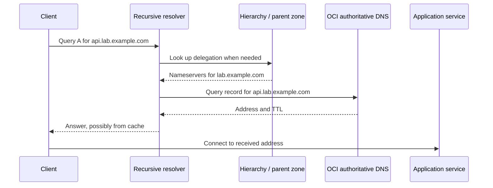

# Public DNS zones and DNS record management

## 1. Objectives and scope

In the **DNS and traffic management** chapter of the Oracle Cloud Infrastructure (OCI) module, public DNS provides authoritative answers for public domain names. Applications can change Compute instances, load balancers, or deployment locations while users continue accessing them using a stable name.

After this lesson, you can:

- Distinguish between a domain, zone, authoritative nameserver, and recursive resolver.
- Create a primary public zone, identify the nameservers assigned by OCI, and configure delegation in the right place.
- Choose record types, manage RRsets, and plan TTLs.
- Add, modify, and delete records using the Console or OCI CLI without unintentional data loss.
- Verify authoritative responses, delegation, caching, and application connectivity.
- Organize access permissions, automation, monitoring, and rollback for DNS changes.

This lesson focuses on primary public DNS zones and static records. Health-based, weighted, or geolocation-based traffic steering belongs to a separate orchestration layer; an A record set with multiple addresses does not provide those capabilities on its own.

All names `example.com`, `lab.example.com` and addresses `203.0.113.x`, `2001:db8:...` in this lesson are illustrative data. During hands-on practice, use a domain under your management and real endpoint addresses; do not publish documentation addresses as real service targets.

## 2. Components in a DNS resolution

### 2.1. A domain is not synonymous with a zone

A domain is a branch in the DNS namespace. A zone is the portion of the namespace managed authoritatively by a set of nameservers.

For example:

```text
example.com
├── www.example.com
├── api.example.com
└── lab.example.com
    ├── api.lab.example.com
    └── www.lab.example.com
```

`lab.example.com` can simply be a name within the `example.com` zone. It becomes the boundary of a child zone when it is managed in a separate zone with corresponding delegation from the parent zone.

The apex is the name at the root of a zone. For the `lab.example.com` zone, the apex is `lab.example.com` itself, while `api.lab.example.com` is a name beneath the apex.

The parent zone holds NS records to delegate answering responsibility to the child zone. Creating a child zone in OCI does not automatically update the parent zone's data at another provider. [Oracle: Overview of DNS](https://docs.oracle.com/en-us/iaas/Content/DNS/Concepts/dnszonemanagement.htm)

### 2.2. Authoritative and recursive roles differ

| Component | Role |
| --- | --- |
| Registrar | Manages domain registration and related delegation operations at the registry level |
| Authoritative nameserver | Answers according to the data of the zone it manages |
| Recursive resolver | Finds answers on behalf of the client and caches them according to DNS rules |
| Client | Queries the resolver, receives the result, and then connects to the service |

When the answer is not in cache, the resolver traverses the hierarchy to find the authoritative nameserver.



The DNS path and the application access path are two separate steps. Public DNS returning the right address does not prove that HTTPS works, the certificate is valid, or the firewall allows traffic.

Conversely, being able to connect to an IP does not prove that hostname delegation is configured correctly.

### 2.3. Public DNS does not open network ports

A public zone stores authoritative records on OCI nameservers to serve public queries. It does not create an Internet Gateway, assign a public IP to Compute, or modify a VCN's NSG. [Oracle: Public DNS](https://docs.oracle.com/en-us/iaas/Content/DNS/Concepts/gettingstarted.htm)

You can enter a private address into an A record, but doing so does not make that address reachable from the Internet. At the same time, data placed into the public namespace can be queried by external parties. Internal-only names and endpoints should be designed using appropriate private DNS.

IAM controls who can manage zones in OCI; IAM does not turn public DNS answers into data that only authenticated account holders can read.

## 3. Record structure and RRset

A record can be represented in zone file format:

```text
api.lab.example.com.  300  IN  A  203.0.113.10
```

| Component | Example value | Meaning |
| --- | --- | --- |
| Owner name | `api.lab.example.com.` | The name that the record describes |
| TTL | `300` | Cache duration in seconds |
| Class | `IN` | Internet class |
| Type | `A` | Record type |
| RDATA | `203.0.113.10` | Data depending on the record type |

The trailing dot at the end of a full name represents the DNS root. In a zone file, omitting the trailing dot may cause a name to be interpreted relative to the origin. When using the Console or API, enter values according to the field requirements and verify the full name after saving to avoid accidentally creating `api.lab.example.com.lab.example.com`.

An **RRset** is a set of records sharing the same owner name, class, and type. Records in the set must use a consistent TTL.

```text
api.lab.example.com.  300  IN  A  203.0.113.10
api.lab.example.com.  300  IN  A  203.0.113.20
```

These are two values in a single A RRset, not two independent DNS services. The answer may contain multiple addresses; do not assume the first address is always the primary server or that the order is always fixed.

The OCI Console groups records with the same name, type, and TTL into an RRset. OCI also normalizes RDATA, so the returned form may differ from the input string, such as appending a trailing dot to a hostname. [Oracle: Adding a Record to a DNS Zone](https://docs.oracle.com/en-us/iaas/Content/DNS/Tasks/record-add.htm)

## 4. Choosing the right record type

| Type | When to use | Illustrative example |
| --- | --- | --- |
| A | Name points to IPv4 | `api.lab.example.com. A 203.0.113.10` |
| AAAA | Name points to IPv6 | `api.lab.example.com. AAAA 2001:db8:42::10` |
| CNAME | One name is an alias of another hostname | `www.lab.example.com. CNAME api.lab.example.com.` |
| MX | Specifies mail receiving server, with priority | `lab.example.com. MX 10 mail.lab.example.com.` |
| TXT | Text data for verification or policies | `_verify.lab.example.com. TXT "training-demo"` |
| NS | Specifies nameservers or delegation to a child zone | NS at zone apex or at delegation boundary |
| SOA | Administrative information and zone parameters | Record created by OCI when creating a zone |
| CAA | Publishes CAs authorized to issue certificates per policy | Value according to the CA and organization's chosen policy |

This is how to interpret DNS data, not a checklist of records that must be created for every zone.

### 4.1. A, AAAA, and application endpoints

A accepts an IPv4 address, and AAAA accepts an IPv6 address. Do not enter URLs with `https://`, paths like `/api`, or ports like `:443` into A/AAAA RDATA.

Before adding AAAA, confirm that the endpoint's IPv6 path, listener, and security rules are already working. Having both A and AAAA does not force clients to use IPv6 and does not guarantee both paths are healthy.

For endpoints provided by a managed service as a hostname, do not arbitrarily resolve its IP and hardcode it into an A record. The provider may change the IP; use the custom domain mechanism and record type instructed by that service.

### 4.2. CNAME, apex, and ALIAS

CNAME points to another name, not to an IP or URL. According to the DNS model, a name with a CNAME cannot coexist with standard data records such as A, AAAA, MX, or TXT. The apex must have SOA and NS records, so standard CNAME cannot be used there. [RFC 1034: Domain Names — Concepts and Facilities](https://www.rfc-editor.org/rfc/rfc1034.txt)

OCI provides **ALIAS**, a non-standard record type to serve a similar purpose to CNAME at the apex. Do not treat ALIAS as an identical feature across all providers; OCI also has constraints regarding steering policy attachments on the same name. [Oracle: Managing Resource Records](https://docs.oracle.com/en-us/iaas/Content/DNS/Reference/supporteddnsresource.htm)

If you do not need a hostname at the apex, a simple structure for the lab is using A/AAAA at `api.lab.example.com` and CNAME at `www.lab.example.com`.

CNAME does not redirect browsers from one name to another. To perform HTTP 301/302 redirects, change URLs, or rewrite paths, configure them at the HTTP layer.

### 4.3. TXT, MX, and administrative data

TXT is public data, not a place to store API keys, passwords, or database connection details. Publish only necessary verification values or policies.

MX points to a mail server hostname, not directly to an IP address or CNAME. SOA and NS must be maintained in their proper administrative roles; fields protected by OCI should not be treated as application data to be edited arbitrarily. [Oracle: Managing Resource Records](https://docs.oracle.com/en-us/iaas/Content/DNS/Reference/supporteddnsresource.htm)

When migrating DNS providers, inventory MX, TXT, CAA, and service verification names as well. Copying only the website's A record can keep the website running while breaking email or certificate issuance.

## 5. TTL, caching, and when changes take effect

TTL controls how long an answer is cached; it is not a synchronized timer guaranteeing the entire Internet switches state simultaneously.

For example, a resolver receives an A record at 09:00 with a TTL of 3600 seconds. If the authoritative record changes at 09:10, that resolver may still use the old data for the remaining time. Lowering the TTL to 300 at 09:10 does not retroactively shorten the expiration of already cached data.

Planned address change workflow:

1. Lower the TTL ahead of the cutover time.
2. Wait through the full old TTL window according to the operational plan.
3. Prepare the new endpoint and test it independently of DNS.
4. Update the RRset, publish, and verify on authoritative nameservers.
5. Monitor resolvers, traffic, and application errors.
6. Keep the old endpoint running during the transition period.
7. Raise the TTL back once the system is stable, if appropriate.

A low TTL increases the likelihood that resolvers must re-query, which can increase query traffic and cost. A high TTL reduces query volume but extends how long stale results persist. Values like 300 or 3600 are only examples; choices must be based on change and operational requirements.

### Negative caching also has an expiration

Non-existence results can be cached. If a client queries a name before you create the record, it may continue receiving the old result for some time after the authoritative server is already returning the new data.

Distinguish between:

| Result | Typical meaning |
| --- | --- |
| `NXDOMAIN` | The queried name does not exist |
| `NOERROR` without data of the queried type | May be NODATA; inspect the full response |
| `SERVFAIL` | Resolution failed, needs root-cause investigation |
| Timeout | No response received within the timeout window |

Negative caching duration depends on SOA information and negative caching rules, rather than simply taking the TTL of the record you just created. [RFC 2308: Negative Caching of DNS Queries](https://www.rfc-editor.org/rfc/rfc2308.txt)

Do not attribute every error to "waiting for DNS propagation." First determine whether the data has been published, what the authoritative servers return, and which path the resolver is using.

## 6. Preparing permissions and zone planning

Select the compartment managing the lab's DNS, and confirm the correct tenancy, displayed region, and zone type. A public zone and a private zone can share the same name while serving different resolution flows.

Recommended role separation:

| Role | Need |
| --- | --- |
| DNS administrator | Create, delete, move zones, and manage related configurations |
| Record manager | Read zones and edit records within the assigned scope |
| Auditor / Tester | Read configurations, compare, and test DNS |
| Domain owner | Has authority to update delegation at the registrar or parent zone |

Permission to create zones in OCI does not grant permissions at the registrar. Those may be two separate teams in an organization.

Example policy scoped to the lab compartment:

```text
Allow group DnsRecordEditors to read dns-zones in compartment NetworkingLab
Allow group DnsRecordEditors to use dns-records in compartment NetworkingLab
```

This is an example; replace the group name and compartment, and use the group identifier appropriate for the tenancy's identity domain. The `use dns-records` permission includes RRset modification operations, including deleting RRsets; do not assume it only grants adding data.

OCI supports conditions by zone, domain name, and record type for finer-grained restrictions. Cross-check the permissions required by the APIs you will use rather than broadly granting `manage dns in tenancy` for every task. [Oracle: Details for the DNS Service](https://docs.oracle.com/en-us/iaas/Content/Identity/Reference/dnspolicyreference.htm)

## 7. Hands-on: creating a primary public zone

### 7.1. Choosing a lab using a child zone

Suppose an organization manages `example.com` at an existing provider. We only move the child zone `lab.example.com` to OCI; the parent domain's website and email continue using their current configuration.

Prerequisites:

- Permission to create a public zone in the OCI lab compartment.
- Permission to add NS delegation in the parent zone `example.com`.
- The `dig` tool for verification.
- A test endpoint if you want to verify HTTP/HTTPS after DNS.
- A list of planned names and RRsets to create.

Examples using documentation addresses only illustrate structure. To test application connectivity, replace them with real public IPs or service hostnames.

### 7.2. Creating the zone in the Console

Under DNS Management, open the Public zones list and create a zone:

| Property | Lab selection |
| --- | --- |
| Zone type | Primary |
| Zone name | `lab.example.com` |
| Compartment | Authorized lab compartment |
| Creation method | Manual |

After creation, wait for the active state and note the OCID. OCI creates the required SOA and NS records for the zone. Do not construct a list of nameservers yourself based on the zone name. [Oracle: Creating a Public DNS Zone](https://docs.oracle.com/en-us/iaas/Content/DNS/Concepts/gettingstarted_topic-Creating_a_Zone.htm)

A secondary zone receives data from an external primary via a separate mechanism; it is not an alternative just because you want an extra manual copy of the zone.

You can create a primary public zone via the OCI CLI in a Bash environment with authentication configured:

```bash
DNS_COMPARTMENT_OCID='REPLACE_WITH_COMPARTMENT_OCID'
DNS_ZONE='lab.example.com'

oci dns zone create \
  --compartment-id "$DNS_COMPARTMENT_OCID" \
  --name "$DNS_ZONE" \
  --zone-type PRIMARY \
  --scope GLOBAL
```

For these DNS commands, `GLOBAL` is the scope value used for public zones, distinguished from `PRIVATE`. Use either the Console or CLI to create it once; do not re-run the example as a way to create a redundant zone.

### 7.3. Configuring delegation in the right place

Retrieve the **entire list of NS records assigned by OCI for the newly created zone**, and use that list for delegation.

| Scenario | Where to update delegation |
| --- | --- |
| Migrating DNS for registered domain `example.com` | Configure nameservers at the registrar following the registrar's process |
| Delegating child zone `lab.example.com` to OCI | NS for `lab.example.com` in the authoritative parent zone `example.com` |

In this lab, perform the second scenario. Add an NS RRset at the name `lab.example.com` in the parent zone, with targets set to the nameservers assigned by OCI.

Adding NS only at the child zone apex is insufficient if the parent zone still does not point to OCI. At the same time, do not change the nameservers of the entire `example.com` domain just to test a child zone.

OCI is a DNS hosting service, not the domain registrar. Delegation may be subject to NS cache duration, so successful zone creation does not immediately mean clients via recursive resolvers reach the right nameservers. [Oracle: Delegating a Public DNS Zone](https://docs.oracle.com/en-us/iaas/Content/DNS/Concepts/gettingstarted_topic-Delegating_Your_Zone.htm)

## 8. Adding and publishing records

Create a minimal lab dataset:

| Owner name | Type | TTL | RDATA |
| --- | --- | --- | --- |
| `api.lab.example.com.` | A | 300 | `203.0.113.10` |
| `www.lab.example.com.` | CNAME | 300 | `api.lab.example.com.` |
| `_verify.lab.example.com.` | TXT | 300 | `"training-demo"` |

Only add an AAAA record for the API when the real endpoint has a verified IPv6 path.

In the Console:

1. Open the zone with the right OCID, and select the Records section.
2. Select Manage records, then Add record.
3. Enter owner name, type, TTL, and RDATA.
4. Verify the full name, trailing dot on the target hostname, and all values in the RRset.
5. Save the changes to the staged section.
6. Select Publish Changes, compare against the published version, and confirm publish.
7. Verify again using an authoritative query.

In this Console workflow, saving a record does not replace the publish step. Do not use a screenshot of a newly saved form as proof that DNS is already serving the new data. [Oracle: Changing DNS Zone Records](https://docs.oracle.com/en-us/iaas/Content/DNS/Tasks/record-edit.htm)

There is no requirement that every A must have an AAAA or every hostname must have a CNAME. Only create records that serve actual needs.

## 9. Updating RRsets via CLI and controlling overwrites

### 9.1. Read fully before making changes

The commands below illustrate Bash. Replace OCIDs and names with your lab values, configure OCI CLI authentication, and select the right environment.

```bash
DNS_ZONE_OCID='REPLACE_WITH_PUBLIC_ZONE_OCID'

oci dns record rrset get \
  --zone-name-or-id "$DNS_ZONE_OCID" \
  --domain 'api.lab.example.com' \
  --rtype A \
  --scope GLOBAL \
  --all
```

Use `--all` to fetch all pages of results, avoiding planning a replacement from partially read data. Inspect the type, TTL, and all existing RDATA. [Oracle CLI: Get RRset](https://docs.oracle.com/en-us/iaas/tools/oci-cli/latest/oci_cli_docs/cmdref/dns/record/rrset/get.html)

### 9.2. Update replaces the entire dataset

Suppose the A RRset currently has:

```text
203.0.113.10
203.0.113.20
```

You want to replace `.10` with `.30` while keeping `.20`. The new request must fully describe both target addresses:

```bash
oci dns record rrset update \
  --zone-name-or-id "$DNS_ZONE_OCID" \
  --domain 'api.lab.example.com' \
  --rtype A \
  --scope GLOBAL \
  --items '[
    {"domain":"api.lab.example.com","rtype":"A","ttl":300,"rdata":"203.0.113.20"},
    {"domain":"api.lab.example.com","rtype":"A","ttl":300,"rdata":"203.0.113.30"}
  ]'
```

`rrset update` replaces the records in the specified RRset. If you only send `.30`, the `.20` value will also be removed from the new set. This is not a single-line append operation. [Oracle CLI: Update RRset](https://docs.oracle.com/en-us/iaas/tools/oci-cli/latest/oci_cli_docs/cmdref/dns/record/rrset/update.html)

This example only affects the A RRset at the exact selected name. Do not switch to a full-zone replacement operation for a small change, as its blast radius and data preservation requirements are much broader.

After a successful CLI/API update, re-read the RRset and query DNS. The CLI/API workflow does not require going into the Console to click publish for an already completed update request.

### 9.3. Preventing lost updates during concurrent edits

If two people read an RRset simultaneously and then each writes back, the second writer may unintentionally erase the first person's changes.

Automation workflows should:

1. Read the full current state and save the appropriate version/ETag from the response.
2. Compute the desired RDATA set, normalize, and compare order-independently.
3. Use the `If-Match` condition when supported by the API to update only the version that was read.
4. When the condition no longer holds, re-read and resolve conflicts instead of blindly overwriting.
5. Re-read and verify authoritatively after the change.

The `rrset update` CLI supports `--if-match`. When using it, pass a valid ETag obtained from the corresponding response; do not fabricate values or reuse an old ETag from a different change. [Oracle CLI: Update RRset](https://docs.oracle.com/en-us/iaas/tools/oci-cli/latest/oci_cli_docs/cmdref/dns/record/rrset/update.html)

### 9.4. Deleting a single value vs. deleting an entire RRset

To remove `203.0.113.20` while keeping `203.0.113.30`, update the A RRset with a set containing only `.30`.

Use the delete RRset operation only when you want to remove all A records at that name. Deleting A does not automatically delete AAAA or CNAME at other names, nor does it immediately purge cached results.

Before deleting a CNAME, confirm the target service is still under your control. Especially when decommissioning an external service, never leave a public name pointing to a reclaimed resource that someone else could re-register.

## 10. Verifying from authoritative server to application

### 10.1. Querying OCI nameservers directly

Assign an actual nameserver retrieved from the zone; do not use guessed names:

```bash
DNS_AUTH_NS='REPLACE_WITH_ASSIGNED_OCI_NAMESERVER'

dig @"$DNS_AUTH_NS" lab.example.com. SOA +norecurse
dig @"$DNS_AUTH_NS" lab.example.com. NS +norecurse
dig @"$DNS_AUTH_NS" api.lab.example.com. A +norecurse
dig @"$DNS_AUTH_NS" www.lab.example.com. CNAME +norecurse
dig @"$DNS_AUTH_NS" _verify.lab.example.com. TXT +norecurse
```

Check the status, Answer section, TTL, and `aa` flag to evaluate the authoritative answer. Query each assigned nameserver when consistency verification is needed, rather than relying on a single brief check.

Direct queries verify data at the nameserver. They do not prove that the Internet delegation path leads to that nameserver.

### 10.2. Checking delegation and resolvers

```bash
dig +trace lab.example.com. NS
dig api.lab.example.com. A
dig www.lab.example.com. A
```

`+trace` helps observe the delegation chain; standard queries use the resolver configured on the machine. When querying A for a CNAME, the response may include both the CNAME chain and the target's address.

If you need to compare via a specific recursive resolver:

```bash
DNS_RECURSOR='REPLACE_WITH_RECURSIVE_RESOLVER_IP'
dig @"$DNS_RECURSOR" api.lab.example.com. A
```

Choose a resolver aligned with the test and network policy. If a corporate network blocks direct outbound DNS queries, a `+trace` timeout is insufficient to conclude the zone is broken.

`dig +short` is handy for a quick look; when troubleshooting, keep the full response so you do not lose status, authority, and TTL details. [Oracle: Testing DNS Using dig](https://docs.oracle.com/en-us/iaas/Content/DNS/Tasks/testingdnsusingdig.htm)

### 10.3. Verifying HTTPS separately

When the lab points to a real endpoint that has a certificate for the hostname:

```bash
curl --noproxy '*' --connect-timeout 5 --max-time 15 \
  https://api.lab.example.com/health
```

Before changing DNS, you can test the new endpoint while preserving HTTP Host and TLS SNI:

```bash
curl --noproxy '*' \
  --resolve 'api.lab.example.com:443:203.0.113.30' \
  --connect-timeout 5 --max-time 15 \
  https://api.lab.example.com/health
```

Replace the documentation address with a real IP before running. Do not use `-k` to treat a TLS check as passing. If the environment requires going through a proxy, test the proxy path according to design as well; the example above aims to test direct connectivity.

A correct DNS answer followed by an HTTPS timeout typically requires investigating routes, firewalls, listeners, or backend health. DNS does not contain the `/health` path and does not determine what status code the business endpoint should return.

## 11. Address migration and rollback scenario

Suppose the API is on an old IP and needs to migrate to a new endpoint.

| Phase | Action | Required evidence |
| --- | --- | --- |
| Preparation | Inventory RRsets, TTLs, and related A/AAAA/CNAME records | Current data and scope of change |
| Lower TTL | Publish a low TTL prior to cutover | Authoritative server returns new TTL |
| Wait old window | Keep both old and new endpoints active | Old cache duration accounted for |
| Test new target | Test HTTP/TLS using hostname and pinned address | New endpoint returns expected result |
| Cutover | Update the full desired RRset | API/Console and authoritative match |
| Monitor | Observe resolvers and applications from appropriate locations | Errors and latency within limits |
| Completion | Decommission old endpoint after transition window | No remaining dependencies to keep |

If the new endpoint has issues, revert the RRset to the recorded state and verify again on authoritative servers. Rollback does not immediately vanish newly cached results, so the new endpoint still needs to be handled during the transition period.

If migrating DNS providers as well, in addition to application records you must plan NS delegation and DNSSEC if enabled. Do not mix changing providers, changing IPs, and rewriting the entire mail policy into one change without a clear reason.

For zones with DNSSEC, changing nameservers and keys must coordinate DS data in the parent zone according to the DNSSEC procedure. Do not delete DS records yourself to try fixing an arbitrary error; first identify the signing state and chain of trust in use. [Oracle: DNSSEC](https://docs.oracle.com/en-us/iaas/Content/DNS/Concepts/dnssec.htm)

## 12. Common errors

| Symptom | Cause to check | Approach |
| --- | --- | --- |
| OCI has the zone but the Internet cannot find the name | Missing or incorrect delegation | Compare parent NS against NS assigned by OCI |
| Direct OCI query is right, resolver still returns old | Cache, old delegation, or resolver using another view | Read TTL, trace, and check actual resolver |
| Console shows new data but authoritative does not | Changes are still staged, not published | Check the published version |
| Name has duplicated zone suffix | Confused relative name with FQDN | Check full owner name after saving |
| Adding CNAME fails | Name has conflicting data or is at apex | Choose appropriate CNAME, A/AAAA, or ALIAS model |
| MX does not work | Malformed RDATA, invalid target | Check priority and mail server hostname |
| Lost an IP after update | Request sent only a partial RRset | Compare previous data with desired set |
| New name still returns NXDOMAIN on some clients | Negative cache | Compare authoritative with resolver response |
| SERVFAIL | Possible delegation, DNSSEC, or unresponsive nameserver issue | Investigate layer by layer; do not just raise TTL |
| DNS returns IP but HTTPS fails | Endpoint, network, or TLS issue | Test service independently of DNS |
| Corporate network returns different IP than outside | Split DNS, private view, or different cache | Identify which resolver and namespace are queried |

Do not treat flushing cache on one machine as proof that all resolvers have updated. Nor should you edit a different zone just because it has the same name; verify OCID, scope, and where queries actually arrive.

## 13. Automation, monitoring, and cost control

### 13.1. Configuration source and change scope

In infrastructure as code, each RRset needs a clear configuration owner. Avoid having one pipeline manage the whole zone while another pipeline edits individual RRsets without coordination conventions.

Change workflows should include:

- Reviewing desired state by owner name, type, TTL, and RDATA.
- Reading full current data, handling pagination.
- Comparing based on normalized value sets.
- Protecting against concurrent overwrites when appropriate.
- Verifying authoritative servers, delegation, and endpoints after changes.
- Saving state for rollback.

Target resources must also be as stable as DNS requires. For Compute, consider appropriate public IP management rather than pointing long-term to an IP that may be lost upon resource termination. For load balancers or managed services, follow each service's custom domain guidance.

Do not use public DNS as a way to publish internal database endpoints. Connecting to Oracle Database, Object Storage, or other services must be evaluated based on that product's endpoint, authentication, and network mechanisms.

### 13.2. Monitoring at the right layer

Track three groups separately:

| Group | Question to answer |
| --- | --- |
| Change management | Who modified a zone or RRset, when, and was it planned? |
| DNS resolution | Do authoritative servers and resolvers return the right data, response code, and latency? |
| Application | Does the hostname lead to an endpoint with valid TLS capable of handling requests? |

Use Audit to investigate management operations via OCI, combined with DNS tests and HTTP/TLS probes. Audit logs of configuration changes are not logs of every end-user DNS query.

When multiple target addresses are needed, define redundancy requirements clearly. A multi-A RRset does not automatically remove a failed backend and does not guarantee all clients distribute traffic evenly. To steer traffic based on health status, design an appropriate load balancer or Traffic Management solution.

### 13.3. Cost and lab cleanup

When budgeting costs, check the current pricing schedule for public DNS, queries, add-on features, and application endpoints. Do not assume a lab is free just because the record count is small.

Low TTLs can increase authoritative queries depending on cache behavior and client traffic. Overly frequent probes also generate extra queries; choose a frequency sufficient to detect faults per requirements.

After the lab, remove unused records and delegations as planned. If decommissioning the entire child zone, revoke delegation in the parent zone first, allow a transition window for caching, and then delete the related resources. Do not leave the parent zone pointing to a deleted zone.

## 14. Lab completion criteria

A properly managed public zone should have concrete evidence:

- Zone with the right name, scope, and compartment, with its OCID identified.
- NS delegation at the parent level matches the nameservers OCI assigned to the zone.
- Necessary SOA and NS records are kept in their proper roles.
- The lab's A, CNAME, and TXT RRsets are published with accurate names and RDATA.
- Direct authoritative queries and queries via recursive resolvers produce explainable results.
- An RRset modification preserves values that should remain and has a rollback state.
- TTL, positive cache, and negative cache are accounted for in the cutover timeline.
- If testing an application, HTTPS is verified separately from DNS with a valid certificate.
- Management permissions stay within the assigned scope; secret data is not placed into public DNS.

The core takeaway is managing both the zone data and the delegation path directing queries to that data. When both parts are verified alongside the application endpoint, DNS changes have clear scope, transition windows, and observable outcomes.
