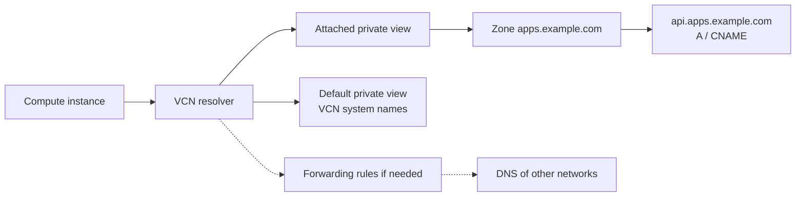

# Private DNS, private views, and name resolution inside a VCN

An application on Oracle Cloud Infrastructure (OCI) typically calls databases and internal services by names like `db.apps.example.com`, rather than keeping IP addresses in configuration. For that name to work, you must determine where the record is stored, which resolver sees the record, and where the application host actually sends its queries.

In the **CLOUD_PROVIDERS_ORACLE** module, this lesson connects VCN networking knowledge with Compute, IAM, and Oracle database services. Learners design internal namespaces, share DNS data across VCNs, connect DNS with on-premises environments, and test the name resolution path separately from the application access path.

After this lesson, learners can:

- Distinguish between a private zone, private view, VCN resolver, and resolver endpoint.
- Create internal records, attach views to a resolver, and verify from a Compute instance.
- Explain lookup order, negative responses, and the impact of caching.
- Choose between sharing a view or conditional forwarding according to network scope.

## 1. Zone–view–resolver relationship

A model requires four components:

| Component | Responsibility |
| --- | --- |
| Private zone | Holds DNS data for a domain, such as `apps.example.com` |
| Resource record | Maps a name by query type, such as A or CNAME |
| Private view | Groups private zones for a resolver to reference |
| Private resolver | Receives queries and finds answers according to the VCN's configuration |

A private zone belongs to exactly one view. Within a view, zone names must be unique; different views can contain zones with the same name. Views are Private DNS resources and do not apply to public zones. A VCN has a protected default view; you can add custom views instead of placing all application zones into the default view. [Private Views](https://docs.oracle.com/en-us/iaas/Content/DNS/Concepts/views.htm).



Two relationships must be verified independently: **which view the zone belongs to** and **whether the resolver has attached that view**. Creating a zone in the right compartment does not automatically make it visible to VCNs in that compartment.

Private DNS is also not a mechanism for granting application access. A client that knows a private IP still needs appropriate routes, network rules, and application permissions. Conversely, attaching a view helps the client resolve a name, but does not create a network path to the returned address.

## 2. Default DNS in a VCN

### 2.1. OCI-managed names

When DNS hostnames are enabled and appropriate DNS labels are set for the VCN, subnet, and private IP hostname, the typical naming structure is:

```text
<hostname>.<subnet_dns_label>.<vcn_dns_label>.oraclevcn.com
```

For example, with hostname `vm01`, subnet label `appnet`, and VCN label `dnslab`:

```text
vm01.appnet.dnslab.oraclevcn.com
```

This name points to the corresponding private IP. A VM's display name, DNS hostname, and the hostname used by the operating system are distinct values; changing the hostname inside the OS does not automatically update OCI records. [DNS in a Virtual Cloud Network](https://docs.oracle.com/en-us/iaas/Content/Network/Concepts/dns.htm).

Protected zones managed by OCI services should not be treated as self-managed application zones. In the default protected view, do not create a private zone at or beneath `oraclevcn.com`; use a separate application domain to avoid conflicts. [Creating a private zone in a view](https://docs.oracle.com/en-us/iaas/Content/DNS/Tasks/view-add-zone.htm).

### 2.2. DHCP determines which DNS the client uses

Each subnet is associated with a set of DHCP options. The **Internet and VCN Resolver** option provides the OCI resolver; the default IPv4 address is `169.254.169.254`. With **Custom Resolver**, clients receive the specified DNS servers. Changes to DHCP options must be picked up by the client via a lease renewal cycle or an appropriate DHCP action/reboot. [DHCP Options](https://docs.oracle.com/en-us/iaas/Content/Network/Tasks/managingDHCP.htm).

Therefore, the first question when troubleshooting is: **which DNS server is the application host querying?** A VM configured to query a public resolver will not automatically have OCI private zone data.

On Linux, an address like `127.0.0.53` may be a local stub. In that case, check the upstream servers using the OS's DNS management tool, for example:

```bash
resolvectl status
```

This lab uses full FQDNs to reduce reliance on search domains. DNS search suffixes help complete short names; they do not create records and do not attach views to a resolver.

## 3. Resolution order and negative responses

The resolver evaluates attached views sequentially in the configured order. The default view is evaluated after attached views, unless explicitly placed in that list. After views come forwarding rules, and finally Internet resolution. For a zone in Static mode, a negative answer from a matching zone also terminates the lookup; data from multiple views is not merged automatically. [Common Private DNS Issues](https://docs.oracle.com/en-us/iaas/Content/DNS/Tasks/troubleshooting_general.htm).

For example, suppose a resolver has the following order:

```text
1. view-app-primary: zone apps.example.com
2. view-app-secondary: zone apps.example.com
3. Default view
4. Forwarding rules
5. Internet
```

If the Static zone in the first view does not contain `billing.apps.example.com`, having that record in the second view does not guarantee the client will receive it. The negative response from the first view already represents the effective data for the queried name.

The same happens when an overly broad parent zone sits ahead of a forwarding rule. If you create a Static zone `example.com`, queries for `host.corp.example.com` may be handled by that zone before reaching the rule for `corp.example.com`.

### Distinguishing three common outcomes

| Outcome | Meaning to examine |
| --- | --- |
| Answer present | Data exists for the queried name/type or alias chain was resolved |
| NXDOMAIN | The queried name does not exist in that resolution context |
| NODATA | The name exists, but has no data for the queried record type |

NODATA typically appears in `dig` as `status: NOERROR` with no answer of the requested type. It differs from a timeout where no response is received, and from `SERVFAIL` when the resolver cannot complete resolution. [RFC 2308 on Negative Caching of DNS Queries](https://www.rfc-editor.org/rfc/rfc2308).

## 4. Static, Transparent, and RTypeTransparent

OCI provides resolution modes to control whether lookups continue when a private zone lacks data. In this lab, choose **Static** so namespace ownership boundaries remain clear. When multiple sources share a namespace, consider transparency. [OCI Private DNS Resolution Modes](https://blogs.oracle.com/cloud-infrastructure/oci-private-dns-resolution-modes).

| Mode | When the name does not exist in the zone | When the name exists but lacks the record type |
| --- | --- | --- |
| Static | Returns NXDOMAIN | Returns NODATA |
| Transparent | Continues evaluating the next source | Continues only when the record type is missing at the zone apex; regular names still return NODATA |
| RTypeTransparent | Continues evaluating the next source | Continues evaluating the next source |

The zone apex is the domain name of the zone itself, such as `apps.example.com`. Continuing evaluation can proceed to the next view, then rules, and then the Internet per resolver order; it does not mean jumping straight to public DNS. Oracle also imposes limits on the number of transparency continuations. [Private DNS Zone Transparency](https://docs.oracle.com/en-us/iaas/Content/DNS/Tasks/privatedns.htm).

For example, one zone holds an A record for `api.apps.example.com`, while another source holds TXT for the same name. Static returns NODATA for a TXT query if the first source lacks that type; RTypeTransparent allows continuing the search. Regardless of the mode used, a matching record returned by an earlier source still takes precedence.

Before enabling transparency, identify the subsequent sources and what data they might return. For sensitive internal names, evaluate the risk of missing names being forwarded onward to an unintended source. Do not enable this mode simply to mask an incorrectly attached view.

## 5. Designing namespaces and application records

A realistic structure might dedicate separate subdomains:

| Namespace | Intended owner | Purpose |
| --- | --- | --- |
| `apps.example.com` | Application platform team | Internal application names |
| `db.example.com` | Database team | Aliases to managed DB endpoints |
| `corp.example.com` | Enterprise DNS team | Names answered by on-premises DNS |

`example.com` in this lesson is an illustrative domain. Production environments should use an organization-managed domain and avoid names that conflict with other resolution mechanisms, such as the `.local` suffix commonly used by mDNS.

Records should be inventoried by name, type, RDATA, TTL, and owner. For example:

```dns
api01.apps.example.com.  60 IN A     10.90.10.20
api.apps.example.com.    60 IN CNAME api01.apps.example.com.
db01.apps.example.com.   60 IN A     10.90.10.30
db.apps.example.com.     60 IN CNAME db01.apps.example.com.
```

This is illustrative data for the zone, not a complete zone file. In the Console, check the FQDN and RDATA preview to avoid appending the suffix twice. Records sharing the same name, type, and TTL are managed as an RRset. Changes must be published following the UI workflow. [Adding a Record to a DNS Zone](https://docs.oracle.com/en-us/iaas/Content/DNS/Tasks/record-add.htm).

Using an alias such as `db.apps.example.com` decouples the name used by the application from the underlying infrastructure target name. However, changing DNS does not change the Oracle Database service name, wallet, TLS certificate, open connections, or client policies.

A CNAME pointing to a name in another VCN also requires the resolver to be able to resolve that target name. Having an alias in the current view does not automatically bring the target's zone into visibility scope.

## 6. Lab: creating a private zone and attaching it to a VCN

### 6.1. Illustrative parameter set

| Resource | Value |
| --- | --- |
| Region | `ap-singapore-1` |
| Lab compartment | `OciDnsLab` |
| VCN | `vcn-dns-lab`, CIDR `10.90.0.0/16` |
| Client subnet | `10.90.10.0/24` |
| Client VM | `10.90.10.10` |
| Test backend | `10.90.10.20` |
| Private view | `view-app-lab` |
| Private zone | `apps.example.com` |
| Resolution mode | Static |
| Lab record TTL | `60` seconds |

Prepare a VM with `dig` and appropriate administrative access. The backend only needs to exist when testing TCP/HTTPS; DNS tests can use the illustrative addresses without creating the corresponding services.

Implementers need permissions to manage private zones, records, views, and resolver configurations in the relevant compartment. Permission to update a resolver with a list of views also involves permission to inspect those views. If creating endpoints, prepare the required additional permissions and network resources. Clients sending DNS queries do not need IAM DNS administration permissions. [DNS Policy Reference](https://docs.oracle.com/en-us/iaas/Content/Identity/Reference/dnspolicyreference.htm).

### 6.2. Creating the view and zone

In the DNS section of the Console, open **Private views**, and create `view-app-lab` in `OciDnsLab`. A view is a regional resource; verify the current region before searching for or creating resources. [Creating a Private View](https://docs.oracle.com/en-us/iaas/Content/DNS/Tasks/view-create.htm).

Inside that view, create the private zone `apps.example.com`, keeping Static mode for the lab. Once the zone is ready, add the records from section 5 and publish. Do not modify protected zones or delete SOA/NS records just to make the record list shorter.

### 6.3. Attaching the view to the resolver

Open the lab VCN, select **DNS Resolver**, go to **Associated private views**, and click **Manage Private Views**. Add `view-app-lab`, keep any existing needed views, and verify the order before saving. This is the operation that makes the resolver reference data in the view. [Adding a Private View to a Resolver](https://docs.oracle.com/en-us/iaas/Content/Network/Tasks/resolver-add-view.htm).

Verify that the VM's subnet uses the right DHCP options and the client has received the configuration. For clients using the default VCN resolver, you do not need to create a dedicated listening endpoint yet to start querying from a VM inside the VCN.

If the same zone name already appears in a higher-priority view, resolve the conflict before acceptance testing. The fact that the new zone exists and is active does not prove it will be selected.

## 7. Context-accurate testing with dig and OCI CLI

### 7.1. Querying from a VM inside the VCN

The following commands are Bash examples on the lab VM, focusing on the IPv4 resolver address:

```bash
dig @169.254.169.254 api01.apps.example.com. A \
  +time=2 +tries=1 +noall +comments +answer +authority +stats

dig @169.254.169.254 api.apps.example.com. A \
  +time=2 +tries=1 +noall +comments +answer +authority +stats

dig @169.254.169.254 missing.apps.example.com. A \
  +time=2 +tries=1 +noall +comments +answer +authority +stats

dig @169.254.169.254 api01.apps.example.com. TXT \
  +time=2 +tries=1 +noall +comments +answer +authority +stats
```

Expected results with this lesson's data and Static mode:

| Query | Expected observation |
| --- | --- |
| `api01... A` | `10.90.10.20` |
| `api... A` | CNAME chain to `api01...` and the corresponding address |
| `missing... A` | NXDOMAIN because the name is not in the lab zone |
| `api01... TXT` | NOERROR with no TXT answer, i.e., NODATA |

Do not look only at `+short`: the header and authority sections help distinguish negative responses, server errors, and missing connectivity. The trailing dot on the FQDN keeps the test independent of search suffixes.

Next, test the OS's default resolver:

```bash
dig api.apps.example.com. A
getent ahostsv4 api.apps.example.com
```

If querying `@169.254.169.254` directly succeeds but the OS or application returns a different answer, check upstream servers, caches, local hosts files, and resolution paths inside containers. `dig` and an application's resolution calls do not necessarily use the exact same processing chain.

### 7.2. Inspecting the control plane

The OCI CLI is authenticated with an identity that has read permissions for the corresponding resources:

```bash
REGION='ap-singapore-1'
RESOLVER_OCID='<RESOLVER_OCID>'
ZONE_OCID='<PRIVATE_ZONE_OCID>'

oci dns resolver get \
  --resolver-id "$RESOLVER_OCID" \
  --scope PRIVATE \
  --region "$REGION"

oci dns record rrset get \
  --zone-name-or-id "$ZONE_OCID" \
  --domain 'api01.apps.example.com' \
  --rtype A \
  --scope PRIVATE \
  --region "$REGION"
```

Use the first output to verify the default view, attached views, and rules; the second output inspects the stored RRset. When accessing a private zone by name instead of OCID, specify the corresponding view to avoid ambiguity between zones sharing the same name. [CLI resolver get](https://docs.oracle.com/en-us/iaas/tools/oci-cli/latest/oci_cli_docs/cmdref/dns/resolver/get.html), [CLI RRset get](https://docs.oracle.com/en-us/iaas/tools/oci-cli/latest/oci_cli_docs/cmdref/dns/record/rrset/get.html).

Reading the right record via CLI only proves that the management data exists. Testing from the client is what verifies the resolver in use, view ordering, and the actual DNS path. Cloud Shell does not inherently represent the DNS context of a VM inside a VCN.

### 7.3. Separating DNS from application connectivity

If there is a test HTTPS backend at `api.apps.example.com:8443` with a certificate trusted by the client:

```bash
nc -vz -w 5 10.90.10.20 8443
curl --noproxy '*' --connect-timeout 5 --max-time 15 \
  'https://api.apps.example.com:8443/health'
```

If DNS is right but TCP fails, investigate routes, Security Lists/NSGs, firewalls, and listeners. If TCP succeeds but TLS fails, check the hostname and certificate. Reading business data also depends on application identity or database permissions.

## 8. Sharing DNS across VCNs

### 8.1. Same region: reusing views

Resolvers in the same region can reference a shared private view. For example, attaching `view-app-lab` to VCN B's resolver lets B use the same zone data instead of creating duplicate records. You can also share an appropriate default view to resolve another VCN's system names. [Shared Private DNS Zones Within a Region](https://docs.oracle.com/en-us/iaas/Content/DNS/Tasks/privatedns.htm).

This is sharing DNS data at the resolver, not sending queries to a DNS server inside a subnet of VCN A. Attaching a view does not automatically create peering or routes for workloads; for B to connect to IPs belonging to A, you must still design a separate data path.

A useful verification test is: from a VM in B, `api.apps.example.com` resolves, yet the backend cannot be reached because no network path exists yet. This outcome separates the two configuration layers instead of editing records when the real issue lies in routing.

### 8.2. Different regions or maintaining independent DNS sources

Use a forwarding endpoint in the source network, a listening endpoint on the destination resolver, and a rule for the right domain. Network connectivity between endpoints, bidirectional routes, and matching security rules are required. Do not treat a view in another region as a local view that can be attached arbitrarily.

When choosing between a shared view and forwarding, weigh data ownership, regional scope, dependency failure points, and troubleshooting visibility. Avoid manually duplicating entire zones across multiple VCNs when the goal is a single shared dataset.

## 9. Listening endpoints and forwarding endpoints

| Endpoint | Query direction |
| --- | --- |
| Listening | Receives queries from resolvers/clients in other networks into the VCN resolver |
| Forwarding | Provides a path to send queries from the VCN resolver to a DNS server selected by a rule |

An endpoint has only one role: listening or forwarding. Compute instances querying `169.254.169.254` directly inside a VCN do not need a separate listening endpoint. Listening/forwarding endpoints currently do not support IPv6; do not confuse that with the ability to store AAAA records. [Resolver Endpoints](https://docs.oracle.com/en-us/iaas/Content/Network/Concepts/dns-topic-resolver_endpoints.htm).

Extended lab example with on-premises DNS:

```text
VCN: 10.90.0.0/16
Endpoint IPv4 subnet: 10.90.20.0/24
Illustrative listening IP: 10.90.20.10
Illustrative forwarding IP: 10.90.20.11
On-premises DNS: 172.20.1.53
On-premises managed zone: corp.example.com
```

The addresses above are samples only; use actually assigned IPs and ensure the subnet has sufficient capacity. Create endpoints via the resolver page by choosing the appropriate subnet and role. An endpoint has associated network resources in the subnet, so its lifecycle must be managed alongside network infrastructure. [Creating a Resolver Endpoint](https://docs.oracle.com/en-us/iaas/Content/Network/Tasks/resolver-endpoint-create.htm).

### Flow: OCI querying on-premises names

```text
VM -> VCN resolver
   -> Not answered by private views
   -> Rule for corp.example.com
   -> Forwarding endpoint
   -> DNS 172.20.1.53
```

Create a FORWARD rule for the target domain, selecting the source endpoint and destination DNS addresses. The connection path can traverse FastConnect or Site-to-Site VPN as designed. Do not use a catch-all forward rule to send every name on-premises without evaluating availability and query scope.

### Flow: on-premises querying OCI names

```text
On-premises client -> Enterprise DNS
                   -> Conditional forward for apps.example.com
                   -> Listening endpoint 10.90.20.10
                   -> VCN resolver -> Private view -> Record
```

Enterprise DNS sends queries to the **listening IP inside the subnet**, not to a remote VCN's link-local address `169.254.169.254`. On the OCI resolver, do not forward `apps.example.com` back to enterprise DNS if that resolver itself is supposed to answer that zone; misconfigured bidirectional rules can create a loop.

A matched FORWARD rule will be applied; if the destination fails to respond, the resolver does not automatically fall through to try the next rule. Failover designs must be tested against actual target configurations. [Forwarding processing rules](https://docs.oracle.com/en-us/iaas/Content/DNS/Tasks/troubleshooting_general.htm).

## 10. Networking and security for DNS forwarding

Both UDP and TCP port `53` must be permitted along the required paths. TCP matters when responses or query mechanisms require it; testing only UDP is incomplete acceptance testing.

For a stateless design, the packet direction checklist is:

| Location | Request | Response |
| --- | --- | --- |
| Listening endpoint | Ingress to destination port 53 | Egress from source port 53 |
| Forwarding endpoint | Egress to destination port 53 | Ingress from source port 53 |

Apply this for both UDP and TCP, restrict CIDRs/IPs to the partner DNS side, and account for ephemeral ports on the client side. Oracle notes stateless rules for DNS traffic to avoid connection-tracking overhead under heavy load; if using stateful rules, understand your environment's connection-tracking behavior. [Network Connectivity Issues With Private DNS](https://docs.oracle.com/en-us/iaas/Content/DNS/Tasks/troubleshooting_network-connectivity.htm).

Inspect subnet route tables, DRG/LPG/RPC if present, endpoint NSGs/Security Lists, and the partner DNS firewall together. You can test the listening path from an authorized host on the external network with:

```bash
dig @10.90.20.10 api.apps.example.com. A +time=2 +tries=1
dig @10.90.20.10 api.apps.example.com. A +tcp +time=2 +tries=1
```

IAM protects administrative actions on zones/views/resolvers; network rules protect the DNS query path. Keeping a record unpublished on the Internet does not replace data access controls. Do not place passwords, tokens, or sensitive information into TXT records to use DNS as a secret store.

## 11. Caching, TTL, and endpoint changes

TTL expresses how long a result is cached by DNS mechanisms, not a guarantee that every process switches to the new address immediately after that many seconds. Operating systems, local stubs, resolvers, runtimes, and connection pools can complicate observing changes.

Negative responses can also be cached. Therefore, querying a name before creating the record and adding the record afterward may still yield NXDOMAIN while the cache remains valid; the new record's TTL does not automatically clear old negative cache entries. [Negative Caching of DNS Queries](https://www.rfc-editor.org/rfc/rfc2308).

When preparing to change an endpoint:

1. Record the current RRset, TTL, view, and resolver ordering.
2. If lowering the TTL is needed, do so early enough for caches holding the old TTL to expire.
3. Prepare the new endpoint, routing, TLS, and application permissions before changing DNS.
4. Publish the record and verify from each actual client group.
5. Keep the old endpoint running for the defined transition window and have a rollback plan.

Do not treat multi-A records or CNAME changes as an automatic health-check mechanism. Private DNS also does not mean OCI Traffic Management for public DNS has been applied to internal zones. For Oracle databases, coordinate name changes with appropriate role transitions and client connection handling.

## 12. Symptom-based diagnostics

| Symptom | What to check |
| --- | --- |
| CLI sees record, VM returns NXDOMAIN | Zone's view, resolver the VM uses, view order, and negative cache |
| `dig @169.254.169.254` works but application fails | DHCP, OS stub, runtime/container cache, and local hosts file |
| VCN system names work, custom zone fails | Custom view not attached or record not published properly |
| Only one VCN answers differently | Different resolvers/views or different priority ordering |
| On-premises querying OCI times out | Listening IP, bidirectional routes, UDP/TCP 53, and firewall |
| OCI querying on-premises returns SERVFAIL/timeout | Rule, forwarding endpoint, target DNS, and loops |
| Short name fails, FQDN works | Search domain and how the application completes names |
| A works but TXT/AAAA missing | Existing record types, NODATA, and resolution mode |
| DNS works but backend connection fails | Routing, network security, listener, TLS, or application permissions |

For every incident, log the full name, QTYPE, queried DNS server, source VCN, timestamp, response code, and answer/authority sections. A screenshot of the record list is not enough to determine what answer the client received.

Check sequentially: is the record right, which view owns the zone, does the resolver use that view, is the client querying the right resolver, and only then inspect forwarding and network paths if needed. Keep test parameters fixed and change one factor at a time so results remain explainable.

## 13. Operations and lab acceptance

A shared private view reduces duplication but increases the blast radius of changes. Document the owner for each zone, which resolvers use the view, and the pre-publish verification workflow. When automating, preserve the entire list of attached views and their intended order; do not accidentally overwrite the list with a single new element.

For the lab budget, inventory created VMs, endpoints, hybrid connections, and observability tools; check applicable pricing before scaling up. Only create forwarding/listening endpoints when the use case requires a DNS path across networks.

An acceptance matrix should cover:

| Test | Criterion |
| --- | --- |
| Lab VM queries A and CNAME | Returns the zone's accurate address and alias |
| Query missing name in Static zone | Context-accurate NXDOMAIN |
| Query non-existent TXT on a name with A | NODATA, distinguishable from timeout |
| Client in VCN B uses shared view | Result matches resolver and configured order |
| B accesses backend in A | Evaluate application path separately, not inferred from DNS |
| Bidirectional hybrid DNS | Accurate conditional forwarding, UDP/TCP working, no loops |
| Modify a test record | Cache observed and restored per plan |

After the lab, remove rule/view associations used only for testing before deleting the resources you created. Preserve OCI-managed protected resources and resources still serving other workloads. Check endpoints and related network resources when cleaning up the environment.

A complete configuration must account for both **effective DNS data** and the **client's query context**. This is the foundation for applications and Oracle databases to use stable internal names across multiple subnets, VCNs, and enterprise networks.