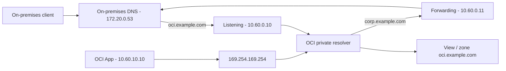

# DNS resolver endpoints and name resolution with on-premises

An application running on OCI Compute may need to call an ERP service in the data center using an internal domain name. Conversely, on-premises operators may need to connect to an Oracle database in OCI using a private name. To make that possible, a FastConnect or Site-to-Site VPN connection must be paired with an appropriate name resolution configuration.

In the **DNS and traffic management** chapter of the **CLOUD_PROVIDERS_ORACLE** module, this lesson focuses on the private DNS resolver, listening endpoint, forwarding endpoint, and conditional forwarding. The design is placed in the context of authorization, routing, security, monitoring, and operability in Oracle Cloud Infrastructure.

## 1. Objectives and scope

After this lesson, learners can:

- Choose a listening endpoint or forwarding endpoint based on the DNS query direction.
- Trace queries from a client host to on-premises DNS or a private zone in OCI.
- Identify the right source IP, destination IP, routes, and ports required for each hop.
- Configure bidirectional resolution for two separate namespaces.
- Distinguish timeouts, NXDOMAIN, rule errors, and application connection failures after an address is already obtained.
- Test caching and backup paths without mistaking stale DNS results for current DNS reachability.

This lesson assumes a VCN, subnets, and private connectivity to the on-premises network are already in place. Names under `example.com` and all addresses in the examples are illustrative data. No public DNS or public traffic steering mechanisms are needed to implement this model.

## 2. Components and responsibilities

| Component | Role |
| --- | --- |
| Private zone | Holds private DNS data, such as host A records |
| Private view | Groups private zones used by the resolver |
| VCN private DNS resolver | Processes queries based on views and rules |
| Listening endpoint | Receives queries sent into the resolver from networks that can reach the endpoint |
| Forwarding endpoint | Sends queries from the resolver to another DNS server |
| Resolver rule | Selects queries to forward and the target DNS server |
| On-premises DNS server | Serves internal domain names and forwards the OCI namespace when configured |

A resolver can use private views, private zones, and conditional forwarding rules. When creating a VCN with appropriate DNS hostname options, OCI creates a dedicated resolver along with a default private view and system-managed zones. [Source: Private DNS Resolvers](https://docs.oracle.com/en-us/iaas/Content/Network/Concepts/dns-topic-Private-resolver.htm).

For a clear design, identify where data ownership resides before configuring rules. For example, the OCI team manages names for cloud workloads, while the enterprise DNS team manages names for on-premises services. Forwarding sends questions to the right place; it does not automatically synchronize records between the two systems.

### 2.1. Listening and forwarding from the OCI perspective

| Need | OCI component required |
| --- | --- |
| On-premises DNS queries names served by OCI | Listening endpoint |
| OCI workload queries names served by on-premises DNS | Forwarding endpoint and resolver rule |
| Compute inside the VCN queries the default resolver | No additional listening endpoint needed just for this |

An endpoint is configured only to listen or to forward. The default address `169.254.169.254` serves queries from Compute instances inside the VCN; a listening endpoint adds an entry point to receive queries from connected networks. An endpoint is attached to a subnet and has an associated VNIC. [Source: Resolver Endpoints](https://docs.oracle.com/en-us/iaas/Content/Network/Concepts/dns-topic-resolver_endpoints.htm).

Do not use a forwarding endpoint address as a DNS server for client hosts. That is the address the resolver uses to send outbound queries. Likewise, do not use `169.254.169.254` as a conditional forwarder target from an on-premises network.

### 2.2. Independent namespaces aid clarity

This lab divides ownership:

```text
oci.example.com    -> data in OCI private zone
corp.example.com   -> data on on-premises DNS
```

For example:

```text
db01.oci.example.com     A  10.60.20.20
app01.oci.example.com    A  10.60.10.10
erp.corp.example.com     A  172.20.50.20
```

Two distinct namespaces make it clear where each query's final answer comes from. If the same namespace has data in multiple locations, an appropriate mechanism must be designed; do not create two zones with the same name expecting a missing record in one to always fall through to the other.

## 3. Bidirectional connectivity model

### 3.1. Addresses and resources

| Resource | Illustrative address |
| --- | --- |
| OCI VCN | `10.60.0.0/16` |
| Subnet hosting resolver endpoints | `10.60.0.0/24` |
| Listening endpoint `dns_in` | `10.60.0.10` |
| Forwarding endpoint `dns_out` | `10.60.0.11`, as the forwarding address |
| OCI application host | `10.60.10.10` |
| OCI database host | `10.60.20.20` |
| On-premises network | `172.20.0.0/16` |
| On-premises DNS | `172.20.0.53` |
| On-premises ERP host | `172.20.50.20` |

Endpoints use an IPv4-only subnet. Reserve one IP for listening and two IPs for forwarding; obtain the actual forwarding address from the service when configuring the network. [Source: Private DNS](https://docs.oracle.com/en-us/iaas/Content/DNS/Tasks/privatedns.htm), [Common Private DNS Issues](https://docs.oracle.com/en-us/iaas/Content/DNS/Tasks/troubleshooting_general.htm).



The diagram only illustrates query flow. Hops between OCI and the on-premises network traverse the configured private connection, with routes and security policies on both sides.

### 3.2. On-premises querying an OCI name

Suppose an on-premises client needs `db01.oci.example.com`:

1. The client queries enterprise DNS `172.20.0.53`.
2. Enterprise DNS matches the conditional forwarder for `oci.example.com`.
3. That DNS sends the query to the listening endpoint `10.60.0.10`.
4. The OCI resolver looks up the data in the view containing the `oci.example.com` zone.
5. The answer `10.60.20.20` is returned via enterprise DNS to the client.

Looking at the hybrid transport path:

```text
Query:
172.20.0.53:<source_port> -> 10.60.0.10:53

Response:
10.60.0.10:53 -> 172.20.0.53:<source_port>
```

In this model, the source IP reaching the endpoint is the enterprise DNS server, not every client host behind it. If a separate diagnostic host queries the listening endpoint directly, that host must have its own route and permission for the direct flow.

### 3.3. OCI querying an on-premises name

Suppose the OCI App needs `erp.corp.example.com`:

1. The App queries the resolver configured for the host, here `169.254.169.254`.
2. No private zone in this design answers the `corp.example.com` namespace.
3. The resolver matches the forwarding rule for `corp.example.com`.
4. The resolver sends the query via `dns_out` to `172.20.0.53`.
5. On-premises DNS answers `172.20.50.20`.
6. The OCI resolver returns the result to the App.

On the hop from OCI to on-premises DNS:

```text
Query:
10.60.0.11:<source_port> -> 172.20.0.53:53

Response:
172.20.0.53:53 -> 10.60.0.11:<source_port>
```

This is a query forwarded by the resolver. The on-premises firewall must evaluate the forwarding address `10.60.0.11`. Allowing only the App IP `10.60.10.10` does not permit this hop.

Oracle's hands-on documentation describes the two directions separately: on-premises sends to the listening address, while the OCI resolver sends outbound using the forwarding address; those addresses must be routed and permitted over VPN or FastConnect. [Source: Configure two way domain name resolution](https://docs.oracle.com/en/learn/resolve-onprem-dns-from-oci/).

### 3.4. Successful resolution does not create a path to the service

After receiving `db01.oci.example.com = 10.60.20.20`, the client initiates an application connection to `10.60.20.20`. This flow has a different destination than the DNS endpoint, uses a different port, and may traverse different network policies.

Separate the evidence:

| Verification layer | Question to answer |
| --- | --- |
| DNS | Does the name return the right data? |
| Network to workload | Is the newly received private IP reachable from the source? |
| Service | Is the listener or application running? |
| Usage permissions | Is the user or application authenticated and authorized? |

Do not modify DNS to fix a listener failure when the record is already right; nor should you conclude DNS is healthy just because a direct IP connection succeeds.

## 4. How does the resolver choose an answer?

### 4.1. Views, rules, and Internet resolution

The core evaluation sequence of a private resolver is:

```text
Private views in configured order
  -> default view if not already in the list above
  -> resolver rules in order
  -> Internet resolution if no matching answer was found
```

A QNAME cover condition matches the specified domain and names beneath it. This lab uses one condition for `corp.example.com`. [Source: Private DNS — Configuration and Resolution](https://docs.oracle.com/en-us/iaas/Content/DNS/Tasks/privatedns.htm).

This sequence explains why a valid rule exists yet no query leaves the endpoint: a private zone may have already provided an answer earlier.

### 4.2. A broad zone can shadow a forwarding rule

Incorrect example within the model's scope:

```text
OCI private zone: example.com
Forwarding rule:  corp.example.com -> 172.20.0.53
Queried name:     erp.corp.example.com
```

If the `example.com` zone uses Static mode and lacks the queried name, it can return NXDOMAIN before reaching the rule. A forwarding rule does not automatically override that negative answer.

OCI supports transparency modes. This example uses Static; a zone with transparency enabled may continue processing differently from the scenario above. [Source: Private DNS — Private DNS Zone Transparency](https://docs.oracle.com/en-us/iaas/Content/DNS/Tasks/privatedns.htm).

### 4.3. The first matching rule is applied

Resolver rules are evaluated in order. Once a rule matches, subsequent rules do not act as a fallback for that rule's outcome. Therefore:

- Place specific conditions before broad conditions that encompass them.
- Check the impact before adding a rule that matches all names.
- Do not create two rules with the same condition expecting the second rule to rescue the first if the target DNS fails.

A forwarding endpoint must exist before a rule using it is created. [Source: Resolver Rules](https://docs.oracle.com/en-us/iaas/Content/Network/Concepts/dns-topic-resolver_rules.htm).

In the basic model, only one OCI rule is needed for the `corp.example.com` namespace; other queries continue following the existing resolver configuration.


## 5. Routing and security for each hop

### 5.1. Routes must include the endpoint subnet

In the model above, DNS hops across the hybrid connection involve `10.60.0.0/24` and on-premises DNS `172.20.0.53`.

| Check location | Required route or forwarding capability |
| --- | --- |
| On-premises side | Has a path to the OCI endpoint subnet |
| DRG receiving packets from on-premises | Can forward to the VCN containing the endpoint |
| Route table applied to the endpoint subnet | Has a path to on-premises DNS via the DRG |
| DRG receiving packets from the VCN | Has a path to the on-premises DNS network via the hybrid connection |
| On-premises DNS side | Can reply back to the listening or forwarding address |

Checking only the App subnet to the on-premises network is not enough. The forwarding endpoint uses a VNIC in the endpoint subnet, so you must verify the effective path for the endpoint.

To narrow the model, the route from the endpoint subnet can target `172.20.0.53/32` instead of the entire on-premises network, if the DRG and customer network design support it. When adding another target DNS, update both routes and network policies.

### 5.2. Allowing UDP and TCP 53

DNS uses both UDP and TCP. TCP is not only for zone transfers; it is also used for regular queries and when handling responses that do not fit in UDP. Opening only UDP 53 can let some names work while other queries fail. [Source: RFC 7766 — DNS Transport over TCP](https://www.rfc-editor.org/rfc/rfc7766).

Required flows for this lab:

| Source | Destination | Protocol, destination port | Purpose |
| --- | --- | --- | --- |
| `172.20.0.53` | `10.60.0.10` | UDP 53 and TCP 53 | On-premises DNS querying OCI |
| `10.60.0.11` | `172.20.0.53` | UDP 53 and TCP 53 | OCI forwarding to on-premises |

Responses travel in the reverse direction, with DNS source port 53 and destination port matching the query's source port. Do not set the source port of all queries to 53.

A dedicated checklist for UDP:

| OCI Endpoint | Direction | Flow port condition |
| --- | --- | --- |
| Listening | Ingress from on-premises DNS | Destination port 53 |
| Listening | Egress returning to on-premises DNS | Source port 53 |
| Forwarding | Egress to on-premises DNS | Destination port 53 |
| Forwarding | Ingress response from on-premises DNS | Source port 53 |

This is a matrix of flows that must be allowed, not a requirement to duplicate every rule. With stateful rules, valid replies are handled by connection tracking; with stateless rules, you must explicitly allow the corresponding return direction. Inspect the endpoint NSG, subnet security list, and on-premises firewall together.

When translating the flow matrix into security rules, maintain accurate source ports, destination ports, and response handling for each protocol. [Source: OCI Security Rules](https://docs.oracle.com/en-us/iaas/Content/Network/Concepts/securityrules.htm), [RFC 1035 — DNS transport](https://www.rfc-editor.org/rfc/rfc1035).

### 5.3. Restricting to the exact DNS server

Recommended for this lab:

- Listening endpoint accepts only from `172.20.0.53/32`.
- Forwarding endpoint sends only to `172.20.0.53/32`.
- On-premises firewall permits forwarding address `10.60.0.11` to send DNS queries.
- On-premises clients continue using enterprise DNS.
- Diagnostic hosts querying the listening endpoint directly are added only when needed and with a clearly defined scope.

If the network uses NAT, the firewall must evaluate the actual address observed at its position rather than copying the source IPs from this non-NAT diagram verbatim.

Permission to read DNS records does not replace permission to connect to workloads. Someone who knows a Database's private IP must still pass routing, network rules, the listener, and Database authentication.

## 6. Bidirectional deployment sequence

### 6.1. Preparing namespaces and administrative permissions

Before creating endpoints, document:

| Namespace | Where managed | How the other side finds answers |
| --- | --- | --- |
| `oci.example.com` | OCI private zone | On-premises DNS forwards to the listening endpoint |
| `corp.example.com` | On-premises DNS | OCI resolver forwards via the forwarding endpoint |

Assign owners for zones/records, resolvers/rules, and networking. OCI provides resource types such as `dns-zones`, `dns-records`, `dns-views`, and `dns-resolvers` to design IAM by responsibility. Operations involving subnets, VNICs, and NSGs require appropriate networking permissions. [Source: Details for the DNS Service](https://docs.oracle.com/en-us/iaas/Content/Identity/Reference/dnspolicyreference.htm).

Scope permissions to the compartment and resources used for the lab. Not seeing a view or subnet in the Console may be due to compartment scope or IAM, not necessarily because the resource does not exist.

### 6.2. Creating private DNS data on the OCI side

On the VCN resolver that needs to serve the OCI namespace:

1. Select a private view dedicated to the lab.
2. Create the private zone `oci.example.com` inside that view.
3. Add A record `db01.oci.example.com` pointing to `10.60.20.20`.
4. Add A record `app01.oci.example.com` pointing to `10.60.10.10`.
5. Attach the view to the VCN resolver, checking the order of existing views.
6. Test this name from Compute inside the VCN before testing from on-premises.

You can set a 60-second TTL for lab records to easily observe caching. This is an illustrative value; production TTLs must balance change frequency and query volume.

Do not create an additional `corp.example.com` private zone in this model, because data for that namespace is delegated to on-premises DNS.

### 6.3. Creating the listening endpoint

From the VCN details, open DNS resolver and go to Resolver endpoints:

1. Select create endpoint.
2. Name it `dns_in`.
3. Select the right compartment and subnet `10.60.0.0/24`.
4. Choose type Listening.
5. Choose an available IP `10.60.0.10` or let the service allocate one and record the actual IP.
6. Attach an NSG according to the lesson's policy.
7. Wait for the endpoint to become active and verify the listening address.

Endpoint names support letters, numbers, and underscores. The specified address must belong to an appropriate subnet. If the environment uses ZPR security attributes, check the corresponding policies as well. [Source: Creating a Resolver Endpoint](https://docs.oracle.com/en-us/iaas/Content/Network/Tasks/resolver-endpoint-create.htm).

The listening endpoint itself uses the existing resolver configuration. You do not need to create an OCI rule forwarding into the private zone itself for the endpoint to answer data from that zone.

### 6.4. Configuring the conditional forwarder on-premises

On enterprise DNS, create a conditional forwarder:

```text
Domain to forward: oci.example.com
Target DNS:        10.60.0.10
```

For Windows DNS Server with the DnsServer module and appropriate administrative permissions, an example command to create the configuration on the active DNS host is:

```powershell
Add-DnsServerConditionalForwarderZone -Name 'oci.example.com' -MasterServers 10.60.0.10
```

The command above modifies the DNS configuration of the environment where it runs; check existing forwarders before applying. Active Directory storage scope and replication mechanisms, if used, must be chosen according to enterprise DNS design. [Source: Microsoft — Add-DnsServerConditionalForwarderZone](https://learn.microsoft.com/en-us/powershell/module/dnsserver/add-dnsserverconditionalforwarderzone).

Forward only the specific namespace needed. If OCI-managed system names are also needed, identify the exact suffix and the resolver holding the data before broadening the condition.

### 6.5. Creating the forwarding endpoint and OCI rule

Create the second endpoint:

```text
Name:                dns_out
Type:                Forwarding
Subnet:              10.60.0.0/24
Forwarding address:  10.60.0.11
```

Once the endpoint is ready, create the rule:

| Field | Illustrative value |
| --- | --- |
| Condition | Domain / QNAME cover |
| Domain | `corp.example.com` |
| Action | FORWARD |
| Source endpoint | `dns_out` |
| Destination IP | `172.20.0.53` |

The rule uses the endpoint as the forwarding source and the on-premises DNS address as the destination. When saving, verify its order relative to existing rules; a broad rule placed ahead of it can shadow the newly added rule. [Source: Creating a Resolver Rule](https://docs.oracle.com/en-us/iaas/Content/Network/Tasks/resolver-rule-create.htm).

Test from Compute inside the VCN using the default resolver. Do not test by sending queries to `10.60.0.11`, because that is the forwarding address.

### 6.6. Confirming which resolver the client actually uses

The model assumes workloads use Internet and VCN Resolver via DHCP options. Changing the VCN's resolver will not help a host sending all queries to another DNS server if that path bypasses the newly configured resolver.

OCI selects DNS for a subnet via DHCP options; when changed, hosts must renew their DHCP configuration accordingly. What appears in the Console and the nameserver active in the OS may not match immediately. [Source: DNS in a Virtual Cloud Network](https://docs.oracle.com/en-us/iaas/Content/Network/Concepts/dns.htm).

With custom DHCP settings, Oracle notes that `169.254.169.254` must be present in the nameserver list if you want to use this address to process private views and rules; do not simply assume a direct query to that address always applies all private DNS configurations. [Source: Common Private DNS Issues](https://docs.oracle.com/en-us/iaas/Content/DNS/Tasks/troubleshooting_general.htm).


## 7. Testing from each side

### 7.1. Reading OCI configuration via CLI

Assume the OCI CLI has appropriate authentication, read permissions, and region set. The following commands are read-only:

```powershell
$resolverOcid = 'ocid1.dnsresolver.oc1...'

oci dns resolver get --resolver-id $resolverOcid --scope PRIVATE
oci dns resolver-endpoint list --resolver-id $resolverOcid --scope PRIVATE --all
```

Verify the resolver, view list, rule order, endpoints used, and target DNS. The `get` command retrieves the resolver configuration; the `list` command lists that resolver's endpoints. [Source: OCI CLI — Get Resolver](https://docs.oracle.com/en-us/iaas/tools/oci-cli/latest/oci_cli_docs/cmdref/dns/resolver/get.html), [OCI CLI — List Resolver Endpoints](https://docs.oracle.com/en-us/iaas/tools/oci-cli/latest/oci_cli_docs/cmdref/dns/resolver-endpoint/list.html).

An active endpoint status does not prove that the private zone contains the right records or that the hybrid path permits queries.

### 7.2. Testing from Compute in OCI

On a host with `dig`:

```bash
dig @169.254.169.254 db01.oci.example.com. A +time=2 +tries=1
dig @169.254.169.254 erp.corp.example.com. A +time=2 +tries=1
dig @169.254.169.254 erp.corp.example.com. A +tcp +time=2 +tries=1
```

Expected results for the model:

| Name | Expected A answer |
| --- | --- |
| `db01.oci.example.com` | `10.60.20.20` |
| `erp.corp.example.com` | `172.20.50.20` |

The trailing dot specifies an explicit FQDN. `@server` specifies the DNS server to query; `+tcp` uses TCP on the query hop to the specified server. Do not infer that all subsequent forwarding hops are also forced to use TCP. [Source: ISC BIND — dig](https://bind9.readthedocs.io/en/latest/manpages.html#dig-dns-lookup-utility).

When reading results, keep the status, answer, and server info. Extracting only an IP from output can miss CNAMEs, multiple addresses, or unexpected responses.

Illustrative example response, not actual measured output:

```text
status: NOERROR

ANSWER SECTION:
erp.corp.example.com.  60  IN  A  172.20.50.20

SERVER: 169.254.169.254#53
```

The SERVER line shows which resolver the tool queried. It does not mean the ERP host or on-premises authoritative DNS has the address `169.254.169.254`.

### 7.3. Testing from the on-premises side

On the DNS server `172.20.0.53` itself, or a diagnostic host authorized to query the listening endpoint directly:

```bash
dig @10.60.0.10 db01.oci.example.com. A +time=2 +tries=1
dig @10.60.0.10 db01.oci.example.com. A +tcp +time=2 +tries=1
```

These two tests verify the path to the listening endpoint over UDP and TCP respectively. If run from a client host without direct permission, a timeout may conform to policy rather than proving the endpoint is broken.

Next, on an on-premises client host, query via enterprise DNS:

```bash
dig @172.20.0.53 db01.oci.example.com. A +time=2 +tries=1
dig @172.20.0.53 erp.corp.example.com. A +time=2 +tries=1
```

If querying the listening endpoint directly succeeds but querying via enterprise DNS fails, focus on the conditional forwarder, caching, and the client host's actual resolver.

Do not point clients to the forwarding address `10.60.0.11` to work around this situation.

### 7.4. Testing on Windows

You can specify the server and query type:

```powershell
Resolve-DnsName -Name 'db01.oci.example.com.' -Type A -Server 172.20.0.53 -DnsOnly -NoHostsFile
Resolve-DnsName -Name 'db01.oci.example.com.' -Type A -Server 172.20.0.53 -DnsOnly -NoHostsFile -TcpOnly
```

These options support DNS testing without relying on the hosts file. Intermediate servers may still answer from cache; this is not a mechanism to clear all cache layers. [Source: Microsoft — Resolve-DnsName](https://learn.microsoft.com/en-us/powershell/module/dnsclient/resolve-dnsname).

Once DNS is right, you can test TCP to the Database listener prepared in the lab:

```powershell
Test-NetConnection -ComputerName 'db01.oci.example.com' -Port 1521
```

This result verifies TCP connectivity, not database credentials or a valid SQL operation.

### 7.5. Acceptance matrix

| Test | Expected result | What is proven |
| --- | --- | --- |
| OCI queries an OCI name | Right record | View and zone can serve data |
| OCI queries an on-premises name | Right record | Resolver/rule/forwarding path works for that query |
| On-premises DNS queries listening directly | Right record | Endpoint accepts queries from an authorized source |
| On-premises client queries enterprise DNS for OCI | Right record | Conditional forwarder participates properly |
| Direct TCP query to listening | Valid response | TCP 53 on that hybrid hop works |
| Application connection using FQDN | Succeeds per service criteria | DNS and subsequent connection layers respond |

For the forwarding path from OCI, combine logs or counters on the on-premises DNS side to confirm the actual protocol and query source received. A single `dig +tcp` to the default resolver is insufficient to test every TCP direction in the entire chain.

## 8. Reverse lookup and dependent names

### 8.1. PTR requires separate configuration

A records map names to IPv4. Reverse lookups use PTR records in the `in-addr.arpa` tree; having an A record does not automatically ensure a corresponding PTR exists in a private DNS design. [Source: RFC 1035 — PTR and reverse domains](https://www.rfc-editor.org/rfc/rfc1035).

If reverse lookup is required, extend the ownership plan:

| Illustrative range | /24 Reverse zone | Intended management location |
| --- | --- | --- |
| `10.60.20.0/24` | `20.60.10.in-addr.arpa` | OCI |
| `172.20.50.0/24` | `50.20.172.in-addr.arpa` | On-premises DNS |

For example, a PTR lookup for `10.60.20.20` queries the name `20.20.60.10.in-addr.arpa`. For on-premises to find it, PTR data and an appropriate conditional forwarder are needed for the reverse namespace served by OCI.

Similarly, OCI needs a rule to the on-premises reverse namespace if applications require it. Do not add entire large reverse trees just because a single small subnet needs it.

### 8.2. Verifying alias targets

If `db.oci.example.com` is a CNAME to another name, verify both the initial name and the target name. One namespace might resolve while the CNAME target belongs to a namespace without a resolution path.

In test records, log the name chain and record types, not just the final IP. For managed Oracle services, use the exact names and DNS requirements of the service; do not arbitrarily replace system names with self-created records.

## 9. Fault isolation

### 9.1. Distinguishing negative answers from no answer

| Outcome | Interpretation and diagnostic direction |
| --- | --- |
| Timeout | No response received within the limit; check target endpoint, routes, firewalls, and DNS service |
| NXDOMAIN | Resolver answers that the name does not exist according to its data and processing path |
| NOERROR but missing requested data type | May be NODATA; check record types and zone |
| SERVFAIL | Resolution failed; check upstream, loops, or DNSSEC depending on the case |
| REFUSED | DNS server rejected the query; check source allowlists or recursion policy |
| Right IP but application fails | Shift to checking path to workload, listener, TLS, and application permissions |

NXDOMAIN differs from a timeout: a negative answer is still a DNS response and can be cached. NODATA distinguishes having no data for the queried type from the name not existing. [Source: RFC 2308 — Negative Caching](https://www.rfc-editor.org/rfc/rfc2308).

Do not open up firewalls just because you encounter NXDOMAIN. First identify which resolver answered and which zone processed that name.

### 9.2. Common errors in the model

| Symptom | Priority hypothesis to check |
| --- | --- |
| OCI answers an on-premises internal name with NXDOMAIN | A broad private zone shadows the rule, or on-premises DNS lacks the record |
| Rule is right but on-premises sees no queries | Cache answered, a view answered first, wrong endpoint, or route blocked |
| On-premises firewall permits App but still fails | Forwarding address missing from source policy |
| On-premises queries endpoint directly okay, fails via enterprise DNS | Wrong namespace, target DNS, or forwarder configuration |
| UDP works, direct TCP to listening fails | Missing TCP 53 or other network control on that hop |
| Only some OCI hosts fail | Different DHCP options, OS resolver, cache, or query path |
| Forwarding endpoint fails to create | Unsuitable subnet, out of IPs, permissions, or network resources |
| Name is right but returned IP differs from expected | Wrong view, stale record, split horizon, or cache |
| After rule change many other names fail together | Broad rule or new ordering changed the processing path |

For a specific name, record:

```text
Query source
 -> resolver the client actually uses
 -> view / zone that could match
 -> first rule that could match
 -> forwarding endpoint and target DNS
 -> response code, data, and timing
```

Tracing this chain is easier to explain than changing records, routes, and firewalls simultaneously.

### 9.3. Avoiding forwarding loops

Bidirectional resolution does not mean the two DNS servers forward every name to each other. A dangerous configuration occurs when both OCI and on-premises DNS have catch-all forwarders pointing to each other while neither terminates the query in question.

```text
Name served by neither side
 -> OCI forwards to on-premises
 -> on-premises forwards back to OCI
 -> continues looping or terminates with an error
```

Each namespace needs a clear final answering authority. In the example, `oci.example.com` terminates at the OCI private zone, while `corp.example.com` terminates at on-premises DNS.

Do not create a zone or forwarder broader than your management scope just to make a single test succeed.

## 10. Caching, redundancy, and operations

### 10.1. Caching changes what you observe

DNS results can be held by the application, operating system, and intermediate resolvers. Negative answers also have their own caching rules; a 60-second TTL on an A record does not govern the entire lifetime of a previously held NXDOMAIN. [Source: RFC 2308 — Negative Caching](https://www.rfc-editor.org/rfc/rfc2308).

OCI private DNS can also serve stale data when it cannot refresh previously resolved data. Therefore, a familiar name still returning a successful answer does not prove the current forwarding path works. [Source: Common Private DNS Issues — Serving Stale Data](https://docs.oracle.com/en-us/iaas/Content/DNS/Tasks/troubleshooting_general.htm).

When testing changes or upstream failures:

- Record the name, query type, observed TTL, and timestamp.
- Use a dedicated test record with a known expected value.
- Distinguish samples likely served from cache from samples that must reach the target DNS.
- Cross-check logs on the on-premises DNS side or traffic evidence.
- Only clear caches at layers within the test's scope when needed; do not assume you can flush every layer of a managed service.

### 10.2. Do not use duplicate rules for redundancy

OCI designs resolver endpoints for high availability. However, the resolution chain still depends on hybrid routes, firewalls, and the target DNS on-premises. [Source: Resolver Endpoints](https://docs.oracle.com/en-us/iaas/Content/Network/Concepts/dns-topic-resolver_endpoints.htm).

If redundant on-premises DNS is needed, use a service address with an appropriate HA mechanism. Oracle describes an NLB option with redundant backends rather than creating multiple rules with the same condition. You must test UDP, TCP, health checks, and the actual query source of the chosen approach. [Source: Resolver Rules — Forwarding Redundancy](https://docs.oracle.com/en-us/iaas/Content/Network/Concepts/dns-topic-resolver_rules.htm).

A redundancy test can follow this sequence:

1. Confirm that the lab names are answering properly.
2. Record a baseline of the network path and backend DNS.
3. Introduce a scoped fault on a selected path or backend in the lab.
4. Observe both cached names and queries that must reach the backend.
5. Check the answers, processing time, and application connectivity.
6. Restore and compare against the baseline.

If only old names still answer while new queries fail, there is insufficient evidence to conclude DNS redundancy passes.

### 10.3. Tracking changes and cost

Manage declarations of zones, views, ordered rule lists, and endpoints with your team's infrastructure tooling. Before updating, inspect the full configuration to be applied to avoid accidentally dropping views or rules serving other namespaces.

Operational records should include owner, compartment, resolver, endpoint addresses, forwarded namespaces, and target DNS. Monitor client query errors on both sides, response latency, and changes in returned addresses for critical names.

When estimating costs, separate test resources, self-managed DNS infrastructure or NLBs if any, hybrid links, and observability data. Use current unit pricing for the actual model; do not infer cost solely from having one or two endpoints.

## 11. Model completion evidence

A bidirectional configuration can be fully explained when the implementer demonstrates:

- Which namespace OCI answers and which namespace on-premises DNS answers.
- Which listening address receives queries from on-premises.
- Which forwarding address is the source of queries going to on-premises DNS.
- Views, rules, routes, and network policies applied at each hop.
- UDP, TCP, and query results via the DNS that clients actually use.
- Behavior of cached names and queries that must reach the backend during faults.
- Whether application connectivity after resolution meets requirements.

For `erp.corp.example.com`, the chain to prove is App, VCN resolver, namespace rule, `dns_out`, on-premises DNS, and the answer back to the App. For `db01.oci.example.com`, the chain goes from enterprise DNS through `dns_in` to the OCI private zone. Understanding both chains enables operating hybrid DNS without confusing endpoint roles with routing or service access permissions.