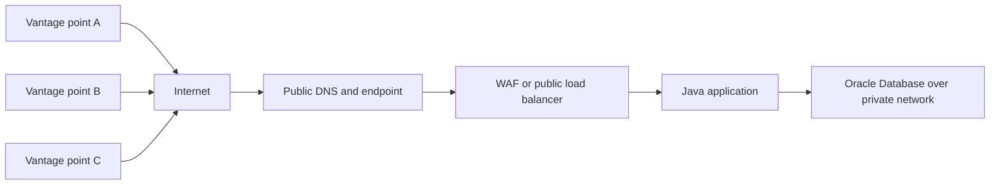
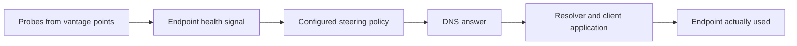

# OCI Health Checks and external endpoint monitoring

## 1. Objectives and context

In the **DNS and traffic management** chapter of the **CLOUD_PROVIDERS_ORACLE** module, this lesson covers how to test a service from the outside using OCI Health Checks. Learners select endpoints and vantage points, configure monitors, read results across the DNS–connection–HTTP layers, and use those signals for monitoring and traffic steering.

A Java application may run on OCI Compute, access an Oracle Database over a private network, and expose an API via a public load balancer. The application host's CPU may look normal, yet users can encounter errors due to wrong DNS, TLS certificate issues, a listener refusing connections, or API failures. External probing adds visibility into the access path customers actually use.

OCI Health Checks serves **public-facing** endpoints, including websites, APIs, and public load balancers, even resources outside OCI. The service provides periodic monitors and on-demand probes for one-off checks. See [Overview of the Health Checks Service](https://docs.oracle.com/en-us/iaas/Content/HealthChecks/Concepts/healthchecks.htm).

After this lesson, you can:

- Distinguish HTTP/HTTPS monitors from ICMP/TCP monitors.
- Design a health endpoint that accurately reflects the application's serving conditions.
- Choose vantage points to separate endpoint outages from regional or network-provider issues.
- Create and inspect monitors using the Console or OCI CLI.
- Read status codes, timeouts, timing metrics, and errors to isolate incidents.
- Distinguish health signals from alerting actions or DNS response changes.
- Estimate probe counts and prepare a controlled fault-injection test.

Domain names in this lesson are sample names. During hands-on practice, replace them with public endpoints you manage or are authorized to test. Command snippets are guides for a lab environment, not output from an already deployed monitor.

## 2. Monitors, probes, and vantage points

### 2.1. Periodic monitors and on-demand probes

A **Monitor** stores a configuration and repeats checks at an interval. It is suited for continuous observation and building time series. An **On-demand probe** executes a single check on request, suited when an extra sample is needed during an investigation; consider permissions and API usage limits accordingly.

A single successful check only describes an observation at the chosen time and location. It does not replace historical tracking across multiple intervals. Conversely, after editing a monitor's configuration, wait for new results to appear rather than evaluating pre-change data.

### 2.2. Vantage points are where tests originate

A vantage point is the geographic location running the monitor/probe. OCI Health Checks provides checkpoints across multiple providers' infrastructure. Oracle recommends selecting at least three points across three different providers; the list of points can change. When deploying, retrieve the current list per [Listing Vantage Points](https://docs.oracle.com/en-us/iaas/Content/HealthChecks/Tasks/list-vantage-point.htm).



A monitor managed in region R1 can still use vantage points in other locations. **Monitor management region**, **vantage point location**, and **endpoint region** are three separate pieces of information to record.

If only one vantage point fails, check network routing, WAF, rate limits, or regional issues. If multiple independent points fail simultaneously with the same symptom, the endpoint failure hypothesis is stronger. This is evidence-based reasoning, not an automatic built-in rule on every monitor.

### 2.3. Endpoints must be reachable from the public Internet

IAM permissions allow managing monitors and results; the network path to the endpoint must still be configured properly. Oracle specifies that resources monitored by Health Checks must be accessible from the public Internet in [Securing Health Checks](https://docs.oracle.com/en-us/iaas/Content/Security/Reference/healthchecks_security.htm).

Therefore, a private IP inside a VCN or an Oracle Database listener reachable only over VPN is not an appropriate target for this public monitor type. For applications with a private database, monitor the public API externally and use internal network checks for the application → database path. Preserve the database's private scope when adding public monitoring.

## 3. Choosing the right protocol and success criteria

### 3.1. Check types

| Monitor type | Protocol | Primary check | What still needs separate verification |
| --- | --- | --- | --- |
| HTTP monitor | HTTP | GET or HEAD request | TLS if the real service uses HTTPS; application logic |
| HTTP monitor | HTTPS | GET or HEAD request over a secure connection | Deeper API functionality and user flows |
| Ping monitor | ICMP | ICMP echo and round-trip time | Service ports and HTTP responses |
| Ping monitor | TCP | TCP handshake to specified port | TLS, HTTP, and application state |

The name "ping monitor" includes TCP mode. A TCP monitor to port `443` can succeed while an HTTPS monitor fails due to TLS or HTTP issues. Protocols are described in [Managing Health Checks](https://docs.oracle.com/en-us/iaas/Content/HealthChecks/Tasks/managinghealthchecks.htm).

ICMP being blocked on an endpoint does not prove a website is down. Choose HTTPS if the operational question is "can customers reach the HTTPS API?", then add TCP or ICMP when lower-layer diagnostic evidence is needed.

### 3.2. HTTP health and response codes

Under OCI's HTTP result model, a probe is considered healthy when the HTTP status code is from `200` up to less than `300`. Results also include `isTimedOut`, `errorCategory`, `errorMessage`, and related timestamps. Refer to [HttpProbeResultSummary](https://docs.oracle.com/en-us/iaas/tools/java/latest/com/oracle/bmc/healthchecks/model/HttpProbeResultSummary.html).

Example direct check endpoint:

```http
HTTP/1.1 200 OK
Content-Type: application/json
Cache-Control: no-store

{"status":"ready"}
```

When the application does not meet the serving conditions defined by the team:

```http
HTTP/1.1 503 Service Unavailable
Content-Type: application/json
Cache-Control: no-store

{"status":"not-ready"}
```

An error page returning `200 OK` can produce a false healthy signal for status-based checks. The application team must ensure the health endpoint's status code matches serving conditions. If JSON body verification, multi-step login, or business transactions are needed, add appropriate application tests.

When seeing final results like `301`, `302`, `401`, `403`, `404`, or `5xx`, inspect the response and target/path configuration before blaming Compute infrastructure. For a health endpoint, use a target URL that returns the expected status directly, avoiding reliance on a login page or website redirect chain.

### 3.3. GET, HEAD, FQDN, and IP

- **GET** fits when the health endpoint is implemented for GET and returns a status representing readiness.
- **HEAD** fits only if the application, proxy, and WAF handle HEAD as designed. An API supporting GET does not necessarily have equivalent HEAD behavior.
- **FQDN** ensures the probe includes name resolution and uses the right service name when accessing HTTPS.
- **IP** lets you target a specific address, but requires considering virtual hosting, Host headers, and that endpoint's TLS identity.

Switching from FQDN to IP changes the meaning of the test. Success against an IP does not prove DNS for the service name works; failures accessing an IP via HTTPS may relate to certificate names or SNI. Document the test goal clearly before changing targets for comparison.

## 4. Designing the health endpoint and monitor configuration

### 4.1. Ready conditions should reflect steering intent

For an application using Oracle Database, separate two questions:

| Question | Example condition |
| --- | --- |
| Is the process still alive? | Runtime can respond to a minimal request |
| Is the instance or region ready to receive users? | Capable of serving required APIs and reaching mandatory dependencies |

An endpoint returning only a static string works for very simple liveness checks, yet may stay green while the application cannot serve real requests. Conversely, a readiness endpoint checking too many non-essential systems can report failures and trigger unnecessary steering.

Design a lightweight check with bounded execution time, no business writes, and only summary status output. When database checks are needed, consider a cached internal check result updated at a reasonable cadence instead of running heavy queries on every probe from every vantage point. For applications using framework health endpoints, restrict what details are exposed publicly.

If a multi-region system shares a single failing database, shifting users to another region may encounter the same failure. A health endpoint's dependency scope must be evaluated alongside the data architecture and database failover plan.

### 4.2. Parameters to finalize

| Property | Lab example | Meaning |
| --- | --- | --- |
| Target | `api-r1.lab.example.com` | Hostname, separate from path |
| Protocol / port | HTTPS / `443` | Actual protocol and port |
| Method / path | GET / `/health/ready` | Application condition to test |
| Interval | `30` seconds | Probe dispatch cadence |
| Timeout | `10` seconds | Maximum wait for completion |
| Vantage points | Three verified available points | Independent observation angles |
| Compartment | Lab monitoring compartment | Management and authorization scope |
| Management region | Region selected at creation | Where API updates and result reads occur |

Current CLI allows intervals of `10`, `30`, `60` seconds; timeouts of `10`, `20`, `30`, `60` seconds, where timeout must not exceed interval. Monitors with a `10`-second interval are classified as Premium, while intervals greater than `10` seconds belong to Basic. Check [CLI: HTTP monitor create](https://docs.oracle.com/en-us/iaas/tools/oci-cli/latest/oci_cli_docs/cmdref/health-checks/http-monitor/create.html) and [monitor classification](https://docs.oracle.com/en-us/iaas/Content/HealthChecks/Concepts/healthchecks.htm) when deploying.

A longer timeout can mark a service healthy even when it responds too slowly for user requirements. Therefore, separate the "responds within timeout" check from latency thresholds the team wants to alert on.

## 5. Creating a monitor with clear permissions and scope

### 5.1. Preparing IAM and access paths

Place the monitor in a compartment aligned with the operations team. Separate permission to read results from permission to edit or delete monitors. An illustrative policy for a lab management group might be:

```text
Allow group HealthCheckOperators to manage health-check-family in compartment NetworkObservability
Allow group HealthCheckOperators to read vantage-points in tenancy
```

Replace the group name, group domain if needed, and compartment per environment. Permissions to manage monitors, read results, and run on-demand probes should be checked separately by responsibility. See [Details for Health Checks](https://docs.oracle.com/en-us/iaas/Content/Identity/Reference/healthcheckpolicyreference.htm) and [Securing Health Checks](https://docs.oracle.com/en-us/iaas/Content/Security/Reference/healthchecks_security.htm).

Verify the public path to the right port through WAF, load balancer, NSG/security lists, and OS firewall if present. A monitor blocked by WAF reflects a difference in external probe behavior; inspect logs before deciding to change rules. If using a probe source allowlist, manage the source list against current vantage point data and system security policy.

Monitors/probes do not support the `Authorization` HTTP header. Do not design the lab around sending a bearer token via this header; nor should you place secrets in monitor names or URL query strings. Header limits are documented in [CLI: HTTP monitor create](https://docs.oracle.com/en-us/iaas/tools/oci-cli/latest/oci_cli_docs/cmdref/health-checks/http-monitor/create.html). Public health endpoints should expose only minimal status suited to operational needs.

### 5.2. Creating via Console

In the OCI Console:

1. Select the management region and intended compartment.
2. Open **Observability & Management → Monitoring → Health Checks**.
3. Click **Create health check**, enter a name and the lab target host/FQDN.
4. Select verified vantage points; prefer viewpoints across multiple providers.
5. Select request type **HTTP**, protocol **HTTPS**, and appropriate timeout and interval.
6. Review method, path, port, and options exposed in the UI; if fields not exposed by the UI are needed, use the corresponding CLI/API.
7. Create the monitor, open its details page, and wait for new results to appear.

UI guidance is in [Creating an HTTP Monitor](https://docs.oracle.com/en-us/iaas/Content/HealthChecks/Tasks/create-http-monitor.htm). Re-check the definition after creation, especially target and path: target `api-r1.lab.example.com` with path `/health/ready` has a different meaning than checking the default `/` page.

### 5.3. Retrieving current vantage points via CLI

The commands below are for Bash with the OCI CLI configured with appropriate permissions. They illustrate learners creating resources in their own lab.

```bash
set -euo pipefail

REGION='ap-singapore-1'
COMPARTMENT_ID='REPLACE_WITH_LAB_COMPARTMENT_OCID'

oci health-checks vantage-point list \
  --region "$REGION" \
  --all
```

From the output, choose the exact name attributes of three available vantage points and replace the placeholders below. Do not take checkpoint names from memory or an outdated list. See [CLI: vantage-point list](https://docs.oracle.com/en-us/iaas/tools/oci-cli/latest/oci_cli_docs/cmdref/health-checks/vantage-point/list.html).

### 5.4. Creating an HTTPS monitor for the lab endpoint

```bash
TARGETS='["api-r1.lab.example.com"]'
VANTAGE_POINTS='["REPLACE_VP_1","REPLACE_VP_2","REPLACE_VP_3"]'

HTTP_MONITOR_ID=$(oci health-checks http-monitor create \
  --region "$REGION" \
  --compartment-id "$COMPARTMENT_ID" \
  --display-name 'lab-api-r1-readiness-https' \
  --targets "$TARGETS" \
  --vantage-point-names "$VANTAGE_POINTS" \
  --protocol HTTPS \
  --port 443 \
  --method GET \
  --path '/health/ready' \
  --interval-in-seconds 30 \
  --timeout-in-seconds 10 \
  --is-enabled true \
  --query 'data.id' \
  --raw-output)

printf '%s\n' "$HTTP_MONITOR_ID"

oci health-checks http-monitor get \
  --region "$REGION" \
  --monitor-id "$HTTP_MONITOR_ID"
```

Before running, replace all targets and `REPLACE_...` values. The HTTPS endpoint must have matching name/certificate configuration. The command above passes the host in `--targets`, the path in `--path`, and captures the OCID for later use. Parameter syntax is in [CLI: HTTP monitor create](https://docs.oracle.com/en-us/iaas/tools/oci-cli/latest/oci_cli_docs/cmdref/health-checks/http-monitor/create.html); reading definitions is described in [Getting an HTTP Monitor's Details](https://docs.oracle.com/en-us/iaas/Content/HealthChecks/Tasks/get-http-monitor.htm).

Re-running `create` can create another monitor with the same display name. When operating via scripts or IaC, store resource identifiers/state and update intentionally, rather than relying on display names alone as proof a monitor already exists.

### 5.5. Adding a TCP monitor when separating layers is needed

You can create a TCP monitor to the same endpoint/port for additional diagnostics:

```bash
TCP_MONITOR_ID=$(oci health-checks ping-monitor create \
  --region "$REGION" \
  --compartment-id "$COMPARTMENT_ID" \
  --display-name 'lab-api-r1-tcp443' \
  --targets "$TARGETS" \
  --vantage-point-names "$VANTAGE_POINTS" \
  --protocol TCP \
  --port 443 \
  --interval-in-seconds 30 \
  --timeout-in-seconds 10 \
  --is-enabled true \
  --query 'data.id' \
  --raw-output)
```

The `--protocol TCP` parameter belongs to the `ping-monitor` group, per [CLI: ping-monitor create](https://docs.oracle.com/en-us/iaas/tools/oci-cli/latest/oci_cli_docs/cmdref/health-checks/ping-monitor/create.html). Additional monitors generate extra probes and operational cost; keep them only when serving a defined purpose.

If TCP succeeds while HTTPS fails, prioritize inspecting TLS, method/path, WAF, and HTTP responses. If both time out, check access paths, firewalls, listeners, and endpoint status. The two results may be collected at slightly different times, so compare timestamps and vantage points before inferring a cause.

## 6. Reading results by target, timestamp, and location

### 6.1. Fetching a recent set of results

After the monitor has run long enough to gather data:

```bash
oci health-checks http-probe-result list \
  --region "$REGION" \
  --probe-configuration-id "$HTTP_MONITOR_ID" \
  --sort-order DESC \
  --limit 20
```

`--probe-configuration-id` accepts a monitor or on-demand probe OCID. The command above fetches a sample of at most 20 results; when investigating a time range, use time/target filters and pagination per [CLI: http-probe-result list](https://docs.oracle.com/en-us/iaas/tools/oci-cli/latest/oci_cli_docs/cmdref/health-checks/http-probe-result/list.html).

Keep the matching region when fetching results and updating monitors. Health Checks resources created via CLI/API have a region tied to their configuration; this rule is described in [Managing Health Checks](https://docs.oracle.com/en-us/iaas/Content/HealthChecks/Tasks/managinghealthchecks.htm).

### 6.2. Fields to examine together

| Information | Question to answer |
| --- | --- |
| Target | Is it the exact hostname/IP you intend to observe? |
| Vantage point | Does the failure occur at one location or multiple locations? |
| Probe timestamp | Does it align with an incident, deployment, or DNS change window? |
| `isHealthy` | Did the probe pass that probe type's health condition? |
| `isTimedOut` | Did it exceed the configured timeout? |
| HTTP status code | What response did the service/WAF/proxy return? |
| Error category/message | Which phase or error cause was reported? |
| DNS/connection/request/response timing | Which part of the probe saw increased duration? |

Timings and result fields are defined in [HttpProbeResultSummary](https://docs.oracle.com/en-us/iaas/tools/java/latest/com/oracle/bmc/healthchecks/model/HttpProbeResultSummary.html). Distinguish timestamps from durations; only compute differences between two timestamps when both are present and share the same units. A probe that stops early may lack data for later phases.

### 6.3. Isolating by symptom

| Observation | Hypothesis to check | Additional evidence |
| --- | --- | --- |
| Name resolution failure | Public DNS, record/delegation, or location-based answer | External DNS results and record change history |
| TCP connection timeout | Firewall, network path, listener, or unresponsive endpoint | WAF/LB logs, relevant flow logs, and port status |
| Transport/TLS error | Certificate, service name, handshake, or TLS configuration | Certificate inspection and endpoint TLS logs |
| HTTP `401`/`403` | Endpoint requires auth or WAF/access policy blocks probes | Related rules, method/path, and access logs |
| HTTP `404` | Path or virtual host differs from expected | App routes, Host header, and monitor configuration |
| HTTP `5xx` | Application, upstream, or dependency cannot serve | App, backend, and database logs |
| Only one vantage point fails | Regional/provider outage, geo rule, or source blocking | Compare independent points and source-filtered logs |
| All points succeed yet users fail | Different endpoint, DNS, protocol, network, or business condition | User requests and tests matching that exact path |

A timeout is a symptom, not a root cause. Preserve both the raw error and timestamps when handing off to networking/application teams. [Troubleshooting Health Checks](https://docs.oracle.com/en-us/iaas/Content/HealthChecks/troubleshooting.htm) also notes checking host monitoring permissions and port configuration when probes are persistently unhealthy.

## 7. Metrics and alarms: keeping aggregation scope right

Health Checks emits metrics in the **`oci_healthchecks`** namespace. Useful metrics include:

| Metric | Observation purpose |
| --- | --- |
| `HTTP.isHealthy` | Success/failure of HTTP/HTTPS probes |
| `HTTP.StatusCode` | HTTP/HTTPS response code |
| `HTTP.DNSLookupTime` | Name resolution time |
| `HTTP.TotalDuration` | Total probe duration |
| `PING.isHealthy` | Success/failure of ICMP/TCP probes |
| `PING.Latency` | Latency of ping probes |

Dimensions such as `resourceId`, `target`, `vantagePoint`, and `protocol` select the exact series. Health samples take values `0` or `1`; dashboards may display success rate as a percentage. See [Health Checks Metrics Reference](https://docs.oracle.com/en-us/iaas/Content/HealthChecks/Reference/metricsalarms-reference.htm) to verify metric names, units, and dimensions.

### 7.1. Aggregate ratios can hide a regional failure

Suppose a target has three vantage points, each with two samples in the evaluated window:

| Vantage point | Sample 1 | Sample 2 | Interpretation |
| --- | --- | --- | --- |
| A | Pass | Pass | No failure observed from A in these two runs |
| B | Pass | Pass | No failure observed from B in these two runs |
| C | Fail | Fail | Repeated failure from C needs investigation |

The combined ratio is `4/6 ≈ 66.7%`, yet the notable fact is that both failures came from C. If you aggregate across many other healthy targets, this target's fault is obscured even further. Start from individual targets and vantage points, then aggregate according to operational needs.

### 7.2. Designing alarms by intent

When creating an alarm in OCI Monitoring, choose the exact namespace, metric, compartment, dimensions, and evaluation window. Define the scenarios you want notifications for beforehand, such as:

- A target fails repeatedly from multiple independent vantage points.
- One location is persistently unreachable even while other locations succeed.
- Latency exceeds agreed serving thresholds, even without hitting timeout.
- A monitor lacks new data beyond a reasonable wait interval.

A rule like "at least two out of three locations fail together across multiple observations" may be an **operational policy designed by the team**. You must build and test the corresponding aggregation/notification logic; do not assume the monitor implements that voting rule out of the box.

Missing samples can stem from a disabled monitor, wrong region, wrong query scope, or data not yet emitted. Define handling for missing data explicitly rather than treating every gap as healthy or dead. Verify notification channels and on-call owners alongside alarms, per [Health Checks Metrics guidance](https://docs.oracle.com/en-us/iaas/Content/HealthChecks/Reference/metricsalarms.htm).

## 8. Connection to DNS Traffic Management

Health Checks provides health signals. Traffic Management steering policies use rules and associated health checks to decide DNS answers for an endpoint. Creating a standalone monitor does not configure DNS failover actions; an appropriate policy and attachment must be configured. The mechanism is described in [Overview of Traffic Management](https://docs.oracle.com/en-us/iaas/Content/TrafficManagement/Concepts/overview.htm).

Two-region architecture example:

```text
User-facing name:         api.lab.example.com
Stable region 1 endpoint: api-r1.lab.example.com
Stable region 2 endpoint: api-r2.lab.example.com
```

Monitoring each region's dedicated endpoint helps distinguish which region is eligible to serve. If you only monitor the steered name pointing to whichever region is healthy, probes may reflect whichever endpoint is currently selected and stop measuring the originally failed endpoint independently. When attaching a health check to a policy, align the checked target with the answer the policy evaluates.



### 8.1. Failure detection and user switching are two stages

Failure observation time depends on interval, timeout, evaluation cycle, and how many samples the policy requires. Beyond that come steering evaluation, DNS caching, how clients re-resolve, and application connection lifetimes. A `30`-second interval is not a guarantee that every user switches regions within `30` seconds.

DNS steering affects name resolution; it does not migrate an existing TCP/JDBC connection to another backend. Applications need appropriate reconnection and error-handling mechanisms. Oracle Database redundancy plans must also ensure data and database roles are ready before the application endpoint reports ready.

### 8.2. Backup endpoints must be truly capable of serving

A readiness endpoint might return `200` because the web process is running while the backup region lacks write capability or has not completed role transition. If that signal drives steering, users can be routed somewhere unable to serve business requests.

Therefore, define readiness criteria jointly with application and data teams. Verify standby capacity, certificates/service names, mandatory dependencies, and access policies before using health status to trigger automated steering.

## 9. Hands-on lab: observing application failures externally

### 9.1. Establishing a baseline

Use a public lab API you manage whose `/health/ready` returns `200` directly when ready. Prepare application logs, relevant WAF/LB logs, and a way to toggle readiness state in the lab without affecting real users.

Steps:

1. Confirm public DNS returns the expected endpoint.
2. Create an HTTPS monitor per the earlier section: interval `30`, timeout `10`, three selected vantage points.
3. If comparing connection layers is needed, also create a TCP monitor to port `443`.
4. Record the OCID, management region, target, method, path, timestamps, and fresh results from each vantage point.
5. Confirm the endpoint actually returns `200`, while reading the monitor definition to ensure it checks the right path.

You can run the following command from an authorized test host for an independent check:

```bash
curl --connect-timeout 5 --max-time 15 \
  --output /dev/null --silent --show-error \
  --write-out 'code=%{http_code} dns=%{time_namelookup}s connect=%{time_connect}s tls=%{time_appconnect}s first_byte=%{time_starttransfer}s total=%{time_total}s\n' \
  'https://api-r1.lab.example.com/health/ready'
```

This is a Bash command using `curl`. Curl's timing variables have distinct meanings and units, with several being cumulative timestamps; do not treat them as independent phases to sum together. Results from this single host also do not represent all Health Checks vantage points.

### 9.2. Inducing a controlled readiness failure

In the lab, switch `/health/ready` to return `503` while keeping the HTTPS listener active. Note the change timestamp and wait for post-change samples to appear from the vantage points.

Design-expected outcomes:

| Observation | Expected when only readiness returns `503` |
| --- | --- |
| TCP monitor | May continue succeeding because the listener still accepts handshakes |
| HTTPS monitor | `isHealthy` fails with status `503` if that response is received |
| Application/WAF/LB logs | Requests arrive at the exact path with the matching status |
| Alarm if configured | Transitions state per designed window and condition |
| DNS if steering not configured | Retains behavior per existing DNS configuration |

The rows above are hypotheses to verify in the lab, not measured figures. If HTTPS stays healthy, inspect timestamps, target, path, caches/proxies, and which backends receive requests. Probes may be hitting another instance or an intermediate layer returning its own `200`.

Restore the endpoint to `200`, and continue observing new samples and alarm recovery status. Record the time to detect failure and time to detect recovery from the actual test.

### 9.3. Creating a path error to recognize monitor misconfiguration

Once the baseline has recovered, temporarily change the lab monitor's path to a non-existent path known to return `404`. The goal is to prove a red monitor can also stem from a probe configured inconsistently with intent.

Confirm the application still serves the valid path, observe status `404` on the wrong path, and then return the monitor to `/health/ready`. Change only one parameter at a time and retain the old configuration for rollback. Do not use results from the wrong path to conclude an entire region or Oracle Database has failed.

### 9.4. Stopping lab monitors upon completion

Once sufficient evidence is gathered, disable monitors no longer needed. Example for the HTTP monitor:

```bash
oci health-checks http-monitor update \
  --region "$REGION" \
  --monitor-id "$HTTP_MONITOR_ID" \
  --is-enabled false
```

Disabling stops subsequent checks per service configuration; see [CLI: HTTP monitor update](https://docs.oracle.com/en-us/iaas/tools/oci-cli/latest/oci_cli_docs/cmdref/health-checks/http-monitor/update.html). If a TCP monitor was created, stop or clean up that resource as well during lab teardown. Keep required evidence and verify related alarms/steering policies before stopping a shared monitor.

## 10. Cost, generated load, and completion criteria

### 10.1. Estimating probe counts

For a periodic monitor, you can estimate the ideal daily probe count as:

```text
Probes/day ≈ target_count × vantage_point_count × 86400 / interval_seconds
```

For example, one target, three vantage points, and a `30`-second interval generate roughly `8,640` probes/day. Two targets with the same configuration generate roughly `17,280` probes/day. Changing the interval from `30` to `10` seconds triples the ideal probe count.

This is a probe-load estimate for planning. Check Basic/Premium tiers, billing units, quotas, and current pricing when budgeting. Also factor in request, log, and dependency costs actually exercised by the health endpoint. An endpoint running heavy database queries can generate significant load even though each probe is just a small GET.

Choose intervals based on detection goals, response times, and acceptable cost. Tag by environment/owning team and avoid creating duplicate monitors with the same target/path without a distinct observation purpose.

### 10.2. Evidence learners need to provide

| Criterion | Expected evidence |
| --- | --- |
| Appropriate target | Public endpoint within authorized testing scope |
| Meaningful configuration | Clear FQDN/IP, protocol, port, method, path, interval, and timeout |
| Observation perspectives | Current list of vantage points and rationale for selection |
| Baseline | Fresh results from each location paired with logs or independent checks |
| Application fault detection | Distinguishing successful TCP from HTTPS returning `503` |
| Fault isolation | Status/error/timing tied to specific target and timestamps |
| Alerting and DNS | Clearly state which configs only observe and which take action |
| Recovery and lab teardown | Endpoint restored, recovery sample recorded, and unused resources stopped |

The value of OCI Health Checks lies in external probes designed to match real serving conditions. By combining vantage-point results, application logs, and clear DNS policies, operations teams can detect access failures, separate fault layers, and prepare traffic steering toward genuinely ready endpoints.