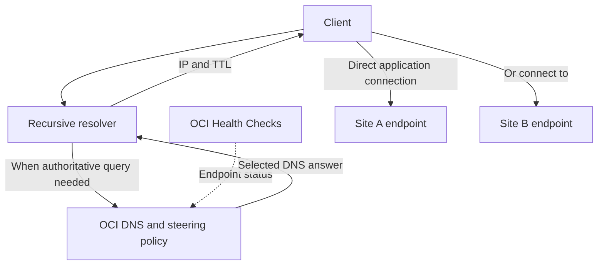

# Traffic Management with failover and weighted routing

In the **DNS and traffic management** chapter of the Oracle Cloud Infrastructure (OCI) module, this lesson explains how to use Traffic Management steering policies to select endpoints when answering DNS queries. The two primary needs are failing over to a backup endpoint when the preferred endpoint fails and distributing answers by weight when running multiple sites or gradually shifting to new infrastructure.

Throughout the lesson, the examples use two public application endpoints across two sites. Each endpoint can be a public load balancer in front of Compute instances inside a VCN; the Oracle database and backends remain on private networks by design. Tenancy, compartment, and IAM restrict permissions to modify DNS, policies, and health checks. Learners will tie steering configuration to monitoring evidence, standby site capacity, and operational costs.

## 1. Learning outcomes

After this lesson, learners can:

- Distinguish DNS-based steering from connection distribution at a load balancer.
- Configure failover using priority order and endpoint health status.
- Use weighted routing to gradually increase the share of DNS answers pointing to a new site.
- Explain the impact of TTL, recursive resolvers, application caches, and open connections.
- Verify health checks, attachments, authoritative responses, and client experience separately.
- Measure failover and weighted distribution without confusing DNS query counts with HTTP request counts.

You need to understand public DNS zones, delegation, A/AAAA/CNAME, TTL, authoritative nameservers, recursive resolvers, and HTTPS. The lab assumes a public zone you manage and two deployed lab endpoints.

## 2. Where does Traffic Management intervene?

OCI Traffic Management selects DNS answers according to policy logic. It supports **public DNS**, not private DNS. Endpoints can reside in OCI, a data center, or another provider provided they meet the design's reachability and monitoring requirements. [Overview of Traffic Management](https://docs.oracle.com/en-us/iaas/Content/TrafficManagement/Concepts/overview.htm).



After receiving an IP, the client sends application traffic to that endpoint. HTTP requests do not flow through the steering policy like a reverse proxy. Consequently, the policy does not inspect URLs to split individual requests, migrate TCP sessions, or synchronize data between the two sites.

| Question | Appropriate layer to solve |
| --- | --- |
| Which site's endpoint should a new DNS query receive? | Traffic Management |
| Which backend inside a site should a connection to a public IP reach? | That site's load balancer |
| Do logged-in users keep their sessions when switching sites? | Session store and application design |
| Does the backup site have accurate data and write permissions? | Replication mechanism, database roles, and recovery procedures |

You can place Traffic Management above two public load balancers. Each load balancer continues checking and distributing to its own backends. The policy type named **Load balancer** in Traffic Management refers to DNS steering; it is a different resource from the OCI Load Balancer serving application connections. [Coordinating DNS steering and load balancing](https://docs.oracle.com/en-us/iaas/Content/Balance/Tasks/managingloadbalancer_topic-Creating_Load_Balancers.htm).

## 3. Components of a steering policy

| Component | Role |
| --- | --- |
| Policy | Holds the list of answers and the chain of rules selecting answers |
| Answer | Internal name, record type, `rdata`, and metadata such as pool or disabled status |
| Pool | Groups answers, useful when prioritizing sites in failover |
| Rule | Filters, evaluates health, sorts priority, or applies weights |
| Template | Rule skeleton for a specific purpose, such as `FAILOVER` or `LOAD_BALANCE` |
| Domain attachment | Attaches a policy to a hostname in a DNS zone |
| Health check monitor | Supplies health data for corresponding endpoints |

A policy that exists without an attachment does not yet answer DNS for the target hostname. An attachment causes the policy to provide answers for the covered record types at that hostname, shadowing matching records already in the zone. Do not treat an old A record at the same name as an automatic fallback. [Traffic Management Steering Policies API Guide](https://docs.oracle.com/en-us/iaas/Content/TrafficManagement/Concepts/trafficmanagementapi.htm).

Use dedicated lab hostnames, record old records before attaching, and re-verify when detaching. A single policy can be used for multiple names; editing a shared policy can affect all of those attachments.

In this lesson, `failover.tm-lab.example.com` and `weighted.tm-lab.example.com` are examples. When deploying, replace them with hostnames in a real public zone you manage. The two illustrative addresses `192.0.2.10` and `198.51.100.20` belong to documentation ranges, not endpoints usable for real health checks.

## 4. Designing health checks before enabling automated redirection

### 4.1. Measuring true serving capability

OCI Health Checks observes public endpoints from external vantage points. HTTP/HTTPS and ping monitors are available; multiple monitoring locations help assess reachability from various regions. [Overview of the Health Checks Service](https://docs.oracle.com/en-us/iaas/Content/HealthChecks/Concepts/healthchecks.htm).

A successful ICMP check only proves one level of reachability. To steer web/API traffic, check a path like `/ready` using the appropriate protocol, port, method, and hostname. The readiness endpoint should reflect the site's serving capability:

- Listener and application are running.
- Mandatory dependencies are ready per the application's contract.
- The site holds the proper business role to accept requests.
- The response is not merely a live web server's default page.

Check depth must be bounded to prevent probes from becoming heavy load on the database. You can return a readiness result computed periodically by the application rather than executing an expensive transaction on every probe.

### 4.2. `rdata` must match the monitored target

The policy uses a monitor referenced by `healthCheckMonitorId`. An answer whose `rdata` matches a monitored endpoint uses that endpoint's health data; an answer matching no target is treated as healthy under OCI's resource model. [Steering policy health check attribute](https://docs.oracle.com/en-us/iaas/tools/terraform-provider-oci/latest/docs/r/dns_steering_policy.html).

For instance, having an A answer with `rdata` equal to site A's public IPv4 while the monitor only watches the shared steered hostname can mislead operators about coverage. In a lab using A answers, configure targets as the two sites' real public IPv4 addresses and verify results per target.

Do not probe via the steered hostname itself and conclude both sites are healthy. The monitor might only hit whichever site DNS currently selects, missing the other site.

### 4.3. HTTPS, Host header, and probe network path

For an HTTPS monitor targeting an IP address, Oracle requires a Host header carrying the domain name matching the endpoint's TLS certificate. Choose a path and method the application supports; sending HEAD to an endpoint that only supports GET can yield results misaligned with testing intent. [Creating an HTTP Monitor](https://docs.oracle.com/en-us/iaas/Content/HealthChecks/Tasks/create-http-monitor.htm).

Ensure NSGs/security lists, firewalls, and WAF allow the selected vantage points to reach the probed port. If a public load balancer is probed, you do not need to expose databases or backends publicly just so the monitor can reach them.

In the lab, both sites must accept both lab hostnames and present valid matching certificates. Use separate monitors for each hostname/policy when Host headers differ. Only share a monitor when targets, hostnames, and readiness contracts are genuinely identical.

### 4.4. Health has perspective and latency

Probe results include target, vantage point, timestamp, status, and error details. Inspect results per location before concluding an endpoint is globally down. [Listing Results for an HTTP Monitor](https://docs.oracle.com/en-us/iaas/Content/HealthChecks/Tasks/list-http-monitor-result.htm).

Check interval and timeout affect detection latency. Do not treat the timestamp a probe fails as the timestamp every client switched sites. The lab logs separately when the endpoint failed, when the health check reflected the failure, when the authoritative answer changed, and when clients recovered.

## 5. Failover: prioritizing one site and using the other when needed

### 5.1. Basic configuration

Use the `FAILOVER` template, two priority-ordered pools, and a maximum answer count of 1:

| Pool | Answer | Illustrative `rdata` | Priority |
| --- | --- | --- | --- |
| `primary` | `site-a` | `192.0.2.10` | 1 |
| `secondary` | `site-b` | `198.51.100.20` | 2 |

Lower priority numbers come first. When A is eligible and healthy, the policy prefers A; when health checks mark A unhealthy, a healthy B becomes the next choice. The prerequisite is that the monitor is properly attached and answer B is also monitored. [Creating a Failover Policy](https://docs.oracle.com/en-us/iaas/Content/TrafficManagement/Tasks/create-tm-policy-failover.htm).

Setting maximum answer count to 1 keeps primary/secondary intent unambiguous. Returning multiple answers can give clients lower-priority endpoints in the list as well; verify actual behavior rather than assuming only the primary site is used.

### 5.2. Understanding evaluation order

The failover template's processing pipeline reads as follows:

```text
All answers
  -> FILTER: keep answers that are not disabled
  -> HEALTH: remove answers marked down when a corresponding monitor exists
  -> PRIORITY: sort pools by priority
  -> LIMIT: keep at most the configured number of answers
```

The API template defines the rule order; priority references pools. Do not arbitrarily insert a weighted rule into a standard template assuming the API will still accept it. When advanced combinations are needed, design a custom policy and verify it separately. [Template rules and rule chains](https://docs.oracle.com/en-us/iaas/Content/TrafficManagement/Concepts/trafficmanagementapi.htm).

### 5.3. Failback and all-sites-down scenarios

When A recovers and becomes eligible, priority order can bring new answers back to A. This is automatic failback per policy logic and must be accounted for in operational procedures. If the application must stay on B after a data recovery cycle, manage eligibility or priorities according to the chosen procedure.

When both sites fail, no healthy endpoint exists to guarantee service continuity. Test separately and record the policy's actual DNS answer/RCODE and client behavior. Do not write assumptions like "always returns B," "always NXDOMAIN," or "automatically shows a maintenance page" into runbooks without verification. Old records shadowed by an attachment are not a designed fallback.

DNS failover does not automatically promote a standby database. For an Oracle Database with primary/standby roles, readiness checks and role-transition procedures must prevent the application from accepting write traffic when a site is not ready. Both sites accepting HTTP successfully does not prove data is consistent.

## 6. Weighted routing: distributing answers by relative ratio

### 6.1. What do weights mean?

Use policy type **Load balancer**, API template `LOAD_BALANCE`. In this example with one answer per site, maximum answer count 1, and both eligible and healthy:

| Answer | Weight | Desired relative ratio |
| --- | --- | --- |
| `site-a` | 80 | 80% |
| `site-b` | 20 | 20% |

OCI permits weights from 0 to 255; a higher weight makes an answer more likely to be returned frequently. [Creating a Load Balancer Policy](https://docs.oracle.com/en-us/iaas/Content/TrafficManagement/Tasks/create-tm-policy-lb.htm).

With two positive weights, the ideal selection probability is understood proportionally:

```text
P(A) = 80 / (80 + 20) = 0.8
P(B) = 20 / (80 + 20) = 0.2
```

The sum does not have to equal 100: 8:2 also expresses a 4:1 ratio. This is a ratio across eligible DNS answer selections, not a guarantee of splitting every batch of 100 requests identically.

### 6.2. When one endpoint loses health

If A is excluded because it is unhealthy and B remains healthy, B can receive the entire remaining share of selections, even if its initial weight was only 20. Site B must be able to absorb that load or the system must have a load-shedding plan.

Processing pipeline:

```text
FILTER -> HEALTH -> WEIGHTED -> LIMIT
```

In the `LOAD_BALANCE` template, weighted answer data references answer names. Failover pool priority and answer weights address two different intents. An 80:20 configuration while both sites are healthy is DNS active-active, not a primary setup that only uses site B when A fails.

If you want 80:20 between two sites plus a separate backup site, do not stack two attachments covering the same hostname/record type to "layer" two policies. Build a suitable combined policy or design steering layers with clear responsibilities.

### 6.3. Gradually increasing selection share for a new site

A self-designed rollout path might be 95:5, 80:20, 50:50, and then moving entirely to the new site once criteria are met. After each step, wait through an observation window and inspect errors, latency, session counts, backend load, and dependencies.

Rollback must account for caches and open connections. Changing weights in the Console does not immediately revoke answers clients already received. To stop selecting an answer for new queries, use appropriate eligibility/disable controls and verify the live policy; do not inspect a weight value alone and assume a site is completely drained.

## 7. TTL, caching, and real-world redirection time

TTL specifies how long a DNS answer can be cached. A resolver still holding a valid answer can return it without querying the authoritative nameserver. When a policy changes its selection, already distributed caches are not automatically revoked. [TTL in DNS records](https://docs.oracle.com/en-us/iaas/Content/DNS/Reference/formattingzonefile.htm).

Multiple points must be observed: recursive resolvers, OS/application caches, and connection pools. An open HTTP keep-alive connection can continue using the old endpoint without re-querying DNS. Changing answers also does not migrate session state from site A to B.

A planning model is:

```text
User recovery time is influenced by:
  time to detect endpoint failure
  + time for authoritative decision update
  + remaining valid cache along the client path
  + client re-resolution interval, timeouts, and retries
```

Intervals can overlap; this is neither an SLA formula nor a hard bound. Oracle also notes that health checks and TTL are two separate factors affecting redirection when a site fails. [Failover reaction time](https://docs.oracle.com/en/solutions/fmw-stretched-clusters/set-fmw-stretched-clusters1.html).

Self-constructed illustrative timeline for explanation, not OCI benchmark figures:

| Relative time | Event |
| --- | --- |
| 0 seconds | Site A stops serving |
| 29 seconds | A resolver still receives answer A with a 30-second TTL |
| 30 seconds | Health check data reflects A unhealthy |
| 35 seconds | Authoritative query observes answer B |
| 59 seconds | Answer A received by the resolver at second 29 expires |
| 65 seconds | A client retries and observes recovery via B |

Shorter TTLs increase query frequency and can reduce how long TTL-compliant clients retain old answers. When lowering TTL from 600 to 30 before a cutover, account for 600-second TTL answers cached earlier; the new TTL does not shorten their expiration.

If both A and AAAA exist, check both IPv4 and IPv6 paths. Steering only A while AAAA still points to a failed site can leave a subset of clients failing. With CNAME chains, observe every involved record and TTL instead of reading only a final IP and assuming all caches match.

## 8. Preparing and configuring two lab policies

### 8.1. Required resources and permissions

| Item | Requirement |
| --- | --- |
| Public zone | Within authorized scope, already delegated to OCI DNS |
| Two hostnames | `failover.tm-lab.example.com`, `weighted.tm-lab.example.com`, or equivalent real names |
| Two endpoints | Stable public IPv4 addresses, accepting lab hostnames, valid TLS |
| Readiness | Same check contract on both sites |
| Site identification | `/whoami` returns `site-a` or `site-b` for verification |
| IAM | DNS policy/attachment and Health Checks permissions matching the compartment |
| Client tools | Bash, `dig`, `curl`; OCI CLI if reading configurations |

If a zone is created without proper delegation, public resolvers may keep querying the old DNS provider. Check NS records and the delegation chain before blaming the policy. [Delegating a Public DNS Zone](https://docs.oracle.com/en-us/iaas/Content/DNS/Concepts/gettingstarted_topic-Delegating_Your_Zone.htm).

Public endpoints in the lab are application entry points. The Oracle database does not need a public listener for this exercise. Creating or modifying resources must stay within the assigned compartment and lab scope; read-only viewers should have appropriate read permissions.

### 8.2. Creating and verifying monitors

1. Create an HTTP monitor for each policy, choosing HTTPS, port 443, path `/ready`, and a method supported by the app.
2. Set targets to the two real public IPv4 addresses; fill in the Host header with the matching lab hostname.
3. Choose appropriate vantage points, interval, and timeout supported by the service.
4. Check data for each target from the vantage points before attaching the monitor to a policy.
5. Confirm that stopping the service on one site makes that exact target report unhealthy while the other site stays healthy; then restore it.

Do not use an existing monitor with a similar application name as a substitute for verifying target and Host header. When changing an endpoint's public IP, update both the answer and related monitors.

### 8.3. Creating the failover policy

In the **DNS and Traffic Management** area of the Console, open steering policies and create a policy:

- Policy type: Failover; recognizable name, e.g., `lab-failover-a-b`.
- Lab TTL: 30 seconds; this is a lab test choice, not a guaranteed RTO.
- Maximum answer count: 1.
- Primary pool contains `site-a`; secondary contains `site-b`; use real public IPv4s for A answers.
- Order primary priority ahead of secondary, keeping answers eligible.
- Attach the right monitor and attach the failover lab hostname.
- Review/publish pending changes per the Console workflow.

Attachment is the step that grants the policy authority to answer for a hostname in the zone. After attaching, verify the exact zone, name, and record type. [Attaching a Domain to a Policy](https://docs.oracle.com/en-us/iaas/Content/TrafficManagement/Tasks/tm-attach-create.htm).

### 8.4. Creating the weighted policy

Create a separate policy `lab-weighted-a-b`, type Load balancer, TTL 30 seconds, maximum answer count 1. Declare the same two sites with weights 80 and 20, attach the monitor for the weighted hostname, and attach the weighted lab hostname.

Two separate hostnames let you test two intents without overwriting an active attachment. One hostname cannot have two attachments covering the same record type. When changing the policy on a live serving name, have a corresponding change and rollback plan.

You can read back the configuration using the OCI CLI with an appropriate profile configured:

```bash
oci dns steering-policy get \
  --steering-policy-id 'STEERING_POLICY_OCID'
```

Verify `template`, `ttl`, answers, rules, and monitor ID. Replace the placeholder with a real OCID; this command only reads configuration and does not prove DNS answers accurately. [CLI get steering policy](https://docs.oracle.com/en-us/iaas/tools/oci-cli/latest/oci_cli_docs/cmdref/dns/steering-policy/get.html).

## 9. Failover lab: measuring all three layers

### 9.1. Declaring test parameters

The Bash snippet below is a framework to run on a lab host with `dig` and `curl`. Replace zone, nameserver, and the two illustrative IPs with real data:

```bash
DNS_ZONE='tm-lab.example.com'
DNS_FAILOVER_NAME='failover.tm-lab.example.com'
DNS_WEIGHTED_NAME='weighted.tm-lab.example.com'
DNS_AUTH_NS='AUTHORITATIVE_NAMESERVER_FROM_OCI'
PRIMARY_PUBLIC_IPV4='192.0.2.10'
SECONDARY_PUBLIC_IPV4='198.51.100.20'
```

Retrieve the real zone's nameservers from OCI and cross-check with public DNS:

```bash
dig NS "$DNS_ZONE" +short

dig @"$DNS_AUTH_NS" "$DNS_FAILOVER_NAME" A \
  +norecurse +noall +comments +answer
```

You should see a response with the authoritative `aa` flag, expected record type, and TTL. If no answer appears, keep both the RCODE and authority section for investigation; `+short` alone cannot distinguish causes.

### 9.2. Testing each endpoint first

Use `curl --resolve` to pin the target to each site while preserving hostname and TLS verification:

```bash
curl --fail --connect-timeout 3 --max-time 8 \
  --resolve "${DNS_FAILOVER_NAME}:443:${PRIMARY_PUBLIC_IPV4}" \
  "https://${DNS_FAILOVER_NAME}/whoami"

curl --fail --connect-timeout 3 --max-time 8 \
  --resolve "${DNS_FAILOVER_NAME}:443:${SECONDARY_PUBLIC_IPV4}" \
  "https://${DNS_FAILOVER_NAME}/whoami"
```

These two commands test endpoints independently of DNS decisions; do not use them to measure steering or cache expiration time. Do not add options that skip certificate verification to make HTTPS tests appear successful.

The baseline requires both endpoints serving, monitors healthy, and the authoritative answer preferring A. Save UTC timestamps for each piece of evidence.

### 9.3. Inducing failure and monitoring authoritative answers

In the lab environment, make site A unavailable per the monitor contract or pause site A's application listener alone. Keep site B running. Do not turn off DNS services or edit attachments to simulate an application outage.

Use a timestamped query loop:

```bash
for sample in $(seq 1 40); do
  date -u '+%Y-%m-%dT%H:%M:%SZ'
  dig @"$DNS_AUTH_NS" "$DNS_FAILOVER_NAME" A \
    +norecurse +noall +comments +answer +time=2 +tries=1
  sleep 3
done
```

Simultaneously watch health check history for A and B. Record when the monitor reflects the failure and when the authoritative answer switches to B. If the loop finishes before observing enough, run another timestamped series; do not infer failure merely because the measurement loop ended early.

### 9.4. Observing from a client using normal DNS

Run the test without `--resolve`:

```bash
for sample in $(seq 1 40); do
  date -u '+%Y-%m-%dT%H:%M:%SZ'
  curl --fail --silent --show-error \
    --connect-timeout 3 --max-time 8 \
    "https://${DNS_FAILOVER_NAME}/whoami"
  printf '\n'
  sleep 3
done
```

Each iteration spawns a new `curl` process, yet the resolver and OS can still cache. This does not represent a Java connection pool, browser, or all other clients. For real applications, add tests using the exact runtime and connection pattern they use.

Do not flush caches and then report that result as natural user recovery time. If conducting a clean-cache test, record it explicitly as a separate test.

### 9.5. Restoring and measuring failback

Restore A, and verify `/ready` and monitor data. Watch when the authoritative answer prefers A again and when clients observe the change. If the application requires a database role switch or data synchronization before returning, complete those steps before making A eligible again.

| Milestone | Actual data to record |
| --- | --- |
| A failure starts | UTC timestamp and lab action |
| Health check detects | Target, vantage point, timestamp, error |
| Authoritative changes answer | Nameserver, answer, TTL, RCODE |
| Client recovers | Resolver used, timestamp, site received |
| A returns | Readiness, health check, and observed failback |

The cells above must be filled from actual runs; do not use numbers from the illustrative timeline in section 7 as measured results.

## 10. Weighted routing lab: measuring DNS answers and traffic separately

### 10.1. Pre-sampling state

Both A and B must be healthy, eligible, weighted 80:20, with maximum answer count 1. Query the authoritative server directly to gather multiple fresh decisions; repeatedly querying the same recursive resolver within the TTL usually just reads cached answers.

The snippet below counts 300 results. It retains error cases or answers not matching the two IPs instead of silently ignoring them:

```bash
for sample in $(seq 1 300); do
  if answer=$(dig @"$DNS_AUTH_NS" "$DNS_WEIGHTED_NAME" A \
      +norecurse +short +time=2 +tries=1); then
    if [ "$answer" = "$PRIMARY_PUBLIC_IPV4" ]; then
      echo 'SITE_A'
    elif [ "$answer" = "$SECONDARY_PUBLIC_IPV4" ]; then
      echo 'SITE_B'
    else
      echo 'EMPTY_OR_UNEXPECTED_ANSWER'
    fi
  else
    echo 'DNS_QUERY_ERROR'
  fi
done | sort | uniq -c
```

This counting frame assumes one A answer and no CNAME chain. Any `EMPTY_OR_UNEXPECTED_ANSWER` group must be investigated via a full query to check RCODE, record type, or answer count; do not count that group as site B.

### 10.2. Evaluating bounded results

With N valid answers:

```text
Observed ratio A = SITE_A count / N
Observed ratio B = SITE_B count / N
```

300 queries do not have to produce exactly 240 A and 60 B. Finite sampling fluctuates; record sample size, nameserver, configuration, and health state during the measurement window. You can collect additional samples from other authoritative nameservers to verify behavior, but do not treat these tests as a full simulation of every resolver on the Internet.

If all answers are A, check B's health, eligibility, weight, attachment, and the actual queried name before concluding the algorithm is broken. If responses contain multiple answers, the single-IP counter above no longer applies.

### 10.3. Comparing with actual requests

Use access logs or site-tagged metrics to measure actual HTTP requests reaching A/B over a sufficiently long window. DNS and HTTP ratios can differ because resolvers serve different numbers of users, cache differently, keep long-lived connections, and carry varying traffic per user.

For example, a resolver serving many users receives A once and serves thousands of requests, while a resolver with few users receives B. 80:20 DNS does not guarantee 80:20 HTTP. If a product requires exact per-request splitting or user-cohort affinity, application/L7-layer routing is more suitable.

Try making A unhealthy within the lab scope, verify B is used for the remaining new answers, and observe load handling. Then restore A, wait for health stabilization, and re-measure ratios. Do not raise a new site's weight while it still lacks capacity or misses error/latency criteria.

## 11. Evidence-based quick diagnostics

| Symptom | What to check next |
| --- | --- |
| Policy Active yet DNS returns old record | Delegation, attachment, record type, publish status, and cache |
| A failed yet still selected | Monitor ID, target matching `rdata`, actual health, cache |
| All lab requests hit the same site | Measure authoritative separately; check cache, weight, and eligibility |
| Health check fails yet clients succeed | Host header, TLS, method/path, vantage point, WAF |
| Authoritative returns B yet clients fail | Endpoint B, cert, route/firewall, and client runtime |
| Health good yet business logic fails | Readiness too shallow, sessions, or database data/role |
| IPv4 switched yet some clients still fail | AAAA, IPv6 path, and corresponding cache |
| Unexpected IP appears after detaching | Previously shadowed static record and existing cache |

Do not edit multiple layers at once. A small change like fixing a monitor target or attachment must be verified via configuration, health checks, and DNS readback before attempting the next change.

## 12. Operations, automation, and cost

Monitor each endpoint's health, DNS responsiveness, business serving capability, and policy change state separately. Alert when the backup site fails even while the primary site works: the system may be losing redundancy before users see errors.

Runbooks should list owner, hostname/record type, zone and policy OCIDs, attachments, monitors, priority/weights, TTL, capacity limits per site, failback conditions, and recovery steps. Changes to shared policies must consider all attached domains. Check Audit history when you need to trace OCI configuration changes.

Managing policies, attachments, and monitors with Terraform/Resource Manager preserves configuration intent and enables change reviews. Post-deployment authoritative DNS and service tests are still required. Do not treat a successful apply status as proof failover meets RTO.

Cost evaluation includes DNS/Traffic Management queries per applicable pricing, Health Checks target/vantage-point counts and frequency, public load balancers/Compute across both sites, inter-region traffic, and monitoring data. Low TTLs can increase authoritative queries; frequent probes increase test load. A backup site capable of absorbing full traffic still needs validated resources or scaling mechanisms.

When finishing the lab, restore services and monitors, return priorities/weights to the intended configuration, and handle lab hostnames per plan. Before detaching, review which records will take effect once the policy no longer shadows them. [Deleting a Domain Attachment](https://docs.oracle.com/en-us/iaas/Content/TrafficManagement/Tasks/tm-attach-delete.htm).

Completion evidence should include both policy configs, health checks per target, authoritative queries, timestamped client results, DNS answer ratios, and measurement caveats. Together, these data show which endpoint the system chooses, when, and under what conditions; final serviceability must still be verified at the application and data layers.