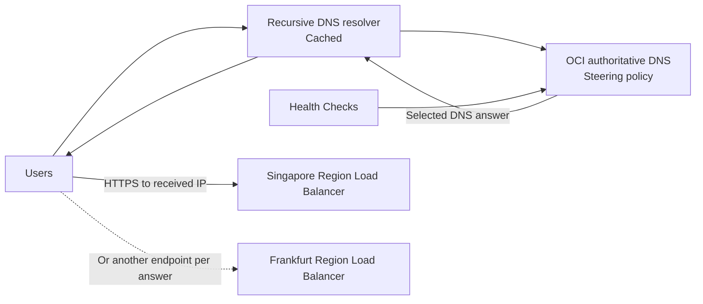

# Location- and latency-based traffic steering

An application deployed across multiple Oracle Cloud Infrastructure (OCI) regions needs to select the right serving location for each user group. Sending all traffic to one region can increase response times; picking the closest region on a map also does not guarantee the fastest path when network routes, application load, or data change.

In the **CLOUD_PROVIDERS_ORACLE** module, this lesson uses DNS Traffic Management to connect a service name with endpoints across multiple regions. Learners combine location, endpoint health, and latency measurements to build a verifiable policy, while assessing the serving readiness of the application and Oracle databases in the selected region.

After this lesson, learners can:

- Explain how Geolocation Steering selects a DNS answer for each query group.
- Distinguish geographic location, network latency, and application response time.
- Design pools, health checks, catch-all rules, and failover ordering.
- Measure effectiveness by user location and build a controlled update workflow.

## 1. Deployment scope on OCI

OCI Traffic Management produces different DNS answers based on conditions such as query origin and endpoint health. The service applies to **public DNS**; these steering policies do not apply directly to private DNS zones. [Overview of Traffic Management](https://docs.oracle.com/en-us/iaas/Content/TrafficManagement/Concepts/overview.htm).

Templates published by OCI include `FAILOVER`, `LOAD_BALANCE`, `ROUTE_BY_GEO`, `ROUTE_BY_ASN`, `ROUTE_BY_IP`, and `CUSTOM`. That list does not include a `LATENCY` template. In this lesson, `ROUTE_BY_GEO` is the primary deployment mechanism; latency measurements help evaluate and tune geographic-to-pool mappings. [Steering policy templates](https://docs.oracle.com/en-us/iaas/tools/oci-cli/latest/oci_cli_docs/cmdref/dns/steering-policy/create.html).

There are two implementation levels:

| Level | How serving location is decided |
| --- | --- |
| Pre-configured geolocation | Geographic groups have a predefined ordered list of pools |
| Measurement-driven policy updates | An operational workflow or external controller uses measurements to update mappings via API/IaC |

The second level is an architectural component built by the implementation team. Attaching Health Checks to a policy does not create an algorithm that automatically selects the endpoint with the lowest RTT for each client.

## 2. Where does DNS steering occur?

The typical flow is:



DNS returns an address or target name. The client then connects directly to the selected endpoint. User HTTP traffic does not pass through the steering policy like a reverse proxy.

This leads to three constraints to incorporate into design:

1. A single DNS lookup may be reused across many requests via cache.
2. Updating a policy affects subsequent eligible resolutions; already open connections do not move automatically.
3. DNS does not manage application cookies, login sessions, or database transactions.

Three steering tiers must be distinguished:

| Tier | Example responsibilities |
| --- | --- |
| Global DNS | Select regional endpoint for the service name |
| Regional Load Balancer | Distribute requests across backends and health-check backends |
| Application/data | Authentication, sessions, write permissions, and consistency |

A region receiving DNS answers must genuinely be able to handle business logic, not merely have a load balancer with an open port.

## 3. Location observed by the policy

In standard DNS, the authoritative server receives queries from a recursive resolver. Therefore, the observed location may reflect the resolver rather than the physical location of the user's device. EDNS Client Subnet is a mechanism for passing source subnet information over DNS, but its availability depends on support and behavior across intermediaries; do not assume every resolution path provides that information. [RFC 7871: Client Subnet in DNS Queries](https://www.rfc-editor.org/rfc/rfc7871).

For example, a user in Vietnam using a corporate VPN and enterprise DNS in Europe may receive a different answer than a user in the same city using a local ISP's DNS. Anycast resolvers also make inferring location from server addresses harder.

When evaluating geolocation results, record completely:

- Location and network of the test host.
- Actual recursive resolver used.
- Full name, QTYPE, and DNS answer received.
- Remaining TTL and test timestamp.
- Endpoint the application connection actually reached.

Do not use a single lookup from an admin workstation to conclude that all customers worldwide are steered to the right region.

## 4. Building a policy from answers, pools, and rules

An **answer** holds record data, such as an A record with a load balancer's public IP. A **pool** groups answers sharing a role. An **attachment** binds a policy to a name in a zone. When an attachment is active, the policy provides answers for the covered record types instead of regular records at that same name/type. A domain can have at most one attachment covering a given record type. [Traffic Management Components](https://docs.oracle.com/en-us/iaas/Content/TrafficManagement/Concepts/overview.htm).

The lab example uses two pools:

| Pool | Region | Illustrative answer |
| --- | --- | --- |
| `pool-sg` | Singapore | A → `203.0.113.10` |
| `pool-eu` | Frankfurt | A → `198.51.100.20` |

Both addresses belong to documentation ranges and are not real endpoints. When deploying, replace them with endpoint addresses you manage and have tested.

For `ROUTE_BY_GEO`, the template rule chain is:

```text
FILTER -> HEALTH if monitor exists -> PRIORITY by geography -> LIMIT
```

`FILTER` handles conditions such as disabled answers; `HEALTH` uses endpoint status; `PRIORITY` orders pools by geographic case; `LIMIT` caps how many answers are returned. In priority rules, lower values represent higher priority. [Traffic Management Steering Policies API Guide](https://docs.oracle.com/en-us/iaas/Content/TrafficManagement/Concepts/trafficmanagementapi.htm).

For the lab, set maximum answer count to `1` to make observing the selected region easier. Two simultaneous A records do not mean clients will automatically pick the fastest region; clients have their own selection and connection behaviors.

## 5. Two-region serving scenario

Suppose the service `api.example.com` is deployed in Singapore and Frankfurt. Both endpoints have valid TLS certificates for this name. The application returns a region marker on a diagnostic endpoint containing no sensitive data.

Illustrative parameter set:

| Property | Value |
| --- | --- |
| Compartment | `OciGeoLab` |
| Policy | `geo-api-lab` |
| Template | `ROUTE_BY_GEO` |
| Lab public hostname | A dedicated name under a domain you manage |
| Lab TTL | `60` seconds |
| Maximum answer count | `1` |
| Singapore Pool | Ready-to-serve Singapore endpoint |
| Frankfurt Pool | Ready-to-serve Frankfurt endpoint |

Initial mapping table:

| Geographic group | Priority 1 | Priority 2 |
| --- | --- | --- |
| Vietnam, Thailand, Singapore | `pool-sg` | `pool-eu` |
| Germany, France, Netherlands | `pool-eu` | `pool-sg` |
| Global catch-all | `pool-sg` | `pool-eu` |

Global catch-all provides an option for queries matching none of the declared groups. It serves a different purpose from a backup pool: catch-all determines **which case a query belongs to**, whereas pool order determines **which endpoint is prioritized within that case**. OCI allows declaring geographic groups and ordered pool lists in Geolocation Steering. [Creating a Geolocation Steering Policy](https://docs.oracle.com/en-us/iaas/Content/TrafficManagement/Tasks/create-tm-policy-geo.htm).

When geographic cases overlap, review the case ordering created and test with representative queries. Do not assume country cases always override continent cases without checking the effective configuration.

## 6. Which latency should be optimized?

Geographic distance is an initial signal. Real experience also depends on ISP peering, international transit paths, TCP/TLS setup, load levels, and data locality.

| Measurement | What it indicates | Limitation |
| --- | --- | --- |
| DNS lookup time | Name lookup time at the test host | Heavily influenced by caching |
| Network RTT | Round-trip time of a network probe | Does not reflect business processing |
| TCP/TLS setup | Connection establishment overhead | Differs between new and reused connections |
| TTFB | Time to first byte | Includes multiple components, not just network RTT |
| Total request time | Time to complete the test operation | Depends on response size and payload |
| Business transaction latency | Performance users actually experience | Requires representative requests and realistic data |

OCI Health Checks provides HTTP/HTTPS, ICMP, and TCP probes; results include timing details appropriate to each protocol. Ping tests do not substitute for real API measurements. [Managing Health Checks](https://docs.oracle.com/en-us/iaas/Content/HealthChecks/Tasks/managinghealthchecks.htm).

To compare regions, keep the same business URL, payload, authentication conditions, and caching mode. Group clients by region/network; inspect median, p95, error rate, and sample size instead of comparing a single successful request.

The table below shows **simulated numbers to illustrate decision-making**, not OCI benchmarks:

| Test host group | Singapore p95 | Frankfurt p95 | Observation |
| --- | --- | --- | --- |
| Vietnam | 85 ms | 245 ms | Singapore is the suitable candidate |
| Germany | 210 ms | 42 ms | Frankfurt is the suitable candidate |
| US East | 260 ms | 125 ms | Singapore catch-all should be revisited for this group |

If consistent samples confirm the US group is faster via Frankfurt, an appropriate case can be added. Adjustments must consider serving readiness, capacity, and data—not just a single latency column.

## 7. Health checks and readiness

Health Checks evaluates whether an endpoint can serve; performance metrics help compare where service is better. An endpoint returning a static page quickly cannot necessarily execute required business operations.

Health endpoint design can verify minimal conditions for a region to accept requests:

- Application process and listener are ready.
- Connections to mandatory dependencies operate at an acceptable level.
- Data state or serving role permits handling that request type.
- Endpoint is not in maintenance or draining state under a deployment workflow.

Health Checks is an external monitoring service for public-facing endpoints. Multiple vantage points can be selected to avoid relying on a single observation angle. [Overview of Health Checks](https://docs.oracle.com/en-us/iaas/Content/HealthChecks/Concepts/healthchecks.htm).

When creating a monitor, select real targets and protocol/port/path. Oracle recommends at least three vantage points across three different providers. Configure timeouts per target and verify results from each location before attaching to a policy. [Creating an HTTP Monitor](https://docs.oracle.com/en-us/iaas/Content/HealthChecks/Tasks/create-http-monitor.htm).

Common lab pitfalls:

1. Monitor only queries the global steered hostname, failing to test each regional endpoint independently.
2. Monitor targets do not match the answers the policy evaluates.
3. Probes are blocked by WAF or firewalls while user traffic still passes.
4. Health endpoint returns 200 even though the region lacks write permissions.
5. HTTPS probe uses the wrong Host/SNI compared to the live listener.

Validate the link between answer RDATA, monitor targets, and policy output by breaking each endpoint in turn. A healthy monitor status is insufficient if the policy binds the wrong monitor or attachment.

If all pools fail, observe and record the actual policy behavior as well as client caches. Do not design business logic assuming DNS will definitely block all access or definitely return only usable endpoints when no valid endpoint remains.

## 8. Hands-on: creating Geolocation Steering

### 8.1. Preparing before attaching a hostname

Prepare a public zone under a domain you manage and confirm delegation to OCI authoritative DNS. Use a dedicated lab hostname for testing; do not immediately alter a name serving real users.

Prepare both regional endpoints:

- Each endpoint returns valid content and an observable region marker.
- Both support the published hostname and matching TLS.
- Firewalls/WAF permit expected probe flows.
- Application data, sessions, and permissions fit the chosen serving model.

The implementer needs IAM permissions for policies, attachments, and related zones, plus Health Checks permissions if managing monitors. Automation identities need scoped permissions rather than shared admin credentials.

### 8.2. Creating the policy and pools

In **Traffic management steering policies**, create a **Geolocation steering** policy. Enter name, compartment, policy TTL, and maximum answer count. Create answers for both pools using real lab endpoints.

Select countries/geographic groups in the UI per the table in section 5, set pool priorities, and add a global catch-all. Attach the pre-verified monitor. Save the policy and read back answers, eligible/disabled states, geographic cases, and backup pools.

Pool names are internal policy identifiers; do not assume pool names must match hostnames or region names. Choose clear names so operators can distinguish roles and infrastructure targets.

### 8.3. Creating an attachment

Attach the policy to the lab hostname in the appropriate public zone, review changes, and publish via the UI. A policy must have a domain attachment to answer for that domain. [Attaching a Domain to a Policy](https://docs.oracle.com/en-us/iaas/Content/TrafficManagement/Tasks/tm-attach-create.htm).

Record policy OCID, attachment, zone OCID, record type, and pre-change configuration. If the same hostname has both A and AAAA, define policies for both paths; changing only A leaves IPv6-preferring clients unverified.

## 9. Testing DNS answers and access paths

### 9.1. Reading configuration via OCI CLI

The Bash example below only reads the policy, using a CLI authenticated with an authorized identity:

```bash
POLICY_OCID='<STEERING_POLICY_OCID>'

oci dns steering-policy get \
  --steering-policy-id "$POLICY_OCID"
```

Verify template, TTL, answers, rules, and health check monitor against the design. Control-plane read commands do not prove which answer users in a specific country receive. [OCI CLI: steering-policy get](https://docs.oracle.com/en-us/iaas/tools/oci-cli/latest/oci_cli_docs/cmdref/dns/steering-policy/get.html).

### 9.2. Querying from representative locations

On each test host, set the real lab hostname:

```bash
LAB_HOST='api.example.com'

dig "$LAB_HOST" A +noall +comments +answer +authority +stats
dig "$LAB_HOST" AAAA +noall +comments +answer +authority +stats
```

Inspect TTL and answers alongside the test host's resolver configuration. To separate authoritative updates from recursive caches, you can query one of the zone's actual nameservers directly:

```bash
AUTH_NS='<ACTUAL_ZONE_AUTHORITATIVE_NAMESERVER>'
dig @"$AUTH_NS" "$LAB_HOST" A +norecurse \
  +noall +comments +answer +authority +stats
```

Direct authoritative queries originate differently from end-user recursive paths, so they only provide evidence for that configuration and test context. They do not replace testing from resolvers users actually use.

### 9.3. Measuring each endpoint separately with curl

Replace documentation addresses below with real endpoint IPs before running. `--resolve` keeps the URL hostname for Host/SNI while choosing the target IP, allowing you to measure each region independently of current steering decisions:

```bash
LAB_HOST='api.example.com'
SG_IP='203.0.113.10'
EU_IP='198.51.100.20'

curl --noproxy '*' --resolve "${LAB_HOST}:443:${SG_IP}" \
  --connect-timeout 5 --max-time 15 --silent --show-error \
  --output /dev/null \
  --write-out 'region=sg code=%{http_code} dns=%{time_namelookup} connect=%{time_connect} tls=%{time_appconnect} ttfb=%{time_starttransfer} total=%{time_total}\n' \
  "https://${LAB_HOST}/health/ready"

curl --noproxy '*' --resolve "${LAB_HOST}:443:${EU_IP}" \
  --connect-timeout 5 --max-time 15 --silent --show-error \
  --output /dev/null \
  --write-out 'region=eu code=%{http_code} dns=%{time_namelookup} connect=%{time_connect} tls=%{time_appconnect} ttfb=%{time_starttransfer} total=%{time_total}\n' \
  "https://${LAB_HOST}/health/ready"
```

Curl's timing values here are in seconds and several are cumulative from the start of the request. `time_starttransfer` is not pure RTT. Because `--resolve` is used, this test does not measure the regular DNS steering path. [curl documentation on resolve and write-out](https://curl.se/docs/manpage.html).

Do not use a lightweight health endpoint to conclude all transactions are fast. Add read-only business URLs, representative payloads, and samples across multiple times of day. After comparing individual endpoints, measure the normal hostname again to confirm the policy actually steers users to the expected region.

## 10. Updating policies based on measured latency

If automating updates, build a dedicated workflow:

```text
Collect measurements by client group and endpoint
  -> Validate sample quality, errors, and freshness
  -> Exclude regions ineligible to serve
  -> Compare candidate plan against current configuration
  -> Apply thresholds and stabilization hold times
  -> Update policy via API/IaC
  -> Read back configuration and verify live data
```

Optimize only within the set of valid regions. For write transactions, a region with low p95 where the database is not in a writable role is not a valid candidate. Regions lacking capacity or missing required application versions must also be handled before DNS decisions.

Example operational rules designed by an implementation team:

```text
Only propose a priority change when:
- Each group has at least 100 valid samples in the evaluation window.
- The new result is at least 15% better and reduces latency by at least 20 ms.
- This condition holds across 3 consecutive windows.
- Minimum configuration hold time of 15 minutes has elapsed.
- The new endpoint meets error, data, and capacity requirements.
```

These are illustrative controller parameters, not built-in fields of `ROUTE_BY_GEO`. Tune them with real measurements and targets. Health failover reactions and performance optimization must also be coordinated so the two workflows do not flip the policy in opposite directions.

When measurement data is missing, stale, or contradictory, retain the verified configuration and raise an operational signal rather than constantly shuffling priorities. Do not use a single probe in one location to represent all ISPs in a country.

### Controlling automated updates

Store desired state, diff before/after, and keep a recoverable configuration snapshot. For policies shared across multiple hostnames, identify the full blast radius before updating. Rate-limit changes and prevent operators and controllers from overwriting each other.

After every update, verify both API readback and DNS queries/requests from client groups. A successful API call only proves the change was accepted at the control plane.

## 11. TTL, failover, and application sessions

Recovery time depends on multiple stages:

```text
Detect endpoint failure
  + Update status used by policy
  + Client/resolver DNS caches expire accordingly
  + Client retries connection or re-resolves
  + Application recovers session/operation
```

This is an analytical framework, not an additive formula with a hard upper bound for all clients. Health check interval and timeout affect detection; TTL affects caching; applications may hold connection pools or retry in their own ways. Oracle also notes failover reaction and session persistence limits when using DNS steering for multi-site systems. [FMW architecture with Traffic Management](https://docs.oracle.com/en/solutions/fmw-stretched-clusters/set-fmw-stretched-clusters1.html).

A `60`-second TTL in the lab does not mean all requests switch regions in exactly 60 seconds. Low TTLs also increase resolver re-query load and require closer monitoring during policy edits.

Applications should have suitable designs for sessions, shared data, and retries. For write operations, a client not receiving a response does not prove the operation in the old region failed to complete; business logic needs idempotency and retry handling to avoid duplicate transactions.

When returning to a recovered region, account for returning traffic spikes, cache warmth, and data catch-up speed. Do not turn a few milliseconds of improvement into repeated region flapping over short intervals.

## 12. Fault-injection and acceptance matrix

Run in the lab or during a change window, altering one factor at a time and recording timestamps:

| Scenario | Required evidence |
| --- | --- |
| Both pools healthy | Each group receives the right answer per policy and requests succeed |
| Singapore pool fails | Monitor status changes, queries adjust, and clients fail over per backup order |
| Frankfurt pool fails | Similar verification for Frankfurt-preferred groups |
| Singapore slow yet healthy | Record p95; verify geo policy holds config until adjustment workflow runs |
| Probes blocked separately | Detect discrepancy between vantage points and user connections |
| Both pools fail | Record actual DNS answer, app errors, and incident response procedure |
| Old region recovers | Observe stability, capacity, and return behavior |
| Clients hold cache | Compare authoritative answer, recursive answer, and IP used by requests |
| Clients use AAAA | Verify IPv6 regional behavior instead of testing A only |

Use application logs or a region marker to verify where requests land. Markers should return only necessary info, never internal hostnames or sensitive configuration data.

Finalize acceptance with business recovery time, error rates, and per-group p95. Do not sign off based solely on a policy screenshot or a single Console lookup.

## 13. Monitoring, cost, and lifecycle

Track three signal groups in parallel:

| Group | Examples |
| --- | --- |
| DNS and configuration | Answers per test group, TTL, policy/attachment, and config changes |
| Health and performance | Probe status, timeouts, latency by target/vantage point |
| Business | Error rate, transaction p95, request counts per region, and data state |

Health Checks provides metrics such as `HTTP.isHealthy`, `HTTP.TotalDuration`, `HTTP.StatusCode`, and `PING.Latency`. Split by target and vantage point when analyzing; do not collapse all probes into a single average that hides a failing region. [Health Checks Metrics Reference](https://docs.oracle.com/en-us/iaas/Content/HealthChecks/Reference/metricsalarms-reference.htm).

In budgeting, inventory DNS/steering, health checks, load balancers, compute, data replication, and inter-region bandwidth per applicable pricing. Increasing region count always requires reviewing total capacity and operational cost, not just the policy itself.

You can estimate probe counts from the design to check scale. With 2 targets, 3 vantage points, and a 30-second interval:

```text
Expected probes per day
  = 2 × 3 × 86,400 / 30
  = 17,280
```

This is a probe count assuming each vantage point probes every target each cycle; it is not a price or billing guarantee. Check actual frequencies, resources, and service terms before inferring cost.

Assign owners and expiration dates to lab hostnames, monitors, endpoints, and policies. When cleaning up the lab, review attachments alongside underlying records: detaching may cause previously shadowed regular records to take effect again. Verify DNS answers after cleanup to avoid leaving hostnames pointing to deleted endpoints.

## 14. Complete hands-on lab

For a two-region model, produce a handover-ready design document:

1. List user groups, representative resolvers, and regions authorized to serve each workload.
2. Build a pool priority table including global catch-all and backup paths.
3. Choose a health endpoint and prove it reflects required readiness.
4. Collect measurements from at least two location groups, separating per-endpoint tests from steered-hostname tests.
5. Explain why the current mapping fits or needs adjustment based on measurements.
6. Simulate losing one region, recording timestamps when monitor flips, DNS flips, and requests succeed again.
7. Prepare update, readback, rollback, and cost inventory procedures.

Results must demonstrate that **location is the initial selection condition**, **health governs endpoint eligibility**, and **measured latency validates selection quality**. Final availability must still be verified on the application and Oracle data layer in the traffic-receiving region.