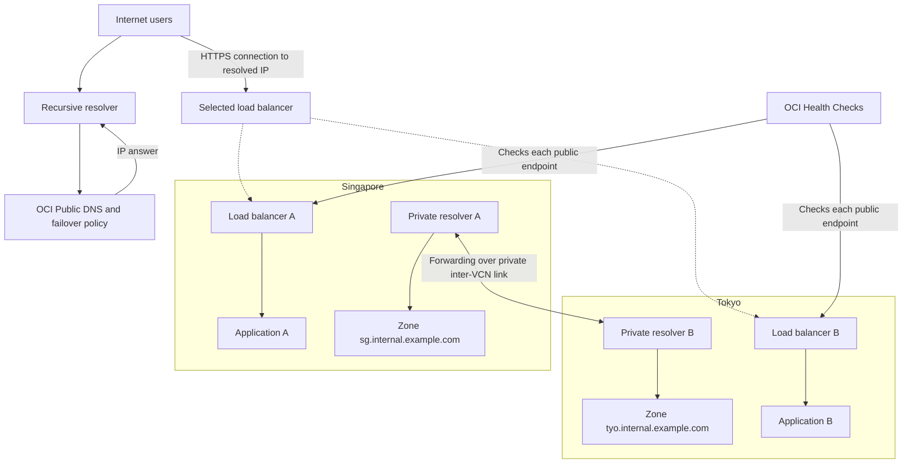

# DNS design for multi-region systems

In the **DNS and traffic management** chapter of the `CLOUD_PROVIDERS_ORACLE` module, this lesson designs the domain layer for applications deployed across multiple regions on Oracle Cloud Infrastructure (OCI). We combine public DNS, Traffic Management, Private DNS, VCN networking, and operational procedures so users find the right endpoint while keeping application and database responsibilities clear during regional transitions.

Throughout the lesson, examples use two regions: Singapore and Tokyo. A product catalog read service can serve from both regions, normally preferring Singapore. Private workloads need internal name resolution between the two VCNs; write flows to Oracle Database follow a separate role-transition procedure.

## 1. Objectives and prerequisites

After this lesson, learners can:

- Distinguish authoritative DNS, recursive resolvers, steering policies, and regional application endpoints.
- Choose naming conventions for public services, private services, and region-pinned endpoints.
- Design public DNS failover based on readiness and health checks.
- Design cross-region private DNS resolution using resolver endpoints and forwarding rules.
- Evaluate TTL, client caches, reconnection times, and data prerequisites before switching regions.
- Establish testing, failback, authorization, and cost-control procedures.

You need to understand A/AAAA/CNAME records, zones, NS, TTL, subnets, DRGs, and security rules. The lab assumes two test application environments, appropriate DNS administrative permissions, a domain you control if testing public DNS, and private connectivity between the two VCNs if testing Private DNS. Names under `example.com` in this lesson are illustrative only; replace them with domains you are authorized to use when deploying.

## 2. What does DNS decide in a multi-region architecture?

The basic public access flow is:

```text
Client → recursive resolver → authoritative DNS
Client ← DNS answer with TTL
Client → returned IP → regional load balancer → application
```

DNS answers questions about domain names. DNS does not proxy individual HTTP requests, migrate already open TCP sessions, or automatically turn a standby database into primary. A valid DNS answer can still point to an unreachable endpoint if routes, firewalls, TLS, or the application are not ready.

OCI DNS lets you manage zones and records, while the service's edge network handles authoritative queries for configured domains. For public DNS, proper delegation is required; for private DNS, a resolver must see the domain data and have an appropriate query path. [Oracle: Overview of DNS](https://docs.oracle.com/en-us/iaas/Content/DNS/Concepts/dnszonemanagement.htm).

Separate four layers when designing:

| Layer | Question to answer | Example |
|---|---|---|
| Domain and authority | Who manages this name, and do queries reach the right zone? | Public zone `example.com` |
| DNS decision | Which endpoint should be returned for the current query? | Select Singapore or Tokyo pool |
| Connectivity and session | Can the client reach the endpoint and establish a new session? | HTTPS, TLS, routes, and NSGs |
| Data and role | Is the endpoint authorized to serve that business operation? | Confirmed database writer |

Through this separation, operations teams can pinpoint whether an incident lies in DNS, networking, application, or data rather than calling everything a "region switch error."

## 3. Choosing the serving model and steering mechanism

| Model | Characteristics | Critical condition |
|---|---|---|
| Active-passive | Prefers one region; the other takes load during an incident | Backup region has sufficient serving readiness before selection |
| Active-active | Multiple regions receive traffic simultaneously | Sessions, data, and dependencies must support load distribution |
| Geolocation priority | Answers depend on query source location | Fallback plan exists when the preferred region is unavailable |
| Weighted traffic shifting | Gradually increases share of answers pointing to a new region | Monitor errors, load, and caching during transition |

OCI Traffic Management offers policies including failover, weighted load balancing, geolocation, ASN, and IP prefix. This service applies to **public DNS**, not directly to private DNS. Policies govern DNS answers; answer weights are not an exact guarantee of HTTP request or user ratios. [Oracle: Overview of Traffic Management](https://docs.oracle.com/en-us/iaas/Content/TrafficManagement/Concepts/overview.htm).

This lab selects public DNS failover to clearly observe the chain of fault detection, answer switching, and client reconnection. The Private DNS part uses dedicated resolver and record design; do not apply the same public steering policy to both layers.

## 4. Designing namespaces and owners

Separate stable service names from names indicating deployment location. Region-specific names are useful when testing each region independently of the shared service name's steering decisions.

| Illustrative name | Scope | Meaning |
|---|---|---|
| `catalog.example.com` | Public | Stable name for the catalog read service |
| `catalog-sg.example.com` | Public | Fixed endpoint of the service in Singapore |
| `catalog-tyo.example.com` | Public | Fixed endpoint of the service in Tokyo |
| `orders.sg.internal.example.com` | Private | Private service in Singapore |
| `orders.tyo.internal.example.com` | Private | Private service in Tokyo |
| `db.sg.internal.example.com` | Private | Managed DB endpoint in Singapore |
| `db.tyo.internal.example.com` | Private | Managed DB endpoint in Tokyo |
| `writer.service.internal.example.com` | Private | Write service name, updated per DB role-transition procedure |

Region-specific names retain their location meaning. Do not point `db.sg...` to a Tokyo address to pretend it is still Singapore. When shifting where service runs, change the stable service-name layer or the connection mechanism designed for the application.

Assign an owner for each zone and RRset: platform team manages delegation and resolvers, application team manages readiness and endpoints, database team confirms the write role. Records updated ad hoc by multiple teams easily cause conflicts during incidents.

## 5. Reference architecture



Public DNS is not in the HTTPS data path once the client knows the IP. The inter-region link between resolvers is a private DNS query path; the path to the target service itself must still be designed and verified independently.

Both read applications in this example already have the required data and dependencies to serve queries. If Tokyo lacks appropriate data, DNS returning Tokyo does not fulfill the service recovery objective.

## 6. Creating failover for a public service

### 6.1. Preparing endpoints before attaching the policy

In each region, prepare a load balancer and backends serving the same API contract. Both need a certificate matching `catalog.example.com`, accurate listeners, Host configuration, and a readiness endpoint such as `/readyz`.

Record the following values:

| Component | Singapore | Tokyo |
|---|---|---|
| Address used in A answer | `<PUBLIC_IP_A>` | `<PUBLIC_IP_B>` |
| Pool | `primary-sg` | `secondary-tyo` |
| Priority order in lab | 1 | 2 |
| Readiness | Ready to serve read service | Ready to serve read service |
| Capacity | Normal load | Sufficient to absorb post-failover load |

IPs are placeholders; replace them with actual public addresses of the selected frontends. Do not publish a temporary backend IP assuming it has the same lifecycle as a stable service endpoint.

### 6.2. Confirming the public zone and delegation

Create or use a public zone you control, verifying assigned NS records for that exact zone and delegation at the registrar or parent zone. Creating a zone in the Console does not automatically make the Internet use that zone. Root domain delegation and subdomain delegation must be handled at the right management point. [Oracle: Delegating a Public DNS Zone](https://docs.oracle.com/en-us/iaas/Content/DNS/Concepts/gettingstarted_topic-Delegating_Your_Zone.htm).

Do not use NS changes at the registrar as the mechanism to switch application endpoints between two regions in the lab. Keep authority stable and change the answer decision for the service name; delegation caches have a separate lifecycle from application record TTLs.

### 6.3. Configuring the policy

Create a Traffic Management steering policy of type **Failover**, declare two answer pools containing the corresponding A addresses, prioritize Singapore ahead of Tokyo, and attach health checks for both endpoints. Set maximum answer count to 1 for the example; pick an initial TTL of 60 seconds for practice. This is a lab value, not a blanket recommendation for all applications.

Attach the policy to `catalog.example.com` in the right public zone. Verify answers are eligible for selection, pool priorities are accurate, and the health check is linked. Without a health check attached, declaring priority order alone provides no endpoint failure-detection signal. [Oracle: Creating a Failover Policy](https://docs.oracle.com/en-us/iaas/Content/TrafficManagement/Tasks/create-tm-policy-failover.htm).

At the API layer, the failover template processes condition filtering, health, priority, and answer limit rule groups in a defined order. When automating with API/IaC, preserve the exact template structure instead of sending a list of answers assuming full failover logic is already present. [Oracle: Traffic Management Steering Policies API Guide](https://docs.oracle.com/en-us/iaas/Content/TrafficManagement/Concepts/trafficmanagementapi.htm).

If IPv6 is present, design and test AAAA separately as appropriate. Switching A to Tokyo while leaving AAAA pointing to Singapore can cause clients to use two different paths.

## 7. Health checks must measure true serving capability

### 7.1. Measuring each region separately

OCI Health Checks uses external vantage points to test public endpoints. Do not assume public monitors have a path to RFC 1918 addresses of private load balancers or databases. For private services, run checks from a network with corresponding access permissions. [Oracle: Overview of the Health Checks Service](https://docs.oracle.com/en-us/iaas/Content/HealthChecks/Concepts/healthchecks.htm).

Monitors must evaluate each regional endpoint independently. Probing only `catalog.example.com` lets the DNS policy itself select a healthy region and hide the other region's failure.

When using an HTTPS monitor targeting an IP, configure the Host header with the hostname bound to the corresponding certificate and listener. Select appropriate protocol, port, path, timeout, interval, and vantage points; verify live results for both IPs. [Oracle: Creating an HTTP Monitor](https://docs.oracle.com/en-us/iaas/Content/HealthChecks/Tasks/create-http-monitor.htm).

### 7.2. Binding health data to answers

Check whether answer `rdata` matches the monitored endpoint per OCI configuration. Oracle notes that answers whose `rdata` matches no monitored endpoint are treated as healthy. Thus, an existing health check alone does not prove every policy answer is monitored. [Oracle: Steering Policy — health_check_monitor_id](https://docs.oracle.com/en-us/iaas/tools/terraform-provider-oci/latest/docs/r/dns_steering_policy.html).

Keep a mapping table of answers, IPs/hostnames, monitor OCIDs, and health results. After changing a frontend address, update and verify both the policy and the monitor.

### 7.3. Readiness differs from a running process

`/readyz` in this example must reflect capability to serve reads: healthy backend, appropriate readable data, and mandatory dependencies ready. A static page returning HTTP 200 while the backend cannot query data is a useless failover signal.

Do not place heavy tasks, data-mutating queries, or secrets into the health endpoint. If using WAF or source IP restrictions, ensure probes are allowed by design; at the same time, continue verifying real user access paths.

Choose a sufficiently stable signal to prevent rapid flapping when dependencies jitter. When both regions fail, test the deployed policy's actual answers and client behavior; do not assume DNS automatically blocks all connections. Clients with cached data or existing connections can still reach an endpoint removed from new selections.

## 8. TTL, caching, and actual user recovery time

### 8.1. An illustrative time budget

Do not equate a 60-second TTL with a 60-second RTO. An estimated budget can be broken down as:

```text
User recovery time ≈
  detecting endpoint unavailability
  + updating answer decision
  + remaining valid old cache
  + client timeouts and reconnections
```

Suppose lab measurements show 45 seconds to detect the fault, 5 seconds to observe the authoritative server returning B, 60 seconds for old cache expiry, and 10 seconds for reconnection. The simple additive budget is 120 seconds. Phases can overlap and client behavior can extend longer; this is an analytical model, not an OCI SLA.

A resolver receiving A right before the authoritative server switches to B can still hold answer A until that cache entry expires. Lowering TTL from 300 to 60 during an incident does not shorten a 300-second TTL cached earlier. For planned drills, lower TTL early enough and wait out old caches before measuring.

### 8.2. Multiple cache layers

| Layer | Behavior to verify |
|---|---|
| Recursive resolver | Caching of positive answers, negative answers, and refresh policy |
| OS or client library | Whether it uses a local cache or a different resolver |
| Application runtime | Whether it holds addresses longer than expected |
| Connection pool | Whether it reuses existing sessions without re-looking up DNS |
| Proxy or edge device | Whether it caches DNS or maintains separate upstream connections |

NXDOMAIN and NODATA can be cached based on SOA details; creating a missing record does not immediately make all resolvers forget earlier negative answers. [IETF RFC 2308: Negative Caching](https://datatracker.ietf.org/doc/html/rfc2308).

Some resolvers implement serve-stale to continue using old data when unable to refresh. Consequently, TTL is not a hard time bound for every client in every scenario. [IETF RFC 8767: Serving Stale Data](https://www.rfc-editor.org/rfc/rfc8767.html).

For Java applications, check `InetAddress` caching policies, including security properties such as `networkaddress.cache.ttl`, `networkaddress.cache.negative.ttl`, and JDK-supported stale behaviors. Do not assume every JVM caches identically to the authoritative TTL; test with the workload's exact JDK, libraries, and connection pool. [Oracle: Java InetAddress — Address Caching](https://docs.oracle.com/en/java/javase/25/docs/api/java.base/java/net/InetAddress.html).

## 9. Private DNS between two regions

### 9.1. Splitting namespaces by region

The sample design uses:

| Region | Local private zone | Example records |
|---|---|---|
| Singapore | `sg.internal.example.com` | Singapore `orders` and `db` |
| Tokyo | `tyo.internal.example.com` | Tokyo `orders` and `db` |

A private zone belongs to a view; a resolver sees data via associated views. Sharing private views across resolvers is supported within the same region. Across two regions, use resolver endpoints and appropriate forwarding rather than treating a view as a globally auto-synced resource. [Oracle: Private DNS](https://docs.oracle.com/en-us/iaas/Content/DNS/Tasks/privatedns.htm).

Splitting zones by region gives each side clear authority. Do not create two zone copies with the same name containing different record sets and expect every query to search the other side for missing records.

### 9.2. Listening and forwarding endpoints

Create a listening endpoint so the resolver receives queries from other networks and a forwarding endpoint to send queries according to rules. An endpoint has either a listening or forwarding role; Compute clients using the local VCN resolver at `169.254.169.254` do not need to pass through a listening endpoint just to resolve names inside the VCN. That link-local address is not a target for calling resolvers in another region. [Oracle: Resolver Endpoints](https://docs.oracle.com/en-us/iaas/Content/Network/Concepts/dns-topic-resolver_endpoints.htm).

Example rule mapping:

| Source resolver | Remote namespace to resolve | Forward target |
|---|---|---|
| Singapore | `tyo.internal.example.com` | Tokyo listening endpoint IP |
| Tokyo | `sg.internal.example.com` | Singapore listening endpoint IP |

Query path from a host in Singapore:

```text
Client → Singapore VCN resolver
       → rule for tyo.internal.example.com
       → Singapore forwarding endpoint
       → inter-region private network
       → Tokyo listening endpoint
       → Tokyo private zone
```

Prepare appropriate private connectivity such as DRG/RPC, bidirectional routes for endpoint subnets, and matching DNS security rules. Permit UDP/TCP 53 per endpoint role and return flows; test TCP as well rather than only a small UDP query. Review networking requirements in [Oracle: Private DNS — VCN Configuration](https://docs.oracle.com/en-us/iaas/Content/DNS/Tasks/privatedns.htm).

Successful DNS only proves the query path to the resolver. The source host still needs a private network path to the application IP returned by the record, along with corresponding application rules.

### 9.3. Avoiding zone shadowing and loops

In the default Static resolution mode, a matched private zone missing a name can return NXDOMAIN instead of continuing to forwarding rules. If Singapore has a parent zone covering Tokyo's names while missing Tokyo records, inspect authority design and evaluation order before fixing routes. OCI offers other resolution modes; configure them intentionally and verify exact record types rather than treating them as cross-region data replication. [Oracle: OCI Private DNS Resolution Modes](https://blogs.oracle.com/cloud-infrastructure/oci-private-dns-resolution-modes).

Do not forward the same namespace from Singapore to Tokyo and from Tokyo back to Singapore when neither holds final authority. Every suffix needs a clear answering authority; specific rules must be ordered so a broader rule does not shadow them.

## 10. Stable service names and Oracle Database roles

To avoid embedding regional names into business connection configs, you can use a stable name like `writer.service.internal.example.com`. For instance, this name is a CNAME pointing to the DB endpoint identified in the region currently holding the write role.

If that name must exist independently in both regions, one approach is managing two `service.internal.example.com` private zones with the same desired data in two local views. These are two sets of resources that must be updated and reconciled; OCI does not automatically turn them into a single global writable zone.

| Business state | Desired CNAME in client-serving regions |
|---|---|
| Singapore is the valid writer | `writer.service... → db.sg.internal.example.com` |
| Role transition to Tokyo completed | `writer.service... → db.tyo.internal.example.com` |

Database procedures must verify replication status, role transition, serving readiness, and prevent the old writer from accepting writes before publishing the new writer. DNS only updates service discovery; it provides no fencing mechanism or guarantee against split-brain writers.

After changing the alias, also verify JDBC/connection pools, database service names, certificates if TLS is enabled, and how the application handles in-flight transactions. A stable domain name cannot fix a connection config that still embeds an old IP or a service name absent in the new region.

If one region becomes unreachable for updates, document which zone changed, which clients might still use old data, and which safeguards block invalid writes. Two DNS updates in two regions are not a single atomic transaction. Recovery plans must account for network partitions, not only total region loss.

## 11. Connecting DNS with on-premises and split-horizon

If on-premises DNS exists, create suffix-based conditional forwarding to the appropriate listening endpoint and configure paths from each region to on-premises DNS when needed. The Tokyo region should not depend solely on a forwarder or link in Singapore if the goal is to keep operating when Singapore goes down.

With split-horizon, the same FQDN can return a public IP to Internet users and a private IP to internal clients. The two answers must be managed as two access contracts: each IP must match the certificate, routes, and readiness of its corresponding client group. A public steering policy does not automatically update private data for the same name.

For example, public `catalog.example.com` has shifted to Tokyo while the private zone still returns the Singapore frontend. Internet users may recover while internal batch jobs keep failing. Therefore, test plans must specify which resolver clients use and which view they see.

## 12. Verifying authority, caching, and endpoints

### 12.1. Public DNS

The commands below use Bash with `dig` and `curl`. Replace domain names, IPs, and nameservers with actual lab values; do not make changes on domains you are not authorized to manage.

```bash
SERVICE_FQDN='catalog.example.com'
ZONE_FQDN='example.com'
AUTH_NS='<authoritative-nameserver-of-right-zone>'
PUBLIC_IP_A='<Singapore-load-balancer-public-ip>'
PUBLIC_IP_B='<Tokyo-load-balancer-public-ip>'

# Inspect delegation and public resolution path.
dig "$ZONE_FQDN" NS
dig "$SERVICE_FQDN" A +trace

# Query authoritative directly: check published answer and TTL.
dig @"$AUTH_NS" "$SERVICE_FQDN" A +norecurse +noall +answer

# Query the resolver currently used by this host: may receive cached answers.
dig "$SERVICE_FQDN" A +noall +answer

# Test each region separately while preserving hostname for HTTPS/TLS.
curl --connect-timeout 5 --max-time 15 \
  --resolve "$SERVICE_FQDN:443:$PUBLIC_IP_A" \
  "https://$SERVICE_FQDN/readyz"
curl --connect-timeout 5 --max-time 15 \
  --resolve "$SERVICE_FQDN:443:$PUBLIC_IP_B" \
  "https://$SERVICE_FQDN/readyz"
```

`--resolve` lets you test each frontend without waiting for DNS to select that region. Do not use `-k` to skip certificate checks in success criteria. If both frontends return identical content, add a region marker in test responses or inspect request logs to know where traffic is actually served.

Authoritative returning B while recursive resolvers still return A can be valid cache behavior. Querying authoritative servers alone does not verify real client experience. See also [Oracle: Testing DNS Using dig](https://docs.oracle.com/en-us/iaas/Content/DNS/Tasks/testingdnsusingdig.htm).

### 12.2. Private DNS

Run from a host inside the Singapore VCN with appropriate resolver configuration:

```bash
# Test a Tokyo-region name via the local VCN resolver.
dig @169.254.169.254 orders.tyo.internal.example.com A

dig +tcp @169.254.169.254 orders.tyo.internal.example.com A

# Inspect both the stable alias and related data.
dig @169.254.169.254 writer.service.internal.example.com CNAME

dig @169.254.169.254 writer.service.internal.example.com A
```

Repeat from Tokyo and from the on-premises network if within design scope. When isolating faults, query the listening endpoint IP directly from a source with permitted routing and rules. `+trace` is useful for public delegation; it does not replace verifying private views and conditional forwarding in internal networks.

After receiving the right IP, test the application protocol against the corresponding IP/service name. Resolving a name accurately and connecting to the service are two distinct criteria.

## 13. Failover and failback runbook

### Lab public failover

1. Confirm both frontends serve the read service, monitors accurately observe each endpoint, and Tokyo has sufficient capacity.
2. Record baseline: authoritative answer, client-resolver answer, TTL, health, and request-serving region.
3. In the controlled lab, fail Singapore readiness to trigger the defined fault signal.
4. Record fault timestamp, when the monitor changes health, when authoritative returns Tokyo, and when real clients complete requests in Tokyo.
5. Check clients holding old caches, long-lived connections, and IPv6 flows if present.
6. Restore Singapore, verify data/dependencies, and execute failback per chosen policy.

Do not rely solely on disabling an answer to measure full automated failover: that action tests the configuration and cache branches, but skips the health-check fault-detection stage. You may run it as a separate test with its scope explicitly noted.

### Controlled failback

A policy prioritizing Singapore can select Singapore again once that region's answer becomes eligible and healthy again. If you do not want to take traffic immediately, manage eligibility or readiness procedures per design rather than letting an early HTTP 200 decide business recovery.

For the database writer, failback is a coordinated data role transition, not just flipping a CNAME. Verify synchronization, transactions, fencing, and connection pools before republishing. Retain recovery-time and actual data-loss evidence to compare against RTO/RPO.

## 14. Incident matrix to rehearse

| Scenario | What to confirm |
|---|---|
| Only Singapore app fails | Monitor detects service failure, policy selects remaining eligible region |
| Complete loss of Singapore | Tokyo has independent DNS, data, secrets, capacity, and access paths |
| Tokyo fails while on standby | Alert fires on loss of redundancy, not monitoring only the primary region |
| Private inter-region link severed | Local names still resolve; impact on remote names is identified |
| Both endpoints unavailable | Actual DNS answers and app behavior measured, with incident response plan |
| Clients hold old DNS or connections | Timeouts, bounded retries, and write controls exist on the old endpoint |
| NXDOMAIN was cached | Measure negative cache expiry after fixing the record |
| Health target mismatched with answer | Detect endpoints that are not actually monitored |
| A switched while AAAA did not | Check both address families and corresponding client groups |
| Lost permissions or update API in one region | Emergency procedures do not depend solely on the failed environment |

One successful health check from a single source does not represent all user networks. Combine DNS observations, HTTP checks from target serving locations, and application logs to bound incident scope.

## 15. Change governance, security, and cost

### Permissions and configuration data sources

Separate permissions to modify zones/records, policies, monitors, and resolvers by responsibility. User-facing runtimes normally do not need permissions to modify all DNS. When using automation to switch endpoints, grant only the required scope and include locking/coordination to prevent two processes from overwriting decisions.

Manage desired state via code or a versioned configuration system. Track domains, zone OCIDs, public/private scope, management region, policy attachments, monitor OCIDs, and owners. Health Checks management and result-reading operations are tied to the configured region; automation must target the right region. [Oracle: Managing Health Checks](https://docs.oracle.com/en-us/iaas/Content/HealthChecks/Tasks/managinghealthchecks.htm).

Inspect IaC plans before applying to catch policy destroy/recreate operations, dropped attachments, or full-RRset overwrites. For private zones in two regions, compare actual data against the same desired version and detect drift rather than assuming both copies are in sync.

### Securing the domain chain

For public DNS, DNSSEC authenticates answer integrity and origin when validating resolvers and a valid chain of trust are used; DNSSEC does not encrypt queries or replace TLS. Coordinate DNSKEY/DS and key rotation with the registrar or parent zone; a broken trust chain can cause validating resolvers to return errors even when direct queries still see records. [Oracle: DNSSEC](https://docs.oracle.com/en-us/iaas/Content/DNS/Concepts/dnssec.htm).

For private DNS, avoid putting private addresses or sensitive operational details into public zones. Maintain access controls on DNS endpoints, network rules, and change logs aligned with the defined client scope.

### Cost and lab cleanup

Budget by actual components: DNS zones/queries, Traffic Management, health check frequency and target counts, resolver endpoints if applicable charges apply, two-region frontends, logging, and inter-region data transfer. Consult the [Oracle Cloud Price List](https://www.oracle.com/cloud/price-list/) with realistic usage levels; do not assume lowering TTL or increasing probe frequency incurs zero cost.

Lower TTLs increase re-query demand in many cases without guaranteeing every client switches faster. Choose TTLs from measured recovery targets, DNS load tolerance, and client behavior, rather than setting the lowest possible value.

Upon completing the lab, remove monitors, policy attachments, and test resources in dependency order. If deleting a public zone, update delegation at the registrar/parent zone so NS records never point to a non-existent zone; then verify resolution and any remaining charges. [Oracle: Dangling DNS Delegation](https://docs.oracle.com/en-us/iaas/Content/DNS/Concepts/dangling-dns-delegation.htm).

## 16. Self-check questions and handover criteria

1. Why can the authoritative server return Tokyo while some clients still call Singapore?
2. Should health checks probe the shared service name or each regional endpoint? Why?
3. What happens if a policy's answer does not match any monitored target?
4. How does sharing a private view within the same region differ from cross-region forwarding?
5. Why can creating a parent zone missing a record block queries to a remote zone?
6. Does successful public steering cutover prove private clients also switched?
7. Before switching the writer name to the Tokyo DB, which data and write-permission conditions must be ensured?
8. Why is a 60-second TTL insufficient to guarantee a 60-second RTO?

The handover package must include namespaces and owners, delegation, record/pool/endpoint/monitor mappings, resolver topology, verified TTL and cache behavior, data role-transition procedures, failover/failback results from real clients, and estimated cost. A multi-region DNS design meets requirements when it explains not only where the domain points, but also which clients see that answer and whether the endpoint is genuinely authorized to serve the business workload.