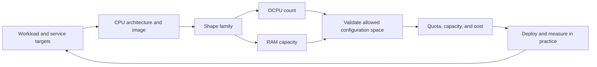

# Flexible Shapes, OCPUs, and Memory Allocation

In the **Compute and Virtual Machines** chapter of the Oracle Cloud Infrastructure (OCI) module, this lesson guides you in choosing CPU and RAM for VMs using flexible shapes. The goal is to build a configuration suited to the workload, interpret OCPU units accurately, check memory limits, and adjust resources based on performance evidence.

The running example is a Java service running on Compute inside a VCN, accessing an Oracle database over a private network. Compartments and IAM bound administrative permissions; images and CPU architecture determine compatibility; Monitoring provides data for choosing configurations. Resizing also relates to downtime, availability, and cost across the entire application.

## 1. Learning Outcomes

After this lesson, learners will be able to:

- Distinguish between a shape family, an OCPU/RAM configuration, and the number of logical CPUs seen by the operating system.
- Convert OCPUs accurately according to the specific x86 or Arm line in use.
- Verify whether an OCPU and RAM pair is valid against shape, image, and tenancy limits.
- Budget memory for Java heap, native memory, operating system, and headroom.
- Choose whether to add CPU, add RAM, or inspect I/O based on workload measurements.
- Execute a planned resize, re-read the configuration, and measure results after the change.

This lesson focuses on general-purpose Linux Standard Flex VMs. Dense I/O, extended memory, burstable, and database services are mentioned to distinguish scope; they have their own terms and conditions, so Standard VM configurations should not be applied mechanically to them.

## 2. What Does a Flexible Shape Let You Choose?

A shape defines the CPU type, resources, and characteristics of an instance. With a flexible shape, users choose the number of OCPUs and the amount of RAM within the supported configuration space when creating or resizing a VM. For example, `VM.Standard.E5.Flex` is a family; `2 OCPU, 16 GB` is a specific configuration of that family. [Overview of the Compute Service](https://docs.oracle.com/en-us/iaas/Content/Compute/Concepts/computeoverview.htm).



Flexibility helps avoid paying for extra CPU just because a workload needs more RAM than a fixed configuration offers. However, CPU and RAM are not completely arbitrary: there are total limits, RAM-to-OCPU ratios, and family constraints.

Other resources must also be checked when selecting a shape. Network bandwidth and VNIC count can scale with OCPUs and platform limits. Increasing RAM does not automatically increase Block Volume IOPS; increasing OCPUs does not guarantee faster storage or backend databases.

Selecting a Flex shape also does not automatically create an autoscaling policy for the application. CPU/RAM configuration, VM resource management mechanisms, and instance pool autoscaling are separate decisions. The lab uses a standard configuration; if the Console offers a Static/Dynamic Configuration option, record which mode is used so measurements remain comparable.

## 3. OCPU, Core, and vCPU

### 3.1. Reading Conversions by CPU Line

An OCPU is the CPU resource unit published by OCI. A vCPU represents one hardware execution thread. Do not use a single formula for all Arm shapes.

According to current Compute Shapes documentation:

| Platform | 1 OCPU Conversion | Meaning When Observed |
| --- | --- | --- |
| Standard x86 AMD/Intel | 2 vCPUs | Two execution threads on one physical core |
| Ampere A1 | 1 core, 1 vCPU | One execution thread per core |
| Ampere A2 and A4 | 2 cores, 2 vCPUs | Two cores, one execution thread per core |

Conversion source and family list: [Compute Shapes — OCPUs and vCPUs](https://docs.oracle.com/en-us/iaas/Content/Compute/References/computeshapes.htm).

For example, a 2 OCPU configuration on standard x86 provides 4 vCPUs; 2 OCPUs on A1 corresponds to 2 vCPUs; 2 OCPUs on A2/A4 corresponds to 4 vCPUs. Having the same number of logical CPUs does not mean topology, single-thread performance, or throughput are identical.

Do not conclude that a 4-vCPU x86 VM has four independent physical cores. Nor should you apply A1's conversion to A2 just because both are Arm. When switching families, re-check the resource table and benchmark a representative workload.

### 3.2. Checking Inside the Guest

On an authorized Linux VM, inspect with:

```bash
uname -m
lscpu
nproc
```

`uname -m` helps identify the architecture such as `x86_64` or `aarch64`. `lscpu` describes the topology visible to the guest. `nproc` reports the number of processing units available to the process in its environment.

Results can be affected by CPU affinity, containers/cgroups, or platform configuration. Cross-check against the shape configuration in OCI rather than inferring billed OCPUs solely from a command inside a container. If available CPUs are lower than expected, check runtime limits before purchasing more OCPUs.

### 3.3. OCPU Is Not an Absolute Performance Measure

Two VMs both having 2 OCPUs can use different CPU generations, frequencies, caches, and memory bandwidth. Workload performance also depends on vector instructions, how many threads actually run in parallel, and database/I/O wait times.

A process busy on only one logical CPU can leave the VM's average CPU low. For example, one of four logical CPUs fully saturated while three remain idle yields an average near 25%; adding OCPUs will not automatically parallelize that single-threaded section.

For pure Java, bytecode is portable, but the JDK, container images, JNI/native libraries, and bundled binaries must still support the target architecture. Switching from x86 to Arm typically requires a matching image and runtime environment; do not treat this as an always-available in-place resize. [Arm-Based Compute](https://docs.oracle.com/en-us/iaas/Content/Compute/References/arm.htm).

## 4. Within What Limits Can Memory Be Chosen?

### 4.1. Reading Shape Options Instead of Guessing

Information groups to inspect:

| Information Group | Question to Answer |
| --- | --- |
| `isFlexible` | Does the shape support flexible configuration? |
| `ocpuOptions` | What are the minimum/maximum OCPUs? |
| `memoryOptions` | What are the minimum/maximum RAM and per-OCPU ratios? |
| `networkingBandwidthOptions` | How do per-OCPU bandwidth and total caps behave? |
| `maxVnicAttachmentOptions` | How many VNICs are allowed for the configuration? |
| Image compatibility | Can the image run on this shape? |

In the CLI, output field names often use hyphens, such as `memory-options`; API/JSON requests may use camelCase. Read actual values instead of relying on a screenshot of a limits table from another environment. [Shape resource options](https://docs.oracle.com/en-us/iaas/tools/terraform-provider-oci/latest/docs/d/core_shapes.html).

Limits can differ across Standard, Optimized, Dense I/O, burstable, and extended memory. Do not assume "having Flex in the name means RAM and CPU can be chosen freely" or "every Flex shape supports live in-place resizing".

### 4.2. Model for Validating a CPU/RAM Pair

For a typical shape with total limits and ratio bounds, let:

- `C`: desired OCPU count.
- `M`: RAM in OCI configuration GB units.
- `Cmin`, `Cmax`: OCPU count limits.
- `Mmin`, `Mmax`: total RAM limits.
- `Rmin`, `Rmax`: GB per OCPU limits.

Preliminary check:

```text
Cmin <= C <= Cmax

Minimum RAM for C = max(Mmin, C * Rmin)
Maximum RAM for C = min(Mmax, C * Rmax)

Minimum RAM for C <= M <= Maximum RAM for C
```

This formula describes basic constraints and does not replace OCI validation. If a shape has custom step increments, NUMA constraints, or predefined configuration sets, check those additional conditions as well.

**Simulated example for learning the calculation**, not specifications of a specific family:

```text
Cmin = 1, Cmax = 8
Mmin = 1 GB, Mmax = 64 GB
Rmin = 1 GB/OCPU, Rmax = 8 GB/OCPU

For C = 2:
  Minimum M = max(1, 2*1) = 2 GB
  Maximum M = min(64, 2*8) = 16 GB

2 OCPU + 12 GB: within this range.
2 OCPU + 24 GB: exceeds the per-OCPU ratio limit.
```

A configuration with RAM below the total cap can still be invalid due to the per-OCPU ratio. Conversely, meeting the ratio is not enough if total RAM exceeds the instance cap.

### 4.3. Configured RAM, Guest RAM, and Application Memory

The `memoryInGBs` field describes instance RAM in OCI units. The operating system may display MiB/GiB, and part of memory is used by the kernel, agents, or background components. When budgeting, keep units consistent and check how much memory is actually available inside the guest.

RAM is not the boot volume or Block Volume. Increasing RAM from 16 to 24 GB does not make disks larger. Swap uses storage to assist memory management, but it does not have RAM-like latency and should not be treated as equivalent RAM.

## 5. Budgeting Memory for a Java Service

### 5.1. Heap Is Only One Part

A self-budgeting model:

```text
Memory required for the VM
  = Java heap
  + metaspace and code cache
  + direct buffers, thread stacks, and native memory
  + helper processes and monitoring agents
  + kernel and required OS page cache
  + headroom for load spikes
```

This is an analytical model, not a formula where every term has a fixed value. Regions reserve and commit memory differently; compare against actual memory in use rather than summing all virtual address reservations into physical RAM.

`-Xmx` bounds the Java heap, not the process's total RSS. When using `MaxRAMPercentage`, the JVM calculates the heap target from the memory it detects in the runtime environment; space must still be reserved for off-heap areas. [The java Command — JVM Memory Options](https://docs.oracle.com/en/java/javase/21/docs/specs/man/java.html).

On a VM configured with roughly 16 GB, an **illustrative starting budget** might allocate about 8 GiB to the heap, leaving the rest for native memory, the OS, and headroom. Do not treat 50% as a mandatory rule; verify with the actual workload, thread count, and libraries.

Example JVM configuration with a fixed maximum heap:

```bash
java -Xms2g -Xmx8g -jar application.jar
```

The command assumes the application is already packaged and the JDK is compatible. After increasing VM RAM, `-Xmx8g` still keeps that heap limit. If heap is the bottleneck, evaluate JVM changes separately; do not conclude that resizing RAM had no effect simply because the heap limit was not adjusted.

### 5.2. Distinguishing Memory Error Types

| Evidence | Investigation Path |
| --- | --- |
| Heap approaching limit, frequent GC | Live set, allocation rate, application caches, heap sizing |
| RSS rising while heap stays stable | Direct buffers, thread stacks, JNI/native allocations |
| Host low on available memory, rising reclaim/swap | Total VM budget and other processes |
| Container OOM-killed despite free host RAM | Container memory limit / cgroup |
| Memory growing continuously without stabilizing | Possible leak; adding RAM only delays failure |

If the JVM reports `OutOfMemoryError`, inspect the error type and logs. If the kernel/container kills the process, correlate metrics at that layer; do not assume both phenomena share the same root cause.

### 5.3. Allocating RAM with Purpose

More RAM can help caching and reduce I/O, but caches must be bounded and have appropriate eviction policies. Do not grow caches to the point of crowding out native memory. For a service calling an Oracle database, increasing application RAM does not automatically increase SGA/PGA or the capacity of a separate database service.

When multiple JVMs run on one VM, budget for the sum of all processes rather than using independent percentage rules that make each JVM expect most of the host's RAM.

## 6. Choosing a Configuration from Workload Measurements

### 6.1. Collect Data Alongside Service Targets

Record target throughput, concurrent requests, p95/p99 latency, error rate, batch duration, and data size. Then observe CPU, RAM, GC, I/O, and dependencies over the same load window.

| Symptom | Decision to Evaluate |
| --- | --- |
| Multiple CPUs busy, rising runnable queue, parallel workload | Add OCPUs or optimize CPU usage |
| One thread busy, overall CPU still low | Optimize sequential path or per-thread performance |
| Low available RAM, sustained memory pressure | Increase RAM, reduce footprint, or fix configuration |
| Low CPU, high disk wait time | Inspect volumes and I/O path |
| Low CPU/RAM, requests waiting on database | Queries, connection pools, and dependencies |
| Backend saturated after adding app CPU | Concurrency limits and end-to-end system capacity |

Do not buy more CPU solely because load average is high. Load can include processes waiting on I/O; read CPU utilization together with process states.

### 6.2. Estimating OCPUs to Pick a Test Point

Within the same family, for a parallelizable CPU-bound workload under equivalent load, an initial estimate is:

```text
New C ≈ Current C * Current CPU utilization / Target utilization
```

Simulated example: 2 OCPUs running at roughly 80% utilization, targeting 60%:

```text
2 * 0.80 / 0.60 = 2.67 OCPUs
```

If the configuration space requires integer OCPUs, you can test 3 OCPUs after checking limits. This is a starting point for measurement, not an exact latency forecast or guaranteed improvement. The formula does not apply when changing architectures, hitting single-thread bottlenecks, or waiting primarily on I/O.

### 6.3. Leave Capacity for Failures and Traffic Spikes

Average daytime usage does not cover traffic peaks, startups, GC, or batch jobs. With two VMs behind a load balancer, evaluate whether the remaining VM can carry the load while the other undergoes maintenance.

One larger VM only adds resources to a single point of failure. Multiple properly distributed instances and node-by-node rollouts may be needed for availability; flexible sizing does not create that architecture automatically.
