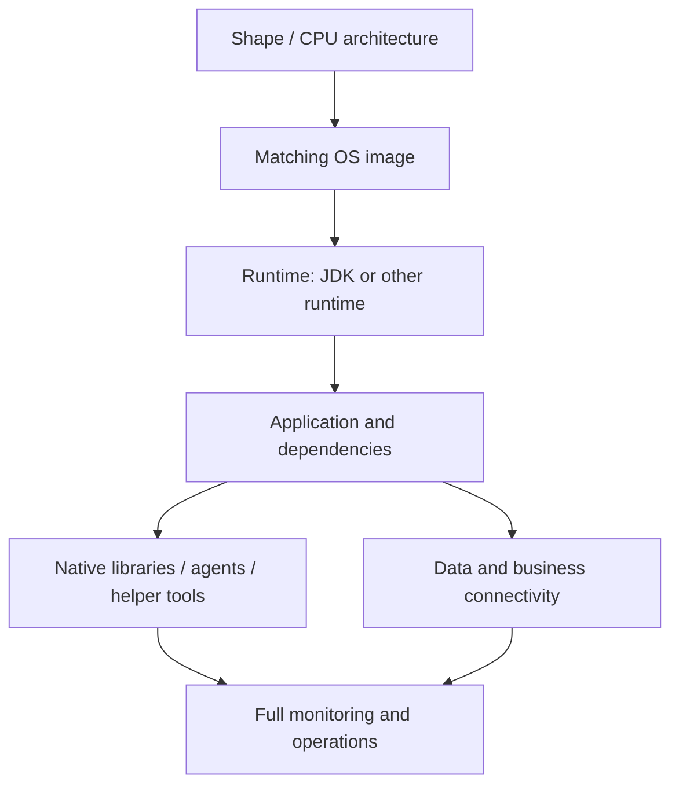

# x86, Arm Architectures, and Application Compatibility

When choosing a virtual machine on Oracle Cloud Infrastructure (OCI), OCPUs and RAM are not enough to determine whether an application will run. The OS image, JDK, native libraries, containers, and operational tools must all match the shape's CPU architecture.

In the **CLOUD_PROVIDERS_ORACLE** module, this lesson helps learners choose x86 or Arm for Compute based on evidence: inventorying dependencies, standing up a test environment, verifying Oracle database connectivity, and measuring performance–cost before shifting traffic. The architecture decision is also placed within permissions, monitoring, and system availability planning.

After this lesson, learners will be able to:

- Recognize `x86_64`, `amd64`, `aarch64`, and `arm64` identifiers across different tools.
- Explain which parts of a Java application are shared and which require platform-specific builds.
- Inspect images, binaries, and containers before deploying onto a target shape.
- Plan testing, migration, and rollback aligned with business goals.

## 1. What Architectures Are x86 and Arm?

An instruction set architecture, commonly called an ISA, defines the machine instructions a CPU executes along with related rules. Within the scope of this Compute lesson, the two groups to focus on are x86-64 and 64-bit Arm.

| Identifier | Common Meaning |
| --- | --- |
| `x86_64`, `x64`, `amd64` | Common names for the 64-bit x86 platform |
| `aarch64`, `arm64` | Common names for the 64-bit Arm platform |
| `x86`, `i386`, `i686` | May refer to 32-bit x86; read context carefully |
| `arm`, `armv7` | May refer to 32-bit Arm; do not assume Arm64 |

`amd64` is an architecture name; it does not mean a binary only runs on AMD-branded CPUs. Likewise, two systems both being 64-bit does not guarantee they can execute the same machine code.

A native x86-64 program contains x86-64 machine instructions. To run directly on Arm64, it needs a build compiled for Arm64 or a compatibility mechanism approved and tested by the organization. Renaming a file or changing an environment variable does not translate the instructions inside a binary.

### Architecture Is Not the Whole CPU Profile

Even within x86-64, software can depend on instruction set extensions of a specific CPU generation. Compiler flags such as `-march=native` can emit code leveraging features of the build machine and make the binary unsuitable for other hosts in the same architecture family. [GCC: x86 Options](https://gcc.gnu.org/onlinedocs/gcc/x86-Options.html).

Therefore, deployment records need the base architecture, required CPU feature level, and software OS/ABI constraints.

## 2. Where Does Architecture Appear in OCI?

OCI offers Intel- or AMD-based shapes in the x86 group and Ampere-family Arm shapes. For example, x86 Standard VMs and the `VM.Standard.A1.Flex`, `VM.Standard.A2.Flex`, and `VM.Standard.A4.Flex` families offer different options. Shape lists and availability must be verified for the active region, image, and tenancy. [Compute Shapes](https://docs.oracle.com/en-us/iaas/Content/Compute/References/computeshapes.htm).

Do not select an image by OS name alone. An x86-64 Linux image and an AArch64 Linux image can share the same distribution version while containing different-architecture kernels, bootloaders, and packages.

The chain that must align is:



Oracle provides a development ecosystem on Arm, including Linux, Java, GraalVM, and related tools. That is a starting point for testing; you must still verify the specific versions and packages required by the workload. [Arm-Based Compute](https://docs.oracle.com/en-us/iaas/Content/Compute/References/arm.htm).

### OCPU Does Not Convert Identically Across Every Arm Family

According to the current OCI allocation table:

| Compute Group | Published Conversion for 1 OCPU |
| --- | --- |
| x86 Intel/AMD | 2 vCPUs |
| Arm A1 | 1 core, corresponding to 1 vCPU |
| Arm A2 and A4 | 2 cores, corresponding to 2 vCPUs |

Read according to the exact shape family; do not use a rule like "every Arm OCPU equals one vCPU". These units also do not prove equivalent performance across CPUs. [Compute OCPU and vCPU Units](https://docs.oracle.com/en-us/iaas/Content/Compute/References/computeshapes.htm).

When comparing, record the full shape, OCPUs, logical CPUs seen by the OS, RAM, and any container limits. Benchmarks must be based on the same load target or the same budget, not merely the same OCPU count.

## 3. Multi-Layer Compatibility Verification

| Layer | Question to Answer | Evidence |
| --- | --- | --- |
| OCI infrastructure | Is the shape available with enough limits and compatible with the image? | Console/API selection and environment record |
| Operating system | Do the image and packages match the CPU architecture? | Image metadata, `uname`, package metadata |
| Runtime | Does the JDK match the OS/architecture/version? | Vendor, version, and runtime info |
| Application | Do bytecode and APIs fit the runtime? | Artifacts, build config, and run results |
| Native dependencies | Are `.so`, executables, and agents built for the platform? | Dependency inventory and ELF metadata |
| Container | Is there an image variant for the target platform? | Manifest/index and image digest |
| Operations | Do monitoring, backup, security, and deployment work? | End-to-end lifecycle testing |
| Product | Does the vendor support this deployment combination? | Version-specific support matrix |

Technical compatibility and vendor-supported status are two separate pieces of evidence to collect. A binary running in a lab does not automatically confirm support terms for commercial software or Marketplace images.

For the operating system, use only images published by OCI as compatible with the target shape. The fact that an OS exists on Arm on another platform does not prove the corresponding image is supported on OCI.

## 4. How Portable Is Java?

Java is typically compiled into class files containing JVM bytecode. The JVM executes bytecode using platform-appropriate mechanisms and may compile it further to machine code. This is the foundation for sharing Java code across operating systems and architectures. Class files also have versions tied to the Java version supported by the runtime. [Java Virtual Machine Specification](https://docs.oracle.com/javase/specs/jvms/se25/html/jvms-1.html).

Model for a pure-Java application:

```text
Same application source / bytecode
              |
       verified service.jar
              |
       +------+------+
       |             |
JVM Linux x86-64  JVM Linux AArch64
       |             |
CPU x86-64        CPU Arm64
```

The same JAR can be used when bytecode, APIs, configuration, and all dependencies fit the target runtime. The JDK/JRE installed on the two machines must still match each architecture.

Things to verify:

- Class files do not require a newer Java version than the runtime provides.
- APIs, modules, security providers, and JVM options exist in the chosen JDK build.
- Dependencies do not silently load an incompatible native library.
- Paths, permissions, timezone, and OS settings are configured properly.
- Rarely used features and background tasks still work after startup.

For example, JDK 25 has its own certified OS and CPU matrix; consult the matrix for the exact vendor and JDK version selected by the project. Do not infer support just because two packages both say "Java". [Oracle JDK 25 Certified System Configurations](https://www.oracle.com/java/technologies/javase/products-doc-jdk25certconfig.html).

### A Java Error Is Not Necessarily an Architecture Error

`UnsupportedClassVersionError` usually points to a bytecode/runtime version mismatch. That is distinct from native library loading failures, missing packages, or an application failing to reach the database. Record the root error before changing shapes or JDKs.

Similarly, `os.arch` identifies the current runtime, not a guarantee that all application dependencies are compatible.

## 5. JNI, Native Libraries, and ABI

JNI allows Java to call native code. The native portion is compiled and linked per platform; a JAR with portable Java classes can still carry or load libraries tied to a CPU and OS. [JNI: Compiling, Loading and Linking Native Methods](https://docs.oracle.com/en/java/javase/25/docs/specs/jni/design.html).

Categories commonly included in an inventory:

| Dependency Group | What to Look For |
| --- | --- |
| Native drivers or SDKs | Client libraries, shared libraries, and supported versions |
| Compression, storage, data processing | JNI inside dependencies or artifact classifiers |
| TLS/crypto | Native providers or platform-optimized libraries |
| Image, video, document processing | Executables outside the JVM and system libraries |
| APM/profiler | Native agents loaded by the JVM at startup |
| Backup, security, operations | OS-installed binaries or sidecars |

The ABI is the set of binary interface conventions governing function calls, data types, and linking. Matching Arm64 is not enough if a library requires a different libc, C++ runtime, or symbol version than the running environment provides.

For example, a Linux library built against glibc will not natively fit a container using musl. A `.so` filename does not reveal all internal dependency versions. On error, inspect both architecture and linked libraries.

### Inspecting ELF Metadata

The commands below are examples on Linux where the corresponding tools are installed, for files you manage:

```bash
file ./service-native
file ./libfeature.so

readelf -h ./libfeature.so
readelf -d ./libfeature.so
readelf --version-info ./libfeature.so
```

`readelf -h` shows the ELF header, including machine type; `-d` inspects dynamic linking info; `--version-info` displays symbol version requirements. These outputs aid isolation and do not replace running actual functionality. [GNU Binutils: readelf](https://sourceware.org/binutils/docs/binutils/readelf.html).

If a package ships multiple variants, check the variant-selection logic. Classifier names like `linux-x86_64` or `linux-aarch64` are vendor-defined; do not assume they match Docker platform names.

## 6. Connecting to an Oracle Database

An application running on Arm can act as a network client to a database running on a different architecture. The two sides communicate over a protocol, not by exchanging each other's machine instructions directly.

For Java, distinguish between:

| Driver | Impact When Changing Client Architecture |
| --- | --- |
| JDBC Thin | Pure Java; check JDK, driver, database versions, and connection config |
| JDBC OCI | Uses native Oracle client libraries; must have libraries matching the platform |

Oracle describes Thin as a Type IV driver that requires no additional native Oracle client on the client side, whereas the Type II OCI driver requires platform-specific libraries. Here, OCI in the driver name stands for **Oracle Call Interface**. [Introducing JDBC](https://docs.oracle.com/en/database/oracle/oracle-database/26/jjdbc/introducing-JDBC.html).

When testing a workload on an Arm VM, verify representative operations: creating the connection pool, querying, writes with rollback, specialized data types, TLS/wallet if used, and reconnecting after interruption.

Moving application hosts to Arm does not automatically move the database server to Arm. If the project wants to change the database platform as well, separately evaluate version, edition, deployment service, image, support matrix, and data migration method. Do not infer from JDBC Thin running that every database installer runs on every shape.

## 7. Containers Do Not Remove CPU Architecture Requirements

Containers package user space and the application, but binaries inside still have an architecture. An image running natively on x86-64 may lack a corresponding Arm64 variant.

A multi-platform image typically has an index pointing to per-platform images. Each variant contains the appropriate base image, runtime, and binaries; the same tag can reference different contents per platform. [Docker: Multi-platform builds](https://docs.docker.com/build/building/multi-platform/).

| Where Displayed | x86-64 | Arm64 |
| --- | --- | --- |
| Common `uname -m` | `x86_64` | `aarch64` |
| Docker platform | `linux/amd64` | `linux/arm64` |
| Common Java `os.arch` | `amd64` | `aarch64` |
| Some native packages | `x86_64` | `aarch64` |

A single Dockerfile can be shared when its input layers support both platforms. Example for a JAR whose dependencies have been inventoried:

```dockerfile
ARG JAVA_RUNTIME_IMAGE
FROM ${JAVA_RUNTIME_IMAGE}
WORKDIR /opt/app
COPY service.jar /opt/app/service.jar
ENTRYPOINT ["java", "-jar", "/opt/app/service.jar"]
```

The builder must pass a runtime base image verified to support the target platforms and the right Java version. If `service.jar` bundles native dependencies, the same `COPY` instruction does not prove the JAR fits both variants.

To inspect the platforms an image advertises:

```bash
APP_IMAGE='<ACTUAL_IMAGE_REFERENCE>'
docker buildx imagetools inspect "$APP_IMAGE"
```

Then run and test it on the corresponding native host. An index claiming `linux/arm64` that accidentally contains an x86-copied binary can still fail when that feature is invoked.

OCI Kubernetes Engine also requires matching application images when using Arm-based nodes; a single source tree can be used to build images for both architectures. [Running Applications on Arm-based Nodes](https://docs.oracle.com/en-us/iaas/Content/ContEng/Tasks/contengrunningarmnodes.htm).

### Emulation and Cross-Architecture Builds

Build approaches include emulation, multi-node native builders, and cross-compilation where the toolchain supports it. QEMU can be useful to get started, but it can be significantly slower for CPU-heavy work. Benchmark results under emulation do not represent native execution performance. [Multi-platform build strategies](https://docs.docker.com/build/building/multi-platform/).

Setting `--platform linux/amd64` on an Arm host does not compile x86 binaries into Arm. If it runs through an emulation layer, you must explicitly note that condition when reporting results.

## 8. GraalVM Native Image and Ahead-of-Time Compiled Binaries

Native Image takes Java inputs and produces a native executable for the target operating system and architecture. This artifact has different platform constraints from a JAR running on a JVM. [GraalVM Native Image](https://www.graalvm.org/dev/reference-manual/native-image/).

Release artifacts can be separated into:

```text
service.jar
service-linux-amd64
service-linux-arm64
```

This is an illustrative naming convention. Contents, compiler, libraries, and baseline CPU must still be recorded; a filename alone does not confirm the platform.

For native executables, prepare the appropriate toolchain and dependencies for each target, verify required framework metadata, and run integration tests on the actual target platform. Do not assume all build options or cross-compilation support are identical across tool versions.

Non-Java components need the same approach: Go/C/C++/Rust executables, native extensions of other runtimes, or external application tools. A shell script may be portable while the binary it invokes only has an x86 build.

## 9. Lab: Evaluating a Java Service on x86 and Arm

### 9.1. Preparing Two Comparable Environments

Assume you have `service.jar`, a readiness endpoint, and representative Oracle database read operations. Choose two VMs under similar network conditions, such as the same region and the same database access path.

| Item | Control Requirement |
| --- | --- |
| Source/artifact | Same release build, record checksum |
| Runtime | Same vendor/version/patch suited to each architecture |
| OS | Supported image, configuration documented |
| RAM/heap | Specify RAM and heap/container limits |
| CPU | Shape, OCPUs, logical CPUs, and actual runtime limits |
| Storage/network | Same configuration type or document differences |
| Load | Same workload, data, and measurement method |
| Observability | Agents, logs, and metrics active on both VMs |

Source software from channels approved by your organization. Check capacity and resource creation permissions before basing a migration plan on a shape family.

### 9.2. Checking OS and JVM Architecture

Bash example on each VM:

```bash
uname -m
lscpu
java -version
java -XshowSettings:properties -version
```

Record `os.arch`, `os.name`, `java.version`, vendor, and CPU details. The JVM often prints settings to stderr; capture evidence without dropping that stream.

Inspect the actual runtime environment. If the application runs in a container, Java info on the host does not prove the runtime inside the container has the right version or platform.

### 9.3. Inventorying the JAR and Dependencies

Start by listing packaged contents:

```bash
jar tf service.jar
```

Look for native libraries, executables, platform-specific classifiers, and agents in both the application artifact and deployment packages. For a fat JAR with nested dependencies, the top-level listing does not prove nested JARs are pure Java; inspect the dependency list and related contents in the build pipeline.

Build an inventory table rather than guessing from the `.jar` extension:

| Component | Type | x86 Build | Arm Build | Required Evidence |
| --- | --- | --- | --- | --- |
| Application code | Bytecode | Matching runtime | Matching runtime | Identical business behavior and accurate data |
| JDBC driver | Thin or native | Verified | Verified | Connection and representative operations |
| Native libraries if any | Shared library | Matching OS/ABI | Matching OS/ABI | Loading and actual functionality |
| APM/profiler | Java/native agent | Active | Active | Collects complete observability data |
| Backup/helper tools | Script/binary | Active | Active | Test scheduled jobs |

A tool that runs only once a night is still an operational dependency. Do not sign off right after startup and overlook background jobs, log compression, or report exports.

### 9.4. Avoiding Hard-Coded Architecture in Scripts

Example mapping the OS name to an internal artifact convention:

```bash
case "$(uname -m)" in
  x86_64)
    APP_ARCH='amd64'
    ;;
  aarch64|arm64)
    APP_ARCH='arm64'
    ;;
  *)
    printf '%s\n' 'Architecture not supported by this workflow' >&2
    exit 1
    ;;
esac

printf 'Artifact architecture: %s\n' "$APP_ARCH"
```

This mapping is only an example for a project artifact repository. If a vendor uses different names, the script must follow the published convention. Avoid silently falling back to the x86 build when the host is unrecognized.

### 9.5. Running and Verifying Business Functionality

Example once the JAR is prepared and application configuration is properly supplied:

```bash
java -Xms512m -Xmx1g -jar service.jar
```

In a separate test session, check the lab endpoint:

```bash
curl --fail --silent --show-error \
  --connect-timeout 5 --max-time 15 \
  'http://127.0.0.1:8080/health/ready'
```

The heap here is an illustrative parameter, not a recommendation for every VM. Total process memory also includes off-heap regions, thread stacks, and native libraries.

Next, exercise real functionality: controlled read/write tests, compression/decompression if used, SDK calls, background jobs, and restarts. Tests must traverse code paths that use any native dependencies or agents under evaluation.

## 10. Comparing Performance and Cost Using Workloads

Two CPUs with the same clock speed do not automatically produce the same throughput. Memory, caches, thread count, compiler, JIT, storage subsystem, and network dependencies all affect results.

For a Java service on the JVM, separate startup and warm-up phases from steady-state load. Record duration, sample count, errors, and load limits; a single API call is not enough to evaluate an architecture.

| Metric | Purpose |
| --- | --- |
| SLO-compliant throughput | Useful capacity while keeping latency and errors within thresholds |
| p50/p95/p99 | Typical and tail latency |
| CPU, RAM, GC | Bottlenecks and resource differences |
| I/O and network | Distinguish CPU limits from other dependencies |
| Startup/restart | Scaling speed and recovery capability |
| Cost per unit of work | Compare efficiency for the same business goal |

Compute Instance Monitoring emits metrics in the `oci_computeagent` namespace, including `CpuUtilization`, `MemoryUtilization`, disk, and network activity. Verify that the plugin/agent is running to capture data; supplement with JVM and application metrics when needed. [Compute Instance Metrics](https://docs.oracle.com/en-us/iaas/Content/Compute/References/computemetrics.htm).

### Example Cost Calculation per Request Volume

The table below uses **simulated figures**, not OCI pricing or benchmarks:

| Option | Assumed Total Hourly Cost | Requests/s Meeting SLO |
| --- | --- | --- |
| x86 VM | 0.12 currency units | 1,000 |
| Arm VM | 0.10 currency units | 1,200 |

If that load is sustained, cost per million requests is calculated as:

```text
Cost / 1 million requests
  = Hourly cost × 1,000,000 / (requests per second × 3,600)

x86: 0.12 × 1,000,000 / (1,000 × 3,600) ≈ 0.0333
Arm: 0.10 × 1,000,000 / (1,200 × 3,600) ≈ 0.0231
```

This conclusion applies only to these assumptions. If the Arm option requires more RAM, more instances, different agents, or significant migration effort, include those in total cost. Conversely, a database-bound workload may see little throughput change even when changing CPUs.

Do not use hourly VM price as the sole evidence. Choose the option that meets compatibility, SLO, operational, and total actual system cost requirements.

## 11. Migrating from x86 to Arm in a Recoverable Way

Changing OCPUs/RAM within the same compatible environment and switching to a different ISA are two distinct types of changes to evaluate separately. OCI requires the current image to be compatible with the new shape; you can check compatible shapes for an image in the Console or API. [Changing the Shape of an Instance](https://docs.oracle.com/en-us/iaas/Content/Compute/Tasks/resizinginstances.htm).

For migrating from x86 to Arm, a readily verifiable approach is provisioning a new Arm VM from an appropriate Arm image and redeploying the application. Do not treat cloning an x86 boot volume as proof that the OS can boot on Arm.

Recommended process:

1. **Inventory:** source, runtime, native dependencies, agents, background jobs, data, and support terms.
2. **Prepare artifacts:** use a verified portable JAR or build platform-specific native artifacts/images.
3. **Provision target environment:** OS image, network, IAM, secrets, monitoring, and application config.
4. **Functional testing:** include edge paths, data, backups, and restarts.
5. **Load testing:** compare against SLOs and cost, ensuring dependencies are not overloaded.
6. **Shift partial traffic:** use appropriate application/load-balancer mechanisms and watch errors and latency.
7. **Gradual expansion:** scale up only with evidence that targets are met.
8. **Rollback or completion:** keep a rollback path for an adequate window and clean up resources after sign-off.

With new resources, a changed instance OCID can affect dynamic groups and instance principal permissions if rules match by instance ID. Review access grants in the same plan as networking and secrets; do not broaden permissions just to make a test pass.

For data, migrating the application does not mean you can arbitrarily copy actively written files. Choose a method suited to the data type, filesystem, and supported tools. Rollback must remain compatible with both schema and protocol, not just keeping the old x86 VM around.

## 12. Common Errors and How to Isolate Them

| Symptom | Investigation Direction |
| --- | --- |
| `Exec format error` | Executable architecture/format, script interpreter, and execution environment |
| `no matching manifest` | Image index lacks the platform requested by the runtime |
| `UnsatisfiedLinkError` | Wrong architecture, library search path, or unmet native dependency |
| `GLIBC... not found` / missing symbol | libc, ABI, and library version in the target environment |
| `Illegal instruction` | Binary uses a CPU feature missing on target or native bug requiring investigation |
| `UnsupportedClassVersionError` | Class file version vs. Java runtime |
| Fails only on one feature | Late-loaded native dependency or external tool outside the JVM |
| App runs but metrics disappear | Agent/plugin lacks a matching build or is misconfigured |
| Low throughput despite spare CPU | Database, network, I/O, locks, or other limits |
| Fails only when shifting traffic | DNS/routing, TLS, sessions, IAM, or config differences |

These are investigation leads, not single-cause mappings. Read the full error chain, identify the actual running process and artifact, and compare against the platform.

A useful sequence is checking host, OS, runtime, binary/image, invoked dependencies, and finally the business path. Avoid changing multiple layers at once, which makes it unclear which change resolved the issue.

## 13. Automation and Operating Dual Architectures

If a system maintains both x86 and Arm, release records must explicitly represent the platform. A deployment record should include:

```text
Application version
Target OS / architecture
JDK vendor / version / patch
Native dependency versions
Container index digest and image variant if used
OCI shape / image OCID / resource configuration
Functional / load / operational results
```

Automation should select the right image by region and architecture, validate inputs before creating VMs, and halt if artifacts are missing. Having the same image display name or container tag is not proof of immutable contents.

In CI, validate each supported architecture using appropriate runners/builders and run tests in a native environment. A passing x86 check branch does not cover native agents or libraries for the Arm branch.

For availability, a multi-architecture fleet needs sufficient artifacts, capacity, and operational tooling in each group. Keeping x86 deployment capability does not automatically create redundancy if capacity runs out or dependencies are not backward-compatible.

For lab budgets, inventory VMs, boot/block volumes, load balancers, registry artifacts, and logging by service used. Check actual resource pricing and terms; do not assume every Arm shape shares the same promotional credits or free-tier limits.

## 14. Complete Hands-On Exercise

Choose a Java service with database interactions and create an architecture decision record:

1. Record the current x86 shape, OS image, and runtime.
2. List all native dependencies, agents, and external tools outside the JVM.
3. Choose an appropriate Arm shape/image and explain the OCPU conversion for that family.
4. Provision a test VM and verify artifacts, data, background jobs, monitoring, and access permissions.
5. Run a representative workload and report SLO-compliant throughput, p95, errors, and resource utilization.
6. Calculate cost per unit of work under clearly stated assumptions.
7. Prepare a traffic-shift plan and rollback conditions.

A passing result must prove the application operates fully in the target environment. Running `java -version`, seeing an `arm64` tag, or seeing a VM in the RUNNING state are only partial checks along that process.