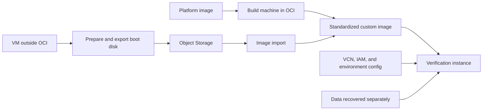

# Platform Images, Custom Images, and Image Import

In the **Compute and Virtual Machines** chapter of the Oracle Cloud Infrastructure (OCI) module, an image is the starting point for creating a server with the right operating system and software. Image selection affects boot capability, CPU architecture, deployment time, and patch maintenance.

This lesson covers selecting platform images, building custom images, and importing images from outside OCI. Operations are placed in the context of tenancies, compartments, IAM, VCNs, and Object Storage so learners can implement a workflow with proper access control, monitoring, automation, and cost control.

## Objectives and Prerequisites

After this lesson, you will be able to:

- Distinguish between platform images, custom images, and the image import operation.
- Choose an image compatible with the target shape, operating system, and CPU architecture.
- Prepare a source machine to create a reusable image.
- Import an image via Object Storage and verify that an instance launched from it works.
- Organize image versions, usage permissions, replacement plans, and resource cleanup.

You should know how to select a region and compartment, create a Compute instance, use SSH or RDP, and read subnet/NSG configurations. CLI examples in this lesson use Bash and assume the OCI CLI is configured; OCIDs, namespaces, bucket names, and object names must be replaced with your lab environment resources.

## What Is an Image and How Do the Three Concepts Relate?

An image is a disk template used to initialize the operating system and software on an instance. When launching a new machine, OCI uses the image as the source to create a boot volume. The instance then runs on its own boot volume. Concepts and base operating systems are described in [OCI Platform Images](https://docs.oracle.com/en-us/iaas/Content/Compute/References/images.htm).

| Concept | Origin | Use Case |
| --- | --- | --- |
| Platform image | OS image provided by the platform | Provisioning new machines with a standard OS base |
| Custom image | Private image created from an instance's boot disk or via an import process | Distributing standardized configurations and software |
| Image import | Operation that brings an image file into OCI to create a custom image resource | Migrating virtual machines or bringing images from another environment into OCI |

Thus, an imported image is a custom image that originated outside OCI's direct boot-disk capture workflow. This is the relationship between **resource type** and **creation method**.

For example, a Java application team can use an Oracle Linux platform image for the first test machine. Once the JDK, agents, and system settings are agreed upon, the team packages them into a custom image. If the software is already running on a VM in a data center, the team can prepare that VM's boot disk and import it into OCI.

### Components That Must Be Managed Separately

A custom image created in OCI contains the boot disk contents; data on attached block volumes is not included in the image. VCNs, subnets, NSGs, and IAM policies must also be configured for the target environment. See boot disk scope in [Managing Custom Images](https://docs.oracle.com/en-us/iaas/Content/Compute/Tasks/managingcustomimages.htm).

Split a deployment plan into three parts:

1. **Image:** operating system, runtime, and shared configurations.
2. **Infrastructure:** Compute shape, boot volume, networking, permissions, and monitoring.
3. **Data and environment configuration:** databases, data volumes, endpoints, and secrets.

For an application connecting to an Oracle database, connection settings can be supplied at deployment time. Database recovery must follow its own procedure corresponding to the database service in use; an application host image does not represent database transaction state.



## Selecting a Platform Image and Pinning Deployment Inputs

A platform image works well when you want to start from a standard OS and automate application software installation. The catalog includes families such as Oracle Linux, Ubuntu, and Windows Server; check available versions and release notes at deployment time. Different releases or architectures may have different lists of supported shapes. The [Platform Image Catalog](https://docs.oracle.com/en-us/iaas/Content/Compute/References/images.htm) is the initial reference.

Before selecting an image, answer four questions:

| Question | Why Decide Early? |
| --- | --- |
| Which OS and release does the workload require? | Avoid picking a base that fails runtime or application vendor requirements |
| Does the workload use x86-64 or Arm? | Binaries, native libraries, and agents can be architecture-dependent |
| Has the target shape been determined? | Compatibility of the exact image–shape pair must be verified |
| Are the inputs pinned to specific versions? | Two builds must have a basis to explain differences |

Moving a system to Arm requires validating both the runtime and the application's native libraries. Renaming an image or editing the compatible shapes list does not translate the operating system's instruction set.

Example listing images for an x86 shape chosen in the lab:

```bash
export OCI_REGION='ap-singapore-1'
export LAB_COMPARTMENT_OCID='ocid1.compartment.oc1..REPLACE_ME'
export TARGET_SHAPE='VM.Standard.E4.Flex'

oci compute image list \
  --region "$OCI_REGION" \
  --compartment-id "$LAB_COMPARTMENT_OCID" \
  --operating-system 'Oracle Linux' \
  --shape "$TARGET_SHAPE" \
  --lifecycle-state AVAILABLE \
  --all
```

The command above returns a candidate list; it does not automatically approve an image. `--all` fetches all result pages of the query; it does not turn the output into a historical archive of every platform image. OCI refreshes the list with recent releases, and older OCIDs may no longer appear in list queries. See [OCI CLI: image list](https://docs.oracle.com/en-us/iaas/tools/oci-cli/latest/oci_cli_docs/cmdref/compute/image/list.html).

After evaluation, record the image OCID, region, operating system, architecture, tested shape, and build workflow version. In a production pipeline, selecting a new image should produce a new build input that can be validated before replacing serving instances.

## Designing Custom Image Contents

Custom images let you bake shared decisions into a reusable release artifact. However, the more environment-specific settings you put into an image, the harder it becomes to reuse across environments.

| Standardize in the Image | Provide at Deploy Time or Runtime |
| --- | --- |
| Selected OS and runtime | Environment name, endpoints, and system-specific parameters |
| Validated agents | Resource access permissions tied to the new machine's identity |
| Logging configuration and system baseline | Secrets such as passwords, tokens, and private keys |
| Application directories and service units | Host identity and data connection details |
| Versioned application package, if required by release strategy | Transactional data and user state |

Two common patterns are:

- **Thin base image:** contains the OS, runtime, and agents; the application is deployed in a later step. Teams can update the application frequently while rebuilding the base less often.
- **Baked application image:** contains both the runtime and an application version. Teams build a new image per release while reducing work on first boot.

This is a workload design choice. Evaluate it by startup time, package repository dependencies during deployment, and release traceability requirements.

Example internal naming convention:

```text
orders-ol9-x86_64-jdk21-2026-11-20-r1
```

This name helps humans recognize the purpose. Pipelines still need to record the OCID to reference the exact resource, along with a package manifest and the build workflow source version.

## Creating a Custom Image from an OCI Instance

Use a dedicated build machine recreated from documented inputs. Creating images from long-lived production servers often carries over manual edits, test data, or obsolete information.

Practical workflow:

1. Create a build machine from the chosen platform image in a build compartment.
2. Install software, apply configuration, and record versions of every input.
3. Verify services, logs, and connectivity on the build machine.
4. Prepare the machine state for packaging according to the notes below.
5. On the instance page, choose **Create custom image**, select the target image compartment, and specify a versioned name.
6. Monitor the operation in the Console and the associated work request.
7. Once the image is ready, launch a new instance to validate the packaged artifact.

Creating an image can shut down and interrupt the source instance during processing. Windows must be shut down from within the OS per the relevant instructions. Plan packaging windows to account for source machine downtime. See [Creating Custom Images](https://docs.oracle.com/en-us/iaas/Content/Compute/Tasks/custom-images-create.htm).

### Preparing Source Machine State

- Stop or quiesce processes still writing important data before packaging.
- Remove secrets, temporary credentials, and data that does not belong in a shared image.
- Verify the mechanism that generates new identities for future machines, including hostname, SSH host keys, and initialization data.
- On Linux, plan initialization-state cleanup according to your OS; do not arbitrarily delete network configs or system directories.
- Ensure the application does not hardcode the build machine's IP address.
- If using iSCSI, detach attachments and remove iSCSI node configurations as required before creating the image; coordinate this with stopping services dependent on those volumes.

iSCSI requirements and custom image limits are documented in [Managing Custom Images](https://docs.oracle.com/en-us/iaas/Content/Compute/Tasks/managingcustomimages.htm).

CLI example for creating an image; `BUILD_INSTANCE_OCID` must point to the prepared build machine:

```bash
export BUILD_INSTANCE_OCID='ocid1.instance.oc1.ap-singapore-1.REPLACE_ME'
export IMAGE_COMPARTMENT_OCID='ocid1.compartment.oc1..REPLACE_ME'

oci compute image create \
  --region "$OCI_REGION" \
  --compartment-id "$IMAGE_COMPARTMENT_OCID" \
  --instance-id "$BUILD_INSTANCE_OCID" \
  --display-name 'orders-ol9-x86_64-jdk21-2026-11-20-r1'
```

The resource-creation response is the handle for tracking progress. Record the returned OCID and check its state before deploying. Detailed parameters are in [OCI CLI: image create](https://docs.oracle.com/en-us/iaas/tools/oci-cli/latest/oci_cli_docs/cmdref/compute/image/create.html).

## Windows: Generalized Images and Specialized Images

Distinguish two forms of Windows custom images:

| Form | Characteristics | Appropriate Use |
| --- | --- | --- |
| Generalized | Machine-specific identity cleaned with Sysprep | Creating multiple new machines from a standard base |
| Specialized | Preserves source machine characteristics | Recovering or testing a specific configuration |

Using a specialized image to clone multiple machines on the same network can cause duplicate names or identifiers. With OCI's generalization process, run it on a copy intended for packaging: generalization can leave the working machine unable to operate normally afterward. Whether the `opc` account is kept or recreated and how passwords are retrieved depends on image configuration; test the login path on a new machine. See [Creating Windows Custom Images](https://docs.oracle.com/en-us/iaas/Content/Compute/References/windowsimages.htm).

For Windows imported from outside OCI, prepare Oracle VirtIO drivers, RDP, DHCP, and generalization if you plan to clone multiple instances. Windows Firewall must also allow management traffic in the network profile the OS receives after import. Choose the right edition/SKU and verify software licensing terms before migrating. [Importing Custom Windows Images](https://docs.oracle.com/en-us/iaas/Content/Compute/Tasks/importingcustomimagewindows.htm) provides Windows-specific steps.

## Image Import: Preparing Source Files and Understanding Formats

Bring Your Own Image (BYOI) brings an operating system from another environment into OCI and launches VMs from that image. Do not extrapolate this BYOI workflow to bare metal. Target hardware, OS, and device modes must all be verified. See [Bring Your Own Image](https://docs.oracle.com/en-us/iaas/Content/Compute/References/bringyourownimage.htm).

### Formats and Origins

| Format | What to Understand When Importing |
| --- | --- |
| QCOW2 | A disk image format used in the import workflow |
| VMDK | Must match an OCI-supported packaging type |
| OCI (`.oci`) | Package containing QCOW2 and OCI metadata, suited for moving custom images across regions/tenancies |

Supported import and export format lists can differ. For example, VHD/VDI are listed for export but are not direct input formats in this import list. Platform images, Marketplace images, and custom images derived from Marketplace images have export restrictions; check before choosing a migration path. See [Importing and Exporting Custom Images](https://docs.oracle.com/en-us/iaas/Content/Compute/Tasks/imageimportexport.htm).

Renaming a file extension does not convert disk structure. If the source is a snapshot chain or multiple dependent files, consolidate/export using the source hypervisor's tools as required for import. Keep a recoverable source copy before modifying.

### Linux Source Requirements to Verify

Per [Importing Custom Linux Images](https://docs.oracle.com/en-us/iaas/Content/Compute/Tasks/importingcustomimagelinux.htm), verify at minimum:

- Image import limit is 1 TB.
- Source uses BIOS boot, MBR, and a valid boot loader.
- Single disk as the boot drive; does not depend on other data disks to boot.
- Unencrypted disk image.
- Single-file QCOW2 or VMDK of supported type `monolithicSparse`/`streamOptimized`.
- Networking uses DHCP, without pinning source IP/MAC.
- Boot loader locates the boot volume by UUID or LVM.

Stop the source VM before cloning/exporting. Prepare cloud-init if you want to process SSH keys from instance metadata. Data volumes, secondary NICs, and storage-dependent services need a post-first-boot recovery plan.

For Windows import, current documentation also notes a 256 GB minimum boot volume. Do not apply that figure to all Linux images or every custom image scenario. See [Windows source requirements](https://docs.oracle.com/en-us/iaas/Content/Compute/Tasks/importingcustomimagewindows.htm).

### Launch Mode and Compatible Shapes

Launch mode describes how virtual devices are presented to the guest OS. For non-OCI sources, prefer **Paravirtualized** when suitable drivers exist; **Emulated** applies only to supported Linux cases. Windows import requires paravirtualized; some shape families and Linux images also support only this mode. Conditions are listed in [BYOI: Launch Modes](https://docs.oracle.com/en-us/iaas/Content/Compute/References/bringyourownimage.htm).

When importing an `.oci` file, the Console determines the mode from source metadata. For QCOW2 exported from OCI, import guidance specifies Native mode. Therefore, record the file's origin before choosing a mode. [Importing Custom Images](https://docs.oracle.com/en-us/iaas/Content/Compute/Tasks/custom-images-import.htm) explains selection by source.

Compatible shapes declare which shapes can be used with an image. You can edit this list, but after any change you must launch a verification test on the new shape; adding a shape name alone does not prove drivers and the OS work. See [Editing Custom Images](https://docs.oracle.com/en-us/iaas/Content/Compute/Tasks/custom-images-edit.htm).

Image capabilities also describe firmware and attachment types. Editing capabilities is for advanced scenarios requiring knowledge of the source configuration; changing a metadata field does not install missing drivers into the disk image. See [Editing Image Capabilities](https://docs.oracle.com/en-us/iaas/Content/Compute/Tasks/configuringimagecapabilities.htm).

## Hands-On: Importing via Object Storage

Suppose a team has an Oracle Linux 9 QCOW2 x86-64 file prepared for paravirtualized mode that meets source requirements. The team wants to bring it into the image compartment to test on a compatible shape.

### Preparing Permissions and Storage Location

Identify the target region, image compartment, and bucket storing the file. The operator needs permission to create images and read the source object. Image-creation permission does not automatically grant permissions to use subnets, volumes, or instances in subsequent verification.

In the Console:

1. Upload the file to the prepared Object Storage bucket.
2. Open **Compute → Custom images** in the target region.
3. Choose **Import image**, the compartment, image name, and OS.
4. Select the bucket/object or appropriate URL for the import path.
5. Choose the right format and launch mode matching the prepared source.
6. Submit the request; monitor import progress and any errors.
7. Proceed to launch a verification machine only when the image reaches **Available**.

The workflow and object-read requirements are described in [Importing Custom Images](https://docs.oracle.com/en-us/iaas/Content/Compute/Tasks/custom-images-import.htm).

### CLI Example for an External QCOW2 Source

```bash
export IMAGE_NAMESPACE='REPLACE_WITH_OBJECT_STORAGE_NAMESPACE'
export IMAGE_BUCKET='oci-image-staging'
export IMAGE_OBJECT='incoming/orders-ol9-x86_64.qcow2'
export LOCAL_IMAGE_FILE='./orders-ol9-x86_64.qcow2'

oci os object put \
  --region "$OCI_REGION" \
  --namespace-name "$IMAGE_NAMESPACE" \
  --bucket-name "$IMAGE_BUCKET" \
  --name "$IMAGE_OBJECT" \
  --file "$LOCAL_IMAGE_FILE"

oci compute image import from-object \
  --region "$OCI_REGION" \
  --compartment-id "$IMAGE_COMPARTMENT_OCID" \
  --namespace "$IMAGE_NAMESPACE" \
  --bucket-name "$IMAGE_BUCKET" \
  --name "$IMAGE_OBJECT" \
  --display-name 'orders-import-ol9-x86_64-2026-11-20-r1' \
  --operating-system 'Oracle Linux' \
  --operating-system-version '9' \
  --source-image-type QCOW2 \
  --launch-mode PARAVIRTUALIZED
```

`--name` in the import command is the source object name; `--display-name` is the name of the created image resource. This example is for a properly prepared external QCOW2 source, not a drop-in template for every format or Windows source. Parameters are described in [OCI CLI: image import from-object](https://docs.oracle.com/en-us/iaas/tools/oci-cli/latest/oci_cli_docs/cmdref/compute/image/import/from-object.html).

After retrieving the OCID from the response, inspect details:

```bash
export IMPORTED_IMAGE_OCID='ocid1.image.oc1.ap-singapore-1.REPLACE_ME'

oci compute image get \
  --region "$OCI_REGION" \
  --image-id "$IMPORTED_IMAGE_OCID"
```

Verify the `lifecycle-state` field and confirm you have the right image. This command is documented in [OCI CLI: image get](https://docs.oracle.com/en-us/iaas/tools/oci-cli/latest/oci_cli_docs/cmdref/compute/image/get.html). A completed import only confirms the image resource exists; workload readiness must be proven with a verification instance.

## Verifying an Instance Created from the Image

The verification machine should reside in a test subnet with prepared SSH/RDP access. For Linux platform images, the default user is commonly `opc` on Oracle Linux or `ubuntu` on Ubuntu; an imported image follows the actual accounts and initialization mechanism of its source. Refer to [platform image account details](https://docs.oracle.com/en-us/iaas/Content/Compute/References/images.htm).

When creating the machine, select the custom image matching the recorded region, compartment, and OCID; then select the shape, boot volume, subnet, and appropriate keys/admin permissions. Network configuration is a separate input to the launch operation. See [Creating an Instance](https://docs.oracle.com/en-us/iaas/Content/Compute/Tasks/launchinginstance.htm).

| Verification Layer | Evidence to Collect |
| --- | --- |
| Boot | OS finishes booting; logs available to explain any boot failure |
| Storage | Root filesystem recognized; mount configuration does not hang first boot |
| Identity | Machine receives a new identity per design, not temporary build-host credentials |
| Network | IP, DNS, and management path work in the target subnet |
| Initialization | First-boot tasks finish; initialization data is not skipped or misapplied |
| Application | Correct runtime version, active services, health endpoint passing |
| Monitoring | Designed logs, metrics, or heartbeats can be collected |
| Reboot | Machine returns to serving state after a controlled reboot |

Basic Linux observation commands, run on the verification machine:

```bash
uname -m
lsblk
findmnt /
ip -brief address
systemctl --failed
```

If the image includes cloud-init, check status with `cloud-init status --long` and inspect the corresponding logs. If the workload runs a dedicated service, verify that exact service and its connectivity to dependencies; an instance marked running may still not be running the application.

Launching two machines from the same image helps catch identity data or machine-specific settings accidentally baked into the image. Do not certify an image for shared use solely because the original build machine worked.

## Permissions, Versioning, and Operational Lifecycle

Separate the roles of building images, approving shared releases, and deploying applications. Deployers typically only need permission to use the approved image along with permissions to launch their resources.

The following table outlines role separation for a sample workflow:

| Role | Responsibility |
| --- | --- |
| Image builder | Provision build machine, create/import images, and record provenance |
| Approver | Review verification results and decide which version is approved |
| Deployer | Use the approved image to deploy workloads in authorized environments |
| Operator | Track expiration, replacement readiness, and remaining dependent resources |

OCI provides sample policies for managing custom images and restricting launches by image OCID. Consult [Common Policies](https://docs.oracle.com/en-us/iaas/Content/Identity/Concepts/commonpolicies.htm) when designing permissions for specific groups, compartments, and networks; launching typically requires more permission types than reading an image.

An image release manifest can include: owner, build date, per-region image OCID, base image, architecture, runtime version, build source commit/version, verification results, and review deadline. This convention answers "what inputs built this running machine?" during an incident.

### Version Replacement and Rollback

A replacement workflow can follow this sequence:

```text
Build new version → launch verification machine → approve → deploy small group
→ monitor → scale out → retain previous version for defined rollback window
```

If an issue is detected, launch replacement instances from the previous version and shift traffic according to the application's procedure. Image rollback only restores the OS/runtime base of that version; teams must still account for schema compatibility and data state changed during rollout.

Adding more instances from the same image only increases software replicas. Availability also requires proper instance placement, health checks, traffic distribution, and data strategy; cloned machines must not share a single point of failure in configuration or credentials.

### Cost and Resource Cleanup

Custom image storage incurs charges; do not assume creating images is free. Limits and cost notes are stated in [Managing Custom Images](https://docs.oracle.com/en-us/iaas/Content/Compute/Tasks/managingcustomimages.htm).

In the lab, list everything created: build machine, verification machine, retained boot volumes, custom images, and staging objects. Assign an owner and retention deadline so cleanup happens after completion. Before deleting an old version, verify whether scale-out, recovery, and rollout plans still reference that image. Early cleanup of staging objects should occur only when no longer needed for re-import or investigation.

## Moving Images Across Regions or Tenancies

Custom images need a plan to be present in backup deployment locations. One path is exporting the image to Object Storage, transferring the object to the target location, and importing it as an image in the target region/tenancy. For OCI-to-OCI transfers, the `.oci` format preserves relevant metadata. See [image import/export workflow](https://docs.oracle.com/en-us/iaas/Content/Compute/Tasks/imageimportexport.htm).

Export requires write permission to the target bucket. After the operation, verify that the object actually exists rather than relying solely on the image returning to Available. [Exporting Custom Images](https://docs.oracle.com/en-us/iaas/Content/Compute/Tasks/custom-images-export.htm) describes requirements and tracking.

When using a pre-authenticated request (PAR), the URL grants access to the object to anyone holding it. Scope it to a single object, grant only required read access, and set an expiration long enough for the transfer; avoid putting the URL in shared docs or logs, and revoke it upon completion. Mechanics and expiration conditions are in [Object Storage Pre-Authenticated Requests](https://docs.oracle.com/en-us/iaas/Content/Object/Tasks/usingpreauthenticatedrequests.htm).

At the destination, record the new OCID and repeat verification against the target network, shape, and permissions. Simply having the file arrive in the target bucket does not prove the backup environment can boot and reach data.

## Stage-by-Stage Troubleshooting

Start by determining whether the failure occurred before import, during import, at launch, or after the OS booted. This layered approach helps pick the right evidence to collect instead of changing multiple settings at once.

| Symptom | Check First |
| --- | --- |
| Desired image not visible | Region, compartment, filters, lifecycle state, and user permissions |
| Import does not complete | Operation details, object-read permissions, exact object, and source format |
| Shape cannot be selected | Architecture, compatible shapes list, and image requirements |
| Launch fails | API/work request errors, quota, capacity, and related infrastructure permissions |
| VM starts running but fails to boot | Boot console, firmware, boot loader, drivers, and required mounts |
| Cannot SSH/RDP | Network path, NSG/security list, OS firewall, service, and account |
| App fails despite login working | Runtime, environment config, credentials, and dependencies |
| Two new machines behave like source machine | Identity, initialization state, and machine-specific config left in image |

For example, a booted machine that fails to open an application port should be checked from the service and host firewall outward along the network path. Conversely, if the console shows the root filesystem is missing, opening extra NSG ports will not fix the boot failure.

When testing a change, record the hypothesis, the change made, and the observed outcome. Keep a known-good source copy so you can return to a defined state if the change has no effect.

## Comprehensive Hands-On Exercise

The goal is to create an image for a Java application host connecting to an Oracle database over a private network. Do not bake database data or connection passwords into the image.

1. Select a platform image compatible with the shape and record the inputs.
2. Create a build machine; install the runtime and a simple versioned application service.
3. Prepare for packaging, create a custom image, and record its OCID.
4. Launch machine A from the image in a test subnet; supply environment-specific configuration.
5. Collect evidence of boot, access, service health, monitoring, and reboot.
6. Launch machine B from the same image; compare identity and initialization behavior across the two machines.
7. If you have a valid external source file, run the import branch and verify against the same criteria.
8. Document which resources must be retained for rollback and which can be cleaned up.

Required deliverables include an input manifest, image OCID, image provenance, tested shape, verification results, and version-replacement plan. If the import branch lacked a suitable source, state clearly that it was not executed; do not promote a failing test image as a shared release.

A complete workflow ends when you can rebuild a machine from the image in the target environment, observe application state, and explain the provenance of the running configuration.
