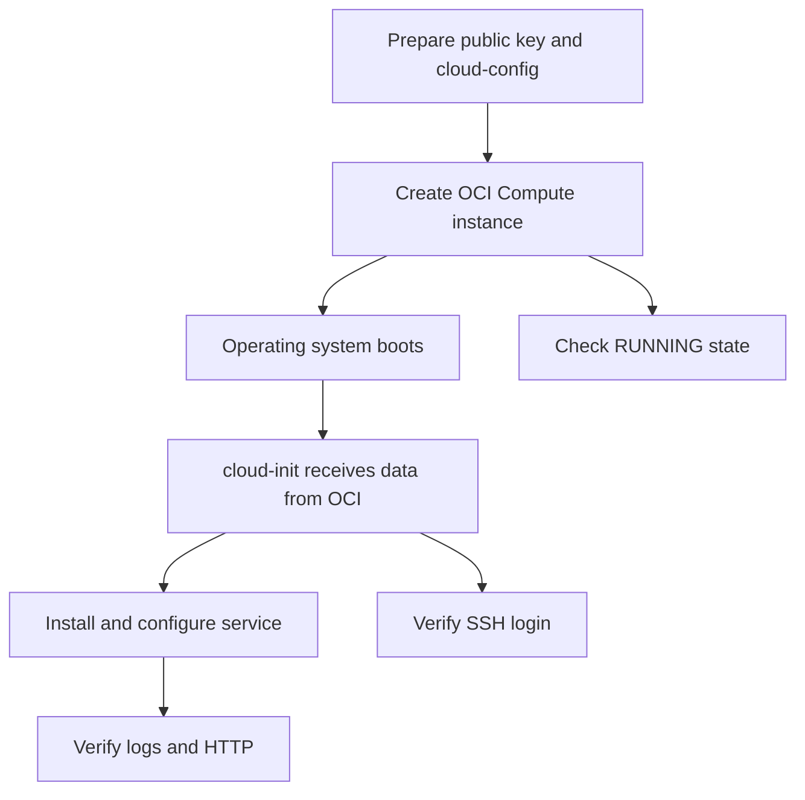

# Initializing Instances with SSH Keys and cloud-init

In the **Compute and Virtual Machines** chapter of the Oracle Cloud Infrastructure (OCI) module, this lesson guides you through provisioning a Linux server accessible via SSH and automatically configured on first boot. The workflow spans selecting a compartment, connecting a VCN, providing access keys, checking the service, reading logs, and cleaning up resources after the exercise.

Running scenario: the development team needs an `oci-compute-lab-01` host running an internal HTTP page to verify infrastructure. Operators connect with a private key; software and the test page are set up by cloud-init. We use an **Oracle Linux 9 platform image**, a compatible VM shape, and dedicated lab resources. The HTTP page is viewed through an SSH tunnel, so the lab only needs to permit SSH from the administrative address.

After this lesson, learners will be able to:

- Distinguish IAM permissions, SSH user keys, and SSH host keys.
- Prepare the network path and public key before creating an instance.
- Supply cloud-init configuration at instance creation time.
- Separately verify infrastructure status, OS access, and bootstrap results.
- Troubleshoot by layer, rotate keys in a controlled way, and clean up lab resources.

## 1. How Do SSH Keys and cloud-init Participate in Instance Creation?

OCI receives an instance-creation request via the Console or API. The instance is attached to a boot volume and VNIC. When the OS boots, cloud-init uses the Oracle datasource to retrieve initialization data. This datasource reads metadata, vendor-data, and user-data provided by the platform. [Source: cloud-init Oracle datasource](https://docs.cloud-init.io/en/latest/reference/datasources/oracle.html).

Two inputs to distinguish:

| Input | Purpose in the Lab | What It Is Not Used For |
|---|---|---|
| SSH public key | Allows authentication to the default Linux account | Does not grant permission to create or delete OCI resources |
| cloud-init user-data | Describes configuration to apply when the machine initializes | Does not replace ongoing long-term configuration management |

In OCI metadata, `ssh_authorized_keys` carries public keys and `user_data` carries initialization data. Never put a private key in either field. [Source: OCI instance metadata](https://docs.oracle.com/en-us/iaas/Content/Compute/Tasks/gettingmetadata.htm).



The diagram shows checkpoints; successful SSH login does not prove all installation steps have finished. Cloud-init runs in multiple stages, with package installation and user scripts typically executing in the Final stage. [Source: cloud-init boot stages](https://docs.cloud-init.io/en/latest/explanation/boot.html).

Three types of permissions or keys play distinct roles:

- **IAM identity and policies** determine who can act on OCI resources in a tenancy/compartment.
- **SSH user key pair** proves the connecting client is allowed to log into the OS account.
- **SSH host key** helps the client identify the SSH server it is connecting to.

Someone with permission to view an instance in the Console may not have an SSH key to log into the host. Someone holding a private key may not be permitted to edit the VCN or terminate the instance.

## 2. Preparing the Lab Environment

Record the following decisions before clicking create:

| Component | Lab Choice | Rationale |
|---|---|---|
| Region | Authorized region | Image OCID and network resources must match the region |
| Compartment | Assigned lab compartment | Simplifies managing permissions, resources, and cost |
| Instance name | `oci-compute-lab-01` | Identifies purpose |
| Operating system | Oracle Linux 9 platform image | Standardizes accounts and admin commands in this lesson |
| Shape | Small VM compatible with image and budget | Sufficient for a test HTTP service |
| Network | Lab VCN public subnet, public IPv4 | Enables direct SSH from the learner's machine |
| SSH | Learner's own public key | Never share private keys across users |
| Initialization | Small cloud-config without secrets | Easy to understand and troubleshoot |

The lab account needs the required permissions to create instances, use images/volumes, and attach network interfaces in the relevant compartments. If your team must use an administrator-provided VCN, use the exact assigned subnet and NSG. Seeing a resource in the Console does not automatically prove all write operations are permitted.

### 2.1. Network Path for SSH

The lab path is:

```text
Learner machine
  -> Internet
  -> instance public IPv4
  -> VNIC in public subnet
  -> sshd service on TCP/22
```

You need a public IP, an active Internet Gateway, a route to the Internet, and rules allowing the traffic all at once. For the lab's public subnet, verify a `0.0.0.0/0` route to the Internet Gateway. DNS and egress to package repositories are also needed to install packages. A public IP is only one part of the connection path.

Recommended SSH rule:

| Attribute | Value |
|---|---|
| Direction | Ingress |
| Stateful | Yes |
| Protocol | TCP |
| Source CIDR | Current public IPv4 of the admin machine, in `/32` form |
| Source port | All |
| Destination port | `22` |

For example, `198.51.100.25/32` is an illustrative address; replace it with the actual outbound Internet IP of your machine. When changing networks or VPNs, your source IP may change.

If using an NSG, attach the NSG to the instance's VNIC. Also inspect the subnet's security list: allow rules from security lists and NSGs are combined. An NSG allowing only `/32` cannot narrow an existing `0.0.0.0/0` SSH rule still present in the security list. Only modify rules in lab networks you manage; for shared networks, ask the administrator to adjust them. The OS-level firewall is another inspection layer. [Source: OCI security rules](https://docs.oracle.com/en-us/iaas/Content/Network/Concepts/securityrules.htm).

In real production deployments, instances can sit in a private subnet accessed via Bastion or private networking. In that case, use the designed access path instead of assigning a public IP as in this lab.

## 3. Generating and Protecting the SSH Key Pair

The public key can be uploaded to OCI. The private key must remain on the admin machine or an approved key vault. A passphrase protects the private key file if stolen; it is not the Linux account password.

Run only one of the two command groups matching your machine. If the filename already exists, choose a new name or verify the provenance of the existing key before proceeding.

### 3.1. Linux, macOS, or WSL

```bash
mkdir -p "$HOME/.ssh"
chmod 700 "$HOME/.ssh"

ssh-keygen -t rsa -b 4096 \
  -f "$HOME/.ssh/oci-compute-lab" \
  -C "oci-compute-lab"

chmod 600 "$HOME/.ssh/oci-compute-lab"
cat "$HOME/.ssh/oci-compute-lab.pub"
```

Enter a passphrase when prompted. The output includes:

- `oci-compute-lab`: private key, used with `ssh -i`.
- `oci-compute-lab.pub`: public key, used when creating the instance.

### 3.2. Windows PowerShell with OpenSSH

```powershell
$labSshDir = Join-Path $env:USERPROFILE '.ssh'
New-Item -ItemType Directory -Path $labSshDir -Force | Out-Null
$labKeyPath = Join-Path $labSshDir 'oci-compute-lab'

ssh-keygen -t rsa -b 4096 -f $labKeyPath -C 'oci-compute-lab'
Get-Content -LiteralPath ($labKeyPath + '.pub')
```

An OpenSSH public key typically appears as a single line:

```text
ssh-rsa <ACTUAL_PUBLIC_KEY_DATA> oci-compute-lab
```

Do not use the placeholder line above to create a machine. Do not copy content starting with `BEGIN OPENSSH PRIVATE KEY`. API signing keys used for OCI API requests should also be managed separately from SSH login keys.

With Oracle Linux platform images, the default SSH user is `opc`; Ubuntu platform images use `ubuntu`. On Linux/macOS, restrict private key read access with file permissions; on Windows, use ACLs granting access only to the necessary account. [Source: OCI connecting to a Linux instance](https://docs.oracle.com/en-us/iaas/Content/Compute/Tasks/connect-to-linux-instance.htm).

## 4. Writing cloud-config for First Boot

On your configuration workstation, create `cloud-init-oci-lab.yaml` containing the exact example below. This file is **user-data passed to the instance**, distinct from lesson metadata in a content management system.

This example targets Oracle Linux 9 with cloud-init and standard platform image utilities including `curl`. For custom images or other distributions, adjust accordingly.

```yaml
#cloud-config
package_update: true
package_upgrade: false

ssh_pwauth: false
disable_root: true

packages:
  - httpd

write_files:
  - path: /var/www/html/index.html
    owner: root:root
    permissions: '0644'
    content: |
      <!doctype html>
      <html lang="en">
      <head>
        <meta charset="utf-8">
        <title>OCI Compute Lab</title>
      </head>
      <body>
        <h1>OCI bootstrap OK</h1>
        <p>Instance configured with cloud-init.</p>
      </body>
      </html>

  - path: /usr/local/sbin/oci-lab-bootstrap
    owner: root:root
    permissions: '0750'
    content: |
      #!/usr/bin/env bash
      set -euo pipefail

      install -d -m 0755 /var/lib/oci-lab
      restorecon -RF /var/www/html
      systemctl enable --now httpd

      curl --fail --silent --show-error \
        --retry 5 --retry-connrefused --retry-delay 2 \
        --max-time 3 http://127.0.0.1/ > /dev/null

      date -u +'%Y-%m-%dT%H:%M:%SZ' > /var/lib/oci-lab/bootstrap-complete
      logger -t oci-lab 'Bootstrap completed; local HTTP check passed'

runcmd:
  - [/usr/local/sbin/oci-lab-bootstrap]
```

### 4.1. Choices in the Configuration

The `#cloud-config` header identifies the format. Use spaces for indentation and save as UTF-8, preferring LF line endings for content containing shell scripts. If a compatible cloud-init environment is available, you can validate the schema before submitting:

```bash
cloud-init schema -c cloud-init-oci-lab.yaml --annotate
```

A valid schema only verifies supported structure; it does not prove package repositories are reachable or that services will start successfully. [Source: validating cloud-config user-data](https://docs.cloud-init.io/en/latest/howto/debug_user_data.html).

`package_update` refreshes package metadata; `package_upgrade: false` keeps the lab focused on bootstrapping. This choice does not replace a security patching plan. The `httpd` package provides Apache; on Ubuntu, package and service names differ, so do not reuse this config verbatim.

`write_files` creates the test page and an executable script. `runcmd` invokes the script after the relevant setup sections. List items represent a command and its arguments; if you need pipes, redirects, or complex shell variables, place them inside a script as shown. The `runcmd` module typically runs once per instance; a normal reboot is not a mechanism to re-run configuration. [Source: cloud-init module reference](https://docs.cloud-init.io/en/latest/reference/modules.html).

Each shell command serves a specific purpose:

| Command or Setting | Role in the Example |
|---|---|
| `set -euo pipefail` | Stops the script on command failures or unset variables instead of continuing and reporting success |
| `restorecon` | Restores standard SELinux contexts for web content |
| `systemctl enable --now httpd` | Starts the service immediately and enables it at boot |
| `curl --fail ...` | Verifies local HTTP with bounded retries |
| `bootstrap-complete` | Records the timestamp when the script passes the HTTP check |
| `logger -t oci-lab` | Emits an event for easy correlation in the journal |

The marker is evidence of that script run, not continuous health monitoring. If HTTP breaks later, the old marker can still remain. In production, implement live service checks and separate alerting.

### 4.2. Sensitive Data and Re-Execution

Do not put database passwords, API signing keys, or long-lived tokens into user-data. Metadata and cloud-init data can be stored on disk, exposed via admin tools, or appear in logs. When secrets are required, use OCI Vault with an instance principal and policies scoped to the exact resources.

The script is written so simple operations like creating a directory and enabling a service can repeat without inserting duplicate config lines. However, safe re-execution is the responsibility of each operation. Commands that delete data, create duplicate accounts, or overwrite keys can still break the system.

Do not use cloud-init as a configuration sync loop after every file edit. Keep the used configuration, select a pinned image version when rebuilding is needed, and use configuration management or an image pipeline for long-term changes.

## 5. Creating the Instance via OCI Console

Select the right region, open **Compute → Instances → Create instance**, and fill in:

1. Name `oci-compute-lab-01` and the lab compartment.
2. Availability domain and VM shape with available capacity within your granted limits.
3. Oracle Linux 9 platform image compatible with the shape's architecture.
4. Lab VCN/subnet, public IP, and SSH NSG if used.
5. Under SSH keys, upload the `.pub` file or paste the entire public key.
6. Under **Initialization script** in advanced options, upload `cloud-init-oci-lab.yaml`.
7. Review boot volume, billing options, and configuration, then create the instance.

The Console encodes user-data automatically on submission; upload the cloud-config file as plain text, not pre-base64-encoded. Do not include a reboot command inside the launch initialization script. [Source: OCI creating an instance](https://docs.oracle.com/en-us/iaas/Content/Compute/Tasks/launchinginstance.htm).

Record the instance OCID, chosen image, shape, public/private IP addresses, compartment, and initialization script name. During troubleshooting, this information identifies the exact machine and deployment run.

If the Console reports out-of-capacity or limit exceeded, resolve according to the returned error. Change shape/availability domain only after verifying image, subnet, and budget compatibility. Do not diagnose a cloud-init error before the instance is even created.

## 6. Alternative: Creating via OCI CLI

This section is an **alternative to Console creation**, used when the OCI CLI is already authenticated. Do not run it to create a second machine if you already completed the Console step.

The example below runs in Bash. Replace OCIDs, region, and availability domain with your tenancy values. `VM.Standard.E4.Flex` is illustrative only; confirm availability and cost suitability. Stage the public key and cloud-config files where the command runs; in Cloud Shell, transfer only the public key, not your workstation's private key.

```bash
REGION='<ACTUAL_REGION>'
COMPARTMENT_ID='<COMPARTMENT_OCID>'
AVAILABILITY_DOMAIN='<ACTUAL_AVAILABILITY_DOMAIN>'
SUBNET_ID='<PUBLIC_SUBNET_OCID>'
IMAGE_ID='<COMPATIBLE_ORACLE_LINUX_9_IMAGE_OCID>'
SSH_PUBLIC_KEY_FILE='./oci-compute-lab.pub'

oci compute instance launch \
  --region "$REGION" \
  --compartment-id "$COMPARTMENT_ID" \
  --availability-domain "$AVAILABILITY_DOMAIN" \
  --display-name 'oci-compute-lab-01' \
  --image-id "$IMAGE_ID" \
  --shape 'VM.Standard.E4.Flex' \
  --shape-config '{"ocpus":1,"memoryInGBs":8}' \
  --subnet-id "$SUBNET_ID" \
  --assign-public-ip true \
  --ssh-authorized-keys-file "$SSH_PUBLIC_KEY_FILE" \
  --user-data-file './cloud-init-oci-lab.yaml' \
  --wait-for-state RUNNING
```

This example assumes the lab subnet's security list already has an SSH rule for the right source. If your design uses NSGs, add `--nsg-ids` with a JSON array containing the prepared NSG OCIDs.

`--ssh-authorized-keys-file` takes the public key; `--user-data-file` takes the initialization file and the CLI handles the encoding sent to the API. Do not pass those convenience flags together with the same underlying metadata keys. `--wait-for-state RUNNING` waits on the Compute lifecycle state. [Source: OCI CLI instance launch](https://docs.oracle.com/en-us/iaas/tools/oci-cli/latest/oci_cli_docs/cmdref/compute/instance/launch.html).

If the CLI times out or drops connection after sending the request, look up the newly created instance by OCID/name and timestamp before retrying. Blindly retrying a create command can spawn duplicate resources.

## 7. Connecting via SSH and Verifying the Server

Replace `203.0.113.10` in the examples with the actual public IP. This is an illustrative documentation address.

On Linux/macOS/WSL:

```bash
ssh -o IdentitiesOnly=yes \
  -i "$HOME/.ssh/oci-compute-lab" \
  opc@203.0.113.10
```

On PowerShell:

```powershell
$labPrivateKey = Join-Path $env:USERPROFILE '.ssh\oci-compute-lab'
ssh -o IdentitiesOnly=yes -i $labPrivateKey opc@203.0.113.10
```

`IdentitiesOnly=yes` restricts SSH to the specified identity, which helps when an SSH agent holds many keys. If prompted for a passphrase, enter the passphrase of your client private key.

On first connection, SSH displays the host fingerprint. Verify it over a trusted channel provided by the administrator before accepting. You can inspect fingerprints on the host itself through an authenticated serial console session with OS access:

```bash
for host_key in /etc/ssh/ssh_host_*_key.pub; do
  sudo ssh-keygen -lf "$host_key"
done
```

This fingerprint belongs to the server's **host key**; it differs from your personal public key fingerprint. Once recorded in `known_hosts`, any warning that the host key changed must be investigated. Recreating an instance or reusing an IP might explain a change, but confirm before updating the trust entry.

Once inside the shell:

```bash
whoami
hostname
cat /etc/os-release
```

For this lab, the expected user is `opc` and the OS should match the selected image. This confirms you are operating on the right environment before running `sudo` commands.

## 8. Verifying cloud-init and the Service

Run from the SSH session after logging in:

```bash
sudo cloud-init status --wait
sudo cloud-init status --long
```

The first command waits for cloud-init to finish; the second displays detailed status. Check error details as well, not just a single summary line. Statuses like `running`, `done`, `error`, and `disabled` must be interpreted according to the image's cloud-init version. [Source: cloud-init reported status](https://docs.cloud-init.io/en/latest/howto/status.html).

Never put `cloud-init status --wait` inside `runcmd` or a script that cloud-init is waiting on to complete: doing so can cause a deadlock waiting on itself. [Source: cloud-init debugging](https://docs.cloud-init.io/en/latest/howto/debugging.html).

Verify the lab-specific results:

```bash
sudo systemctl is-active httpd
sudo systemctl is-enabled httpd
curl --fail --silent --show-error http://127.0.0.1/
sudo cat /var/lib/oci-lab/bootstrap-complete
sudo journalctl -t oci-lab --no-pager
```

Expected results:

| Evidence | Value to Observe | Permitted Conclusion |
|---|---|---|
| Compute lifecycle | `RUNNING` | Compute resource is running |
| SSH to `opc` | Valid shell session | SSH path and authentication work |
| Cloud-init | Finished with no unhandled errors | Initialization completed per reported status |
| `httpd` | `active`, `enabled` | Service is running and enabled at boot |
| Local HTTP | Page contains `OCI bootstrap OK` | Service currently returns the expected test content |
| Marker and journal | Appropriate timestamp/event present | Script passed the HTTP check during that run |

To view the page from your workstation browser without opening port 80 to the Internet, open another terminal and keep an SSH tunnel open:

```bash
ssh -N -o ExitOnForwardFailure=yes -o IdentitiesOnly=yes \
  -i "$HOME/.ssh/oci-compute-lab" \
  -L 127.0.0.1:8080:127.0.0.1:80 \
  opc@203.0.113.10
```

Equivalent PowerShell example:

```powershell
ssh -N -o ExitOnForwardFailure=yes -o IdentitiesOnly=yes -i $labPrivateKey -L 127.0.0.1:8080:127.0.0.1:80 opc@203.0.113.10
```

Open `http://127.0.0.1:8080` on your machine. HTTP traffic travels inside the SSH session to the instance's loopback interface. Press `Ctrl+C` in the tunnel terminal to close. If local port 8080 is already in use, change the left-hand port to an unused one.

To verify the service auto-starts after a reboot, reboot only after saving bootstrap evidence and confirming cloud-init has finished. After the machine returns, check `httpd` and HTTP; do not expect `runcmd` to re-run merely because of a reboot.

## 9. Troubleshooting by Layer

Read error messages before changing configurations. An authentication failure and a routing failure require different fixes.

| Symptom | Layer to Check First | Appropriate Action |
|---|---|---|
| Instance launch rejected | IAM, quotas/limits, capacity, config | Read OCI error; check compartment, shape, and related permissions |
| SSH times out | IP and network path | Check public IP, routes, gateway, `/32` source rule, and client network |
| `Connection refused` | Service or firewall rejection | Verify target IP, `sshd` status, and firewall via another management channel |
| `Permission denied (publickey)` | Account and keys | Use `opc`, matching private key, and public key supplied at launch |
| Private key reported as too open | Client permissions/ACLs | Restrict key file read permissions; never send private keys to others for debugging |
| SSH works but page missing | Bootstrap or service | Wait for/inspect cloud-init, package logs, and `httpd` status |
| Local HTTP works, tunnel fails | SSH forwarding/client | Check local port, SSH session, and forwarding policies |
| Marker exists but HTTP broken | Current service state | Check `httpd`, logs, and current content rather than trusting old markers |

If SSH works but bootstrap failed, start with:

```bash
sudo tail -n 100 /var/log/cloud-init.log
sudo tail -n 100 /var/log/cloud-init-output.log
sudo journalctl -u cloud-final.service -b --no-pager
sudo systemctl status httpd --no-pager
```

`cloud-init.log` shows cloud-init's internal activity; `cloud-init-output.log` typically holds command/script output. Scrub sensitive information before sharing logs for troubleshooting. [Source: cloud-init debugging](https://docs.cloud-init.io/en/latest/howto/debugging.html).

For repository errors, inspect DNS, egress routing, any proxy, and the package sources used by the image. For YAML errors, check the header line, indentation, colons, and data types. For script errors, find the first failing command; `set -e` can prevent subsequent lines from running.

When you need to inspect actual user-data and supported schema versions, run:

```bash
sudo cloud-init schema --system --annotate
```

This command can display configuration contents; run it only in an authorized session and handle output accordingly. [Source: inspecting config on an instance](https://docs.cloud-init.io/en/latest/howto/debug_user_data.html).

If SSH is unavailable, use a serial console or boot volume recovery per organizational procedures. Creating a console connection does not automatically grant OS login privileges. Never open SSH to the entire Internet or disable host key checking as a first reflex.

## 10. Rotating Keys and Fixing Bootstrap After Initial Launch

### 10.1. Rotating Keys While Access Still Exists

A verifiable key-rotation procedure:

1. Generate a new key pair on the admin machine and keep the new private key secure.
2. Inside the existing session, append the **new public key** as a single line to `authorized_keys` for the target account.
3. Verify directory/file ownership; for `opc`, `.ssh` is typically `0700`, and `authorized_keys` is `0600` owned by `opc`.
4. Open a new SSH session using the new private key.
5. Only after the new session succeeds, remove the old public key line being revoked.
6. Verify that a new session with the old key can no longer log in once fully revoked.

Keep the old session open until the new key is proven to work. Removing a public key does not automatically terminate existing SSH sessions; handle open sessions per your organization's security policy.

### 10.2. Fixing Initialization Configuration

Editing the cloud-config file on your local machine does not push changes to an already-created instance. In a lab without important data, you can terminate the broken machine and launch a new one with the fixed config after saving needed logs.

For systems holding data, evaluate each step before applying controlled fixes. Do not default to `cloud-init clean` as a fix: clearing state can cause initialization modules to re-run and alter the machine unexpectedly. Nor should updating metadata be treated as a guaranteed mechanism to rotate keys or re-run the entire bootstrap.

## 11. Operational Limits, Reproducibility, and Cost

A successfully bootstrapped VM is the foundation for subsequent operations. It does not by itself create a high-availability design. Fault tolerance requires additional decisions around multiple instances, fault domains, load balancing, data, and instance replacement workflows.

To rebuild environments reliably, retain secret-free configs, image/version details, shapes, network parameters, and required package sources. Installing from repositories at runtime can pull different package versions; if strict reproducibility is required, version your artifacts and adopt an appropriate image strategy.

After the lab:

1. Save verification evidence and any logs worth keeping.
2. Confirm the exact lab instance by name, compartment, and OCID.
3. Terminate the instance if no longer needed.
4. Choose to delete the boot volume once certain no data is needed; check for retained volumes/backups.
5. Tear down lab-only network resources once dependencies are gone; leave shared resources untouched.

OCI can retain boot volumes after termination depending on your selection; explicitly check delete/retain options rather than assuming terminating an instance deletes all data. [Source: OCI terminate instance](https://docs.oracle.com/en-us/iaas/Content/Compute/Tasks/terminatinginstance.htm).

Do not assume stopping an instance drops all costs to 0. Billing for stopped Compute instances depends on shape; retained resources must be checked separately. Check current tenancy estimates rather than assuming the lab falls under free-tier limits. [Source: billing for stopped instances](https://docs.oracle.com/en-us/iaas/Content/Compute/Tasks/resource-billing-stopped-instances.htm).

## 12. Lab Completion Criteria

Consider the lab complete when you have saved the following evidence:

- Instance created in the right region/compartment with the chosen image and shape.
- SSH path permits only the intended admin sources across all applied rules.
- Logged into the `opc` account using the learner's private key.
- Cloud-init finished, errors are resolved, and logs explain the outcome.
- `httpd` is active, enabled at boot, and local HTTP returns the expected page.
- SSH tunnel displays the page on the learner's machine without exposing HTTP to the Internet.
- Initialization config contains no private keys or long-lived secrets.
- Lab resources are terminated or have an assigned owner with a clear retention purpose.

In an OCI deployment, record separate results for **resource creation**, **SSH authentication**, and **application bootstrap**. This layered verification isolates failing layers quickly and establishes the baseline for automated deployment, monitoring, and multi-host operations.
