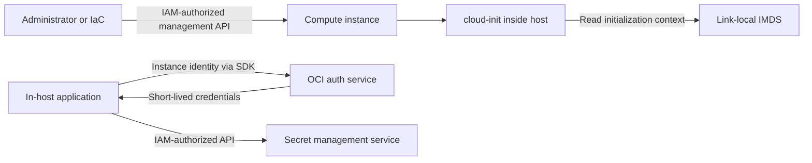

# Instance Metadata, IMDS, and Protecting Initialization Data

## 1. Objectives and Context

In the **Compute and Virtual Machines** chapter of the **CLOUD_PROVIDERS_ORACLE** module, a virtual machine has more than an operating system and an IP address. At boot, it needs to know which environment it belongs to, where to get its configuration, and which identity to use to access OCI services. Instance metadata and the Instance Metadata Service, abbreviated as **IMDS**, take part in that process.

This lesson focuses on Oracle Cloud Infrastructure, tying VM configuration to tenancies, compartments, IAM, VCNs, and secret management services. The implementation must support security, rebuildability on instance recreation, monitoring, and operational cost control.

After this lesson, you will be able to:

- Distinguish metadata, user data, secrets, and instance credentials.
- Read only the necessary fields via IMDSv2 without dumping all metadata into logs.
- Understand which risks IMDSv2 mitigates and which additional layers of protection remain necessary.
- Design bootstrap workflows that do not embed passwords or private keys in initialization data.
- Plan a controlled transition to IMDSv2-only on an instance and recognize common errors.

The Bash commands below are intended for a **test Linux machine on OCI**. The `oci compute` commands run from an admin environment with OCI CLI and appropriate permissions. They are examples for hands-on practice, not instructions to run on the machine hosting these notes. All illustrative OCIDs and resource names must be replaced with values from your learning environment.

## 2. What Is Metadata, and Which Data Must Be Protected?

Metadata is data describing an instance or configuration associated with an instance. For example, an initialization task might need the OCID to tag events, or the region name to choose the right configuration.

Do not equate all metadata with passwords, yet do not treat all metadata as public information either. A record that looks harmless on its own can help an outsider piece together a deployment diagram when combined with other data.

| Data Category | Example in a Learning System | Appropriate Handling |
| --- | --- | --- |
| Infrastructure identifiers | Instance OCID, compartment, hostname | Send only to observability systems that need it; mask in public docs |
| Configuration context | `environment=lab`, config version | May be placed in metadata if it contains no sensitive secrets |
| Initialization data | Scripts or cloud-config to prepare the OS | Treat as deployment code under change control |
| Authentication credentials | Database passwords, private keys, tokens | Store in a secret management system; restrict which users and processes can read them |
| Secret references | OCID of the secret to fetch | May be passed as config; actual read access is still governed by IAM |

**Base64 is a data representation encoding, not a secrecy mechanism.** If you put a password in a script and base64-encode the script, anyone who reads that string can still decode the password.

Similarly, a public SSH key used to authorize logins differs from a private SSH key used to prove a user's identity. Never put a private key into metadata just because a field name mentions SSH.

## 3. Where Does IMDS Sit in OCI Architecture?

OCI's IMDS is accessed from inside the instance at the link-local HTTP address `169.254.169.254`. IMDSv2 uses the `/opc/v2/` prefix; commonly used endpoints include `/instance/` and `/vnics/`. On machines with multiple VNICs, metadata requests must go over the primary VNIC. This is an in-instance interface, distinct from the Compute management API that administrators call to view or modify resources. [Oracle: Getting Instance Metadata](https://docs.oracle.com/en-us/iaas/Content/Compute/Tasks/gettingmetadata.htm).



This diagram is a conceptual model. A single SDK call can involve multiple steps such as obtaining identity material via IMDS, exchanging it with the auth service, and calling the target API. Reaching IMDS does not prove the instance can reach the auth service or secret service.

This is especially important for machines in private subnets. When bootstrap fails, separate three questions:

1. Can the machine retrieve local data via IMDS?
2. Can the machine resolve DNS and reach the required OCI endpoints?
3. Does the instance's identity have permission to perform the exact operation on the target resource?

A change to routes, proxies, or IAM can break one step while the other two still work.

## 4. IMDSv2 and the Limits of Its Protection

### 4.1. OCI's Required Header

IMDSv2 requests require the header:

```http
Authorization: Bearer Oracle
```

Here, `Oracle` is a protocol-defined constant value, not a password, API signing key, or application-specific session token. When legacy endpoints are disabled, `/opc/v1` and `/openstack` are rejected with HTTP 404. IMDSv2 also rejects requests containing `Forwarded`, `X-Forwarded-For`, or `X-Forwarded-Host` headers. [OCI IMDSv2 Rules](https://docs.oracle.com/en-us/iaas/Content/Compute/Tasks/gettingmetadata.htm).

Do not copy another cloud provider's session-token retrieval workflow verbatim to OCI simply because both use the term IMDSv2.

### 4.2. Why Does the Header Help Reduce SSRF Risk?

**Server-Side Request Forgery**, or SSRF, occurs when an application is tricked into sending requests to an attacker-controlled destination. For example, an image-preview feature takes a URL and fetches content from the application server.

Suppose that feature only lets callers choose a URL, while the HTTP library does not allow adding custom headers. If an attacker points the request at IMDSv2, the application lacks the required header and cannot read the data. This is an inference from protocol rules, not a guarantee that all SSRF attacks are blocked.

If a URL-fetching feature lets outsiders control headers too, or an attacker already executes code on the host, they can add the fixed header themselves. Therefore, IMDSv2 does not provide authorization by UID, process, or application name.

### 4.3. Layers of Protection Still Required

For URL-fetching features, explicitly allowlist the business servers permitted to be reached. Validate scheme, hostname, resolved IP addresses after DNS lookup, and the destination of every redirect. Block paths to loopback and link-local addresses for flows that do not need them. Control outbound connections in the runtime environment to complement in-code checks.

Do not blindly forward the `Authorization` header from user requests to another server. Do not let users turn an image-fetching feature into a general-purpose HTTP client running from the application's network position.

For untrusted code, use appropriate isolation boundaries. Do not assume a container isolates IMDS merely because it has its own filesystem. Inspect network namespaces, packet paths, and permissions held by the container.

## 5. Reading Only the Minimal Required Data

### 5.1. Reading Canonical OCID and Region

The example below fetches only two fields. `canonicalRegionName` returns the standard region name; `region` may return a shortened name in some older regions. [OCI Metadata Fields](https://docs.oracle.com/en-us/iaas/Content/Compute/Tasks/gettingmetadata.htm).

```bash
# Run inside the test OCI Linux machine.
IMDS='http://169.254.169.254/opc/v2'

curl --noproxy '*' --fail --silent --show-error \
  --connect-timeout 2 --max-time 5 \
  -H 'Authorization: Bearer Oracle' \
  "$IMDS/instance/id"
printf '\n'

curl --noproxy '*' --fail --silent --show-error \
  --connect-timeout 2 --max-time 5 \
  -H 'Authorization: Bearer Oracle' \
  "$IMDS/instance/canonicalRegionName"
printf '\n'
```

In this example:

- `--noproxy '*'` keeps the request direct to IMDS, avoiding routing it through an environment-variable proxy.
- Timeouts bound waiting time so initialization tasks do not hang indefinitely.
- `--fail` makes the command error on HTTP failures; scripts consuming the output must check the exit code.
- The URL and header are fixed rather than taken from untrusted user parameters.

Do not query metadata in a loop on every business HTTP request. In application design, define data lifetimes, cache appropriately, and bound retries so transient failures do not trigger a request storm.

### 5.2. Distinguishing Reading One Field from Dumping the Entire Tree

During a diagnostic session, reading `/instance/` is convenient but easily over-collects. Something like shipping the entire JSON payload to centralized logging can drag in initialization config as well.

Determine beforehand which data answers the diagnostic question. For instance, to confirm which host is running a process, fetch the OCID; to check the deployment region, fetch the region. There is no need to read `user_data` for either question.

A successful `curl` result only proves that specific request was accepted at check time. It does not prove every agent has switched to v2, nor does it prove the application has permission to read secrets.

## 6. User Data, cloud-init, and Artifacts Remaining After Boot

### 6.1. Initialization Data Becomes Code Running on the Host

In Compute resource metadata, `ssh_authorized_keys` holds public keys for the default user; `user_data` can contain scripts or configuration for cloud-init. When supplying `user_data` directly via the API or Terraform metadata field, the content is base64-encoded. Tools with file-input flags may perform that encoding for you; check the interface you use to avoid double-encoding. [Metadata in the OCI Compute resource](https://docs.oracle.com/en-us/iaas/tools/terraform-provider-oci/latest/docs/r/core_instance.html).

An initialization script typically can install packages, create files, or configure services with elevated privileges. Consequently, deciding who may edit user data is also deciding who can run code on instances using that configuration.

Never download a mutable script from a URL and execute it directly as root. In deployment design, control the source, version, and integrity of artifacts; clearly define who can modify artifacts before the next instance launch.

### 6.2. Data Does Not Disappear Just Because Boot Finished

Cloud-init persists data and state on the machine. Relevant locations typically include `/var/lib/cloud/instance/`, `/run/cloud-init/instance-data.json`, and `/run/cloud-init/instance-data-sensitive.json`; the `sensitive` file may contain unredacted data. Verify access permissions and file details against the image's cloud-init version. [Cloud-init: Internal Files](https://docs.cloud-init.io/en/latest/development/internal_files.html).

Also consider logs, boot volume clones, custom images, backups, and pipeline artifacts. Removing a password from the current script version does not erase copies that already exist.

`cloud-init collect-logs` can also bundle logs and user data for diagnostics. Before attaching that bundle to a ticket, review and scrub sensitive information. [Cloud-init: CLI commands](https://docs.cloud-init.io/en/latest/reference/cli.html).

In operations, treat backup-read permissions and image-creation permissions on initialized hosts as data-access paths that must be governed. If a real secret was ever put into user data, the primary remediation is rotating or revoking the secret while checking related copies.

### 6.3. Editing Metadata Is Not Equivalent to Reapplying OS Configuration

Do not build operational workflows assuming that editing user data and rebooting will re-run all tasks. Cloud-init modules have different execution frequencies; actual behavior depends on the image, configuration, and persisted state.

For example, editing a public key in metadata should not be treated as proof that the current account's `authorized_keys` file changed as desired. Use proper access management or OS configuration tooling and verify the result on the machine.

## 7. Secret-Free Bootstrap Example

Suppose the lab needs to create a context file so an observability service knows the instance's OCID and region. There is no database connection needed at this step, so the script needs no passwords, API keys, or secret-read permissions.

The following is a **shell script suitable as user data** for a Linux image supporting cloud-init and IMDSv2. It assumes `bash`, `curl`, `install`, and `mktemp` are present in the image. The script does not yet install or start a business application.

```bash
#!/bin/bash
set -euo pipefail
umask 077

readonly IMDS='http://169.254.169.254/opc/v2'

read_metadata() {
  curl --noproxy '*' --fail --silent --show-error \
    --connect-timeout 2 --max-time 5 \
    --retry 2 --retry-delay 1 \
    -H 'Authorization: Bearer Oracle' \
    "$IMDS/$1"
}

instance_id="$(read_metadata 'instance/id')"
region="$(read_metadata 'instance/canonicalRegionName')"

# Accept only expected formats before creating the config file.
[[ "$instance_id" =~ ^ocid1\.instance\.[A-Za-z0-9._-]+$ ]] || exit 1
[[ "$region" =~ ^[a-z0-9]+(-[a-z0-9]+)+$ ]] || exit 1

install -d -m 0750 -o root -g root /etc/oci-bootstrap
tmp_file="$(mktemp /etc/oci-bootstrap/context.XXXXXX)"
trap 'rm -f -- "$tmp_file"' EXIT

printf '{"instanceOcid":"%s","region":"%s"}\n' \
  "$instance_id" "$region" > "$tmp_file"
chmod 0640 "$tmp_file"
mv -f -- "$tmp_file" /etc/oci-bootstrap/context.json
trap - EXIT
```

The choices in this example represent a recommended design for the lab:

- Fetch only the fields serving the task's purpose.
- Validate formats before writing data into JSON.
- Fail if required info cannot be retrieved, instead of writing an empty config and reporting success.
- Use a temporary file in the same directory and rename atomically to reduce the chance a service reads a half-written file.
- Avoid `set -x`, avoid printing full metadata, and avoid long-lived credentials.

When submitting the script via a deployment tool, follow that tool's exact user-data mechanism. After the instance initializes, check status with `cloud-init status --long` and inspect the existence and permissions of `/etc/oci-bootstrap/context.json`. For services running under a dedicated account, design appropriate groups or config-delivery mechanisms rather than broadening read access to all initialization files.

## 8. When Applications Need Secrets: Use Instance Identity and IAM

### 8.1. Separating Identity and Permissions

Instance principals allow a Compute instance to use its own identity to call OCI services, avoiding distributing an IAM user's API signing key onto every host. A dynamic group defines the set of instances; policies grant permissions to that set. Reading from IMDS does not automatically grant secret-read or database-admin privileges. [Oracle: Calling Services from an Instance](https://docs.oracle.com/en-us/iaas/Content/Identity/Tasks/callingservicesfrominstances.htm).

For the lab, you can propose the following flow:

1. User data contains only non-secret configuration and references to secrets.
2. The image already includes the required SDK or agent.
3. A trusted component on the host uses instance principals.
4. IAM permits reading only the required secret.
5. That component passes the secret to the application via an appropriately permissioned mechanism that supports rotation.

Do not assume every Unix user automatically gets a separate OCI identity. Anyone able to access the instance must be evaluated within the trust scope of the permissions granted to that machine. Separating two applications with very different permission needs onto separate instances can create a cleaner boundary than placing both on the same host.

### 8.2. Example Policy Scoping Access to One Secret

Suppose the dynamic group `dg-oci-bootstrap` already matches only the lab instances. An illustrative policy is:

```text
Allow dynamic-group dg-oci-bootstrap to read secret-bundles in compartment app-secrets where target.secret.id = 'ocid1.vaultsecret.oc1..EXAMPLE'
```

Replace the dynamic group name, compartment, and secret OCID for your environment. If the tenancy uses dynamic group names qualified with an identity domain, use the tenancy's corresponding identifier. The policy must be placed at a scope covering the target resource.

The key takeaway is scoping access to a specific secret's content instead of granting `manage all-resources in tenancy` just to silence permission errors. OCI uses the `target.secret.id` condition syntax to restrict which secret can be read. [Example policy scoping a single secret](https://docs.oracle.com/en-us/iaas/Content/internet-of-things/node-red.htm).

If fetching contents via CLI, the relevant command is `oci secrets secret-bundle get --secret-id ... --stage CURRENT`. Never run a test command that prints a secret to a recorded terminal session or pipeline log. Application designs should retrieve data via SDK and control where it is used, how long it is held, and logging behavior. [OCI CLI: secret-bundle get](https://docs.oracle.com/en-us/iaas/tools/oci-cli/latest/oci_cli_docs/cmdref/secrets/secret-bundle/get.html).

### 8.3. Relation to Java Applications

In a Java application running on an OCI instance, selecting the instance-identity provider looks like:

```java
import com.oracle.bmc.auth.InstancePrincipalsAuthenticationDetailsProvider;

// Illustrative configuration snippet; requires OCI Java SDK and an appropriate OCI environment.
InstancePrincipalsAuthenticationDetailsProvider provider =
        InstancePrincipalsAuthenticationDetailsProvider.builder().build();
```

Then pass the provider to the required service client. The provider does not replace IAM policies, network configuration, or application secret-handling logic. Never log credential or secret contents in custom exception messages. [Oracle: configuring SDKs for instance principals](https://docs.oracle.com/en-us/iaas/Content/Identity/callresources/Configuring_the_SDK_CLI_or_Terraform.htm).

This example only illustrates identity selection and is not a complete program. Real deployments must manage client lifecycle, timeouts, retries, secret rotation, and how the application reloads updated configuration.

## 9. Controlled Transition to IMDSv2-Only

### 9.1. Prerequisites Before Switching

Verify that the image, cloud-init version, Oracle Cloud Agent, SDKs, and scripts in use support IMDSv2. Do not assume every Marketplace image or custom-built image is compatible. Especially with Windows or older images, consult support docs and test launching a fresh instance before rolling out broadly.

A change plan should include a canary host, an out-of-band management path, and success criteria. Verifying that an already-running host looks fine is not enough to conclude fresh instance creation will also succeed.

### 9.2. Observing Legacy Calls

OCI provides the `InstanceMetadataRequests` metric in the `oci_compute` namespace. Dimensions include `metadataVersion`, `path`, `resourceId`, `userAgent`, and `status`, helping identify clients still calling legacy endpoints. [Oracle: Compute Management Metrics](https://docs.oracle.com/en-us/iaas/Content/Compute/References/compute-management-metrics.htm).

For the lab, pick an observation window covering service startup, scheduled jobs, and a fresh instance launch from the image. If no data appears, check metric-viewing permissions, time range, and exact resource before concluding there are no remaining v1 calls.

Do not place credentials into metrics or custom labels. A migration tracking sheet only needs which machines switched, which agents were verified, and any errors observed.

### 9.3. Updating Instance Options via OCI CLI

After migrating dependent components, an administrator can inspect and update the instance option:

```bash
# Run from an administrative environment with OCI CLI configured.
INSTANCE_OCID='ocid1.instance.oc1..EXAMPLE'

oci compute instance get \
  --instance-id "$INSTANCE_OCID" \
  --query 'data."instance-options"' \
  --output json

oci compute instance update \
  --instance-id "$INSTANCE_OCID" \
  --instance-options '{"areLegacyImdsEndpointsDisabled":true}' \
  --query 'data."instance-options"' \
  --output json
```

`areLegacyImdsEndpointsDisabled=true` disables legacy endpoints while keeping IMDSv2 enabled. Input JSON field names use camelCase; CLI JSON output may use hyphens such as `are-legacy-imds-endpoints-disabled`. [OCI CLI: compute instance update](https://docs.oracle.com/en-us/iaas/tools/oci-cli/latest/oci_cli_docs/cmdref/compute/instance/update.html).

To ensure newly created machines preserve the same setting, add the matching block to your IaC source. Example block inside an existing `oci_core_instance` resource:

```hcl
instance_options {
  are_legacy_imds_endpoints_disabled = true
}
```

This is an addition to a resource, not a standalone Terraform file. Inspect the plan because the real resource may have other changes pending. [Terraform OCI: instance_options](https://docs.oracle.com/en-us/iaas/tools/terraform-provider-oci/latest/docs/r/core_instance.html).

### 9.4. Acceptance Checks on the Canary Machine

After the change, verify all three directions:

| Check | Expected Result |
| --- | --- |
| Read an IMDSv2 field with the right header | Expected data returned |
| Read IMDSv2 without the header | Rejected |
| Read the corresponding field via legacy endpoint | No longer returns data once legacy is disabled |
| Restart application and helper tasks | No metadata-dependency errors appear |
| Launch a new machine from deployment config | Bootstrap completes per defined criteria |

You can check HTTP status codes without printing response bodies:

```bash
# These checks run inside the test OCI machine.
# Do not use --fail here because error HTTP status codes also need to be observed.
curl --noproxy '*' --silent --show-error \
  --connect-timeout 2 --max-time 5 \
  -o /dev/null -w 'v2_with_header=%{http_code}\n' \
  -H 'Authorization: Bearer Oracle' \
  'http://169.254.169.254/opc/v2/instance/id'

curl --noproxy '*' --silent --show-error \
  --connect-timeout 2 --max-time 5 \
  -o /dev/null -w 'v2_without_header=%{http_code}\n' \
  'http://169.254.169.254/opc/v2/instance/id'

curl --noproxy '*' --silent --show-error \
  --connect-timeout 2 --max-time 5 \
  -o /dev/null -w 'legacy=%{http_code}\n' \
  'http://169.254.169.254/opc/v1/instance/id'
```

Do not draw conclusions from a single HTTP 404: a wrong path can produce the same code. Combine instance option settings, working v2, and blocked legacy. If `curl` reports `000`, that is not a successful HTTP response from IMDS; inspect the exit code and connection error.

If the canary breaks due to an old client, halt broad rollout and fix the client or image. Re-enabling legacy, if needed to restore service, must be a time-boxed change with a plan to close it again; never let it become permanent due to forgotten follow-up.

## 10. Restricting IMDS Access at the OS Level

Oracle recommends restricting metadata access to privileged users. The following example is a variant for a **lab machine allowing only root to use IMDS**, scoped specifically to TCP port 80:

```bash
# Apply only after confirming no non-root service requires IMDS.
sudo iptables -I OUTPUT 1 \
  -d 169.254.169.254/32 -p tcp --dport 80 \
  -m owner ! --uid-owner 0 -j REJECT
```

Keep a fallback admin session and the exact command to remove the test rule:

```bash
sudo iptables -D OUTPUT \
  -d 169.254.169.254/32 -p tcp --dport 80 \
  -m owner ! --uid-owner 0 -j REJECT
```

This example illustrates host-level control based on Oracle's Compute hardening guidance. Do not overwrite existing rule sets verbatim and do not flush the firewall. [Oracle: Securing Compute](https://docs.oracle.com/en-us/iaas/Content/Security/Reference/compute_security.htm).

Before applying to real systems, consider the limitations:

- Java applications or agents running under a non-root account may need IMDS for instance principals; a root-only rule will break them.
- Rules in `OUTPUT` affect traffic generated in that network namespace; container traffic traversing another namespace or chain requires separate design.
- Any process with root or firewall-modification capability can alter the rule; this is not a boundary against someone who already controls the whole machine.
- If the system uses nftables or firewalld, integrate with the existing firewall manager and verify rule persistence across reboots.

The link-local address also serves other background services. Hence the example narrows to TCP/80 for IMDS; avoid blocking the entire address and accidentally breaking DNS or time sync. Do not treat VCN NSGs or security lists as the sole evidence that individual processes are restricted from reaching IMDS.

## 11. Troubleshooting by Symptom

| Symptom | Hypothesis to Test | Narrow Next Step |
| --- | --- | --- |
| V2 rejected | Missing header or forwarded header attached | Test one exact field with direct curl and fixed header |
| Timeout or code `000` | Local route, proxy, host firewall, or namespace | Check exit code, proxy config, and path from the app's exact runtime environment |
| V1 returns 404 after change | Legacy disabled, or client uses wrong path | Read instance option and confirm v2 works |
| Curl works as root, fails as service | UID policy, proxy environment, or different namespace | Test under the service's exact account and environment |
| Reading OCID works, fetching secret fails | Network to OCI service, identity, or IAM permissions | Separate connectivity, authentication, and target-secret permission checks |
| Existing machines fine, new machine bootstrap fails | Image, artifacts, or first-boot-only tasks | Inspect cloud-init status and logs scrubbed of sensitive info |
| Intermittent failures | Too many requests or transient outage | Bound retries, cache appropriately, and track error rates |

An incident should be described with minimal facts: which instance, timestamp, endpoint type, HTTP code or connection error, process UID, and most recent change. There is no need to attach user-data contents or secrets just to report an endpoint timeout.

IMDS may apply throttling; code must handle transient errors with bounded retries and backoff. For SDK-managed credentials, prefer the SDK's refresh mechanism rather than querying identity material manually on every transaction. [IMDS Operational Recommendations](https://docs.oracle.com/en-us/iaas/Content/Compute/Tasks/gettingmetadata.htm).

## 12. Comprehensive Exercise and Completion Criteria

Use a Linux instance in the lab compartment with an image verified to support IMDSv2 and containing no production secrets. This exercise does not require opening application ports to the Internet or creating a new database.

Execute in order:

1. Record the current IMDS option and verify both OCID and region fields using v2.
2. Inventory scripts, SDKs, agents, and scheduled tasks that may depend on metadata.
3. Run the secret-free bootstrap in a test environment; inspect status and output files.
4. Observe metrics and fix any clients still calling legacy endpoints.
5. Switch the canary to v2-only and test requests with header, without header, and legacy.
6. If testing instance principals, grant permissions only to the selected test resource; never use production secrets for testing.
7. Rebuild a test machine from the saved configuration to verify reproducibility, then clean up unneeded resources.

The lab deliverable should be a brief report containing before/after instance options, bootstrap status, test check results, and changes to add to IaC. When sharing the report outside the learning environment, redact unnecessary identifiers.

Completion criteria for the design: bootstrap produces the required configuration; legacy is no longer used; the application receives only the needed permissions; diagnostic artifacts do not leak credentials; instance recreation reproduces the result.

Cost control starts with lab scope: reuse authorized resources and do not spin up extra databases or services just to prove IMDS works. When cleaning up the lab, check boot volumes, block volumes, retained public IPs, and auxiliary resources against environment policy; delete only resources confirmed to belong to the lab.

## 13. Key Principles to Remember

Metadata is an input to automation and must be read intentionally. User data is part of the deployment pipeline and can leave copies across multiple storage layers. IMDSv2 reduces risk from certain unwanted request patterns, while data and service access must still be controlled at the application, OS, and IAM layers.

An operable design passes non-secret context via metadata, retrieves secrets using an appropriate identity, grants only necessary permissions, and validates fresh instance creation. When failures occur, diagnosing separately across connectivity, authentication, and authorization resolves the root cause without broadening permissions or dumping entire initialization payloads.
