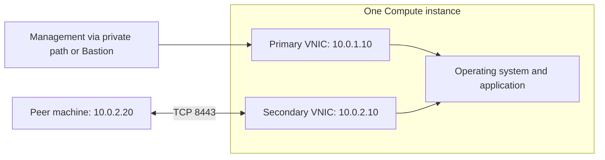

# Managing Secondary VNICs and Instance Networking

In the **Compute and Virtual Machines** chapter of Oracle Cloud Infrastructure (OCI), adding a secondary VNIC gives an instance an additional network attachment point. The task is only complete when the operating system recognizes the right interface, the application uses the right address, security layers permit the traffic, and return packets follow the intended path.

This lesson uses a Linux VM with separate management and application networks to walk through the entire process: preparing IAM permissions, creating the VNIC, configuring the OS, verifying routing, monitoring, and cleaning up resources. The operational goal is maintaining administrative access while deploying new connectivity, while understanding cost and availability limits.

## Learning Objectives

After this lesson, you will be able to:

- Distinguish a primary VNIC, secondary VNIC, and secondary private IP.
- Select the appropriate subnet, NSG, and permission scope for a secondary VNIC.
- Create a VNIC using the Console or OCI CLI and match it to the interface inside the instance.
- Explain the difference between OS routes and VCN routes.
- Detect asymmetric routing, verify paths by source address, and apply policy routing when needed.
- Verify connectivity with evidence from the sender, receiver, and OCI network layers.
- Plan persistent configuration, detach the VNIC, and restore connectivity.

## What Problem Does a Secondary VNIC Solve?

A VNIC, short for Virtual Network Interface Card, is a virtual network interface connecting an instance to a subnet in a VCN. An instance is created with a primary VNIC. Secondary VNICs are attached afterward; the supported count depends on the shape. A secondary VNIC can connect to a different subnet, even in a different VCN. A VNIC attached to an instance belongs to the same availability domain as the instance; regional subnets still work for instances across supported ADs. Adding a VNIC does not increase the total bandwidth allocated to the shape. See [OCI VNIC concepts and limits](https://docs.oracle.com/en-us/iaas/Content/Network/Tasks/managingVNICs.htm).

Suitable scenarios include:

| Need | How to Evaluate |
|---|---|
| Separating management address from application address | Use separate VNICs per subnet, combined with NSGs and application configuration |
| One instance needs direct presence in two network domains | Consider a secondary VNIC along with each domain's paths and policies |
| Only need extra addresses for multiple services in one subnet | Consider secondary private IPs on the existing VNIC |
| Need many instances communicating between two VCNs | Consider peering or a DRG architecture instead of attaching extra VNICs to each machine |
| Need higher network throughput | Evaluate shape, OCPUs, and bandwidth limits before adding a VNIC |

Separating subnets helps organize networks, yet all interfaces still belong to the same operating system. If an instance is compromised, an attacker can reach any connections the host is permitted to use. Thus, a secondary VNIC does not replace authorization, service hardening, and trust-boundary design.

### Distinguishing Identifiers

| Component | Meaning | When Used? |
|---|---|---|
| Instance OCID | Identifier for the VM or bare metal host | Selecting the machine receiving the VNIC |
| VNIC OCID | Identifier for the network interface in OCI | Looking up IP, MAC, subnet, NSG |
| VNIC attachment OCID | Identifier for the link between instance and VNIC | Working with attachment APIs |
| Private IP | Address inside the subnet | Binding applications, identifying traffic source and destination |
| OS interface name | For example `ens3`, `ens5` | Running networking commands inside the OS |
| MAC address | Link-layer address of the VNIC | Matching an OCI VNIC to its OS interface |

Do not infer a VNIC from interface naming order. The second interface on one image may have a different name on another image. Matching by MAC is the practical safeguard against modifying the management network by mistake.

A **secondary private IP** adds an address to an existing VNIC; a **secondary VNIC** adds a network attachment interface. If you simply need two addresses in the same subnet, adding a private IP usually keeps the routing model simpler. Multiple VNICs sharing the same CIDR must be evaluated carefully because interface selection and return paths can become unpredictable.

## Hands-On Model

Assume you already have a VCN, a test instance, and a peer machine to test the service:

| Component | Illustrative Value |
|---|---|
| VCN | `10.0.0.0/16` |
| Management subnet | Private regional subnet `10.0.1.0/24` |
| Instance primary VNIC | `10.0.1.10`, assumed named `ens3` by the OS |
| Application subnet | Private regional subnet `10.0.2.0/24` |
| Secondary VNIC to create | `10.0.2.10`, assumed named `ens5` by the OS |
| Peer machine in application subnet | `10.0.2.20` |
| Test service port | TCP `8443` |
| Public IP on secondary VNIC | Not assigned |

These IPs are examples; use them only if they are unallocated and belong to the right subnets in your lab environment. If OCI auto-assigns a private IP, substitute the actual assigned IP throughout the steps below. Port 8443 is just a lab service port; the port number does not itself dictate whether the application uses HTTP or HTTPS.



The diagram shows an instance with two attachment points. It does not represent an automatic router bridging the two subnets. In this model, the OS is not configured to forward other machines' traffic.

Verify the management path before adding a VNIC. For private subnets, use OCI Bastion or an established private connection. Keep an active admin session open and prepare instance console access before changing routes.

## Preparing Permissions and Network Information

### Confirming Per-Resource Permissions

SSH login access to Linux is separate from permission to create network resources in OCI. An account may be able to log into the machine yet lack permission to attach a VNIC in the target subnet.

For the `AttachVnic` operation, IAM documentation lists permissions such as `INSTANCE_ATTACH_SECONDARY_VNIC`, `VNIC_ATTACH`, `VNIC_CREATE`, and `SUBNET_ATTACH`. If attaching an NSG at creation time, `NETWORK_SECURITY_GROUP_UPDATE_MEMBERS` and `VNIC_ASSOCIATE_NETWORK_SECURITY_GROUP` also apply. These are permission names for reference, not a complete policy. See [Permissions for Core Services](https://docs.oracle.com/en-us/iaas/Content/Identity/Reference/corepolicyreference.htm).

In an enterprise environment, confirm:

- Which compartment the operations team manages instances in.
- Which network compartment the team can use subnets and modify NSG memberships in.
- Read access required to select the right VCN, subnet, and instance.
- Monitoring view permissions granted on the scope holding the network resources to observe.

The instance compartment and network compartment can differ. When hitting an authorization error, check both scopes and the active region. Granting tenancy-wide admin rights just to bypass an attach error grants far broader access than needed.

### Pre-Change Checklist

Record the following details from the exact instance and subnet you will use:

1. Region, AD, compartment, and shape of the instance.
2. Attached VNIC count and whether the current configuration supports another VNIC.
3. CIDR, available private IPs, and public/private property of the target subnet.
4. Target NSG, subnet security lists, and any additional security controls in effect.
5. Effective route table applied to the VNIC's traffic.
6. MAC, addresses, and routes of the primary VNIC inside the OS.
7. Test service ready on the peer host and its return path.
8. Change objective, owner, and rollback procedure.

For bare metal, you must also inspect physical NICs, NIC indexes, and VLAN configuration per shape. The Linux commands in this lesson illustrate **VM** workflows, not a full replacement for bare metal procedures.

## Designing Security and Traffic Paths Before Attaching

A successful connection requires multiple conditions simultaneously:

```text
Application selects source/destination IP
  -> OS routing selects interface and next hop
  -> OCI network controls permit traffic
  -> Destination network and OS firewall permit traffic
  -> Destination application is listening
  -> Appropriate return path exists
```

### NSGs and Security Lists

Attach an NSG to the secondary VNIC according to its role. An NSG containing the primary VNIC does not automatically apply to the secondary VNIC just because both are on the same instance.

In OCI, rules from subnet security lists and NSGs containing the VNIC combine as a union. A narrow NSG cannot narrow a broad rule already allowing the same traffic in a security list. Stateful rules allow tracked return traffic; stateless rules require explicitly designing the return direction. See [Security Rules mechanics](https://docs.oracle.com/en-us/iaas/Content/Network/Concepts/securityrules.htm).

For the lab model, you can design the effective policy as follows:

| Enforcement Point | Direction | Source or Destination | Allow |
|---|---|---|---|
| Instance secondary VNIC | Ingress | Peer machine `10.0.2.20/32` | TCP destination port 8443 |
| Peer machine VNIC | Egress | Instance `10.0.2.10/32` | TCP destination port 8443 |
| Instance secondary VNIC, if calling peer service | Egress | `10.0.2.20/32` | TCP destination port 8443 |
| Peer machine VNIC, if serving the call above | Ingress | `10.0.2.10/32` | TCP destination port 8443 |
| Primary VNIC | Per management policy | Approved admin sources | Required admin ports |

The instance-to-peer rows are only needed if testing that direction. With stateful rules, do not open the entire ephemeral port range just for return traffic. When referencing an NSG as source or destination in a rule, confirm the NSG has an appropriate VCN scope; the lab example uses IPs for clarity.

Beyond OCI rules, the Linux firewall and the application's bind address must also align. If the environment enforces Zero Trust Packet Routing or additional control layers, verify those layers when evaluating actual access.

### OS Routes and VCN Routes Are Two Different Layers

The OS decides which interface a packet leaves the instance on. Afterward, the OCI network layer forwards the packet according to applicable network configuration. Adding a rule to a VCN route table does not automatically add an `ip rule` inside Linux.

OCI supports per-resource routing: a route table attached to a private IP takes precedence, followed by the VNIC, and then the subnet if none is set at earlier levels. These tables are not merged into one combined table. See [VCN Route Tables and per-resource routing](https://docs.oracle.com/en-us/iaas/Content/Network/Tasks/managingroutetables.htm).

In the lab, assume no custom route redirects internal traffic between the two subnets. When troubleshooting real failures, verify this assumption against live configuration; do not assume from CIDRs alone that traffic never traverses an intermediate appliance.

A secondary VNIC does not need a public IP to talk to a peer machine inside the VCN. If Internet access is required, design gateways and routes to fit the need: a NAT Gateway serves outbound-initiated connections from private networks, while an Internet Gateway does not itself assign a public IP or expose services.

## Creating a Secondary VNIC via OCI Console

This is one way to create a VNIC. If you already completed it via the Console, do not run the attach command in the CLI section for the same change.

1. Select the right region and compartment containing the instance.
2. Go to **Compute → Instances** and open the instance to modify.
3. Open **Attached VNICs** and choose **Create VNIC**.
4. Give it a descriptive name, such as `app-secondary`.
5. Select the VCN and application subnet in the right compartment.
6. Select the NSG prepared for application traffic.
7. Do not assign a public IPv4 address for this lab.
8. Choose automatic private IP assignment or enter a planned available IP.
9. Create the VNIC, wait for attachment completion, and record the VNIC OCID, private IP, and MAC.

Console navigation labels may evolve with UI updates. Resource selection steps are documented in [guide to creating a secondary VNIC](https://docs.oracle.com/en-us/iaas/Content/Network/Tasks/managingvnics_tasks-attach.htm).

Attachment completion confirms the OCI resource side. You still must verify the OS and application connectivity before putting the VNIC into service.

## Creating and Inspecting via OCI CLI

The commands below are **Bash examples** for learners to run from an admin environment with OCI CLI installed and authenticated. OCIDs containing `...` are placeholders to replace with real values; do not run verbatim. This lesson does not execute these operations itself.

```bash
INSTANCE_ID='ocid1.instance.oc1...'
INSTANCE_COMPARTMENT_ID='ocid1.compartment.oc1...'
APP_SUBNET_ID='ocid1.subnet.oc1...'
APP_NSG_ID='ocid1.networksecuritygroup.oc1...'

# Check the list before creating to avoid duplicate attachments.
oci compute vnic-attachment list \
  --compartment-id "$INSTANCE_COMPARTMENT_ID" \
  --instance-id "$INSTANCE_ID" \
  --all

# Create only when no existing VNIC fulfills this change.
oci compute instance attach-vnic \
  --instance-id "$INSTANCE_ID" \
  --subnet-id "$APP_SUBNET_ID" \
  --display-name 'app-secondary' \
  --assign-public-ip false \
  --nsg-ids "[\"$APP_NSG_ID\"]"
```

The example lets OCI choose the private IP automatically rather than assuming `10.0.2.10` is definitely free. Record the actual assigned address and use it in subsequent steps.

`--assign-public-ip false` makes the intent not to assign a public address explicit. When running CLI against a subnet that permits public IPs, omitting this flag can produce an unintended result. See [attach-vnic parameters](https://docs.oracle.com/en-us/iaas/tools/oci-cli/latest/oci_cli_docs/cmdref/compute/instance/attach-vnic.html).

After creation, list attachments again, take the `vnic-id` field, and inspect the VNIC:

```bash
oci compute vnic-attachment list \
  --compartment-id "$INSTANCE_COMPARTMENT_ID" \
  --instance-id "$INSTANCE_ID" \
  --all

SECONDARY_VNIC_ID='ocid1.vnic.oc1...'

oci network vnic get --vnic-id "$SECONDARY_VNIC_ID"
```

Verify attachment state, subnet, MAC, private IP, NSGs, and primary/secondary flag. APIs can return multiple resources; never blindly grab the first VNIC in the list as the target VNIC.

If the attach command times out, query attachments before retrying. A client-side timeout is insufficient proof that OCI did not create the resource. Display name is also not a unique key preventing duplicates.

## Configuring and Verifying in Linux

### Recording Initial State

Run on the instance over the active management path:

```bash
ip -br link
ip -br address
ip route show table main
ip rule show
```

Compare MACs in `ip link` against the secondary VNIC's MAC in OCI. Only use the name `ens5` in later steps if matching confirms that exact name.

Questions to answer:

- Has the secondary VNIC interface appeared?
- Does the interface have the OCI-assigned private IP?
- Is the management network's default route unchanged?
- Are there already custom routing tables or rules created by network management tools?

Do not run a DHCP client across all interfaces indiscriminately or overwrite the default route just because the new VNIC is not working yet. Those actions can disrupt the management path and system-service reachability.

### Using Oracle Linux Utilities

On Oracle Linux images with matching `oci-utils`, inspect and synchronize configuration using:

```bash
command -v oci-network-config
sudo oci-network-config show
sudo oci-network-config configure
sudo oci-network-config show

ip -br address
ip rule show
ip route show table all
```

`configure` synchronizes IP configuration with VNICs provisioned in OCI, including cleaning up configs for VNICs no longer provisioned. Therefore, inspect the state of all VNICs before running it, especially when manual configurations exist or multiple tools manage networking. See [OCI Utilities Reference](https://docs.oracle.com/en-us/iaas/oracle-linux/oci/oci-utilities-reference.htm).

If the utility is unavailable or the image does not support this workflow, configure according to the image and active network manager. NetworkManager, Netplan, and systemd-networkd store configurations differently. Do not apply one distribution's configuration commands across all distributions.

This lab assumes interfaces reside in the default network namespace. If an image's configuration tool places the VNIC in another namespace, verification commands and applications must run in that namespace; inspect `ip netns list` and the active tool's settings.

### Post-Configuration Success Criteria

With the illustrative IPs, expected results include:

- The secondary VNIC has address `10.0.2.10` with the subnet's matching prefix.
- There is a route to `10.0.2.0/24` via the secondary interface.
- No unintended default route was introduced into the `main` table.
- Management connectivity via the primary VNIC remains functional.
- Existing rules and routing tables are understood before adding manual configs.

On Windows, start with `Get-NetAdapter`, `Get-NetIPConfiguration`, and `Get-NetRoute` to match MACs, IPs, and metrics. Configure according to the Windows image and corresponding OCI guide; the `ip` commands below apply only to Linux.

## Understanding and Handling Asymmetric Routing

### When Extra Policy Routing Is Not Needed

If the instance calls peer `10.0.2.20` inside the same application subnet, a direct route via the secondary VNIC is usually sufficient. Check kernel selection:

```bash
ip route get 10.0.2.20
ip route get 10.0.2.20 from 10.0.2.10
```

In this model, both outputs should indicate the secondary interface, and the auto-selected source address should be `10.0.2.10`. If the output is already right and the application works, do not add extra routing tables just for the sake of adding config.

### When Source Address Must Determine the Egress Path

Consider a connection from machine `10.0.1.20` to application address `10.0.2.10`. Incoming packets arrive on the secondary VNIC, while the instance's `main` table has a direct route to `10.0.1.0/24` via the primary VNIC. With destination-only lookup, return packets can leave the primary VNIC with source IP `10.0.2.10`.

Such a path must be evaluated against source validation, firewalls, and connection tracking across the whole network path. An NSG opening the right port cannot fix the kernel's interface selection.

First, simulate the return path:

```bash
ip route get 10.0.1.20 from 10.0.2.10
```

Only test live connectivity from `10.0.1.20` if matching OCI and host firewall rules have been added for that source. Initial lab rules only allow `10.0.2.20/32`, so rejection of another host is not proof of a routing error.

### Source-Based Routing Table Example

This is a **temporary in-memory** configuration for demonstration on a lab VM. Prerequisites:

- IP and interface are assigned and configured properly in the OS.
- Management default route in `main` is active.
- Network tooling has not already created an equivalent rule for the secondary VNIC.
- Table `200` and priority `10200` are unused.
- The subnet's actual gateway is confirmed. In the `10.0.2.0/24` example, `10.0.2.1` is used.

Check beforehand:

```bash
ip rule show
ip route show table 200
```

If the table already contains routes or the priority already has a rule, stop this example and choose a design compatible with the live configuration. Never overwrite routes belonging to another change.

```bash
# Use these illustrative values only after verifying them.
sudo ip route add 10.0.2.0/24 \
  dev ens5 src 10.0.2.10 table 200

sudo ip route add default \
  via 10.0.2.1 dev ens5 table 200

sudo ip rule add priority 10200 \
  from 10.0.2.10/32 lookup 200

ip rule show
ip route show table 200
ip route get 10.0.1.20 from 10.0.2.10
```

The new rule states that packets **already having source** `10.0.2.10` consult table 200 before `main` according to priority order. That table holds the connected subnet route and a default route via the secondary VNIC's gateway.

Source-based policy does not force an application that has not chosen a source address to use the secondary VNIC. For application-initiated connections, still check destination routes or configure source IP binding. Moreover, a default route in table 200 does not create Internet egress if VCN routing lacks a valid path.

Keep metadata access and existing iSCSI connections on the primary VNIC as designed by the image. When shifting broad traffic to a secondary VNIC, inspect these special routes; do not blindly replace the default route or push all of `169.254.0.0/16` onto a new gateway.

### Reverse Path Filtering

Linux can validate return paths to the source with `rp_filter`. Strict mode may drop packets in some multi-interface topologies. Check current settings:

```bash
sysctl net.ipv4.conf.all.rp_filter
sysctl net.ipv4.conf.ens3.rp_filter
sysctl net.ipv4.conf.ens5.rp_filter
```

`1` is strict mode, `2` is loose mode, and `0` disables checking. The kernel applies the maximum of the `all` setting and the per-interface setting when evaluating that interface. If the design requires loose mode on the secondary interface, test deliberately:

```bash
sudo sysctl -w net.ipv4.conf.ens5.rp_filter=2
```

Record the previous value for rollback. Loose mode still requires a route back to the source via some interface; it does not fix routing, open firewalls, or alter OCI's source/destination check. See [Linux kernel rp_filter documentation](https://kernel.org/doc/html/latest/networking/ip-sysctl.html).

## Testing Connectivity Layer by Layer

### Checking Routes and Source Address

On the instance:

```bash
ip -br address
ip route get 10.0.2.20
ip route get 10.0.2.20 from 10.0.2.10
```

`ip route get` is evidence of the OS's choice; it does not prove the destination service or OCI network allows the packet through.

### Checking Port and Application

Assuming the peer machine runs a lab HTTP service at `10.0.2.20:8443`:

```bash
nc -vz -w 3 10.0.2.20 8443

curl --interface 10.0.2.10 \
  --connect-timeout 3 \
  --max-time 10 \
  http://10.0.2.20:8443/health
```

This uses HTTP for lab practice. For real HTTPS services, use the proper hostname, certificates, and protocol; do not infer from a port number that certificate verification should be disabled.

To test inbound traffic to the secondary VNIC, the instance must have a real service listening on `10.0.2.10:8443`. On the instance:

```bash
sudo ss -lntp
```

Then, from the peer machine:

```bash
nc -vz -w 3 10.0.2.10 8443
```

If the application binds only to `127.0.0.1`, network rules will not make it accept remote connections. If it binds to `0.0.0.0`, it may accept traffic on multiple local addresses; to serve only the application network, configure the appropriate bind address and retest.

A successful ping does not prove a TCP port is permitted. A failed ping does not prove TCP is blocked either, since ICMP can have its own policy.

### Observing Packets and Return Paths

Once packet-capture tools and appropriate permissions are in place:

```bash
sudo tcpdump -ni ens5 'host 10.0.2.20 and tcp port 8443'
sudo tcpdump -ni ens3 'host 10.0.2.20 and tcp port 8443'
```

Run each command in a separate observation session while generating test traffic:

- No SYN seen on sender: check application, address, and source routing.
- SYN seen on sender but never reaches destination: check OCI rules, intermediate path, and destination side.
- SYN reaches destination but no SYN-ACK: check listener, OS firewall, and source validation.
- SYN-ACK leaves an unexpected interface: inspect return routing.
- TCP handshake succeeds but application request fails: inspect protocol, TLS, DNS, and service logic.

Absence of packets in OS captures is not enough to identify which OCI rule dropped them. Combine two-ended captures with network config and telemetry.

### Verifying Permitted Scope

Test both a connection that should be allowed and one that should be denied. For example, the peer machine may call port 8443 on the secondary VNIC, but must not use that address for SSH administration.

"Connection refused" typically means the endpoint actively replied that no listener is present or rejected the connection; it does not by itself prove an NSG blocked the traffic. To confirm policy enforcement, know the listener state and inspect relevant rules or logs.

## Monitoring and Troubleshooting

Networking emits metrics in the `oci_vcn` namespace, filterable by `resourceId` set to the VNIC OCID. Useful metrics include `VnicFromNetworkBytes`, `VnicToNetworkBytes`, `VnicIngressDropsSecurityList`, `VnicEgressDropsSecurityList`, and throttle metrics. Security list drop metric names must be read per the service's exact definitions; they do not replace checking every security layer. See [VNIC Metrics](https://docs.oracle.com/en-us/iaas/Content/Network/Reference/vnicmetrics.htm).

Correlate metrics with the change timestamp and test-traffic window. Aggregate instance traffic can hide a fault on an individual VNIC. When finer detail is needed, consider VCN Flow Logs scoped appropriately in target and duration.

| Symptom | Hypothesis to Check | Evidence to Collect |
|---|---|---|
| Attach rejected | Wrong IAM scope, region, or target resource | Error code, request ID, instance and subnet compartments |
| OCI shows attached, OS lacks IP | Guest config not synchronized | MAC, `ip -br address`, network manager status |
| Has IP, cannot reach host in same subnet | Wrong IP/prefix, interface, or rules | `ip route get`, two-ended capture, NSGs and security lists |
| Secondary VNIC connectivity intermittent | Return path, source validation, or route changes | `ip rule`, all relevant tables, packet capture |
| SSH lost after adding VNIC | Default route or network profile altered | Before/after state from console, route to admin host |
| TCP works, hostname fails | DNS or application address selection | DNS resolution, actual IP, test by IP vs. hostname |
| Secondary VNIC stops working after reboot | Configuration only lived in memory | Persistent network profile and boot logs |
| Throughput does not rise after adding VNIC | Shape or application limit | Allocated bandwidth, CPU, throttle metrics, benchmark results |
| Volume access fails after route change | iSCSI path affected | Image-specific routes and volume attachment state |

If routing and TCP look right yet large transfers stall, check MTU, Path MTU Discovery, and required ICMP rules along the path. Do not blindly change MTU across the board as a first troubleshooting step without evidence.

## Persisting Configuration and Automation

`ip route`, `ip rule`, and `sysctl -w` in this lesson only illustrate runtime state. For operational deployment:

1. Choose a network configuration manager suited to the image.
2. Persist IPs, routes, policy rules, and sysctls using that tool's supported mechanism.
3. Ensure profiles bind to the right interface using a stable identifier like MAC rather than discovery order.
4. Ensure OCI utilities and custom configurations do not continuously overwrite each other.
5. Test rebooting during a safe window with an out-of-band console fallback.
6. After reboot, re-verify routes, management access, application call paths, and denial scope.

You can manage the attachment resource with Terraform or OCI Resource Manager, and guest configuration with a configuration management tool. Both layers must coordinate: an attachment existing in Terraform state does not prove the OS is using the IP.

A solid automation workflow checks existing resources before creating, waits for the proper attachment state, verifies MAC/IP, applies guest config, and runs health checks. When verification fails, the workflow should report the error clearly and execute the planned rollback rather than advertising the service.

If a pipeline manages attachments, any manual Console changes must be reconciled back to desired pipeline state so the next run does not silently revert fixes.

## A Multi-VNIC Instance Does Not Automatically Become a Router

The model in this lesson uses local instance IPs. If you want an instance to act as a firewall or network appliance forwarding packets between other hosts, you need a different design including:

- Enabling IP forwarding in the OS.
- Configuring routes in source and destination networks.
- Configuring forwarding firewall rules, NAT if required by architecture, and return paths.
- Evaluating disabling source/destination check on VNICs that forward traffic.
- Designing monitoring, redundancy, and behavior when the appliance fails.

Never disable the source/destination check just to make a local service on a secondary VNIC work. This OCI check is distinct from Linux `rp_filter`.

Attaching VNICs from two VCNs to the same machine also does not automatically provide transit connectivity for all hosts in those VCNs. Architecturally, such an instance can also become a concentration point for access privileges and a shared point of failure.

## Detaching the VNIC and Rolling Back Changes

Before detaching a VNIC, confirm no service still uses that private IP, update DNS or dependent configs if any, and then clean up related routes and guest configs.

Plan the sequence carefully:

1. Stop accepting new connections on the address being removed and drain active sessions.
2. Delete or update any OCI routes using that private IP as a next hop.
3. Revert guest rules and routes created by this change.
4. Detach the secondary VNIC by its exact identifier.
5. Synchronize or clean up the guest profile according to the active management tool.
6. Re-verify management connectivity and remaining services.

For the runtime example above, run the following commands only if you personally created the exact matching rule and routes:

```bash
sudo ip rule del priority 10200 \
  from 10.0.2.10/32 lookup 200

sudo ip route del default \
  via 10.0.2.1 dev ens5 table 200

sudo ip route del 10.0.2.0/24 \
  dev ens5 table 200
```

Restore `rp_filter` to the previously recorded value if the test change is no longer needed. Never flush shared routing tables or delete profiles unrelated to the change being reverted.

The following OCI CLI command **detaches and deletes the secondary VNIC**, requiring the VNIC OCID rather than the attachment OCID:

```bash
oci compute instance detach-vnic \
  --compartment-id "$INSTANCE_COMPARTMENT_ID" \
  --vnic-id "$SECONDARY_VNIC_ID"
```

The primary VNIC cannot be detached this way. Do not treat a detached secondary VNIC as a device waiting to be moved to another instance. If the VNIC's private IP is the target of a route rule, detaching the VNIC without fixing the route breaks traffic to that destination. See [detach-vnic reference](https://docs.oracle.com/en-us/iaas/tools/oci-cli/latest/oci_cli_docs/cmdref/compute/instance/detach-vnic.html) and [route notes when deleting a VNIC](https://docs.oracle.com/en-us/iaas/Content/Network/Tasks/managingvnics_tasks-detatch.htm).

## Cost, Availability, and Completion Criteria

Evaluate cost across the **entire path**: shape, data transfer, related gateways or appliances, log ingestion, and observability retention. Do not assume adding an interface adds bandwidth or that all new connectivity is free. Enabling Flow Logs needs scope and retention policies matching the investigation need.

Two VNICs on the same instance still depend on the same OS and instance lifecycle. When high availability is required, design multiple instances, health checks, load balancing, or failover mechanisms suited to the service. Separating VNICs organizes connectivity, whereas fault tolerance must be designed at the system level.

A change can be signed off when the following evidence is collected:

| Criterion | Evidence |
|---|---|
| Correct resources | Instance, VNIC, subnet, and NSG verified by OCID |
| Correct guest config | MAC, IP, prefix, and interface match OCI |
| Correct path | `ip route get` by destination and source returns expected paths |
| Correct access scope | Allowed flow and denied flow tested with explanation |
| Operations preserved | Management access and critical system connections still work |
| Persistent config | Connectivity and routes remain valid after a controlled reboot |
| Observability ready | Relevant metrics/logs identified per VNIC and timeframe |
| Rollback ready | Dependencies to handle before detaching the VNIC are known |

Managing secondary VNICs therefore moves from connectivity goals to evidence in both OCI and the OS. When source addressing, routing, security policies, and resource lifecycle are managed consistently, multi-interface instances are much easier to deploy and troubleshoot.
