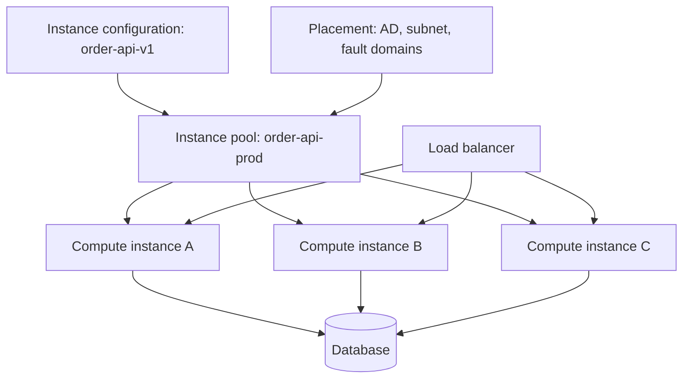

# Instance Configurations and Instance Pools

When a Java API needs to run across multiple OCI Compute hosts, provisioning each machine and installing software manually easily causes drift in images, shapes, application versions, and network settings. When scaling up or replacing a failed machine, the operations team has to repeat those steps and re-verify the outcome.

In Oracle Cloud Infrastructure, an **instance configuration** describes how to create an instance; an **instance pool** manages a group of instances based on that configuration. Together, these two resources turn multi-host deployment into a repeatable process that integrates with IAM permissions, VCN networking, load balancing, monitoring, and automation.

After this lesson, you will be able to distinguish the responsibilities of a configuration and a pool, design an instance group for a Java application, explain the impact of changing configurations, and verify deployment results at both the infrastructure and application layers.

## 1. Three Concepts to Keep Distinct

| Concept | Role | Example in an Ordering System |
| --- | --- | --- |
| Instance configuration | Template of settings used when creating a Compute instance | OS image, shape, metadata, and related resource settings |
| Instance pool | Group of Compute instances managed together | The `order-api-prod` pool with target size and placement locations |
| Compute instance | Specific machine running the workload | A host with its own OCID, network address, OS, and Java process |

One configuration can be used by multiple pools. Each pool attaches to one configuration at a time. A pool manages instances within the same region; do not use a single pool to span across regions. When cross-region recovery is needed, design additional deployment components and corresponding traffic routing. [Oracle: Managing Instance Pools](https://docs.oracle.com/en-us/iaas/Content/Compute/Concepts/instance-pools.htm)



This diagram illustrates one deployment option. The database and load balancer are designed separately; creating a pool does not automatically provision the rest of this architecture.

## 2. What Does an Instance Configuration Describe?

A configuration stores launch settings, which can include source image, shape, metadata, network configuration, and block volume attachments. It can also reference a capacity reservation. Check which fields are supported for your instance type and configuration creation method. [Oracle: Managing Instance Configurations](https://docs.oracle.com/en-us/iaas/Content/Compute/Concepts/instancemanagement.htm)

For a Java API, review the following setting groups:

| Group | Design Questions |
| --- | --- |
| OS and application | Which image is used? Where do the JDK and application build come from? Can exact versions be pinned? |
| Compute resources | Do CPU, RAM, and architecture fit the JVM, native libraries, and measured load? |
| Startup | Where do new instances fetch config, how does the service start, and how does it signal readiness? |
| Network access | Do instances need public IPs? Which subnet, NSGs, and routes permit access to exact dependent services? |
| Identity | What permissions do the pool creator and the application on the host need? |
| Storage | Which data can be recreated, and which must survive instance replacement? |
| Observability | How do you identify the running version, startup errors, and resource utilization? |

### 2.1. Two Ways to Prepare a Configuration

You can create a configuration by specifying settings explicitly or by basing it on an existing instance. A common misconception is that the second method **does not copy files, binaries, and software manually installed on the boot volume**; contents of attached block volumes are not copied into the configuration either. If you want disk setups preserved, prepare a custom image or a repeatable installation workflow. [Oracle: Creating an Instance Configuration](https://docs.oracle.com/en-us/iaas/Content/Compute/Tasks/creatinginstanceconfig.htm)

For example, suppose you SSH into a test machine and copy `order-api.jar` to `/opt/order-api/`. Creating a configuration from that machine does not ensure the next instance will have the JAR file. You must launch a new instance from the chosen workflow and verify it directly.

Two common approaches for applications:

- **Baked image:** contains the OS, runtime, and tested components. Each release has a distinct image identifier or workflow pinning the exact application build.
- **Base image with bootstrap:** new machines download a versioned artifact, fetch required config, and start the service. With this approach, network path, access permissions, and artifact availability sit on the startup critical path.

Do not rely on a download path meaning "latest" when exact release reproducibility is required. Nor should you embed database passwords or secret keys into images, resource names, or widely shared scripts. Choose an identity and secret-retrieval mechanism aligned with system policy.

### 2.2. Compartment of the Configuration vs. the Instances

Do not infer where instances are placed solely from the compartment holding the configuration. When a configuration is created from an existing instance, new instances are placed in the source instance's compartment, even if the configuration resides in a different compartment. Verify actual resource scope before applying policies and cost allocation. [Oracle: Creating an Instance Configuration](https://docs.oracle.com/en-us/iaas/Content/Compute/Tasks/creatinginstanceconfig.htm)

## 3. What Does an Instance Pool Add?

A pool manages instance count and placement at the group level. You can resize the pool, manage members, and integrate with a load balancer or network load balancer. However, pool state must be read alongside the member list and operational checks; do not treat a single status label as sufficient proof that the application is serving properly. [Oracle: Managing Instance Pools](https://docs.oracle.com/en-us/iaas/Content/Compute/Concepts/instance-pools.htm)

### 3.1. Placement Determines Where Machines Are Created

When creating a pool, placement specifies the availability domain and subnet for instances. Appropriate fault domains can be selected to distribute the workload. For pool-created instances, the pool's availability domain and subnet settings take precedence over the corresponding settings in the configuration. [Oracle: Creating an Instance Configuration](https://docs.oracle.com/en-us/iaas/Content/Compute/Tasks/creatinginstanceconfig.htm)

Example design for a Java API:

- Place application instances in a private subnet.
- Use NSGs and routes allowing traffic to the load balancer, database, and required services.
- Distribute replicas across chosen locations, accounting for regional support.
- Ensure that if one location becomes unavailable, remaining replicas still handle acceptable load.

Instance count and placement distribution must be decided together. Three instances placed in one location sharing the same fault domain do not provide the same fault tolerance as an actively distributed and tested design.

### 3.2. Integrating with Load Balancing

Once load balancer attachment is configured for the pool, new instances can be automatically added to the backend set. Traffic is routed once a backend passes the configured health check. Creating a pool also requires compatible instance configurations and networking; OCI documentation notes that a pool cannot be created from a configuration whose image source is a boot volume. [Oracle: Creating Instance Pools](https://docs.oracle.com/en-us/iaas/Content/Compute/Tasks/creatinginstancepool.htm)

At the application tier, distinguish between:

1. Machine created and OS running.
2. Java process started.
3. Application completed startup steps needed to serve requests.
4. Network path and load balancer health check confirmed backend readiness.

An open TCP port does not prove the API is usable. If choosing an HTTP health check, design the endpoint and readiness criteria to fit the application, while avoiding health checks that impose heavy load or create a feedback loop with a failing downstream system.

## 4. Scaling Instance Count and Autoscaling

**Scale out** increases instance count; **scale in** decreases instance count. For a stateless API, adding machines distributes request-handling load. For background jobs, extra workers help only if the queue and job-claiming mechanism support safe coordination.

A pool does not automatically know whether an in-flight order has finished or when a long job can safely stop. The application must handle retries, idempotency/deduplication, job release, or progress recovery properly.

OCI provides metric-based or schedule-based autoscaling for instance pools. An autoscaling policy is a separate control resource and is not enabled merely by creating a pool. Scale-in can terminate instances; metric-based autoscaling must account for Monitoring data and cooldown intervals. [Oracle: Autoscaling](https://docs.oracle.com/en-us/iaas/Content/Compute/Tasks/autoscalinginstancepools.htm)

Hypothetical example: the `order-api-prod` pool has three machines and may scale up to six under high processing load. This decision must be paired with checks:

- Are quota, capacity, and IP addresses sufficient for the maximum instance count?
- How long does a new machine take to download artifacts, start the JVM, and reach readiness?
- When scaling out, can the database handle the total connection count?
- When scaling in, how are in-flight requests and background jobs drained or recovered?
- If resized manually, which active autoscaling policy might adjust that size again?

A simple calculation illustrates database impact: if each machine may open up to 20 connections, three machines can open up to 60 connections; six machines can open up to 120. This is the configuration ceiling of the example, not measured live connections. Reserve headroom for other services and temporary overlap instances during deployments.

Low CPU or higher instance count is not enough to conclude the system is healthy. Also watch throughput, latency, error rate, queues, and wait times at dependent services.

## 5. Updating Configuration Does Not Redeploy Running Instances

To change the image, shape, or launch settings, create a new configuration and attach it to the pool. This update affects only **future instance creations**; it does not automatically replace, reboot, or convert existing instances. Display name and tags can be updated on an existing configuration, but do not mistake that for changing deployment payload. [Oracle: Updating the Instance Configuration for an Instance Pool](https://docs.oracle.com/en-us/iaas/Content/Compute/Tasks/updatinginstancepool-updating-instance-configuration.htm)

Consider this illustrative timeline:

| Time | Configuration Attached to Pool | Running Instances |
| --- | --- | --- |
| T0 | `order-api-v1` | A, B, C created from v1 |
| T1: attach new configuration | `order-api-v2` | A, B, C continue running unchanged |
| T2: scale size from 3 to 4 | `order-api-v2` | New D created from v2; A, B, C remain v1 |

At T2, the pool holds mixed configuration generations. Therefore, the configuration name currently attached to the pool is insufficient to conclude which application version runs on each member.

A controlled replacement plan should explicitly specify:

1. Configuration and v2 artifact already tested on a fresh machine.
2. Temporary buffer capacity required to maintain service during host replacement.
3. Health check criteria, observation window, and error thresholds to proceed.
4. How to drain traffic, wait for in-flight work, and replace members incrementally.
5. How to revert to the old configuration and recreate required instances if v2 fails.

Merely pointing the pool back to v1 does not revert existing v2 instances back to v1. Restoring the application version still requires an explicit deployment or replacement procedure.

Do not treat this plan as an automatic zero-downtime guarantee. Results depend on the application, data, healthy replica count, and traffic control. For database migrations, separately verify compatibility across running application versions and schemas.

## 6. CLI Example: Creating a Pool from a Prepared Configuration

The example below uses **Bash**, intended for a test environment with OCI CLI configured and authenticated. OCIDs and availability domain names are placeholders to replace with real resources in the right region. Commands here are hands-on guidance; the flow is not a report from an already-executed deployment.

Prepare a tested instance configuration, an appropriate subnet, and permissions to create the related resources. Verify cost, service limits, and capacity before launching instances.

```bash
export COMPARTMENT_OCID='ocid1.compartment.oc1..REPLACE_ME'
export CONFIG_OCID='ocid1.instanceconfiguration.oc1.REGION.REPLACE_ME'

# Inspect the configuration that the pool will use.
oci compute-management instance-configuration get \
  --instance-configuration-id "$CONFIG_OCID"
```

In your working directory, create `placements.json` with a single-placement example:

```json
[
  {
    "availabilityDomain": "REPLACE_WITH_EXACT_AVAILABILITY_DOMAIN_NAME",
    "primarySubnetId": "ocid1.subnet.oc1.REGION.REPLACE_ME"
  }
]
```

After substituting values, create a two-instance pool:

```bash
oci compute-management instance-pool create \
  --compartment-id "$COMPARTMENT_OCID" \
  --instance-configuration-id "$CONFIG_OCID" \
  --placement-configurations file://placements.json \
  --size 2 \
  --display-name order-api-lab
```

Pool creation requires compartment, configuration, placement, and size. One placement entry is supplied per selected availability domain. A single-placement example here teaches the resource-creation flow; it does not prove survivability if an availability domain fails. [Oracle CLI: instance-pool create](https://docs.oracle.com/en-us/iaas/tools/oci-cli/latest/oci_cli_docs/cmdref/compute-management/instance-pool/create.html)

Record the pool OCID from the creation output, then inspect pool details and member list:

```bash
export POOL_OCID='ocid1.instancepool.oc1.REGION.REPLACE_ME'

oci compute-management instance-pool get \
  --instance-pool-id "$POOL_OCID"

oci compute-management instance-pool list-instances \
  --compartment-id "$COMPARTMENT_OCID" \
  --instance-pool-id "$POOL_OCID" \
  --all
```

`list-instances` takes the pool OCID and compartment; `--all` retrieves all result pages. Compare this list against the target count before moving to application-layer checks. [Oracle CLI: instance-pool list-instances](https://docs.oracle.com/en-us/iaas/tools/oci-cli/latest/oci_cli_docs/cmdref/compute-management/instance-pool/list-instances.html)

API completion of the create call does not mean every host and backend is ready. Continue checking provisioning progress, deployment errors, bootstrap logs, and health checks in your environment. If instances live in a private subnet, use the management path designed for that environment to test the application.

After the exercise, inventory instances, boot volumes, block volumes, and related resources before cleanup. Delete only test resources within your scope and separately verify any data to keep; deleting Compute resources is no substitute for a backup or data management plan.

## 7. Validating a Pool for a Java Application

A useful sign-off checklist combines evidence from multiple layers:

| Check Layer | Evidence to Collect | Example Failures Caught |
| --- | --- | --- |
| Configuration | Configuration OCID, expected image and artifact | Wrong image used or version unidentifiable |
| Infrastructure | Members, lifecycle state, placement, and actual resources | Missing instances, capacity errors, or wrong subnet |
| Bootstrap | Artifact download logs and service startup logs | Artifact repo unreachable or missing config |
| Application | Version, readiness, test requests, and logs | JVM running yet API unusable |
| Load balancing | Healthy backends, request flow, and error rate | Wrong port, health check, or network rule |
| Dependent services | Database connections, queues, and wait times | Scaling up exhausts connection budget |
| Recovery | Behavior when one replica stops serving | Lost sessions or unretried background work |

For example, if a pool has all three machines running yet one backend is unhealthy, inspect that machine's process and logs, port config, network path, and health check. Scaling the pool to six machines before finding the cause may just spawn more identically broken hosts.

If all backends are healthy yet latency spikes on database queries, focus on measuring database wait times and load. Adding application hosts in that scenario increases concurrent queries without resolving the bottleneck.

For applications keeping sessions in local memory, shifting requests to another host drops user state. Design appropriate session management; belonging to the same pool does not make instances share memory.

## 8. Common Misconceptions

| Misconception | Accurate Understanding and Action |
| --- | --- |
| Creating a configuration from an installed machine captures a full copy | Verify image and bootstrap; launch a new machine to prove software is present |
| Updating configuration immediately switches the whole pool to the new version | Inventory each member's generation and execute a replacement plan |
| Pool running means the API is definitely healthy | Also check readiness, backend health, and live requests |
| Increasing size always increases throughput | Measure bottlenecks and capacity of database, queues, network, and dependencies |
| Scale-in merely pauses instances for reuse | Design for instance termination and recoverable work |
| Having multiple machines solves fault tolerance | Check placement, shared components, and load when a replica is lost |
| Same configuration means disk or RAM data is identical | Manage data and application state with dedicated mechanisms |

## 9. Applied Exercise

Design a pool for a Java ordering API with three initial replicas. The exercise requirement is being able to rebuild an instance without SSHing in to install the application manually.

Document the following decisions:

1. How the image or bootstrap is built, application build identification, and startup success criteria.
2. Placement, network path, and permissions required for a new instance to serve requests.
3. Where sessions, business data, and background-job progress are stored.
4. Maximum database connections during normal operation, scale-out, and version replacement.
5. Evidence distinguishing a running machine from a ready application.
6. Plan to transition v1 to v2 and roll back if v2 fails.

Then evaluate this scenario: the pool currently has three v1 instances; you attach the v2 configuration and increase pool size to five. Create a table of expected versions across the five instances, describe how to verify in practice, and identify the remaining steps needed for the entire group to run v2.

A sound design must demonstrate both how new instances are created and how service continuity is maintained while old instances are replaced. Configurations make launch settings repeatable; pools manage the group; application availability and recovery must be designed and verified across the remaining layers.
