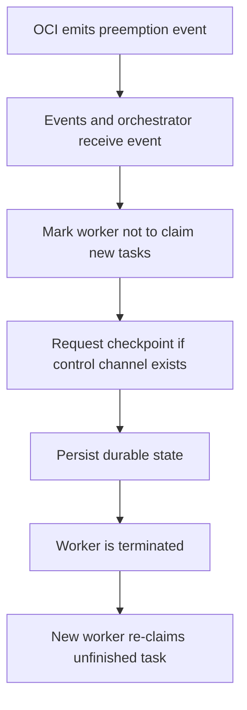

# Capacity Reservations, Dedicated Hosts, and Preemptible Instances

In the **Compute and Virtual Machines** chapter of the Oracle Cloud Infrastructure (OCI) module, selecting an image and OCPU count only solves the machine configuration part. Operators must also decide how compute capacity is sourced: launch on demand, reserve ahead so capacity is available later, use physical servers dedicated to the tenancy, or accept reclamation in exchange for lower cost.

This lesson focuses on three choices: **capacity reservation**, **dedicated virtual machine host**, and **preemptible instance**. We place them in an OCI deployment context with clear compartments, IAM, VCN networking, monitoring, automation, and cost accountability.

After this lesson, learners will be able to:

- Select a capacity type based on availability requirements, hardware isolation, and interruption tolerance.
- Distinguish requested capacity from actually reserved capacity inside a reservation.
- Explain the costs of idle reserved capacity, underutilized dedicated hosts, and rerun work.
- Design preemption-tolerant workers using durable state and safe retry handling.
- Practice verifying instance associations with reservations/hosts and properly cleaning up resources.

## 1. Which Requirements Do the Four Capacity Options Address?

**Capacity** here refers to the underlying Compute hardware capacity available to allocate to instances. It is distinct from account limits, IAM permissions, and storage capacity. Having quota does not mean the target placement zone has spare hardware; having hardware does not replace permission to create instances.

| Option | Primary Goal | Unit to Manage | Illustrative Use Case |
|---|---|---|---|
| On-demand | Launch instances for current demand | Instance created when capacity is available | General-purpose application servers |
| Capacity reservation | Reserve matching capacity ahead of a needed deployment | Reservation and capacity configurations | Standby capacity for disaster recovery or a launch event |
| Dedicated VM host | Place VMs on servers dedicated to the tenancy | Host and the VMs placed on it | Isolation requirements or host-based licensing models |
| Preemptible | Reduce cost for interruption-tolerant work | Instances subject to reclamation | Checkpointed batch workers |

On-demand is the default; OCI does not guarantee capacity is always available when launching a large workload. The remaining three options change how capacity is allocated or consumed. [Source: overview of OCI Compute capacity types](https://docs.oracle.com/en-us/iaas/Content/Compute/Concepts/computeoverview.htm).

A system can use multiple capacity types for **different groups of instances**. For example, the primary API runs on on-demand, a standby tier uses reservations, and background batch uses preemptible instances. Do not assume all options can be enabled simultaneously on the same instance.

Before choosing, establish three independent requirements:

1. **Must launch capacity be held for a specific time or location?**
2. **Are physical servers required to be dedicated to the tenancy?**
3. **Can the workload continue correctly if an instance is lost suddenly?**

The word "reserved" does not inherently imply a long-term discount contract. A dedicated host also does not automatically create extra application replicas or a high-availability architecture.

## 2. Capacity Reservation: Reserving Instance Launch Capacity Ahead of Time

### 2.1. Reservation and Capacity Configuration

A reservation is bound to a tenancy and a single availability domain (AD). It contains one or more **capacity configurations**, describing the instance shape/type and count to hold; it can optionally constrain fault domains (FDs). When launching an instance into a reservation, the requested configuration must match what was reserved. A reservation does not span multiple ADs or regions. [Source: OCI capacity reservations](https://docs.oracle.com/en-us/iaas/Content/Compute/Tasks/reserve-capacity.htm).

Planning example for a payment service group:

| Attribute | Illustrative Value |
|---|---|
| Reservation | `payment-dr-capacity` |
| Compartment | `ComputeLab` or assigned DR compartment |
| AD | A specific AD in the standby region |
| VM shape | Supported Flex shape with capacity |
| Per-VM config | 2 OCPUs, 16 GB RAM |
| Target count | 4 VMs |
| Fault domain | Per selected fault-tolerance design |

This reserves slots for a specific configuration, not a generic pool of RAM/OCPUs you can freely swap across any shape or CPU architecture. Using a compatible image and selecting a subnet matching the AD remain the responsibility of the instance launch flow.

### 2.2. Creating a Reservation Resource Does Not Mean All Capacity Was Reserved

OCI can create a reservation with fewer instances than requested when capacity is insufficient, including 0. Therefore, after the request finishes, inspect actual reserved capacity and the work request rather than merely checking that the reservation has an OCID. [Source: creating a capacity reservation](https://docs.oracle.com/en-us/iaas/Content/Compute/Tasks/capacity-reservations-create_tabs.htm).

Suppose the team requested 4 VMs but the system only reserved 3:

```text
requested_instances = 4
actual_reserved_instances = 3
used_instances = 1
unused_reserved_instances = 2
missing_instances_for_plan = 1
```

The recovery plan is still short one VM. Reporting "reservation created successfully" is insufficient to conclude the capacity requirement is solved.

When using multiple capacity configurations, inspect each configuration individually. Matching total OCPUs does not prove shape, RAM, and FD requirements are all satisfied.

### 2.3. Usage and Lifecycle

Typical usage flow:


When creating an instance, select the reservation under placement/capacity or specify the reservation OCID via API/CLI. Then verify the association on the instance. [Source: launching an instance in a reservation](https://docs.oracle.com/en-us/iaas/Content/Compute/Tasks/capacity-reservations-create-instance_tabs.htm).

Terminating an instance returns capacity to the reservation; the reservation remains active and unused slots continue to be billed. Stopping an instance using a reservation retains its capacity for restart. Capacity reservations currently cannot be combined with preemptible, dedicated VM hosts, or burstable instances; Free Tier accounts do not include this reservation feature. [Source: reservation lifecycle and limits](https://docs.oracle.com/en-us/iaas/Content/Compute/Tasks/reserve-capacity.htm).

In the lab, selecting the reservation explicitly makes results easier to verify. The default reservation option has a broader scope than a single instance launch; use it only when tenancy design explicitly defines how it applies and its permissions.

### 2.4. Billing: Used vs. Unused Portions

Per OCI billing documentation reviewed when authoring this lesson, unused reserved capacity is billed at **85%**, while instances consuming capacity are billed at the standard **100%** rate for the shape. This is a capacity-holding mechanism, not an automatic discount on running VMs. Actual monetary charges also depend on shape and account terms. [Source: OCI capacity reservation billing](https://docs.oracle.com/en-us/iaas/Content/Compute/Tasks/reserve-capacity.htm).

Simple one-hour model for identical VMs with no state changes within the hour:

```text
N = number of VM slots actually reserved
U = number of slots currently used by running instances
P = standard hourly Compute cost of one VM

Compute_cost = U × P + (N - U) × 0.85 × P
```

Example with `N = 4`, `U = 1`, `P = 1 unit/hour`:

```text
Used portion:     1 × 1        = 1.00
Unused portion:   3 × 0.85 × 1 = 2.55
Total:                           3.55 units/hour
```

If only 3 slots were actually reserved, use `N = 3` for cost modeling while still reporting one slot short of the plan. Do not add reservation charges for all 4 slots and then add full VM charges on top for the used slot.

This model omits volumes, backups, networking, licenses, and mid-hour usage changes. Nor should it be used to extrapolate costs across all stop/start scenarios. For real budgeting, inspect usage reports by resource type and state.

## 3. Dedicated Virtual Machine Host: Dedicating a Server to the Tenancy

### 3.1. Host and Instance Are Two Separate Resources

A Dedicated VM Host (DVH) lets you run VMs on a physical server not shared with other customers. One host can run multiple VMs belonging to your tenancy. A dedicated VM host is still a VM-hosting environment; it differs from deploying a bare metal instance where a single OS uses the physical server directly. [Source: Oracle Compute FAQ on dedicated hosts](https://www.oracle.com/cloud/compute/faq/).

```text
One dedicated VM host
├── Application VM A
├── Application VM B
└── Utility VM C

VMs still require their own images, VNICs, subnets, volumes, and security configs.
```

Hardware isolation helps satisfy certain deployment requirements. For software licensed per host/node, verify exact licensing terms; choosing a dedicated host does not automatically prove every licensing requirement is satisfied.

All VMs on one host still share the failure risk of that physical host. Placing two service replicas on the same host does not eliminate a single physical point of failure.

### 3.2. Create the Host First, Then Place VMs on It

When creating a host, choose the compartment, AD, FD, and host shape. VMs placed on the host reside in that AD/FD; a VM's compartment can differ from the host's compartment if IAM permissions allow. The host must reach `ACTIVE` state before creating VMs on it. [Source: creating a dedicated VM host](https://docs.oracle.com/en-us/iaas/Content/Compute/Concepts/dedicatedvmhosts_topic-Creating_a_Dedicated_Virtual_Machine_Host.htm).

When creating an instance:

1. Select an image and VM shape supported by the host.
2. Choose **Dedicated host** capacity type under placement.
3. Select a host with suitable remaining capacity.
4. Complete networking, access keys, and volumes.
5. Read back the dedicated host OCID on the instance.

The host shape determines which VM shapes can be placed on it. You can filter the host list by shape and minimum capacity; inspect host details to verify capacity. [Source: placing an instance on a dedicated VM host](https://docs.oracle.com/en-us/iaas/Content/Compute/Concepts/dedicatedvmhosts_topic-Placing_an_Instance_on_a_Dedicated_Virtual_Machine_Host.htm).

### 3.3. Total Free Capacity May Still Not Fit a Large New VM

VM placement also depends on how physical resources are partitioned. Billed OCPUs of the host and allocatable OCPUs for VMs are not necessarily equal because virtualization management requires overhead. For workloads with large VMs, plan placement carefully and prioritize placing larger VMs first. [Source: optimizing capacity on dedicated VM hosts](https://docs.oracle.com/en-us/iaas/Content/Compute/Concepts/dedicatedvmhosts.htm).

Conceptual example with two independent placement zones, each having 8 OCPUs free:

```text
Zone A has 8 OCPUs remaining
Zone B has 8 OCPUs remaining
Total remaining: 16 OCPUs

A VM needing 12 OCPUs in one placement zone may not fit.
```

This example illustrates fragmentation; actual zone counts and placement rules depend on the host shape. Never use simple OCPU addition to guarantee placement for large VMs.

### 3.4. Cost and Operational Limits

Compute billing attaches to the host; there is no additional Compute charge per VM placed on the host, though image license fees may still apply. An underutilized host still carries the full host cost. Deleting all VMs does not remove the host resource; you must terminate/delete the host to stop host charges per its lifecycle. [Source: Oracle Compute FAQ on host billing](https://www.oracle.com/cloud/compute/faq/).

Budget model for a group of VMs:

```text
Group cost = dedicated host fee
           + volumes and backups
           + applicable licenses
           + networking and related services
```

Do not add full standard on-demand VM Compute charges on top of the host fee as if those VMs were running on shared capacity.

Dedicated VM hosts currently do not support autoscaling, instance pools, capacity reservations, burstable instances, or live migration. Plan maintenance using supported reboot migration or manual migration procedures. [Source: dedicated VM host limitations](https://docs.oracle.com/en-us/iaas/Content/Compute/Concepts/dedicatedvmhosts.htm).

Therefore, when you need an auto-scaling worker group, check architectural compatibility before choosing dedicated hosts. Physical isolation requirements can reshape both automation and application maintenance.

## 4. Preemptible Instances: Lower Cost with Reclamation Risk

### 4.1. What the Application Must Tolerate

A preemptible instance can have its capacity reclaimed and be **terminated** by OCI at any time; there is no guaranteed minimum runtime. Per OCI documentation, preemptible capacity is priced **50%** lower than on-demand. Workloads must recover cleanly from worker loss. [Source: OCI preemptible instances](https://docs.oracle.com/en-us/iaas/Content/Compute/Concepts/preemptible.htm).

Suitable design examples:

| Workload | Conditions to Consider Preemptible |
|---|---|
| Image processing or transcoding | Inputs and outputs live outside the worker; tasks are repeatable |
| Automated testing | Jobs can be rerun and variable completion time is acceptable |
| Batch data analytics | Tasks are splittable with checkpoints and completion tracking |
| Artifact builds | Artifact publishing checks for duplicates and integrity |

A single database storing data on local disk, a single coordinator, or an interruption-sensitive service must be evaluated very differently. Calling a workload "batch" does not prove it tolerates host loss: a 10-hour job without checkpoints may still have to redo nearly 10 hours of work.

### 4.2. Limits to Factor into Planning

Preemptible instances currently do not support start, stop, or reboot; they cannot change shape or convert directly to on-demand. They cannot be used with instance pools, dedicated VM hosts, or capacity reservations. Choose only shapes on the supported list at deployment time. [Source: preemptible limitations](https://docs.oracle.com/en-us/iaas/Content/Compute/Concepts/preemptible.htm).

A terminated preemptible instance must be replaced by a **new instance** if the system still needs workers. An external scheduler or orchestrator manages worker provisioning, retries, and fallback; do not assume instance-pool autoscaling built for on-demand applies as-is.

If a workload must fall back to on-demand, launch new on-demand workers and hand over or resume work from durable state. Work portability depends on application and data design, not just capacity selection.

### 4.3. Reclamation Notice and Response Path

OCI emits an `instancepreemptionaction` event two minutes before termination begins. The event can be handled via Events to send notifications or invoke automation. This is a service-layer notification; actual handling time is also affected by event delivery and processing latency. [Source: two-minute preemption notice](https://docs.oracle.com/en-us/iaas/releasenotes/changes/5120d35b-05be-4ef2-9e72-7ce2dcffb947/).

Full event type:

```text
com.oraclecloud.computeapi.instancepreemptionaction
```

Filter by event type and compartment, then read the instance OCID from event data to identify which worker needs handling. [Source: OCI instance event types](https://docs.oracle.com/en-us/iaas/Content/Events/Reference/eventsproducers.htm).

Recommended response design:



This flow is an application-level recommendation. Creating an Events rule alone does not automatically stop an in-host process from claiming jobs, translate the event into a `SIGTERM` for your process, or save data.

You must still handle recovery when the application misses the event: write periodic checkpoints, detect unreachable workers, and allow tasks to be re-claimed after lease expiration.

### 4.4. Durable State and Safe Retry Handling

A worker should hold only disposable state on the host, while recovery-critical data resides outside the worker:

```text
Durable work source
    -> worker claims task with lease timeout
    -> reads input from durable store
    -> processes and writes periodic checkpoints
    -> publishes result by job_id
    -> acknowledges task completion
```

If the worker disappears before acknowledgment, the task may rerun. Therefore, ensure reruns do not produce duplicate results or corrupt side effects:

- Use a stable `job_id` instead of a random per-attempt ID.
- Write results using commits or conditional updates as appropriate.
- Acknowledge task completion only after durable results are successfully written.
- Distinguish an unfinished task from a finished task whose acknowledgment was lost.
- Enforce retry limits and a dead-letter path for persistently failing tasks.

These are design principles, not a guarantee that every queue or datastore shares identical semantics. If publishing results and acknowledging tasks span two separate systems, analyze the failure window between those two steps.

For example, a worker processes 100 data chunks and checkpoints every 5 chunks. When a new worker starts, it reads the committed checkpoint and resumes the remaining chunks. A checkpoint written only to the worker's boot volume is insufficient if that volume is deleted or cannot be attached quickly during recovery.

### 4.5. Choosing Boot Volume Handling

When creating a preemptible instance, you choose whether to preserve or delete the boot volume on reclamation. In the API model, the terminate preemption action exposes the `preserveBootVolume` field. [Source: OCI TerminatePreemptionAction](https://docs.oracle.com/en-us/iaas/tools/java/latest/com/oracle/bmc/core/model/TerminatePreemptionAction.html).

| Choice | Operational Consequence to Manage |
|---|---|
| Preserve boot volume | May aid investigation or recovery, but the volume still incurs charges and needs cleanup |
| Delete boot volume | Fits reproducible workers; data that must survive must live elsewhere |

Keeping the volume does not keep the instance running, nor does it turn it into a replacement worker. The system still has to provision a machine, attach data, and resume work per design.

## 5. Comparing Cost per Completed Unit of Work

A lower Compute unit price is not enough to conclude total system cost drops by the same ratio. For preemptible instances, include rerun time and worker startup overhead:

```text
C_preemptible_compute ≈ 0.5 × P × (T_useful + T_rerun + T_startup)
```

Where `P` is the equivalent on-demand hourly rate, and the `T` values are **total billed VM-hours**, not merely wall-clock time. Then add costs for durable state storage, volumes, networking, and orchestration.

Illustrative example holding performance and output volume constant:

| Component | Baseline On-Demand | Hypothetical Preemptible Design |
|---|---:|---:|
| Useful VM-hours | 100 | 100 |
| Rerun VM-hours | 0 | 20 |
| Extra startup VM-hours | 0 | 10 |
| Compute unit price factor | 1 | 0.5 |
| Normalized Compute cost | 100 | 65 |

Compute cost in this example drops by 35% because of extra rerun work. These numbers are hypothetical to illustrate the model, not a forecast of OCI reclamation rates.

Similarly, for reservations, track utilization ratio relative to the reservation commitment. For dedicated hosts, track how many workloads actually fit and their CPU/RAM utilization. Do not look only at "provisioned" resources while ignoring whether workloads are delivering value.

Evaluate every option against the same target: cost per completed unit of work, completion time, acceptable interruption level, and recoverability.

## 6. IAM, Quotas, and Scope of Responsibility

### 6.1. Separating Capacity Holders from Capacity Consumers

Platform operations can manage reservations/hosts; application teams only consume them to launch instances. Separating these roles prevents application deployers from accidentally deleting or altering shared capacity resources.

Example policy additions for reservations in a lab compartment:

```text
Allow group ComputeLabUsers to use compute-capacity-reservations in compartment ComputeLab
Allow group CapacityOperators to manage compute-capacity-reservations in compartment ComputeLab
```

Substitute group and compartment names for your environment. These two statements illustrate only reservation permissions; users still need the corresponding Compute, network, volume, and image permissions to complete an instance launch. [Source: IAM for capacity reservations](https://docs.oracle.com/en-us/iaas/Content/Compute/Tasks/reserve-capacity.htm).

When a host resides in a different compartment from VMs, check permissions in both scopes. SSH access inside a VM never grants permission to manage hosts in OCI.

### 6.2. Quotas and Physical Capacity

Distinguish three questions:

| Layer | Question |
|---|---|
| IAM | Is this identity permitted to perform the operation? |
| Limit/quota | Are the tenancy and compartment allowed to allocate more of this resource? |
| Capacity | Can the platform fulfill the configuration at the selected location? |

OCI defines quotas related to reservable capacity and instances launched from reserved capacity. Read quotas carefully by shape, OCPU/RAM, and scope. Raising a quota does not create additional physical hardware. [Source: OCI Compute quotas](https://docs.oracle.com/en-us/iaas/Content/Quotas/Concepts/resourcequotas_topic-Compute_Quotas.htm).

When a launch fails, preserve the exact error message and request ID to distinguish these three layers. Never blindly switch to another capacity type just to mask the root cause.

## 7. Evidence-Based Hands-On Practice

Execute the branch for which you have authorized resources and budget. If an account lacks feature support or budget for dedicated hosts, use the configuration plan and sample resource readouts provided by your instructor; never report a live deployment without actually creating the resources.

General preparation: lab compartment, appropriate IAM, compatible Linux image, subnet with admin access, SSH public key, and tags identifying the owner. Capacity choices do not replace network configuration or OS bootstrapping.

### 7.1. Branch A: Small Reservation

1. In Compute, open Capacity Reservations and choose Create Capacity Reservation.
2. Select compartment, AD, and a small assigned capacity configuration; do not enable default reservation on your own for the lab.
3. Wait for the request to finish, and record both requested count and actual reserved count.
4. Launch one VM using that exact reservation, shape, OCPU/RAM, and FD.
5. Inspect the instance to confirm the reservation OCID; inspect the reservation to record used/unused counts.
6. Record the usage window so you can cross-check usage reports later.

Example evidence log:

| Evidence | Result Learner Must Fill In |
|---|---|
| Reservation OCID and AD | Actual values |
| Capacity configuration | Shape, OCPUs, RAM, FD |
| Requested / actual reserved count | Two separate values |
| Instance OCID | Consuming instance |
| Reservation association | OCID read from instance |
| Post-launch capacity | Used and remaining counts |

Proving this association matters more than merely seeing a machine in `RUNNING` state.

### 7.2. Branch B: Dedicated Host

1. Create a host with the assigned host shape and location.
2. Wait until the host is `ACTIVE`, then launch a compatible VM shape onto that host.
3. Read back the VM's dedicated host OCID and the host's Hosted Instances list.
4. Record remaining allocatable capacity and host cost over the lab window.
5. Explain which physical risks two VMs on the same host share.

Do not treat total billed OCPUs as guaranteed allocatable OCPUs. When a new VM fails to place, inspect shape compatibility and detailed capacity before buying another host.

### 7.3. Branch C: Preemptible Worker

1. In instance creation, select **Preemptible capacity** and a supported shape.
2. Explicitly choose whether to preserve or delete the boot volume on reclamation.
3. Run a small test task whose inputs, checkpoints, and outputs live outside the worker.
4. Verify the task makes progress and commits a checkpoint.
5. Perform a controlled worker-loss test on lab resources, then launch a new worker to pick up the task.
6. Verify the task finishes with accurate results and no duplicate side effects.
7. Separately test the Events rule and preemption handler path.

Preemptible and boot-volume choices appear in OCI's instance creation workflow. [Source: creating a preemptible instance](https://docs.oracle.com/en-us/iaas/Content/Compute/Concepts/preemptible.htm).

Manually terminating tests worker-loss recovery; to prove the system reacts to preemption events, you must also test the receiver/handler for that exact event type. Do not treat manual termination as proof of receiving a real OCI capacity-reclamation event.

## 8. Reading Configuration via OCI CLI

The commands below are read-only against existing resources. Run in an authenticated OCI CLI environment; replace placeholders with real OCIDs and select the right region/profile.

```bash
oci compute capacity-reservation get \
  --capacity-reservation-id '<RESERVATION_OCID>'

oci compute dedicated-vm-host get \
  --dedicated-vm-host-id '<DEDICATED_VM_HOST_OCID>'

oci compute instance get \
  --instance-id '<INSTANCE_OCID>'
```

Inspect the following fields in responses:

| Resource | Fields to Verify |
|---|---|
| Reservation | AD, capacity configuration, actual reserved count, and usage |
| Dedicated host | Lifecycle state, host shape, and returned capacity details |
| Instance | Reservation ID, dedicated host ID, or preemptible config depending on type |

`get` reads configuration from the control plane; it does not prove the application inside the VM is ready. Confirming the application requires additional checks of services, logs, and job outputs. [Source: reservation get](https://docs.oracle.com/en-us/iaas/tools/oci-cli/latest/oci_cli_docs/cmdref/compute/capacity-reservation/get.html), [host get](https://docs.oracle.com/en-us/iaas/tools/oci-cli/latest/oci_cli_docs/cmdref/compute/dedicated-vm-host/get.html), [instance get](https://docs.oracle.com/en-us/iaas/tools/oci-cli/latest/oci_cli_docs/cmdref/compute/instance/get.html).

When automating instance launches, distinguishing flags include `--capacity-reservation-id`, `--dedicated-vm-host-id`, and `--preemptible-instance-config`. They describe the respective capacity allocation modes; never combine incompatible options in one launch request. [Source: OCI CLI instance launch](https://docs.oracle.com/en-us/iaas/tools/oci-cli/latest/oci_cli_docs/cmdref/compute/instance/launch.html).

## 9. Monitoring by Risk Profile of Each Capacity Type

| Type | What to Monitor | Signal Requiring Action |
|---|---|---|
| Reservation | Actual vs. planned capacity, used/unused ratio, and reservation age | Under-fulfilled or sitting idle long after its purpose ended |
| Dedicated host | Host/VM health, placement headroom, and actual utilization | No room for critical VMs, fragmentation, or sustained low load |
| Preemptible | Worker loss frequency, retries, checkpoints, backlog, and completion time | Rising retries, stalled tasks, or missed-deadline risk |
| All three | Usage/cost by compartment, owner, and purpose | Unowned resources or budget overruns |

This is a recommended set of operational signals. Do not assume every metric in this table is a built-in OCI metric under the exact same name; some must come from applications, schedulers, or billing reports.

Tags should identify owner, environment, and purpose, such as `owner`, `environment`, and `workload`. For standby capacity, record who decides whether to keep or release it. Idle reserved capacity can be intentional for DR, but there must be a concrete business requirement to justify that cost.

For deadline-bound batch jobs, an orchestrator can use preemptible workers while slack time remains, then switch remaining unfinished work to on-demand when needed. Fallback plans must also verify limits, quotas, capacity, and budget; on-demand cannot be promised as always instantly available.

## 10. Troubleshooting and Common Fallacies

| Symptom or Fallacy | How to Check |
|---|---|
| "Reservation exists, so 4 VMs are guaranteed" | Read actual capacity of each configuration and compare against request |
| Reservation exists yet VM fails to launch | Check shape/OCPU/RAM/AD/FD, permissions, and remaining unused slots |
| "Terminated VM, so reservation billing stopped" | Check whether the reservation still exists and capacity returned to unused |
| Host has spare total OCPUs yet large VM won't place | Check supported shapes and capacity partitioning |
| "Deleted all VMs, so host incurs no charge" | Check whether the host still exists and host termination lifecycle |
| "Preemptible was terminated, just start it again" | Provision a new instance and resume task from durable state |
| "Events rule exists, so checkpoints will run automatically" | Verify action, receiver, control path, and checkpoint logic |
| "50% lower unit price means 50% lower total cost" | Recalculate rerun VM-hours plus storage, networking, and orchestration |
| "Dedicated host makes the application highly available" | Check whether replicas still share a single physical host |

Missing IAM permissions, quota exhaustion, and capacity shortages require different actions. Save service error messages, OCIDs, and timestamps; avoid rapid blind retries before knowing whether the previous attempt actually created a resource.

## 11. Cleaning Up Resources in Dependency Order

For a reservation, before deleting it you must terminate instances using the reservation or move them out of the capacity configuration. Then delete the reservation and confirm deletion. Deleting individual instances does not replace deleting the reservation. [Source: deleting a capacity reservation](https://docs.oracle.com/en-us/iaas/Content/Compute/Tasks/capacity-reservations-delete.htm).

For a dedicated host, terminate/remove VMs on the host first, then delete the host. If the workload must stay online, complete replacement/migration and verify the application before terminating old VMs. [Source: deleting a dedicated VM host](https://docs.oracle.com/en-us/iaas/Content/Compute/Concepts/dedicatedvmhosts_topic-Deleting_a_Dedicated_Virtual_Machine_Host.htm).

For the preemptible lab, stop the auto-spawning worker loop before terminating workers, otherwise the orchestrator may keep launching replacements. Check any boot volumes marked to preserve and any data still needed for investigation.

Finally, inventory volumes, backups, networking resources, and automation created specifically for the lab. Clean up only resources under your ownership; a shared subnet or queue may serve other workloads. Record completion evidence and the owner for any resources intentionally retained.

## 12. Completion Criteria

The lab meets its objectives when the learner can explain and demonstrate:

- Why a workload chooses a specific capacity type and which limits it accepts.
- For reservations, requested/actual/used counts are tracked separately and the instance references the exact reservation.
- For dedicated hosts, host/VM association is verified, shapes match, and host cost is accounted for in the budget.
- For preemptible instances, tasks recover on a new worker with duplicate-handling safeguards.
- Preemption notifications, checkpoints, and automated worker provisioning integrate into a coherent flow.
- Monitoring, fallback, and cleanup plans have clear owners.

Capacity selection must follow workload requirements: when capacity is needed, isolation boundaries, and resilience to host loss. Technical evidence paired with a cost model makes that decision verifiable before scaling out an OCI deployment.
