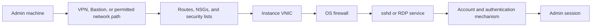

# Console Connections and Recovering Unreachable Instances

## 1. Objectives and Scope

In the **Compute and Virtual Machines** chapter of the **CLOUD_PROVIDERS_ORACLE** module, you need to know how to respond when an Oracle Cloud Infrastructure instance becomes unreachable via SSH or Remote Desktop. A `RUNNING` status in the management console is insufficient to confirm that the OS, network, and application are all working.

This lesson ties Compute recovery operations to OCI compartments, IAM, VCNs, boot volumes, and monitoring. The goal is restoring administrative access and services with clear evidence, preserving critical data, and controlling downtime and rescue-resource costs.

After this lesson, you will be able to:

- Classify failures across networking, authentication, login services, OS, and infrastructure.
- Choose among console history, serial console, VNC console, and other management channels.
- Understand three authorization layers: IAM permissions, console connection keys, and guest OS accounts.
- Design a workflow to fix configuration or recover a boot volume when login is impossible.
- Verify service restoration and revoke temporary recovery access.

Linux examples primarily target Oracle Linux using systemd. Ubuntu, Windows, and custom images may differ in account names, service names, and recovery-mode procedures. The commands below are hands-on guidance for an authorized OCI environment; they are not meant to run on the machine hosting these notes. Substitute illustrative OCIDs, IP addresses, and resource names with real lab values.

## 2. Loss of Connectivity Is a Symptom, Not Yet a Root Cause

A typical SSH path spans multiple layers:



This is a model for reasoning. If one layer breaks, login can fail even when all other layers are healthy. For instance, wrong permissions on `authorized_keys` differs from accidentally deleting an NSG rule; the two require different fixes.

| Symptom | What Can Be Inferred | What Cannot Yet Be Concluded |
| --- | --- | --- |
| SSH timeout | Connection could not complete within timeout | Machine is powered off or boot volume is corrupted |
| Connection refused | A response arrived from some point on the path | All network and authentication configs are correct |
| Permission denied on SSH auth | Reached authentication stage of an SSH server | Current key matches account, or that server is definitely the right host |
| Host key changed | SSH server identity differs from saved record | Warning can be ignored without checking |
| Console shows login prompt | OS booted up to a login interface | Applications, databases, and all filesystems are ready |
| Console shows mount error or emergency mode | Grounds to focus on boot and storage | Every error must be fixed with filesystem repair tools |

OCI's SSH troubleshooting guide also separates timeouts, invalid credentials, and file permissions. Start from the observed error rather than immediately recreating the machine. [Oracle: Troubleshooting the SSH Connection](https://docs.oracle.com/en-us/iaas/Content/Compute/Tasks/troubleshooting-ssh-connection.htm).

## 3. Choosing the Right Observation and Access Tool

### Console History: Point-in-Time Evidence

Console history captures recent serial output, including boot messages. It is a point-in-time capture, not an interactive session and not a full archive of every boot. A capture taken before a change helps compare a failed boot against a healthy boot. [Oracle: Displaying the Instance Console History](https://docs.oracle.com/en-us/iaas/Content/Compute/Tasks/displayingconsole.htm).

In operations, store captures with timestamp, OCID, and brief notes on relevant lines. Initialization logs can contain internal data; share only necessary excerpts and scrub sensitive details.

### Serial Console: Interactive Path for Diagnostics

The serial console lets you observe and interact with the instance's serial interface. It is useful when guest SSH is broken or when observing boot progress. Console connections exist for diagnostics; SSH and RDP remain the day-to-day management paths. [Oracle: Instance Console Connection](https://docs.oracle.com/en-us/iaas/Content/Compute/References/serialconsole.htm).

Do not treat the serial console as a pre-authenticated root shell. You can view boot messages without logging in, whereas running commands inside the OS still requires a valid access mechanism.

### VNC Console: Viewing the Machine's Display

The VNC console displays the graphical screen, useful for boot messages or Windows recovery screens. OCI routes this connection over an SSH tunnel; it does not require exposing VNC publicly on the guest VNIC. Verify instance-type support and use a compatible client. [Oracle: VNC console hands-on](https://docs.oracle.com/en/learn/troubleshooting-compute-instance/index.html).

### Run Command: When the Agent Still Works

Compute Instance Run Command can execute scripts inside an instance even without inbound SSH open. It depends on Oracle Cloud Agent and its plugin, a supported image, IAM permissions, and connectivity to OCI endpoints. Thus, it can help fix a broken SSH daemon, but it does not replace the console when the OS fails to boot or the agent is down. [Oracle: Running Commands on an Instance](https://docs.oracle.com/en-us/iaas/Content/Compute/Tasks/runningcommands.htm).

Never use Run Command output to print passwords or private keys. Keep scripts small, purpose-specific, and log actions taken.

### Bastion, VPN, and Console Solve Different Problems

Bastion or VPN provides a network management path to the guest. If the guest is not running a login service, adding a network path is not enough to fix the host. Conversely, if only access into a private subnet is missing, the console can confirm the guest is healthy while the permanent fix is restoring the designed management path.

## 4. Preparing Permissions and Identities Before Connecting

### IAM Permissions on OCI Resources

To create a console connection, operators need permission to manage `instance-console-connection` and read instances. Example for a lab compartment:

```text
Allow group ComputeRecoveryOperators to manage instance-console-connection in compartment compute-lab
Allow group ComputeRecoveryOperators to read instances in compartment compute-lab
```

Group and compartment names are illustrative; tenancies with identity domains require the corresponding group identifiers. Policies must be placed at a scope covering the target compartment. [Oracle: Core Services policy reference](https://docs.oracle.com/en-us/iaas/Content/Identity/Reference/corepolicyreference.htm).

These two lines cover managing console connections, not a complete permission set for every rescue task. Capturing console history, rebooting, backing up, attaching volumes, or creating helper instances may require additional permissions. When encountering a permission error, identify the exact operation and resource before adding policies; never substitute tenancy-wide admin rights just to test.

### Three Authentication Layers to Keep Distinct

| Layer | Subject Authenticated | Does Not Substitute For |
| --- | --- | --- |
| OCI IAM | User or tool calling management APIs | Login account inside the guest OS |
| Console connection SSH key | Client accessing the console service | Public key in guest `authorized_keys` |
| Guest OS account | User running commands on Linux or Windows | Permission to create or delete OCI resources |

Providing a public key to a console connection does not add that key to `opc`, `ubuntu`, or an application account. Likewise, the console connection OCID is not a Linux username.

OCI does not pre-set a default password for `opc`. If the guest prompts for a password and the account has no usable password, creating a console connection alone is insufficient to log in. Follow an authorized maintenance or rescue workflow rather than guessing an "OCI default password". [Console login prerequisites](https://docs.oracle.com/en-us/iaas/Content/Compute/References/serialconsole.htm).

### Preparing a Brief Recovery Record

Before modifying a machine, record:

- Target tenancy, region, compartment, and instance OCID.
- Private IP, public IP if any, VNICs, and related boot volume.
- Image, operating system, CPU architecture, and most recent change.
- Affected services, incident start time, and who else is working on the host.
- Backup or rollback plan to return to pre-change state.

This prevents fixing the wrong machine and supports handoffs; it is not a reason to delay reading status or collecting logs.

## 5. Connecting via Serial Console

### Using Integrated Cloud Shell

On the instance details page, locate **Console connection**, which may appear under **OS Management** or **Resources** depending on UI layout. Choose **Launch Cloud Shell connection**. This integration provisions the console connection and temporary key for a serial session automatically; it is not used to launch a VNC console. [Oracle: console connection via Cloud Shell](https://docs.oracle.com/en-us/iaas/Content/Compute/References/serialconsole.htm).

When the UI offers to delete an existing connection, first confirm whether that connection belongs to the active troubleshooting session. During a multi-responder incident, deleting someone else's connection can cut off an active recovery session.

Connecting to the console without seeing immediate output does not prove the machine is dead. Try pressing Enter, confirm you are attached to the right instance, and inspect console history. If you need to watch a reboot, connect first and then trigger the reboot during an appropriate change window.

### Using a Local Client and OCI CLI

For a local serial console, use an RSA key per OCI requirements. Creating a dedicated key for the lab separates usage purposes; choose a non-existing filename and protect the private key with a passphrase per environment policy.

```bash
# Run on the Linux/macOS admin machine with OpenSSH.
# Do not overwrite an existing key in use.
ssh-keygen -t rsa -b 3072 -f "$HOME/.ssh/oci-console-lab"
```

Create the console connection using the prepared public key:

```bash
# Run in an admin environment with OCI CLI and region configured.
INSTANCE_OCID='ocid1.instance.oc1..EXAMPLE'

oci compute instance-console-connection create \
  --instance-id "$INSTANCE_OCID" \
  --ssh-public-key-file "$HOME/.ssh/oci-console-lab.pub" \
  --wait-for-state ACTIVE \
  --max-wait-seconds 60 \
  --output json
```

Here, `ACTIVE` confirms the console connection resource is ready; it does not prove the guest booted or has an active login session. If the command times out, check whether the resource was created before retrying. [OCI CLI: create instance console connection](https://docs.oracle.com/en-us/iaas/tools/oci-cli/latest/oci_cli_docs/cmdref/compute/instance-console-connection/create.html).

Record the returned connection OCID so you can inspect its details:

```bash
CONNECTION_OCID='ocid1.instanceconsoleconnection.oc1..EXAMPLE'

oci compute instance-console-connection get \
  --instance-console-connection-id "$CONNECTION_OCID" \
  --output json
```

Use the exact connection string provided by OCI for your instance and client type. Do not assemble console hostnames by hand or mistake the connection OCID for a guest username. With OpenSSH, when specifying a custom private key, pay attention to both the outer SSH command and the inner proxy command. Windows/PuTTY uses a different key format and invocation. [OCI CLI: get connection details](https://docs.oracle.com/en-us/iaas/tools/oci-cli/latest/oci_cli_docs/cmdref/compute/instance-console-connection/get.html).

The client must reach the console service; OCI uses SSH over port 443 to the console server hop. Port 443 here does not turn it into a regular HTTPS request, so corporate proxies or firewalls may still block it. Use the exact endpoint and syntax returned by OCI for your live environment.

### Checking Host Keys and Console Path Errors

Verify the console server fingerprint against OCI-provided info before accepting a new host key. Any key-change warning must be verified; never disable host key checking globally across SSH clients just to connect faster.

Classify errors at the right layer:

| Error | First Check Direction |
| --- | --- |
| Cannot create connection | Region, compartment, IAM, resource limits, and existing connections |
| Resource exists yet console SSH times out | Path from admin machine to console server, proxy, or firewall |
| Console rejects public key | Whether local key matches the connection's public key |
| Message says only one client allowed | Another session is active or an old session has not cleared |
| Reached console yet guest rejects login | OS accounts and authentication mechanisms |

Do not edit guest NSGs to fix a key-authentication error occurring at the console service.

## 6. Diagnosing Before Fixing

### Checking from the OCI Side

Inspect lifecycle state, current IP addresses, and recent changes. If connecting via public IP, check the exact public IP, routes, and allowed source ranges. If using a private IP, inspect VPN, Bastion, or peered network paths per design rather than turning a private subnet public just to test.

Example TCP reachability test from Windows:

```powershell
# 203.0.113.20 is a documentation address; replace with the lab target IP.
Test-NetConnection -ComputerName '203.0.113.20' -Port 22
```

TCP success does not prove SSH login works. Ping failure does not prove the machine is dead either, because ICMP may not be permitted.

OCI provides dedicated health signals:

| Namespace and Metric | Diagnostic Meaning |
| --- | --- |
| `oci_compute_infrastructure_health` / `instance_status` | For a running VM, reflects infrastructure-level availability; `1` indicates unavailable due to infrastructure issues |
| `oci_compute_instance_health` / `instance_accessibility_status` | `1` indicates the instance failed OCI's availability probe; does not pinpoint the exact cause |

Sources: [Infrastructure Health Metrics](https://docs.oracle.com/en-us/iaas/Content/Compute/References/infrastructurehealthmetrics.htm), [Compute Instance Health Metrics](https://docs.oracle.com/en-us/iaas/Content/Compute/References/compute-health-metrics.htm).

A metric showing no anomaly does not replace SSH, application, or database checks. Also verify the right region, OCID, and time window; missing data does not equal healthy state.

### Reading Clues in the Console

Note the last milestone the machine reached: firmware, bootloader, kernel, root filesystem mount, service startup, or login prompt. Record the first relevant error and the most recent change.

A `read-only filesystem` message can explain why multiple services fail to write files simultaneously. In that situation, chasing each failing service wastes time because all share a single storage-layer root cause.

Conversely, a clean login prompt with the application still serving requests is grounds to focus on the management path or SSH rather than immediately performing boot-volume recovery.

### Once You Have a Valid Shell Inside the Guest

On Oracle Linux using systemd, start with a set of observation commands:

```bash
# Run inside the guest under recovery after logging in properly.
whoami
uptime
ip -br addr
ip route
sudo ss -lntp
sudo systemctl status sshd --no-pager
sudo journalctl -u sshd -b --no-pager -n 80
df -hT
df -i
findmnt -no SOURCE,FSTYPE,OPTIONS /
```

On Ubuntu, the service may be named `ssh` instead of `sshd`. Read these commands as a checklist of questions: which IP does the network hold, which route is selected, is a daemon listening, is the filesystem full or read-only.

Do not publish full outputs containing internal IPs, account names, or application data. Retain enough evidence to explain the fix decision.

## 7. Fixing Issues When the OS Is Still Accessible

### SSH Configuration Errors

Suppose the most recent change edited OpenSSH configuration and the service failed to start. Run syntax validation before reloading:

```bash
# Oracle Linux; the binary path may differ on custom images.
sudo /usr/sbin/sshd -t
```

`sshd -t` checks configuration validity and daemon prerequisites; it does not open an SSH session for you. Fix the exact reported error, re-validate, and then reload or start the service depending on its current state. [OpenSSH: sshd manual](https://man.openbsd.org/sshd.8).

If `sshd` is already running and supports reload:

```bash
sudo systemctl reload sshd
sudo systemctl status sshd --no-pager
```

Keep the console or fallback session open. From the admin workstation, test opening a brand-new SSH session. An older still-open SSH session does not prove the new configuration permits logins.

### Wrong Public Key or File Permissions

First verify the exact username, home directory, key, and `AuthorizedKeysFile` path. For an Oracle Linux example with account `opc` and home `/home/opc`:

```bash
getent passwd opc
sudo ls -ld /home/opc /home/opc/.ssh
sudo ls -l /home/opc/.ssh/authorized_keys
```

Only after confirming those paths are right and required files exist, fix permissions on the exact targets:

```bash
sudo chown opc:opc /home/opc/.ssh /home/opc/.ssh/authorized_keys
sudo chmod 700 /home/opc/.ssh
sudo chmod 600 /home/opc/.ssh/authorized_keys
```

This is an example for the `opc` user and group, not a verbatim command for every image. OpenSSH enforces strict permission checks on related directories and files. [Oracle Linux: Validating Configuration Permissions](https://docs.oracle.com/en/operating-systems/oracle-linux/openssh/openssh-ValidatingConfigurationPermissions.html).

If a key needs rotation, add the authorized public key per access-management workflow, preserve other valid entries, and verify new login before revoking the old key. Never copy private keys onto the guest. With SELinux, verify contexts per OS policy; never disable SELinux globally to mask permission errors.

Editing SSH key metadata in OCI is not proof that `authorized_keys` on an already-provisioned instance updated. Always inspect the live state inside the guest.

### Firewall or Route Misconfigurations

Compare live settings against the most recent change. If a rule for an admin source is missing, restore the exact source and port per design. If the guest firewall was modified, use the system's active firewall manager to fix the exact rule.

Never flush the entire firewall and never open all ports to all sources. Either shortcut might make a connectivity test pass while leaving uncontrolled exposure behind. After fixing, verify both immediate runtime effect and persistence across reboot.

### Disk Space or Inode Exhaustion

Distinguish a full filesystem from inode exhaustion. Inspect logs and rotation policies before deleting files. For an Oracle database or services with dedicated data files, never delete datafiles, redo logs, or unfamiliar files just to free space for SSH.

Regaining a management session is only the first step; find what caused storage growth and configure monitoring so the outage does not recur.

## 8. When Login Is Impossible: Maintenance Mode and Boot Volume Recovery

### Choosing Recovery Based on Evidence

If the console shows the guest boots but lacks a usable account, use the maintenance procedure for the exact OS/image. For Oracle Linux, OCI documents entering maintenance mode to fix configs or restore keys. Bootloader steps vary by version and firmware, so do not apply one image's key sequence or kernel parameters blindly to every host.

Entering maintenance mode, rebooting, or editing files changes machine state. For a hands-on recovery, capture evidence first, define a single targeted fix, and prepare a rollback path before making edits.

If maintenance mode is unavailable or offline disk repair is needed, use a helper instance to access the boot volume as a data volume. Oracle outlines Linux recovery by detaching the boot volume and attaching it to a second instance with a closely matching OS in the same availability domain and region. [Oracle: Linux boot volume recovery](https://docs.oracle.com/en-us/iaas/Content/Block/Tasks/recoveringlinuxbootvolume.htm).

### Preparing a Recovery Point

Before write-modifying edits, prioritize creating an appropriate backup or clone. OCI boot volume backups are crash-consistent; they do not automatically guarantee application-level consistency for databases or multi-volume sets. When Oracle Database recovery is required, follow database backup and recovery procedures alongside all volumes holding related data. [Oracle: Boot Volume Backups](https://docs.oracle.com/en-us/iaas/Content/Block/Concepts/bootvolumebackups.htm).

Note clearly whether you are modifying the original volume or a clone. For critical data, testing the repair on a clone lets you evaluate impact before touching the volume you must preserve.

### Offline Rescue Procedure

1. Verify the OCIDs of the instance, boot volume, and recovery target; record attachment settings.
2. Stop the target instance and wait until stopped before detaching the boot volume. OCI requires the instance to be stopped to detach a boot volume. [Oracle: Detaching a Boot Volume](https://docs.oracle.com/en-us/iaas/Content/Block/Tasks/detach-compute-boot-volume-attachment.htm).
3. Prepare a suitable helper instance; if you must execute binaries inside the rescued filesystem, verify CPU architecture and OS compatibility.
4. Record the helper's disk list before attaching; attach the volume to rescue as a data volume per OCI attachment guidance.
5. Identify the exact device, partition, filesystem, and LVM layers if present. Never assume the newly attached device is always `/dev/sdb`.
6. Inspect in write-restricted mode where possible; if forensic preservation is needed, consider cloning and filesystem journal replay behavior before mounting.
7. Fix only the identified fault, save changes, and verify the edit took effect.
8. Unmount filesystems, release related OS device locks, and detach from the helper using the matching attachment type.
9. Reattach the boot volume to the original instance, boot it, and verify outcome via console. [Oracle: Attaching a Boot Volume](https://docs.oracle.com/en-us/iaas/Content/Block/Tasks/attach-compute-boot-volume-attachment.htm).

Observation commands on the helper can include:

```bash
# Run on the helper to identify disks, not to repair filesystems.
sudo lsblk -o NAME,SIZE,TYPE,FSTYPE,MOUNTPOINT,UUID
sudo blkid
findmnt
```

Capturing outputs before and after attachment separates the helper's own boot disk from the rescued volume. If the rescued volume is mounted at `/mnt/oci-recovery`, every edit must target that exact filesystem; editing the helper's own `/etc/fstab` by mistake will not fix the target machine.

Never prescribe a single `fsck -y` command for all situations. XFS, ext4, LVM, and mounted filesystems require different handling. Filesystem repair tools can alter structures and cause irreversible data loss; choose based on filesystem type, mount state, and data-preservation goals.

If LVM has colliding volume group names or volumes use custom encryption keys, follow the corresponding runbook. Never alter UUIDs, rename volume groups, or strip protections just because a filesystem does not appear immediately after attachment.

### Reasoning Example: `fstab` Failure After Detaching a Data Volume

Suppose a lab machine had one change: detaching a data volume while leaving a mandatory mount entry using that volume's UUID. The next boot drops into emergency mode and the console reports the mount device was not found.

The fix is verifying the actual UUIDs against configuration and adjusting the data volume's mount entry per business requirements. Do not touch the root filesystem entry when evidence points only to the data volume. An optional mount may need different boot options than a mandatory mount; the choice must reflect whether the application is allowed to start without that data.

After editing, validate syntax and boot behavior in the lab. If a missing volume risks causing the application to write data into an empty mount directory on the root disk, prevent the service from starting until data is properly mounted.

## 9. Windows-Specific Considerations

Loss of RDP can stem from networking, the Remote Desktop service, accounts, login policies, or the OS itself. The VNC console helps inspect the login screen, error screens, or recovery progress. Seeing Windows actively repairing a filesystem is a clear reason to assess progress before interrupting it with repeated resets.

Windows also provides serial mechanisms such as Special Administration Console when supported by the image and configuration, but do not assume it is enabled or readily usable on every host.

The workflow to detach and rescue a Windows boot volume includes an important note about Boot Configuration Data (BCD). Oracle warns that detaching can alter BCD and may require repair before booting again. Therefore, never copy a Linux rescue runbook verbatim for Windows. [Oracle: Windows boot volume recovery](https://docs.oracle.com/en-us/iaas/Content/Block/Tasks/recoveringwindowsbootvolume.htm).

When repairing offline, identify the exact Windows volume, EFI partition, and decryption keys if encrypted. Do not treat drive letter `C:` on the helper as proof that it is the rescued machine's system drive. For issues beyond lab scope, gather logs, volume states, and changes already made to coordinate with support.

## 10. Distinguishing Reboot, Diagnostic Reboot, and Rebuilding the Instance

| Option | When to Consider | What Must Be Verified |
| --- | --- | --- |
| Service restart | Fault isolated to one daemon or its config | Valid config, fallback management path exists |
| OS reboot | Need to apply changes or observe boot again after diagnostics | Application impact, logs to preserve, rebootability |
| Stop/start or power cycle | Guest cannot be controlled normally | Behavior per instance type, local storage, and attached addresses |
| Diagnostic reboot | VM remains unreachable after appropriate diagnostic steps | Support prerequisites, execution permissions, and downtime |
| Provision replacement instance | Configuration is reproducible or fixing old host misses recovery targets | Data, IAM, networking, DNS, load balancer, and split-brain write risk |

OCI's diagnostic reboot stops, rebuilds, and restarts the VM; it is recommended when other diagnostic steps fail. It is not equivalent to fixing a bad config file inside the guest. Read documented prerequisites and preserved properties rather than guessing from the word "reboot". [Oracle: Performing a Diagnostic Reboot](https://docs.oracle.com/en-us/iaas/Content/Compute/Tasks/diagnostic-reboot.htm).

If a Java application is deployed reproducibly via images and IaC, provisioning a replacement machine can be a sound operational choice. However, the new host still needs the right dynamic group, policies, secrets, routes, and database access configuration. Restoring CPU and RAM does not automatically restore the entire system.

For stateful or data-writing workloads, prevent two instances from acting simultaneously as independent writers to the same data. Traffic-cutover and write-ownership rules must be explicit, especially if an old instance might unexpectedly come back online.

## 11. Verifying Recovery Across All Three Layers

### Management Layer

Open a fresh SSH or RDP session from an authorized source. Confirm the exact instance and server identity, the right account, required privilege level, and the ongoing connection path to use once the console closes.

If the fix involves persistent configuration, verify it survives a planned service restart or OS reboot. Do not perform extra reboots solely for peace of mind without a test objective and an approved window.

### OS and Storage Layer

Confirm filesystems are mounted properly, no unexpected read-only state remains, disk space and inodes are adequate, and required services are stable. Verify UUIDs and mount points if volumes were manipulated.

A machine with a working shell mounted onto the wrong data volume is not properly recovered. A host still failing to write logs or missing core services also needs follow-up within incident scope.

### Business Layer

Check the application's health endpoint, backend status in the load balancer, and at least one representative business flow. For applications backed by Oracle Database, verify connectivity and application permissions using checks designed for that environment.

Monitor errors after opening traffic, not only beforehand. Record service outage duration and any potentially affected data to evaluate recovery objectives.

**RTO** is the Recovery Time Objective; **RPO** is the Recovery Point Objective measuring acceptable data loss in time. Consoles assist diagnosis and intervention, but do not guarantee either objective on their own. Both depend on backups, application architecture, and infrastructure reproducibility.

## 12. Closing the Rescue Session and Controlling Costs

Once normal management access is confirmed working, close the console session and delete the incident's temporary console connection. Never delete a connection belonging to someone else's session.

```bash
# Run in the admin environment after confirming the exact temporary connection.
oci compute instance-console-connection delete \
  --instance-console-connection-id "$CONNECTION_OCID"
```

The command prompts for confirmation by default CLI behavior. This deletes the console connection resource, not the instance. [OCI CLI: delete console connection](https://docs.oracle.com/en-us/iaas/tools/oci-cli/latest/oci_cli_docs/cmdref/compute/instance-console-connection/delete.html).

Next, audit temporary changes: rescue accounts, guest keys, extra IAM policies, firewall rules, and backup config files. Revert them cleanly once certain you will not sever legitimate access.

For helper instances, volume clones, and backups created during the incident, document owner, purpose, and expiration date. Delete only resources confirmed unneeded and within authorized scope; retain artifacts required for post-incident review or rollback per policy.

Do not assume stopping the helper stops all charges. Boot volumes, data volumes, backups, and retained network resources still follow the environment's current billing model. Keep labs minimal and avoid provisioning extra databases just to test the console.

## 13. Reproducible Hands-On Exercise

Use an Oracle Linux lab instance containing no production data, with a backup or rebuild plan, an authorized admin source, and appropriate console permissions. Prepare console access before introducing a controlled fault.

A suitable scenario is intentionally breaking SSH file permissions for the lab account while keeping a valid console path ready. Only do this once a verified login or maintenance method is tested; never lock yourself out without a prepared recovery path.

Recommended sequence:

1. Record the healthy baseline: fresh SSH succeeds, app service is healthy, and access config is known.
2. Capture console history and prepare a serial console connection, verifying the exact instance.
3. Introduce a single controlled fault per lab plan; record the change and how to reverse it.
4. Attempt a new SSH connection and record symptoms without altering other config layers.
5. Use the console to confirm the guest is alive, then inspect the exact account and file permissions.
6. Fix only the root cause, then test a fresh login and the application service.
7. Delete the console connection, revoke temporary access, and update deployment configs if needed.

The lab report should capture root cause, evidence, remediation steps, verification checks, and resources to clean up. If practicing boot volume recovery, run a separate exercise on a dedicated recovery host or clone, clearly identifying devices before any write operation.

## 14. Key Principles to Remember

A console connection opens an extra diagnostic channel, while command execution and data access must remain governed. Choosing tools by failure layer prevents turning a login issue into unnecessary storage surgery.

A sound recovery workflow preserves pre-change evidence, fixes the true root cause, maintains a rollback path, and verifies up to the business layer. Once the machine returns to service, update automation configs, monitoring, and runbooks so future instances do not repeat the same failure.
