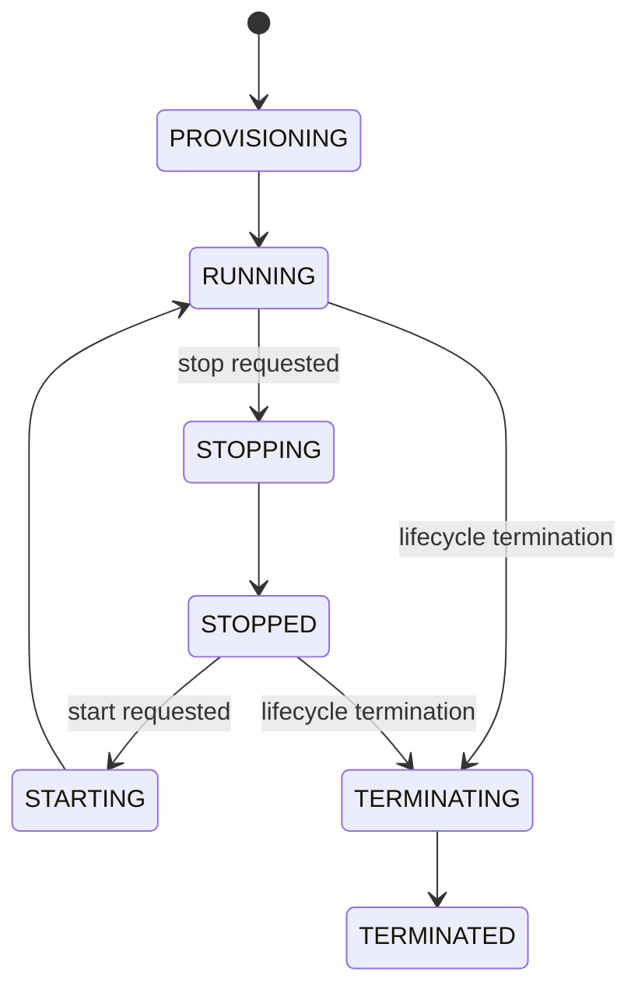

# Maintenance, Changing Shapes, and Instance Lifecycle Termination

A Compute instance on Oracle Cloud Infrastructure (OCI) must be managed from the moment it enters service until retirement. During operations, you may need to patch the operating system, respond to infrastructure maintenance notices, scale resources up or down, migrate workloads to another host, and eventually terminate the instance.

Each operation affects service availability, data, and cost differently. A sound procedure clearly defines what will change, what must be preserved, when the service is considered recovered, and how to handle outcomes that fall short of requirements.

This lesson belongs to the **Compute and Virtual Machines** chapter, focusing on operating OCI instances with proper permissions, observable state, controlled automation, and data protection plans.

## Learning Objectives

After this lesson, you will be able to:

- Distinguish stop, start, reboot, migration, and terminate.
- Prepare a maintenance window with a recovery plan and post-change verification.
- Evaluate shape-change feasibility based on image, resources, quotas, and capacity.
- Execute a VM resize procedure with planned downtime.
- Verify the OS, networking, volumes, and application after the instance returns to service.
- Choose whether to preserve or delete boot volumes, data volumes, and dependent resources at end of life.
- Explain why stopped or terminated instances can still leave associated costs.

## Distinguishing Lifecycle Operations

| Operation | Purpose | What to Watch Out For |
|---|---|---|
| Stop | Halts the instance while keeping resources and config needed for later startup | Application stops serving; billing depends on resource type |
| Start | Boots a stopped instance | Must verify both OS and services after OCI state returns to RUNNING |
| Reboot | Restarts the instance | Causes interruption; must handle application shutdown |
| Change shape | Adjusts supported Compute configuration | May change CPU, RAM, network bandwidth, and attachment limits |
| Maintenance migration | Handles underlying host maintenance or replacement | Execution method depends on instance type and specific event |
| Terminate | Ends and deletes the instance | Cannot start the same terminated instance again; data survival depends on storage type and preservation choices |

Stopping does not mean deleting the instance. Conversely, preserving a boot volume at termination does not mean the old instance still exists to start again. Recovering from a volume or backup means running a recovery flow or creating a new instance.

Common lifecycle transitions can be illustrated as follows:



The diagram shows common paths only. Transitional states are not always visible to observers. Distinguish between the API accepting a request, the infrastructure operation finishing, and the application being ready to serve.

## Identifying Maintenance Types and Responsibilities

### OS and Application Maintenance

Operations teams are typically responsible for:

- OS, kernel, and package patching inside the instance.
- Runtime, library, and application updates.
- Service auto-start configuration across reboots.
- Backup, recovery, and data validation procedures.
- Draining traffic, handling sessions, and monitoring user experience.

An OCI host maintenance event does not mean the kernel or application inside the VM was patched. Likewise, patching the OS does not resolve underlying physical host hardware issues.

For hands-on practice, you can use a Linux instance running a Java service to observe reboot impacts on the service, heap, database connections, and warm-up duration. The same principles apply to other workloads.

### OCI Infrastructure Maintenance

OCI uses methods including live migration, reboot migration, rebuild in place, and manual migration. The applicable method depends on resource characteristics and the maintenance event. See [Instance Maintenance overview](https://docs.oracle.com/en-us/iaas/Content/Compute/References/infrastructure-maintenance.htm).

| Method | Operational Understanding |
|---|---|
| Live migration | Eligible VMs move hosts while continuing to run; latency-sensitive apps still require monitoring |
| Reboot migration | Involves a stop phase, move to another host, and restart |
| Rebuild in place | Maintenance on current hardware; may require a longer window |
| Manual migration | Operations team must follow instructions to move or rebuild the workload |
| Non-Terminating Repair on supported bare metal | Repair type determines whether stopping the instance is required |

Non-Terminating Repair is a dedicated mechanism for supported bare metal hosts that covers both repairs requiring downtime and repairs while the instance stays running. Do not assume the name guarantees zero interruption for every maintenance action. See [Non-Terminating Repair](https://docs.oracle.com/en-us/iaas/Content/Compute/Tasks/non-terminating-repair.htm).

For VMs, inspect live migration support and any instance-specific incompatibilities. Shape, image, launch options, and enabled features can affect migration capability; do not judge from shape name alone.

## Receiving and Handling Maintenance Notices

When a notice arrives, first record:

1. Affected instance OCID, region, compartment, and workload.
2. Event type, expected action, and deadline if any.
3. Timezone of the maintenance schedule and assigned owner.
4. Whether proactive rescheduling is available within OCI limits.
5. Impact on traffic, local data, and dependent instances.
6. Configured recovery behavior for the instance.
7. Evidence to check to confirm the event is resolved.

Live migration can reduce disruption but does not replace application-level redundancy. Reboot migration incurs downtime. For manual migration or instances with local NVMe, plan data handling and steps separately per documentation. See [methods for moving an instance during maintenance](https://docs.oracle.com/en-us/iaas/Content/Compute/Tasks/movinganinstance.htm).

Running an OS reboot command is not enough to prove the instance moved hosts or closed the maintenance event. When an event requires a specific action, execute the exact supported action and re-check maintenance status.

Availability config also determines post-recovery state. For instance, `RESTORE_INSTANCE` aims to restore the pre-event lifecycle state, whereas `STOP_INSTANCE` leaves the instance stopped after recovery. An instance returning to service still does not prove the application service is working. See [recovery action semantics](https://docs.oracle.com/en-us/iaas/tools/python/latest/api/core/models/oci.core.models.UpdateInstanceAvailabilityConfigDetails.html).

## Preparing a Recoverable Change

### Documenting Resources and Dependencies

Never record only display names, since names can collide. Identify resources by OCID and scope:

| Information Group | Details to Record |
|---|---|
| Compute | Instance OCID, shape, OCPUs, RAM, AD, fault domain, image, and launch options |
| Networking | VNICs, MACs, private/public IPs, subnets, NSGs, custom routes, and DNS |
| Storage | Boot volume, block volumes, attachment types, mount points, and local disks |
| Application | Version, config, startup method, health endpoint, and dependencies |
| Traffic | Load balancer backends, open connections, workers, and job schedules |
| Recovery | Completed backups, retention, encryption keys, and restore instructions |
| Orchestration | Instance pool, autoscaling, Terraform, or config management tools |
| Observability | Dashboards, logs, alarms, and pre-change metric baselines |

Modifying an instance belonging to a pool or managed by a pipeline requires coordinating with that orchestration layer. An automated controller maintaining instance count may recreate a resource you just deleted, or manual edits may be overwritten on the next run.

### Identifying Required Permissions

SSH or RDP access does not substitute for OCI API permissions. Separate the needs clearly:

- Read instances, attachments, and metadata for inspection.
- Execute power actions or update instance configuration.
- Create and restore backups within the relevant storage scope.
- Use encryption keys when resources rely on customer-managed keys.
- Terminate instances or delete volumes when reaching decommissioning.

Instance, network, volume, and backup compartments can differ. Grant permissions scoped to the job; needing to resize a shape does not mean someone needs permission to delete every volume in the tenancy.

### Defining Outcomes and Abort Thresholds

A change plan must answer:

- After the change, what configuration and behavior must be met?
- When does downtime start counting?
- What is the maximum time budget for each step?
- What criteria allow returning the node to service?
- When must we abort the current path and roll back?
- If the previous configuration also lacks capacity, where will the service run?

Example: an API has two nodes behind a load balancer. Maintain only one node at a time; the remaining node must sustain projected load. The maintained node re-enters the backend set only after passing internal checks and live-path transaction tests.

If a workload has only one node, accept and announce downtime per team procedures. Health checks do not conjure a standby replica.

## Backups Must Match the Data Type

### Classify Before Choosing a Backup Method

| Data Location | Required Preparation |
|---|---|
| Boot volume | Backup or a plan to rebuild OS and config |
| Remote block volume | Backup, volume group, or application-specific backup mechanism |
| Local NVMe | Copy critical data to durable storage before any action that could wipe local disks |
| Self-managed database | Database-supported consistent backup and recovery procedure |
| External database or data service | Verify retention, reconnection, and service-level responsibilities |
| In-memory-only data | Checkpoint or accept loss per design |

A boot volume backup does not include every data volume, RAM contents, or resources in other services. Custom images must also be scoped accurately before treating them as copies of an entire workload.

### Crash-Consistent vs. Application-Consistent

Volume backups reflect data on disk. Volume groups help create point-in-time consistent backups across grouped volumes, while applications may still need quiescing, transaction flushing, or dedicated mechanisms for application consistency. See [Block Volume backup consistency guidance](https://docs.oracle.com/en-us/iaas/Content/Block/Concepts/blockvolumebackups.htm).

For data-writing services, the workflow may include stopping new writes, waiting for active tasks to finish, stopping or quiescing the application, and then creating backups per the chosen tool's instructions. Do not treat a `sync` command as proof that every application's transactions are consistent.

Before changing anything, confirm the backup finished in a usable state and the team knows how to restore it. A backup request ID is not proof of recoverability. If backups are encrypted with customer-managed keys, recoverability also depends on access to and lifecycle of those keys.

## Executing Planned OS Maintenance

A typical operational sequence:

1. Confirm remaining nodes can carry load or the downtime window has begun.
2. Drain the node out of new traffic and wait for active connections per system capability.
3. Pause schedulers, consumers, or workers as needed to prevent duplicate processing.
4. Create an appropriate recovery point and record current configuration.
5. Stop applications in dependency order.
6. Update OS or software per image guidance.
7. Reboot if required by patches or configuration.
8. Verify OS, network, storage, application, and data.
9. Return the node to service incrementally and monitor.

The following Linux commands are verification examples, not an automated patching script for every image:

```bash
uname -r
uptime
systemctl --failed
ip -br address
ip route
lsblk -f
findmnt
```

After rebooting, verify the running kernel rather than merely checking that a kernel package was installed. On Windows, check update status, pending reboot flags, services, and OS event logs.

Avoid bundling OS patching, shape resizing, network changes, and storage edits into one big change without clear reason. Making one verified change at a time makes it easier to pinpoint root causes and pick the right recovery path.

## When Should You Change a Shape?

Changing a shape is vertical scaling. It helps when a workload needs more CPU or RAM, or when over-provisioned resources can be downsized to save cost.

Rely on metrics over time:

- High CPU with growing run queues and latency may suggest CPU shortage.
- Memory pressure, swap, or OOM must be analyzed alongside actual application memory usage.
- High I/O wait can stem from storage and is not solved simply by adding CPU.
- Network throughput may be capped by the shape, network path, or peer side.
- A slow database or overloaded downstream service can keep bottlenecking an API even on a larger instance.

For Java applications, after increasing RAM check whether the JVM actually uses the intended settings. When reducing RAM, verify `-Xmx`, native memory, thread stacks, and container limits still fit. An oversized heap setting can prevent the service from starting even after OCI finishes resizing.

For stateless workloads, compare vertical scaling against adding nodes. Making one machine larger adds no fault tolerance if that single machine stops.

## Prerequisites and Limits Before Changing Shape

The current shape and image determine the supported target shapes. The image must be compatible, OCPU/RAM configuration valid, and service limits sufficient. Also check compartment quotas and capacity in the deployment location. See [Changing the Shape of an Instance](https://docs.oracle.com/en-us/iaas/Content/Compute/Tasks/resizinginstances.htm).

Points to evaluate:

| Question | Why Check? |
|---|---|
| Operating on VM or bare metal? | VM resize procedures do not apply across all instance types |
| Staying in the same family or switching families? | Can change processor, drivers, performance, and limits |
| Is CPU architecture compatible with image and binaries? | Moving x86 to Arm requires an application migration plan |
| Are licenses tied to the image or configuration? | Marketplace and commercial software may impose constraints |
| Does a smaller shape have enough VNICs and network resources? | Scaling down may require adjusting attachments |
| Are there multiple block volumes or special topologies? | Extra preparation steps may be needed before resizing |
| Are local disks or specialized features present? | Requires a resource-appropriate procedure |
| Are target capacity and fallback options available? | Quota permission does not guarantee physical hardware availability |

Current resize documentation requires handling attachments before certain changes, including detaching block volumes when an instance has more than one block volume; when downsizing to a shape supporting fewer VNICs, excess VNICs must be handled. Detaching must follow proper I/O stop, unmount, and reconnect steps rather than blindly detaching resources.

OCI also notes known issues where resizing can reorder VNICs or block devices in the OS, as well as guards blocking certain operations to protect topology. Therefore, check [Known Issues for Compute](https://docs.oracle.com/en-us/iaas/Content/Compute/known-issues.htm), use stable volume and interface identifiers, and never ignore errors just to force a resize through.

If the image or shape does not allow direct resizing, the right path may be launching a new instance, migrating data, and shifting traffic. Do not assume every shape pair can be swapped in place.

## Example: Resizing a Standard Flex VM

### Exercise Scope

Suppose a test Linux VM has:

| Attribute | Configuration |
|---|---|
| Shape | `VM.Standard.E4.Flex` |
| Before change | 1 OCPU, 8 GB RAM |
| Target | 2 OCPUs, 16 GB RAM |
| Storage | Boot volume, no local NVMe for critical data |
| Networking | One primary VNIC, guest config recorded |
| Application | Example service `orders-api` |
| Method | Proactively stop, resize while STOPPED, then start again |

This is an illustrative configuration, not a guarantee that your region or tenancy has capacity for that shape. Practice only on resources you are authorized to modify.

The procedure below incurs downtime. Having a flexible shape does not mean every CPU/RAM change happens without a reboot. The UpdateInstance reference describes impacts on running instances and update options. See [OCI CLI instance update](https://docs.oracle.com/en-us/iaas/tools/oci-cli/latest/oci_cli_docs/cmdref/compute/instance/update.html).

### Step 1: Record the Baseline

Inside Linux, before stopping:

```bash
lscpu
free -h
ip -br address
ip route
lsblk -f
findmnt
systemctl --failed
```

Also record application metrics under representative load: throughput, p95 latency, error rate, and memory usage. Metrics from an idle host are insufficient to justify scaling down or prove scaling up worked.

OCI CLI examples here use Bash on an admin machine with CLI installed and authenticated. OCIDs with `...` must be replaced with real identifiers. Commands are presented for study and are not executed by this article itself.

```bash
INSTANCE_ID='ocid1.instance.oc1...'
COMPARTMENT_ID='ocid1.compartment.oc1...'
IMAGE_ID='ocid1.image.oc1...'
AVAILABILITY_DOMAIN='TENANCY_PREFIX:REGION-AD-1'

oci compute instance get --instance-id "$INSTANCE_ID"

oci compute shape list \
  --compartment-id "$COMPARTMENT_ID" \
  --availability-domain "$AVAILABILITY_DOMAIN" \
  --image-id "$IMAGE_ID" \
  --all
```

Variables must come from real resources in the CLI profile's active region. A compatible shape list is not a capacity guarantee. Use capacity reports or appropriate reservation plans when stronger launch assurance is needed.

### Step 2: Drain and Stop the Application

Remove the node from new traffic per load balancer or platform design. Once active connections and in-flight work finish, stop the service per application guidelines.

Example with the hypothetical service:

```bash
sudo systemctl stop orders-api
systemctl is-active orders-api
```

Replace the service name with your actual unit. An `inactive` result can return a non-zero exit code; automation scripts must interpret the desired state properly.

If the application takes a long time to stop, finish application shutdown before issuing the power action. Soft power actions still have wait timeouts, so they cannot replace transaction closing or worker termination logic.

### Step 3: Stop the Instance via OCI

```bash
oci compute instance action \
  --instance-id "$INSTANCE_ID" \
  --action SOFTSTOP \
  --wait-for-state STOPPED \
  --max-wait-seconds 1200
```

`SOFTSTOP` sends an OS shutdown request; per current reference, after a 15-minute wait the instance may be forcibly powered off if the OS has not stopped. `STOP` powers off immediately, while `SOFTRESET` and `RESET` likewise differ in shutdown mechanism. See [instance action reference](https://docs.oracle.com/en-us/iaas/tools/oci-cli/latest/oci_cli_docs/cmdref/compute/instance/action.html).

Before continuing, confirm lifecycle state is `STOPPED`. If the waiter times out, inspect status and logs before retrying; a client timeout does not prove the earlier request failed.

### Step 4: Update Shape Configuration

Execute only after confirming the right instance is stopped and a recovery plan is ready:

```bash
oci compute instance update \
  --instance-id "$INSTANCE_ID" \
  --shape 'VM.Standard.E4.Flex' \
  --shape-config '{"ocpus":2,"memoryInGBs":16}'

oci compute instance get --instance-id "$INSTANCE_ID"
```

Read back the output to verify shape, `shape-config`, and state. Do not treat HTTP success or command completion as proof that the application already has enough resources and works properly.

Some cases allow updating shape directly while the instance is running with OCI handling the reboot. This exercise stops proactively to establish a clean boundary for draining, backups, and shutdown.

### Step 5: Start and Verify

```bash
oci compute instance action \
  --instance-id "$INSTANCE_ID" \
  --action START \
  --wait-for-state RUNNING \
  --max-wait-seconds 1200
```

Once OS access is back, re-check:

```bash
lscpu
free -h
ip -br address
ip route
lsblk -f
findmnt
systemctl --failed
systemctl status orders-api --no-pager
```

If the application is configured to auto-start, confirm it is actually active. If procedures require manual startup, start it only after volumes, configuration, and dependencies are ready.

If the application exposes a health endpoint as in the example, test it as follows:

```bash
curl --fail \
  --connect-timeout 3 \
  --max-time 10 \
  http://127.0.0.1:8080/health
```

Loopback checks confirm part of local status. Also test from the user or load balancer path with a representative business operation before returning the node to service.

### Executing via Console

If using the Console instead of CLI, follow the same milestones:

1. Open the right instance and verify its OCID.
2. Drain and stop the application.
3. Stop the instance and confirm `STOPPED` state.
4. Open the edit shape dialog and select a valid shape and configuration.
5. Save, re-read the configuration, and start the instance.
6. Verify OS, application, and live traffic flow.

Use only one execution method for a given change, coordinating with any pipeline. Button locations may change with Console UI updates.

## Post-Maintenance or Post-Resize Verification

Never sign off solely from `RUNNING`. A useful verification matrix covers:

| Layer | What Must Be Proven |
|---|---|
| OCI | Right instance, shape, OCPU/RAM, and lifecycle state |
| OS | Boot completed with no critical system services failed |
| Networking | Interfaces, IPs, routes, DNS, and admin access work |
| Storage | Right volumes mounted, right filesystems and permissions |
| Application | Service ready, connected to dependencies, handling requests |
| Data | Reads/writes, transactions, or checkpoints verified |
| Performance | Meets throughput, latency, and error-rate targets under representative load |
| Observability | Metrics and logs continue flowing; alarms reflect true state |
| Orchestration | Load balancer, pool, and desired config have no drift |

For volumes, avoid relying on `/dev/sdb` still existing to conclude you have the right disk. Verify device identifiers, filesystem UUIDs, or consistent device paths per design. For VNICs, verify MACs and live addresses in case interface names shifted.

Changing shapes does not automatically enlarge boot volumes, expand filesystems, or adjust all application limits. Measure each relevant limit again before concluding effectiveness.

## Recovering When a Change Falls Short

### Reverting to the Previous Configuration

If the OS or application fails after resizing:

1. Keep the node out of traffic.
2. Collect boot errors, console output, logs, and attachment states.
3. Determine whether the fault lies in shape, networking, storage, or application config.
4. If appropriate, stop the node and revert to the pre-change shape/OCPU/RAM.
5. Start, re-verify, and only then return to service.

Reverting to the previous configuration is another Compute operation that may incur downtime and require capacity. There is no guarantee the old host or resources remain reserved merely because the instance ran there earlier.

### When Data Recovery or a New Node Is Needed

If the failure stems from patches, filesystem config, or data corruption, reverting the shape does not undo those changes. You may need to restore from backup or launch a new node from a known-good image and configuration.

The recovery plan must specify:

- Which backup snapshot is used.
- Which data since the backup timestamp could be lost.
- How to restore data volumes and related access keys.
- How to reattach networking, service discovery, and load balancers.
- How to prevent two nodes from holding an exclusive role or performing unsafe concurrent writes.

RTO is the Recovery Time Objective; RPO is the Recovery Point Objective measuring acceptable data loss. Test actual restore procedures to measure both objectives instead of merely estimating how long an instance-launch command takes.

## Observing Maintenance and Recovery Status

In the `oci_compute_infrastructure_health` namespace, `maintenance_status` helps track maintenance schedules while `instance_status` reflects infrastructure health of a running VM. `instance_status` uses 0 for available and 1 for unavailable due to infrastructure issues; stopped instances emit no value for this metric. See [Infrastructure Health Metrics](https://docs.oracle.com/en-us/iaas/Content/Compute/References/infrastructurehealthmetrics.htm).

Never interpret a gap in metrics as proof the system is healthy. Cross-check lifecycle state, agent status, and metric-emission policies.

Observation layers should complement each other:

- Maintenance events and notices reveal upcoming infrastructure actions.
- CPU, memory, disk, and network metrics show resource and load shifts.
- OS logs help diagnose boot, service, and driver behavior.
- Health checks and business metrics show whether the live service actually serves requests.
- Audit logs and request IDs trace who initiated configuration changes.

Mark start and end timestamps for changes to compare before/after metrics. If alerts are temporarily silenced for planned maintenance, restore alerting afterward; do not ignore failures outside maintenance scope.

## When Should an Instance Reach End of Life?

An instance can be retired when its workload moved elsewhere, a test environment expired, the host was replaced by a newer image, or the resource no longer has an active owner.

Collect evidence that the workload was cleanly migrated or shut down:

- Traffic no longer routes to the instance.
- Schedulers and workers no longer hold active roles.
- Data to retain has been migrated or archived per policy.
- Recoverability has been verified if still required.
- Data owners defined retention and deletion schedules.

Low CPU alone is insufficient to conclude an instance is unneeded. It may be a standby host, a monthly scheduled runner, or a low-traffic yet critical endpoint.

## Deciding Whether to Keep or Delete Resources

| Resource | Decision Required Before Termination |
|---|---|
| Instance | Confirm exact OCID and confirm workload moved elsewhere or stopped |
| Boot volume | Preserve for recovery or delete once criteria are met |
| Data volumes created at launch | Explicitly choose preserve or delete via the matching flag |
| Data volumes attached later | Inventory and manage lifecycle separately |
| Local NVMe | Back up needed data before the resource is destroyed |
| VNICs and IPs | Update network dependencies and addressing plans |
| DNS and load balancer backends | Remove or point to new endpoints |
| Backups and custom images | Apply dedicated retention with an assigned owner |
| Logs and alarms | Keep required evidence and remove obsolete configs |
| Keys, certificates, and access grants | Revoke instance-specific credentials while keeping restore dependencies |

Termination ends the instance and detaches related attachments. Local NVMe data is wiped at termination, so move needed data off local disks beforehand. See [Terminating an Instance](https://docs.oracle.com/en-us/iaas/Content/Compute/Tasks/terminatinginstance.htm).

Private IPs, ephemeral public IPs, and reserved public IPs have different lifecycles and management models. Never assume creating a new machine with the same name reclaims all old addresses. For stable endpoints, design DNS, load balancers, or IP addressing before deleting nodes.

Preserving the boot volume does not preserve the old machine's entire identity: a new instance gets a new OCID and attachments that must be re-verified. When launching from a boot volume, also evaluate shape compatibility, resource placement, and any configuration outside the OS.

## Example Termination with Explicit Data Preservation

This is an instance deletion operation; run only after completing the decommissioning checklist. The Bash example below explicitly preserves the boot volume and data volumes created at launch:

```bash
# Verify the exact target right before deleting.
oci compute instance get --instance-id "$INSTANCE_ID"

# Example terminating the instance and preserving specified volumes.
oci compute instance terminate \
  --instance-id "$INSTANCE_ID" \
  --preserve-boot-volume true \
  --preserve-data-volumes-created-at-launch true \
  --wait-for-state SUCCEEDED \
  --max-wait-seconds 1200
```

Do not rely on defaults to decide data retention. Current CLI reference documents `--preserve-boot-volume` defaulting to false and `--preserve-data-volumes-created-at-launch` defaulting to true. The example passes both explicitly. `SUCCEEDED` in the terminate waiter is the work request state per this reference; verify against your installed CLI version. See [OCI CLI instance terminate](https://docs.oracle.com/en-us/iaas/tools/oci-cli/latest/oci_cli_docs/cmdref/compute/instance/terminate.html).

Afterward, confirm the instance terminated and every volume meant to be kept still exists. The instance may remain visible in lists with state `TERMINATED` for a while; that is not a reason to re-run deletion.

These two preserve flags do not create backups, do not protect data residing only in RAM or local NVMe, and do not automatically set retention on remaining resources. Deleting preserved volumes is a separate lifecycle decision.

## Cleaning Up Dependencies After Termination

After confirming the workload stopped and data is properly preserved:

1. Clean up DNS records, backends, service discovery entries, and routes pointing to the old host.
2. Inspect separately managed public IPs and workload-dedicated network resources.
3. Remove unused monitoring configs while retaining logs per required retention windows.
4. Revoke permissions, credentials, or certificates dedicated solely to that instance.
5. Update infrastructure configs and asset inventories to prevent accidental recreation.
6. Tag retained volumes or backups with owner, expiration date, and purpose.
7. Review costs by tag, compartment, and service.

Do not delete NSGs, gateways, or encryption keys merely because an instance terminated if those resources still serve other workloads or backups. Cleanup must follow actual dependencies.

While recovery backups remain within their retention period, backups and decryption access must remain usable. Deleting a dependency early can break restore capability even while backups still appear in lists.

## Understanding Billing on Stop and Terminate

Billing while stopped depends on shape. Standard shapes generally pause Compute billing when stopped, though the instance still counts toward service limits. Dense I/O, HPC, and certain GPU or bare metal shapes follow different rules. Shutting down from inside the OS alone does not stop billing; you must issue a stop through OCI per procedure. See [Resource Billing for Stopped Instances](https://docs.oracle.com/en-us/iaas/Content/Compute/Tasks/resource-billing-stopped-instances.htm).

Beyond Compute, check separately for:

- Retained boot volumes and block volumes.
- Backups, custom images, and stored logs.
- Remaining load balancers, gateways, or appliances.
- Resources in dependent services.
- Software licenses and commercial models applied to the workload.

View remaining costs through an operational formula:

```text
Post-termination cost
  = cost of intentionally retained resources
  + cost of uncleaned dependencies
  + cost of retaining backups, logs, and data
```

The goal is not deleting everything immediately, but knowing which items are intentionally retained, who owns them, and when they will be reviewed. A volume retained for recovery needs an expiration date; a forgotten volume must be surfaced and resolved.

## Automating Operational Workflows

A maintenance or resize pipeline should model conditional states:

```text
Verify resources and change prerequisites
  -> verify recovery point
  -> drain and stop application
  -> execute OCI operation
  -> wait for result and re-read config
  -> verify OS, data, and application
  -> restore traffic
  -> monitor and update records
```

Automation must handle cases where a request times out while the operation continues running, a node fails health checks, configuration changed yet startup fails, or an orchestrator spawns extra unintended nodes.

Practical principles include:

- Target resources by OCID and state preconditions, not display name alone.
- Check live state before retrying an operation.
- Bound wait times and log request IDs for investigation.
- Verify post-conditions rather than checking only the API command's exit code.
- Keep nodes out of traffic if application checks fail.
- Distinguish configuration rollback from data restoration.
- For decommissioning, declare preservation options and cleanup schedules for retained resources explicitly.

Terraform or Resource Manager can manage infrastructure resource state; guest configuration tools manage OS and applications. A valid plan does not replace draining, shutdown, and business checks during the maintenance window.

## Completion Criteria

| Work Type | Completion Evidence |
|---|---|
| OS maintenance | Target version and boot state verified; services and representative transactions working |
| Infrastructure maintenance | Event handled as required; infrastructure state and application verified |
| Shape scale-up or scale-down | OCI and guest configs match target; application meets requirements under appropriate load |
| Recovery | Data, connectivity, and service roles restored to agreed targets |
| Lifecycle termination | Exact instance terminated, kept/deleted data confirmed, remaining dependencies and costs assigned to an owner |

Instance lifecycle management must combine infrastructure state with application serviceability and data lifecycle. Every maintenance event, shape resize, or resource retirement needs measurable outcomes and a fallback plan when reality diverges from expectations.
