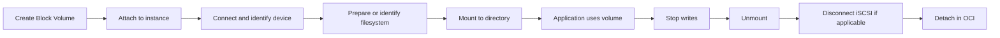

# Creating, Attaching, and Detaching a Block Volume

A Java application running on OCI Compute may require extra space for uploaded files, processing data, or storage components managed by the operations team. Placing all data on the boot volume tightly couples the operating system lifecycle with the data lifecycle. Block Volume provides block-level storage devices that can be created separately and attached to an appropriate instance.

For an application to use a volume, both OCI-side operations and operating system configurations must be completed. This lesson walks through creating a volume, attaching it, identifying the device, preparing the filesystem, mounting, and detaching; the examples focus on a Linux VM with a new data volume.

## 1. Distinguishing Volume, Attachment, and Mount

| Component or Operation | Which Layer? | Meaning |
| --- | --- | --- |
| Block volume | OCI Block Volume | A storage resource with its own OCID, capacity, location, and configuration |
| Volume attachment | OCI Compute | The association attaching a volume to an instance; the attachment has its own OCID |
| Connect | Operating system and storage protocol | Makes the device accessible from the OS; iSCSI has a separate connection step |
| Filesystem | Inside the block device | Organizes data in a format such as ext4 or XFS |
| Mount | Operating system | Places the filesystem into the directory tree, such as `/srv/order-data` |
| Detach | OCI Compute | Removes the attachment association after preparing at the OS layer |

Block Volume supports creating, attaching, connecting, and moving volumes across eligible instances. The volume and instance must be in the same availability domain for direct attachment; they can belong to different compartments if permissions allow. [Oracle: Overview of Block Volume](https://docs.oracle.com/en-us/iaas/Content/Block/Concepts/overview.htm), [Oracle CLI: volume create](https://docs.oracle.com/en-us/iaas/tools/oci-cli/latest/oci_cli_docs/cmdref/bv/volume/create.html)



The flow above applies to a standard filesystem. Volumes used as raw devices, swap, LVM members, or storage for a cluster system require procedures specific to the layer managing that device.

## 2. Preparation Before Creation

Suppose you need a volume for a Java API's data directory. Before acting, identify:

- **Target instance:** OCID, region, availability domain, and operating system.
- **Management scope:** the compartment holding the volume and the team responsible for operations.
- **Requirements:** capacity, I/O characteristics, scalability, and required performance tier.
- **Data:** is this a new disk or one that already contains data; what are the backup and recovery requirements?
- **Permissions:** the OCI user has permissions to create volumes and manage attachments; the Linux operator has the required administrative privileges.
- **Lifecycle:** will the volume be retained, moved, or deleted when the instance is replaced?

IAM permissions to attach a resource and Linux permissions to mount or write files are two independent layers. A successful attachment does not automatically grant filesystem write access to the account running Java.

Do not choose performance solely based on free space. For real workloads, consider IOPS, throughput, latency, and instance limits together. Provisioned capacity and performance options must also be factored into cost planning, even before the application uses the volume.

## 3. Creating a Block Volume in OCI

In the Console, open the Block Storage section, select Block Volumes, and create a volume. Choose the compartment, an identifiable name, the availability domain matching the instance, and an appropriate capacity and performance tier. You can also configure encryption keys, backup policies, and tags per environment requirements. Wait for the volume to become available before attaching. [Oracle: Creating a Block Volume](https://docs.oracle.com/en-us/iaas/Content/Block/Tasks/creatingavolume.htm)

### 3.1. OCI CLI Example

The commands in this lesson use **Bash**, with the OCI CLI already configured for authentication. This is a hands-on guide and has not been run against your tenancy. Replace all placeholders with real values and execute in an authorized test environment.

```bash
export COMPARTMENT_OCID='ocid1.compartment.oc1..REPLACE_ME'
export INSTANCE_OCID='ocid1.instance.oc1.REGION.REPLACE_ME'
export AVAILABILITY_DOMAIN='REPLACE_WITH_EXACT_AVAILABILITY_DOMAIN_NAME'

oci bv volume create \
  --compartment-id "$COMPARTMENT_OCID" \
  --availability-domain "$AVAILABILITY_DOMAIN" \
  --display-name order-data-lab \
  --size-in-gbs 50 \
  --wait-for-state AVAILABLE
```

This example selects 50 GB for the lab exercise. Check the performance configuration and default values before applying to another workload. Save `data.id` from the output as the **volume OCID**; this OCID will be used when creating the attachment. [Oracle CLI: volume create](https://docs.oracle.com/en-us/iaas/tools/oci-cli/latest/oci_cli_docs/cmdref/bv/volume/create.html)

```bash
export VOLUME_OCID='ocid1.volume.oc1.REGION.REPLACE_ME'

oci bv volume get --volume-id "$VOLUME_OCID"
```

Verify the compartment, availability domain, size, and state. Do not use the display name as a unique identifier because resources can share the same name.

## 4. Attach: Choosing the Right Attachment Type

Two common attachment types are **paravirtualized** and **iSCSI**. With paravirtualized, the device connects automatically after attachment succeeds. With iSCSI, the operating system needs an iSCSI connection; this can be done using commands provided by OCI or an appropriate automatic mechanism from the Block Volume Management plugin. Regardless of type, the filesystem must still be prepared and mounted if the application accesses it via file paths. [Oracle: Attaching a Block Volume to an Instance](https://docs.oracle.com/en-us/iaas/Content/Block/Tasks/attach-compute-volume-attachment.htm)

| Criterion | Paravirtualized | iSCSI |
| --- | --- | --- |
| Connection in guest OS | Connects automatically when attachment completes | Requires an iSCSI session to be established |
| Additional inspection tools | Linux block device tools | Block device tools and `iscsiadm` |
| Preparation before detach | Stop using the device, unmount related filesystems | Corresponding steps, then log out of the exact iSCSI session |
| Usage selection | Check shape support, image support, and workload requirements | Check support, agent/plugin, and iSCSI configuration |

Example of attaching a volume to a VM that supports paravirtualized attachments:

```bash
oci compute volume-attachment attach \
  --instance-id "$INSTANCE_OCID" \
  --volume-id "$VOLUME_OCID" \
  --type paravirtualized \
  --wait-for-state ATTACHED
```

Record `data.id` from this output as the **attachment OCID**. It differs from the volume OCID. Attachment management operations, including detach, use the attachment identifier. [Oracle CLI: volume-attachment attach](https://docs.oracle.com/en-us/iaas/tools/oci-cli/latest/oci_cli_docs/cmdref/compute/volume-attachment/attach.html)

### 4.1. If Choosing iSCSI

After attaching, open the iSCSI Commands and Information section of that exact attachment to retrieve the IQN, IP address, port, and corresponding commands. Steps may include registering the node, configuring reconnection after reboot, configuring CHAP if enabled, and logging into the target. Use the details from that exact attachment; do not copy targets from another machine or volume. [Oracle: Connecting to iSCSI-Attached Block Volumes](https://docs.oracle.com/en-us/iaas/Content/Block/Tasks/connectingtoavolume_topic-Connecting_to_iSCSIAttached_Volumes.htm)

If a plugin has already connected automatically, check the actual state before re-running commands. For multipath or specialized performance configurations, follow the corresponding OCI procedure rather than extrapolating from the single-path example in this lesson.

## 5. Identifying the Right Device in Linux

Before attaching, record the list of existing devices. After attaching and connecting, check again:

```bash
lsblk -o NAME,PATH,SIZE,TYPE,FSTYPE,MOUNTPOINTS,SERIAL
findmnt /
```

Cross-check the output with the volume OCID, capacity, attachment details, and device path provided by OCI. In environments supporting consistent device paths, paths may appear under `/dev/oracleoci/`; confirm that it points to the right volume. Do not assume `/dev/sdb` or `/dev/sdc` is always the newly attached data disk. Device naming order can change upon reboot. [Oracle: Traditional fstab Options](https://docs.oracle.com/en-us/iaas/Content/Block/References/fstaboptions.htm), [Oracle: Consistent Device Paths and fstab](https://docs.oracle.com/en-us/iaas/Content/Block/References/fstaboptionsconsistentdevicepaths.htm)

For example, if you see a new 50 GB disk appear, size alone is only one piece of corroborating evidence. It is not enough to conclude it is safe to format: the machine might already have another disk of the same size, or the device could be managed by another storage layer.

In the following commands, the `DEVICE` variable must point to the confirmed device:

```bash
DEVICE='/dev/REPLACE_WITH_CONFIRMED_NEW_VOLUME'

lsblk -f "$DEVICE"
sudo blkid "$DEVICE"
sudo wipefs --no-act "$DEVICE"
```

These commands are for inspection; `wipefs --no-act` does not erase data signatures. If the tools find no filesystem, still verify the volume's history: data may reside inside a partition, LVM, encryption, or software using raw devices. Do not treat an empty result as permission to format a volume of unknown origin.

## 6. Creating a Filesystem and Mounting a New Volume

This section applies only to **a newly created lab volume with no existing data**, already confirmed not to be a boot volume and not belonging to LVM, RAID, or multipath. The example creates ext4 directly on the entire device. If the environment uses a partition table, the filesystem will be created on the selected partition and paths must be adjusted accordingly.

**`mkfs` writes filesystem structures onto the device and can destroy old data. Run it only after confirming the exact new volume.**

```bash
sudo mkfs.ext4 -L orderdata "$DEVICE"
sudo mkdir -p /srv/order-data
sudo mount "$DEVICE" /srv/order-data

findmnt --mountpoint /srv/order-data
df -hT /srv/order-data
```

If the volume already has a valid filesystem, skip the `mkfs` step. When reattaching an existing data volume, identify the existing filesystem or partition and mount it according to operational requirements.

Before mounting, inspect the target directory to avoid hiding existing files underneath. After mounting, confirm `findmnt` shows the right source device and filesystem type; `df` showing capacity at a path alone is not enough to prove it is the intended volume.

### 6.1. Granting Permissions to the Java Application

Suppose the service runs under the `orderapp` account and `orderapp` group properly created on the machine. Create the data directory only after confirming the mount succeeded:

```bash
mountpoint -q /srv/order-data && \
  sudo install -d -o orderapp -g orderapp -m 0750 \
  /srv/order-data/uploads
```

The application uses `/srv/order-data/uploads` per its configuration. Test using the exact account running the service, and check additional policies such as SELinux if used in the environment. Do not open write permissions across the entire filesystem for all accounts as a quick fix for a permission error.

A single machine's block volume also does not solve the problem of multiple API replicas needing to see the same uploaded files. Before scaling out application instances, determine which data stays local and which data needs a shared mechanism or appropriate storage service.

## 7. Remounting After Reboot

A manual mount does not automatically configure persistence for the next boot. With the traditional configuration approach, OCI guides using the filesystem UUID in `/etc/fstab` along with appropriate options, including `_netdev` and `nofail`. If using consistent device paths, follow the instructions specific to that mechanism. [Oracle: Traditional fstab Options](https://docs.oracle.com/en-us/iaas/Content/Block/References/fstaboptions.htm), [Oracle: Consistent Device Paths and fstab](https://docs.oracle.com/en-us/iaas/Content/Block/References/fstaboptionsconsistentdevicepaths.htm)

Retrieve the UUID of the created filesystem:

```bash
sudo blkid "$DEVICE"
```

Example `/etc/fstab` entry for the ext4 filesystem in this lab:

```fstab
UUID=REPLACE_WITH_ACTUAL_FILESYSTEM_UUID /srv/order-data ext4 defaults,_netdev,nofail 0 2
```

The filesystem UUID differs from the volume OCID and attachment OCID. If the filesystem resides on a partition, use the UUID of the filesystem on that partition. Preserve other configuration lines, verify the new line, and perform a controlled test mount before attempting a reboot during an allowed window.

### 7.1. The Application Must Verify Required Volumes

`nofail` avoids turning an optional volume into a mandatory boot dependency. However, for mandatory API data, ensure the service does not mistakenly write into a directory on the boot filesystem when the volume is not mounted.

Example snippet of a systemd configuration for the service:

```ini
[Unit]
RequiresMountsFor=/srv/order-data

[Service]
ExecStartPre=/usr/bin/mountpoint -q /srv/order-data
```

This is an addition to the application's unit file, not a complete service definition. Check the path to the `mountpoint` utility on the target OS and reload systemd configuration after editing. `RequiresMountsFor` establishes dependencies on the mounts required for the path; checking before startup helps catch missing data mounts. [systemd: Unit configuration](https://www.freedesktop.org/software/systemd/man/latest/systemd.unit.html)

## 8. Detaching a Volume in the Proper Order

Detaching does not mean deleting the volume. You can remove an attachment to move a volume to another eligible instance, but you must finish handling device usage at the OS level first. For iSCSI, OCI specifically requires unmounting and disconnecting before detaching to avoid risk of data loss. [Oracle: Detaching a Volume](https://docs.oracle.com/en-us/iaas/Content/Block/Tasks/detachingavolume.htm)

### 8.1. Stop Active Write Operations

For the Java API example, stop or drain traffic per the operational plan, wait for active writes to finish, and stop the service:

```bash
sudo systemctl stop order-api.service
```

The service name is only an example. Also check background jobs, copy tasks, and other processes using the directory. If the data belongs to a database, follow the stop or quiesce procedure required by that database; `sync` does not replace a database's consistency mechanisms.

### 8.2. Handle Mounts and Auto-Mount Configuration

Before removing a volume long-term, update the corresponding line in `/etc/fstab`, mount units, or configuration management tools so the machine no longer waits for or attempts to auto-mount that volume. Do not delete configurations for other volumes. If using systemd, reload configurations as needed.

Then inspect and unmount:

```bash
cd /
sudo fuser -vm /srv/order-data
sync
sudo umount /srv/order-data
```

If there are related submounts or bind mounts, handle them first in the proper order. If `umount` reports busy, find the process, open file, or working directory holding the mount and resolve the root cause. Do not use lazy unmount or force unmount to bypass verification in routine procedures.

Verify again:

```bash
if mountpoint -q /srv/order-data; then
  printf '%s\n' 'Volume is still mounted; not ready to detach.'
else
  printf '%s\n' 'Mount point removed; continue checking related devices.'
fi
```

An unmounted mount point does not yet prove the entire device is no longer in use. Re-check `lsblk` and related storage layers before removing the attachment.

### 8.3. Disconnect iSCSI if Applicable

For an iSCSI attachment that is already unmounted and no longer in use, use the exact IQN and portal address of that attachment:

```bash
IQN='REPLACE_WITH_THIS_ATTACHMENTS_IQN'
PORTAL='REPLACE_WITH_ISCSI_IP:PORT'

sudo iscsiadm -m node -T "$IQN" -p "$PORTAL" -u
```

Confirm the corresponding session has logged out successfully. This command does not apply to paravirtualized attachments. If using a plugin or multipath, follow the corresponding disconnection workflow rather than logging out all other targets indiscriminately. [Oracle: Disconnecting From a Volume](https://docs.oracle.com/en-us/iaas/Content/Block/Tasks/disconnectingfromavolume.htm)

### 8.4. Detach in OCI

In the Console, select the right instance, the right attached block volume, and click Detach. With the CLI, use the recorded **attachment OCID**:

```bash
export ATTACHMENT_OCID='ocid1.volumeattachment.oc1.REGION.REPLACE_ME'

oci compute volume-attachment detach \
  --volume-attachment-id "$ATTACHMENT_OCID" \
  --wait-for-state DETACHED
```

Once complete, verify that the attachment has been removed and the volume still exists if the goal is to preserve data. Deleting a volume is a separate decision, performed only after clearly verifying the data and recovery requirements. [Oracle: Detaching a Volume](https://docs.oracle.com/en-us/iaas/Content/Block/Tasks/detachingavolume.htm)

## 9. Reattaching the Volume to Another Instance

Suppose instance A needs to be replaced by B in the same availability domain. Illustrative workflow:

1. Record the volume OCID, filesystem UUID, mount point, and access permissions on A.
2. Stop writes, unmount, disconnect iSCSI if applicable, and detach from A.
3. Attach the volume to B and complete connection steps if needed.
4. Re-identify the device, partition, and filesystem on B.
5. Mount the existing filesystem without reformatting.
6. Verify data, Linux permissions, auto-mount configuration, and service startup conditions.
7. Restore application access and verify related functionality.

Numeric UIDs/GIDs for accounts may differ between two machines even if account names match. Therefore, after moving machines, verify actual permissions before fixing ownership. For volumes containing critical business data, also verify backups and application-level consistency evidence.

Do not mount the same standard ext4 or XFS filesystem in write mode across multiple machines merely because OCI allows creating multiple attachments. Concurrent write access requires a filesystem or coordination layer designed for it; otherwise, data corruption risks occur. [Oracle: Attaching a Volume to Multiple Instances](https://docs.oracle.com/en-us/iaas/Content/Block/Tasks/attach-to-multiple-instances-compute-volume-attachment.htm)

## 10. Layer-by-Layer Troubleshooting

| Symptom | First Check | Resolution Direction |
| --- | --- | --- |
| Cannot attach | Region, availability domain, permissions, and volume state | Cross-check resources and resolve specific OCI errors before operating in Linux |
| OCI reports attached, but device is not visible | Attachment type, iSCSI session, or agent/plugin status | Complete connection steps and re-scan/identify the device |
| Device exists, but data directory is missing | Filesystem, partition, and mount | Distinguish a new disk from a disk containing data before choosing an action |
| Java reports permission denied | Service account, UID/GID, permissions, and SELinux | Grant proper directory permissions and test as the application account |
| Data missing at path after reboot | Actual mount, UUID, fstab, and iSCSI connection | Verify filesystem source before allowing the application to write |
| Unmount reports target is busy | Open files, shells, services, submounts | Stop the offending task or leave the directory, then retry |
| Reattached, but device name changed | Attachment mapping and device paths | Use stable identifiers instead of relying on `/dev/sdX` ordering |

## 11. Practice Exercise and Completion Criteria

On a test Linux VM, create a separate data volume, attach it, create a new filesystem, and mount it at `/srv/order-data`. Write a test file with recognizable content after confirming the mount is correct. Then stop all related tasks, safely detach, reattach the volume, and read the file back.

Save evidence for the following milestones:

| Milestone | Required Evidence |
| --- | --- |
| Create | Volume OCID, compartment, availability domain, and capacity |
| Attach | Attachment OCID, target instance, and attachment type |
| Identify | Cross-referenced device path along with filesystem UUID |
| Use | Correct mount source, application account has required permissions |
| Detach | Writes stopped, unmounted, iSCSI disconnected if applicable, and attachment removed |
| Reattach | Test file remains intact, filesystem and permissions properly recognized |

Also explain three scenarios: why attached does not mean the application can already use the volume; why a reattached existing disk must not be formatted; and why `nofail` must be paired with a mount check before an application writes mandatory data.

You have completed this lab when you can trace the full chain **volume → attachment → device → filesystem → mount point → application**, then detach and reattach while preserving both data and operational configuration.
