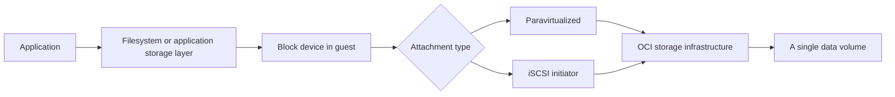
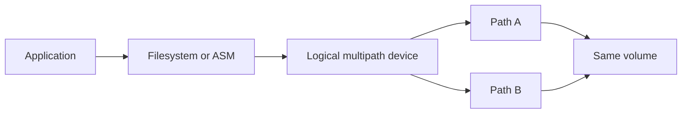

# Paravirtualized Attachment, iSCSI, and Multipath

In the **Block Volume and Boot Volume** chapter of the Oracle Cloud Infrastructure (OCI) module, the volume attachment choice determines how the operating system sees and accesses the remote disk. The same storage requirement may call for different operational steps depending on the instance, image, and performance tier.

This lesson covers paravirtualized attachments, iSCSI, and multipath in an OCI deployment context involving permissions, networking, monitoring, and cost control. Examples focus on a data block volume for a Linux machine running an application; differences for Windows and boot volumes are noted separately.

## Objectives and Prerequisites

After this lesson, you will be able to:

- Choose between paravirtualized and iSCSI based on supportability and workload requirements.
- Distinguish attach in OCI, connect in the OS, and mounting a filesystem.
- Connect a standard iSCSI attachment using the details provided by OCI.
- Explain multiple paths to the same volume and how to identify a multipath device.
- Verify Ultra High Performance (UHP) prerequisites, agent API connectivity, and attachment status.
- Prepare mounts after reboot and detach volumes in the proper order.

You should be familiar with regions, availability domains (ADs), compartments, Compute instances, VCNs, and basic Linux operations. The commands in this lesson are examples to run in your own lab environment; replace attachment details with values from the exact volume you are operating on.

## Three State Layers to Distinguish

A volume can already show as **Attached** in OCI while the application still cannot read data. Check these three layers in order:

| Layer | What Happens | Evidence to Look For |
| --- | --- | --- |
| OCI control plane | Creates the association between instance and volume | Volume attachment with the right OCID, instance, connection type, and status |
| Device connection in guest OS | The operating system receives the block device | Corresponding device, iSCSI session, or multipath map |
| Filesystem and application | Filesystem is mounted, permissions are appropriate | Mount point, filesystem type, owner, and application activity |

Paravirtualized connects the device automatically after attach. iSCSI requires a connection step performed by the operator or Oracle Cloud Agent. Afterward, filesystem/mount setup is still required if the workload uses a filesystem. See [Connecting to a Block Volume](https://docs.oracle.com/en-us/iaas/Content/Block/Tasks/connectingtoavolume.htm).

For example: the order application's data volume is already attached to the host. If only the mount is missing, re-attaching multiple times will not solve the filesystem configuration part. Conversely, if iSCSI has not logged in successfully, changing the owner of the mount directory will not establish access to the volume either.

## How Are Paravirtualized and iSCSI Different?

**Paravirtualized attachment** presents the storage device to the VM through virtualization. Users do not have to manually establish an iSCSI session inside the guest to connect that volume.

**iSCSI attachment** uses the protocol for transporting SCSI commands over TCP/IP. The guest runs an initiator that communicates with the target provided by OCI. An attachment has a target identifier, portal address, and optional authentication.

| Criterion | Paravirtualized | iSCSI |
| --- | --- | --- |
| Primary environment | Supported VMs and images | Supported VMs or bare metal |
| After attach operation | Device connects automatically | Requires login, manually or via agent |
| Components to inspect in guest | Block device and filesystem | Initiator, session, device, and filesystem |
| Operational complexity | Fewer connection setup steps | Requires managing additional iSCSI configuration and state |
| When evaluating performance | Check limits for the exact shape/attachment | Check limits for the exact shape/attachment |

Bare metal uses iSCSI for block volumes. For VMs, paravirtualized support depends on the image; do not assume images imported from outside OCI have full support. Attachment scope is described in [Overview of Block Volume](https://docs.oracle.com/en-us/iaas/Content/Block/Concepts/overview.htm).

Do not choose solely based on the assumption that "this type is always faster." Actual results also depend on volume limits, instance limits, OCPU count, workload, and path configuration. The selection process should start with supportability, then performance requirements, then operational cost evaluation.

### Attributes That Must Not Be Conflated

- **Attachment type:** the paravirtualized or iSCSI connection mechanism.
- **Access type:** read/write permissions of the attachment and sharing capability per configuration.
- **Multipath:** multiple I/O paths managed as access paths to the same device.
- **Filesystem:** how data is organized on the block device, if the workload needs a filesystem.

Multipath does not mean multiple machines concurrently writing data to the same filesystem. For multi-attach read/write, you need a solution capable of coordinating access across machines; a standard filesystem does not automatically become a cluster filesystem. See [Attaching a Block Volume to an Instance](https://docs.oracle.com/en-us/iaas/Content/Block/Tasks/attach-compute-volume-attachment.htm).

## Visualizing the I/O Path



In this diagram, multiple connection paths are not yet shown. When multipath is active, multiple paths all lead to **one volume**. The capacity the application can use remains the capacity of that volume.

For applications connecting to a managed Oracle Database, internal storage operations of the database service follow the service's own procedures. The examples here apply to volumes attached to Compute that you manage directly.

## Preparation Before Attaching

Before acting, record the instance OCID, volume OCID, region, AD, compartment, and volume purpose. The volume must be in the same AD as an instance with access permissions; being in the same tenancy is not enough to guarantee attachment is possible. See [Block Volume Regions and Availability Domains](https://docs.oracle.com/en-us/iaas/Content/Block/Concepts/overview.htm).

Then prepare:

1. Verify IAM permissions of the user or pipeline performing the attach.
2. Choose the attachment type and access type based on the workload.
3. Cross-check the shape, image, drivers, and intended performance tier.
4. Select a consistent device path if the instance and workflow support it.
5. Determine who manages the iSCSI connection: the operator or the agent.
6. If testing UHP, separately check multipath prerequisites before attaching.
7. Determine whether the volume is empty or already contains data to decide the filesystem step.

Building a mapping table helps prevent mixing up devices:

| Attribute | Example Record |
| --- | --- |
| Purpose | Temporary data for the order processing service |
| Volume OCID | OCID retrieved from the Block Volume resource |
| Attachment OCID | OCID of the attachment relationship to a specific instance |
| Expected device path | Path selected at attach time |
| Filesystem and mount point | Actual filesystem type, directory serving the workload |
| Owner | Application team and responsible operator |

The attachment OCID and volume OCID are two different values. When a volume is detached and reattached, read the new attachment details instead of reusing portals or credentials from a previous association.

## Paravirtualized Attachment Workflow

In the Console, navigate to the target instance, open **Attached block volumes** or the corresponding **Storage** section, and select **Attach block volume**. Choose the volume, **Paravirtualized** attachment type, access type, and appropriate device path. Once the attachment completes, check the device inside the guest. The procedure is described at [Attaching a Block Volume](https://docs.oracle.com/en-us/iaas/Content/Block/Tasks/attach-compute-volume-attachment.htm).

Linux inspection commands:

```bash
lsblk -o NAME,TYPE,SIZE,FSTYPE,UUID,MOUNTPOINTS
findmnt
ls -l /dev/oracleoci/
```

The `/dev/oracleoci/` path applies only when the image/instance supports consistent device paths. If absent, cross-reference the device identification method of the operating system in use.

Do not conclude a volume is empty just because it has no mount point. It may already have a filesystem, partitions, or LVM structures. If the volume contains data, identify the exact storage layer and mount or activate it according to that data's workflow.

A new volume with no filesystem must be initialized according to the application's design. Creating partitions or filesystems can alter data on the device, so volume-to-device mapping must be completed before this step.

## Standard iSCSI Workflow on Linux

This section applies to **a manually managed single-path iSCSI attachment**, without auto-connect configured and outside the plugin-managed UHP workflow. Do not use these steps as a general multipath configuration.

### Reading Details of the Exact Attachment

In the instance's volume list, open **iSCSI Commands and Information**. OCI provides:

- IQN: target identifier.
- IP and port: portal to connect to.
- CHAP username/password if CHAP is enabled on the attachment.
- Registration and login commands for that specific attachment.

Copy the commands from the Console to get exact values. [Connecting to iSCSI-Attached Block Volumes](https://docs.oracle.com/en-us/iaas/Content/Block/Tasks/connectingtoavolume_topic-Connecting_to_iSCSIAttached_Volumes.htm) describes the sequence of operations.

### Registering the Target and Configuring Startup

Below is the command structure to understand the components; replace placeholders with real values:

```bash
export TARGET_IQN='REPLACE_WITH_ATTACHMENT_IQN'
export TARGET_PORTAL='REPLACE_WITH_ATTACHMENT_IP:PORT'

sudo iscsiadm -m node \
  -o new \
  -T "$TARGET_IQN" \
  -p "$TARGET_PORTAL"

sudo iscsiadm -m node \
  -T "$TARGET_IQN" \
  -p "$TARGET_PORTAL" \
  -o update \
  -n node.startup \
  -v automatic
```

If CHAP is enabled, apply the Console's authentication commands before the login step. CHAP credentials are tied to the volume/instance pair and must be handled as sensitive credentials. CHAP authenticates the connection; it does not mean data is encrypted in transit. CHAP details and initiator configuration are in [iSCSI Commands and Information](https://docs.oracle.com/en-us/iaas/Content/Block/Concepts/iscsiinformation.htm).

### Logging In and Verifying the Device

```bash
sudo iscsiadm -m node \
  -T "$TARGET_IQN" \
  -p "$TARGET_PORTAL" \
  --login

sudo iscsiadm -m session
lsblk -o NAME,TYPE,SIZE,FSTYPE,UUID,MOUNTPOINTS
```

Cross-check the session and device against the newly registered attachment. Do not run a command to log into all targets as a blanket fix for every issue: node records on the host may belong to multiple different volumes.

When checking services, inspect initiator status and logs according to your distribution. Avoid restarting storage services across the board on a host serving multiple volumes just to troubleshoot one attachment.

### When Using Oracle Cloud Agent

If auto-connect is selected and the environment meets the prerequisites, the Block Volume Management plugin runs the iSCSI connection commands. Do not repeat manual configuration steps for the same attachment as if the plugin were not involved.

The plugin belongs to Oracle Cloud Agent; it requires the proper agent version, plugin status, instance API permissions, and a route to Oracle services. For private hosts, documentation guides using a service gateway and route to Oracle Services Network. See [Enabling the Block Volume Management Plugin](https://docs.oracle.com/en-us/iaas/Content/Block/Tasks/enablingblockvolumemanagementplugin.htm).

Separate two questions when diagnosing:

- **Can the guest reach the storage target?**
- **Can the agent call the API to read configuration and report status?**

An agent API permission error is not solved by editing a filesystem UUID. Conversely, a running agent alone does not prove the application has mounted the right data.

## Multipath: Multiple Paths, One Logical Device

On Linux, Device Mapper Multipath can aggregate multiple paths to the same device into a single logical block device. Member paths are not independent disks for separate application use. Depending on configuration, multipath can distribute I/O or fail over to an active path when one path fails. See [Using Multipathing for Efficient Storage](https://docs.oracle.com/en/operating-systems/oracle-linux/8/stordev/stordev-UsingMultipathingforEfficientStorage.html).



Illustrative example: if two paths lead to the same 200 GiB volume, the logical device still has a capacity of 200 GiB. Do not create two filesystems on the two paths and treat them as two separate data stores.

Multipath also differs from the following mechanisms:

| Mechanism | Primary Problem Solved |
| --- | --- |
| Multipath | Managing multiple I/O paths to the same volume |
| Multi-attach | Allowing multiple instances to hold attachments to a volume |
| Backup | Creating data recovery points |
| Replication | Maintaining copies according to service capabilities |
| Application HA | Maintaining service when a system component fails |

A remaining active path does not restore an accidentally deleted file. Similarly, multipath does not allow a stopped instance to continue serving requests. Availability planning must consider the I/O path, host, application, and data together.

## Multipath Conditions in OCI and UHP

To achieve optimal performance for UHP volumes, attachments require multipath. OCI evaluates multipath eligibility at attach time; increasing a volume's performance tier does not automatically prove the remaining prerequisites are met.

| Case | Conditions to Note |
| --- | --- |
| iSCSI UHP | Choose a supported shape and image; labs should use an eligible Oracle Linux image |
| Paravirtualized UHP | Supported on eligible VMs/images, including Oracle Linux, Ubuntu, CentOS, and Windows per catalog |
| Bare metal UHP | Uses iSCSI |
| Oracle Autonomous Linux | Not within the scope of multipath attachment support in this reference |

Cross-check the current matrix at [Configuring Attachments to Ultra High Performance Volumes](https://docs.oracle.com/en-us/iaas/Content/Block/Tasks/configuringmultipathattachments.htm). Do not extrapolate paravirtualized multipath support for Windows to iSCSI UHP on Windows.

OCPU count, IOPS limits, throughput, and attachment count must be checked for the exact instance configuration. Use the **Supports Ultra High Performance (UHP)** column in [Block Volume Performance](https://docs.oracle.com/en-us/iaas/Content/Block/Concepts/blockvolumeperformance.htm) rather than looking only at the shape family name.

### Preparing the iSCSI UHP Path

In addition to an eligible shape/image, you need:

1. Enable the Block Volume Management plugin and verify it is actually running.
2. Configure permissions for the instance/agent to call the required APIs.
3. Provide connectivity to Oracle services per plugin documentation.
4. Choose a consistent device path when attaching.
5. Let the plugin establish connections, then verify results in both OCI and the guest.

Custom images must have a supported kernel; troubleshooting documentation cites Oracle Linux UEK6U1 or later and the `Storage.Iscsi.MultipathDeviceSupported=true` capability for corresponding cases. Enabling the capability does not install missing drivers. See [Troubleshooting Ultra High Performance Volume Attachments](https://docs.oracle.com/en-us/iaas/Content/Block/Tasks/troubleshootingmultipathattachments.htm).

Do not use `oci-utils` and `oci-iscsi-config` simultaneously to manage the same volume interchangeably. UHP configuration documentation warns that mixing both tools can cause multipath status to be misreported. Also do not blindly apply `node.startup=automatic` from the single-path example onto node records managed by the multipath workflow.

If you need to change shape, image, or add device paths, you may need to detach/reattach following the appropriate workflow. This is a change requiring planned I/O stoppage; do not use detach/attach as a trial-and-error step on a live volume.

## Verifying Multipath at Two Layers

### Status Reported by OCI

In the attachment list, check the **Multipath** column:

| Value | Interpretation |
| --- | --- |
| Yes | UHP volume and the attachment is marked multipath-enabled |
| No, without warning | Volume is not at UHP, so multipath is not required for its configured tier |
| No, with warning | UHP volume, but attachment is not multipath-enabled; check prerequisites |

Details can be retrieved via OCI CLI:

```bash
export OCI_REGION='REPLACE_WITH_REGION'
export ATTACHMENT_OCID='REPLACE_WITH_VOLUME_ATTACHMENT_OCID'

oci compute volume-attachment get \
  --region "$OCI_REGION" \
  --volume-attachment-id "$ATTACHMENT_OCID"
```

Inspect `is-multipath` and verify the exact attachment under review. The required parameter is the **volume attachment OCID**, not the volume OCID or volume group OCID. See [Checking If a Volume Attachment is Multipath-Enabled](https://docs.oracle.com/en-us/iaas/Content/Block/Tasks/get-multipath-enable-check-compute-volume-attachment.htm).

### Topology in Linux With iSCSI Multipath

After the plugin finishes, inspect devices and maps:

```bash
sudo multipath -ll
lsblk -o NAME,TYPE,SIZE,FSTYPE,UUID,MOUNTPOINTS
sudo iscsiadm -m session
```

When reading the output, look for:

- One logical device and the WWID identifying the volume.
- Member paths leading to that device.
- Path status, path groups, and matching capacity.
- The filesystem or application storage layer placed on top of the logical device.

Names may take the form `/dev/mapper/<WWID>` or an alias depending on configuration. An alias like `mpathN` is a local convenience name in that environment; do not treat the number N as a permanent business identity of the volume. Naming components and inspection are explained in [Device Multipathing Sample Setup](https://docs.oracle.com/en/operating-systems/oracle-linux/10/stordev/stordev-DeviceMultipathingSampleSetup.html) and [Configuring Multipathing](https://docs.oracle.com/en/operating-systems/oracle-linux/10/stordev/stordev-ConfiguringMultipathing.html).

Example **diagram for reading output**, not a mandatory OCI standard output format:

```text
Logical device /dev/mapper/<WWID>
  ├─ path A → same volume
  └─ path B → same volume
```

Actual path counts, device names, and policies depend on the supported configuration. Do not manually add targets or force a specific path count from an example just to make output look like the diagram.

With iSCSI UHP, cross-check both OCI status and guest topology if misreporting is suspected. If `multipath -ll` shows no matching map, gather more configuration and logs before drawing conclusions. With **paravirtualized**, do not treat the absence of an iSCSI session or iSCSI map inside the guest as automatic proof that the attachment does not support multipath.

### Choosing the Device for Filesystems or Applications

With iSCSI multipath, operate on the corresponding logical device, not individually on member paths. You can inspect the consistent device path symlink to trace down to the right device, then cross-check the friendly name/map. Identification steps are covered in [Working with Multipath-Enabled iSCSI-Attached Volumes](https://docs.oracle.com/en-us/iaas/Content/Block/Tasks/connectingtouhpvolumes.htm).

In environments using LVM or Oracle ASM, follow the design of that layer. Do not create a filesystem on a disk already used as an ASM member or LVM physical volume simply because listing commands show no mount point.

## Device Path, WWID, and Filesystem UUID

Three types of identifiers commonly appear at different layers:

| Identifier | Role |
| --- | --- |
| Consistent device path | A path provided by OCI on compatible Linux systems to reference a volume across reboots |
| WWID | Storage device identifier used by multipath to group paths |
| Filesystem UUID | Filesystem identifier used in mount configurations |

Names like `/dev/sdb` can change recognition order after reboot. Do not use "the second disk" as a way to identify a production data volume.

When supported, choose a consistent device path at attach time and verify that path on the host. This feature does not apply by default to all custom images and does not apply to Windows. A boot volume attached as a data volume to a second machine also has specific device path limitations. See [Connecting to Volumes With Consistent Device Paths](https://docs.oracle.com/en-us/iaas/Content/Block/References/consistentdevicepaths.htm).

Example of inspecting a chosen path:

```bash
ls -l /dev/oracleoci/oraclevdb
readlink -f /dev/oracleoci/oraclevdb
```

Use this example only when `oraclevdb` is actually the device path of the attachment being inspected. If the path does not exist, verify image support and attachment configuration before randomly picking another device.

If mounting by UUID, note that a cloned filesystem may carry the same UUID as the source. When multiple copies appear on the same host, handle identifiers according to clone/recovery procedures to avoid mounting the wrong volume.

## Mounting After Reboot and Application Dependencies

Having a device present right now does not guarantee the filesystem auto-mounts properly after reboot. Configuration must account for startup ordering between storage connections and mounts.

OCI guides using `_netdev` and `nofail` options for data block volumes depending on device path type. `_netdev` expresses network storage dependency; `nofail` lets the host continue booting if the mount fails. See [fstab with consistent device paths](https://docs.oracle.com/en-us/iaas/Content/Block/References/fstaboptionsconsistentdevicepaths.htm).

Example configuration line for an **existing ext4 filesystem**, after replacing the UUID and verifying the right device:

```fstab
UUID=REPLACE_WITH_FILESYSTEM_UUID /srv/orders-data ext4 defaults,_netdev,nofail 0 2
```

The filesystem type and trailing check fields must match the actual system. If not using consistent device paths, refer to UUID mounting in [Traditional fstab Options](https://docs.oracle.com/en-us/iaas/Content/Block/References/fstaboptions.htm).

For iSCSI multipath, startup ordering must also account for `multipathd`. In one documented multipath misreporting scenario, OCI guides adding the `x-systemd.requires=multipathd.service` dependency; match the exact scenario rather than adding options as a cure-all. See [troubleshooting UHP attachments](https://docs.oracle.com/en-us/iaas/Content/Block/Tasks/troubleshootingmultipathattachments.htm).

An important operational point: `nofail` helps the host boot, but it does not prove data is ready. If the application writes to `/srv/orders-data` while the filesystem is unmounted, it may write onto the boot volume.

Therefore, the application startup workflow should:

1. Confirm the mount point is the expected filesystem.
2. Confirm access permissions for the application account.
3. Start the workload only when data conditions are met.
4. Report an error or degrade readiness if the mount disappears.

After changing mount configuration, check syntax and test mounts in an appropriate window, then perform a controlled reboot test on a lab machine. Record connection status, maps, mounts, and services after reboot.

## Windows and Boot Volume: Operational Boundaries

For standard Windows iSCSI, get the portal/IQN from OCI, use **iSCSI Initiator**, connect to the exact target, and persist connection settings across reboots per documentation. Then inspect the disk using Windows storage management tools. Never initialize/format a disk that already contains data. See [Connecting to iSCSI-Attached Block Volumes](https://docs.oracle.com/en-us/iaas/Content/Block/Tasks/connectingtoavolume_topic-Connecting_to_iSCSIAttached_Volumes.htm).

Windows MPIO concepts and OCI iSCSI UHP supportability must be distinguished. Just because the OS has a multipath feature does not replace the provider's support matrix.

A boot volume holds the running operating system, so do not apply the data volume detach procedure directly as instructions for detaching the root disk. When inspecting or recovering a boot volume, follow the corresponding stop, detach, and attach procedures in [Working with Boot Volumes](https://docs.oracle.com/en-us/iaas/Content/Block/Concepts/bootvolumes.htm).

## Disconnecting and Detaching in Order

**Disconnect** terminates the connection path inside the guest. **Detach** removes the attachment relationship in OCI. With iSCSI, prepare the guest side before detaching to avoid data loss.

A sequence for a data volume is:

1. Stop workloads writing to the volume; complete appropriate checkpoints or quiesce steps.
2. Confirm filesystem, LVM, or ASM layers are no longer using the device per their respective procedures.
3. Unmount filesystems if applicable; update startup configurations that are no longer valid.
4. For manual single-path iSCSI, log out of the exact target/portal.
5. For multipath or agent-managed setups, handle all paths of that volume using the active tool/procedure.
6. Verify connections have ended, then detach in OCI.
7. When attaching to another machine, read the new attachment details and verify before starting the workload.

Logout structure for **manual single-path iSCSI**, used after stopping I/O and unmounting:

```bash
sudo iscsiadm -m node \
  -T "$TARGET_IQN" \
  -p "$TARGET_PORTAL" \
  --logout
```

Logging out one portal once does not cover all paths of a multipath attachment. For Windows, the corresponding procedure includes taking the disk offline and disconnecting the target. See [Disconnecting From a Volume](https://docs.oracle.com/en-us/iaas/Content/Block/Tasks/disconnectingfromavolume.htm).

Paravirtualized has no iSCSI session inside the guest to log out for that volume, yet I/O must still be stopped and filesystems prepared before detaching. Do not use force detach as a routine operational step in place of preparing the application.

## Performance, Monitoring, and Cost

Upgrade a volume to UHP only after confirming storage is the component needing improvement. One evaluation model is:

```text
Achieved performance is bounded by the lowest limit across:
volume → attachment/I/O path → instance → filesystem → workload
```

Illustrative example: if an order-processing step only issues a small amount of I/O and spends most of its time waiting on another dependency, adding paths may not reduce response times. Measure the workload's actual I/O type, block size, concurrency, and cache state.

Both instance and volume limits affect IOPS/throughput; service performance tables are not a guarantee that every filesystem/application automatically hits those figures. See [Block Volume Performance](https://docs.oracle.com/en-us/iaas/Content/Block/Concepts/blockvolumeperformance.htm).

Monitor at minimum:

| Signal Group | Purpose |
| --- | --- |
| Read/write operations and throughput | Know how much I/O the workload actually generates |
| Throttled operations | Detect signs of hitting service-side limits |
| I/O latency and queue depth in guest | Observe experience at the instance level |
| Paths/maps or initiator logs | Detect path loss, reconnects, and device errors |
| Mount and application health | Confirm data is actually serving the workload |

OCI publishes metrics in the `oci_blockstore` namespace, including `VolumeReadOps`, `VolumeWriteOps`, throughput, and `VolumeThrottledIOs`. Activity counters are defined per interval; when calculating IOPS or bytes/sec, account for the time interval and aggregation function. See [Block Volume Metrics Reference](https://docs.oracle.com/en-us/iaas/Content/Block/References/volumemetrics-reference.htm).

Increasing VPUs or upgrading shapes to meet UHP prerequisites changes billing configuration. After testing, weigh measured benefits against actual costs and limits, then return lab resources to the planned baseline. Do not keep oversized machines or high-performance volumes running simply because multipath setup is complete.

## Layer-Based Diagnostics

| Symptom | Evidence and Inspection Direction |
| --- | --- |
| Attach rejected | OCID, region/AD, IAM, limits, and resource conditions |
| Attached, but no iSCSI device present | Session, target/portal, CHAP, or plugin process |
| Auto-connect incomplete | Agent status, API permissions, and path to Oracle services |
| Device exists, but cannot mount | Filesystem, UUID, partition/LVM layout, and mount logs |
| UHP shows multipath warning | Shape, image, device path, and attachment branch prerequisites |
| OCI reports Yes, but iSCSI topology is wrong | Cross-check map in guest and the tools used for configuration |
| Data missing after reboot | Auto-connect, multipath/mount ordering, and application configuration |
| Low throughput | Per-layer limits and workload traits, not just multipath state |

For the plugin-managed iSCSI branch, one diagnostic source is:

```text
/var/log/oracle-cloud-agent/plugins/oci-blockautoconfig/oci-blockautoconfig.log
```

`NotAuthorizedOrNotFound` in the logs must be cross-checked against permissions and the plugin's ability to report status; do not assume the volume is gone. [Troubleshooting Ultra High Performance Volume Attachments](https://docs.oracle.com/en-us/iaas/Content/Block/Tasks/troubleshootingmultipathattachments.htm) describes common permission and network errors.

Collect the instance OCID, attachment OCID, timestamps, OCI status, and guest evidence before making changes. Changing one factor at a time under a clear hypothesis preserves root-cause explainability.

## Comprehensive Practice Exercise

Use a lab instance and a separate data volume; do not use a running boot volume for detach/attach experiments.

1. Record the instance configuration, image, and existing volumes.
2. Attach a volume using paravirtualized if supported; verify the device and filesystem state.
3. Stop I/O, prepare the guest, and detach according to procedure.
4. Perform the single-path iSCSI branch with an eligible volume; cross-check target info, sessions, and devices.
5. If an environment meeting UHP requirements is available, use a lab volume for the plugin/multipath branch; verify both OCI and the guest iSCSI topology.
6. Configure mounting and application startup conditions; perform a controlled reboot test.
7. Disconnect/detach, then clean up resources no longer needed.

Do not scale a small environment up to an expensive configuration just to complete the UHP branch. If lacking an eligible shape, image, or permissions, document the missing prerequisite and the scope of that lab limitation.

Completion evidence includes a volume–attachment–device mapping table, connection management method, post-reboot results, and detach order. For the multipath branch, add OCI status along with observed WWIDs/maps. The goal is to explain every layer of the I/O path and operate volumes repeatably.
