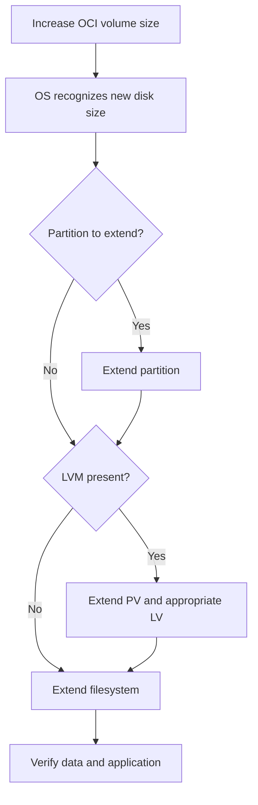

# Expanding Volumes, Partitions, and Filesystems

In the **Block Volume and Boot Volume** chapter of the Oracle Cloud Infrastructure (OCI) module, a common situation is increasing volume size in the Console while the application still reports running out of space. The reason is that capacity at the storage service layer has not yet been claimed by the layers inside the operating system.

This lesson guides expanding in order from the OCI volume to the disk device, partition, LVM if present, and finally the filesystem. The main hands-on section uses a Linux instance with a data block volume; boot volumes and Windows are covered in separate branches. The goal is to increase usable capacity, preserve existing data, and capture verification evidence at each layer.

After this lesson, learners will be able to:

- Explain why expanding a volume does not automatically increase `df`.
- Correlate volume OCID with attachment, OS device, and mount point.
- Select the proper workflow for filesystems on a partition, an entire disk, or a logical volume.
- Extend XFS/ext4 using the right tools and use `oci-growfs` for supported root filesystems.
- Verify data, mounts, services, and cost after the operation.

## 1. Which Layers Must Be Expanded?

For a block volume with a partition and a filesystem directly on that partition:

```text
OCI Block Volume
  -> disk seen by the operating system, e.g., /dev/sdb
  -> partition, e.g., /dev/sdb1
  -> XFS or ext4 filesystem
  -> mount point, e.g., /srv/data
  -> application data directory
```

With LVM, additional layers exist:

```text
OCI volume -> disk -> partition if present -> physical volume (PV)
           -> volume group (VG) -> logical volume (LV)
           -> filesystem -> mount point
```

Not every machine has all layers. A filesystem can sit directly on the entire disk; a PV can also use the entire disk instead of a partition.

| Layer | Question to Answer | Linux Inspection Tool |
|---|---|---|
| OCI volume | Has the service provisioned the new size? | Console or OCI CLI |
| Disk | Has the kernel recognized the new capacity? | `lsblk`, `blockdev --getsize64` |
| Partition | Does the partition cover the intended space? | `lsblk`, `sfdisk --dump` |
| PV/VG | Has LVM recognized the additional extents? | `pvs`, `vgs` |
| LV | Has the target logical volume grown? | `lvs` |
| Filesystem | Has usable capacity increased? | `df`, filesystem-specific tools |
| Application | Are reads/writes and business operations normal? | Application checks |

For example, if the volume and disk are already 150 GB while the partition remains around 100 GB, the filesystem is still constrained by the partition. With LVM, if the partition has grown but the LV has not, the filesystem on the LV still has no additional space.



## 2. Scoping and Preparation Before Making Changes

### Selecting the Right Target

Main lab scenario:

| Component | Example Assumption |
|---|---|
| Machine | Linux instance in the lab compartment |
| Volume type | Data block volume, attached to one machine in read/write mode |
| OCI capacity | Increased from 100 to 150 GB via the service interface |
| Linux device | Verified as `/dev/sdb` |
| Partition | `/dev/sdb1`, at the end of the disk and able to grow into trailing free space |
| Filesystem | XFS or ext4, choose one branch |
| Mount point | `/srv/data`, properly mounted to the right volume |

The name `/dev/sdb`, partition number `1`, and `/srv/data` are illustrative values only. Never infer the data device simply because it is the second disk. On another machine it could be `/dev/sdc`, `/dev/vdb`, an NVMe device, or a device-mapper path.

### Backup, Permissions, and Recovery Plan

Before resizing, take a backup of the volume and confirm the backup completes. OCI only supports increasing volume size, not shrinking in place. When needing to revert to an earlier configuration, the recovery plan typically involves restoring or migrating data to another volume, not entering a smaller size. [Source: OCI resizing a volume](https://docs.oracle.com/en-us/iaas/Content/Block/Tasks/resizingavolume.htm).

For databases or multi-step write applications, determine the consistency level of the copy and how to recover the application. A block-layer backup alone does not prove in-flight transactions were completely flushed by the application. Choose timing, quiesce mechanisms, or backup tools appropriate for the workload.

Distinguish two permission scopes:

- **OCI IAM** permits updating volumes in the assigned compartment.
- **Guest OS privileges** permit rescanning, modifying partitions/LVM, and extending filesystems.

Having Console permissions does not automatically grant `sudo`; having `sudo` does not automatically grant permission to modify OCI resources. Document which volume is kept for which application, who performs the change, and when.

Check further if the volume has replication, multiple attachments, multipath, in-guest encryption, RAID, thin provisioning, or Oracle ASM. Those structures require corresponding workflows; do not blindly apply the single-disk, single-partition, single-filesystem example.

Per OCI documentation, volumes with cross-region replication enabled must have replication disabled before resizing and can re-enable it afterward. Plan separately for the window where data protection changes. [Source: replication note when resizing](https://docs.oracle.com/en-us/iaas/Content/Block/Tasks/resizingavolume.htm).

## 3. Recording Baseline State and Identifying the Disk

Run inspection commands on the target Linux instance:

```bash
lsblk -o NAME,PATH,SIZE,TYPE,FSTYPE,MOUNTPOINTS
findmnt --mountpoint /srv/data -o TARGET,SOURCE,FSTYPE,OPTIONS
df -hT /srv/data
df -i /srv/data
```

`findmnt --mountpoint` here verifies the exact mount point. If `/srv/data` is not mounted, stop and re-verify; running only `df /srv/data` can return results from the parent filesystem containing that directory.

If the machine uses LVM and data resides on an LV, also inspect:

```bash
sudo pvs
sudo vgs
sudo lvs -o lv_path,lv_size,vg_name,devices
```

Cross-check against the attachment in OCI: instance OCID, volume OCID, device path, or iSCSI details. If the image supports consistent device paths, inspect the symlinks:

```bash
ls -l /dev/oracleoci/
readlink -f /dev/oracleoci/oraclevdb
```

Use that path only when it actually corresponds to the target attachment. OCI supports consistent device paths on compatible Linux images; boot volumes typically have the consistent path `/dev/oracleoci/oraclevda`. [Source: OCI consistent device paths](https://docs.oracle.com/en-us/iaas/Content/Block/References/consistentdevicepaths.htm).

Once the disk is proven to be `/dev/sdb`, record its size and layout:

```bash
sudo blockdev --getsize64 /dev/sdb
sudo sfdisk --dump /dev/sdb
sudo blkid /dev/sdb1
```

Save the partition table record and command output in an authorized location outside the volume being modified. If an immutable lab sample file was prepared, record its checksum before changes:

```bash
sha256sum /srv/data/resize-sample.dat
```

This file must exist and must not be modified by the application during verification. A sample file checksum helps detect changes to that file; it does not prove integrity of the entire dataset.

Before proceeding, you must be able to state a complete sentence: "This volume OCID is attached to this instance, recognized by Linux as this disk, contains this partition/LV, and is mounted at this path."

## 4. Increasing Volume Size in OCI

### Online or Offline

Online resizing grows a volume while it remains attached; afterward, the guest OS must recognize the new size and upper layers must be expanded. Offline resizing is performed while the volume is detached from the instance; when reattached, the OS sees the disk at the new size, though partitions/filesystems still need handling. [Source: online resizing](https://docs.oracle.com/en-us/iaas/Content/Block/Tasks/update-online-resize-block-boot-volume.htm), [offline resizing](https://docs.oracle.com/en-us/iaas/Content/Block/Tasks/update-offline-resize-block-boot-volume.htm).

If choosing offline for a data volume, stop processes using the volume, unmount, and disconnect per attachment type before detaching. A boot volume requires proper instance shutdown and boot volume detach/attach procedures. Never yank a volume actively writing to a filesystem as if merely editing a property in the Console.

### Via Console

For a data volume, open **Storage → Block Storage → Block Volumes**. For a boot volume, open the **Boot Volumes** list. Select the right compartment, AD, and volume OCID, then modify size via **Edit Size or Performance** or the corresponding option in the current UI.

Set the target capacity to `150 GB` for the lab, double-check the volume, and save. Wait for the update operation to finish, verify the new size in the service, and copy any rescan commands if the Console displays them. Do not simultaneously change unrelated attributes when the lab goal is solely capacity.

### Via OCI CLI

You can replace the Console operation with one of the following commands, run in an OCI CLI environment configured with authentication and the right region/profile.

For a **block volume**:

```bash
oci bv volume update \
  --volume-id '<BLOCK_VOLUME_OCID>' \
  --size-in-gbs 150
```

For a **boot volume**:

```bash
oci bv boot-volume update \
  --boot-volume-id '<BOOT_VOLUME_OCID>' \
  --size-in-gbs 150
```

The two resource types use different identifier flags. Run only the command matching your target volume; `--size-in-gbs` is the target size, not the increment to add. [Source: block volume update](https://docs.oracle.com/en-us/iaas/tools/oci-cli/latest/oci_cli_docs/cmdref/bv/volume/update.html), [boot volume update](https://docs.oracle.com/en-us/iaas/tools/oci-cli/latest/oci_cli_docs/cmdref/bv/boot-volume/update.html).

At this point, only the OCI layer has been proven changed. Do not take the API update output as proof that the filesystem has grown.

## 5. Rescanning So Linux Sees the New Disk Size

First inspect the disk again:

```bash
lsblk -o NAME,PATH,SIZE,TYPE,FSTYPE,MOUNTPOINTS
sudo blockdev --getsize64 /dev/sdb
```

If it still shows the old size, follow the rescan guide for the attachment and image in use. For a SCSI disk verified as `sdb`, the OCI-guided command pair looks like:

```bash
sudo dd iflag=direct if=/dev/sdb of=/dev/null count=1
printf '1\n' | sudo tee /sys/class/block/sdb/device/rescan
```

In the first command, data is read from the disk and output goes to `/dev/null`. Keep `if` and `of` exact. The second command instructs the kernel to rescan the device. [Source: OCI rescanning the disk](https://docs.oracle.com/en-us/iaas/Content/Block/Tasks/rescanningdisk.htm).

Then read again:

```bash
sudo blockdev --getsize64 /dev/sdb
lsblk -o NAME,PATH,SIZE,TYPE,FSTYPE,MOUNTPOINTS
```

If the new size appears, move on to the partition layer or whichever next layer actually exists.

Points to distinguish:

- `/sys/class/block/sdb/device/rescan` uses the **kernel disk name**, not `/dev/sdb1` or an LV name.
- If the rescan path does not exist, identify the actual driver and attachment; do not substitute another disk to test.
- An iSCSI attachment needs an active session and connection; do not log out a session serving a filesystem just to test a rescan.
- With multipath, a procedure covering all paths and mappings is required; the single SCSI disk example here does not cover that topology.

Seeing a larger disk while `df` remains unchanged is the expected state. Rescanning does not automatically expand partitions or filesystems.

## 6. Extending the Partition If Partitioned

### Conditions for the Example

Perform this section only after confirming:

- The target filesystem or PV resides on `/dev/sdb1`.
- Partition number `1` belongs to disk `/dev/sdb`.
- Unallocated space sits immediately after the partition and no other partition needs moving.
- The `growpart` utility is installed and supports the partition table in use.
- The disk is currently seen by the kernel at the new size.

First preview the change plan:

```bash
sudo growpart -N /dev/sdb 1
```

`-N` in `growpart` runs a dry run. The arguments are the **disk** followed by the **partition number**, not `/dev/sdb1` alone. The tool extends the partition up to the limit of usable space before the next partition or end of disk. [Source: growpart manual](https://manpages.ubuntu.com/manpages/jammy/man1/growpart.1.html).

If the output matches the verified plan, execute:

```bash
sudo growpart /dev/sdb 1
```

Re-read both the layout and partition size seen by the kernel:

```bash
lsblk -o NAME,PATH,SIZE,TYPE,FSTYPE,MOUNTPOINTS
sudo blockdev --getsize64 /dev/sdb1
sudo sfdisk --dump /dev/sdb
```

Proceed only when the partition already has the expected size at the kernel layer. If the on-disk partition table changed but the kernel has not recognized it, resolve partition table reloading per tool/driver or schedule a planned reboot. Do not force subsequent steps without verifying state.

For NVMe, argument splitting works the same way:

```text
Disk:      /dev/nvme1n1
Partition: /dev/nvme1n1p1
Syntax:    growpart /dev/nvme1n1 1
```

This is purely a syntax illustration; do not identify a data disk from that NVMe name.

### When growpart Does Not Apply

If `lsblk` shows the filesystem directly on the whole disk, skip partition expansion. If the target sits ahead of another partition, free space at the end of the disk does not automatically become contiguous space behind the target. In that case, you need a different layout or data migration plan.

If you see a `NOCHANGE` message, check the disk size, free space, and whether the partition was already extended previously. Do not conclude the filesystem is also complete.

This workflow does not create a new filesystem with `mkfs`, does not delete and recreate partitions by guessing start sectors, and does not change filesystem types. Those are different operations from expanding existing capacity.

## 7. Extending a Filesystem Directly on a Partition or Disk

Identify the exact mounted filesystem:

```bash
findmnt --mountpoint /srv/data -o TARGET,SOURCE,FSTYPE,OPTIONS
```

Pick **one** branch matching the output. The commands below assume the layers beneath the filesystem are already expanded and recognized by the kernel.

### XFS

For XFS mounted at `/srv/data`:

```bash
sudo xfs_growfs -d /srv/data
df -hT /srv/data
```

`xfs_growfs` takes the mount point in this example; it consumes available space on the underlying device. XFS must be mounted to grow, and this operation does not grow disks, partitions, or LVs in place of earlier steps. [Source: Oracle Linux 9 growing XFS](https://docs.oracle.com/en/operating-systems/oracle-linux/9/xfs/xfs-GrowinganXFSFileSystem.html).

Do not run `resize2fs` on XFS. If XFS is no longer mounted or reports metadata/I/O errors, resolve the root cause and recovery procedure before expanding; do not add force flags to ignore errors.

### ext4

For ext4 on `/dev/sdb1`, in configurations supporting online growth:

```bash
sudo resize2fs /dev/sdb1
df -hT /srv/data
```

Omit a size argument so the tool uses all device space available to hold the filesystem. Ext4 can grow while mounted in supported environments; if offline filesystem checking/repair is required, arrange unmounting and maintenance first. [Source: Oracle Linux 9 resizing Ext](https://docs.oracle.com/en/operating-systems/oracle-linux/9/ext/ext-ResizinganExtFileSystem.html).

If the filesystem sits directly on the disk—for example, verified ext4 on `/dev/sdb`—the target of `resize2fs` is `/dev/sdb`; do not create a partition. With XFS on a whole disk, still grow via the corresponding XFS mount point.

### Checking and Repairing Filesystems Is a Separate Operation

Do not run `e2fsck` to repair ext4 or `xfs_repair` on a mounted, active filesystem. Also do not add forced repair steps into routine resizes. If errors are detected, halt the expansion workflow, schedule maintenance, and follow the procedure appropriate for that filesystem.

Distinguish clearly: filesystem expansion tools claim additional free space; repair tools inspect or alter structures to fix errors. They solve different problems.

## 8. LVM Branch: Expanding Both PV and LV Is Required

This section replaces the direct filesystem branch when the actual layout is:

```text
/dev/sdb
└─/dev/sdb1       LVM PV
  └─vgdata
    └─lvdata      XFS or ext4, mounted at /srv/data
```

Suppose the LV is initially around 100 GiB, the target is **140 GiB**, the disk has grown sufficiently, and the partition has been extended. Keep some unallocated extents in the VG if required by the plan. VG/LV names and sizes must match actual observed values.

### Letting LVM Recognize Additional PV Capacity

```bash
sudo pvresize /dev/sdb1
sudo pvs
sudo vgs
```

`pvresize` updates the PV size after the underlying device or partition has grown; the PV may belong to a VG with active LVs. It does not automatically decide which LV receives the new space. [Source: pvresize manual](https://manpages.ubuntu.com/manpages/noble/man8/pvresize.8.html).

If the PV sits directly on the disk, use the verified PV disk, such as `/dev/sdb`, and skip the partition layer.

### Allocating Extents to the Right LV

View current LVs and remaining free space in the VG:

```bash
sudo lvs -o lv_path,lv_size,vg_name,devices
sudo vgs
```

When the LV is currently smaller than 140 GiB and the VG has sufficient eligible extents, set the target size:

```bash
sudo lvextend -L 140G /dev/vgdata/lvdata
sudo lvs -o lv_path,lv_size,vg_name,devices
```

`-L 140G` sets the target size; `-L +40G` adds 40 GiB. The `lvextend` command allocates extents from the VG to the LV. Choose sizes per plan rather than blindly taking all `%FREE` of a shared VG. [Source: lvextend manual](https://manpages.ubuntu.com/manpages/jammy/man8/lvextend.8.html).

After the LV has grown, expand the filesystem **inside the LV**.

If XFS at `/srv/data`:

```bash
sudo xfs_growfs -d /srv/data
```

If ext4 on that LV:

```bash
sudo resize2fs /dev/vgdata/lvdata
```

Do not run `resize2fs /dev/sdb1` when `/dev/sdb1` is an LVM PV. `FSTYPE=LVM2_member` indicates an LVM physical layer, not ext4 to grow directly.

Some LVM versions/configurations support `lvextend -r` to expand both the LV and the filesystem. In this lesson, both steps are separated so each layer's state can be observed. If using the combined flag in automation, still verify results at both the LV and filesystem layers.

Thin, snapshot, RAID, or multi-PV LVs have additional metadata and extent allocation requirements. Do not extrapolate the entire workflow for those from the simple linear LV example above.

## 9. Boot Volume and Root Filesystem Branch

A boot volume can contain EFI, `/boot`, an LVM partition, and multiple LVs. Increasing boot volume capacity does not mean every filesystem like `/`, `/boot`, and `/var` grows together automatically.

Before acting, inspect the layout:

```bash
findmnt --mountpoint / -o TARGET,SOURCE,FSTYPE,OPTIONS
lsblk -o NAME,PATH,SIZE,TYPE,FSTYPE,MOUNTPOINTS
df -hT /
```

On Oracle Linux images with OCI Utilities and a supported root layout, after increasing the boot volume and confirming the kernel sees the new disk size, you can use:

```bash
sudo /usr/libexec/oci-growfs --help
sudo /usr/libexec/oci-growfs
```

Review the information about the root filesystem, partitions, and LVM detected by the tool, then answer confirmation prompts according to the verified layout. The tool has a `-y` option to auto-confirm prompts, though the interactive flow lets you inspect the plan in a lab.

`oci-growfs` is an in-guest utility from OCI Utilities, distinct from the OCI CLI command that updates the service resource. It supports XFS/ext4 root filesystems and can handle related layers in supported root layouts. [Source: OCI Utilities reference](https://docs.oracle.com/en-us/iaas/oracle-linux/oci/oci-utilities-reference.htm).

Then verify:

```bash
lsblk -o NAME,PATH,SIZE,TYPE,FSTYPE,MOUNTPOINTS
df -hT /
```

If root sits on LVM, also inspect `pvs`, `vgs`, and `lvs`. If the full directory belongs to a separate filesystem such as `/var`, inspect that mount point; growing `/` alone may not solve the problem.

Do not assume Ubuntu, custom images, or every Oracle Linux image includes the utility and shares the exact same layout. If the tool is absent or does not support the layout, follow the workflow appropriate to the image after identifying the layers, or execute a maintenance plan provided by the administrator. Never guess that root is always partition 1 or partition 3.

For an active root filesystem, do not unmount `/` from a normal SSH session to run offline repairs. When offline work is truly needed, prepare administrative/recovery access and an appropriate maintenance window.

## 10. Windows Branch: Rescan and Extend Volume

On Windows, after expanding the volume in OCI, open Disk Management with administrator privileges and choose **Action → Rescan Disks**. Verify the exact disk, partition, and drive letter before modifying. [Source: OCI rescan on Windows](https://docs.oracle.com/en-us/iaas/Content/Block/Tasks/rescanningdisk.htm).

For a basic NTFS volume with Unallocated space immediately adjacent after it on the same disk, select **Extend Volume** and specify the capacity to add. Windows has requirements regarding filesystem type and free space placement; a recovery partition between the OS volume and unallocated space can make the option unavailable. [Source: Microsoft Extend a basic volume](https://learn.microsoft.com/en-us/windows-server/storage/disk-management/extend-a-basic-volume).

You can inspect via elevated PowerShell:

```powershell
Get-Disk
Get-Partition
Get-Volume
```

The following example applies only after verifying drive `D:` is the lab volume to extend:

```powershell
$labPartition = Get-Partition -DriveLetter D
$labSize = Get-PartitionSupportedSize -DiskNumber $labPartition.DiskNumber -PartitionNumber $labPartition.PartitionNumber
$labSize
```

Check `SizeMax` and compare against the target before resizing. To use all extendable space in this lab case:

```powershell
Resize-Partition -DiskNumber $labPartition.DiskNumber -PartitionNumber $labPartition.PartitionNumber -Size $labSize.SizeMax
Get-Volume -DriveLetter D
```

If `Extend Volume` is grayed out or `SizeMax` did not increase, check the partition layout and disk size recognized by Windows. Do not delete recovery partitions, convert disks to dynamic, or reformat just to make the extend button appear.

## 11. Post-Expansion Verification

For the data mount point on Linux:

```bash
findmnt --mountpoint /srv/data -o TARGET,SOURCE,FSTYPE,OPTIONS
lsblk -o NAME,PATH,SIZE,TYPE,FSTYPE,MOUNTPOINTS
df -hT /srv/data
df -i /srv/data
sha256sum /srv/data/resize-sample.dat
```

Compare the checksum against the earlier record if the sample file was kept immutable. Then perform a small read/write test defined by the lab or application and check service logs. Do not create giant files just to fill up the newly expanded volume.

Completion evidence should include:

| Milestone | What to Prove |
|---|---|
| OCI | Exact volume OCID shows the target capacity |
| Guest disk | Kernel recognizes the new size on the exact disk |
| Partition | Target partition grew if the layout includes this layer |
| LVM | Appropriate PV, VG, and LV updated if using LVM |
| Filesystem | Total capacity increased on the exact mount point |
| Data | Sample file intact and required data remains readable |
| Application | Verification task succeeds with no new storage errors |
| Operations | Mounts and recovery plan remain under management |

OCI Console, `lsblk`, and `df` may not display identical numbers due to unit conventions, metadata, other partitions, and filesystem reserved blocks. Use byte counts when exact comparisons are needed; do not treat every discrepancy as lost capacity.

You do not need to edit `/etc/fstab` simply because an existing filesystem was expanded. Confirm sources/UUIDs and mount options remain valid, especially after detach/reattach which can alter device names. If reboot mount persistence must be proven, reboot only during a planned test window and verify the application once the machine returns. [Source: managing filesystem mount tables on Oracle Linux](https://docs.oracle.com/en/operating-systems/oracle-linux/9/fsadmin/fsadmin-AbouttheFileSystemMountTable.html).

## 12. Layer-Based Troubleshooting and Change Closure

| Symptom | Layer to Inspect First | Resolution Direction |
|---|---|---|
| Console does not show new size | OCI | Verify exact OCID, update result, permissions, and volume state |
| Console grew, disk shows old size | Guest/attachment | Check rescan, drivers, and connection path for the exact disk |
| Disk grew, partition shows old size | Partition | Check adjacent free space, partition number, and growpart output |
| Partition table changed, kernel sees old size | Kernel partition view | Do not grow filesystem yet; resolve partition table reload or maintenance |
| Partition grew, VG has no extra space | LVM PV | Verify exact PV and pvresize result |
| VG has free space, LV has not grown | LVM LV | Allocate exact extents to the right LV per target |
| LV/partition grew, `df` shows old size | Filesystem | Check filesystem type and run the matching grow command |
| `df` grew, yet application is still out of space | Mount/application | Check actual data path, quotas, inodes, deleted-but-open files, and app limits |
| XFS reports not mounted | Filesystem/mount | Verify mount and filesystem health before growing |
| Windows lacks Extend Volume | Layout | Check free space on the same disk immediately following the partition |
| I/O or metadata errors appear | Storage integrity | Stop further changes, preserve logs, and handle recovery per error |

If an error occurs at one layer, keep evidence of the layers that succeeded and troubleshoot the missing layer. Do not expand the volume again simply because `df` has not changed yet.

Expanded capacity changes provisioned resources and associated costs. Re-check estimates, performance tiers, and growth forecasts; do not assume a larger volume solves every I/O limit. Monitor usage, latency, and time remaining until full thresholds to plan ahead.

When finishing the lab, record before/after capacity, modified layers, data/application results, and retained backups. If dedicated lab resources are no longer needed, reclaim them per ownership and data retention requirements. For production volumes, close the change by handing over the verified state to the responsible monitoring owner.

An expansion is only complete when the application can use the new capacity on the right filesystem. The sequence **volume → disk → partition/PV/LV if present → filesystem → application** lets you pinpoint what has been done and which layer still needs action.
