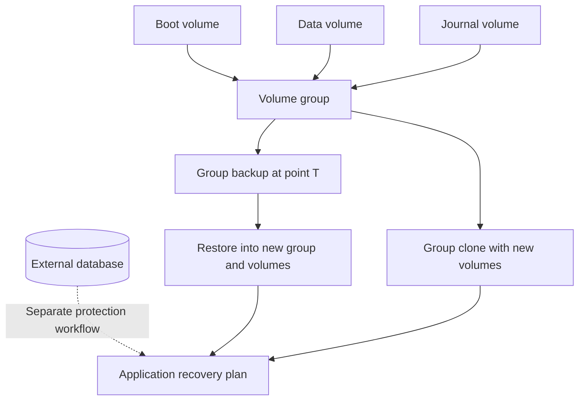

# Backup, Clone, and Volume Groups

A volume running smoothly does not mean application data is always safe from accidental deletion, software bugs, or a failed upgrade. When you need to recover or spin up a test environment on Oracle Cloud Infrastructure, you must select the right copy type and clearly define the scope of data that must stay together.

In OCI Block Volume, a **backup** saves a recovery point for later restoration; a **clone** creates a copy volume for immediate use; and a **volume group** bundles related volumes to perform coordinated backups or clones. Choosing a mechanism must align with recovery requirements, consistency, permissions, and operational cost.

This lesson uses the example of an order-management Java application. The application may require a boot volume for the operating system, a block volume for data, and another volume for related files. External databases, queues, and network configurations must be addressed separately in the recovery plan.

## 1. Distinguishing the Goals of the Three Mechanisms

| Mechanism | What Do You Get? | Use Cases |
| --- | --- | --- |
| Backup | A backup resource representing data at a point in time, used for restore operations | Keeping pre-upgrade checkpoints or recovering after erroneous data changes |
| Clone | A new volume containing a copy at the time of cloning | Creating test environments or analyzing data on a copy |
| Volume group | A group of volumes managed as a single unit for supported operations | Backing up or cloning multiple volumes that have data relationships |

Both backups and clones require a decision about when to capture the data. A clone created after an application has already written bad data will contain that exact bad data. An old backup may be valid at the storage level yet fail to meet the data loss threshold allowed by the business.

A volume group is also not a copy itself. Creating a group only defines the set of volumes; you still need to create backups, clones, or configure appropriate protection mechanisms.

## 2. Backup: Keeping a Recovery Point

A volume backup has its own lifecycle and is stored by the Block Volume service in Object Storage. When recovery is needed, you can create a new volume from a backup. This is a service-managed backup resource, not a JAR file or directory that an application copies to a bucket itself. [Oracle: Creating a Block Volume Backup](https://docs.oracle.com/en-us/iaas/Content/Block/Tasks/create-bv-backup.htm)

For example, before changing an attachment-processing workflow, the team takes a backup of the data volume. If the new release corrupts file contents, the team has a pre-change data point to inspect and restore. However, data generated after that point requires a separate reconciliation plan.

### 2.1. Full and Incremental

OCI supports full and incremental backups. Incremental backups store changes relative to the previous backup, yet when restoring a valid backup point, the service restores the complete contents at that point. Operators do not have to restore a full backup followed by each incremental backup sequentially like a manual file-merging process. Backups to retain are selected based on required recovery points. [Oracle: Block Volume Backups](https://docs.oracle.com/en-us/iaas/Content/Block/Concepts/blockvolumebackups.htm)

This does not mean you can delete backups arbitrarily. You must still preserve points needed by the business, verify retention and deletion permissions, and test restores. Backup size should also not be inferred solely from the number of files visible in a filesystem.

### 2.2. Restoring Requires Rebuilding the Data Access Path

In a restore-to-new-volume workflow, choose the backup, compartment, and target availability domain. Once the new volume is available, remaining steps include attaching, connecting the device if needed, identifying the filesystem, and configuring the application. A block volume backup can be restored to a different availability domain in the same region; restoring in another region requires an appropriate backup copy in the target region, such as via a copy operation. [Oracle: Restoring a Backup to a New Volume](https://docs.oracle.com/en-us/iaas/Content/Block/Tasks/create-restore-to-new-volume-bv-volume-backup.htm), [Oracle: Overview of Block Volume](https://docs.oracle.com/en-us/iaas/Content/Block/Concepts/overview.htm)

Do not treat a newly available volume as having completed system recovery. The application also depends on configuration, identity, databases, endpoints, and services external to the restored dataset.

## 3. Clone: Creating a Copy for Use

A clone is a point-in-time copy created directly from a source volume without going through a backup-then-restore step. Subsequent changes on the source do not automatically sync to the clone. For block volumes, direct clones are created in the same region, availability domain, and tenancy; a different compartment can be chosen if permissions allow. Once its status transitions to `AVAILABLE`, the clone can be used while background data copying continues. [Oracle: Cloning a Block Volume](https://docs.oracle.com/en-us/iaas/Content/Block/Tasks/cloningavolume.htm)

For example, a development team wants to test a file conversion batch job. They create a clone from a test data volume, attach the clone to a test machine, and run the batch on the copy. They then compare results against the original data without modifying the source volume.

Decisions that still must be clearly documented:

- At what point was the clone taken, and what state was the source data in at that time?
- Who is allowed to access data on the clone?
- Could the test machine be misconfigured to call production databases, queues, or services?
- When is the clone cleaned up, and who is responsible for its storage cost?

Cloning does not replace keeping a schedule of multiple backup points. If multi-day historical recovery is required, retention points must be designed and tested accordingly.

Boot volumes also support cloning. A boot volume clone preserves the OS disk data at the time of the copy; it does not contain the memory of a running Java process. Launching an instance and verifying application configuration remain subsequent steps. [Oracle: Cloning a Boot Volume](https://docs.oracle.com/en-us/iaas/Content/Block/Tasks/create-clone-bv-boot-volume.htm)

## 4. Volume Groups: Defining Datasets That Must Move Together

A volume group can include both boot volumes and block volumes. Group backups or group clones provide coordinated, crash-consistent copy points across member volumes. Each volume can belong to only one group at a time. [Oracle: Working with Volume Groups](https://docs.oracle.com/en-us/iaas/Content/Block/Concepts/volumegroups.htm)

Consider the following self-managed system:

| Volume | Assumed Contents | Relationship to Consider |
| --- | --- | --- |
| Boot | Operating system, runtime, and local config files | May need the same deployment generation as the data |
| Data | Application data or self-managed database data files | May depend on files on other volumes |
| Journal | Journals, recovery logs, or related workload components | Must be restored as a matching set using the proper workflow |

Names and roles in the table are examples. Not every log file must sit in the same recovery set; base this on how the application or database actually manages data.

If you take three independent backups at three different times and stitch them together, you might produce a combination that never existed on the source system. Groups handle copy-point coordination at the storage layer, but business consistency still needs to be designed at the application layer.



When creating a group, choose the availability domain and matching volumes; check volume states, backup policy assignments, and related settings before adding. Do not assume every volume visible in a tenancy can be placed into the same group. [Oracle: Creating a Volume Group](https://docs.oracle.com/en-us/iaas/Content/Block/Concepts/create-volume-group.htm)

A group backup can be restored as a group, or member volumes can be restored via their corresponding volume backups. If the application requires the entire set to be consistent, restoring only a single member must be evaluated separately. [Oracle: Volume Group Backups](https://docs.oracle.com/en-us/iaas/Content/Block/Concepts/volumegroups_topic-Volume_Group_Backups.htm)

## 5. Crash-Consistent vs. Application-Consistent

**Crash-consistent** can be pictured as the durable on-disk data state when a system abruptly stops. Structures supporting journals or recovery logs may need to run recovery when reopened. A snapshot does not automatically capture buffers still sitting in application memory.

**Application-consistent** requires the application to coordinate bringing data to a defined recovery point: pausing write intake when necessary, completing or handling in-flight transactions, flushing buffers, and using workload-supported quiesce/backup mechanisms.

For example, a Java API stores files on a block volume and writes metadata to an external database. A group backup of volumes on the VM does not capture that database. If metadata and files must match, you need a coordination procedure, reconciliation mechanism, or data design permitting proper recovery.

### 5.1. Snapshot Point Differs From Backup Completion Point

OCI recommends quiescing applications and syncing required data before initiating a backup. For a single-volume backup, writes can resume after the state transitions from `REQUEST_RECEIVED` to `CREATING`. For a group backup, the safe point to resume writes is `COMMITTED`, confirming member snapshots were taken in coordination. `AVAILABLE` is the point when the backup is fully ready; do not conflate these states. [Oracle: Block Volume Backups — best practices](https://docs.oracle.com/en-us/iaas/Content/Block/Concepts/blockvolumebackups.htm)

In runbooks, explicitly specify which state to wait for, how to check it, and how to resume normal operations if the step fails. Never leave a filesystem frozen indefinitely just because a waiting command lost its connection. For self-managed databases, follow the database's procedures; a single `sync` command on Linux is not enough to prove application consistency.

A scheduled backup policy also does not automatically mean application quiesce steps ran. Clearly distinguish which points are merely crash-consistent and which involve workload coordination.

## 6. CLI Examples for Backing Up, Cloning, and Restoring a Volume

Examples use **Bash** and a pre-authenticated OCI CLI. They illustrate lab operations and have not been run against your tenancy. Replace placeholders with authorized test resources; verify consistency and cost before creating copies.

```bash
export COMPARTMENT_OCID='ocid1.compartment.oc1..REPLACE_ME'
export SOURCE_VOLUME_OCID='ocid1.volume.oc1.REGION.REPLACE_ME'
export AVAILABILITY_DOMAIN='REPLACE_WITH_EXACT_AVAILABILITY_DOMAIN_NAME'
```

### 6.1. Creating a Manual Backup

After preparing data per the chosen procedure:

```bash
oci bv backup create \
  --volume-id "$SOURCE_VOLUME_OCID" \
  --display-name order-data-before-release \
  --type FULL \
  --wait-for-state AVAILABLE
```

Record `data.id` from the output as the backup OCID. The example waits for `AVAILABLE` for lab convenience; in operations, write pause windows are managed according to the snapshot milestones described earlier. [Oracle CLI: backup create](https://docs.oracle.com/en-us/iaas/tools/oci-cli/latest/oci_cli_docs/cmdref/bv/backup/create.html)

If a wait command times out, query the created resource before submitting a new request. A CLI timeout does not prove the service-side operation failed or was canceled.

### 6.2. Creating a Clone From a Source Volume

```bash
oci bv volume create \
  --compartment-id "$COMPARTMENT_OCID" \
  --availability-domain "$AVAILABILITY_DOMAIN" \
  --source-volume-id "$SOURCE_VOLUME_OCID" \
  --display-name order-data-test-clone \
  --wait-for-state AVAILABLE
```

For a direct clone in this example, the availability domain must be where the source volume resides. Save the clone volume OCID and do not reuse the source volume OCID when attaching to the test machine. The `--source-volume-id` parameter identifies the source of the clone operation. [Oracle: Cloning a Block Volume](https://docs.oracle.com/en-us/iaas/Content/Block/Tasks/cloningavolume.htm)

### 6.3. Restoring a Backup to a New Volume

```bash
export BACKUP_OCID='ocid1.volumebackup.oc1.REGION.REPLACE_ME'

oci bv volume create \
  --compartment-id "$COMPARTMENT_OCID" \
  --availability-domain "$AVAILABILITY_DOMAIN" \
  --volume-backup-id "$BACKUP_OCID" \
  --display-name order-data-restore-test \
  --wait-for-state AVAILABLE
```

This command creates a new volume from the specified backup. Record the new OCID, then perform the attach and data verification workflow on the test machine. Do not reformat a volume that already has a filesystem. [Oracle: Restoring a Backup to a New Volume](https://docs.oracle.com/en-us/iaas/Content/Block/Tasks/create-restore-to-new-volume-bv-volume-backup.htm)

A clone or restore can carry over on-disk identifiers such as filesystem UUIDs, partition IDs, or LVM metadata. To avoid confusion in labs, use a separate test instance; if both the original and the copy must be attached to one host, handle identifiers according to your OS and storage technology guidelines.

## 7. Example: Creating and Backing Up a Volume Group

Suppose two test data block volumes need to be protected together. In your lab working directory, prepare `group-source.json` with real OCIDs:

```json
{
  "type": "volumeIds",
  "volumeIds": [
    "ocid1.volume.oc1.REGION.REPLACE_WITH_DATA_VOLUME",
    "ocid1.volume.oc1.REGION.REPLACE_WITH_JOURNAL_VOLUME"
  ]
}
```

Create the group after confirming the volumes meet eligibility requirements to join a group:

```bash
oci bv volume-group create \
  --compartment-id "$COMPARTMENT_OCID" \
  --availability-domain "$AVAILABILITY_DOMAIN" \
  --source-details file://group-source.json \
  --display-name order-stack-lab \
  --wait-for-state AVAILABLE
```

`type: volumeIds` indicates creating a group from existing volumes; this operation does not copy data. Verify membership and save the group OCID before backing up. [Oracle CLI: volume-group create](https://docs.oracle.com/en-us/iaas/tools/oci-cli/latest/oci_cli_docs/cmdref/bv/volume-group/create.html)

```bash
export GROUP_OCID='ocid1.volumegroup.oc1.REGION.REPLACE_ME'

oci bv volume-group-backup create \
  --volume-group-id "$GROUP_OCID" \
  --display-name order-stack-before-change \
  --type FULL \
  --wait-for-state AVAILABLE
```

This requests a group-level backup. Record the group backup OCID and status, and preserve membership details at the backup point for later verification. [Oracle CLI: volume-group-backup create](https://docs.oracle.com/en-us/iaas/tools/oci-cli/latest/oci_cli_docs/cmdref/bv/volume-group-backup/create.html)

### 7.1. Restoring a Group Backup

Prepare a `group-restore-source.json` file in the lab environment:

```json
{
  "type": "volumeGroupBackupId",
  "volumeGroupBackupId": "ocid1.volumegroupbackup.oc1.REGION.REPLACE_ME"
}
```

```bash
oci bv volume-group create \
  --compartment-id "$COMPARTMENT_OCID" \
  --availability-domain "$AVAILABILITY_DOMAIN" \
  --source-details file://group-restore-source.json \
  --display-name order-stack-restore-test \
  --wait-for-state AVAILABLE
```

Restoring creates a new group and restored volumes; you still must map the exact boot, data, and related volume roles into the target environment. It does not automatically rebuild the entire instance, network, IAM, and application flow. [Oracle: Restoring a Volume Group from a Volume Group Backup](https://docs.oracle.com/en-us/iaas/Content/Block/Tasks/create-restore-bv-volume-group.htm)

If the goal is to clone an existing group directly, the group creation command's source uses `type: volumeGroupId` with a `volumeGroupId` field. Distinguish this source from `volumeGroupBackupId`, which is used for restoring from a backup. [Oracle: Cloning a Volume Group](https://docs.oracle.com/en-us/iaas/Content/Block/Concepts/clone-volume-group.htm)

## 8. Evaluating Recovery Using RPO and RTO

**RPO** is the target for the maximum time span of data loss acceptable during recovery. **RTO** is the target time to restore the service to a defined service level. Both must be measured across the application workflow, not just how long a volume creation command takes to complete.

Hypothetical example:

- The latest successfully backed-up data point was at 14:00.
- An error rendering data unusable occurred at 14:17.
- If only the 14:00 point is restored with no mechanism to replay subsequent transactions, the time span of data at risk of loss is 17 minutes.

If the RPO target is 15 minutes, this scenario misses the target even though a good backup exists. You must evaluate schedules, actual lag, completion times, and appropriate supplementary protection mechanisms.

A drill might record hypothetical durations as follows:

| Phase | Illustrative Duration |
| --- | --- |
| Detect incident and decide recovery point | 3 minutes |
| Restore data | 12 minutes |
| Attach, mount, and apply configuration | 5 minutes |
| Workload recovery and Java startup | 8 minutes |
| Business verification, reopen traffic | 4 minutes |
| Total | 32 minutes |

These numbers only illustrate how to calculate. Use measurements from your own environment to determine RTO compliance, including access permissions, resource provisioning capacity, and dependencies.

## 9. Backup Schedules, Retention, Permissions, and Cost

Backup policies define schedules and retention periods for backup points. OCI supports predefined and user-defined policies for volumes and volume groups. Actual start times may lag behind the schedule; therefore, monitor successful backup points rather than only checking that a resource has a policy assigned. [Oracle: Backup Policies](https://docs.oracle.com/en-us/iaas/Content/Block/Tasks/schedulingvolumebackups.htm)

Operational decisions requiring clear ownership:

| Item | Questions to Answer |
| --- | --- |
| Schedule | How often is a point taken and which data must be coordinated? |
| Retention | Which points are kept, for how long, and how are pre-major-change points retained? |
| Monitoring | Who receives backup failure alerts, detects stale backups, and verifies restores? |
| Permissions | Who can create, restore, copy, and delete copies? |
| Encryption | Are permissions to use customer-managed keys needed at the recovery destination? |
| Cost | How many backups, clones, and restored volumes are currently retained? |

Manual backups now support configurable retention options; do not infer retention lifetime solely from the "manual" label. Verify the resource's actual settings and operational requirements before relying on one as a long-term recovery point. [Oracle: Creating a Block Volume Backup](https://docs.oracle.com/en-us/iaas/Content/Block/Tasks/create-bv-backup.htm)

For cross-region plans, verify backup copies in the target region, permissions, and appropriate encryption key configurations. Do not assume Vault keys are automatically copied alongside a backup policy. [Oracle: Backup Policies — cross-region copies](https://docs.oracle.com/en-us/iaas/Content/Block/Tasks/schedulingvolumebackups.htm)

Clones used for testing should have an explicit expiration date and owner. Test restore environments must also be inventoried after drills; resources no longer accessed by applications can continue consuming provisioned capacity.

### 9.1. Caution When Modifying Members or Cleaning Up Groups

When updating group members via CLI/API, the submitted list must contain all volumes you want to keep; volumes omitted from the list are removed from the group. Deleting a volume group does not automatically delete member volumes. Conversely, deleting a group backup deletes the volume backups inside that group backup. [Oracle: Working with Volume Groups](https://docs.oracle.com/en-us/iaas/Content/Block/Concepts/volumegroups.htm)

Distinguish three objects in cleanup records: the source group, active volumes, and group backups. Each object has a different purpose and deletion impact.

## 10. Common Mistakes

| Claim | Consequence or Proper Handling |
| --- | --- |
| Having a clone is enough to replace historical backups | A clone reflects one point; design and retain recovery points per requirements |
| A group backup automatically guarantees every application transaction | Define quiesce mechanisms and address data outside the group |
| Three separate backups taken around the same hour form a consistent set | Use an appropriate coordination mechanism and test recovery procedures |
| `REQUEST_RECEIVED` means the backup is finished | Distinguish request receipt, snapshot point, and ready-for-restore state |
| Once the volume is restored, the service is back up | Verify attach, mount, recovery, configuration, and application functionality |
| A clone or restore is an empty disk | Identify existing data; do not reformat |
| Having a policy guarantees RPO is met | Monitor actual data timestamps of completed backups |
| Deleting a group cleans up all resources | Inventory volumes, attachments, backups, and test environments separately |

## 11. Applied Exercise

In a test environment, prepare two volumes containing related test data—for example, a data file and a version descriptor file. Place them in a volume group and create a group backup at a defined point. Then modify the source data and restore the group backup to new volumes to compare.

Record:

1. OCIDs of source volumes, source group, and group backup.
2. Group members along with each volume's role at the backup point.
3. Test data or transactions representing the recovery point.
4. Chosen consistency level and workload coordination steps.
5. OCIDs of restored volumes, plus attach and mount steps on the test machine.
6. Data read-back results and time taken to bring test functionality back.
7. Dependencies excluded from the backup and how they are protected.

Also create a clone of the test data volume, edit a file on the clone, and inspect the source. Explain why copy independence alone does not provide a multi-point recovery history.

The output of this exercise is a runbook defining **the data to protect, the consistency point, retained copies, and application recovery steps**. A backup becomes useful recovery evidence only once you have verified it can bring back the required data and functionality.
