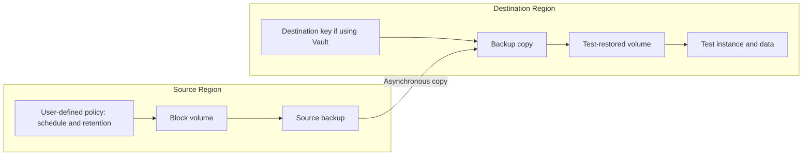

# Backup Policies and Cross-Region Volume Copying

A volume that is operating normally is not enough to guarantee data can be recovered in the event of an application bug, accidental deletion, or an outage affecting an entire region. In Oracle Cloud Infrastructure (OCI), backup policies create scheduled recovery points, while cross-region backup copies replicate those recovery points to another region.

To operate properly, you must manage the backup schedule, retention period, IAM permissions, encryption keys, copy lag, and restore workflow together. This lesson belongs to the **Block Volume and Boot Volume** chapter and focuses on designing and practicing this mechanism for both application data and instance boot disks.

## Learning Objectives

After this lesson, you will be able to:

- Distinguish backup, backup copy, clone, and replication.
- Choose a backup policy based on recovery needs and retention duration.
- Explain full backups and incremental backups in OCI.
- Create a policy with a schedule and cross-region copy, then assign it to the right resource.
- Prepare copy permissions and encryption keys in the destination region.
- Verify a copy using identifiers, status, and data timestamp.
- Test-restore a volume in the destination region and verify data.
- Monitor backup freshness, detect failures, and control costs.

## Distinguishing Data Protection Mechanisms

| Mechanism | Artifact Created | Primary Purpose |
|---|---|---|
| Volume backup | Point-in-time recovery point of a volume | Roll back to data at a selected point in time |
| Cross-region backup copy | A backup residing in another region | Recover when the source region is unavailable, or prepare regional migration |
| Volume clone | A new volume from source data within supported scope | Create a working copy without going through a full backup/restore cycle |
| Volume replication | Asynchronously updated replica | Prepare fresher data for DR scenarios |
| Application-level backup | Copy aligned with application semantics | Restore transactions, objects, or data using application-supported mechanisms |

Replication and backup serve complementary needs. A replica closely tracking changes can also receive unwanted changes; backups store historical points to choose from. See [Block Volume Replication](https://docs.oracle.com/en-us/iaas/Content/Block/Concepts/volumereplication.htm).

In this lesson, "copying a volume across regions" primarily refers to the sequence:

```text
Volume in source region
  -> create backup
  -> copy backup to destination region
  -> restore as a new volume in destination region
```

This is not an operation that changes the region attribute of an attached volume. The volume recreated at the destination has its own OCID, attachments, and lifecycle.

## Scope of Backups

### Block Volume and Boot Volume

Block volumes typically hold application data, filesystems, or database data. Boot volumes hold the OS and data written to the startup disk. Boot volume backups can be created manually or via policy and can be copied to another region. See [Boot Volume Backups](https://docs.oracle.com/en-us/iaas/Content/Block/Concepts/bootvolumebackups.htm).

Backing up a boot volume does not automatically include attached block volumes, local NVMe, RAM, or data in another service. When protecting an instance, determine where each piece of data resides rather than merely enabling a policy on the boot disk.

### Volumes and Backups Have Different Location Scopes

Volumes are used with instances in the same availability domain under the Block Volume attachment model. Backups can be restored into an eligible AD within the region containing the backup. To restore in another region, you first need a backup in that region. See [Block Volume region and AD scope](https://docs.oracle.com/en-us/iaas/Content/Block/Concepts/overview.htm).

A copy in the destination region does not pre-create:

- Compute instances with an appropriate shape.
- VCNs, subnets, NSGs, routes, or private connectivity.
- Load balancer and DNS configurations serving users.
- Secrets, certificates, and application access permissions.
- Data services external to the volume.

Therefore, cross-region backups are one part of a full system recovery plan.

## Full Backup and Incremental Backup

OCI supports full and incremental backups. Incremental backups record changes since the previous backup, yet when restoring, operators select a single backup to restore the volume's contents at that point in time. You do not manually download and stitch files across an incremental chain. See [Block Volume backup type semantics](https://docs.oracle.com/en-us/iaas/Content/Block/Concepts/blockvolumebackups.htm).

Distinguish clearly:

| Aspect | Interpretation |
|---|---|
| Data additionally stored in one backup | Depends on backup type and changed blocks |
| Restored contents | State of the volume at the selected recovery point |
| Number of retained backups | Determined by retention, manual actions, and related protection mechanisms |
| Billed capacity | Cannot be inferred simply by multiplying backup count by used filesystem space |

Do not delete a backup just because it is labeled "full" and you assume it is redundant, nor retain every "incremental" indefinitely out of fear you must maintain a chain manually. Manage them via retention and verify restores using service mechanisms.

After changing volume capacity or experiencing major data churn, re-evaluate backup duration, storage footprint, and copy completion within the desired window.

## Data Consistency

A volume backup protects on-disk data at a point in time. It does not automatically understand every transaction, RAM buffer, or application write ordering.

For boot volumes, OCI describes backups as following a crash-consistent model. For data requiring application consistency, operations teams must execute appropriate procedures: quiesce, flush, checkpoint, or application-native backup mechanisms. Do not treat a backup created while an instance is running as proof that all transactions are consistent.

If data spans multiple volumes, separate policies assigned individually per volume do not produce a synchronized recovery point for the entire dataset. Consider volume groups and group-level backups along with application coordination.

When managing policies at the volume group level, handle volume-level policy assignments according to supported procedures. Never leave two protection models overlapping where operators do not know which policy actually applies. See [assigning a backup policy to a volume group](https://docs.oracle.com/en-us/iaas/Content/Block/Concepts/create-assign-to-group-bv-volume-backup-policy-assignment.htm).

Example for a self-managed database:

1. Identify which volumes hold datafiles, logs, and configuration.
2. Choose a recovery-point creation mechanism supported by the database.
3. Coordinate volume or volume group backups if used at the storage layer.
4. Copy the required set of resources to the destination region.
5. Test database recovery, not merely filesystem mounting.

## Designing Policies From Recovery Requirements

Before configuring, answer these questions:

| Question | Decision to Make |
|---|---|
| How much data loss is acceptable? | Target RPO |
| How long can service be down? | Target RTO |
| How far back in history must we go? | Retention and recovery point tiers |
| Which incidents must be handled? | Data corruption, accidental deletion, instance loss, or region loss |
| Which data must be mutually consistent? | Individual volume, volume group, or application backup |
| Who can create, copy, restore, and delete? | Role-based IAM permissions |
| Who bears costs and maintains the workflow? | Owner, tags, and review schedule |

RPO is the target for acceptable data loss. RTO is the target time to restore service. Both targets must be measured using actual recovery points and real restore workflows.

For example, daily backups do not automatically guarantee an RPO under 24 hours in the destination region. The backup must also finish, be copied, have usable keys, and be restorable.

## Choosing Oracle-Defined vs. User-Defined Policies

OCI provides predefined policies such as Bronze, Silver, and Gold. They have schedules and retention defined by Oracle. User-defined policies allow teams to configure their own settings. Automated scheduled copying of backups to another region requires a user-defined policy; you can clone an existing policy and adjust it. See [Backup Policies](https://docs.oracle.com/en-us/iaas/Content/Block/Tasks/schedulingvolumebackups.htm).

| Option | Suitable When |
|---|---|
| Oracle-defined policy | Predefined schedule and retention meet needs, and policy-driven automatic cross-region copy is not needed |
| User-defined policy | You need control over timing, retention, or destination region |
| Manual backup | You need a recovery point for a specific change or a test |
| Combined mechanisms | Different operational needs exist and each backup type's lifecycle is clearly managed |

A backup policy here is a policy for **scheduling data protection**. An IAM policy is a policy for **granting access permissions**. Having permission to create backups does not mean a volume has a schedule assigned; having a schedule assigned does not prove all cross-region permissions are complete.

## Schedules, Time Zones, and Retention

### Explicitly Specify the Time Zone

A schedule must specify frequency, time of day, and time zone. Example:

| Component | Illustrative Value |
|---|---|
| Frequency | Daily |
| Time | 18:00 UTC |
| Converted to Vietnam time | 01:00 UTC+7 the next day |
| Requested backup type | Incremental |
| Retention | 14 days |
| Copy | Automatic to the selected destination region |

This is a lab schedule to illustrate interpretation, not a time suitable for every workload. Pick windows based on load, application workflows, and observed completion times.

When using structured fields such as `hourOfDay`, set `offsetType` appropriately. With `STRUCTURED`, schedule fields are interpreted according to the period type; do not mix semantics with second-based offsets. See [VolumeBackupSchedule model](https://docs.oracle.com/en-us/iaas/tools/java/latest/com/oracle/bmc/core/model/VolumeBackupSchedule.html).

### Retention Is Not Frequency

"Backup daily, retain 14 days" differs from "backup every 14 days." Frequency determines how often recovery points are created; retention determines how long each point is kept.

When designing multiple retention tiers, you may need different short-term and long-term points. However, check schedule limits, overlap-handling rules, and service copy capabilities. Do not assume that because an API exposes a time field, every schedule combination behaves as desired.

For automatic copies, the destination copy's retention follows the source backup's retention. A delayed copy does not mean the destination automatically receives a fresh full period starting from when you see it appear. Read the actual resource state and expiration metadata.

### Retention Lock and Data Hold Mechanisms

Available retention features may include retention period, prevent deletion, retention lock, or indefinite hold, depending on supported resources and operations.

- Retention defines the data storage lifetime.
- Prevent deletion controls deletion under configured conditions.
- Retention lock prevents reducing or removing the protection duration once enabled.
- Indefinite hold keeps the backup until the hold is lifted with corresponding permissions.

Do not treat prevent deletion as a way to automatically extend an expired backup. These mechanisms carry their own IAM permissions and affect editing or deleting resources. See [configuring retention for schedules](https://docs.oracle.com/en-us/iaas/Content/Block/Tasks/create-schedule-bv-volume-backup-policy.htm) and [managing backup retention](https://docs.oracle.com/en-us/iaas/Content/Block/Tasks/bv-backup-edit.htm).

The lab below illustrates only basic scheduling and retention. Enabling locking mechanisms must be a separate decision based on retention requirements and data governance responsibilities.

## Preparing the Destination Region and IAM Permissions

### Checking Resources and Scope

Before enabling copies, record:

1. Volume OCID, block or boot type, and source compartment.
2. Supported source and destination regions, ready for use in the tenancy.
3. Current backup policy and scope: volume or volume group.
4. Permissions to create source backups, copy, and create backups at the destination.
5. Source encryption key and destination key if using customer-managed keys.
6. Quotas, service limits, and resources needed for a test restore.
7. Owner, operational schedule, and where recovery evidence is recorded.

A different region does not mean a different account or tenancy. Examples in this lesson handle copying across regions within prepared permissions; do not assume this is a cross-tenancy workflow.

### Distinguishing Block Backup and Boot Backup Permissions

For copying block volume backups, source permissions such as `VOLUME_BACKUP_READ`, `VOLUME_BACKUP_COPY` and destination backup creation permissions such as `VOLUME_BACKUP_CREATE` are needed. Documentation notes that the aggregate resource type `volume-family` does not automatically include this copy permission. See [block volume backup copy permissions](https://docs.oracle.com/en-us/iaas/Content/Block/Tasks/copy-bv-backup.htm).

Boot volume backups have a corresponding permission set such as `BOOT_VOLUME_BACKUP_READ`, `BOOT_VOLUME_BACKUP_COPY`, and `BOOT_VOLUME_BACKUP_CREATE`. Do not use block backup permissions to infer that boot backups are sufficiently authorized.

The permission names above are for IAM reference; they are not yet a complete deployable policy set. Permission grants must still be scoped by compartment, region, and role. Restore, attach volume, and key usage permissions must also be verified separately.

## Preparing Encryption Keys in the Destination Region

The source volume's Vault key is not automatically copied along with a backup to another region. If using customer-managed encryption at the destination, specify a valid key in the destination region and configure permissions for Block Volume to use that key. If no customer-managed key is specified, the default mechanism uses an Oracle-managed key per the operation. See [encryption keys for cross-region operations](https://docs.oracle.com/en-us/iaas/Content/Block/Tasks/assign-encryption-key.htm).

Three items to verify independently:

| Item | What to Verify |
|---|---|
| Identifier | OCID is a key, in the right region and right resource |
| Permissions | User or pipeline is allowed to configure; service is allowed to perform required cryptographic operations |
| Lifecycle | Key and decryption permissions remain usable throughout the entire required recovery window |

The copy's key is an attribute that must be read back from the destination backup. Do not look only at the source volume's key and conclude the copy used the same encryption policy.

With automatic cross-region copy, the destination key can be specified when **assigning the policy** to the resource. With manual copy, the key parameter sits on the copy operation itself. These two configuration locations are easily confused.

If a key is disabled or scheduled for deletion, a visible backup is not enough to guarantee successful restoration. The DR plan must cover key availability in the destination region when the source region is down.

## Lab Model

Suppose you have a test block volume containing sample data that must be backed up daily and copied to another region:



Sample data should have verifiable values, such as a set of files with checksums or a set of test records with timestamps. Do not treat "volume attached" status as a data verification result.

The following commands are **Bash** examples in an environment with OCI CLI installed and authenticated. Values with `...` or inside `<...>` are placeholders. This is instructional content; this article does not execute cloud commands or create real resources.

## Creating a Policy Using the Console

A typical workflow:

1. Select the right region and management scope.
2. Open **Block Storage → Backup Policies**.
3. Create a user-defined policy and give it a descriptive name.
4. Select the appropriate cross-region copy target.
5. Add a schedule: frequency, time, time zone, backup type, and retention.
6. Double-check the schedule in your operational time zone.
7. Open the volume or boot volume to protect and assign the policy.
8. If a customer-managed key is needed for the destination copy, select the destination-region key during the assignment step.
9. Verify the policy assignment after saving.

Creating a policy alone is not enough to generate backups for a volume. The policy needs a valid schedule and must be assigned to the right asset. See [creating a user-defined policy](https://docs.oracle.com/en-us/iaas/Content/Block/Tasks/create-bv-volume-backup-policy.htm) and [assigning a policy to a volume](https://docs.oracle.com/en-us/iaas/Content/Block/Tasks/create-bv-volume-backup-policy-assignment.htm).

For volume groups, use the group-level workflow. Do not repeat individual assignments on member volumes to substitute for a group policy.

## Creating and Assigning a Policy Using OCI CLI

### Recording the Current Assignment

```bash
SOURCE_REGION='<source-region>'
DEST_REGION='<destination-region>'
POLICY_COMPARTMENT_ID='ocid1.compartment.oc1...'
BLOCK_VOLUME_ID='ocid1.volume.oc1...'

oci bv volume get \
  --region "$SOURCE_REGION" \
  --volume-id "$BLOCK_VOLUME_ID"

oci bv volume-backup-policy-assignment \
  get-volume-backup-policy-asset-assignment \
  --region "$SOURCE_REGION" \
  --asset-id "$BLOCK_VOLUME_ID"
```

Verify the volume and assignment before making changes. Each volume has only one backup policy assignment; assigning another policy may replace the current assignment. Do not treat that action as adding an independent extra schedule layer. See [policy assignment semantics](https://docs.oracle.com/en-us/iaas/tools/oci-cli/latest/oci_cli_docs/cmdref/bv/volume-backup-policy-assignment/create.html).

If the lab replaces an existing policy, record the old policy OCID and related options so you can restore the original configuration.

### Creating a Daily Schedule

The following example requests an incremental backup at 18:00 UTC, retained for 14 days:

```bash
oci bv volume-backup-policy create \
  --region "$SOURCE_REGION" \
  --compartment-id "$POLICY_COMPARTMENT_ID" \
  --display-name 'daily-14d-cross-region' \
  --destination-region "$DEST_REGION" \
  --schedules '[
    {
      "backupType": "INCREMENTAL",
      "period": "ONE_DAY",
      "offsetType": "STRUCTURED",
      "hourOfDay": 18,
      "retentionSeconds": 1209600,
      "timeZone": "UTC"
    }
  ]'
```

`1209600 = 14 × 24 × 60 × 60` seconds. Read back the API response and verify the schedule, retention, and destination region. The example uses `retentionSeconds`; when adding newer retention features, check the schema and CLI version instead of combining fields that may overlap semantically. See [OCI CLI volume-backup-policy create](https://docs.oracle.com/en-us/iaas/tools/oci-cli/latest/oci_cli_docs/cmdref/bv/volume-backup-policy/create.html).

After creation, extract the policy OCID from the output:

```bash
BACKUP_POLICY_ID='ocid1.volumebackuppolicy.oc1...'

oci bv volume-backup-policy get \
  --region "$SOURCE_REGION" \
  --policy-id "$BACKUP_POLICY_ID"
```

### Assigning the Policy and Selecting the Destination Key

If using Oracle-managed encryption for the copy, assign as follows:

```bash
oci bv volume-backup-policy-assignment create \
  --region "$SOURCE_REGION" \
  --asset-id "$BLOCK_VOLUME_ID" \
  --policy-id "$BACKUP_POLICY_ID"
```

If required to use a Vault key in the destination region, run the assignment option with the prepared key:

```bash
DEST_KEY_ID='ocid1.key.oc1...'

oci bv volume-backup-policy-assignment create \
  --region "$SOURCE_REGION" \
  --asset-id "$BLOCK_VOLUME_ID" \
  --policy-id "$BACKUP_POLICY_ID" \
  --xrc-kms-key-id "$DEST_KEY_ID"
```

The two blocks above are two alternatives, not two mandatory sequential steps. `--xrc-kms-key-id` configures the key for the destination backup copy; it does not change the source volume's key.

For boot volumes, pass the exact boot volume OCID in the asset assignment and check the policy applied to that resource. Protecting a boot volume and a block volume with the same policy does not turn two separate backups into one synchronized snapshot.

## Observing the First Scheduled Run

After assigning the policy:

1. Confirm the assignment is accurate and the schedule remains active.
2. When the actual cycle arrives, verify the source backup was created.
3. Wait for both the backup and copy to complete per service status.
4. Switch to the destination region to look up the copy.
5. Cross-check provenance, data timestamp, retention, and encryption key.
6. Select that copy for a test restore.

The schedule is the requested start time under service mechanisms, not a commitment that every resource finishes at that exact minute. OCI documentation notes that copying daily backups to the destination can take up to 24 hours. Therefore, design alerts around actual cycles and target RPO rather than only checking that a source backup exists today.

If you need to test the copy path early, you can create and copy a manual backup as shown below. That verifies permissions and recoverability, but **does not prove the automated schedule ran**.

## Creating a Manual Backup and Copy for Testing

### Creating the Source Backup

Ensure consistent data on the test volume before invoking backup:

```bash
oci bv backup create \
  --region "$SOURCE_REGION" \
  --volume-id "$BLOCK_VOLUME_ID" \
  --display-name 'manual-dr-test' \
  --type INCREMENTAL
```

Capture the backup OCID from the output and query it:

```bash
SOURCE_BACKUP_ID='ocid1.volumebackup.oc1...'

oci bv backup get \
  --region "$SOURCE_REGION" \
  --volume-backup-id "$SOURCE_BACKUP_ID"
```

A backup may transition through `REQUEST_RECEIVED` and `CREATING`; `AVAILABLE` is the ready milestone to check before the next step. See [OCI CLI backup create](https://docs.oracle.com/en-us/iaas/tools/oci-cli/latest/oci_cli_docs/cmdref/bv/backup/create.html).

Manual backups have their own lifecycle. Read their actual retention and hold settings; do not assume a volume's assigned policy will automatically clean them up alongside scheduled backups.

### Copying to the Destination Region

With a customer-managed key in the destination region:

```bash
oci bv backup copy \
  --region "$SOURCE_REGION" \
  --volume-backup-id "$SOURCE_BACKUP_ID" \
  --destination-region "$DEST_REGION" \
  --display-name 'manual-dr-test-copy' \
  --kms-key-id "$DEST_KEY_ID"
```

If using an Oracle-managed key, omit `--kms-key-id`. Decide explicitly based on encryption requirements; do not drop the parameter just to bypass a permission error.

`--region` selects the source region endpoint for the request. `--destination-region` selects where the copy goes. After submitting, extract the destination backup OCID from the response and query it in the destination region. See [backup copy reference](https://docs.oracle.com/en-us/iaas/tools/oci-cli/latest/oci_cli_docs/cmdref/bv/backup/copy.html).

```bash
DEST_BACKUP_ID='ocid1.volumebackup.oc1...'

oci bv backup get \
  --region "$DEST_REGION" \
  --volume-backup-id "$DEST_BACKUP_ID"
```

Do not use the source OCID to inspect the copy, and do not check only source status. The two backups are separate resources that must be verified individually.

### Handling Timeouts and Retries

If the client times out:

- Query the work request, source resource, and backup list at the destination.
- Determine whether the earlier request is still running or already created the copy.
- Retry only after understanding the outcome to avoid creating unnecessary duplicate copies.
- Record the request ID, source backup OCID, and destination backup OCID for tracking.

Display names aid identification, but they are not unique identifiers preventing duplicate creation.

## Differences When Copying Boot Volume Backups

Boot volume backups use a separate command group, for example:

```bash
SOURCE_BOOT_BACKUP_ID='ocid1.bootvolumebackup.oc1...'

oci bv boot-volume-backup copy \
  --region "$SOURCE_REGION" \
  --boot-volume-backup-id "$SOURCE_BOOT_BACKUP_ID" \
  --destination-region "$DEST_REGION" \
  --display-name 'boot-dr-test-copy' \
  --kms-key-id "$DEST_KEY_ID"
```

Limits to check beforehand include supported image types, destination shape compatibility, and concurrent copies per boot volume. Current documentation notes support for boot backups of instances created from platform images or custom images built from platform images; do not assume every Marketplace image can be copied. See [copying boot volume backups cross-region](https://docs.oracle.com/en-us/iaas/Content/Block/Tasks/copyingbootvolumebackupcrossregion.htm).

After copying, boot volume recovery also requires launching an eligible instance, configuring networking, and verifying the application. Do not treat a block volume restore result as a substitute for testing boot from a boot backup.

For volume group backups, use the group-level operation. Do not pass a group backup OCID to a single block volume backup copy command.

## Calculating RPO From a Truly Usable Copy

For a source-region loss scenario, a practical measurement is:

```text
Age of DR recovery point at time t
  = t - data timestamp of the newest backup
        already present in the destination region and eligible for restore
```

"Eligible" includes valid status, access permissions, and a usable key. Copy completion time does not make the backup contents newer data.

Illustrative example, all timestamps in UTC:

| Timestamp | Event |
|---|---|
| Day 1, 18:00 | Source backup data point captured |
| Day 1, 20:00 | Copy of that point reaches AVAILABLE at destination |
| Day 2, 18:00 | New source backup point taken; new copy not yet ready |
| Day 2, 19:00 | Source region suffers an outage |

If the newest usable copy at the destination is still the Day 1 18:00 point, recovered data is **25 hours** old at the time of the outage—not 23 hours measured from copy completion, and not 1 hour measured from the latest backup schedule.

This example shows DR RPO is affected by both the interval between backups and copy lag. When targets allow very little data loss, evaluate replication or appropriate application-layer mechanisms while still retaining necessary historical backups.

## Test-Restoring a Block Volume in the Destination Region

### Preparing the Recovery Environment

Before restoring:

1. Select the exact usable destination backup.
2. Prepare the compartment and AD for the new volume.
3. Prepare a test instance in the same AD.
4. Prepare required permissions and keys.
5. Isolate the test workload from production traffic and background jobs.
6. Define the data, checksums, or transactions used for verification.

A backup holding valid data that cannot be decrypted or has nowhere to attach does not yet provide complete recoverability.

### Creating a Volume From the Destination Backup

```bash
RESTORE_COMPARTMENT_ID='ocid1.compartment.oc1...'
DEST_AD='<destination-availability-domain>'

oci bv volume create \
  --region "$DEST_REGION" \
  --compartment-id "$RESTORE_COMPARTMENT_ID" \
  --availability-domain "$DEST_AD" \
  --volume-backup-id "$DEST_BACKUP_ID" \
  --display-name 'dr-restore-validation'
```

This creates a new volume from the backup without overwriting the source volume. Record the volume OCID, wait for the right state, and verify configuration before attaching. See [parameters for creating a volume from a backup](https://docs.oracle.com/en-us/iaas/tools/oci-cli/latest/oci_cli_docs/cmdref/bv/volume/create.html).

If specifying a key for the restored volume, that is an encryption choice for the new resource. Distinguish it from the key protecting the destination backup.

### Attaching, Mounting, and Verifying Data

Attach the new volume using the connection type appropriate for the test instance. Inside the OS:

- Cross-reference volume and device identifiers.
- Inspect partitions, filesystems, and mount points.
- Do not format the restored volume just because it was newly created in OCI.
- Mount following proper filesystem procedures and restrict writes outside testing purposes.
- Verify checksums, record counts, or selected business data.
- Test the live application if the goal is service recovery.

If attaching both the original volume and the restored copy to the same machine, UUID, partition ID, or filesystem configuration conflicts can occur. Use a separate test environment and follow OS guidance. See [Restoring a Backup to a New Volume](https://docs.oracle.com/en-us/iaas/Content/Block/Tasks/create-restore-to-new-volume-bv-volume-backup.htm).

Do not measure RTO solely by the volume-creation API call duration. Include incident detection, recovery point selection, resource provisioning, attachment, application startup, data validation, and traffic cutover. Measure the critical path of the actual procedure since some steps can run in parallel.

## Monitoring Data Protection Policies

A long list of backups alone is not enough to conclude a policy is meeting targets. Operational signals to track include:

| Metric or Status | Question to Answer |
|---|---|
| Age of newest source backup | Is the source schedule still creating new points? |
| Age of newest usable destination backup | Where does DR RPO currently stand? |
| Backup creation duration | Does it exceed normally observed thresholds? |
| Copy lag | Has the latest source point arrived at the destination? |
| Current assignment | Does the volume or group still have the intended policy assigned? |
| Retention and holds | Could backups expire early or be retained unexpectedly? |
| Keys and permissions | Will the next copy or restore be able to use them? |
| Latest test restore | Is there evidence that data and applications can recover? |
| Cost by region and tag | Are retained resources aligned with their purpose? |

You can combine checks across APIs, Audit, Events, and Notifications depending on the capabilities of the events or services used. Set alerts on target conditions—such as "no new usable copy within the acceptable window"—rather than merely "backup request submitted."

Assign an alert responder and a verification runbook in the destination region. An alarm with no owner does not shorten recovery time.

## Common Errors

| Symptom | Cause to Check | Resolution Direction |
|---|---|---|
| Policy exists, but no backups appear | Asset not assigned, schedule hasn't fired, or unexpected schedule config | Inspect assignment, schedule, and time zone |
| Source backup succeeds, no new copy appears | Cross-region not enabled, copy pending, or missing permissions | Check policy, destination resources, and related work requests |
| Backup not found | Wrong region, compartment, resource type, or OCID | Query the right endpoint and identifier |
| Copy rejected | Missing copy/create permissions or IAM region condition | Cross-check both source and destination permissions |
| Vault error | Wrong key region, key unavailable, or missing use permissions | Check destination key and service permissions |
| Boot backup cannot be copied | Unsupported image type or related limitation | Check boot backup guidelines |
| Volume restores, but application errors | Lack of consistency, missing dependencies, or guest config | Troubleshoot at the application layer |
| Costs spike after testing | Leftover manual backups, copies, volumes, or test VMs | Inventory and enforce cleanup schedules |
| Old backups still have unexpected expiry | Confusing schedule edits with editing already-created resources | Check retention attributes on each backup |
| Destination data is too old | Monitoring only source or ignoring copy lag | Measure recovery point age at the destination |

Do not delete a good copy just to "start over from scratch" while a new copy is not yet ready. Keep valid recovery points per policy during investigation.

## Cost and Data Lifecycle

Enabling cross-region copy incurs backup storage at both source and destination, plus potential cross-region data transfer charges. Test restores also create volumes, Compute, and related networking resources. Estimate using current pricing models for your actual services and regions.

Cost drivers include:

- Block churn rate and backup schedule.
- Retention, storage tiers, and holds.
- Number of copies and transferred data.
- Lifetime of manual backups.
- Resources created during drills.
- Logs and observability data.

Backup size does not necessarily match `df` values inside the OS. Track service-reported size and actual billing, especially after major changes or as old backups expire.

When a source volume is deleted or a workload retires, continue managing retained backups. Clarify ownership, retention duration, keys that must stay active, and cleanup criteria. Removing an assignment is not proof that old backups have been handled.

After drills, terminate test VMs and volumes per plan, and manage manual backups and test copies with a dedicated lifecycle. Delete only when recovery evidence or validation resources are no longer needed.

## Verifiable Automation

A data protection pipeline should track these steps:

```text
Inventory volumes and protection requirements
  -> verify policy and assignment
  -> run scheduled backups
  -> confirm source backup
  -> copy and confirm destination resource
  -> measure recovery point age
  -> run periodic test restores
  -> manage retention, keys, and cost
```

To prevent configuration drift:

- Manage policies and assignments via tooling with clear ownership.
- Record source assets, policies, source backups, and destination backups by OCID.
- Check status before retrying.
- Do not treat resource display names as unique keys.
- Monitor changes to IAM permissions, keys, and destination regions.
- Verify actual resources after pipeline runs.
- Rehearse restores after major OS, application, or data storage changes.

If changing a policy, back up the previous assignment configuration in an appropriate change management system and assess impact on related assets. A shared policy may protect multiple workloads; changing its schedule requires evaluating the entire usage scope.

## Completion Criteria

| Criterion | Required Evidence |
|---|---|
| Right data scope | List of boot volumes, block volumes, or groups to protect |
| Right policy | Schedule, time zone, retention, and destination read back |
| Right assignment | Asset actually attached to the intended policy |
| Right permissions and keys | Successful copy and verified destination key |
| Automated schedule works | Source backup and copy exist from an actual scheduled cycle |
| DR point is fresh enough | Destination data age meets defined targets |
| Restorable | Restored volume and verification evidence of data or application |
| Lifecycle managed | Backups, keys, and test resources have owners and retention plans |

A backup policy is valuable only when it produces usable recovery points and the operations team can leverage them during an incident. An accurate schedule, a copy in the right region, usable keys, and a verified restore are pieces of evidence that must go together.
