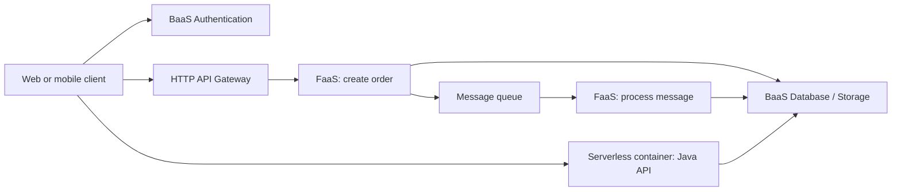

# Distinguishing FaaS, BaaS, and Serverless Containers

Serverless is a way of consuming compute services in which the provider manages most of the servers, operating systems, resource provisioning, and scaling. Developers focus on application code or service configuration. "Serverless" does not mean the application runs without servers; it means the development team does not directly manage servers in the traditional way.

The three terms FaaS, BaaS, and serverless containers often appear together because all three reduce infrastructure operations work. However, they solve three different needs:

- **FaaS (Function as a Service)** provides a place to run a unit of code when an HTTP request, message, or event arrives.
- **BaaS (Backend as a Service)** provides ready-made backend capabilities such as authentication, databases, and file storage via APIs or SDKs.
- **Serverless container** runs an application packaged as a container image; the platform manages provisioning and scaling those containers.

All three can be combined in the same system. To choose the right one, look at the unit the team deploys, what the team must manage, and how the application is triggered.

## 1. FaaS: Running Functions on Requests or Events

FaaS is a deployment model in which developers upload a function (handler) to the platform. The platform invokes the function when a configured trigger fires. The development team typically does not need to create an HTTP server, manage an operating system, or manually orchestrate process counts for each invocation.

### How It Works

A function can be triggered by many types of triggers:

- **HTTP:** an API Gateway or platform endpoint receives a request and forwards it to the function.
- **Message:** a message placed into a queue or stream can trigger the function.
- **Event:** a file uploaded to object storage, a changed record, or a scheduled timer reaching its time can emit an event that invokes the function.

General processing flow:

1. A system generates a request, message, or event.
2. The trigger service passes the data and context to the function.
3. The platform provisions an execution environment if needed, then invokes the handler.
4. The handler processes the data, calls any required services, and returns a result or acknowledges processing.
5. The platform terminates or reuses the execution environment according to its policies.

The unit of deployment here is **the handler function and trigger configuration**. Developers focus on handler logic, input/output data contracts, access permissions, and error handling.

### Java Example with an HTTP Trigger

The following example uses the AWS Lambda RequestHandler interface to illustrate a handler receiving a create-order request. API Gateway can map an HTTP request to this handler; configuration details and event data types depend on the platform.

```java
import com.amazonaws.services.lambda.runtime.Context;
import com.amazonaws.services.lambda.runtime.RequestHandler;

public class CreateOrderHandler
        implements RequestHandler<CreateOrderRequest, CreateOrderResponse> {

    @Override
    public CreateOrderResponse handleRequest(
            CreateOrderRequest request,
            Context context) {

        if (request == null || request.customerId == null
                || request.items == null || request.items.isEmpty()) {
            return new CreateOrderResponse(400, "Invalid order");
        }

        // Check permissions, validate data, and apply business rules.
        // Persist the order using an external storage service.
        return new CreateOrderResponse(201, "Order accepted");
    }
}
```

This is a simplified example: the DTO classes CreateOrderRequest and CreateOrderResponse as well as dependency configuration are omitted. With API Gateway in Lambda proxy mode, the handler typically receives an event object containing headers, path, and body; the application needs to read the body and validate the data. The example uses the DTO directly when corresponding payload mapping is configured.

In the example, the platform calls handleRequest when a matching request arrives. The handler does not need to open an HTTP port or manage a web server itself. An API Gateway typically handles routing, gateway-layer authentication (if configured), rate limiting, and protocol translation.

With a message trigger, the handler receives a single message or a batch of messages. With an event trigger, the handler receives a payload describing the event, such as details of an object just created in storage. Each trigger type has a different data contract and acknowledgment mechanism; do not assume HTTP, queue, and event payloads share the same structure.

### Characteristics to Understand When Using FaaS

**Lifecycle and state.** Functions should be designed so each invocation can be processed independently. Some platforms reuse the execution environment across multiple invocations to reduce initialization time, but the application must not rely on that environment always persisting. In-memory variables, static variables, or temporary files are not places to store durable business state. Store state that must be preserved in a database, object storage, or a dedicated service.

Shared clients can be initialized outside the handler to take advantage of reused environments, provided the client is thread-safe for concurrent invocations and handles expired connections. Do not store request-specific data in shared variables where another request could read it.

**Scaling.** The platform typically increases or decreases the number of execution environments based on request or message volume. During a sudden traffic spike, many instances may run in parallel. This helps handle fluctuating load, but it also means downstream databases and services can receive many concurrent connections. Appropriate concurrency limits, connection pools, and quotas must be set.

**Cold starts.** If no environment is ready yet, the platform must initialize one before invoking the function. This extra initialization time is commonly called a cold start. Deployment package size, libraries, runtime, network configuration, and platform choice can affect initialization time. With Java, initializing a large framework or loading many libraries can make cold starts significantly more noticeable. You can reduce the impact by keeping deployment packages lean, avoiding unnecessary initialization, and using pre-warmed instance options if the platform supports them; these options may increase cost.

**Retries and idempotency.** When a function fails or fails to acknowledge a message, the platform or invoking service may retry. Retry rules depend on the trigger and provider: synchronous HTTP, queues, and asynchronous events may behave differently. A message can be redelivered, so the handler needs to handle duplicates safely. For example, use an eventId or idempotency key as a unique key, record processed results, and ensure business operations do not create two orders when the same event arrives multiple times. For message batches, understand whether the platform acknowledges the whole batch or individual messages to avoid unnecessary reprocessing.

**Execution limits.** FaaS typically has limits on execution time, memory, CPU, payload size, concurrent invocations, and supported runtimes. Specific limits vary by provider and service tier. Long-running work, tasks requiring persistent connections, or workloads needing low-level process control may not be suitable.

### When Is FaaS a Good Fit?

FaaS is a good fit when logic has clear boundaries, is triggered by requests or events, and can finish within the platform's execution limits. Examples:

- Handling an HTTP request to create a record or look up status.
- Processing a message from a queue after an order is created.
- Generating thumbnails when a new image appears in object storage.
- Running a scheduled task to aggregate data.
- Sending notifications after a business event occurs.

FaaS is especially useful when traffic is uneven or there are many small, independent tasks. Consider carefully if the application relies on long-lived in-process memory, requires continuous processing, or has many long-running background jobs.

## 2. BaaS: Using Ready-Made Backend Capabilities

BaaS is a model of using backend components already built and operated by a provider. Instead of writing and deploying every backend API yourself, the application calls the service's APIs or SDKs to use common capabilities.

Common BaaS capabilities include:

- **Authentication:** sign-up, sign-in, session management, and identity providers.
- **Database:** storing and querying data through supported APIs, SDKs, or protocols.
- **File/object storage:** uploading, downloading, and managing file access permissions.
- **Realtime and notifications:** syncing data changes or sending notifications.
- **Other backend services:** such as analytics, remote configuration, or content management, depending on the product.

Examples of platforms offering BaaS capabilities include Firebase, Supabase, and Appwrite. Feature sets, pricing models, and levels of control vary across products; each service should be evaluated against application requirements.

### How It Works

Web or mobile applications typically integrate the provider's SDK or call REST APIs. Developers configure the project, data schema, access rules, and business flows. The provider operates the corresponding backend infrastructure.

For example, a booking app might:

1. Use the Authentication service to sign users in.
2. Store profiles and appointments in the database provided by BaaS.
3. Store profile photos in storage.
4. Subscribe to real-time updates when an appointment changes.

The development team does not have to build an entire login system, CRUD APIs, file storage, and real-time sync from scratch. Even so, the team still has to design the data model, define who can read or modify each record, validate input data, and protect sensitive information.

### BaaS Is Not Synonymous with FaaS

BaaS provides **complete or near-complete backend capabilities** for the application to consume. FaaS provides **an execution environment for code written by the development team**.

A BaaS platform may integrate functions to run custom logic. For example, when a database change occurs, a function might check business rules and send a notification. That does not make the two concepts the same: the database and authentication are still the BaaS services, while the code reacting to the event is the FaaS part.

### Responsibilities Still Belong to the Development Team

BaaS reduces backend development and operational work, but it does not automatically guarantee the application is secure or business-correct. Pay attention to:

- Configuring security rules or access permissions at the record and object level.
- Never embedding administrative secret keys in applications running in the browser or on user devices.
- Checking permissions server-side for high-risk operations; do not rely solely on hiding buttons in the UI.
- Designing schemas, indexes, data relationships, backups, and retention policies.
- Monitoring API limits, quotas, and costs for queries, storage, and data transfer.
- Evaluating data exportability, provider migration, and the degree of dependency on proprietary SDKs or APIs.

### When Is BaaS a Good Fit?

BaaS is a good fit when a product needs common backend capabilities and wants to deliver the first version to users quickly. Examples:

- A mobile app needing login, user profiles, and image storage.
- An internal application needing CRUD, authorization, and data sync.
- A prototype product needing a database and authentication without operating a dedicated backend yet.

BaaS may be less suitable when business rules are highly specialized, integration requirements are complex, deep query control is needed, or there are data requirements the provider cannot meet. In those cases, you can keep BaaS for some features and add FaaS or container services for custom logic.

## 3. Serverless Containers: Deploying Applications as Containers

Serverless containers are a deployment model in which the team packages the application and its dependencies into a container image, typically following the OCI standard. The provider manages the container runtime infrastructure, request routing, and scaling. Depending on the service, the platform can scale instances down to 0 when idle and start them again when new requests arrive.

Examples of services in this category include Google Cloud Run, Azure Container Apps, and AWS App Runner. Naming, triggers, scale-to-zero capability, maximum execution duration, and pricing models are not identical across platforms.

### How It Works

With serverless containers, the unit of deployment is **a container image containing the application**. The development team is responsible for building the application, choosing the runtime, packaging libraries, configuring environment variables, and declaring how the process starts. The platform is responsible for provisioning machines to run containers, routing traffic, and adjusting instance counts according to configuration.

For example, a Java application using Spring Boot can run as a web service:

```java
@SpringBootApplication
@RestController
public class CatalogApplication {

    @GetMapping("/health")
    public String health() {
        return "ok";
    }

    public static void main(String[] args) {
        SpringApplication.run(CatalogApplication.class, args);
    }
}
```

Imports, build configuration, and the Dockerfile are omitted to focus on the application process. The container image needs to package the application along with the runtime and launch this class.

The team packages the application along with the runtime and libraries into a container image, then deploys the image to the serverless container service. The application continues operating in the familiar web server model: starting a process, listening on a configured port, and handling multiple requests according to instance capacity. The platform usually provides a URL or integrates with a load balancer to forward requests to containers.

### Differences Compared to FaaS

In FaaS, the team deploys a handler and declares triggers; the platform invokes the handler according to the trigger contract. In serverless containers, the team deploys the entire application and the process running inside the image. The application can contain multiple HTTP routes, middleware, native libraries, or multiple related processing components.

Serverless containers generally allow greater control over the runtime and application structure. Teams can reuse an existing Spring Boot application with fewer changes than splitting all logic into small functions. In return, the team must pay attention to images, image size, startup time, port configuration, health checks, concurrency, and how the application handles shutdown.

FaaS and serverless containers still overlap. Some FaaS platforms use containers under the hood; some container platforms can receive events or run background tasks. A useful distinction is **the deployment interface the developer works with**: a trigger-driven handler versus an application packaged as an image.

### Operational Considerations

- **Startup and scale-to-zero:** when no instance is ready, the first request may have to wait for the platform to start a container. You can configure a minimum number of instances if the service supports it, though this usually incurs extra cost.
- **Concurrency:** an instance may handle one or multiple requests simultaneously depending on configuration. Java applications must be thread-safe for concurrent processing; do not use shared mutable variables for request-specific data.
- **Resources:** set appropriate CPU, memory, maximum instance counts, and connection limits. Rapid scaling can increase load on downstream databases or APIs.
- **State:** containers have temporary memory and filesystem while running, but instances can be stopped or replaced. Data that must persist long-term belongs in external storage services.
- **Execution duration:** some platforms support long-lived HTTP services tied to instance lifecycle; certain job or request modes have time limits. Verify the exact workload type and limits of the specific service.
- **Supply chain security:** manage base images, update libraries, scan for vulnerabilities, do not bake secrets into images, and grant least-privilege permissions to the service identity.

### When Are Serverless Containers a Good Fit?

Serverless containers are a good fit when you need to deploy a complete application or web service without managing clusters or servers yourself. Examples:

- Migrating an existing Spring Boot application to a managed container platform.
- Running a REST API with many endpoints and middleware.
- Using native libraries, custom runtimes, or process structures that FaaS cannot easily accommodate.
- Running workers or tasks packaged as containers if the platform supports that workload type.

If the task is just a small handler triggered by a single message that finishes quickly, FaaS often offers a simpler model. If you need a pre-built backend such as authentication or a database, BaaS may reduce more work.

## 4. Direct Comparison

| Criterion | FaaS | BaaS | Serverless container |
|---|---|---|---|
| Primary need | Run custom logic per invocation or event | Consume ready-made backend capabilities | Run an application packaged as a container |
| Team's unit of deployment | Function/handler and trigger | Service configuration, schema, permissions, and integration | Container image and runtime configuration |
| Trigger mechanism | HTTP, queue, event, schedule | SDK/API, subscriptions, or service mechanisms | Typically HTTP/gRPC; may support events or jobs depending on platform |
| What the team controls | Handler logic, event contracts, dependencies, and permissions | Data, schema, access rules, and integration | Application code, runtime, libraries, image, and process |
| Server management | Provider | Provider | Provider |
| Long-term state | Stored in external services | Typically uses BaaS database/storage | Stored in external services |
| Scaling | By invocation or event volume | Managed by the backend service per product | By requests, load, or platform configuration |
| Key considerations | Cold starts, retries, idempotency, timeouts, and concurrency | Data permissions, quotas, service costs, and vendor lock-in | Image, startup, concurrency, resources, and instance lifecycle |
| Example use case | Processing orders from a queue | User sign-in and profile storage | Deploying a Spring Boot REST API |

This table describes differences at a conceptual level. A specific product may offer multiple models simultaneously; review the limits and pricing of the exact service before designing.

## 5. Combining All Three Models in One Architecture

You do not need to pick a single model for the entire system. An application can use BaaS for common capabilities, FaaS for event-driven processing, and serverless containers for an API or service that needs to run as a complete application.

Ordering system example:

1. The web application uses BaaS Authentication to authenticate users and BaaS Database to store profile data.
2. The client calls an HTTP endpoint. API Gateway forwards the request to FaaS to validate data and create an order request.
3. The function writes the required data to the database and publishes a message to a queue.
4. Another function consumes the message to send an email or update processing status.
5. A Java/Spring Boot service running on a serverless container handles the catalog API with multiple endpoints or logic requiring existing libraries.



In this architecture, each component has a clear responsibility. BaaS handles common backend capabilities; FaaS handles short logic triggered by requests or events; serverless containers run the Java application as a service. The exact combination also depends on security requirements, latency, data, and the limits of the chosen services.

## 6. How to Choose the Right Model

You can start with three questions:

**1. Do you need a ready-made backend capability or custom logic?**

If you need login, a database, file storage, or real-time features and a provider's product meets your requirements, consider BaaS. If you need to execute custom business rules when a request or event arrives, consider FaaS. If you need to run a full application with its own runtime and process, consider serverless containers.

**2. What is the natural unit of deployment for the work?**

- An independent operation with clear input and output: a function.
- A standard backend capability shared across multiple screens or clients: BaaS.
- A web service, worker, or application with its own structure and dependencies: a container image.

**3. Which operational constraints matter most?**

Check processing duration, cold start latency, burst traffic, concurrency, database connections, payload size, background execution needs, and pricing model. Especially with Java, measure actual startup time of the framework and application rather than relying solely on generic platform descriptions.

Some practical suggestions:

| Scenario | Option to consider | Reason |
|---|---|---|
| Handling a short HTTP request to create a record | FaaS | Logic has clear boundaries and is triggered per request |
| Processing order messages from a queue | FaaS | Fits asynchronous processing and scaling with message volume |
| Needing login, profiles, and image storage for a mobile app | BaaS | Uses common backend capabilities that are already managed |
| Moving an existing Spring Boot REST API to a managed environment | Serverless container | Can package the application as an image and preserve the web service model |
| Having a custom API and needing managed login and database | Combine BaaS with FaaS or containers | Each model handles the part it fits best |

## 7. Operational Principles That Apply to All Three Models

Regardless of which model you choose, serverless applications still need deliberate design and operations.

**State management.** Do not rely on function or container memory to store business data that must survive after an instance terminates. Choose a database, object storage, cache, or queue based on data characteristics.

**Least privilege.** Every function, container, and client should have only the permissions it needs. Separate identities per workload, manage secrets with a dedicated service, and avoid embedding admin keys in source code or images.

**Design for safe duplicate handling.** For events and messages, assume an event can be delivered more than once. Use idempotency keys, unique constraints, or appropriate transactions to prevent duplicate side effects. Clearly define when a message is acknowledged and how failed messages are routed to a dead-letter queue if supported by the platform.

**System observability.** Write structured logs with correlation IDs, processing duration, retry counts, and error codes. Track metrics such as invocations, errors, latency, cold starts, instance counts, queue depth, and database utilization. Do not log tokens, passwords, or sensitive personal data.

**Cost control.** Costs can come from invocation counts, CPU time, memory, minimum instance counts, database queries, storage volume, and data transfer. Scale-to-zero does not mean the entire system is free when there are no requests; databases, storage, and background services can still incur charges. Set appropriate quotas, budget alerts, and scaling limits.

**Benchmark before choosing.** Create a representative workload and measure latency, throughput, cold starts, cost, retry behavior, and load on dependent services. For Java, measure startup time, memory consumption, and concurrent execution performance.

## 8. Common Misconceptions

- **"Serverless means there are no servers."** Applications still run on servers or containers; the provider is responsible for managing that infrastructure.
- **"BaaS and FaaS are the same."** BaaS provides pre-built backend capabilities; FaaS runs custom code on invocations or events.
- **"FaaS is always cheaper than containers."** Cost depends on invocation count, execution time, resources, traffic, and supporting services. Continuous workloads can have a very different cost profile than intermittent workloads.
- **"Functions only run once, so duplicate handling isn't needed."** Retries and message delivery can cause the same event to be processed again. Idempotency is still necessary.
- **"Serverless containers are stateful because they have a filesystem."** Instance filesystem and memory can be lost when an instance stops or is replaced. Long-term state must be stored externally.
- **"Using serverless means no operations are needed."** Teams still must manage permissions, data, retries, observability, limits, performance, and costs.

## 9. Key Takeaways

FaaS, BaaS, and serverless containers differ in what they provide to developers:

- Choose **FaaS** when you need to run custom logic on HTTP requests, messages, or events.
- Choose **BaaS** when you need common managed backend capabilities such as authentication, databases, and storage.
- Choose **serverless containers** when you need to run an application packaged as a container image, such as a Java/Spring Boot service.

You can combine them in the same architecture. The final decision should be based on the unit of deployment, state and runtime requirements, provider limits, required level of control, and the total cost of the entire system.
