# Components of a Serverless Application

## 1. Viewing a Serverless Application as a System

Serverless is a model for building and operating applications in which the cloud provider manages most of the server infrastructure, operating systems, and resource provisioning. The development team focuses on application code, data, events, and operational policies. "Serverless" does not mean the application does not run on servers; it means the development team does not have to manage servers directly in the traditional way.

A serverless application typically combines multiple managed services. FaaS (Function as a Service) functions execute short pieces of logic upon receiving an HTTP request, message, or event. An API gateway, queues, event buses, databases, object storage, identity services, and observability tools work together to form a complete system. Therefore, a single function should not be viewed as the entire application.

Within the scope of CLOUD_SERVERLESS, the focus is on how to develop and deploy serverless applications, especially Java functions triggered by HTTP, messages, or events. When designing, you need to consider triggers, state, access permissions, retries, idempotency, cold starts, scalability, and cost together to decide whether FaaS is appropriate.

## 2. Core Components

### 2.1. Entry Points and Trigger Sources

Triggers define when a piece of processing is invoked and how input data is delivered to the function. Common trigger categories include:

| Trigger type | Examples | Design characteristics |
| --- | --- | --- |
| HTTP | Users calling a REST API, webhooks from partners | Usually requires authentication, input validation, response time limits, and HTTP error mapping |
| Queue | Messages such as `OrderCreated` or `SendEmail` | Absorbs traffic spikes, decouples producers from processors; must handle duplicate and failed messages |
| Event bus | Business events broadcast to multiple services | Routes by event type or attributes; supports multiple independent subscribers |
| Schedule | Running an aggregation task every night | Time-triggered; must account for time zones, overlapping runs, and missed runs |
| Storage event | A file uploaded to object storage | Typically passes bucket, object key, and metadata; must validate size, format, and access permissions |
| Data stream | New records from an event stream or data changes | Can be processed by batch or partition; requires attention to ordering, checkpoints, and latency |

For HTTP, an API gateway typically sits in front of the function. The gateway accepts connections, routes requests, applies authentication or rate limiting, and forwards requests to the function. The function executes business logic and returns a result for the gateway to map into an HTTP response. The gateway and the function may have different timeout limits; processing time must fit within the end-to-end limit.

For asynchronous processing, a producer sends a message to a queue or event bus. The service triggers the function when data is ready. The sender can complete early without waiting for all downstream work, but the system must accept delayed processing and eventual consistency.

### 2.2. Compute Layer: FaaS Functions

A function is the execution unit for business logic. The platform is typically responsible for initializing the runtime environment, allocating CPU and memory, receiving invocations, managing instance lifecycles, and scaling instance counts according to load.

A good function usually has a clear scope, bounded execution time, and well-defined input/output interfaces. Examples include validating an order creation request, processing a payment message, generating a thumbnail after an image upload, or sending a notification when an order status changes.

Functions should avoid keeping business state in memory between invocations. An instance may be stopped after processing completes, reused for a period, or run concurrently across multiple environments. Static variables, singletons, or local memory are only suitable for temporary data within one execution environment; they are not shared storage and do not guarantee data will exist on the next invocation.

In Java, business code should be separated from the cloud provider adapter. The adapter translates a request or event into domain objects, calls the business service, and converts the result into a response. This separation makes it easy to test logic with unit tests and reduces coupling to a specific FaaS platform's API.

### 2.3. Workflow Orchestration

A business workflow can consist of multiple steps: validating an order, reserving inventory, charging payment, updating status, and sending notifications. You can chain functions using events, but when you need multi-step progress tracking, conditional branching, timeouts, waiting for signals, or compensation handling, a workflow/orchestration service is often more suitable.

An orchestrator stores workflow state and decides the next step. Functions focus on executing one unit of work; the workflow manages sequencing and overall state. For distributed workflows, do not assume a single ACID transaction spans all services. You can use the Saga pattern: each step updates part of the state and defines a compensating action when a later step fails. A compensating action is a separate business action and does not necessarily undo every side effect that already occurred.

### 2.4. Data Layer and State Storage

Serverless applications still need durable places to store data. Common options include:

- **Relational or NoSQL databases:** store orders, accounts, business configuration, and processing state.
- **Object storage:** store images, documents, data exports, and large input/output files.
- **Cache:** reduce latency or read load for reconstructible data; a cache should not be the system of record without appropriate consistency guarantees.
- **Queues, event buses, or streams:** buffer and forward data for asynchronous processing; they complement databases rather than automatically replacing business databases.

Because functions can run concurrently, the data layer must withstand sudden increases in connection counts and write rates. Creating a new database connection on every invocation can exhaust connection limits. Depending on the platform, you can use managed connection pools, connection proxies, data access APIs, or function concurrency limits.

Business state must be persisted in a durable system. For example, order statuses `PENDING`, `PAID`, or `CANCELLED` must live in the database; they should not live only in function variables. You also need to define the system of record, concurrency update rules, retention periods, and how expired data is handled.

### 2.5. Asynchronous Communication: Queues, Event Buses, and Streams

All three components move data between parts of a system, but they serve different purposes:

| Component | Primary purpose | Design questions |
| --- | --- | --- |
| Queue | Distributes work to one or more consumers; acts as a buffer under traffic spikes | How many times can a message be redelivered? When should it move to a dead-letter queue? |
| Event bus | Routes events to one or more subscribers based on rules | Which subscribers need the event? How are event schemas and versions managed? |
| Stream | Ingests a continuous sequence of records, typically partitioned | Within what scope is ordering guaranteed? How do consumers store checkpoints and replay? |

A queue helps regulate processing speed: producers can send quickly while consumers process according to current capacity. An event bus enables one business event to trigger multiple independent reactions—for instance, `OrderPaid` being used to update inventory, send emails, and record analytics. A stream fits continuous data or scenarios requiring replay by offset.

When designing asynchronous communication, define message schemas, versioning, correlation IDs, processing deadlines, and error policies. Do not place secrets or oversized payloads directly into messages if you can pass a secure reference to stored data.

### 2.6. Identity, Authentication, and Authorization

Applications must control both who calls a function and what permissions the function uses when accessing other services.

- **Authentication:** verifies who the user or calling system is, for example via OAuth 2.0, OpenID Connect, JWT, or platform-provided authentication mechanisms.
- **Authorization:** decides which actions a principal is allowed to perform on which resources.
- **Execution role/service identity:** the identity a function uses to call databases, queues, object storage, or cloud services.
- **Secret management:** API keys, passwords, and certificates should be stored in a secret manager or equivalent mechanism, with minimal read permissions granted to functions that need them.

Apply the principle of least privilege: an email-sending function only needs permission to send email and read related configuration; it should not have administrative rights over the entire cloud account. Separate runtime permissions, deployment permissions, and end-user permissions. Never embed long-lived access keys in source code, committed config files, or unprotected environment variables.

### 2.7. Configuration and Environment Management

Endpoints, queue names, feature flags, business limits, and environment-specific settings should be managed separately from source code. Non-secret configuration can be supplied via environment variables or configuration services. Secrets must go through a secret manager and have a rotation policy.

Separating development, testing, and production environments helps avoid accidentally using the wrong resources or data. When changing configuration, know which function version receives that configuration and whether you can roll back to previous values.

### 2.8. Observability and Operations

An application composed of many distributed services is hard to diagnose by looking only at individual function logs. At minimum, three signal groups are needed:

- **Logs:** record structured events, log levels, correlation IDs, and enough information to investigate issues. Do not log tokens, passwords, or unnecessary personal data.
- **Metrics:** track invocation counts, error rates, execution duration, concurrency, backlog message counts, oldest message age, timeouts, and throttling.
- **Traces:** connect requests across gateways, functions, queues, and dependent services to pinpoint which step caused slowness or failures.

Business metrics should also be added, such as successful orders created, failed payments, or end-to-end workflow completion time. Infrastructure metrics can look normal while users are unable to complete business flows. Alerts should be tied to meaningful thresholds and clear ownership.

### 2.9. Deployment and Infrastructure Management

Function code is only part of a deployment. An application also includes gateways, triggers, queues, routing rules, databases, roles, secret references, log groups, alerts, and scaling configurations. Infrastructure as Code (IaC) describes these resources in code so they can be reviewed, reproduced, and deployed consistently.

CI/CD pipelines typically handle compilation, testing, artifact packaging, resource deployment, and publishing function versions. Separate publishing a new version from shifting all traffic to it; use canary or weighted rollouts if the platform supports them. Have a rollback plan covering both code and compatible configuration changes.

## 3. How the Components Work Together

The diagram below illustrates an order-processing application. The HTTP flow receives order creation requests; the event flow handles payment and notifications afterward.

```mermaid
flowchart TD
    U[Client application] --> G[API Gateway]
    G --> F1[Order creation function]
    F1 --> DB[(Order database)]
    F1 --> EB[Event Bus]
    EB --> Q1[Payment queue]
    EB --> Q2[Notification queue]
    Q1 --> F2[Payment function]
    F2 --> PG[Payment gateway]
    F2 --> DB
    Q2 --> F3[Notification function]
    F3 --> NS[Email / SMS service]
    Q1 -. errors exceeding retry limit .-> DLQ[Dead-letter Queue]
    F1 -. logs, metrics, traces .-> OBS[Observability system]
    F2 -. logs, metrics, traces .-> OBS
    F3 -. logs, metrics, traces .-> OBS
```



The processing sequence can unfold as follows:

1. The client application sends `POST /orders` to the API gateway. The gateway authenticates the request and forwards the payload to the order creation function.
2. The function validates the data, applies business rules, writes the order in `PENDING` status to the database, and emits an `OrderCreated` event.
3. The event bus routes the event to the payment queue and notification queue based on rules. Both consumers can process independently.
4. The payment function reads the message, calls the payment gateway with a stable idempotency key, and updates the order status. The notification function sends email or SMS according to the appropriate status.
5. If a message encounters a transient failure, the system retries according to policy. If it exceeds the allowed attempt count or time limit, the message is moved to a dead-letter queue for investigation and controlled reprocessing.
6. Logs, metrics, and traces allow operators to follow the entire path using a correlation ID or event ID.

This is an architectural example, not a mandatory configuration for every platform. Different cloud providers use different service names or trigger mappings; the architectural roles remain similar.

## 4. Cross-Cutting Concerns When Designing FaaS

### 4.1. State and Idempotency

Asynchronous systems can often deliver a message multiple times. A consumer may have already performed an action but failed before acknowledging the message; the subsequent delivery causes the function to run again. Therefore, never assume each event is processed strictly once.

Idempotency means that repeatedly processing the same request or event produces no unintended additional business side effects. You can use an event ID or request ID as an idempotency key, persist processing outcomes in a durable store, and check the key before executing side effects. Recording completion and updating business state should be designed atomically where possible. For side effects on external systems, pass the same idempotency key to the provider if they support it; otherwise, implement reconciliation or compensating actions.

Illustrative Java example (storage interfaces are application components, not a specific cloud provider's standard API):

```java
public final class PaymentHandler {
    private final IdempotencyStore idempotencyStore;
    private final PaymentGateway paymentGateway;
    private final OrderRepository orderRepository;

    public PaymentHandler(
            IdempotencyStore idempotencyStore,
            PaymentGateway paymentGateway,
            OrderRepository orderRepository) {
        this.idempotencyStore = idempotencyStore;
        this.paymentGateway = paymentGateway;
        this.orderRepository = orderRepository;
    }

    public PaymentResult handle(PaymentRequested event) {
        return idempotencyStore.executeOnce(event.eventId(), () -> {
            paymentGateway.charge(event.payment(), event.eventId());
            orderRepository.markPaid(event.orderId());
            return PaymentResult.success(event.orderId());
        });
    }
}
```

`executeOnce` represents a mechanism that must be backed by durable storage, handling contention across concurrent invocations and in-progress states. The snippet only illustrates responsibility boundaries; it does not by itself guarantee a distributed transaction across the idempotency store, payment gateway, and database. In practice, you must handle the case where the payment gateway has already charged the customer but the function loses connectivity before recording the outcome.

### 4.2. Retries, Backoff, and Dead-Letter Queues

Retries help overcome transient errors such as network timeouts, throttling, or temporary dependency outages. Set a maximum attempt count, exponential backoff, jitter to prevent many invocations retrying simultaneously, and distinguish retryable errors from permanent errors.

Invalid data errors usually do not resolve on retry. Unbounded retries can inflate costs, clog queues, and create even heavier load on a struggling service. After exceeding thresholds, route the message to a dead-letter queue (DLQ) or equivalent error store. A DLQ needs alerts, root-cause inspection procedures, and a safe replay mechanism after fixes are applied.

For synchronous HTTP, the client or gateway may perform retries. Only retry requests with safe semantics or an idempotency key; if a client resends a payment creation operation without a stable key, duplicate transactions can occur.

### 4.3. Cold Starts and Response Time

A cold start is the latency incurred when the platform must prepare a new execution environment before a function processes an invocation—such as initializing the runtime, loading classes and libraries, or establishing connections. Java can be impacted by artifact size, dependency count, framework initialization time, and work executed in static initializers.

You can reduce cold starts by keeping artifacts lean, removing unnecessary dependencies, deferring heavy resource initialization until actually needed, and measuring initialization time separately from business logic time. Some platforms offer pre-warmed environment configurations or pre-initialization features; these can lower latency but typically increase cost. Measure p95/p99 under realistic load instead of relying only on averages.

### 4.4. Scaling, Concurrency, and Limits

FaaS can scale instances up or down according to invocation or message volume. Automatic scaling does not mean resources are unlimited. Account quotas, concurrency limits, message ingestion rates, database connection limits, and external API quotas can all become bottlenecks.

If a function scales faster than the database can handle, the system can shift from insufficient compute capacity to database overload. Set appropriate concurrency limits, tune batch sizes and consumer rates, use queues to absorb peak load, and monitor queue depth. For streams, consider partition counts and per-partition processing capacity.

### 4.5. Cost

Serverless costs typically consist of multiple components: function invocation counts and execution duration, memory or resource configuration, API gateway, queues/event buses, databases, object storage, logs/traces, data transfer, and pre-warmed environment features. Exact pricing depends on the provider and deployment region.

FaaS can save money under intermittent load because you do not need to keep servers running continuously for that compute layer. Under high, steady load, continuously running functions, long startup times, or many supporting services can make total cost higher than expected. Overly verbose logging, unbounded retries, poorly tuned batch sizes, and inefficient database queries also drive up costs.

Estimate across low, average, and peak traffic scenarios; measure invocation counts, execution duration, memory, retry counts, and supporting service costs. Cost optimization must go hand in hand with latency, reliability, and recovery requirements.

## 5. Design Process for a Serverless Application

When starting a feature, you can follow this sequence:

1. **Identify the initiating event or request:** who calls it, what data is sent, and does it require a synchronous response or can it be processed asynchronously?
2. **Define function boundaries:** each function performs one clearly describable and testable responsibility; identify which steps need workflow orchestration.
3. **Choose where state lives:** which business data must be durable, which is only cache, and which messages must be retained?
4. **Define communication contracts:** request/event schemas, event ID, correlation ID, schema versioning, and compatibility rules.
5. **Design failure handling before implementation:** timeouts, retries, backoff, idempotency, DLQ, compensating actions, and replay mechanisms.
6. **Set up permissions and secrets:** per-function identity, least privilege, secret manager, and caller authentication.
7. **Set operational limits:** memory, timeouts, concurrency, batch sizes, quotas, and alert thresholds.
8. **Put infrastructure into IaC and CI/CD:** version management, environment configuration, controlled rollouts, and rollbacks.
9. **Measure under near-production conditions:** p95/p99 latency, cold starts, error rates, backlog, recovery capability, and total cost.

## 6. When Should You Use FaaS?

FaaS is generally a good fit when work is triggered by requests or events, has bounded execution time, can be divided into independent processing units, and does not require keeping a continuous process running. Examples include API backends with fluctuating load, post-upload file processing, queue consumers, webhooks, scheduled tasks, and event-driven automation.

FaaS may not be suitable if the workload runs continuously at steady, very high load, requires long processes exceeding runtime limits, maintains long-lived bidirectional connections, depends heavily on local memory, or requires deep OS and runtime control. Those cases may fit containers, virtual machines, or long-running services better. A real-world system can combine FaaS with containers and other managed services.

Before deciding, answer these questions:

- Can the work be triggered by HTTP, messages, events, or a schedule?
- Does processing duration fit within the platform's runtime limits?
- Can state be externalized and operations made safe for repeated execution?
- Can dependent services handle the expected concurrency?
- Do cold starts and timeout limits meet latency requirements?
- Is the total cost of the function plus gateway, messaging, database, observability, and data transfer reasonable?
- Can the team reliably operate retries, DLQs, alerts, permissions, and version deployments?

## 7. Common Design Mistakes

| Mistake | Consequence | Mitigation |
| --- | --- | --- |
| Storing business state in function variables or memory | State is lost when an instance stops; instances cannot see each other's data | Store durable state in a database or appropriate store |
| Assuming an event arrives only once | Duplicate order creation, duplicate charges, or duplicate notifications | Use idempotency keys and controlled update operations |
| Retrying every error type | Pointless loops, higher cost, and system congestion | Classify errors, cap retry attempts, use backoff and DLQ |
| Allowing unbounded concurrency relative to database capacity | Connection exhaustion or exceeding dependent service quotas | Set concurrency limits, use proxies/pools, and monitor backlog |
| Granting broad permissions to every function | Larger blast radius on bugs or credential exposure | Use separate execution roles and least-privilege permissions |
| Observing only individual function logs | Difficult to trace one request across multiple services | Use correlation IDs, metrics, and distributed tracing |
| Calculating only invocation costs | Overlooking database, gateway, messaging, logs, and data transfer | Estimate total cost across traffic scenarios |

## 8. Conclusion

A serverless application is a coordination of entry points, triggers, functions, orchestration services, storage, asynchronous messaging, security, configuration, observability, and deployment pipelines. Functions execute logic; surrounding services provide request ingestion, state persistence, event delivery, access control, and system operations.

Good design makes clear where state lives, how events can be redelivered, how failures are retried and isolated, which permissions are granted to each function, what limits the system scales to, and how costs are generated by each component. When those questions have answers aligned with real requirements, FaaS becomes a well-grounded choice for the corresponding workload.
