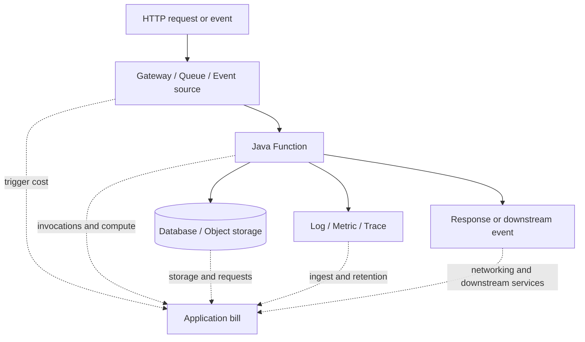

# Pay-Per-Invocation and Resource-Usage Pricing Model

Serverless enables development teams to deploy features without managing servers themselves. In the Function as a Service (FaaS) model, the platform receives an event, provisions resources to run the function, scales execution instances as load rises, and reclaims resources when work finishes. As a result, cost is typically tied to how many times the function is invoked and the amount of resources consumed during each execution.

This is an advantage when traffic is uneven or an application has long idle periods. However, "pay only when running" does not mean the entire application has only a single per-invocation charge. API gateways, queues, databases, networking, logs, and the services a function calls can all incur separate charges. To decide whether FaaS fits, you need to calculate the cost of the entire processing flow and measure cost per completed business task.

## 1. Two Core Billing Components

Platforms have different price sheets and rounding rules, but the FaaS model generally has two main cost components: invocation count and execution resources.

### Invocations / Requests

An invocation is one time the platform runs a function to process input. Invocations can originate from an HTTP request, a message in a queue, a record in a stream, a schedule, or an event from another service.

Do not assume one user request maps to strictly one invocation:

- One HTTP request may call multiple functions across different steps.
- A batch-processing function may receive multiple messages in a single invocation.
- A message that is retried or redriven from a dead-letter queue (DLQ) can generate additional invocations.
- One event can trigger multiple subscribers, each running its own function.

Therefore, when estimating invocation counts, trace the entire event flow and include retries, redrives, or operational reruns.

### Execution Duration and Resource Configuration

Functions are typically billed by execution duration and allocated resources. Some platforms express resources in GB-seconds; others may bill memory, CPU, or vCPU-seconds separately. Configured memory may also determine the amount of CPU allocated to the function.

Under a GB-second billing model, you can estimate resource usage with the formula:

```text
GB-seconds = allocated memory (GB) × billable duration (seconds)
Execution cost = GB-seconds × unit price per GB-second
```

If a function has different configuration tiers or runtimes, calculate each group separately and sum them. Billable duration may be rounded to a minimum billing increment or according to provider-specific rules. Some platforms include part of initialization time in billing, while others apply separate rules to initialization. Always check the pricing documentation for the exact service, region, and runtime you use.

The response time observed by users does not necessarily equal billable duration either. For example, wait time at the API gateway or on the network increases end-to-end latency without counting toward function execution time; conversely, runtime initialization may be billed under platform-specific rules.

## 2. Cost Estimation Formula

A general model for building an estimate is:

```text
Function cost
  = invocation cost
  + execution resource cost

Total serverless application cost
  = function cost
  + trigger and integration service cost
  + data and networking cost
  + log, metric, and tracing cost
  + provisioned capacity cost (if any)
  - eligible free tier or discounts
```

If the provider publishes unit prices per million invocations and per GB-second, the formula can be written as:

```text
Function cost
  = (billable invocations / 1,000,000) × price per million invocations
  + total GB-seconds × price per GB-second
```

This is an estimation formula. When reconciling an actual bill, apply the provider's free tier, pricing tiers, region, CPU architecture, rounding rules, and surcharges.

### Calculation Example

Suppose a Java function has the following monthly averages:

| Parameter | Assumed value |
| --- | ---: |
| Invocation count | 2,000,000 |
| Configured memory | 512 MiB (approx. 0.5 GiB; calculation assumes conversion to 0.5 GB units) |
| Average billable duration | 250 ms = 0.25 seconds |
| Estimated GB-seconds | 2,000,000 × 0.5 × 0.25 = 250,000 |

Then the function cost component is expressed as:

```text
Function cost
  = 2 × price per million invocations
  + 250,000 × price per GB-second
```

This example does not assign concrete dollar amounts because unit prices vary by platform, region, and time. It also excludes API gateway, queue, database, log, or data transfer charges.

Now suppose an additional 2% of invocations fail and each failure is retried once. If the average duration of a retry is also 250 ms, the system adds roughly 40,000 invocations and 5,000 GB-seconds. This is only an approximation to show how retries impact the bill; in practice, failed runs may terminate earlier, run longer, or be retried multiple times depending on configuration.

## 3. Charges Outside the Function

A serverless architecture typically combines multiple managed services. Depending on the design, the following charges may appear:

| Component | Factors that can generate cost |
| --- | --- |
| HTTP gateway or load balancer | Request count, data transferred, duration, or gateway capacity |
| Queues, event buses, streams, and schedulers | Send/receive operations, events, storage size, retention period, or polling mechanisms |
| Databases and object storage | Read/write requests, storage volume, throughput, backups, and queries |
| Networking | Egress, cross-region transfer, NAT gateways, IP addresses, or persistent network resources |
| Logs, metrics, and tracing | Data ingestion, storage, queries, and retention period |
| Provisioned execution capacity | Provisioned concurrency, minimum instances, or always-ready configurations |
| Ephemeral storage | Capacity and usage duration beyond the included allowance, depending on the platform |

For example, an HTTP function might run very briefly yet execute many database queries or send large volumes of data out to the Internet. In that case, the database or networking bill can exceed the function's compute cost. Similarly, enabling verbose logging for every message can cause observability costs to spike rapidly on high-throughput queues.



Not every architecture incurs all of the charges above. Check the pricing sheet for each integrated service, as polling, data transfer, and storage fees can be calculated differently across providers.

## 4. How Retries, Failures, and Idempotency Affect Cost

With asynchronous processing, the platform may redeliver a message when a function fails, times out, or fails to acknowledge successful processing. This improves reliability, but it can increase invocations and compute time. A repeatedly failing message can also trigger a chain of expensive runs without producing any business outcome.

Design three layers together:

1. **Retry limits:** configure appropriate retry counts, backoff, and processing deadlines. Use a DLQ or error-storage mechanism for investigation instead of letting a poison message loop indefinitely.
2. **Idempotency:** attach an idempotency key or unique event ID to the business operation. If the same event is delivered multiple times, the system recognizes it and avoids repeating side effects such as charging money or creating a second order.
3. **Failure observability:** monitor error rates, timeouts, retry counts, DLQ message counts, and oldest message age.

Idempotency prevents duplicate business side effects, but it does not eliminate the cost of invocations that already ran. To reduce retry costs, fix the root causes of errors, limit retry attempts, and route unprocessable messages to an investigation flow.

For batches, examine how the platform behaves when only one record in a batch fails. If the entire batch is redelivered, records that already succeeded may be reprocessed and consume additional compute. Partial-batch failure reporting, batch size, and timeouts must be chosen together.

## 5. Cold Starts, Memory, and Concurrency

### Cold Starts

A cold start occurs when the platform must prepare a new execution environment before a function processes an event. For Java, this time can come from starting the JVM, loading classes, scanning dependencies, initializing frameworks, or establishing initial connections.

Cold starts affect latency first. Their impact on cost depends on how the platform bills initialization time and manages execution environments. If initialization is billed, cold starts can increase compute cost; if not, they can still hurt SLAs and make users wait longer. Do not assume all platforms bill this phase the same way.

Startup time can be reduced by keeping dependencies lean, avoiding unnecessary initialization, avoiding broad classpath scanning, and choosing suitable frameworks. Solutions such as runtime snapshots, Java SnapStart, or native images are available only on certain platforms and come with specific compatibility constraints; re-measure startup time, memory usage, and post-restore behavior.

### Memory and CPU

Increasing memory can simultaneously increase allocated CPU. Consequently, a higher memory setting sometimes speeds up a function enough that total GB-seconds decrease, even though the per-second rate is higher. Conversely, allocating too much memory to an I/O-bound task can raise costs without meaningfully improving duration.

Test several memory settings on the same representative dataset, then compare:

- average and p95 execution duration;
- actual memory usage and out-of-memory risk;
- billable GB-seconds or CPU-seconds;
- timeout, error, and cold start rates.

Choose the configuration that meets the SLA with the lowest cost per successful task, rather than defaulting to the lowest memory tier.

### Concurrency and Provisioned Capacity

Concurrency is the number of invocations executing simultaneously. In an on-demand model, concurrency is usually not an independent cost multiplier; the compute bill depends primarily on invocation count and total resource duration used. If concurrency rises because the system receives more work, total invocations and compute can also rise. High concurrency also increases pressure on databases, connection limits, and downstream services.

Provisioned concurrency or minimum instances keep environments ready to reduce startup latency, but they can incur charges even when request volume is low. Reserved concurrency is typically used to cap or reserve capacity according to platform rules; distinguish concurrency limits from billed provisioned capacity. Only enable pre-warmed capacity when the latency or stability benefit justifies the ongoing cost.

## 6. Optimizing Cost for Java Functions

The following steps usually yield clear, measurable improvements:

1. **Measure before optimizing.** Collect invocations, billed duration, memory, CPU if available, cold starts, concurrency, errors, and retries per function. Analyze p50 and p95 rather than optimizing only for the average case.
2. **Benchmark memory.** Run the same test load across multiple memory configurations. Evaluate speed, GB-seconds, and error rates together to find the sweet spot.
3. **Reduce Java initialization work.** Remove unused dependencies, minimize work in static initializers and constructors, and avoid initializing heavy clients or frameworks when an invocation does not need them.
4. **Reuse resources safely.** HTTP clients, SDK clients, or connection pools can be reused across invocations if the runtime supports it and the objects are thread-safe for concurrent execution. Do not store request data or mutable business state in static variables; function environments may be reused unpredictably.
5. **Choose batch sizes wisely.** Batching messages can reduce invocation counts and overhead, but overly large batches can increase duration, memory, latency, and the blast radius when a failure triggers retries.
6. **Set deliberate timeouts and retry limits.** Timeouts that are too short trigger extra retries; timeouts that are too long hold resources when downstream services hang. Analyze real processing times and cap retry counts.
7. **Trim unnecessary observability costs.** Use structured logs, avoid logging sensitive payloads or redundant data, set appropriate retention, and consider sampling for high-volume traces or logs.
8. **Control downstream impact.** Reuse connections, batch queries where appropriate, cap concurrency to protect databases, and avoid unnecessary egress or cross-region data transfer.
9. **Evaluate always-ready capacity.** Compare the cost of provisioned concurrency against cold start impact and SLA requirements before enabling it around the clock.

In Java, reusing clients and connections can reduce initialization time, but function memory must never be treated as durable state storage. Business data must be stored in a database, object storage, or appropriate state service; those storage and access charges must be included in estimates.

## 7. Measuring Cost per Successful Business Task

Looking solely at function compute cost can lead to bad decisions. For example, a change that makes a function run faster while issuing many more database queries can increase total cost. A better metric is the cost to complete one business task.

```text
Cost per 1,000 successful tasks
  = total cost of the processing flow
    / number of successfully completed business tasks
    × 1,000
```

When calculating, clearly define the cost scope across functions, triggers, databases, storage, networking, and observability. Count successful tasks by unique business ID to avoid counting multiple successful retries as separate business outcomes.

A useful tracking table for each function or flow includes:

| Metric | Question to answer |
| --- | --- |
| Invocations and requests | What is the actual traffic? Are there abnormal spikes? |
| Billed duration and GB-seconds | How many resources does each task consume? |
| Memory and CPU | Does the current configuration match the workload? |
| Errors, timeouts, and retries | How much cost is spent on runs that produce no outcome? |
| Cold starts and p95 latency | Does the SLA require pre-warmed capacity? |
| Downstream requests and egress | Is cost coming from the function or from integrated services? |
| DLQ and message age | Is there a backlog or stuck failing messages? |
| Cost per successful task | How much does each business outcome cost? |

Set budgets and alerts by function, environment, service, or business group if the platform supports it. When costs increase, correlate changes in traffic, configuration, error rates, retries, logs, and downstream services to identify the root cause before changing resource settings.

## 8. When Is FaaS Cost-Effective?

FaaS is generally well suited to short, stateless, event-triggered tasks with time-varying traffic. Systems with short traffic peaks or long idle windows can benefit from automatic scaling and scaling resources down near zero when idle.

For continuously high and steady traffic, long-running jobs, always-on background processing, or workloads requiring many persistent connections, container services or always-on servers can sometimes have lower resource costs. Even then, factor in operational effort, auto-scaling, availability, and management overhead of that alternative. There is no universal invocation threshold that applies to every application; the break-even point depends on execution duration, resource configuration, traffic pattern, supporting services, and each platform's unit pricing.

Before choosing FaaS, answer these questions:

- How many invocations and supporting service calls does one business task generate?
- What are the average and p95 billable duration and memory/CPU configuration?
- How much can error rates, retries, redrives, and batch failures inflate execution counts?
- Is provisioned concurrency or minimum instances required to meet the SLA?
- How much of the total cost comes from databases, queues, gateways, networking, and observability?
- Under expected steady load, is FaaS still more economical than containers or always-on servers?

Once you have real metrics, build estimates for low, normal, and peak traffic; after deployment, reconcile estimates against bills and cost per successful task. This approach evaluates FaaS based on whole-application efficiency while catching issues from retries, cold starts, resource settings, or integrated services early.
