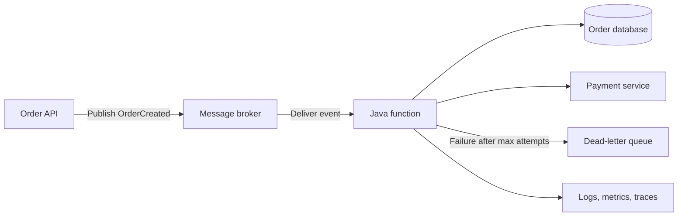

# Shared Responsibility When Operating Serverless

Serverless helps development teams focus on business functionality without manually managing servers, operating systems, or VM orchestrators. Even so, serverless does not mean the cloud provider is responsible for the entire application. When operating a serverless service, the provider and the development team share responsibilities at different layers.

Within the scope of **CLOUD_SERVERLESS**, the focus is on developing and deploying applications under the serverless model, especially Java functions triggered by HTTP, messages, or events. To operate safely and reliably, developers must understand who manages triggers, state, access permissions, retries, idempotency, cold starts, scalability, and cost. That is how the shared responsibility model is applied in day-to-day work.

## 1. What Is the Shared Responsibility Model?

The *shared responsibility model* divides what the cloud service provider must secure and operate from what the customer must configure, develop, and monitor.

- **The provider** is typically responsible for securing physical infrastructure, data centers, underlying networks, servers, and the managed execution layer. With FaaS, the platform also orchestrates provisioning execution environments, receiving events, and allocating resources according to the service's mechanisms.
- **The development team** is responsible for source code, dependent libraries, data, identities and permissions used by the application, trigger configurations, error handling rules, and how the application meets business and security requirements.
- **Both parties jointly establish system reliability:** the provider maintains the platform service according to commitments; the development team must design the application to use the platform properly, monitor actual behavior, and handle situations within its own control.

Exact boundaries depend on the product, service tier, configuration, and contract. Therefore, do not assume every service labeled "serverless" shares the same responsibility boundary. Always read the shared responsibility documentation and operational docs of the exact service you are using.

## 2. Responsibility Shifts with the Service's Management Level

When moving from self-managed infrastructure to more heavily managed services, the provider takes on more platform operations work. Responsibility for the application and data still belongs to the customer.

| Layer of work | IaaS | PaaS | FaaS |
|---|---|---|---|
| Data centers, physical servers, underlying network | Provider | Provider | Provider |
| Operating system and application host servers | Customer typically manages | Provider typically manages | Provider manages the underlying execution environment |
| Provisioning and scaling execution resources | Customer configures and operates most of it | Service assists or partially automates | Platform orchestrates per function model and service limits |
| Application code and application libraries | Customer | Customer | Customer |
| Data, business rules, and application permissions | Customer | Customer | Customer |
| Integration, trigger, and error-handling configuration | Customer | Customer | Customer, with some mechanisms provided by the platform |

The table above shows general trends and does not replace each provider's documentation. For instance, a FaaS platform may patch the OS of execution hosts, but the development team must still update to supported Java versions, update third-party libraries, and fix vulnerable source code. A service may encrypt data at the storage layer, but the customer must still decide what data is stored, who can read it, and how encryption keys are authorized.

## 3. Dividing Responsibilities in a Java FaaS Application

A Java function typically involves several collaborating parts: the event producer, trigger configuration, runtime environment, handler code, storage or external services, and observability systems. You must identify the responsible owner for each part.

| Component | Platform provider typically handles | Development team must handle |
|---|---|---|
| Execution infrastructure | Physical servers, networking, and service isolation layer | Choose configurations aligned with requirements and service limits |
| Runtime | Operates the managed runtime infrastructure under service commitments | Choose supported Java versions; test compatibility; update dependencies and address security advisories in the application |
| Function code | Provides deployment and execution mechanisms | Write, test, review, release, and maintain code; validate inputs; handle business errors |
| Triggers and integrations | Provides APIs, event sources, queues, or integration mechanisms | Configure callers, filters, routing, authentication, rate limiting, timeouts, and processing acknowledgments |
| Identity and permissions | Provides IAM or identity management mechanisms | Grant least-privilege permissions to the function; protect secrets; audit access to data and target services |
| State and data | Operates infrastructure of managed storage services | Choose where state lives; design schemas, lifecycles, consistency, backups, and appropriate access permissions |
| Retries and failed messages | Provides delivery, retry, or error-queue mechanisms per service characteristics | Choose retry policies; handle duplicate or failed messages; monitor and process dead-letter queues |
| Scalability | Creates or reclaims execution environments per platform mechanics | Set appropriate concurrency limits; protect databases and dependent services; control burst traffic |
| Observability and cost | Provides platform metrics, logs, or billing data | Emit structured logs; build business metrics, traces, and alerts; analyze bills and optimize usage |

The key point is that **a managed service does not automatically manage your application's configuration for you**. The platform can provide an HTTP trigger, but the development team must still decide whether the endpoint requires authentication, how requests are rate-limited, and how errors are returned. The platform can redeliver a message, but the development team must ensure a redelivery does not execute the business action twice.

## 4. Triggers: The Platform Invokes, the Application Defines How to Respond

Triggers determine which events cause a function to run. The three common categories are HTTP, messages, and events from other services.

### HTTP Trigger

With HTTP, the platform typically accepts requests and forwards them to the function according to integration settings. The development team must define:

- Which endpoints are public and which require authentication or authorization.
- How to validate input data, payload size, content type, and rate limits.
- Timeouts aligned with the API contract; never assume a request can wait indefinitely.
- Status codes and response structures for success, authentication errors, invalid data, or unavailable dependencies.
- How to protect operations with business side effects when a client retries a request due to a timeout or dropped connection.

For example, an order-creation function may have successfully saved the order, yet the HTTP response was lost. If the client resends the request, there is a risk of creating two orders. The API needs a client-supplied idempotency key or a stable business identifier to detect duplicate requests.

### Message Trigger

With a message trigger, a broker or queue is typically responsible for storing and delivering messages according to the service's semantics. The development team must clearly understand when a message is acknowledged, what the maximum processing window is, when the system redelivers, and what happens after attempts are exhausted.

Never assume a message is delivered strictly once. Many systems use *at-least-once* delivery: the same message can reach the function multiple times, such as when the function finishes processing but the acknowledgment fails or times out. Therefore, processing logic must tolerate duplicate deliveries.

### Event Trigger

An event trigger can originate from storage operations, record changes, a schedule, or another service. The development team needs to verify event schemas and versions, whether event ordering is guaranteed, whether events can arrive late, and how to handle payload structure changes from the producer.

Across all three trigger types, the provider supplies the invocation and integration mechanism; the development team owns the business meaning of the request or event, data validity, and processing outcome.

## 5. State: Functions May Be Ephemeral, Business Data Must Be Durable

FaaS typically creates execution environments on demand. A function instance can be freshly initialized, reused, or terminated after a period. Process memory, static variables, or temporary files inside the execution environment must never be treated as durable business state storage.

For example, a `static Map<String, Order>` variable in Java may persist while the same instance is reused, but it can vanish when the instance is reclaimed; another instance will not see that copy of the variable either. This makes data depend on instance count and initialization history, causing hard-to-reproduce bugs as the system scales.

The development team should store state that must persist across invocations in an appropriate storage service, such as a database, key-value store, or object storage. Also design:

- Identifier keys and unique constraints to prevent duplicate records.
- Transactions or conditional update mechanisms when multiple functions modify the same data.
- Expiration, archival, and deletion policies according to business needs.
- Backups, recovery, and restoration testing if the data is critical.
- Separate read/write permissions per function or per role.

Managed storage platforms can take responsibility for hardware, availability, and service-level protection mechanisms. The development team must still choose configurations, design data models, enforce permissions, and test recovery capabilities to fit the application's goals.

## 6. Retries and Idempotency: Redelivery Must Not Corrupt Business Logic

Retries help a system survive transient failures, such as a dependent service being briefly unavailable. However, retries can also cause an operation to execute multiple times. Thus, retry policies and idempotency design must be considered together.

### Choosing Retries Deliberately

The development team needs to distinguish transient errors from errors that cannot be resolved by retrying:

- Transient network errors, rate limits, or overloaded dependencies may fit bounded retries with backoff.
- Malformed data, missing required fields, or business rule violations usually belong in an error-handling flow for investigation and should not be retried continuously.
- Attempt counts, wait intervals, processing deadlines, and dead-letter queues must be configured according to the event source's capabilities and business requirements.
- Logs and alerts must highlight messages retrying repeatedly or routed to a dead-letter queue.

Retries can increase completion time, execution counts, and cost. If a function calls an already overloaded dependency, aggressive retries can worsen the overload. Backoff, attempt caps, and load shedding help mitigate this risk.

### Designing Idempotency

An operation is idempotent when executing it repeatedly with the same identifier or input produces the same business outcome as executing it once. For example, "set order status to CONFIRMED" can be designed to be idempotent; "add 100,000 VND to the balance" is not idempotent if it adds again each time a message arrives.

For messages or events, you can use an event ID or stable business key as an idempotency key. Checking and recording the key must be performed atomically in a shared data store; an in-memory variable inside a function is insufficient to prevent duplicates across multiple instances.

Illustrative Java handler using an idempotency component backed by durable storage:

```java
public final class OrderCreatedHandler {
    private final IdempotencyExecutor idempotency;
    private final OrderService orders;

    public OrderCreatedHandler(
            IdempotencyExecutor idempotency,
            OrderService orders) {
        this.idempotency = idempotency;
        this.orders = orders;
    }

    public void handle(OrderCreated event) {
        String key = "order-created:" + event.eventId();

        idempotency.executeOnce(key, () ->
                orders.confirm(event.orderId())
        );
    }
}
```

`IdempotencyExecutor` here is an illustrative interface. Its implementation must use conditional writes or transactions to coordinate across instances, persist completion state, and recover when an in-flight execution is interrupted. It must not be implemented with an in-memory `HashSet`. If the operation calls an external system, check whether that system supports idempotency keys; if you need to coordinate data updates and event publishing, consider a transactional outbox to avoid committing data while losing the event.

## 7. Access Permissions and Data Protection

Providers offer IAM mechanisms, secret managers, encryption, and network boundaries. The development team must configure those mechanisms appropriately for the application.

Practical principles include:

1. **Least privilege:** each function has only the permissions needed to read or write the exact resources it uses. An image-processing function should not have administrative rights over an entire database if it only needs to read from one bucket and write to another.
2. **Separate identities:** use a dedicated execution identity per function or functional group with shared permission needs; avoid sharing one privileged account across all components.
3. **Secret management:** never embed passwords, tokens, or access keys in source code, images, or public config files. Use a secret management service and restrict secret read access.
4. **Data protection:** identify sensitive data, restrict what is written to logs, and configure encryption and retention periods per requirements.
5. **Verify call paths:** authenticate HTTP callers, verify signatures or identities of event sources when supported/required, and never trust a payload solely because it arrived from a trigger.
6. **Dependency review:** update Java libraries, scan for vulnerabilities, and remove dependencies that are no longer needed.

A secure platform cannot compensate for a function with overly broad permissions, leaked secrets, or broken authorization logic. Permission configuration and data handling are direct responsibilities of the development team.

## 8. Cold Starts and Scalability

FaaS may need to initialize an execution environment before processing a request. This extra time is commonly called a *cold start*. Cold starts depend on the platform, runtime, deployment package size, resource configuration, number of libraries loaded, and how the application initializes.

In Java, class loading, framework initialization, connection creation, and configuration loading can increase startup time. The development team can measure initialization time separately from processing time, remove unnecessary dependencies, defer initialization of unused components, and pick suitable runtime configurations. Some platforms provide pre-warmed environments or provisioned concurrency; these mechanisms can lower latency but typically alter cost.

Platforms usually spin up additional instances automatically as event volume grows, within service limits. The development team must still protect dependent components. For example, if a function scales from 5 to 200 instances while the database only supports 30 concurrent connections, function scaling can overwhelm the database.

Therefore, you should:

- Set maximum concurrency or rate limits when target services have finite capacity.
- Use connection pools and connection lifetimes suited to instance lifecycles; avoid opening unbounded new connections on every invocation.
- Design backpressure, queues, or throttling mechanisms to absorb traffic spikes.
- Load test both during fresh initialization and once instances are running steadily.
- Monitor p95/p99 latency, instance counts, throttling counts, errors, and queue depth.

The provider is responsible for the platform's scaling mechanism; the development team is responsible for ensuring the entire processing chain stays stable as load shifts.

## 9. Observability, Reliability, and Incident Response

Logs, metrics, and traces are the tools that let the development team verify the application behaves as designed. Serverless services often distribute a business flow across multiple function invocations and managed services, so correlation identifiers are needed to connect processing steps.

A minimum observability setup should include:

- **Structured logs:** record correlation ID, event ID, trigger type, processing outcome, and error codes; never log tokens, passwords, or unnecessary personal data.
- **Technical metrics:** invocation counts, error rates, execution duration, timeouts, throttling, cold starts, and retry counts.
- **Business metrics:** orders processed, failed transactions, and end-to-end time from event receipt to completion.
- **Distributed traces:** propagate trace context across functions and dependent services where supported.
- **Actionable alerts:** alert when error rates cross thresholds, queues grow continuously, dead-letter queues contain messages, or costs spike abnormally.

The provider may ensure platform-layer observability and supply raw telemetry. The development team must pick meaningful signals, set thresholds, handle on-call incidents, and build recovery procedures. Also check log retention limits, log access permissions, and costs caused by excessive logging.

## 10. Cost: The Provider Meters, the Development Team Controls Usage

FaaS typically bills by factors such as invocation count, execution duration, allocated resource level, provisioned concurrency, and companion services. Exact billing varies by provider and product.

Costs do not come solely from the function. A short-running function that queries a database repeatedly, transfers large data volumes, logs densely, or retries continuously can still generate a sizable bill. The development team should:

- Estimate invocation counts and execution durations against realistic traffic.
- Choose memory/CPU and timeouts based on measurements rather than defaults alone.
- Track costs of API gateways, queues, databases, storage, logs, network egress, and called services.
- Detect retry loops, duplicate event emissions, or functions running too frequently.
- Use budgets, budget alerts, and cost allocation tags by environment or business unit if the platform supports them.
- Weigh cost against latency, reliability, and operational effort; FaaS is not automatically cheaper than every other model.

The provider is responsible for metering and publishing pricing per service. The development team and product owners are responsible for understanding consumption, forecasting, and refining the design.

## 11. Integrated Example: Processing an Order-Created Event

Suppose an e-commerce service emits an `OrderCreated` event. A Java function receives the event, confirms the order, and sends a request to the payment service.



In this flow, the provider operates the broker infrastructure, the function execution environment, and the managed storage infrastructure. The development team must define the following behaviors:

1. The function has its own identity and is permitted only to read events, update orders, and call the required payment service.
2. The handler validates schema and event ID before processing. If the broker redelivers the same event, an idempotency key prevents confirming the order or creating a payment request twice.
3. Updating order status and recording processing outcomes must have a consistency mechanism. If payment is an external system, use an idempotency key supported by the payment service or an appropriate reconciliation workflow.
4. Transient errors are retried with limits and backoff. Events that cannot be processed after the attempt limit are moved to a dead-letter queue for investigation and controlled replay.
5. Function concurrency is capped according to database and payment service capacity. Traffic spikes must not overload dependencies.
6. Logs and traces include event ID/correlation ID to trace an order across steps. Alerts fire when error rates or dead-letter queue message counts cross thresholds.
7. Cost dashboards track invocations, execution duration, retries, storage, logs, and calls to dependent services.

This example shows that shared responsibility does not stop at identifying who manages servers. The development team must design business flows to stay safe under duplicate delivery, partial failures, traffic spikes, and dependency outages.

## 12. Pre-Production Checklist for a Function

| Check question | Required evidence or configuration |
|---|---|
| Who can trigger the function? | Trigger list, authentication configuration, and invocation permissions |
| What permissions does the function have? | Least-privilege IAM role/policy; secrets securely managed |
| Where is state stored? | Durable store, schema, lifecycle policy, and appropriate backups |
| What if the same event arrives twice? | Durable idempotency key and concurrent execution tests |
| What happens when the function fails? | Timeouts, retries, backoff, dead-letter queue, and replay procedure |
| Can the system withstand traffic spikes? | Concurrency limits, load tests, and dependent service limits |
| How do cold starts affect it? | Measured initialization and end-to-end latency; evidence-based tuning |
| How are incidents detected? | Logs, metrics, traces, dashboards, alert thresholds, and incident owners |
| How is cost controlled? | Traffic estimates, tracking of billable components, and budget alerts |
| Are the runtime and libraries up to date? | Supported Java version, dependency patching workflow, and vulnerability checks |

## 13. How to Define Responsibility Boundaries When Selecting Services

Before deploying, walk through these steps in order:

1. **Identify the specific services:** explicitly name the FaaS product, event source, data stores, and integrated services being used. The generic label "serverless" is not enough to define responsibilities.
2. **Read responsibility docs and SLAs:** determine which layers the provider manages, which limits apply, what the service guarantees, and which scenarios fall outside commitments.
3. **List application-owned configurations:** triggers, IAM, secrets, runtime, timeouts, retries, concurrency, storage, and observability.
4. **Assign owners:** every critical configuration needs an owning team or role, alert recipients, and operational runbooks.
5. **Verify with failure scenarios:** test invalid requests, duplicate events, function timeouts, dependency outages, traffic surges, and recovery from dead-letter queues.
6. **Review periodically:** update boundaries when the provider changes features, runtimes reach end of support, application permissions change, or the architecture expands.

Shared responsibility only matters when translated into concrete configuration, testing, and owned procedures. For Java FaaS, the provider reduces the infrastructure management burden for the development team; the development team remains responsible for source code, data, access permissions, and how the system responds to failures, load, and cost. Understanding this boundary helps you decide rightly when to use FaaS and operate functions under control.
