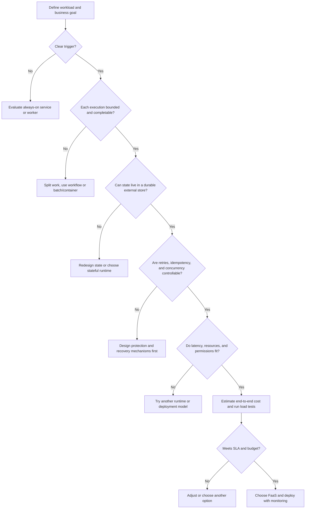
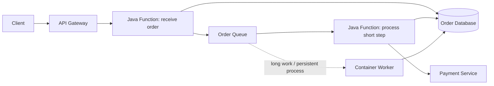

# Selecting Suitable Workloads and Recognizing Unsuitable Cases

Serverless, especially Function as a Service (FaaS), fits when a piece of work can be triggered by an HTTP request, message, or event, execute within a bounded duration, and finish. The platform is responsible for provisioning resources and adjusting the number of execution instances to match load. As a result, the development team can focus on business logic rather than operating servers.

However, serverless does not automatically make every system cheaper, faster, or simpler. A function still has its own time limits, memory limits, connectivity behavior, and retry model. Automatic platform scaling can also generate too many concurrent connections to downstream databases or services. Therefore, the right decision is not moving the entire application to FaaS, but identifying which workloads have suitable characteristics, which workloads need a different model, and where the boundaries between them should be placed.

In this lesson, a *workload* is a unit of work with relatively clear inputs, processing goals, operational requirements, and traffic characteristics. An application can contain multiple distinct workloads: an API receiving requests, processing orders from a queue, generating thumbnails after upload, or aggregating scheduled reports. Each workload must be evaluated individually.

## 1. What Kinds of Work Fit FaaS?

FaaS organizes execution around a function invocation. A trigger delivers input to the function; the function validates data, performs the work, and returns a result or triggers side effects. Triggers usually belong to one of these categories:

- **HTTP:** an API Gateway, webhook, or HTTP endpoint invokes the function on request.
- **Message:** a queue or message broker delivers messages to the function for processing.
- **Event:** an object created in storage, a changed record, an event from an event bus, or an action in another service triggers the function.
- **Schedule:** a scheduler invokes the function at a configured time or interval.

This execution unit typically has a short, independent lifecycle. Once processing finishes, the function returns a result and the execution environment may be reused or reclaimed. Never assume an instance persists between two invocations, and never rely on local memory to store durable business state.

A workload typically has a strong fit when it combines the following characteristics:

1. **Clear activation trigger.** Work starts upon receiving a request, message, event, or schedule; no always-awake process is needed to wait for work.
2. **Decomposable into bounded executions.** Each invocation can finish within the platform's time and resource limits.
3. **Clear input and output boundaries.** Required data can be passed in the request/event or read from a storage service; results can be returned or written to another system.
4. **Capable of independent and concurrent execution.** Many invocations can run in parallel, or ordering and concurrency can be controlled via queues, locks, or orchestration.
5. **No need to hold state in-process.** State that must survive across invocations is stored in a database, object storage, cache, or external state service.
6. **Fluctuating or unpredictable load.** The ability to scale execution instances up and down on demand provides clear value, especially without maintaining idle compute resources.

A workload does not have to be bursty to use FaaS. An API with relatively steady traffic can still fit if operations, latency, platform limits, and total cost meet requirements. Traffic variability is a common advantage, not a strict prerequisite.

## 2. Signs That a Workload Is a Good Fit

### 2.1. Event-Triggered Work

A function handling a webhook when a partner sends a notification, generating a thumbnail when a new image arrives, or consuming a message when an order is confirmed has a natural starting point. There is no need to keep a server running just to continuously poll whether new work exists.

For example, when a user uploads an image to object storage, an `ObjectCreated` event can trigger a thumbnail-generation function. The function receives the object identifier, reads the original image, generates a smaller version, and writes the output. Each image is a relatively independent unit of work, easy to observe, and able to run concurrently.

### 2.2. Bounded and Predictable Processing Time

FaaS suits work that completes within the provider's timeout limit. Measure real processing time in both normal and worst-case scenarios, including external service calls, database queries, and data transfers. Do not measure only the CPU portion of function logic.

If a job occasionally runs for tens of minutes or hours, evaluate timeout limits, interruption risks, checkpointing strategies, and resource-holding costs. You can break the job into smaller steps, orchestrate via workflows, or move long processing to a more suitable container/job platform.

### 2.3. Scalable Without Bottlenecking Downstream Systems

The platform can spin up many execution instances when event volume surges. That enables parallel processing, but it does not mean every dependent component scales at the same pace. A function can jump from a few instances to hundreds in a short time, while a database supports far fewer concurrent connections.

Before choosing FaaS, identify:

- Maximum concurrency the workload needs or the platform can generate.
- Load capacity of databases, external APIs, and dependent services.
- How to limit concurrency, batch size, or queue consumption rate.
- Behavior when backlog grows: add workers, slow consumption rate, or move failing messages to a dead-letter queue.

FaaS fits better when concurrency limits and load throttling can be applied to protect downstream systems.

### 2.4. State Can Live Outside the Function

A function can handle a request without remembering the previous request. If business logic needs to remember order status, processing progress, or generated results, store that state in a durable system. Subsequent invocations read state using a business key or correlation identifier.

Separating state from instance lifecycles lets functions run on different instances, be retried, or scale horizontally. In return, the design must account for state-store access latency, transactions, consistency, locking, and storage service costs.

### 2.5. The Team Wants to Reduce Infrastructure Management

FaaS can reduce responsibilities for managing servers, operating systems, and scaling mechanisms. This helps teams that want to focus on business logic or have traffic too modest to justify operating a server cluster themselves.

However, serverless does not eliminate operational responsibility. Teams must still manage access permissions, trigger configurations, resource limits, secrets, logging, tracing, alerting, retries, dead-letter queues, and deployment pipelines. Simplicity only increases when teams design these pieces intentionally.

## 3. Cases Where FaaS Is Typically Unsuitable

There is no absolute ban list across all providers. Limits on time, memory, CPU, deployment package size, networking, and concurrency vary by platform. The cases below are signals to compare carefully against containers, virtual machines, managed services, or dedicated stream processing systems.

### 3.1. Processes That Must Run Continuously or Hold Long-Lived Connections

Examples include workers continuously listening on sockets, game servers maintaining sessions, device-orchestration daemons, or services requiring long-lived TCP connections. FaaS is designed around invocations with a start and an end, so sustaining an uninterrupted process is unnatural and can incur unsuitable costs or hit limits.

You can use a continuously running service to hold connections and then emit events or messages to functions for short tasks. This hybrid keeps FaaS where it excels.

### 3.2. Work Exceeding Execution Limits or Needing Continuous Progress

Long video processing, simulations, model training, or massive data exports can exceed function timeouts or memory. If splittable, create checkpointed steps with durable progress state. If unsplittable or needing continuous resources, containers/jobs or batch platforms are usually a better fit.

Never assume increasing timeout or allocating more memory will solve everything. Platform limits still exist, and cost can climb steeply with execution duration.

### 3.3. Latency Must Stay Consistently Very Low

A function can experience a *cold start*: the platform must prepare an execution environment before handling a request. For Java, JVM startup, class loading, framework initialization, and connection setup can all contribute to this delay. Impact depends on the runtime, application size, network configuration, provider, and deployment approach.

If business requirements impose strict latency thresholds even at high percentiles, measure cold starts under near-production conditions. Impact can be reduced by trimming dependencies, optimizing startup, using native images where appropriate, or configuring pre-warmed execution environments if supported. Those measures can add complexity or cost. An always-on service may deliver consistent latency more easily.

### 3.4. High, Steady, and Sustained Traffic

FaaS can still serve large workloads, but under continuously high load, per-request and execution-time billing can exceed container or server models with steady capacity. In such cases, an always-on worker cluster can utilize resources more cost-effectively.

Do not decide based solely on the label "high traffic." Measure actual resource utilization, per-invocation duration, redundancy requirements, operational costs, and supporting service costs. A high-volume workload with short, uneven bursts may still fit FaaS well.

### 3.5. Requiring Specialized Resources or Control

Workloads needing dedicated GPUs, very large memory, directly attached hardware, custom kernels, OS administrative privileges, or incompatible native libraries may not run on the chosen FaaS runtime. Verify CPU architecture, OS, Java runtime, package limits, native libraries, and network access before committing.

### 3.6. Relying on In-Memory State or Global Sequential Ordering

If logic assumes every request lands on the same instance, relies on static variables to store a shopping cart, or requires all events to process strictly sequentially, that design does not align naturally with FaaS horizontal scaling.

You can move state to a database, use distributed locks, partition by business key, or design a workflow. However, if global ordering and in-process state are central, a continuously running service may be simpler and easier to control.

## 4. Assessment by Workload Type

| Workload type | Typical fit | What to check |
| --- | --- | --- |
| Stateless HTTP API | High | Latency, cold starts, timeouts, authentication, concurrency limits, and database connections |
| Partner webhooks | High | Signature verification, deduplication, fast response, and offloading heavy work to queues |
| Queue message processing | High | Retries, idempotency, ordering, visibility timeout, batches, and dead-letter queues |
| Object storage event processing | High | Object size, read/write permissions, duplicate events, and trigger loops |
| Short scheduled tasks | High | Overlapping schedules, time zones, duration, and catch-up execution |
| Thumbnail generation or small file conversion | High | Memory, duration, file size, and library constraints |
| Large reports or long exports | Low to medium | Whether it can be chunked, checkpointed, output persisted, and kept within timeouts |
| Workers holding persistent connections | Low | Consider containers or always-on services |
| High-throughput, complex stateful stream processing | Case-dependent | Consider dedicated stream processing platforms; FaaS can process events in batches |
| GPU or specialized hardware tasks | Low on standard FaaS | Check runtime and hardware limits; consider specialized services |

These ratings are only initial guidance. A stateless API might not fit if it needs ultra-low latency while the platform has significant cold starts. A large report might still fit if broken into short, checkpointed steps and properly orchestrated.

## 5. Questions to Answer Before Choosing FaaS

### 5.1. Triggers and Data Shape

- What event initiates the work? Who emits it and who is responsible if emission fails?
- Is the input complete data or only a reference to data that must be read elsewhere?
- What is the maximum payload size? Should large data travel via object storage instead of being stuffed into messages?
- Can one trigger fire multiple times for the same business action?

Payloads should contain enough information to identify and continue processing, without exceeding the messaging service's size limits. For large files, usually only the bucket, object key, version, or access-controlled URI needs to be passed.

### 5.2. Time, Memory, and Runtime Limits

- What are the median and high-percentile processing times?
- Can the job finish within the maximum timeout?
- Is peak memory predictable?
- Are there native libraries, large file operations, or heavy framework initializations?
- If the function is terminated mid-run, can the work resume safely?

Test with representative data as well as edge cases. A successful run on a developer machine does not prove the function will satisfy runtime limits in production.

### 5.3. State, Retries, and Idempotency

The platform may retry when a function fails, times out, or fails to acknowledge a message in time. Some event sources can deliver the same event multiple times; exact delivery semantics depend on the service. Therefore, design under the assumption that an event can be processed repeatedly, unless the producer's contract guarantees otherwise and the system has verified it.

**Idempotency** is the property whereby performing an operation multiple times with the same business key produces an end result equivalent to performing it once. For example, upon receiving `OrderPaid` twice, the system must not record payment twice. You can use `eventId`, `paymentId`, or a stable business key to record completion using an atomic database operation.

When processing messages, clearly define:

- When is a message acknowledged as processed?
- Which errors are retried and which go to a dead-letter queue?
- Do retries use backoff and attempt caps?
- If the function successfully called the payment service but failed before recording completion, will the retry cause duplicate side effects?
- Can failed messages be inspected, replayed, and handled manually?

Never swallow exceptions and return success when business work has not completed. That behavior can cause the platform to acknowledge the message and lose the chance to retry. Conversely, retrying an unrecoverable data error forever can create loops and inflate costs. Classify errors, limit retries, and retain info for investigation.

The illustrative example below uses hypothetical interfaces to demonstrate the idea; actual API names and message acknowledgment mechanisms must be adapted to the provider:

```java
public final class OrderCreatedHandler {
    private final InboxRepository inbox;
    private final PaymentService payments;

    public OrderCreatedHandler(
            InboxRepository inbox,
            PaymentService payments) {
        this.inbox = inbox;
        this.payments = payments;
    }

    public void handle(OrderCreated event) {
        // claim() must be an atomic operation based on eventId.
        ClaimResult claim = inbox.claim(event.eventId());

        if (claim == ClaimResult.ALREADY_COMPLETED) {
            return; // Event already completed: redelivery causes no new side effect.
        }

        if (claim == ClaimResult.IN_PROGRESS) {
            throw new RetryLaterException("Event is being processed");
        }

        try {
            // Pass the same idempotency key to the downstream service if supported.
            payments.capture(
                    event.orderId(),
                    event.amount(),
                    event.eventId());

            inbox.markCompleted(event.eventId());
        } catch (RuntimeException error) {
            inbox.releaseForRetry(event.eventId());
            throw error; // Let the trigger adapter apply its retry policy.
        }
    }
}
```

In a real implementation, `claim()` must handle concurrency via unique constraints, transactions, or lease-based locks. The `IN_PROGRESS` state needs an expiration timeout so work can recover if an instance crashes. The example also highlights a crucial transaction boundary: the payment service may succeed before `markCompleted()` fails. Therefore, the idempotency key must be passed to the payment service if supported; recording in the inbox alone is not enough to prevent duplicate external side effects.

### 5.4. Concurrency and Dependency Capacity

A function's fast scaling capability must be paired with dependent system limits. Set appropriate concurrency limits, size connection pools reasonably, consider message batching, and monitor database connection counts. During traffic surges, a queue can act as a buffer so workers process at a rate dependencies can sustain.

If multiple functions update the same record or resource concurrently, design transactions, optimistic locking, partition keys, or serialization mechanisms. Scaling instance counts does not solve data contention.

### 5.5. Latency and Cold Starts

Measure total latency from when the trigger fires until the business operation completes, not just core code execution time. For HTTP APIs, evaluate high percentiles such as p95 or p99. For asynchronous processing, queue wait time and backlog drain time are also part of the user experience and SLA.

For Java, startup time can be reduced by trimming unnecessary dependencies, lazily initializing unused clients, avoiding overly broad classpath scanning, and measuring framework impact. Only adopt native images or pre-warmed instance settings after testing compatibility, build times, memory usage, and total cost.

### 5.6. Security and Access Permissions

Each function should have the minimum permissions needed for its exact job: reading the right bucket, writing the right table, or sending to the right queue. Do not share one broad administrative permission across all functions. Secrets such as API keys should come from a secret manager or secure platform configuration mechanism, never hardcoded in source code or payloads.

Inputs from HTTP, webhooks, and messages all need authentication, schema validation, and size limits. For webhooks, verify signatures or partner authentication mechanisms. Also control who can invoke the function, network access permissions, and sensitive data in logs.

### 5.7. Observability and Incident Response

Every execution should emit structured logs with correlation fields such as `requestId`, `eventId`, `correlationId`, or `orderId` as appropriate. Monitor at least invocation counts, errors, timeouts, duration, cold starts if metrics exist, concurrency, retries, dead-letter queue message counts, and backlog delay.

A function "succeeding" at the infrastructure level does not guarantee the business workflow finished. For example, a function may return HTTP 200 after merely enqueuing a request; actual completion happens in a downstream worker. Distinguish ingestion metrics from business completion metrics.

## 6. Evaluating End-to-End Flow Cost

Serverless typically bills based on invocation count, execution duration, and allocated resources; exact pricing varies by provider. Beyond FaaS charges, a real flow can incur costs for API Gateway, queues, event buses, databases, object storage, logs, tracing, data transfer, and network egress.

An initial estimate can be expressed as:

```text
Total workload cost per period
  = function invocation cost
  + execution duration and memory cost
  + trigger / gateway / queue / event bus cost
  + database / storage / cache cost
  + log / monitoring / tracing cost
  + data transfer and related service cost
```

This is an analytical framework, not a universal pricing formula. Obtain unit prices and billing rules from your chosen provider. When comparing FaaS with containers or VMs, keep assumptions consistent for traffic, redundancy, availability, deployment region, data transfer, and operational staffing costs.

A workload with few requests where each run takes a long time or requires high memory can be expensive. A workload with many requests where each finishes very quickly can be economical. Conversely, an always-on container service may be more efficient under steady load and high resource utilization. You cannot conclude FaaS is cheaper solely from not managing servers.

Build at least three scenarios: low, average, and peak load. For each scenario, estimate invocation counts, execution duration, memory, retry counts, read/write data, network traffic, and dependency usage. Do not overlook retry storms or event spikes, as they can drive up both costs and system load simultaneously.

## 7. Decision Process

You can use the following process to screen a workload before choosing technology:



In practice, walk through these steps:

1. **Define work boundaries.** Specify triggers, inputs, outputs, side effects, owners, and completion criteria.
2. **Check technical limits.** Compare timeouts, memory, CPU, package size, Java runtime, networking, and concurrency against target platform limits.
3. **Design failure paths.** Describe retries, idempotency, timeouts, dead-letter queues, poison-message handling, and safe replay procedures.
4. **Check dependencies.** Verify whether databases, external APIs, and storage services can withstand expected concurrency.
5. **Measure latency and cold starts.** Test in a near-production environment with representative data under both normal and peak load.
6. **Compare total cost.** Include supporting services and operations in the same comparison model.
7. **Pilot with limits.** Start with a small workload, configure alerts, cap concurrency, and define clear rollback criteria.

If a critical criterion lacks an answer, treat it as a risk requiring testing or clarification before scaling up. Do not use a weighted average score to mask a hard constraint such as an unmeetable timeout or unreachable latency requirement.

## 8. Real-World Selection Examples

### Example A: Generating Thumbnails When Users Upload Images

**Characteristics:** Storage emits an event when a new object arrives. Each image can be processed independently, processing time is relatively short, and the output is written as another object.

**Assessment:** This workload fits FaaS well. The trigger is clear, the unit of work is bounded, and scaling with image count is straightforward. The function should receive the object key rather than the entire image content inside the event. Enforce image size limits, validate file types, control concurrency, and ensure deterministic output naming to handle duplicate events. Also prevent thumbnails from being written into the same trigger-watched location and causing an infinite invocation loop.

### Example B: Processing Orders from a Queue

**Characteristics:** When an order is created, the system emits `OrderCreated`. A worker checks inventory, calculates charges or calls a payment service, and updates status.

**Assessment:** FaaS can fit because each message represents one unit of work. However, this business process has side effects and high correctness requirements. It needs per-event or per-order idempotency, appropriate transactions/locking, timeouts for external services, bounded retries, and a dead-letter queue. If the workflow spans multiple steps requiring long waits or compensation when a step fails, consider workflow orchestration rather than stuffing the whole process into one function.

### Example C: Generating Large Nightly Reports

**Characteristics:** A scheduled job queries months of data, aggregates millions of records, and produces a large file.

**Assessment:** A scheduled trigger fits serverless, yet data volume and execution time may not fit a single FaaS invocation. If partitionable by day, customer, or data group, each function can process one partition and write a checkpoint while a workflow aggregates results. If the task needs large memory, runs continuously, or cannot be split, a batch service or container job may fit better.

### Example D: WebSocket Server Maintaining Chat Sessions

**Characteristics:** The server must keep user connections open for long periods, manage sessions, and exchange bidirectional data in real time.

**Assessment:** A short-lived function is not a natural place to hold persistent connections. You can use a WebSocket service or container to manage connections, then emit events to functions for independent tasks such as saving history, moderating content, or sending notifications. This is a classic example of a hybrid architecture.

## 9. Hybrid Architectures Are Often a Sensible Choice

A system does not have to pick solely FaaS or traditional servers. You can use API Gateway and functions for short requests, queues to decouple load, functions for independent processing steps, databases to persist state, and containers for long-running workers or components holding persistent connections.

Order-processing flow example:



In this flow, the function accepts requests and records orders quickly. The queue decouples order acceptance from processing. A function handles short, retryable, idempotent steps; a container worker takes on long-running work if any exists. The database preserves business state across executions.

Hybrid architectures also carry costs: more services, more failure points, more observability plumbing, and added inter-step latency. Split into multiple components only when the gains in scaling, fault isolation, maintainability, or ownership outweigh that complexity.

## 10. Pre-FaaS Adoption Checklist for a Workload

- [ ] Triggers and input/output contracts are defined.
- [ ] Processing duration, memory, and payload sizes fall within verified limits.
- [ ] Long-term state is stored outside the function.
- [ ] Duplicate events and retries do not cause duplicate business side effects.
- [ ] Timeout, backoff, retry, and dead-letter queue policies are in place.
- [ ] Concurrency is capped according to database and dependent service capacity.
- [ ] Access permissions follow least privilege; secrets are managed securely.
- [ ] Logs, metrics, tracing, and alerts suffice to track business outcomes.
- [ ] Cold starts and latency have been measured in a near-production environment.
- [ ] Total cost includes triggers, storage, databases, networking, and observability.
- [ ] There is a mechanism to replay or manually handle failed events.
- [ ] Criteria exist to move the workload to workflows, containers, batch, or always-on services if limits are exceeded.

## Conclusion

FaaS is a strong choice when a workload has clear triggers, bounded per-invocation processing, externalizable state, and execution scaling within controllable limits. Workloads requiring continuous processes, long-lived connections, specialized hardware, durations beyond limits, or highly consistent low latency should be evaluated carefully against alternative models.

Decisions should rest on measurements of duration, load, concurrency, failure modes, and total cost. For Java, also verify runtime startup time and dependency impact. In many systems, the best approach combines FaaS with queues, workflows, databases, and containers so each component runs on the model suited to its workload characteristics.
