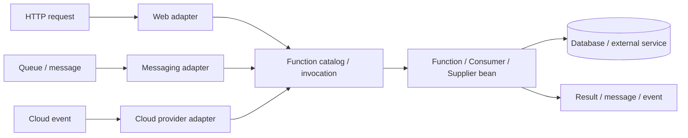

# Function, Consumer, and Supplier Models in Spring Cloud Function

Spring Cloud Function provides a programming model based on Java's functional interfaces to build logic that can run across many different input types. Instead of writing business logic tightly coupled to an HTTP controller, message listener, or a specific cloud provider's API, the application declares beans in the form of `Function`, `Consumer`, or `Supplier`. The corresponding adapter connects that function to HTTP, messaging, or a serverless deployment environment.

These three types describe three fundamental processing contracts:

- `Function<I, O>` accepts input data of type `I`, processes it, and returns a result of type `O`.
- `Consumer<I>` accepts input data of type `I` and performs a side effect without returning a business result.
- `Supplier<O>` takes no input and produces data of type `O`.

The examples use Java `record` for concise DTOs (requiring Java 16 or later). For projects using an older Java version, records can be replaced with classes/POJOs having corresponding constructors, getters, and data types.

Choosing the right contract helps decouple business logic from triggers. In a Cloud Serverless model, the same function may be invoked by an HTTP request, a message, or an event; long-lived state must still reside in a durable data store, while access control, retries, idempotency, cold starts, concurrency, and cost need to be handled at the appropriate deployment boundaries.

## 1. Where Does Spring Cloud Function Fit?

Spring Cloud Function is an abstraction layer for processing logic. The application defines functional beans; the runtime or adapter looks up the bean, converts input data into the corresponding Java type, invokes the logic, and translates the result back to the external protocol.



The components have distinct responsibilities:

- **Functional bean:** contains application logic and declares input/output types.
- **Function catalog/runtime:** discovers, looks up, and composes functions by name or definition.
- **Adapter:** converts HTTP requests, messages, or events into function calls; maps results and errors back to the corresponding protocol.
- **External systems:** databases, queues, event buses, partner APIs, or object storage that hold state and perform integrations.

Spring Cloud Function does not automatically turn every application into serverless. It provides a unified function model; to receive HTTP or messages, the application still needs an appropriate adapter. When deploying to a FaaS platform, you must use an adapter/runtime supported for the chosen platform and Spring Cloud Function version.

## 2. The Three Core Functional Interfaces

| Type | Contract | Result | Business example |
|---|---|---|---|
| `Function<I, O>` | Input → Output | Returns new data | Calculate order price, normalize event, transform DTO |
| `Consumer<I>` | Input → side effect | Returns no business value | Save audit log, send notification, update projection |
| `Supplier<O>` | No input → Output | Produces new data | Read job batch, emit snapshot, generate scheduled event |

These are interfaces in `java.util.function`, so they can be tested directly without starting a web server or message broker.

### Function<I, O>

`Function<I, O>` is suitable when each invocation takes an input and needs a result. For example, receiving an order creation command, validating the data, and returning the created result. The `apply` method has the logical signature `O apply(I input)`.

```java
import org.springframework.context.annotation.Bean;
import java.util.function.Function;

public record PriceRequest(long unitPrice, int quantity) {}
public record PriceResult(long subtotal) {}

@Bean
Function<PriceRequest, PriceResult> calculatePrice() {
    return request -> {
        if (request.quantity() <= 0 || request.unitPrice() < 0) {
            throw new IllegalArgumentException("Invalid price request");
        }
        return new PriceResult(
                Math.multiplyExact(request.unitPrice(), request.quantity()));
    };
}
```

A Function should focus on a transformation or use case with a deterministic output. If the logic needs to write to a database or call an external system, `Function` can still be used, provided it is clear that the output is the outcome of the use case and side effects are managed safely.

### Consumer<I>

`Consumer<I>` is suitable when the primary purpose is to execute a side effect. The logical signature is `void accept(I input)`. For example, an `OrderConfirmed` event triggers a consumer to update a read model or send a notification.

At the type level, one could write `Function<I, Void>`, but `Consumer<I>` expresses more clearly that the caller receives no business output and does not need to return `null`.

```java
import org.springframework.context.annotation.Bean;
import java.util.function.Consumer;

public record OrderConfirmed(String orderId, String customerId) {}

@Bean
Consumer<OrderConfirmed> updateOrderProjection(OrderProjection projection) {
    return event -> projection.markConfirmed(
            event.orderId(), event.customerId());
}
```

A Consumer returns no business payload. In messaging triggers, the adapter typically relies on whether the consumer completes normally or throws an exception to decide if the message is acknowledged or treated as an error. Details of ack, retry, and dead-letter handling depend on the adapter/broker. For HTTP, a Consumer is unsuitable if the client needs to receive a business result; you can use a Function or design an asynchronous ingestion endpoint that returns a tracking ID.

### Supplier<O>

`Supplier<O>` generates data without requiring input. The logical signature is `O get()`. For example, fetching a batch of due jobs or generating a state snapshot.

```java
import org.springframework.context.annotation.Bean;
import java.util.List;
import java.util.function.Supplier;

public record PendingJob(String jobId, String type) {}

@Bean
Supplier<List<PendingJob>> loadPendingJobs(JobRepository repository) {
    return repository::findNextBatch;
}
```

A Supplier does not mean it runs on a schedule by itself. An adapter or scheduling mechanism must decide when to invoke `get()`. With pollable message sources, Spring Cloud Stream or a scheduler can provide the polling mechanism; poller configuration belongs to the corresponding integration layer, not to the `Supplier` itself.

Do not create a Supplier that always returns the same mutable object or use it to hold state across invocations. Each invocation should create or fetch a fresh result from an appropriate data source. If the Supplier fetches pending jobs, the batch selection/claim operation must be atomic or use a lease so that two concurrent invocations do not inadvertently pick up the same jobs.

## 3. Declaring Functional Beans in Spring

Functions are typically declared with `@Bean` inside a Spring configuration class. The bean method name serves as the function name that the runtime/catalog can use for selection.

```java
import org.springframework.context.annotation.Bean;
import org.springframework.context.annotation.Configuration;
import java.util.Locale;
import java.util.function.Function;

@Configuration
public class TextFunctions {

    @Bean
    public Function<String, String> normalizeText() {
        return value -> value == null
                ? ""
                : value.trim().toLowerCase(Locale.ROOT);
    }
}
```

An application can declare multiple function, consumer, and supplier beans. When multiple beans exist, the adapter configuration must select the right function or definition. Do not rely on bean discovery order to infer a default function.

For business dependencies, inject services/repositories into the bean method or configuration class. Avoid creating a new database connection on every function invocation if an SDK client can be safely reused across the instance lifecycle.

## 4. Distinguishing Functions from Controllers and Message Listeners

A Spring MVC controller receives `HttpServletRequest`/DTOs and returns an HTTP response. A message listener receives messages via the broker's API. A functional bean describes a purer processing contract; the adapter is responsible for translating the protocol into that contract.

| Component | Which protocol does it know? | Role |
|---|---|---|
| `@RestController` | HTTP, path, status, headers | Build HTTP APIs directly |
| `@KafkaListener` or similar listener | Broker and message API | Consume messages directly from the broker |
| Spring Cloud Function bean | Java input/output types | Describe logic that can be invoked through an adapter |
| Web/messaging/cloud adapter | Specific protocol | Connect triggers to functions and map results |

The functional model is useful when you want to reuse logic across multiple triggers or deploy the same code across multiple environments. If an endpoint needs specialized HTTP features such as complex streaming responses, multipart uploads, or fine-grained route mapping, a dedicated controller may be more appropriate; the controller can still call the same application service used by the function.

## 5. Using Message<I> to Access Headers and Metadata

When passing only payload `I`, the function does not directly see transport metadata. Spring Messaging `Message<T>` includes both payload and headers. This is how you receive correlation IDs, tenant context, event IDs, or other needed metadata from the adapter.

```java
import org.springframework.context.annotation.Bean;
import org.springframework.messaging.Message;
import org.springframework.messaging.support.MessageBuilder;
import java.util.function.Function;

public record CreateOrderRequest(String customerId, long total) {}
public record CreateOrderResult(String orderId, String status) {}

@Bean
Function<Message<CreateOrderRequest>, Message<CreateOrderResult>> createOrder(
        OrderApplicationService service) {
    return message -> {
        CreateOrderRequest request = message.getPayload();
        String correlationId = message.getHeaders()
                .get("correlationId", String.class);

        CreateOrderResult result = service.create(request, correlationId);

        return MessageBuilder.withPayload(result)
                .setHeader("correlationId", correlationId)
                .setHeader("orderId", result.orderId())
                .build();
    };
}
```

Header names and data types must be aligned with the adapter. Not every transport permits every header; the adapter may filter, rename, or serialize headers according to its own rules. If a header is required for business processing, validate it at the boundary and return a clear error when missing.

When constructing the output message, copy only the necessary headers. Do not blindly forward all incoming headers because they may contain internal details, credentials, or data invalid for the destination. A correlation ID is tracing metadata, not proof of authentication or authorization.

## 6. Composition: Chaining Multiple Functions

Type-compatible functions can be combined into a pipeline. If the first function outputs type `B` and the next function accepts type `B`, they can be chained using Java's `andThen` or function composition supported by Spring Cloud Function via function definitions.

### Composing Directly in Java

```java
Function<String, String> trim = String::trim;
Function<String, String> uppercase = String::toUpperCase;

Function<String, String> normalize = trim.andThen(uppercase);

String result = normalize.apply("  serverless  ");
// SERVERLESS
```

`andThen` runs the left-hand function first and passes the result to the right-hand function. `compose` runs the passed-in function before the current one. Check the generic types of both steps to avoid runtime conversion errors.

### Composing via Function Definition

Spring Cloud Function supports expressing composition by bean names, for example:

```properties
spring.cloud.function.definition=normalizeText|addPrefix
```

In this example, the output of `normalizeText` must be compatible with the input of `addPrefix`. The exact syntax and how the adapter selects the definition should be verified against the Spring Cloud Function version in use. When deploying multiple functions, explicitly specify which function/definition to expose to avoid accidentally exposing internal beans.

Composition is helpful for small, clearly ordered data transformation steps. For long-running business workflows involving retries, state, waiting for events, or compensation, do not force everything into a synchronous function chain; use appropriate workflow orchestration or an event-driven process instead.

## 7. Function, Consumer, and Supplier in Messaging

In messaging integrations, functional beans can be wired to input/output bindings. Depending on the Spring Cloud Stream version and binder, binding names, destination configuration, consumer groups, partitions, retries, and DLQs will differ.

A basic mental model:

- `Function<I, O>` consumes an input message and emits the result to an output binding.
- `Consumer<I>` only consumes and performs side effects; there is no business output binding.
- `Supplier<O>` produces messages for the adapter to publish to an output binding or fetches data from a source when polled.

Example function processing an order:

```java
import org.springframework.context.annotation.Bean;
@Bean
Function<OrderSubmitted, OrderAccepted> acceptOrder(
        OrderApplicationService service) {
    return event -> service.accept(event);
}
```

The messaging adapter receives `OrderSubmitted`, converts the payload into a Java record, invokes `acceptOrder`, and then sends `OrderAccepted` to the configured output destination. The function does not need to instantiate a Kafka consumer or SQS client itself if the binder/adapter already manages that part.

Example Consumer updating a projection:

```java
import org.springframework.context.annotation.Bean;
@Bean
Consumer<OrderAccepted> updateProjection(OrderProjection projection) {
    return event -> projection.apply(event);
}
```

Example Supplier emitting a snapshot:

```java
import org.springframework.context.annotation.Bean;
@Bean
Supplier<InventorySnapshot> inventorySnapshot(
        InventoryQueryService queryService) {
    return queryService::currentSnapshot;
}
```

A Supplier requires an invocation or polling mechanism. If polled continuously, appropriate frequency, batch size, and load limits must be set; otherwise, the function may repeatedly read the same data or create unnecessary load.

## 8. Reactive Functions and Stream Processing

Spring Cloud Function can work with reactive types such as `Flux` and `Mono` when the application uses Reactor. Instead of handling a single payload, a function can accept or return a publisher to represent an asynchronous data stream.

```java
import org.springframework.context.annotation.Bean;
import reactor.core.publisher.Flux;
import java.util.function.Function;

@Bean
Function<Flux<String>, Flux<String>> normalizeStream() {
    return values -> values
            .map(String::trim)
            .filter(value -> !value.isEmpty())
            .map(String::toLowerCase);
}
```

Reactive types are useful when the adapter supports streaming or when processing multiple records as a stream. However, using `Flux` does not automatically make all I/O non-blocking. If blocking JDBC or a blocking SDK is still called inside, an appropriate scheduler/adapter is needed or you must use a non-blocking client. You need to understand backpressure, concurrency, and how the adapter acknowledges individual records or batches.

Do not collect an unbounded stream into memory with `collectList()` if the data can grow indefinitely. Choose explicit batch sizes, concurrency limits, and checkpoint strategies. For replayable event sources, consumers must be idempotent because records can be replayed after failures.

## 9. Errors and Retries at the Trigger Boundary

The functional interface only defines the processing signature; it does not prescribe the entire retry policy. When a function throws an exception, the adapter decides how to represent the failure:

- A web adapter may map the error to an HTTP status/response.
- A messaging adapter may nack the message so the broker redelivers it, retry per policy, or route it to a DLQ.
- A cloud function adapter may return an invocation error so the platform applies trigger-level retries.
- A Supplier may fail while reading from a source; the scheduler/poller must decide when to invoke next.

Do not catch every exception and return a fake success result. Doing so causes the broker to ack the message or the HTTP client to receive a success response even though the business work is incomplete. If an error is a business error that can be represented normally, return a result with a clear status; if an infrastructure or data error prevents processing from completing, throw an exception so the adapter applies the configured error mechanism.

### Idempotency

For messages/events, assume at-least-once delivery by default unless the platform and configuration guarantee otherwise within a specific scope. The consumer should record the processed `eventId` together with the business change in the same transaction. For HTTP, resource-creating operations can use `Idempotency-Key`. Do not use a correlation ID in place of an event ID or idempotency key.

A function should not generate a new ID on each retry for the same logical operation. The operation ID must be stable so downstream systems can detect duplicate requests. Side effects on external systems require the target API's idempotency key or an appropriate compensation process.

## 10. Stateless Functions and Dependency Management

Functional beans are usually Spring singleton beans. Therefore, the function object may be used concurrently by multiple invocations or multiple threads depending on the adapter. Do not store per-request data in mutable fields of a singleton:

```java
// Unsafe: shared state across invocations.
import org.springframework.context.annotation.Bean;
import java.util.ArrayList;
import java.util.List;
@Bean
Function<OrderRequest, OrderResult> unsafeFunction() {
    List<String> processedOrders = new ArrayList<>();
    return request -> {
        processedOrders.add(request.orderId());
        return process(request);
    };
}
```

Instead, keep the function stateless and store business state in an appropriate database/cache/queue/workflow state. You can inject shared thread-safe clients or repositories if they are designed for concurrency. If a dependency is not thread-safe, apply appropriate scoping or synchronization and measure the performance impact.

In serverless environments, reusing clients at the instance scope can reduce cold starts and connection overhead. However, an instance can be reclaimed at any time; do not use static fields, the local filesystem, or heap memory as durable data storage.

## 11. Security at the Boundary and Inside the Function

The adapter may perform protocol-level authentication, but the function/service still needs to check business permissions on resources. For example, the gateway verifying a JWT does not mean the user is authorized to read every order ID they submit.

Principles:

- Authenticate callers at the gateway/adapter using the system's authentication mechanism.
- Pass principal/tenant context through a trusted mechanism; do not trust headers arbitrarily set by the client.
- Enforce resource- and tenant-level authorization inside the application service.
- Grant the function only the IAM permissions needed to read/write databases or publish/consume messages.
- Retrieve secrets from a secret manager; do not put tokens or credentials in payloads/logs.
- Validate event schemas and sources before executing side effects.
- Limit payload sizes and strip unnecessary headers when forwarding messages.

## 12. Testing Functional Beans

An advantage of the Function/Consumer/Supplier model is that it can be tested directly by invoking the interface. Unit tests do not need to start a web server or broker.

Example testing a Function:

```java
import static org.junit.jupiter.api.Assertions.assertEquals;
import org.junit.jupiter.api.Test;
import java.util.function.Function;

class PriceFunctionTest {
    @Test
    void calculatesSubtotal() {
        Function<PriceRequest, PriceResult> function = request ->
                new PriceResult(request.unitPrice() * request.quantity());

        PriceResult result = function.apply(new PriceRequest(1200, 3));

        assertEquals(3600, result.subtotal());
    }
}
```

Example testing a Consumer with a fake dependency:

```java
@Test
void updatesProjectionForAcceptedOrder() {
    FakeOrderProjection projection = new FakeOrderProjection();
    Consumer<OrderAccepted> consumer = projection::apply;

    consumer.accept(new OrderAccepted("order-1"));

    assertTrue(projection.contains("order-1"));
}
```

Beyond unit tests, adapter integration tests are needed to verify serialization, header mapping, function selection, HTTP responses, message ack/retry, and DLQ behavior. Concurrency tests should confirm that beans do not share mutable request state. Contract tests should validate input/output schemas when producers and consumers deploy independently.

## 13. Naming and Selecting Which Function to Expose

Bean names become part of operational configuration. Use names that describe the action and business domain, such as `createOrder`, `updateProjection`, `loadPendingJobs`. Avoid generic names like `process`, `handler1`, or `functionA` when an application has multiple functions.

When an application has multiple functions, configure `spring.cloud.function.definition` or the adapter's function selection mechanism to specify which function to run/expose. For composition, the definition name can express a chain of compatible functions. Do not expose internal Suppliers or administrative functions over public HTTP unless required and properly secured.

The function catalog helps look up functions by name and supports composition/routing in the Spring Cloud Function model. If accessing the catalog directly in code, keep lookup logic in the adapter or orchestration layer; core business logic should depend on stable interfaces/services rather than string bean names.

## 14. Deploying via HTTP, Messaging, and FaaS

The same functional bean can be reused with different adapters through appropriate deployment configuration; packaging and configuration still depend on the environment:

| Trigger | Common adapter | Deployment notes |
|---|---|---|
| HTTP | Spring Cloud Function web adapter or suitable web integration | Choose exposed functions/routes, configure security, timeouts, and response mapping |
| Queue/message | Spring Cloud Stream binder or messaging adapter | Configure destination, group, ack, retry, DLQ, concurrency, and batching |
| Cloud provider event | Provider-specific adapter/runtime | Map event envelope, invocation permissions, platform timeouts, and retries |
| Polling/source | Supplier combined with scheduler/poller or connector | Configure schedule, batching, checkpoints, and load limits |

When deploying to FaaS, the function adapter must match the runtime's contract. Some platforms require specific handlers or adapters; some support Spring Cloud Function via a runtime adapter. Do not assume that merely adding `@Bean Function` causes every cloud provider to recognize the function automatically.

Check the following factors before deploying:

- Java, Spring Boot, Spring Cloud Function, and adapter versions are compatible with each other.
- Artifacts, dependencies, and classpath match the runtime.
- The handler/adapter is configured properly and the function definition is explicitly selected.
- IAM roles for databases, queues, event buses, secrets, and logging follow least privilege.
- Memory/CPU, timeouts, concurrency, and batch sizes fit the workload.
- Cold starts have been measured with real dependencies; trim unnecessary dependencies.
- Functions do not retain business state in memory across invocations.
- Logs, metrics, traces, correlation IDs, and error/timeout alerts are in place.

## 15. Cost and Performance

Function cost does not depend solely on invocation count. You must account for execution duration, memory/CPU configuration, cold starts, retry counts, gateway requests, message operations, database reads/writes, network transfer, and logs/traces. A short function that retries repeatedly or makes many database calls can cost more than a function that processes reasonable batches.

Measure these metrics:

- Invocation count and p50/p95/p99 duration.
- Error, timeout, throttling, and retry rates.
- Cold start/init duration if provided by the runtime.
- Concurrency and number of database connections.
- Message backlog, age of oldest message, and DLQ depth.
- Records processed per invocation and batch failure rate.
- Cost per business unit, such as one successfully processed order.

With a polling Supplier, polling too frequently can create empty invocations and queries. With a Consumer, overly high concurrency can overload databases or partner APIs. With a Function returning output, large payloads increase serialization, memory, and network costs. Choose batch sizes and concurrency based on measurements, not merely autoscaling capabilities.

## 16. Common Design Mistakes

| Mistake | Consequence | Fix |
|---|---|---|
| Using Consumer when the client needs a result | No business output to return | Use a Function or an async HTTP API returning a tracking ID |
| Assuming Supplier runs on a schedule automatically | No actual trigger | Configure a poller/scheduler/adapter explicitly |
| Putting mutable state in a singleton bean | Race conditions and data leaks across invocations | Stateless beans, durable state store |
| Mixing HTTP/message SDKs into business logic | Hard to reuse and test | Let adapters handle transport, services handle business logic |
| Swallowing exceptions and returning success | Messages may be acked even though processing did not finish | Classify errors and let the adapter apply retries/DLQ |
| Using correlation ID as an idempotency key | Different messages in the same workflow get treated as duplicates | Use an appropriate event ID or operation ID |
| Exposing every function bean | May expose internal endpoints or operations | Select definitions/routes to expose publicly |
| Assuming reactive means non-blocking | Blocking I/O still ties up threads and increases latency | Use non-blocking clients or an appropriate scheduler |
| Not checking adapter versions | Mapping failures or functions not discovered | Lock versions and run integration tests |

## 17. Design Checklist

- [ ] Selected the right `Function`, `Consumer`, or `Supplier` contract for the use case's input/output.
- [ ] Functional beans have clear names and are explicitly selected/exposed.
- [ ] Business logic is separated from HTTP, broker, and cloud provider adapters.
- [ ] Required headers/metadata are read and forwarded selectively.
- [ ] Correlation ID, event ID, and idempotency key are distinguished.
- [ ] Consumers are idempotent and ack only after durable changes complete.
- [ ] Retries, timeouts, and DLQs are configured at the appropriate adapter/trigger.
- [ ] Suppliers have a concrete scheduler/poller/source and frequency limits.
- [ ] Beans do not retain per-request mutable state in singletons.
- [ ] Reactive flows enforce backpressure and do not accidentally perform blocking I/O on the event loop.
- [ ] Unit tests invoke functional interfaces directly; integration tests verify adapters.
- [ ] Java, Spring Boot, Spring Cloud Function, and adapter versions are compatible.
- [ ] IAM, secrets, concurrency, timeouts, and observability are configured for the workload.
- [ ] Cold starts, duration, retries, database load, and cost per business unit have been measured.

Spring Cloud Function helps express processing logic using familiar Java contracts: `Function` transforms input into output, `Consumer` performs side effects, and `Supplier` produces output. When functional beans are kept stateless, adapters are separated from business logic, and triggers are configured clearly, functions can be reused across HTTP, messaging, and serverless runtimes. Deployment effectiveness depends on managing metadata, errors, idempotency, concurrency, durable state, and the constraints of actual adapters.
