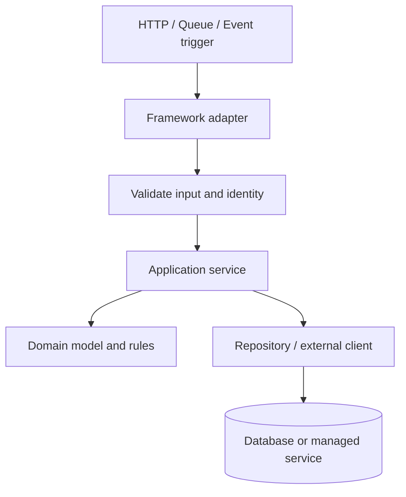

# Optimizing Functions with Quarkus and Micronaut

## 1. Why Choose the Right Framework for Serverless Java?

Java has a rich library ecosystem, strong JIT optimization capabilities, and a familiar programming model. However, a Java application designed to run continuously on a server typically initializes many components at startup: dependency injection containers, web frameworks, configuration, serializers, connection pools, and service clients. In a Function as a Service (FaaS) environment, the initialization time and memory of each execution environment can directly affect latency and cost.

Quarkus and Micronaut are designed to reduce runtime overhead by shifting much of the work to build or compile time. Both support building lean Java applications, integrating cloud libraries, and producing native executables via GraalVM Native Image technology. They can still run on a standard JVM; native image is a deployment option rather than a mandatory requirement.

Optimizing a function is not just about achieving the fastest cold start. A function must also satisfy warm throughput, p95/p99 latency, memory limits, library compatibility, retry reliability, observability requirements, and build/operational costs. You must measure under real workloads to select the appropriate framework, runtime, and packaging approach.

## 2. How Do Quarkus and Micronaut Reduce Runtime Overhead?

### 2.1. Quarkus: Build-Time Augmentation and Extensions

Quarkus performs extensive application analysis at build time through a mechanism called build-time augmentation. Extensions provide metadata so Quarkus knows which components are used and what needs to be prepared. This reduces runtime classpath scanning, annotation processing, and dynamic initialization.

Quarkus uses a CDI container called Arc. Beans, injection points, and most of the dependency graph are processed in a way tailored to augmentation. The extension ecosystem covers REST, JSON, messaging, persistence, telemetry, and cloud integrations. Selecting only the extensions you need prevents pulling in an entire large stack when only a small capability is required.

One point to keep in mind is that some Quarkus configuration properties are fixed at build time, while others can be changed at runtime. When deploying the same artifact across multiple environments, check the configuration phase of each property. Do not assume every environment variable can override behavior already decided at build time.

### 2.2. Micronaut: Compile-Time Dependency Injection and AOP

Micronaut handles dependency injection (DI), aspect-oriented programming (AOP), and bean introspection primarily at compile time via annotation processing. As a result, many operations that might require reflection or classpath scanning at runtime in other frameworks are replaced by metadata and classes generated during compilation.

This model helps Micronaut start up cleanly and suits native images well. However, third-party libraries may still use reflection, dynamic proxies, JNI, or service loading. Compile-time DI does not automatically make every dependency native-friendly; each library must be verified and given additional configuration when necessary.

### 2.3. Similarities and Differences

| Aspect | Quarkus | Micronaut |
| --- | --- | --- |
| Primary optimization | Build-time augmentation via extensions and Arc CDI | Compile-time DI, AOP, and bean introspection |
| Extensibility | Extension ecosystem deeply integrated with Quarkus build and runtime | Modules and annotation processing for many integrations, frameworks, and clouds |
| JVM mode | Runs on JVM, supporting startup and footprint optimizations | Runs on JVM, avoiding much runtime DI/scanning overhead |
| Native image | Supports GraalVM Native Image/Mandrel via Quarkus tooling | Supports GraalVM Native Image via Micronaut tooling and configuration |
| Function integration | Provides models and extensions for HTTP, events, and cloud providers | Provides function modules and integrations for cloud platforms |
| Watch-outs | Build-time/runtime configuration phases and extension capabilities | Annotation processing, reflection from dependencies, and native config |

There is no universal conclusion that one framework is always faster or uses less RAM. Results depend on extensions, dependencies, configuration, JDK version, JVM/native mode, function size, and the FaaS platform.

## 3. JVM Mode vs. Native Image

### 3.1. Running on the JVM

In JVM mode, the artifact typically contains Java bytecode and runs on a compatible JRE/JDK provided by the platform. The JVM can use its JIT compiler to optimize code based on actual runtime behavior when the application runs long enough.

Common advantages:

- Simpler build and debugging than native images.
- Strong compatibility with Java libraries using reflection or dynamic class loading.
- Can achieve high throughput once JIT has optimized hot code paths.
- Easy to use with traditional Java profiling, diagnostics, and libraries.

Common limitations include JVM and framework initialization time, baseline memory footprint, and JIT warm-up cost. For short-lived functions or functions experiencing frequent cold starts, this overhead can be significant. Lightweight frameworks like Quarkus and Micronaut can reduce application initialization overhead, but they do not eliminate all JVM costs.

### 3.2. Native Image

GraalVM Native Image analyzes the application and produces an executable tailored to a specific combination of operating system, CPU architecture, and library environment. A native executable does not need to boot a full JVM in the traditional way. For suitable applications, startup time and memory footprint can drop substantially.

Native image is often suitable when:

- Cold start is a critical requirement.
- Functions have short execution times or intermittent traffic.
- Dependencies can be analyzed and configured for native image.
- The team can accept longer build times and a specialized testing workflow.

Native image carries trade-offs:

- Builds consume more time and resources.
- Reflection, dynamic proxies, class loading, JNI, and resources may require extra declarations.
- Some libraries or drivers are not yet fully supported.
- Steady-state performance is not automatically better than JVM JIT; some long-running, hot workloads achieve higher throughput on the JVM.
- The binary is tied to the target OS/architecture and corresponding native libraries.

### 3.3. Choosing by Workload Characteristics

| Characteristic | JVM mode is usually suitable when | Native image is worth considering when |
| --- | --- | --- |
| Instance lifetime | Instances live longer with many warm invocations | Instances are frequently created fresh or handle short tasks |
| Cold start | SLAs tolerate higher initialization times | Cold starts dominate user experience or SLAs |
| Long-term throughput | JIT has time to optimize hot code | Startup and footprint matter more than peak throughput |
| Dependencies | Many dynamic/reflection libraries are hard to configure | Dependencies support native and are controllable |
| Build pipeline | Fast builds, debugging, and frequent releases are needed | Native build pipelines and separate artifact testing are in place |
| Operations | The platform provides an appropriate JVM | The platform supports the corresponding executable/native runtime |

Create a small benchmark comparing both modes. Compare cold starts, warm latency, p95/p99, peak memory, throughput, package size, and total cost. Measuring local startup time alone is insufficient to draw conclusions for FaaS, since the platform also incurs environment provisioning, artifact download, and network connection setup times.

## 4. Structuring Code So the Framework Does Not Dominate Business Logic

### 4.1. Separating Adapters from Domain Services

HTTP controllers, function handlers, or event adapters should be responsible for translating runtime data into application types. Business rules should live in independent services so they can be tested without booting the entire framework.



Separating layers lets you swap an HTTP adapter for a queue/event trigger without rewriting domain logic. It also lets you benchmark services independently of framework startup overhead.

### 4.2. Managing Beans and State

Quarkus CDI beans and Micronaut singletons are typically reused across the lifetime of an execution environment. This is helpful for serializers, HTTP clients, or repositories designed to be thread-safe. However, an execution environment can be stopped at any time, and multiple environments can run concurrently.

Do not store unique business state in singleton fields or static variables. Orders, payment statuses, idempotency markers, and checkpoints must be stored in durable systems. Likewise, do not store per-request data in mutable singletons, as doing so can leak data across concurrent invocations.

### 4.3. Shared Service Example

```java
public record CreateOrderCommand(String customerId, int itemCount) {}

public record CreateOrderResult(String orderId, String status) {}

public interface OrderRepository {
    CreateOrderResult create(CreateOrderCommand command);
}

public final class CreateOrderService {
    private final OrderRepository repository;

    public CreateOrderService(OrderRepository repository) {
        this.repository = repository;
    }

    public CreateOrderResult create(CreateOrderCommand command) {
        if (command == null
                || command.customerId() == null
                || command.customerId().isBlank()
                || command.itemCount() <= 0) {
            throw new IllegalArgumentException("Invalid order command");
        }
        return repository.create(command);
    }
}
```

This is plain Java with no framework annotations. Quarkus and Micronaut can wire the repository/service via DI, while HTTP or event adapters call the same application service.

## 5. Building an HTTP Function with Quarkus

Quarkus can expose HTTP endpoints via its REST extension. The following example illustrates an endpoint receiving a request, calling an application service, and returning a response. Some imports are omitted to focus on structure; extension names and dependencies must be chosen according to the project's Quarkus version.

```java
import jakarta.inject.Inject;
import jakarta.ws.rs.Consumes;
import jakarta.ws.rs.POST;
import jakarta.ws.rs.Path;
import jakarta.ws.rs.Produces;
import jakarta.ws.rs.core.MediaType;

@Path("/orders")
@Consumes(MediaType.APPLICATION_JSON)
@Produces(MediaType.APPLICATION_JSON)
public class OrderResource {
    @Inject
    CreateOrderService createOrderService;

    @POST
    public CreateOrderResult create(CreateOrderRequest request) {
        return createOrderService.create(
                new CreateOrderCommand(request.customerId(), request.itemCount()));
    }
}
```

In FaaS, this endpoint can be connected to an HTTP gateway or an adapter provided by the platform. Distinguish between an HTTP server running in a container and a function runtime receiving requests over a provider-specific protocol. Both can serve HTTP, but their lifecycle and deployment models differ.

Quarkus also provides function models and cloud/event integration extensions. For event-driven functions, the adapter converts messages or events into Java types and invokes the service. Use the appropriate extension and target provider contract rather than placing business logic into a class tightly coupled to provider-specific event objects.

## 6. Building an HTTP Function with Micronaut

Micronaut provides controllers and compile-time DI. An equivalent example:

```java
import io.micronaut.http.annotation.Body;
import io.micronaut.http.annotation.Controller;
import io.micronaut.http.annotation.Post;

@Controller("/orders")
public class OrderController {
    private final CreateOrderService createOrderService;

    public OrderController(CreateOrderService createOrderService) {
        this.createOrderService = createOrderService;
    }

    @Post
    public CreateOrderResult create(@Body CreateOrderRequest request) {
        return createOrderService.create(
                new CreateOrderCommand(request.customerId(), request.itemCount()));
    }
}
```

Constructor injection makes dependencies explicit and simplifies unit testing. Micronaut can process bean definitions and certain metadata at compile time. When adding libraries that use annotation processing, ensure the processor is configured properly in Maven/Gradle; missing processors can prevent beans or metadata from being generated as expected.

For queue or event triggers, Micronaut offers function/cloud integration modules. The adapter receives events from the runtime, validates the contract, and invokes the service. Preserve event IDs, correlation IDs, and information needed for idempotency throughout processing.

## 7. Optimizing Initialization Time

### 7.1. Measuring Each Initialization Phase

Cold starts can include execution environment provisioning, artifact download, runtime startup, bean creation, configuration reading, class loading, client setup, and database connections. Do not attribute the entire cold start time solely to the framework.

Measure separately:

- Time from when the platform receives the invocation until the handler starts.
- Framework and application context initialization time.
- Bean/client initialization and connection setup time.
- Business processing time of the first invocation.
- Latency of subsequent warm invocations.

Track p50, p95, and p99. Averages can mask a subset of very slow cold start invocations. Use identical payloads, configurations, regions, memory settings, and dependencies when comparing two frameworks.

### 7.2. Avoiding Unnecessary Initialization Work

Several helpful practices:

- Include only the extensions/modules actually needed.
- Avoid scanning broad packages or reading thousands of config files unnecessarily.
- Defer initializing heavy clients to the code paths that actually use them, while weighing the impact on the first invocation of that branch.
- Do not run database queries, external API calls, or load large business datasets in static initializers.
- Use build-time prepared configuration and metadata when appropriate, without embedding secrets or environment-specific data into the artifact.
- Avoid creating duplicate serializers, HTTP clients, or connection pools.

Lazy initialization is not always better. If nearly every invocation needs a client, eager initialization can make request latency more predictable. Measure both the first-invocation path and the warm path.

### 7.3. Leveraging Safely Reusable Clients

HTTP clients, JSON mappers, and certain SDK clients can be created once in a singleton bean and reused across many warm invocations. This reduces object allocation and handshake overhead. Clients must be thread-safe or managed according to the runtime's concurrency model.

Idle network connections can be closed by servers or proxies while the function environment is frozen. Clients need timeouts, stale connection detection, and controlled retries. Never hold a connection assuming it stays alive indefinitely.

### 7.4. Quarkus Build-Time and Micronaut Compile-Time

With Quarkus, select appropriate extensions to leverage augmentation and exclude unneeded extensions. Inspect build logs to see what is processed at build time, and check which configurations are fixed at build time.

With Micronaut, ensure annotation processors and corresponding compile-time modules are properly configured. Limit libraries that force classpath scanning or heavy reflection at runtime. Use bean introspection and constructor injection where they fit the application model.

## 8. Optimizing Native Images

### 8.1. Reflection, Proxies, and Dynamic Classes

Native Image analyzes reachable code at build time. Classes or methods loaded only by string name, reflection, dynamic proxies, or runtime plugins may not be discovered automatically. In those cases, you need appropriate metadata/configuration or a different library usage pattern.

Quarkus extensions typically provide metadata to integrate supported libraries. Micronaut also generates compile-time metadata for many framework features. However, arbitrary application dependencies may still need custom reflection or resource configurations.

Do not add overly broad reflection configurations just to make the build pass without understanding the impact. It can bloat the binary, increase build times, and mask incompatible dependencies.

### 8.2. Resources and ServiceLoader

Native image needs to know which resources must be included in the executable. Config files, templates, schemas, certificate bundles, and `META-INF/services` may require inclusion configuration depending on libraries and build tools.

If a provider is loaded via `ServiceLoader`, verify that the provider is discovered and initialized in the native image. Unit tests running on the JVM can pass while the native executable fails to locate the provider.

### 8.3. JNI and Native Libraries

Some drivers, codecs, or SDKs depend on native libraries. Verify binary compatibility with the OS, libc, and CPU architecture of the deployment target. A native image built on a different environment may fail to run in the target container or runtime if system dependencies are incompatible.

Build native executables in a container or an environment matching production when tools support it. Verify the final executable with smoke tests on the exact target architecture and OS.

### 8.4. Separate Native Testing

The pipeline should include these steps:

1. Unit tests and integration tests in JVM mode.
2. Build the native executable.
3. Run native smoke tests against representative routes or events.
4. Verify reflection, serialization, resources, and ServiceLoader.
5. Measure startup, peak memory, and warm performance.
6. Check error logs for missing metadata and verify the artifact matches the target OS/architecture.

Do not infer that a native image works properly simply because the native build succeeded. A successful build confirms analysis/compilation; smoke tests confirm that critical execution paths actually work.

## 9. Runtime Configuration and Secrets

Functions are often deployed across multiple environments with different endpoints, timeouts, quotas, and credentials. Distinguish between:

- Configuration that can be fixed at build time, such as certain framework structural choices.
- Runtime configuration, such as service endpoints, feature flags, or business limits.
- Secrets, such as database passwords, API tokens, and private keys.

Quarkus distinguishes build-time and runtime properties; Micronaut supports externalized configuration and binding config into beans. Regardless of framework, never put secrets into source code, image layers, or native executables. Read secrets from a secret manager or the platform's security mechanism and grant least-privilege permissions to the function.

If the same artifact runs across multiple environments, verify that every property needing variation is truly runtime-configurable. For properties fixed at build time, build separate artifacts per configuration or redesign to move those values into runtime config.

## 10. Databases and Service Connections in FaaS

### 10.1. Avoiding Oversized Connection Pools

A function can scale into many execution environments. If each environment creates a pool of 20 connections and the platform spins up 100 environments, the database may receive up to 2,000 connections from a single function. This can exhaust connection limits even when each individual instance looks reasonable.

Estimate maximum connections with the approximate formula:

\[
\text{Total connections} \approx \text{Concurrent environments} \times \text{Pool size per environment}
\]

This is a rough estimate; you must also account for other functions, other applications, admin connections, and proxies. Size pools small relative to real concurrency, use a database proxy or managed connection pooling if supported by the platform, and monitor active connections.

### 10.2. Timeouts and Retries

HTTP clients, database drivers, and function timeouts must align. If a function times out before the client receives a result, the client may retry while the previous operation is still completing. For data-creating or payment operations, use idempotency keys and check state before re-executing.

Do not retry indefinitely when a database is overloaded. Backoff, jitter, concurrency caps, and queues help avoid adding load to an already struggling service.

### 10.3. Shared Clients and Lifecycle

Singleton beans can hold clients for reuse within the same execution environment. Do not assume singletons are shared across environments or survive after the function stops. Business data and processed markers must be persisted externally outside the process.

## 11. HTTP, Events, and Asynchronous Processing

### 11.1. HTTP Functions

HTTP functions typically need input validation, principal authentication, timeout enforcement, and proper status codes. Framework controllers should act as thin adapter layers. Avoid running long tasks in synchronous requests if clients or gateways have short timeouts; enqueue work and return `202 Accepted` with an ID for clients to poll status.

### 11.2. Queue Consumers and Event Handlers

With queue or event triggers, the handler should receive an event already converted by the adapter into an application type. Handle duplicate events, schema versions, transient failures, and permanent errors. If the function processes batches, understand the provider's partial batch failure mechanism so one bad message does not force all successful messages to be redelivered unnecessarily.

Example framework-independent business handler:

```java
public record OrderCreatedEvent(
        String eventId,
        String orderId,
        int schemaVersion) {}

public interface OrderProjectionService {
    void updateProjection(OrderCreatedEvent event);
}

public final class OrderCreatedHandler {
    private final OrderProjectionService projectionService;

    public OrderCreatedHandler(OrderProjectionService projectionService) {
        this.projectionService = projectionService;
    }

    public void handle(OrderCreatedEvent event) {
        if (event == null || event.eventId() == null || event.eventId().isBlank()) {
            throw new IllegalArgumentException("Missing event id");
        }
        if (event.schemaVersion() != 1) {
            throw new IllegalArgumentException("Unsupported schema version");
        }
        projectionService.updateProjection(event);
    }
}
```

The example does not yet show an idempotency store. In production, `updateProjection` must be guarded by a unique event ID or an appropriate transaction/conditional write so event redeliveries do not produce duplicate side effects.

### 11.3. Reactive and Blocking I/O

Reactive APIs can help when a function performs lots of concurrent I/O and the framework uses an event loop. However, calling blocking JDBC or performing CPU-heavy tasks on an event-loop thread can block other requests. Offload blocking work to an appropriate executor or use non-blocking clients across the entire execution path.

Reactive does not automatically make a function faster. For a single simple request, an imperative model may be easier to read and perform well enough. Choose based on concurrency, I/O characteristics, and your team's operational capabilities.

## 12. Measuring and Benchmarking Quarkus/Micronaut

### 12.1. Benchmark Matrix

For a fair comparison, build a matrix:

| Framework | Runtime | Measurement targets |
| --- | --- | --- |
| Quarkus | JVM | Startup, warm latency, throughput, memory |
| Quarkus | Native image | Cold start, peak memory, warm latency, binary size |
| Micronaut | JVM | Startup, warm latency, throughput, memory |
| Micronaut | Native image | Cold start, peak memory, warm latency, binary size |

Keep the same business logic, functional dependencies, memory/CPU settings, and environment. If frameworks require different extensions/modules, document the differences so results remain interpretable.

### 12.2. Metrics to Measure

- **Cold start:** time from the first invocation until the function is ready to process.
- **Warm latency:** latency of invocations on an already initialized environment.
- **p95/p99:** exposes tail latency rather than relying only on averages.
- **Peak memory and steady-state memory:** critical for memory limits and FaaS pricing.
- **Throughput:** number of requests/events processed within a time interval.
- **Error rate:** initialization errors, timeouts, dependency failures, and business errors.
- **Artifact size and build duration:** impacts deployment times and pipelines.
- **Total cost:** function duration/memory, concurrency, supporting services, logs, and data transfer.

Run multiple iterations and separate cold from warm invocations. Test low load, steady load, and bursts. A native image with excellent cold starts but lower warm throughput may still suit bursty workloads; for steady workloads, the JVM may be more economical.

### 12.3. Avoiding Flawed Benchmarks

Do not compare a minimal hello-world function against an app with REST, JSON, database, and telemetry and conclude which framework is faster. Do not treat local startup time as equivalent to cloud cold start time. Do not overlook that native images may require different reflection configurations or build optimizations.

Benchmark the actual deployment artifact with runtimes and triggers close to production. Measure both the client-initialization path and the realistic request-processing path.

## 13. Choosing Quarkus or Micronaut for a Function

| Need | Consideration |
| --- | --- |
| Application needs rich integrated extensions and build-time augmentation | Quarkus may fit well if extensions cover required services |
| Want DI/AOP and bean metadata handled mostly at compile time | Micronaut is worth trying |
| Native image is a core requirement | Both are worth benchmarking; verify native support across all dependencies |
| Project already uses the Quarkus ecosystem | Staying with Quarkus can reduce migration cost and leverage existing extensions |
| Project already uses Micronaut and fitting function modules | Staying with Micronaut can simplify adapters and build workflows |
| Long-running workloads needing JIT throughput | Benchmark JVM mode for both before choosing native |
| Bursty workloads sensitive to cold starts | Benchmark native images and platform keep-warm features |

The framework is only part of the decision. Also consider team familiarity, extension quality for databases/messaging, observability, native compatibility, build pipelines, and version support policies.

## 14. Function Optimization Workflow

1. **Define the workload:** HTTP or event, invocation volume, bursts, processing time, SLAs, and memory limits.
2. **Establish a baseline:** measure cold starts, warm latency, p95/p99, memory, throughput, and cost of the current version.
3. **Trim dependencies:** keep only required extensions/modules, exclude test-only dependencies from runtime, and inspect the dependency tree.
4. **Decouple domain from adapters:** keep controllers/handlers thin, services easy to test, and no business state stored in-process.
5. **Choose JVM or native:** benchmark both with real artifacts; assess reflection, resources, JNI, and build times.
6. **Optimize initialization:** avoid I/O in static initializers, reuse thread-safe clients, and cap connection pools.
7. **Control configuration:** distinguish build-time/runtime properties, read secrets from a secret manager, and avoid baking environment info into binaries.
8. **Test triggers:** verify HTTP responses, queue acknowledgements, retries, duplicate events, and timeouts.
9. **Re-measure in the cloud:** use identical region, memory, concurrency, and data; compare tail latency alongside total cost.
10. **Deploy safely:** version artifacts, roll out gradually if supported, monitor error rates, and prepare rollback.

## 15. Common Optimization Mistakes

| Mistake | Consequence | Fix |
| --- | --- | --- |
| Choosing native just because startup is rumored to be fast | Increases build complexity and hits reflection/resource errors | Benchmark JVM and native with real dependencies |
| Stripping extensions/modules wholesale | Missing providers, adapters, or runtime configuration | Analyze dependency graph and test triggers after each change |
| Putting heavy I/O in static initializers | Long cold starts and hard-to-retry initialization errors | Separate initialization, measure independently, and handle errors cleanly |
| Storing business state in singletons | Data loss when environment stops, bugs when scaling horizontally | Use databases/queues/durable stores and idempotency |
| Oversized database pools | Function scaling exhausts connection limits | Calculate total connections by concurrency, shrink pools, and use proxies when appropriate |
| Running blocking I/O on the event loop | Blocks other requests and spikes tail latency | Move to appropriate executors or non-blocking clients |
| Assuming all config changes after build | Artifact behaves inconsistently across environments | Check framework build-time/runtime config phases |
| Testing JVM without testing the native artifact | Failures surface only in native production | Add native smoke/integration tests to the pipeline |
| Optimizing cold start while ignoring warm throughput | Higher cost under steady load | Measure cold, warm, p95/p99, and total cost |

## 16. Conclusion

Quarkus and Micronaut help Java functions reduce part of their initialization overhead by processing more information at build time or compile time. Quarkus stands out with build-time augmentation and extensions; Micronaut focuses on compile-time DI, AOP, and bean introspection. Both can run on the JVM or compile to native images, though native images demand careful verification of reflection, resources, service loading, and native libraries.

There is no single optimal framework or runtime for every function. Separate business logic from adapters, keep dependencies lean, safely reuse clients, control connections and concurrency, measure cold starts alongside warm performance, and test the final artifact on the deployment platform. Data-driven decisions strike a better balance among latency, throughput, maintainability, and cost.
