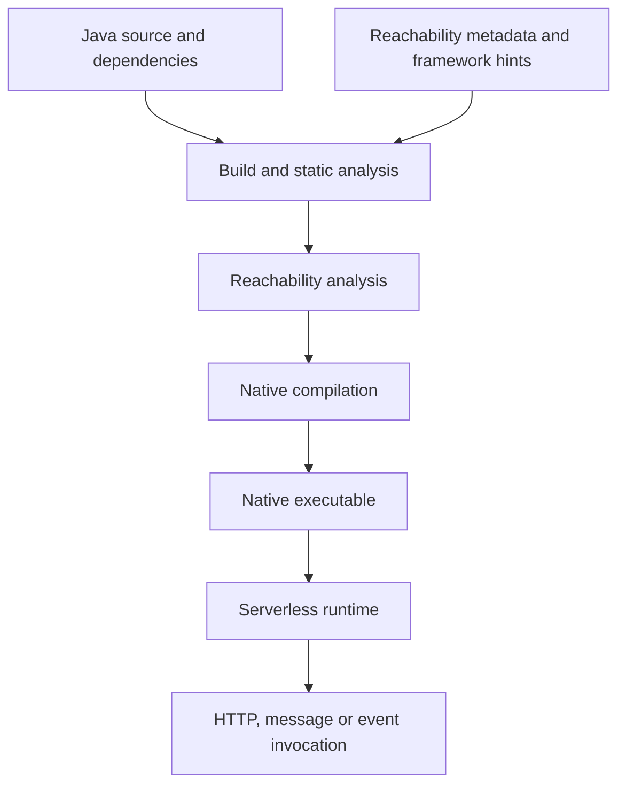
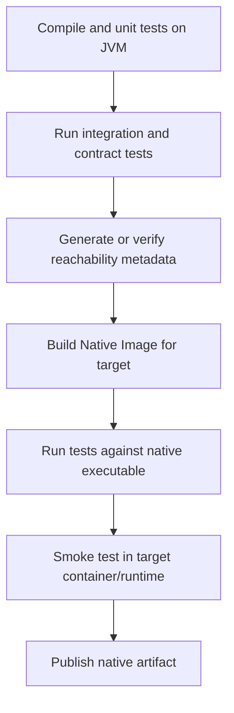

# GraalVM Native Image and Reflection Configuration Requirements

Java is commonly deployed on serverless platforms using a JVM runtime: the platform launches the JVM, loads classes, executes bytecode, and may take time for the JIT compiler to optimize hot code. For workloads with many short invocations or high cold-start sensitivity, JVM startup time and baseline memory footprint can affect latency and cost.

GraalVM Native Image provides a way to compile a Java application into a native executable ahead of deployment. The application can start faster and consume less memory in certain workloads, but the build process must analyze which components may be accessed at runtime. This is a key difference from the JVM: dynamic features such as reflection, dynamic proxies, loading classes by name, JNI, or reading classpath resources may require metadata so Native Image preserves the right elements.

Within the scope of **CLOUD_SERVERLESS**, this lesson places Native Image in the context of Java functions triggered by HTTP, messages, or events. Developers need to weigh cold starts, scaling, cost, and framework compatibility, while understanding how to configure reflection and other reachability metadata so functions operate properly inside a native executable.

## 1. What Is Native Image?

GraalVM Native Image analyzes the application and its dependent libraries at build time, determines which code is reachable, and compiles the required parts into a native executable for a target operating system and architecture.



In applications running on the JVM, many dynamic operations are resolved at runtime. For example, a framework might read a class name from configuration and call `Class.forName`, scan annotations, generate proxies, or invoke constructors via reflection. The JVM can load classes and look up members on demand.

Native Image needs to know in advance which parts may be used. This analysis relies on statically determinable paths and declared metadata. If a class or method is only accessed via a string name or reflection without being discovered during the build, it may be stripped from the executable or inaccessible in the way the application expects.

## 2. Why Does Native Image Use Closed-World Analysis?

Native Image uses a reachability analysis model close to a *closed-world* assumption: at build time, the tool must determine the set of code and resources the application can use. The tool starts from entry points and traces recognizable references.

For example, if a handler calls `OrderService`, the service calls `OrderRepository`, and the repository calls specific methods, these paths can typically be analyzed from bytecode. However, if the application reads a class name from an external configuration file and only loads the class then, that path may not appear in static references.

Features requiring attention:

- Reflection: looking up classes, constructors, methods, or fields at runtime.
- Dynamic proxies: generating proxy classes from interfaces at runtime.
- Serialization: instantiating objects or accessing fields through serialization mechanisms.
- JNI: calling native libraries or accessing Java members from native code.
- Resource loading: reading config files, templates, schemas, or certificates from the classpath.
- Dynamic class loading: loading classes/plugins unknown at build time.
- Service loading: discovering implementations via `ServiceLoader` or similar framework mechanisms.

Not every application using these APIs fails. Many frameworks and libraries already ship metadata or build plugins so Native Image preserves the necessary elements. What is required is verifying compatibility for the exact framework and dependency versions you use.

## 3. How Does Reflection Work in Java?

Reflection allows a program to inspect and interact with class structures at runtime. Common APIs include:

```java
Class<?> type = Class.forName("com.example.plugins.EmailPlugin");
Constructor<?> constructor = type.getDeclaredConstructor();
Object plugin = constructor.newInstance();

Method method = type.getDeclaredMethod("send", String.class);
method.invoke(plugin, "hello@example.com");
```

On a standard JVM, the class and members are resolved when that code runs. With Native Image, the class name `com.example.plugins.EmailPlugin`, the no-arg constructor, and the `send(String)` method must be identified during the build if they are only accessed dynamically.

Reflection may be used directly in application code, but it is also frequently used under the hood by frameworks. Commonly overlooked cases include:

- Jackson or other JSON libraries instantiating objects, reading/writing fields, or calling constructors.
- Dependency injection frameworks discovering beans or constructors.
- ORMs reading annotations and accessing entity fields/constructors.
- Validation frameworks inspecting annotations on fields, getters, or parameters.
- Frameworks discovering controllers, routes, serializers, or converters via metadata.
- Plugin systems loading implementations by class name from configuration.

Consequently, an application with no explicit reflection calls may still need reflection metadata because its frameworks or libraries rely on it.

## 4. Reflection Metadata for Native Image

Reflection metadata describes which classes must be retained and which members of those classes may be accessed dynamically. Traditional JSON format files are typically placed under the `META-INF/native-image` directory of an artifact or dependency.

Example directory structure:

```text
src/main/resources/
└── META-INF/
    └── native-image/
        └── com.example/
            └── orders-function/
                ├── reflect-config.json
                ├── resource-config.json
                └── proxy-config.json
```

An illustrative `reflect-config.json`:

```json
[
  {
    "name": "com.example.plugins.EmailPlugin",
    "methods": [
      {
        "name": "<init>",
        "parameterTypes": []
      },
      {
        "name": "send",
        "parameterTypes": ["java.lang.String"]
      }
    ]
  }
]
```

This metadata tells Native Image to retain the no-arg constructor and the `send(String)` method for reflective access. If the application needs additional fields, constructors, or methods, those exact members must be declared in the metadata structure supported by your GraalVM version.

Broader declarations such as `allDeclaredConstructors`, `allDeclaredMethods`, or `allDeclaredFields` are possible, but scope should be narrowed whenever feasible. Registering all members of many classes inflates the executable and may retain unnecessary code.

Class names and parameter types must be exact, including full package names. A typo or signature change can cause metadata to stop matching after a dependency upgrade.

## 5. Other Types of Reachability Metadata

Reflection is only one piece. Native Image has additional configurations for other dynamic features.

| Metadata file | Purpose | Example scenario |
|---|---|---|
| `reflect-config.json` | Access classes/members via reflection | Framework creates DTOs or beans using dynamic constructors |
| `resource-config.json` | Include classpath resources in the executable | Reading templates, schemas, YAML, or config files |
| `proxy-config.json` | Register interfaces used to create dynamic proxies | Client proxies or interfaces dynamically proxied by a framework |
| `serialization-config.json` | Declare types used with Java serialization | Application needs to serialize/deserialize objects via Java serialization |
| `jni-config.json` | Declare elements accessed through JNI | Native library calls back into Java or accesses members dynamically |

Required metadata depends on how libraries use APIs. For example, an application may not need `serialization-config.json` if it only uses standard JSON serializers; JSON serialization and Java Object Serialization are two distinct mechanisms.

### Resource Configuration

If the application reads `templates/report.html` from the classpath at runtime, that file must be included in the native executable. Example `resource-config.json`:

```json
{
  "resources": {
    "includes": [
      {
        "pattern": "templates/.*\\.html$"
      },
      {
        "pattern": "schemas/order-v[0-9]+\\.json$"
      }
    ]
  }
}
```

Patterns must match actual resource paths on the classpath. Include only the specific directories or patterns needed rather than bundling every resource into the executable without reason.

### Dynamic Proxy Configuration

If the application creates dynamic proxies from one or more interfaces, Native Image may need that list of interfaces. Example `proxy-config.json` format:

```json
[
  [
    "com.example.spi.PaymentGateway",
    "com.example.spi.Auditable"
  ]
]
```

This is an illustrative example; the exact metadata structure must follow the documentation for your Native Image version. Modern frameworks can register proxies automatically through build-time hints.

## 6. Placing Metadata and Managing It by Dependency

For application-owned metadata, place files in `META-INF/native-image` so build tools can discover them during packaging. A dependency can also bundle its own metadata inside its JAR. This keeps metadata coupled with the library version instead of forcing every application to copy library configurations into its own repository.

Key notes:

- Namespace metadata under your application or library coordinates to avoid filename collisions.
- Document which classes require reflection and why; this helps reviews when upgrading dependencies.
- Do not add metadata solely to make the build pass without knowing which feature actually needs it.
- Verify metadata is packaged into the final artifact, not merely present in the source tree.
- When upgrading a framework or library, re-run native integration tests and inspect reachability metadata changes.
- Use library-published metadata or the reachability metadata repository when available and compatible with your version.

Newer GraalVM and framework releases may support unified metadata formats or framework-specific hint mechanisms. Prefer the mechanism recommended by your current build plugin version rather than copying an outdated sample file without verification.

## 7. Using the Native Image Agent to Discover Dynamic Access

The Native Image tracing agent observes the application running on the JVM and records a subset of dynamic accesses it sees, such as reflection, resources, proxies, or serialization. This is helpful when an application uses many frameworks and listing every class manually is difficult.

An illustrative invocation:

```bash
mkdir -p target/native-agent-config

java \
  -agentlib:native-image-agent=config-output-dir=target/native-agent-config \
  -jar target/orders-function.jar
```

Then exercise representative business flows: hit the order-creation endpoint, process payment messages, read report templates, run validation, and exercise branches using serializers or plugins. The agent records metadata based on executed code paths.

The agent cannot infer every possible execution path on its own. If tests never invoke a rarely used plugin or an older event version, metadata for that branch may not be captured. Therefore:

1. Run the agent with a sufficiently broad test suite and representative data.
2. Inspect generated files, remove redundant entries, and verify meaningful ones.
3. Add tests for uncommon dynamic branches.
4. Build the native image and run the native executable itself.
5. Whenever dependencies or configurations change, re-run the verification workflow.

Do not treat agent output as complete metadata merely because the JVM run succeeded.

## 8. Registering Reflection with Framework Hints

Modern Java frameworks can provide abstractions to declare reachability directly in source code. The exact mechanism depends on the framework.

| Framework | Common mechanism | Benefit |
|---|---|---|
| Spring Framework/Spring Boot | Spring AOT and `RuntimeHints` | The framework analyzes beans and generates hints for supported reflection, resources, proxies, and serialization |
| Quarkus | Build-time augmentation, extension metadata, and `@RegisterForReflection` when needed | Many structures are processed at build time, reducing dynamic reflection needs |
| Micronaut | Compile-time dependency injection, introspection, and annotation processing | Reduces classpath scanning and runtime reflection in many cases |
| Helidon | Native integration and configuration per SE/MP version | Requires checking corresponding extensions and metadata |

Not every class in an application needs manual registration. The framework may already generate metadata for what it manages. Before adding JSON files, check whether an extension, starter, or build plugin already provides hints for that library.

### Spring RuntimeHints Example

With Spring, runtime hints can be declared via `RuntimeHintsRegistrar` when registering a dynamically accessed class:

```java
public final class PluginRuntimeHints implements RuntimeHintsRegistrar {
    @Override
    public void registerHints(RuntimeHints hints, ClassLoader classLoader) {
        hints.reflection().registerType(
                EmailPlugin.class,
                MemberCategory.INVOKE_DECLARED_CONSTRUCTORS,
                MemberCategory.INVOKE_DECLARED_METHODS);
    }
}
```

Then register the registrar using Spring's mechanism, such as `@ImportRuntimeHints` on an appropriate configuration class. API names and member categories must match the Spring version in use. Spring AOT also generates many hints automatically, so only supplement what the framework cannot infer.

### Quarkus Example

With Quarkus, a class accessed via reflection can be annotated with the framework's supported annotation:

```java
@RegisterForReflection
public class LegacyPaymentPayload {
    public String paymentId;
    public long amountMinor;
}
```

Quarkus handles many cases via extensions and build-time augmentation. The annotation above is an example for classes requiring explicit registration; do not use it as a substitute for checking whether an extension already supports a given library.

## 9. Which Frameworks Suit Native Image?

Native Image does not automatically make every framework lightweight or compatible. Evaluate frameworks based on how they handle dependency injection, configuration, serialization, proxies, and reflection.

| Criterion | Build-time-oriented frameworks | Frameworks relying heavily on runtime discovery |
|---|---|---|
| Dependency injection | Can build the bean graph at build time | May require reflection or classpath scanning at runtime |
| Serialization | Can generate metadata/codecs at build time | May require reflection metadata for DTOs |
| Configuration | Can process schemas and mappings early | May load classes or binders dynamically at runtime |
| Startup | Often reduces runtime initialization work | May need extra metadata and initialization |
| Library compatibility | Depends on extensions and build-time support | Must verify dynamic libraries have metadata |

Spring Boot, Quarkus, Micronaut, and Helidon all offer native support paths depending on version and extensions. Do not rank them by framework name alone. Measure your actual application with the exact dependencies, endpoints, triggers, and databases.

## 10. Building a Native Image for Java Functions

You can invoke GraalVM Native Image directly or use a framework build plugin. In Maven/Gradle projects, plugins typically manage classpaths, metadata, and native compiler flags better than hand-assembling long commands.

Conceptual direct command example:

```bash
native-image \
  --no-fallback \
  -jar target/orders-function.jar \
  orders-function
```

`--no-fallback` instructs the build to fail if it cannot produce a native executable as configured, rather than falling back to a JVM-dependent image. Exact invocation, option names, and JAR support depend on the GraalVM version; consult the documentation for your project's toolchain.

With build plugins, the workflow typically looks like:

```bash
# Maven project configured with native-maven-plugin
mvn -Pnative package

# Gradle project configured with GraalVM Native Build Tools
./gradlew nativeCompile
```

These two commands only work when the project has declared the appropriate plugins, profiles/tasks, and native toolchain. Framework plugins may expose their own commands or perform AOT processing automatically before native compilation.

Native builds generally consume more CPU, RAM, and time than JVM JAR builds. Run them on CI runners or containers with adequate resources, cache dependencies sensibly, and store native artifacts keyed by target OS/architecture.

## 11. Class Initialization at Build Time or Runtime?

Native Image can initialize some classes at build time or defer initialization until the executable runs. This decision affects both startup speed and correctness.

- **Build-time initialization:** static initializers run during image creation; the resulting state becomes part of the initial state of the executable.
- **Run-time initialization:** classes are initialized when the native executable runs inside the function's actual environment.

Build-time initialization can cut startup work, but is unsafe for classes that read the current time, environment variables, secrets, hostnames, random seeds, network state, or open deployment-environment-dependent files. If such values get baked into the image, the executable may hold values from the build machine or fail to reflect the runtime environment.

Practical guidelines:

1. Only initialize classes at build time if their initializers are deterministic and have no environment-dependent side effects.
2. Let classes needing secrets, runtime config, networking, or clocks initialize when the function runs.
3. Never expose credentials or sensitive data during image building.
4. When encountering initialization errors, read Native Image's error messages to identify the relevant class and side effect; do not blindly force whole packages into build-time initialization to silence errors.
5. Test the executable in an environment equivalent to production.

Options like `--initialize-at-build-time` and `--initialize-at-run-time` can control class scope depending on the Native Image version. Apply them only after understanding the initializer and its consequences.

## 12. Dynamic Class Loading and Plugin Architectures

Native Image works best when the set of classes can be determined at build time. Loading plugins from arbitrary JARs after the function is deployed is difficult to support because the native executable cannot dynamically load new Java bytecode like a full JVM.

If your application has a plugin system, consider:

- Packaging known plugins into the artifact and registering required classes via metadata.
- Using `ServiceLoader` with providers known at build time and verifying resource/service metadata.
- Extracting independently evolving extensions into external services communicating over HTTP or messages.
- Using a JVM runtime for functions that must load arbitrary plugins post-deployment.

Do not assume adding `reflect-config.json` lets you load a class that is not included in the executable at all. Reflection metadata preserves and grants access to elements compiled into the image; it does not turn a native executable into a JVM capable of loading arbitrary new bytecode.

## 13. Serialization and DTOs in Native Image

Many Java functions receive JSON over HTTP or messages. Framework serializers may instantiate objects via constructors, call setters, or access fields. Native Image needs to know about those accesses if the library does not generate codecs at build time.

To handle this:

- Prefer serializers/frameworks with Native Image support and matching extension metadata.
- Use clear DTOs; avoid dynamically constructing classes by string names unless needed.
- Register required constructors, methods, or fields if the serializer uses reflection.
- Test nested DTOs, generic types, enums, records, custom serializers, and polymorphic types.
- Run serialize/deserialize tests using the native executable, not only on the JVM.
- With polymorphic deserialization, restrict allowed subtypes and validate inputs to mitigate security risks.

For example, if a JSON library needs the constructor and fields of `PaymentPayload`, metadata must match how the library actually accesses them. Do not register an entire package just because one DTO fails to deserialize; first identify which constructor, setter, or field is missing.

## 14. JNI, Native Libraries, and Dynamic Proxies

Some Java dependencies rely on native libraries via JNI. When moving to Native Image, verify:

- The native library provides binaries for the target OS and architecture.
- ABI, libc, and system library versions are compatible.
- Native methods and callbacks into Java are supported by Native Image and properly registered.
- `.so`, `.dll`, or `.dylib` files are packaged or discoverable in the runtime.
- Licenses and distribution terms for native dependencies are compliant.

Dynamic proxies also need separate attention. Frameworks may generate proxies for repository interfaces, HTTP clients, or AOP. Native-aware frameworks usually register proxies at build time; if calling `Proxy.newProxyInstance` directly, verify the corresponding metadata and run native tests.

## 15. Building for the Exact Deployment OS and Architecture

Native executables are bound to the target environment. A binary compiled for Linux x86-64 will not run on Linux ARM64 or Windows. Beyond CPU architecture, you must also account for libc and system libraries.

When building for serverless, verify:

- The OS image/runtime provided by the platform.
- CPU architecture: x86-64 or ARM64.
- glibc vs. musl and compatible versions.
- Required native libraries, CA certificates, timezone data, and filesystem files.
- How the executable is packaged and its execute permissions inside the artifact/container.

It is usually best to build inside a container or CI runner matching the target runtime. If using static linking or musl to minimize system dependencies, verify both dependency and runtime support; not every library works with every linking mode.

An essential test is running the executable inside the actual container base image or an environment matching deployment, not only on a developer workstation.

## 16. Native Image and Serverless: Benefits and Trade-offs

Native Image can improve cold starts and memory usage for suitable workloads, though it is not universally better than the JVM.

| Criterion | JVM runtime | Native Image |
|---|---|---|
| Startup | Usually requires initializing the JVM and classes; can grow with large frameworks | Usually faster when the executable is properly optimized |
| Memory footprint | Can be higher due to JVM and heap/runtime overhead | Can be lower, depending on the app and configuration |
| Peak throughput | JIT can optimize aggressively once warm enough | AOT can suit short workloads; benchmark long-running workloads |
| Build time | Usually faster | Native compilation usually takes more time and resources |
| Reflection/dynamic loading | More flexible at runtime | Requires reachability metadata and restricts unknown classes |
| Portability | Bytecode runs on any compatible JVM | Executable depends on OS/architecture and build environment |
| Debugging/diagnostics | Mature JVM tooling ecosystem | Has native tooling; some behaviors and tools differ |

Native Image is worth testing when functions have strict cold-start sensitivity, short invocations, spiky traffic, or significant memory costs. The JVM can be a better fit when applications depend on dynamic plugins, libraries lacking metadata, long-running workloads benefitting from JIT, or when native builds add excessive complexity.

Do not decide based on a "hello world" benchmark. Measure the real function with its framework, serializer, database, trigger, payload, and expected concurrency.

## 17. Measuring Cold Start, Memory, and Cost

A meaningful comparison should record:

- Cold start duration from when the platform starts initialization until the handler is ready.
- Pure invocation processing time, separate from startup.
- p50, p95, and p99 latency under low and high load.
- Peak memory and allocated memory configuration.
- Artifact/container image size and download/launch time.
- Startup errors, reflection errors, and native dependency compatibility issues.
- Build/CI cost and operational cost under the platform's pricing model.

Run multiple iterations to separate cold and warm invocations. Also test burst traffic to observe how the platform spins up multiple new environments. If Native Image speeds up startup while increasing build times or enlarging artifacts, evaluate the net impact on pipelines and operations.

## 18. Troubleshooting Reflection Errors in Native Executables

When an application works on the JVM but fails in Native Image, follow a systematic sequence:

1. **Reproduce with the native executable:** capture the invocation, payload, and full stack trace; identify the missing class/member/resource.
2. **Locate the dynamic usage:** check `Class.forName`, `getDeclaredMethod`, framework scanning, serializers, ORMs, proxies, or `ServiceLoader` involved.
3. **Check framework support:** see whether an extension/build plugin generates metadata and which version supports that dependency.
4. **Add minimal metadata:** register only the exact required classes/members/resources/proxies.
5. **Re-run native tests:** verify success paths, error paths, and all supported payloads/event versions.
6. **Document the reason:** annotate application-owned metadata and add tests to prevent regressions.

Common symptoms:

| Symptom | Possible cause | Where to check |
|---|---|---|
| `ClassNotFoundException` or class cannot be loaded | Class selected dynamically by name is missing from the image | Check plugins, class names, and reachability |
| `NoSuchMethodException` during reflection | Constructor/method not registered or signature mismatch | Match `reflect-config.json` against actual API |
| JSON deserialization fails in native | DTO/members or custom serializer need metadata | Check framework hints and run native payload tests |
| Template/schema file not found | Resource not included in the image | Check `resource-config.json` and classpath paths |
| Proxy creation error | Proxy interface not registered | Check framework hints or proxy metadata |
| JNI symbol/library error | Native library missing or incompatible with target | Check ABI, architecture, libc, and packaging |
| Static value differs between build and runtime | Class initialized at build time depends on environment | Adjust class initialization policy |

Do not fix errors by unconditionally registering every class or including every resource. Overly broad metadata inflates image size and obscures which dependencies actually require configuration.

## 19. Testing and CI/CD for Native Image

A pipeline should test both the JVM and the native executable because the two environments behave differently.



Essential steps:

- Domain/application unit tests on the JVM for fast feedback.
- Adapter and contract tests for HTTP, messages/events, serialization, and validation.
- Native builds in CI with the right GraalVM/JDK, framework plugin, and target architecture.
- Native integration tests exercising real reflection, resource, proxy, and serialization paths.
- Smoke tests in a container or runtime matching production.
- Verification that the artifact has execute permissions, metadata, and required resources.
- Tracking build duration, artifact size, and cold/warm start benchmarks.

When metadata is generated by the tracing agent, review the diff in pull requests. Do not blindly accept every generated entry, as it may depend on specific test data and cause metadata bloat without reason.

## 20. Checklist Before Choosing and Deploying Native Image

| Question | Required evidence |
|---|---|
| Does Native Image improve the target workload? | Benchmarks of cold start, warm latency, memory, and cost |
| Do the framework and dependencies support native? | Version docs, extensions, and reachability metadata |
| Is reflection or dynamic class loading used? | List of classes/members and tests covering dynamic paths |
| Do DTOs/serializers work in native? | Native serialization/deserialization tests |
| Are classpath resources packaged? | Verification of templates, schemas, YAML, and config files in the executable |
| Do dynamic proxies/JNI work? | Metadata, native libraries, and tests on the target architecture |
| Is class initialization safe? | No secrets, clocks, or build-environment state embedded in the image |
| Does the binary match the deployment environment? | Compatible OS, CPU architecture, libc, and system libraries |
| Does the build pipeline have adequate resources? | CI runner/container capacity, build times, and caching |
| Is the native executable tested? | Integration tests and smoke tests in a production-equivalent environment |
| Is metadata reviewed? | Minimal entries, documented rationale, and regression tests |
| Is there a fallback plan to the JVM? | JVM artifact and deployment config ready if native proves unsuitable |

## 21. When Should You Use Native Image for Java FaaS?

Native Image is worth considering when startup time directly impacts user experience or cost, the application's reachability can be cleanly analyzed, and key frameworks/dependencies support native compilation. For short-lived HTTP functions, bursty message consumers, or event tasks needing rapid scale-out, reducing cold starts can deliver meaningful gains.

The JVM remains a sensible choice when applications rely heavily on dynamic plugins, runtime class loading, libraries lacking metadata, or long-running workloads well-optimized by JIT. You must also account for native build costs, CI complexity, and the effort of maintaining metadata across dependency upgrades.

Base the decision on benchmarks of your actual function and tests on the target runtime. If you adopt Native Image, treat reachability metadata as part of your source code and release process: declare exact reflection, resource, proxy, serialization, and JNI requirements; run tests against the native executable; and monitor metadata changes whenever frameworks or libraries are upgraded. This approach captures the startup benefits of Native Image while preserving the correctness of your serverless Java application.
