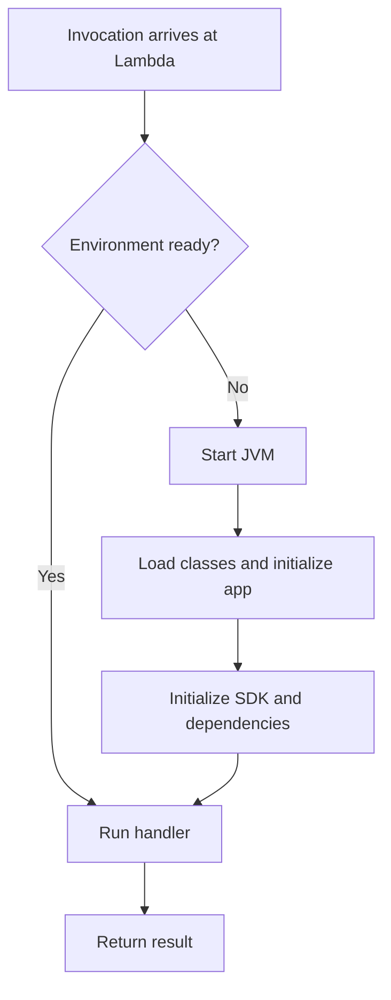
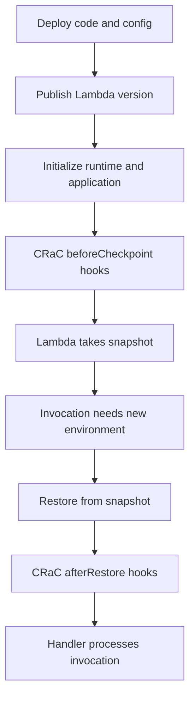

# Snapshotting and Restoring the JVM with AWS Lambda SnapStart

Java offers a rich library ecosystem, a familiar programming model, and the ability to build large applications. However, when running on a Function as a Service (FaaS) platform, JVM startup time, class loading, dependency injection context creation, and framework initialization can increase the latency of the first invocation in a new execution environment. This phenomenon is commonly known as a *cold start*.

AWS Lambda SnapStart reduces part of this initialization overhead by taking a snapshot of the execution environment after the function initialization phase. When a new environment is needed, Lambda restores from the snapshot instead of re-executing the entire application startup sequence. For Java, this mechanism is especially helpful for functions with many classes, frameworks, or dependencies that take time to initialize.

Snapshotting and restoring also introduce an important requirement: the in-memory state at the time of the snapshot will be cloned across many restored environments. Some state can be safely reused, whereas per-environment unique data such as random seeds, network connections, leases, or expiring information must be refreshed. This lesson explains the SnapStart lifecycle, how to use CRaC hooks in Java, and how to validate an application after restore.

## 1. Cold Starts in Java Lambda

When Lambda needs a new execution environment, the runtime must start the JVM, load classes, and run application initialization before invoking the handler. For a Java application using a framework, these steps can include:

1. Starting the Java runtime and loading required classes.
2. Reading configuration, environment variables, and setting up logging.
3. Creating the dependency injection container and beans/services.
4. Initializing SDK clients, HTTP transports, serializers, and connection pools.
5. Loading metadata, schemas, or startup caches needed by the application.
6. Becoming ready to receive the first invocation.

If these steps take significant time, callers experience high latency on the first invocation. Subsequent invocations can reuse the active environment and therefore usually avoid paying the full startup cost again.



A cold start is not merely the handler execution time. It can include runtime startup, application initialization, and other preparatory work. Optimizing handler code alone does not eliminate pre-handler initialization time.

## 2. How Does SnapStart Work?

SnapStart uses a snapshot of an already initialized execution environment. When you publish a function version with SnapStart enabled, Lambda runs the initialization phase, captures a snapshot of memory and associated filesystem state, and stores that snapshot. When a new environment is needed for that version, Lambda restores the snapshot so the function can handle invocations faster than booting the JVM and application from scratch.



Key points:

- SnapStart applies to a **published version** configured with SnapStart enabled. `$LATEST` is not a published version served through this mechanism.
- An alias can point to a SnapStart-enabled version; when deploying a new release, publish a new version and shift the alias according to your release process.
- The snapshot is created from post-initialization state. Objects on the heap, static fields, and data loaded before the checkpoint may appear in the restored state.
- Each restored environment is a separate execution instance from the snapshot. They do not share a live heap, but they may start with identical snapshotted values.
- SnapStart reduces repeated startup work; it does not make inherently slow handlers, database queries, or API calls faster.

SnapStart is an AWS Lambda feature. Runtime support, region availability, package types, limits, and configuration options can evolve over time. When deploying, consult the current AWS support matrix and documentation for your Java runtime and function type.

### SnapStart Is Not a Shared JVM

A snapshot does not turn all invocations into threads sharing a single global JVM. Lambda restores separate execution environments from the same snapshot. Because environments may begin with the exact same snapshotted state, values assumed to be unique or single-use created before the checkpoint require careful review.

For example, if an application generates a UUID during startup and stores it in a static field, restored environments may all start with that same UUID. If the UUID is used as a unique identifier per environment or session, duplicating that value causes collisions. Generate unique values after restore or at request-handling time.

## 3. Distinguishing Initialization, Checkpoint, and Restore

To use SnapStart properly, distinguish three phases:

| Phase | Timing | Appropriate work |
|---|---|---|
| Initialization | Lambda prepares the version and runs startup code | Load classes, build immutable config, create safely shared objects |
| Before checkpoint | Immediately before Lambda takes the snapshot | Close or pause resources that cannot be safely restored, finalize preparatory state |
| After restore | Whenever an environment is restored from snapshot | Refresh entropy, recreate connections, refresh time-dependent data, and resume paused resources |

Not every object needs handling inside a hook. Immutable objects such as parsed configurations, compiled regexes, static metadata, or safe serializers can usually be snapshotted and reused. Resources tied to a live connection or a value valid only for a limited time window must be evaluated individually.

### State Worth Creating Before Checkpoint

Time-consuming work that yields stable results can be performed during initialization:

- Loading required classes and metadata.
- Parsing immutable configuration.
- Creating object mappers, validators, or schema registry clients if their client lifecycle supports restore.
- Initializing the dependency injection context.
- Building read-only data structures and static caches containing no per-request data.

The goal is to move reusable startup work into the snapshot so it does not have to be repeated in every new environment.

### State Requiring Review After Restore

The following need to be refreshed, validated, or reinitialized depending on your implementation:

- Random seeds, nonces, tokens, or IDs that must be unique.
- TCP sockets, HTTP connections, database connections, and connection pools that may be stale or invalid.
- Temporary credentials or time-bound data.
- Caches reflecting external state that may have changed while the snapshot was stored.
- Timers, schedulers, background threads, and executors with state needing resumption.
- Temporary files or data meaningful only within a single invocation.

Do not assume by default that every connection breaks after restore or that every client must be recreated. Follow SDK/framework guidance and test on the real runtime. What must be ensured is that the application recovers cleanly when external resources have changed or connections were closed while the snapshot sat idle.

## 4. CRaC Hooks in Java

CRaC (Coordinated Restore at Checkpoint) provides an API for applications to participate in the checkpoint/restore lifecycle. AWS Lambda SnapStart supports this hook model for Java applications. An object implementing `org.crac.Resource` can register with the global context to receive callbacks before checkpoint and after restore.

Two primary callbacks:

- `beforeCheckpoint(...)`: runs before the snapshot is taken. Used to close or pause resources that must be reinitialized after restore.
- `afterRestore(...)`: runs after the environment is restored and before the handler processes an invocation. Used to recreate resources, refresh state, or restart stopped components.

To compile `org.crac.*` imports, the application needs a CRaC dependency compatible with the Java/SnapStart runtime in use. Example Gradle declaration (replace placeholder with a version supported by AWS/the runtime):

```kotlin
dependencies {
    implementation("org.crac:crac:<compatible-version>")
}
```

Do not pick a version solely from the example above; check the AWS Lambda Java runtime guide and CRaC compatibility matrix before locking the dependency.

The example below illustrates managing a JDBC connection pool. Assume the application uses HikariCP and database connections should not be held open across a checkpoint.

```java
import com.zaxxer.hikari.HikariConfig;
import com.zaxxer.hikari.HikariDataSource;
import org.crac.Context;
import org.crac.Core;
import org.crac.Resource;

public final class DatabaseResources implements Resource {
    private volatile HikariDataSource dataSource;

    public DatabaseResources() {
        this.dataSource = createDataSource();
        Core.getGlobalContext().register(this);
    }

    @Override
    public void beforeCheckpoint(Context<? extends Resource> context) {
        closeDataSource();
    }

    @Override
    public void afterRestore(Context<? extends Resource> context) {
        this.dataSource = createDataSource();
    }

    public HikariDataSource dataSource() {
        HikariDataSource current = dataSource;
        if (current == null) {
            throw new IllegalStateException("Database pool is not initialized");
        }
        return current;
    }

    private void closeDataSource() {
        HikariDataSource current = dataSource;
        dataSource = null;
        if (current != null) {
            current.close();
        }
    }

    private HikariDataSource createDataSource() {
        HikariConfig config = new HikariConfig();
        config.setJdbcUrl(System.getenv("JDBC_URL"));
        config.setUsername(System.getenv("DB_USERNAME"));
        config.setPassword(System.getenv("DB_PASSWORD"));
        config.setMaximumPoolSize(2);
        config.setConnectionTimeout(3_000);
        return new HikariDataSource(config);
    }
}
```

This example illustrates lifecycle management; in a real system, credentials should be retrieved via an appropriate secret provider/managed identity and not necessarily kept static in environment variables. `beforeCheckpoint` closes the pool and sets the field to `null`, because the post-callback state is what gets snapshotted. `afterRestore` creates a fresh pool for the restored environment. Pool size should be calculated from concurrency and database limits rather than using illustrative defaults directly in production.

Register the resource during application initialization, for example:

```java
public final class ApplicationResources {
    private static final DatabaseResources DATABASE = new DatabaseResources();

    private ApplicationResources() {}

    public static DatabaseResources database() {
        return DATABASE;
    }
}
```

When the runtime initializes this class before the checkpoint, the resource is registered. After restore, the callback is invoked to recreate the pool. In applications using dependency injection, integrate with the framework's lifecycle; avoid registering duplicate resources multiple times by accidentally creating multiple instances.

### Hook Ordering and Errors

Hooks are part of environment preparation. If `beforeCheckpoint` cannot bring a resource into a safe state, the snapshot should not be considered ready. If `afterRestore` cannot recreate a mandatory dependency, the environment cannot serve business requests properly; let errors surface clearly and observably.

Keep callbacks short, safely idempotent, and free of business side effects. Do not send emails, charge payments, or emit business events inside hooks. Hooks run as part of snapshot/restore lifecycle events, not once per business message.

## 5. Handling Randomness, IDs, and Unique Data

Snapshots duplicate memory state. If a random value is generated before the checkpoint and stored in a field, multiple restored environments may start with the exact same value. This causes problems for nonces, random seeds, session IDs, instance IDs, or any value expected to be unique.

Guidelines:

- Generate UUIDs, nonces, and business IDs at the time they are needed, not once in a static initializer reused across environments.
- If the application retains a long-lived random generator, verify how the runtime/SnapStart handles entropy and reseeding after restore per AWS/JDK guidance.
- Never synthesize cryptographic seeds from timestamps or predictable values.
- For system-wide unique IDs, use an ID source with appropriate guarantees or a properly supported UUID/random generator.
- Test multiple environments restored from the same version and verify zero collisions.

Example generating an ID per operation:

```java
import java.util.UUID;

public final class RequestIdFactory {
    public String newRequestId() {
        return UUID.randomUUID().toString();
    }
}
```

Do not store the result of `UUID.randomUUID()` in a static field to serve as the ID for every request. Calling the factory inside the handler generates an ID at processing time. For cryptographic requirements, use APIs and entropy sources supported by the JDK/runtime; never substitute `new Random()`.

## 6. Network Connections, Databases, and SDK Clients

A snapshot can contain Java objects representing connections, sockets, or clients, yet external state outside the snapshot is not frozen alongside the heap. While a snapshot sits idle, servers may close connections, DNS records may change, credentials may expire, or databases may fail over to another node.

Therefore, classify clients appropriately:

| Resource | Approach |
|---|---|
| Stateless SDK client capable of automatic reconnect | Can be created before checkpoint if SDK supports SnapStart; test after restore |
| HTTP client with open pools or sockets | Consult SDK guidance; close/pause before checkpoint or verify recovery after restore |
| JDBC connections/pools | Typically close before checkpoint and recreate after restore |
| Refreshable credential provider | Prefer providers that manage credential refresh; avoid snapshotting static temporary credentials |
| Custom TCP sockets | Close before checkpoint and recreate after restore |
| DNS cache or endpoint cache | Check TTLs and refresh behavior upon restore |

With AWS SDK for Java 2.x, service clients are typically designed for reuse and credential providers handle credential retrieval. However, do not assume every custom HTTP transport or third-party client is snapshot-safe. Check the SDK's SnapStart compatibility documentation and run connection tests after restore.

### Custom Socket Management Example

```java
import java.io.IOException;
import java.net.Socket;
import org.crac.Context;
import org.crac.Core;
import org.crac.Resource;

public final class RemoteSocketResource implements Resource {
    private volatile Socket socket;

    public RemoteSocketResource() {
        Core.getGlobalContext().register(this);
    }

    @Override
    public void beforeCheckpoint(Context<? extends Resource> context) throws IOException {
        closeSocket();
    }

    @Override
    public void afterRestore(Context<? extends Resource> context) throws IOException {
        socket = connect();
    }

    private void closeSocket() throws IOException {
        Socket current = socket;
        socket = null;
        if (current != null) {
            current.close();
        }
    }

    private Socket connect() throws IOException {
        return new Socket(System.getenv("REMOTE_HOST"),
                Integer.parseInt(System.getenv("REMOTE_PORT")));
    }
}
```

This is an illustrative example. A production application needs connection timeouts, TLS, authentication, bounded retries, and handling for unexpectedly closed sockets. Do not open connections in hooks if a dependency is not needed immediately upon restore; lazy reconnect on first access can reduce restore latency, provided the invocation handles errors and timeouts appropriately.

### Credentials and Secrets

Never snapshot a temporary access token and assume it remains valid at any future restore time. A snapshot may be restored long after the token expired. Use refreshable credential providers, a secrets manager, or managed identities. If a secret is cached, the cache must have an expiration time and a refresh mechanism.

For database passwords, avoid reading once at startup and holding indefinitely if passwords rotate. You can build the pool after restore by fetching the current secret from the provider. Balance restore latency against security and refresh requirements; never let a hook retain an expired token that causes every invocation to fail.

## 7. Caches and Mutable Data

A cache populated before checkpoint can reduce startup time, but it can go stale when an environment is restored minutes or longer afterward. For example, permission lists, feature flag settings, product prices, or endpoint mappings may have changed.

Before placing a cache into a snapshot, verify:

- Is the data immutable for the entire lifetime of the version?
- Does the cache have a TTL or version?
- If the cache is stale, can the system re-read from the authoritative source?
- Does the cache contain tenant-specific or user-specific data?
- Can cache refresh happen lazily on the first invocation or in `afterRestore`?

Static, shared, non-sensitive caches are usually good candidates for snapshotting. Rapidly changing or user-permission-dependent caches should have explicit TTL/refresh logic. Never put single-request data into a static cache before checkpoint.

## 8. Threads, Executors, and Background Tasks

A Java application may create schedulers, executors, or background threads during initialization. Snapshotting and restoring alter the actual lifecycle of these threads. A thread waiting on a socket, holding a lock, or running a background task may not be in a valid state to resume after restore.

Guidelines:

- Avoid starting unnecessary background workers in static initializers.
- Never allow threads to perform business side effects before or during checkpoint.
- If an executor must exist, define how to stop/await tasks in `beforeCheckpoint` and recreate it in `afterRestore`.
- Never leave locks held in a state that deadlocks post-restore invocations.
- Use platform schedulers for periodic jobs when appropriate rather than relying on a background thread in short-lived functions.
- If using an async SDK, verify that its event loop and HTTP transport support checkpoint/restore.

A Lambda invocation must not rely on a background thread continuing to run after the handler returns. If work must survive independently of the invocation, send it to a queue, event bus, or stateful workflow.

## 9. Integration with Java Frameworks

Frameworks can increase cold-start overhead by scanning classpaths, building application contexts, initializing beans, and configuring libraries. SnapStart can snapshot that initialization work, but beans holding resources outside the JVM still require proper lifecycle handling.

### Spring

With Spring, the application context and singleton beans are normally created during initialization. Immutable, safely shared beans can be snapshotted. Beans managing database pools, sockets, schedulers, or credential caches must be evaluated individually. Use the CRaC/lifecycle integrations supported by your Spring Boot version rather than manually registering redundant hooks.

Avoid performing business side effects inside `@PostConstruct`, bean constructors, or application runners if those side effects should only occur once in production. Such initialization callbacks may execute when creating the version snapshot; do not send notifications or create business records merely because a version was published.

### Quarkus and Micronaut

Quarkus and Micronaut optimize startup time through build-time processing, lightweight dependency injection, and reduced reflection. SnapStart can complement them by snapshotting initialized state, though actual gains depend on how much runtime initialization remains. Check your framework version's documentation regarding CRaC and resources requiring close/reopen handling.

### Do Not Assume the Framework Handles Every Resource Automatically

A framework can manage bean lifecycles, yet cannot know about every custom connection or cache in your application. Inventory all resources with side effects outside the JVM: pools, sockets, threads, tokens, temporary files, and data caches. For each resource, decide explicitly whether it is snapshotted, closed before checkpoint, refreshed after restore, or created lazily when needed.

## 10. Configuring SnapStart in the Release Workflow

SnapStart is bound to published versions. A typical deployment workflow includes:

1. Package the function artifact and configure the Java runtime.
2. Enable SnapStart for published versions in the function configuration.
3. Publish a new version so Lambda performs initialization and creates the snapshot.
4. Wait for the version/snapshot state to become ready per platform status.
5. Run test invocations against that version or an alias pointing to it.
6. Shift the production alias to the new version after tests pass.
7. Monitor restore duration, post-restore errors, latency, and cost.

Do not test only on `$LATEST` and conclude SnapStart works. Invoke the actual published version or alias pointing to the SnapStart-enabled version. Whenever code or configuration changes, publish a new version to generate the corresponding snapshot.

Conceptual configuration example in AWS SAM:

```yaml
Resources:
  JavaFunction:
    Type: AWS::Serverless::Function
    Properties:
      Runtime: java21
      Handler: example.Handler::handleRequest
      CodeUri: target/function.jar
      AutoPublishAlias: live
      SnapStart:
        ApplyOn: PublishedVersions
```

This is a conceptual configuration example; exact template structure, supported runtimes, and publishing steps must match the AWS SAM/CloudFormation version in use. With other deployment tools, the corresponding SnapStart setting is applied to the Lambda function and version publication.

### Rollback

Because an alias points to a specific version, rollback can switch the alias back to a previous version provided that version is retained and compatible with current settings. Keep artifacts/versions, check data compatibility, and ensure database changes work with both old and new versions. Snapshots do not replace an application rollback strategy.

## 11. Measuring Effectiveness and Comparing Options

SnapStart can cut initialization time, but the actual improvement depends on initialization duration, heap size, framework, dependencies, and restore work. Measure before and after enabling on the same workload type.

Metrics to track:

| Metric | Purpose |
|---|---|
| Cold start latency | Total latency of the first invocation in a new environment |
| Init duration | Pre-checkpoint initialization time when publishing a new version |
| Restore duration | Time to restore the environment from snapshot |
| After-restore hook duration | Overhead of refreshing resources after restore |
| Handler duration | Business processing time once ready |
| Error/throttle rate | Errors from connections, credentials, or concurrency |
| Memory usage | Heap and resource footprint after restore |
| Cost per request | Overall cost including snapshot, restore, and associated resources |

Do not look at only a single initial invocation. Trigger enough new environments to gather cold-restore samples, measure p50/p95/p99, and compare under equivalent load conditions. Separate `afterRestore` time from handler time to see whether resource refreshing becomes a new cold-start bottleneck.

### SnapStart, Framework Optimization, and Provisioned Capacity

| Approach | How it reduces latency | Considerations |
|---|---|---|
| Initialization optimization | Reduces classes, dependencies, and startup work | May require refactoring application structure |
| SnapStart | Restores from an initialized snapshot | Requires handling unsafe state across checkpoint/restore |
| Fast-starting framework/runtime | Cuts JVM/framework overhead | Requires evaluating compatibility and library limits |
| Provisioned concurrency | Keeps pre-initialized environments ready ahead of requests | Incurs capacity-maintenance cost and requires sizing to demand |

Options may carry compatibility constraints on Lambda. Check current AWS documentation before combining them. Choose based on SLOs, traffic patterns, traffic steadiness, and cost—not solely on a cold-start number from a small test.

SnapStart also does not replace handler optimization. If most latency comes from database queries, external API calls, or heavy CPU work, snapshotting the JVM will not remove that bottleneck.

## 12. Common Mistakes When Using SnapStart

| Mistake | Consequence | Fix |
|---|---|---|
| Generating a random ID before checkpoint and storing it statically | Multiple restored environments reuse the same value | Generate IDs after restore or per invocation |
| Holding JDBC connections across a snapshot | Connections may be stale or invalid | Close before checkpoint and recreate after restore |
| Caching static temporary credentials | Tokens may expire before the environment is used | Use a refreshable provider or fetch again after restore |
| Caching mutable data without a TTL | Restored environments serve stale data | Add versions, TTLs, or refresh logic |
| Running background threads at startup | Threads/locks may be in an unsafe state after restore | Stop and restart via hooks or offload to background services |
| Sending emails/creating business resources in constructors | Side effects may fire during snapshot publishing | Perform side effects only during invocations or business workflows |
| Testing on `$LATEST` | Fails to exercise the published-version SnapStart lifecycle | Invoke the SnapStart-enabled version/alias |
| Swallowing exceptions in `afterRestore` | Environment is unready and errors are hard to trace | Log/emit clear metrics and fail fast on mandatory dependencies |
| Assuming every SDK client must be recreated | Unnecessarily increases restore duration | Follow SDK docs and handle only resources that actually need it |
| Assuming SnapStart makes handlers faster | Overlooks business-processing bottlenecks | Measure restore/init and handler durations separately |

## 13. Pre-Production Testing Workflow

A SnapStart test plan must verify both speed and post-restore correctness. Follow this sequence:

1. **Establish a baseline.** Measure cold starts and warm latency with SnapStart disabled under a representative workload.
2. **Enable SnapStart on a test version.** Publish a new version and wait until the snapshot is ready.
3. **Verify hooks.** Emit structured logs when `beforeCheckpoint` and `afterRestore` execute; do not log secrets.
4. **Verify uniqueness.** Spin up multiple environments and confirm IDs, nonces, and random outputs do not collide due to snapshotted state.
5. **Verify connections.** Test databases, HTTP, SDKs, and custom sockets after restore; confirm reconnects and credential refreshes.
6. **Verify caches.** Mutate source data after the snapshot is created and confirm the app does not serve stale data beyond policy.
7. **Verify threads and temp files.** Confirm no background tasks or prior invocation data persist across restore.
8. **Verify hook failures.** Simulate an unavailable dependency and confirm errors surface cleanly with controlled retries/rollback.
9. **Measure performance and cost.** Compare init, restore, handler, p95/p99, memory, and cost under identical conditions.
10. **Roll out via alias.** Switch the production alias only after the test version meets agreed criteria.

One particularly valuable test is to publish a version, wait a sufficiently long period, and then invoke it. This uncovers credentials or caches that expired while the snapshot sat idle. Also test parallel invocations to catch unexpected sharing of static or random state.

## 14. Design Checklist for Java Applications with SnapStart

- [ ] The runtime and package type in use are supported by AWS SnapStart.
- [ ] SnapStart is enabled for published versions and tested via the corresponding version/alias.
- [ ] Initialization contains only work that can be safely snapshotted and reused.
- [ ] No business side effects are executed in constructors or static initializers.
- [ ] Random values, IDs, and nonces requiring uniqueness are generated or refreshed at the right time.
- [ ] Database pools, sockets, and network resources have clear checkpoint/restore handling.
- [ ] Credential providers can refresh expired credentials.
- [ ] Caches have TTLs/versions and hold no per-invocation data.
- [ ] Background threads, executors, and schedulers follow proper lifecycles.
- [ ] `beforeCheckpoint` and `afterRestore` are fast, safe, and observable.
- [ ] Tests cover restore, uniqueness, connections, stale caches, and hook errors.
- [ ] Cold starts, restore duration, handler latency, and cost have been measured under realistic load.

## Conclusion

AWS Lambda SnapStart reduces Java cold-start overhead by snapshotting the execution environment after initialization and restoring that snapshot for new environments. To use it safely, separate reusable state from resources that must be refreshed after restore. CRaC hooks `beforeCheckpoint` and `afterRestore` help close and reopen connection pools, sockets, or resources with special lifecycles. Random IDs, credentials, caches, background threads, and side effects must be handled intentionally because multiple environments can start from the same snapshotted state. Enable SnapStart on published versions, test against the proper version/alias, measure restore and handler durations separately, and then decide on broad rollout.
