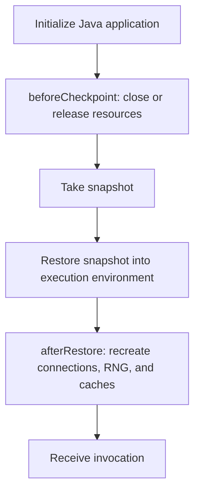

# Reinitializing Connections, Randomness, and State After Restore

Some serverless platforms can take a snapshot of an initialized environment and restore that snapshot to spin up new execution environments faster. For Java, this reduces repeated startup work during cold starts, but it also introduces an important issue: **any in-memory state present at snapshot time can be cloned across multiple restored environments**.

An open TCP connection may no longer be valid. A connection pool may hold connections pointing to an old network session. A random number generator initialized before the snapshot may carry the exact same initial state into multiple restored instances. A cache holding tokens or time-bound data may have gone stale. A static variable that looks private to one instance can become an identical copy across many instances.

Therefore, Java applications running on platforms with snapshot/restore must distinguish which state can be kept and which state must be recreated after restore. This lesson focuses on the snapshot lifecycle, network connections, random data, caches, and restore hooks such as CRaC in serverless Java.

## 1. What Is Snapshot and Restore?

In a typical serverless startup, the platform creates an execution environment, starts the runtime, loads the application, and invokes the handler. If the environment is discarded, the next startup must repeat all those steps.

Snapshot/restore changes the flow:

1. The platform initializes the application up to a defined point.
2. The runtime or platform captures the state of the process, including part of the heap, loaded classes, and supported runtime state.
3. When a new execution environment is needed, the platform restores the snapshot.
4. The application resumes from the captured state and runs post-restore hooks if supported by the runtime.
5. The handler begins processing the invocation.

A common example is **AWS Lambda SnapStart** for supported Java runtimes. Java also has the **CRaC (Coordinated Restore at Checkpoint)** ecosystem, providing APIs for applications to prepare before checkpoint and recover after restore. Exact integration and supported versions depend on the runtime and provider.



A snapshot is not a fresh deployment, nor is a restore a full cold-boot of the application from scratch. The heap is restored from the captured state, so values already in memory can persist across the restore.

## 2. Why Can Pre-Snapshot State Cause Bugs?

Imagine a Java function that initializes a connection pool, a `SecureRandom`, and a token cache during the init phase. Then the platform takes a snapshot. When the platform restores that snapshot into multiple execution environments, each environment can start with the exact same in-memory state from snapshot time.

This can cause:

- Multiple instances holding references to connection state that existed before the snapshot.
- Connections in the pool already closed by the server or proxy by the time the environment is restored.
- Random number generators sharing identical internal state and producing duplicate sequences.
- Tokens, credentials, or cached data already expired when the snapshot is restored.
- Static counters or in-memory temporary IDs duplicated across instances.
- Threads, executors, or background tasks carrying state incompatible with the new lifecycle.

This is not an AWS Lambda-only issue. Any mechanism that clones process state requires examining resources tied to time, networking, the operating system, or uniqueness.

### Which State Can Be Retained?

Data typically safe to keep in a snapshot:

- Validated immutable configuration.
- Loaded classes and static metadata.
- Templates, precompiled expressions, or schemas containing no sensitive data and no time dependencies.
- Immutable lookup data, if its potential staleness is acceptable.
- Application structures holding no sockets, temporary credentials, or per-invocation state.

Data typically requiring recreation or verification after restore:

- TCP/TLS connections and connection pools.
- HTTP clients or SDK clients with internal connection state.
- Temporary credentials, access tokens, and expiring sessions.
- Random number generators initialized prior to the snapshot.
- Caches depending on time or external system state.
- Threads, executors, and background tasks tied to runtime state.
- Deadlines, timestamps, or timing measurements saved before the checkpoint.

Not every object on the heap needs to be cleared. The goal is to classify state by its lifecycle and validity after restore.

## 3. Resource Lifecycles in Serverless Java

An application can divide state into three categories:

| State category | Examples | Handling |
|---|---|---|
| Immutable, environment-independent | Validated configuration, templates, schemas | Can be kept across snapshot |
| Ephemeral, environment-dependent | Sockets, connection pools, HTTP connections | Close before checkpoint and recreate after restore |
| Time- or uniqueness-dependent | Tokens, TTL caches, RNGs, local counters | Refresh or reinitialize after restore |

A static variable does not automatically become safely shared state. It is scoped only to a single process. When a snapshot is restored into multiple processes, those processes can receive identical copies of that static variable.

For example, a counter variable:

```java
private static final AtomicLong COUNTER = new AtomicLong();
```

If the snapshot is taken when `COUNTER` is 100, multiple execution environments restored from that snapshot can all start at 100. Each process increments its own counter, so they can all produce the same value 101. If unique IDs across instances are needed, use a database sequence, an ID service, a UUID backed by a safe random source, or a proper ID-partitioning scheme.

Never use static memory to store business state that must be unique or consistent across the system.

## 4. Reinitializing Database Connections

Connection pools typically hold open sockets, authentication state, and tracking for idle or in-use connections. After restore, those sockets may no longer represent valid connections:

- The database has closed idle connections.
- A NAT gateway or proxy has expired the connection mapping.
- TLS sessions or sockets tied to the pre-snapshot environment are no longer usable.
- The database server has restarted or failed over.
- The pool tracks connections as borrowed even though no corresponding request exists after restore.

If the application keeps pulling old connections, the first request may fail or hang until timeout.

Typical approach:

1. Close connections or pools before checkpoint if hooks are supported.
2. After restore, build a fresh pool using current configuration and credentials.
3. Verify the pool can establish a real connection before accepting database work.
4. Keep validation and timeouts sensible so restore is not delayed indefinitely.
5. Never carry open transactions or borrowed connections across a snapshot.

Do not rely solely on calling `isClosed` to conclude a socket is still alive. A connection may not yet be marked closed on the client side even though the server or network path closed it. Only an actual health check or an appropriate validation query confirms usability.

### Example with HikariCP and CRaC

The example below illustrates closing a `HikariDataSource` before checkpoint and creating a new pool after restore. The application must use a CRaC API version and runtime supporting the corresponding hooks.

```java
import com.zaxxer.hikari.HikariDataSource;
import java.security.SecureRandom;
import java.util.Objects;
import java.util.function.Supplier;
import org.crac.Context;
import org.crac.Core;
import org.crac.Resource;

public final class SnapshotResources implements Resource {

    private final Supplier<HikariDataSource> poolFactory;

    private volatile HikariDataSource dataSource;
    private volatile SecureRandom secureRandom;

    public SnapshotResources(
            Supplier<HikariDataSource> poolFactory) {
        this.poolFactory = Objects.requireNonNull(poolFactory);
        this.dataSource = poolFactory.get();
        this.secureRandom = new SecureRandom();

        Core.getGlobalContext().register(this);
    }

    public HikariDataSource dataSource() {
        HikariDataSource current = dataSource;
        if (current == null) {
            throw new IllegalStateException(
                    "Database pool is not ready");
        }
        return current;
    }

    public byte[] newRandomBytes(int size) {
        if (size <= 0) {
            throw new IllegalArgumentException(
                    "Size must be positive");
        }

        byte[] bytes = new byte[size];
        secureRandom.nextBytes(bytes);
        return bytes;
    }

    @Override
    public void beforeCheckpoint(
            Context<? extends Resource> context) {
        HikariDataSource current = dataSource;
        dataSource = null;

        if (current != null) {
            current.close();
        }
    }

    @Override
    public void afterRestore(
            Context<? extends Resource> context) {
        secureRandom = new SecureRandom();
        dataSource = poolFactory.get();
    }
}
```

In this example:

- `poolFactory` creates a fresh `HikariDataSource` using current configuration.
- `beforeCheckpoint` closes the old pool and clears the reference to it.
- `afterRestore` recreates `SecureRandom` and the database pool.
- `volatile` ensures threads observe the updated resource references after the hook runs.
- `dataSource()` refuses to return a pool when the resource is not ready.

This is an illustrative skeleton. In a real application, handle errors during pool creation, close resources in the right order, configure timeouts, and manage pool shutdown when the application exits. Do not swallow exceptions when restoring resources; if the pool cannot initialize, let the runtime or application fail clearly rather than accepting invocations and failing later with obscure errors.

If using a `DataSource` other than HikariCP, apply the same principle using that library's close/open APIs. Do not call close on an object and assume it can be reopened unless the library explicitly supports it.

## 5. Recreating HTTP Clients and SDK Clients

HTTP clients can hold connection pools, sockets, TLS state, DNS caches, or other internal state. After restore, connections opened before the snapshot may no longer be valid.

Two approaches:

- Close the client before checkpoint and create a new client after restore if the library supports closing and rebuilding.
- Keep immutable configuration, but discard old connections or instantiate a new client after restore if the library's API does not offer a safe pool-refresh mechanism.

With JDK `HttpClient`, pool management APIs are relatively limited and vary across JDK versions. Do not rely on internal APIs to clear connections. You can retain a configuration factory and replace the client reference after restore if creating a fresh client is needed.

Conceptual example:

```java
public final class HttpClients implements Resource {

    private volatile HttpClient client;

    public HttpClients() {
        this.client = buildClient();
        Core.getGlobalContext().register(this);
    }

    public HttpClient current() {
        return client;
    }

    private HttpClient buildClient() {
        return HttpClient.newBuilder()
                .connectTimeout(Duration.ofSeconds(2))
                .build();
    }

    @Override
    public void beforeCheckpoint(
            Context<? extends Resource> context) {
        // Do not retain a reference to the old client in the snapshot.
        client = null;
    }

    @Override
    public void afterRestore(
            Context<? extends Resource> context) {
        client = buildClient();
    }
}
```

This example illustrates swapping the client reference. JDK `HttpClient` did not provide `close` in older Java versions; therefore, do not assume this snippet synchronously closes old sockets. Exact behavior depends on the JDK and runtime. If you need guaranteed pool closure, use a library with an explicit lifecycle API and matching version configuration.

For AWS SDK or other HTTP clients, consult the documentation for your exact version to know how clients can be reused, closed, refreshed, or must be rebuilt.

## 6. Random Data and Collision Risks After Restore

Pseudorandom number generators (PRNGs) maintain internal state to produce sequences of values. If that state is captured in a snapshot, multiple restored instances can start from the same state and produce the exact same subsequent sequence.

For example, an application initializes:

```java
private static final Random RANDOM = new Random();
```

If `RANDOM` was used before the checkpoint, its current state is captured. When the snapshot is restored multiple times, the clones can continue from the same state and generate identical output sequences. This is dangerous if the outputs are used to create IDs, tokens, nonces, or values expected to be unique.

### Distinguishing Standard Random from Cryptographic Random

- `java.util.Random` is a deterministic PRNG; never use it for keys, tokens, or security nonces.
- `SplittableRandom` suits certain simulation and computation tasks, but its state can also be cloned across snapshots.
- `ThreadLocalRandom` is convenient for non-security randomness in multithreaded apps; do not treat it as a cryptographic entropy source.
- `SecureRandom` is designed for cryptographically strong random values, yet its provider state still needs care across snapshot/restore.

For data requiring security or uniqueness, ensure the random source is initialized or reseeded after restore per runtime guidance. Never self-seed using `System.currentTimeMillis()`, process IDs, or predictable values. Time and PIDs do not provide strong entropy, and execution environments may be created nearly simultaneously.

### Creating SecureRandom After Restore

In the CRaC example earlier, `SecureRandom` was recreated inside `afterRestore`. Applications can also instantiate generators on demand after restore rather than keeping a generator initialized before the checkpoint.

For security tokens, you should:

- Use `SecureRandom` from a provider supported by the JDK/runtime.
- Create or reseed after restore per platform guidance.
- Never use `Random` or `SplittableRandom` to generate secrets.
- Never log seeds or tokens.
- Test uniqueness and entropy quality in a real snapshot environment.

Do not assume calling `setSeed` with the current time solves the issue. `setSeed` may mix in entropy depending on the provider and does not necessarily reset the generator into a known safe state. Prefer initialization/reseeding mechanisms supported by the runtime and provider.

### Unique IDs Should Not Rely Solely on Randomness

Even when using `SecureRandom`, applications should design IDs and data constraints to withstand rare collisions. For example, place a unique constraint in the database and handle conflicts by generating another ID. For business requirements needing ordering or global uniqueness, consider database sequences, an ID service, or an ID-partitioning algorithm with safely assigned node identities.

## 7. Caches, Credentials, and Expiring Data

Snapshots capture in-memory values at a point in time. When a restore happens minutes or longer afterward, cached data may have expired.

Common examples:

- Short-lived OAuth access tokens.
- AWS temporary credentials or session tokens.
- Changed DNS results and endpoint IPs.
- JWKS/public key caches needing refresh when a provider rotates keys.
- Expired signed URLs or presigned URLs.
- Updated feature flags or dynamic configurations.
- Stale order status or inventory caches.

Do not freeze temporary credentials in a static field before a snapshot and keep using them after restore. Use a refreshable credential provider, fetch fresh tokens when needed, and evaluate TTLs against current time.

For caches, store absolute expiration timestamps and revalidate after restore. If a cache holds sensitive or rapidly changing data, clear and reload it after restore. If a cache holds slow-changing lookup data, it may be kept provided it has a TTL and an invalidation mechanism.

### Do Not Store Initialization Time as Current Time

The following example is error-prone:

```java
private static final Instant STARTED_AT = Instant.now();
```

After restore, `STARTED_AT` remains the timestamp when the snapshot was taken. Do not use it to calculate session age, token expiration, or elapsed time since invocation. Call `Instant.now()` or use a `Clock` when the calculation is needed.

Similarly, do not store a deadline computed from `System.nanoTime()` before a snapshot and reuse it after restore. Deadlines must be computed fresh per invocation or relative to the restore point as appropriate. `System.nanoTime()` measures elapsed time within a single live interval, not a durable timestamp valid across a checkpoint.

## 8. Static State, Threads, and Executors

Snapshots can retain static variables, singletons, thread state, and heap-referenced objects. This makes lifecycle bugs subtle because the application keeps running and data appears valid.

Common risks:

- Static counters cloned across multiple execution environments.
- Singletons holding expired credentials or stale connections.
- Executors containing threads created before the snapshot.
- Scheduled tasks relying on pre-checkpoint timestamps or state.
- Threads waiting on locks or condition variables at snapshot time.
- Mutable caches updated by multiple invocations without synchronization.

Avoid creating background threads during init if the snapshot runtime does not safely support that state. Create executors after restore or lazily when actually needed. If a scheduler exists, design it to re-register tasks exactly once after restore and avoid multiple instances unintentionally running the same periodic job.

For business state, use a database, queue, or workflow store. For local caches, treat them strictly as rebuildable caches rather than authoritative data sources.

## 9. Using CRaC Hooks in Java

CRaC provides the `Resource` interface so applications can perform work before checkpoint and after restore:

- `beforeCheckpoint(...)`: prepares resources prior to snapshot, such as closing sockets or pools.
- `afterRestore(...)`: restores required resources, such as recreating pools, clients, and `SecureRandom`.

Structural example:

```java
import org.crac.Context;
import org.crac.Core;
import org.crac.Resource;

public final class MyResource implements Resource {

    public MyResource() {
        Core.getGlobalContext().register(this);
    }

    @Override
    public void beforeCheckpoint(
            Context<? extends Resource> context) throws Exception {
        // Close or release resources that cannot be reused.
    }

    @Override
    public void afterRestore(
            Context<? extends Resource> context) throws Exception {
        // Recreate environment-dependent resources.
    }
}
```

To use this, the application needs a compatible CRaC dependency and a runtime/platform with checkpoint/restore integration. Not every serverless environment supports CRaC or invokes these hooks.

### Principles for Writing Hooks

**Hooks must be idempotent.** Repeated hook calls or recovery after failures must not spawn redundant pools, threads, or schedulers. Check and replace resources based on explicit state.

**Keep hooks short.** Do not load large datasets, run migrations, or execute long business tasks inside `afterRestore`. Restore only the resources needed so invocations can begin. Heavy work belongs in handlers or workers.

**Do not swallow errors.** If a mandatory database connection cannot be recreated, let restore fail explicitly or mark readiness failed per the runtime contract. Catching exceptions and proceeding with null resources produces confusing errors on the first invocation.

**Do not create business side effects.** Hooks can run every time a snapshot is restored into a new environment. Never send emails, charge money, or emit business events inside hooks. Hooks manage process resource lifecycles only.

**Register hooks at the right time.** Resources must be registered during init before the checkpoint. If registered too late, resources may not be prepared before the snapshot is taken.

## 10. AWS Lambda SnapStart and CRaC

AWS Lambda SnapStart snapshots the initialized environment for a published function version, then uses that snapshot to launch execution environments faster. With Java, CRaC hooks can close resources before the snapshot and recreate them after restore.

Points to remember:

- SnapStart is enabled at the published version level per Lambda's workflow; changing code or configuration requires publishing a new version to generate a new snapshot.
- `beforeCheckpoint` runs before the snapshot is taken.
- `afterRestore` runs when the environment is restored and before handling an invocation.
- Each restored execution environment gets its own heap copy from the snapshot; mutable in-memory state is not automatically shared across environments.
- Secrets, credentials, and connections must follow the service's lifecycle and security policies.
- Not every runtime or function type supports SnapStart; check current AWS documentation before designing around it.

SnapStart cuts initialization time but does not eliminate cold starts completely. Restoring still takes time, and post-restore hooks can also add latency. If `afterRestore` builds a large database pool or makes synchronous API calls, startup gains can diminish substantially.

### Do Not Confuse Restore Hooks with Invocation Hooks

`afterRestore` runs when an execution environment is restored from a snapshot. It is not a hook that runs before every handler call. A single execution environment can handle many invocations after one restore.

Therefore:

- Use `afterRestore` to recreate environment-lifecycle resources.
- Use handler logic to process per-invocation data.
- Use TTLs/refresh checks to verify resources remain valid across subsequent invocations.
- Do not assume refreshing once after restore keeps credentials or connections valid forever.

## 11. Verifying Resources After Restore

A hook finishing does not guarantee every dependent service is ready. Verify critical resources appropriately:

| Resource | Post-restore check |
|---|---|
| Database pool | Acquire a connection and run a lightweight validation query |
| HTTP client | Perform a bounded-timeout health check or handle stale-connection errors |
| Credential provider | Verify valid credentials can be obtained; avoid logging credentials |
| SecureRandom | Generate test values in a test environment and confirm no duplicates across restores |
| Cache | Check TTL, version, or refresh from authoritative source |
| Executor | Confirm thread pool creation and no duplicate scheduled tasks |
| File handles | Reopen required files or resources per runtime contract |

You do not necessarily need to health-check every dependency inside `afterRestore`. If an external service is temporarily unavailable, blocking the entire restore can hinder system recovery. Classify mandatory vs. optional dependencies, enforce short timeouts, and adopt an appropriate readiness strategy.

Some resources can be initialized lazily after restore. This reduces work inside the hook, though the first invocation must handle initialization failures clearly and enforce timeouts.

## 12. Testing Snapshot/Restore

An application can work normally locally yet fail when a snapshot is restored multiple times. Therefore, test actual runtime behavior.

Scenarios to test:

- Taking a snapshot after HTTP clients and database pools have initialized.
- Restoring multiple execution environments from the same snapshot.
- Invoking multiple environments concurrently and verifying database connections.
- Confirming no two instances generate identical IDs or tokens in a test run.
- Testing tokens/credentials expiring between snapshot time and restore time.
- Verifying caches refresh or invalidate properly.
- Confirming hooks run in the right order and are not registered multiple times.
- Simulating database or external API unavailability during `afterRestore`.
- Confirming threads, executors, and schedulers do not run duplicate tasks unexpectedly.
- Measuring latencies of init, restore hooks, and the first invocation.

### Testing Uniqueness

In a test environment, restore multiple instances from the same snapshot and have each instance generate a large batch of IDs. Write the results to a data store with a unique constraint to catch duplicates. Do not test only a single instance or run sequentially; collisions often surface only when multiple restored instances run concurrently.

### Testing Hooks

Emit metrics or structured logs for events:

- `beforeCheckpoint` start/finish.
- `afterRestore` start/finish.
- Which resources were closed or recreated.
- Connection pool creation duration.
- Health check outcomes.
- Credential or cache refresh errors.

Never log secrets, tokens, seeds, or full sensitive payloads. You may log platform-provided environment identifiers when appropriate to distinguish restore instances.

## 13. Common Mistakes

- **Keeping database connections across a snapshot:** sockets may be dead; close the pool before checkpoint and create a new pool after restore.
- **Keeping old HTTP connections:** connections may be closed by servers or proxies; refresh clients/pools as supported by the library.
- **Initializing Random before a snapshot:** restored instances may continue the exact same PRNG sequence; recreate generators after restore.
- **Using timestamps as seeds:** timestamps are not a safe entropy source and can collide.
- **Storing temporary tokens in static fields:** tokens may be expired when the snapshot is restored; use refreshable providers.
- **Using a static counter as a global ID:** every restored instance can start at the same value; use an ID store or distributed uniqueness mechanism.
- **Keeping pre-checkpoint deadlines:** deadlines no longer reflect current invocation time; recompute per invocation.
- **Running business actions inside `afterRestore`:** multiple environments can run the same hook, causing duplicate side effects.
- **Spawning background threads before a snapshot:** thread states or schedulers may not restore safely; recreate them per supported lifecycle.
- **Assuming every serverless runtime supports CRaC:** hooks may never be invoked if the runtime lacks integration; verify the target platform.

## 14. Practical Implementation Workflow

When preparing a Java function for snapshot/restore, follow this sequence:

1. Inventory singletons, static fields, caches, clients, pools, threads, and generators created during init.
2. Classify each object as immutable, ephemeral, or time/uniqueness-dependent.
3. Identify which network resources must close before checkpoint.
4. Create factories to rebuild connection pools and clients after restore.
5. Initialize or reseed cryptographic random sources after restore per runtime guidance.
6. Refresh credentials, tokens, and TTL caches; never keep ephemeral values as immutable state.
7. Recreate required executors or schedulers and ensure tasks are not registered multiple times.
8. Register the CRaC `Resource` or corresponding platform hooks.
9. Keep hooks short, with timeouts and explicit error handling.
10. Test multiple concurrent restores, connections, uniqueness, and expired data.
11. Monitor restore latency, hook duration, resource errors, and cold-start latency.
12. Deploy a new snapshot version after lifecycle code changes and verify with test traffic.

## 15. Key Takeaways

Snapshot/restore helps serverless Java start faster by restoring captured process state. However, state valid before a snapshot is not guaranteed to remain valid after restore, and mutable heap state can be cloned across multiple execution environments.

Close and recreate connection pools, refresh HTTP/SDK clients when needed, reinitialize cryptographic random sources, refresh credentials and time-bound caches, and recreate threads or schedulers according to the runtime lifecycle. Use CRaC hooks or equivalent mechanisms when supported by the platform.

Business data requiring consistency and uniqueness must live in appropriate storage systems or distributed services. Test multiple concurrent restores to catch stale connections, expired tokens, duplicate random sequences, and cloned static state before putting the function into production.
