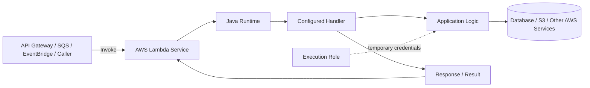

# Creating a Java Handler, Execution Role, and Lambda Function Configuration

AWS Lambda runs code when it receives an invocation from a trigger source such as API Gateway, a function URL, a queue, an event bus, or a direct call via the AWS SDK. With Java, the development team needs to prepare three interconnected parts: a **handler** that receives and processes events, an **execution role** that grants permissions to the running code, and a **function configuration** that defines the runtime, artifact, resources, and how Lambda operates invocations.

A handler matching the contract but lacking S3 read permissions will still fail. An execution role with sufficient permissions but a JAR missing the handler class cannot even start. A valid artifact and role with a timeout that is too short or concurrency exceeding database capacity can still cause production failures. Therefore, design these three parts as a single deployment unit.

This lesson focuses on Java on AWS Lambda. The examples use illustrative resource names; replace them with the actual account, region, bucket, function, and permissions of your deployment environment.

## 1. Architecture of a Lambda Invocation

An invocation passes through these main components:

1. **Event source or caller** creates a request/event and invokes Lambda.
2. **Lambda service** resolves the function version/alias, checks invoke permissions, and prepares the execution environment.
3. **Java runtime** loads the artifact, instantiates the class, and invokes the configured handler.
4. **Handler** converts the input into business logic, calls services/repositories, and produces a result.
5. **Execution role** provides temporary credentials so code in the function can call authorized AWS services.
6. **Lambda service/adapter** returns the response, records invocation success/failure, or coordinates acknowledgement/retries depending on the trigger type.



The execution role is neither the end user's identity nor the permission allowing an event source to invoke the function. Separate the permission to invoke the function from the permissions the function code uses at runtime.

## 2. Creating a Java Handler

### 2.1. The Handler as the Function Entry Point

The handler is the method the Lambda runtime calls upon an invocation. With the Java managed runtime, a handler can be implemented using two common interfaces:

- `RequestHandler<I, O>`: receives input and returns output as Java objects; the runtime performs data conversion using a supported serializer.
- `RequestStreamHandler`: receives an `InputStream` and writes results to an `OutputStream`; suitable when direct control over reading/writing the payload is required.

For most standard HTTP, queue, and event handlers, `RequestHandler` is easier to read and test. Use a stream handler when handling specialized formats or data streams, while taking responsibility for reading input, writing output, and handling serialization yourself.

### 2.2. Basic Handler Structure

A handler can accept `Context` to access invocation metadata:

```java
package com.example.orders;

import com.amazonaws.services.lambda.runtime.Context;
import com.amazonaws.services.lambda.runtime.RequestHandler;

public final class HelloHandler implements RequestHandler<HelloRequest, HelloResponse> {

    @Override
    public HelloResponse handleRequest(HelloRequest input, Context context) {
        String requestId = context.getAwsRequestId();
        String name = input == null || input.name() == null
                ? "guest"
                : input.name();

        return new HelloResponse(
                "Hello, " + name,
                requestId);
    }
}

record HelloRequest(String name) {}

record HelloResponse(String message, String requestId) {}
```

This is an illustrative example for a modern Java runtime supporting records. If using a runtime or serializer that does not support the chosen data type, use standard Java classes with appropriate constructors/getters. Actual input must match the trigger's schema; do not assume every event contains a `name` field.

### 2.3. Lambda Context

The `Context` object provides useful metadata during processing:

| Property/method | Purpose |
| --- | --- |
| `getAwsRequestId()` | Invocation identifier to correlate logs and traces |
| `getFunctionName()` | Name of the running function |
| `getFunctionVersion()` | Version of the invoked function |
| `getMemoryLimitInMB()` | Configured memory limit |
| `getRemainingTimeInMillis()` | Remaining invocation time |
| `getLogGroupName()` / `getLogStreamName()` | CloudWatch Logs information |
| `getInvokedFunctionArn()` | ARN used to invoke the function |

`getRemainingTimeInMillis()` is especially useful before an operation that may take a long time. The handler can refuse to start a new step if insufficient time remains to complete and persist state. Do not use this value as the sole deadline enforcement mechanism; HTTP clients, databases, and other dependencies still need their own timeouts.

```java
int remaining = context.getRemainingTimeInMillis();
if (remaining < 1_500) {
    throw new IllegalStateException(
            "Not enough time to start the next operation");
}
```

### 2.4. Configuring the Handler String

In the Lambda function configuration, the handler points to the entry-point class and method in a format supported by the Java runtime, for example:

```text
com.example.orders.HelloHandler::handleRequest
```

The package, class, and method names must match the packaged artifact exactly. If the handler class resides in a different package or the method is renamed without updating the configuration, invocations can fail when the runtime looks up the entry point.

When using `RequestHandler`, the standard method is `handleRequest`. When using a stream handler, the class implements `RequestStreamHandler` and the runtime invokes `handleRequest(InputStream, OutputStream, Context)`. Always verify the handler string against the actual implementation type.

## 3. Choosing Input Types by Event Source

Lambda does not automatically turn every event into the same object. Input structure depends on the invocation source and adapter.

| Invocation source | Common input type | Notes |
| --- | --- | --- |
| Direct invocation | POJO or `Map<String, Object>` matching caller payload | Caller and function must agree on the schema |
| API Gateway proxy | `APIGatewayProxyRequestEvent` | Includes method, path, headers, query, body, and request context |
| SQS | `SQSEvent` | One invocation can contain multiple records; handle batch/partial failures per configuration |
| S3 notification | `S3Event` | Event typically carries bucket/key/version referencing the object; decode the key per contract |
| EventBridge | `ScheduledEvent` or `EventBridgeEvent` | Payload has its own envelope and detail schema |
| Function URL | HTTP event model corresponding to runtime/adapter | Verify event structure and authentication mechanism |

Specialized event types usually reside in the `aws-lambda-java-events` library. Add the proper dependency to your project and package it in the artifact if the runtime does not provide it. The library version must be compatible with the event schema and runtime in use.

### 3.1. HTTP Handler Example with API Gateway

For API Gateway proxy integration, you can use event types from the AWS Lambda Java Events library:

```java
package com.example.orders;

import com.amazonaws.services.lambda.runtime.Context;
import com.amazonaws.services.lambda.runtime.RequestHandler;
import com.amazonaws.services.lambda.runtime.events.APIGatewayProxyRequestEvent;
import com.amazonaws.services.lambda.runtime.events.APIGatewayProxyResponseEvent;
import com.fasterxml.jackson.core.JsonProcessingException;
import com.fasterxml.jackson.databind.ObjectMapper;

import java.util.Map;

public final class OrdersHttpHandler implements RequestHandler<
        APIGatewayProxyRequestEvent,
        APIGatewayProxyResponseEvent> {

    private static final ObjectMapper JSON = new ObjectMapper();

    @Override
    public APIGatewayProxyResponseEvent handleRequest(
            APIGatewayProxyRequestEvent request,
            Context context) {

        String orderId = request.getPathParameters() == null
                ? null
                : request.getPathParameters().get("orderId");

        if (orderId == null || orderId.isBlank()) {
            return response(400, "ORDER_ID_REQUIRED");
        }

        // Call business service and check authorization before returning data.
        return jsonResponse(200, Map.of("orderId", orderId));
    }

    private static APIGatewayProxyResponseEvent response(int status, String code) {
        return jsonResponse(status, Map.of("code", code));
    }

    private static APIGatewayProxyResponseEvent jsonResponse(
            int status,
            Object payload) {
        final String body;
        try {
            body = JSON.writeValueAsString(payload);
        } catch (JsonProcessingException error) {
            throw new IllegalStateException("Could not serialize API response", error);
        }
        return new APIGatewayProxyResponseEvent()
                .withStatusCode(status)
                .withHeaders(Map.of("Content-Type", "application/json"))
                .withBody(body);
    }
}
```

This snippet focuses on illustrating the handler signature and response envelope. In a real application, use a JSON serializer instead of manual JSON string concatenation, validate tokens, verify scope/tenant/ownership, validate the body, and handle exceptions according to the API contract. Do not trust an `orderId` or tenant simply because it appears in the path or payload.

### 3.2. Queue Handlers and Batches

With SQS, a single invocation can contain multiple messages. If one record fails, default behavior may cause the entire batch to be redelivered depending on the event source mapping. Partial batch response can be configured to report only failed records if the source and configuration support it.

The handler should:

- process each record independently when business logic permits;
- use the message ID or business event ID for idempotency;
- not acknowledge a record before data has been durably stored;
- record errors per individual record;
- choose batch size and concurrency based on database/dependency capacity.

Do not reuse an HTTP proxy handler for SQS merely by changing the handler string configuration. The input types and response contracts are different.

## 4. Project Organization and Java Artifact Packaging

### 4.1. Deployment Artifact

Lambda requires an artifact containing the handler class and the dependencies used by the application. With Java, you typically deploy a JAR with dependencies bundled (fat/uber JAR) or a ZIP containing the JAR and libraries in a structure supported by the runtime.

Example Maven structure:

```text
orders-lambda/
  pom.xml
  src/
    main/
      java/
        com/example/orders/OrdersHttpHandler.java
      resources/
        application.properties
  target/
    orders-lambda.jar
```

`application.properties` inside the artifact should only contain non-secret default configurations. Environment-specific values should be passed via function configuration or a configuration service; credentials should be retrieved from a secret manager/role.

### 4.2. Required Dependencies

A Java Lambda project typically needs:

- AWS Lambda Java Core for `RequestHandler`, `RequestStreamHandler`, and `Context`;
- AWS Lambda Java Events if using event classes such as API Gateway or SQS;
- a JSON library if a serializer beyond the default is needed;
- AWS SDK v2 or an appropriate client if calling AWS services;
- the application's domain and adapter libraries.

Dependencies must be included in the artifact in a way the runtime can load. Do not assume all libraries are pre-installed in the Java runtime. Inspect the dependency tree and JAR contents after building, especially when using shading/relocation or frameworks with resource metadata.

### 4.3. Maven Dependency Declaration Example

```xml
<dependencies>
    <dependency>
        <groupId>com.amazonaws</groupId>
        <artifactId>aws-lambda-java-core</artifactId>
        <version>${lambda.java.core.version}</version>
    </dependency>
    <dependency>
        <groupId>com.amazonaws</groupId>
        <artifactId>aws-lambda-java-events</artifactId>
        <version>${lambda.java.events.version}</version>
    </dependency>
</dependencies>
```

Version properties are managed in the project's `pom.xml`. Choose versions compatible with the runtime and APIs in use; for instance, avoid pinning outdated versions just to lock onto an old library set.

### 4.4. Building and Inspecting the Artifact

A general build command:

```bash
mvn clean package
```

After building, verify:

- the JAR exists and has a reasonable size;
- the handler class appears at the right package/path;
- required dependencies are packaged;
- configuration resources are present;
- no `.env` files, credentials, private keys, or secrets are included;
- the handler string in Lambda points to the right class/method.

You can use `jar tf target/orders-lambda.jar` to inspect JAR contents. For ZIP artifacts, check directory structure and entrypoint filenames. Do not upload an unverified JAR and wait for a class loading error before investigating.

### 4.5. Optimizing Size and Startup Time

Java cold starts are affected by artifact size, number of classes, framework bootstrap, client initialization, and network configuration. Optimization approaches:

- remove unused dependencies;
- limit unnecessary classpath scanning and auto-configuration;
- create shared AWS SDK/service clients if the client is thread-safe;
- defer work not needed for the first invocation;
- measure startup and memory under data/conditions close to production;
- consider Lambda SnapStart or native images when supported by the runtime, framework, and application requirements.

Optimizing cold starts must not compromise correctness. For example, static initializers should not perform business side effects or hold user state. If using SnapStart, review how randomness initialization, connections, and sensitive data are handled according to AWS runtime guidelines.

## 5. Execution Role: The Identity the Function Uses at Runtime

### 5.1. What Is an Execution Role?

An execution role is the IAM role assumed by the Lambda service to provide temporary credentials for the code inside the function. When the function needs to read an S3 object, write to DynamoDB, or send a message to SQS, the AWS SDK uses this role's credentials to sign requests.

An execution role has two logical parts:

1. **Trust policy:** defines which principal can assume the role. For Lambda, the service principal is usually `lambda.amazonaws.com` and the action is `sts:AssumeRole`.
2. **Permissions policies:** define which AWS actions the function is allowed to perform on which resources.

The trust policy does not grant S3 read access. The permissions policy also does not automatically allow API Gateway to invoke the function. These are two separate IAM questions.

### 5.2. Trust Policy for Lambda

Minimal trust relationship example:

```json
{
  "Version": "2012-10-17",
  "Statement": [
    {
      "Effect": "Allow",
      "Principal": {
        "Service": "lambda.amazonaws.com"
      },
      "Action": "sts:AssumeRole"
    }
  ]
}
```

The trust policy allows the Lambda service to assume the role. When creating a function in the console, you can pick an existing role or create a new role for the Lambda use case. When deploying with IaC, the trust policy is declared in the IAM role resource.

### 5.3. Log Writing Permissions

A function usually needs permission to write logs to CloudWatch Logs. You can attach the AWS managed policy `AWSLambdaBasicExecutionRole` to grant basic logging permissions. If tighter control is needed, use a customer-managed policy with the appropriate resource ARN; when the log group is pre-created, log writing permissions can be scoped to that exact log group.

Log operations typically include:

- `logs:CreateLogGroup` if the function is allowed to create the log group;
- `logs:CreateLogStream` to create log streams;
- `logs:PutLogEvents` to write log events.

If permissions are missing, the handler may still execute part of its logic, but logs will not appear as expected. Pre-creating the log group and granting narrowly scoped permissions provides better access control.

### 5.4. Granting Least-Privilege Permissions to Specific Resources

Suppose the function only needs to read objects under the `incoming/` prefix of bucket `example-orders`. Illustrative policy:

```json
{
  "Version": "2012-10-17",
  "Statement": [
    {
      "Sid": "ReadIncomingObjects",
      "Effect": "Allow",
      "Action": [
        "s3:GetObject"
      ],
      "Resource": "arn:aws:s3:::example-orders/incoming/*"
    }
  ]
}
```

If the code needs to list objects, grant `s3:ListBucket` on the bucket ARN and consider a condition restricting the prefix. Do not grant `s3:*` on `*` just to avoid AccessDenied errors. Identify the exact actions and resources based on the APIs the code calls.

Example permission to write to a specific DynamoDB table:

```json
{
  "Version": "2012-10-17",
  "Statement": [
    {
      "Sid": "ReadAndUpdateOrders",
      "Effect": "Allow",
      "Action": [
        "dynamodb:GetItem",
        "dynamodb:UpdateItem"
      ],
      "Resource": "arn:aws:dynamodb:ap-southeast-1:123456789012:table/Orders"
    }
  ]
}
```

Account ID, region, and table name in the example are illustrative only. Add actions such as `PutItem`, `Query`, or transaction APIs if the code actually uses them, and restrict permissions to only the required tables/indexes.

### 5.5. VPC Access

If a function needs to access resources inside a VPC, configure appropriate subnets and security groups. The execution role needs network permissions used by Lambda to manage network interfaces; AWS provides the managed policy `AWSLambdaVPCAccessExecutionRole` for this use case.

Placing a function inside a VPC does not automatically grant internet access. If the function needs to call public APIs, design routes/NAT or VPC endpoints as required. For S3, DynamoDB, and certain AWS services, VPC endpoints can enable private access within the AWS network.

Do not grant VPC access permissions to functions that do not need a VPC. Permissions and network configuration should match the actual architecture.

### 5.6. Invoke Permissions vs. Execution Role

There are three commonly confused scenarios:

| Question | Primary mechanism |
| --- | --- |
| Is Lambda allowed to read S3/DynamoDB/SQS at runtime? | Permissions policy attached to the execution role |
| Is API Gateway/EventBridge/S3 allowed to invoke Lambda? | Lambda resource-based policy and trigger configuration; depending on source, additional caller-side permissions may apply |
| Is the deployer allowed to create/update the function and attach the role? | Deployer's IAM permissions, including `iam:PassRole` when needed |

Do not add API Gateway invoke permissions to the execution role and expect the gateway to be able to call the function. For service principals, the Lambda resource policy usually needs to allow the specific principal/source to invoke the function, with conditions restricting the source ARN/account appropriately.

### 5.7. Execution Role and End-User Permissions

The execution role generally represents the workload and does not automatically carry the permissions of the HTTP user calling the API. If the function serves multiple tenants or users, validate access tokens, verify scope/tenant/ownership in the application, and use an IAM role with least privilege at the AWS access layer. Do not trust a client-supplied `userId` and use the execution role to read arbitrary data without domain authorization checks.

## 6. Lambda Function Configuration

Function configuration determines how the runtime runs and the amount of resources allocated. Settings must align with processing time, load, dependencies, and SLA.

### 6.1. Runtime and Architecture

Choose a managed Java runtime supported by AWS at deployment time. Clearly specify:

- Java runtime version;
- `x86_64` or `arm64` architecture;
- handler class/method;
- package type and artifact;
- runtime management/update policy per operational requirements.

Do not build native libraries for one architecture and deploy to another. If using native libraries, check the operating system, CPU architecture, and runtime ABI. Changing runtime versions must be tested with dependencies, serializers, frameworks, and cold starts before broad rollout.

### 6.2. Memory and CPU

The memory setting determines the memory allocated to the function; with Lambda, allocated CPU also scales with memory. Increasing memory sometimes reduces duration enough that total cost does not increase—or even decreases—but this must be benchmarked.

Measure at least:

- peak memory;
- median and high-percentile duration;
- number of dependency calls;
- startup/cold start time;
- throughput at expected concurrency.

Do not choose memory based on a single successful run. Use representative data and load close to production.

### 6.3. Timeout

Timeout limits how long a single invocation may run. Choose timeout based on SLA and maximum dependency durations. Set HTTP client, database query, and I/O timeouts shorter than the function timeout so the handler still has time to handle errors and return results.

A timeout that is too short stops valid work. A timeout that is too long can tie up concurrency and raise costs when dependencies hang. For long-running tasks, consider queues/workflows or batching instead of increasing timeout without bounds.

### 6.4. Ephemeral Storage

Lambda provides temporary storage at `/tmp` with configurable capacity within current runtime limits. Use it for intermediate files, archive extraction, or file processing during an invocation. Contents may be retained when the environment is reused, but it must not be treated as durable storage.

Do not store sessions, orders, or unique business data in `/tmp`. Enforce size limits, clean up temporary data, and do not leave sensitive data around longer than necessary.

### 6.5. Environment Variables and Secrets

Environment variables suit non-sensitive configurations such as table names, buckets, feature flags, or endpoints. Do not hard-code credentials in the JAR and do not treat plain environment variables as a secret store.

For secrets, use AWS Secrets Manager or Systems Manager Parameter Store as required. The execution role should only be allowed to read the exact secrets/parameters needed. Consider caching secrets in-process to reduce requests, but include a TTL/rotation strategy and handle revoked secrets.

### 6.6. Concurrency

Lambda can scale up execution environments to handle concurrent invocations. Key limits:

- **Account concurrency quota:** concurrency limit at the account/region scope.
- **Reserved concurrency:** reserves and caps maximum concurrency for a function.
- **Provisioned concurrency:** pre-initializes environments to reduce cold starts for an expected invocation volume, at an additional cost.
- **Event source concurrency/batch settings:** controls the rate at which some queue/stream sources invoke the function.

Lambda scale-out can overload downstream databases or APIs. Set concurrency according to dependency capacity, connection pools, and SLA. With SQS, batch size and maximum concurrency can throttle the volume of messages processed in parallel.

### 6.7. VPC, Subnets, and Security Groups

Only configure a VPC when the function needs access to private resources or has specific network requirements. Choose subnets with proper routes and security groups opening only required ports. If the function needs internet access, design NAT or endpoints accordingly; do not assume a private subnet can reach the public internet.

Check DNS, route tables, network ACLs, security groups, VPC endpoint policies, and IAM permissions when encountering connection errors. Network timeout errors are not necessarily Lambda runtime bugs.

### 6.8. Function Configuration Example in CloudFormation

The declaration below illustrates core configuration properties. The artifact is uploaded to S3 before the stack is deployed; the role is declared separately and attached to the function via its ARN.

```yaml
Resources:
  OrdersFunction:
    Type: AWS::Lambda::Function
    Properties:
      FunctionName: orders-api
      Runtime: java21
      Handler: com.example.orders.OrdersHttpHandler::handleRequest
      Code:
        S3Bucket: deployment-artifacts
        S3Key: orders/orders-lambda.jar
      Role: !GetAtt OrdersExecutionRole.Arn
      MemorySize: 1024
      Timeout: 10
      Architectures:
        - arm64
      EphemeralStorage:
        Size: 1024
      Environment:
        Variables:
          ORDERS_TABLE: Orders
          LOG_LEVEL: INFO
      ReservedConcurrentExecutions: 20
```

Values for memory, timeout, architecture, ephemeral storage, and concurrency are examples only. `java21` should be replaced with a supported Java runtime tested in your environment. If the artifact contains native libraries, build for the matching architecture. `ReservedConcurrentExecutions` both reserves a portion of quota for the function and caps maximum concurrency; only set a value after calculating load and downstream capacity.

This example does not yet declare triggers, VPC, or detailed policies. Those resources should be added according to the event source and network architecture, while separately reviewing invoke permissions and execution role access permissions.

## 7. Client Initialization and Execution Environment Reuse

Lambda may reuse an execution environment across invocations, though it does not guarantee doing so. Shared clients can be placed at the class level to reduce client creation time and leverage connection reuse if the SDK/client is thread-safe.

```java
package com.example.orders;

import com.amazonaws.services.lambda.runtime.Context;
import com.amazonaws.services.lambda.runtime.RequestHandler;
import software.amazon.awssdk.services.s3.S3Client;

public final class ObjectMetadataHandler implements RequestHandler<ObjectRequest, ObjectResult> {

    // AWS SDK v2 client can be reused; do not store per-user state here.
    private static final S3Client S3 = S3Client.create();

    @Override
    public ObjectResult handleRequest(ObjectRequest input, Context context) {
        var response = S3.headObject(builder -> builder
                .bucket(input.bucket())
                .key(input.key()));

        return new ObjectResult(
                input.bucket(),
                input.key(),
                response.contentLength(),
                context.getAwsRequestId());
    }
}

record ObjectRequest(String bucket, String key) {}
record ObjectResult(String bucket, String key, Long size, String requestId) {}
```

This example illustrates a shared client; add the appropriate AWS SDK v2 dependency. For `headObject`, the IAM permission typically required is `s3:GetObject` on the corresponding object ARN. If switching to another API, determine the required actions based on the actual operation. Do not use a client-supplied bucket/key without checking tenant and allowlist rules.

Key principles:

- Reuse immutable/thread-safe clients when supported by the library.
- Do not store `currentUser`, `currentOrder`, or mutable request data in static fields.
- Do not hold open transactions or database connections indefinitely.
- Do not assume local caches always exist or are always fresh.
- Handle client `close()` according to lifecycle needs; do not close a shared client after every invocation if intending to reuse it.

## 8. Triggers and Invoke Permissions

### 8.1. API Gateway

API Gateway receives HTTP requests and invokes Lambda. Configure routes, methods, integration, authorization, and response mapping appropriately. If using proxy integration, the handler receives the event envelope and returns a properly structured response envelope.

API Gateway must be granted permission to invoke the function via a Lambda resource-based permission or corresponding integration configuration. The function's execution role is not where this permission is granted.

### 8.2. SQS

An SQS event source mapping reads messages and invokes Lambda. The execution role needs permissions to read/receive/delete messages and view queue attributes as required by the event source mapping. You must also configure queue visibility timeout, batch size, retry/redrive, and partial batch response appropriately.

If using a queue encrypted with a KMS customer-managed key, verify key usage permissions according to the queue's encryption model. SQS permissions and KMS permissions are two distinct layers.

### 8.3. S3 and EventBridge

S3 notifications or EventBridge rules can trigger Lambda. Configure invoke permissions for the event source with the proper principal and restrict source ARN/account whenever possible. The function needs permission to read the object or resource referenced by the event.

With S3, events usually contain only metadata and the object key. The function must read the object using its execution role permissions, decode the key according to event encoding, and check allowed prefixes/buckets. Avoid creating infinite loops if the function writes objects back to a prefix that triggers itself.

### 8.4. Function URL

A Function URL provides a direct HTTP endpoint for Lambda. Choose the appropriate auth mode (`AWS_IAM` or `NONE`) and control access per requirements. `NONE` does not mean a publicly safe endpoint; when using it, implement authentication/authorization in the application and protect against abuse.

## 9. Logging, Tracing, and Observability Configuration

Lambda sends logs to CloudWatch Logs when the role has required permissions. Emit structured logs with fields such as:

- `awsRequestId`;
- `functionName`, `functionVersion`;
- `correlationId`, `eventId`, or message ID;
- business step name and outcome;
- error type, dependency, and duration.

Do not log access tokens, secrets, passwords, or entire sensitive payloads. Use stable error codes and correlation IDs to locate invocations.

Useful metrics:

| Metric | Meaning |
| --- | --- |
| Invocations | Number of times the function is invoked |
| Errors | Invocations ending in errors as recorded by Lambda |
| Duration | Processing duration |
| Throttles | Invocations rejected due to concurrency/quota limits |
| ConcurrentExecutions | Number of concurrent executions |
| IteratorAge or queue age | Processing lag for corresponding stream/queue sources |
| Init/cold start duration | Impact of environment initialization |
| DLQ/failure destination count | Events that could not be processed per policy |

Platform metrics do not replace business metrics. An HTTP function might return 200 after enqueuing a request; you also need to track completion rates in the consumer.

## 10. Deployment, Versions, and Aliases

### 10.1. Separating Configuration Environments

Dev, test, and production should have separate configurations for roles, buckets, databases, secrets, concurrency, and networking. Avoid sharing a single broad execution role across all environments.

Managing configurations with IaC tools like AWS SAM, AWS CDK, or CloudFormation enables roles, functions, permissions, and triggers to be reviewed, recreated, and version-controlled. It is not necessary to use one single tool; what matters is that deployment configurations are managed explicitly.

### 10.2. Publishing Versions and Aliases

A Lambda version is an immutable snapshot of code and certain function configurations at publish time. An alias is a name pointing to a version that can serve as a target for callers/triggers.

Aliases like `dev`, `staging`, or `prod` decouple callers from specific versions and support shifting traffic between versions. Weighted aliases can be used for gradual rollouts if the architecture and triggers support them. Verify that event source mappings, API Gateway integrations, and resource policies point to the desired alias/version.

### 10.3. Release Process

1. Build the artifact from reviewed source code.
2. Verify handler class, dependencies, resources, and absence of secrets.
3. Deploy function/config/role via pipeline or IaC.
4. Grant invoke permissions to triggers and AWS service access permissions to the execution role.
5. Run smoke tests with payloads representative of the trigger.
6. Inspect logs, metrics, timeouts, memory, and access permissions.
7. Publish a version, update the alias, and monitor post-deployment errors.
8. Roll back the alias to the previous version if a regression occurs.

Do not patch a production role directly with broad permissions just to fix an AccessDenied error. Identify the exact API/action/resource actually needed and update the policy following least privilege.

## 11. Common Configuration Errors

| Symptom | Possible cause | Investigation approach |
| --- | --- | --- |
| `ClassNotFoundException` or handler not found | Wrong handler string or missing class in artifact | Check package, class path, and JAR/ZIP |
| `NoClassDefFoundError` | Missing dependency or dependency conflict | Inspect dependency tree and artifact contents |
| `AccessDeniedException` when calling AWS service | Execution role missing action/resource or blocked by policy/permission boundary | Identify API, action, resource ARN, SCP, and KMS policy if applicable |
| Lambda not invoked by API Gateway | Missing resource-based permission or wrong integration/alias | Check Lambda permissions, source ARN, and invoke target |
| Cannot write CloudWatch Logs | Role missing log permissions or misconfigured log group/region | Check basic execution policy and log group |
| Timeout calling private database | VPC/subnet/route/security group/DNS or connection issue | Check network path and per-dependency timeouts |
| Throttled under load spike | Concurrency/quota or reserved concurrency too low | Check Throttles, concurrency, and downstream capacity |
| Database out of connections | Scale-out multiplies connection pools | Cap concurrency/pool size, use a proxy if appropriate |
| Function uses wrong environment config | Mismatched environment variables or alias/version | Check function configuration and deployment target |
| Duplicate event processing | At-least-once delivery, retries, or visibility timeout | Implement idempotency, inspect event source policy |

## 12. Checklist Before Promoting Java Lambda to Production

- [ ] Handler class/method exists in the artifact and the handler string points to it accurately.
- [ ] Input/output types match the trigger schema.
- [ ] Java runtime and architecture are compatible with the artifact/dependencies.
- [ ] Required dependencies and resources are packaged.
- [ ] Execution role has a trust policy for the Lambda service.
- [ ] Execution role has only least-privilege permissions on required resources.
- [ ] Permissions exist to write logs to CloudWatch Logs.
- [ ] Invoke permissions for API Gateway/S3/EventBridge/callers are configured separately.
- [ ] Deployer has deployment permissions and properly scoped `iam:PassRole` if needed.
- [ ] Memory, timeout, and ephemeral storage are based on measurements.
- [ ] Concurrency aligns with databases and downstream services.
- [ ] VPC/subnets/security groups/routes are configured if the function needs private networking.
- [ ] Secrets are retrieved from secret manager/parameter store and the role reads only exact required secrets.
- [ ] Triggers, batch size, retries, DLQ, and partial batch response are configured for the workload.
- [ ] Handler is idempotent for events that may be delivered multiple times.
- [ ] Logs/metrics include request IDs and do not expose sensitive data.
- [ ] Smoke tests have passed and a version/alias rollback plan is in place.

## Conclusion

Creating a Java Lambda function requires implementing a contract-compliant handler, packaging all classes/dependencies, attaching an execution role with a Lambda trust policy, and granting least-privilege permissions for the AWS resources the code uses. Function configuration must align runtime, architecture, memory, timeout, storage, environment, concurrency, VPC, and triggers.

Separate three types of permissions: the Lambda service's permission to assume the execution role, the function code's permissions when calling AWS services, and the source/caller's permission to invoke the function. This distinction helps troubleshoot AccessDenied errors at the right layer and prevents overly broad permissions.

Finally, test the artifact with realistic configurations, monitor invocations and downstream services, design retries/idempotency per trigger, and release via versions/aliases for gradual rollout and rollback. A reliable function is the result of handler, IAM, and configuration designed together.
